<p align="center">
  <picture>
    <source media="(prefers-color-scheme: dark)" srcset="docs/media/readme/lockup-dark.svg">
    <source media="(prefers-color-scheme: light)" srcset="docs/media/readme/lockup-light.svg">
    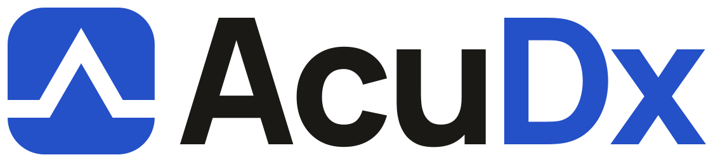
  </picture>
</p>

<h3 align="center">Simulated patients. Real decisions.</h3>

<p align="center">A source-available clinical reasoning simulator inside a real EHR, for health-professions education.</p>

<p align="center">
  <a href="https://github.com/ArioMoniri/acudx-simulation/actions/workflows/ci.yml"></a>
  
  
</p>

<br>

<p align="center">
  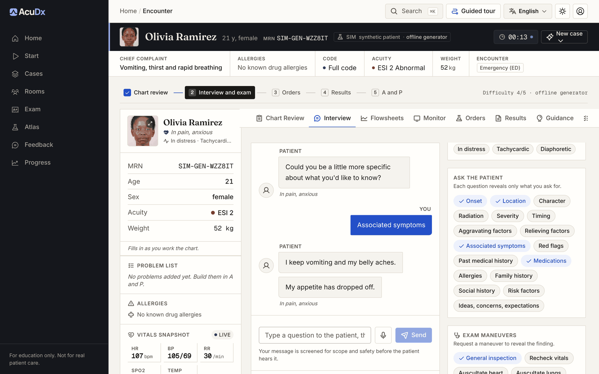
</p>

<p align="center"><sub>Education only. Synthetic patients. Not a medical device.</sub></p>

## Why AcuDx

Clinical reasoning is learned by doing: taking a history, choosing tests, reading results, treating and committing to a diagnosis under time pressure. AcuDx writes every case on request for the learner who asks; there is no case library, seed list or template. The opening streams in first and the chart opens on it, while history, exam, treatments and results are written for that patient as the learner works. The case keeps changing in flight: after every question, exam, order or treatment the Clinical Director steps the patient on the server (a shared course engine with guideline targets, harms and branches) and the vitals monitor and the patient's replies follow. It all happens inside an Epic-like chart, with an AI patient that answers only what is asked (in text, voice or a live video call), results that arrive on real turnaround timers, and a debrief whose clinical statements cite a verified guideline or say plainly that no verified source was found. It runs on open-weight models on an on-demand GPU worker, so a school can host it with zero third-party data egress.

## Features

<table>
  <tr>
    <td colspan="2" valign="top">
      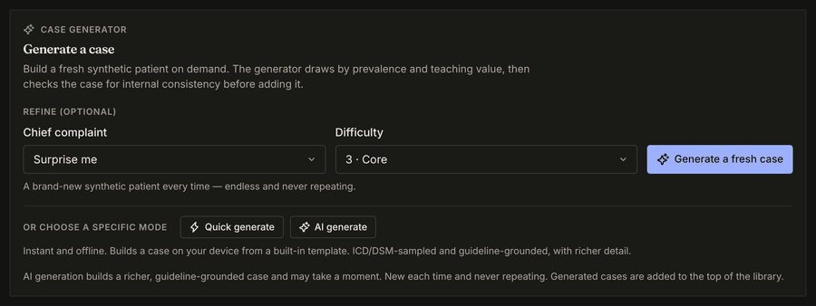
      <br><strong>Generated on request</strong>
      <br>Every case is written by the model when the learner asks. The opening (patient, complaint, triage) streams in first and the chart opens on it; each layer of history, exam, treatments and results is then written for that patient, behind deterministic and safety checks. The banner always says where the case came from.
    </td>
  </tr>
  <tr>
    <td width="50%" valign="top">
      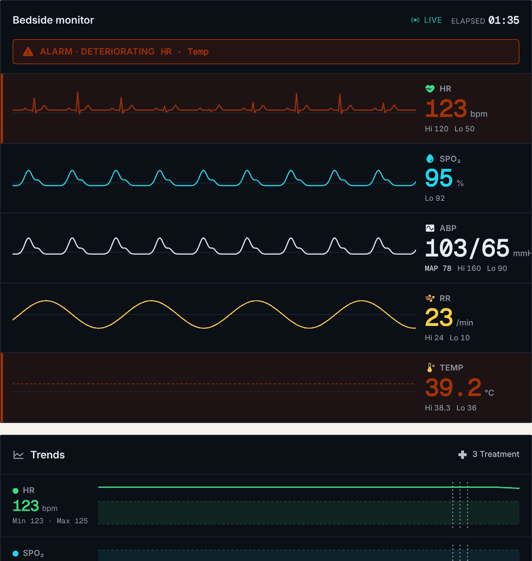
      <br><strong>Clinical Director</strong>
      <br>Every learner action is one Director step on the server. The course engine moves the vitals, fires or averts complications against guideline time targets, and the patient answers in character.
    </td>
    <td width="50%" valign="top">
      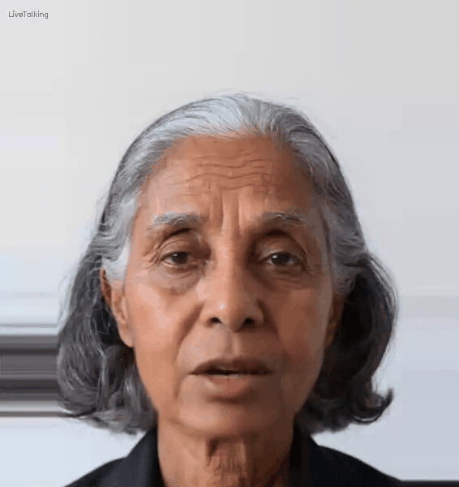
      <br><strong>Live video call</strong>
      <br>Talk to the patient face to face: a self-hosted LiveTalking and MuseTalk 1.5 runner on the GPU worker lip-syncs the patient's voice over WebRTC, or an optional Tavus adapter does it as a hosted service.
    </td>
  </tr>
  <tr>
    <td width="50%" valign="top">
      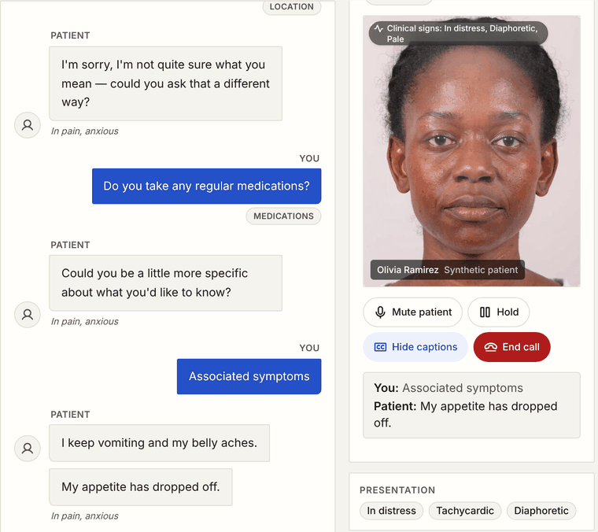
      <br><strong>Patient interview</strong>
      <br>Free text, voice or video. Each question is scope-screened and reveals only what was asked.
    </td>
    <td width="50%" valign="top">
      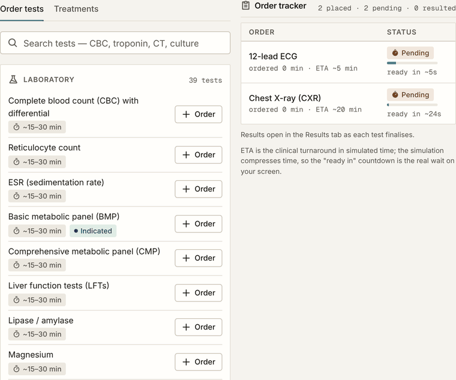
      <br><strong>Orders worklist</strong>
      <br>Labs, imaging, micro and point of care, with an order tracker showing status, ETA and countdown.
    </td>
  </tr>
  <tr>
    <td width="50%" valign="top">
      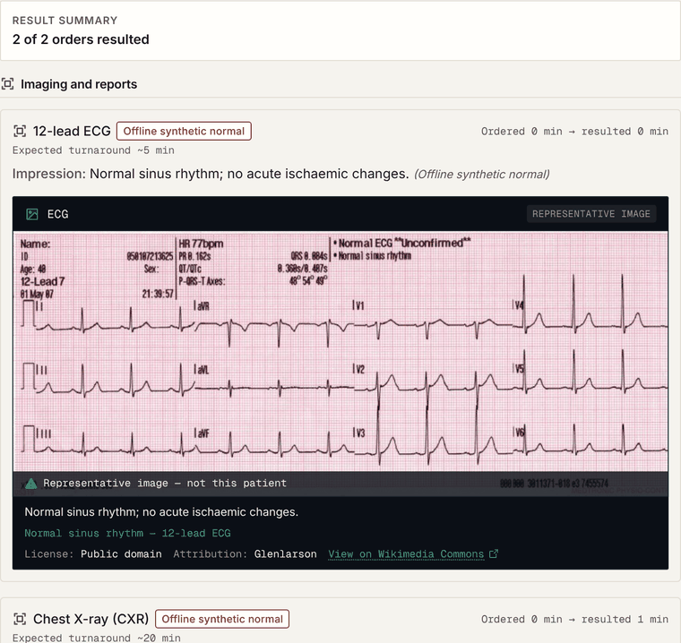
      <br><strong>Results and ECG</strong>
      <br>Sourced reference ranges, treatment-responsive kinetics and a 12-lead ECG; every value shows its provenance.
    </td>
    <td width="50%" valign="top">
      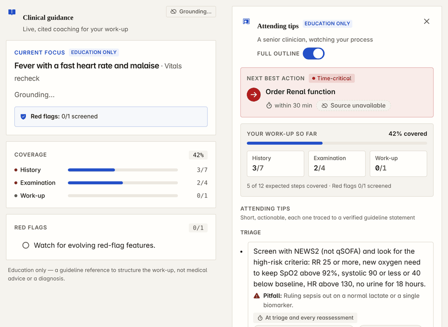
      <br><strong>Attending tips</strong>
      <br>Coaching traced to verified guideline statements. Unverified sources are shown as unavailable, never invented.
    </td>
  </tr>
  <tr>
    <td width="50%" valign="top">
      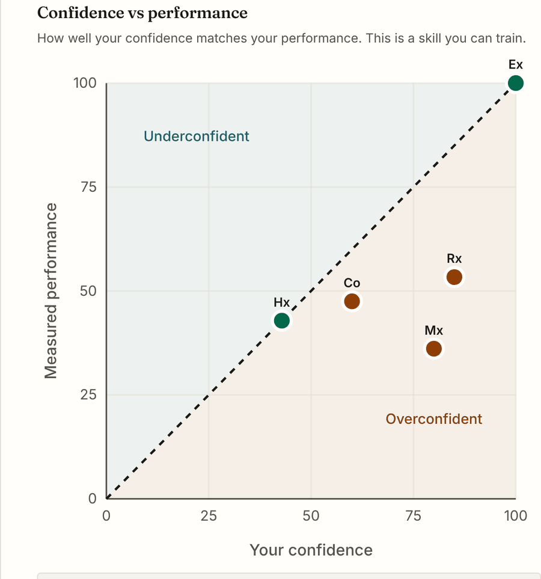
      <br><strong>Calibrated feedback</strong>
      <br>Attending debrief, competency bands and a calibration plot of confidence against measured performance.
    </td>
    <td width="50%" valign="top">
      <a href="video/out/walkthrough.mp4">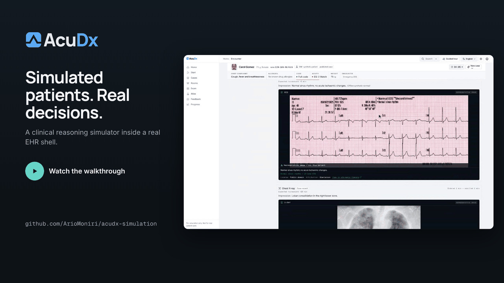</a>
      <br><strong>Walkthrough</strong>
      <br>The whole loop in a two-minute screen recording; see below.
    </td>
  </tr>
</table>

## See it in two minutes

<p align="center">
  <a href="video/out/walkthrough.mp4"></a>
</p>

A real screen recording of the running app, driven by [`video/scripts/record-walkthrough.mjs`](video/scripts/record-walkthrough.mjs) and cut in Remotion. The case is a recorded live model case (the same output the e2e suite replays) streamed in stages, and every other call is answered by a local gateway: profile, a fever case requested and generated, chart, interview, the live patient video call (spliced from a real capture of the MuseTalk worker), exam, orders, fluids, oxygen and an antibiotic, the Clinical Director moving the patient, results with the ECG, attending tips, diagnosis, feedback, then the admin telemetry and the dean panel. Also: [15 s teaser](video/out/teaser-v2.mp4), [square social cut](video/out/square.mp4). How it is made: [video/README.md](video/README.md).

## Quick start

Production, on a fresh Ubuntu host (Docker is installed when missing):

```bash
git clone https://github.com/ArioMoniri/acudx-simulation.git && cd acudx-simulation
sudo DOMAIN=sim.example.edu LAMBDA_SSH_KEY_NAME=<lambda key name> ./deploy/one-click.sh
# DOMAIN unset: <public-ip>.sslip.io. Caddy gets a Let's Encrypt certificate either way.
```

This starts Caddy, the web app, the gateway, the rooms relay, Keycloak and its Postgres
(`docker-compose.prod.yml`), creates one Keycloak account per role (`acudx-student`,
`acudx-resident`, `acudx-nurse`, `acudx-paramedic`, `acudx-faculty`, `acudx-dean`,
`acudx-admin`, `acudx-super-admin`) with random temporary passwords, and mints a single-use
retrieval code (72 h) for `https://<domain>/bootstrap/credentials`, which shows the accounts
once. Every secret is generated on the host and stays root-only under `/etc/acudx`. On AWS,
`deploy/aws/provision.sh` does all of it from your machine ([deploy/aws/README.md](deploy/aws/README.md)).
Operations (update, logs, backup, rotate the code): [deploy/RUNBOOK.md](deploy/RUNBOOK.md).

To use your own domain later, point its A record at the host and re-run
`sudo DOMAIN=sim.example.edu ./deploy/one-click.sh` (the realm redirect URIs and the TLS
certificate follow the new name).

Local development (web on 5173, gateway on 8890, rooms relay on 8899):

```bash
npm --prefix web install && npm --prefix web run dev
python -m venv .venv && . .venv/bin/activate && pip install -r server/requirements.txt && bash server/run.sh
cd multiplayer && npm install && npm start
```

Every learner case is generated on request by the model (owner decision): without a reachable model no case can start, and the app says so and offers Retry; no template, seed or curated case is ever served in its place. Results without the gateway fall back to a labelled offline value, and guidance shows "unavailable" rather than unverified text. The e2e suite replays recorded live model cases (`server/tests/fixtures/live`) instead of a gateway.

## How it works

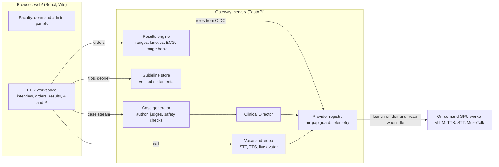

Design documents: [docs/architecture](docs/architecture) (00 to 13 are the blueprint; 14 [results](docs/architecture/14-results-and-imaging-engine.md), 15 [case generator and Director](docs/architecture/15-case-generator-v2-and-director.md), 16 [guideline store](docs/architecture/16-guideline-store-and-verification.md), 17 [provider registry](docs/architecture/17-provider-registry-admin-telemetry.md), 18 [voice and video](docs/architecture/18-voice-and-video-call.md) and 19 [identity and panels](docs/architecture/19-identity-roles-and-panels.md) describe what ships). Rooms for doctor, nurse and paramedic teams run over a WebSocket relay ([07](docs/architecture/07-multiplayer-rooms.md)).

## Panels

| Student | Faculty |
|---|---|
| 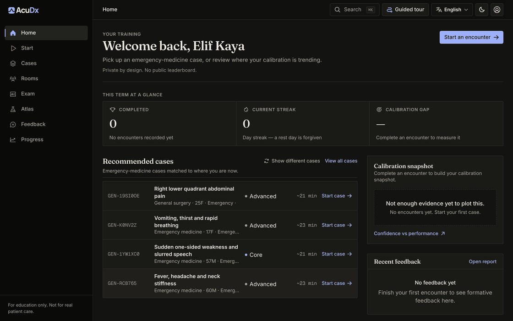 | 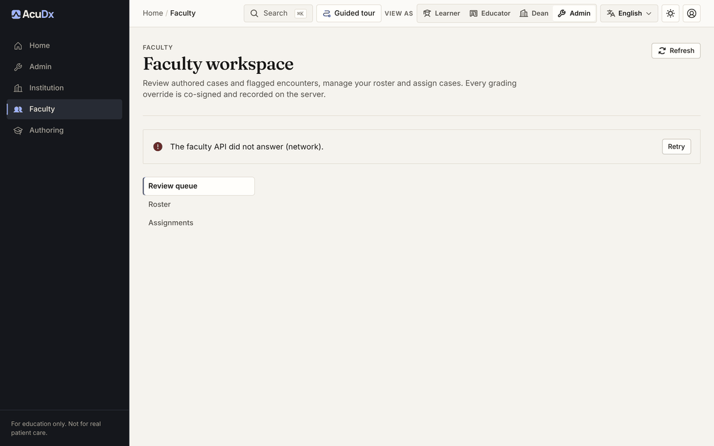 |
| Recommended cases, the term at a glance and a calibration snapshot. | Review queue, roster and assignments; every grading override is co-signed on the server. Offline it says the faculty API is unreachable. |
| **Dean** | **Admin** |
| 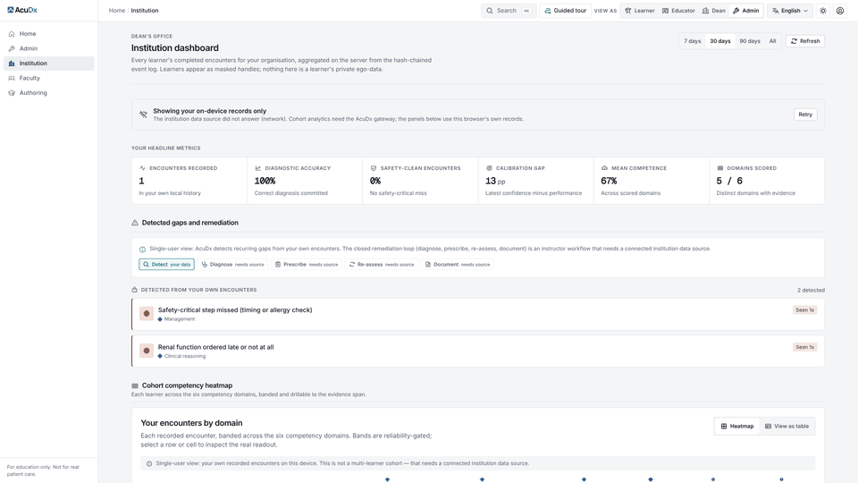 | 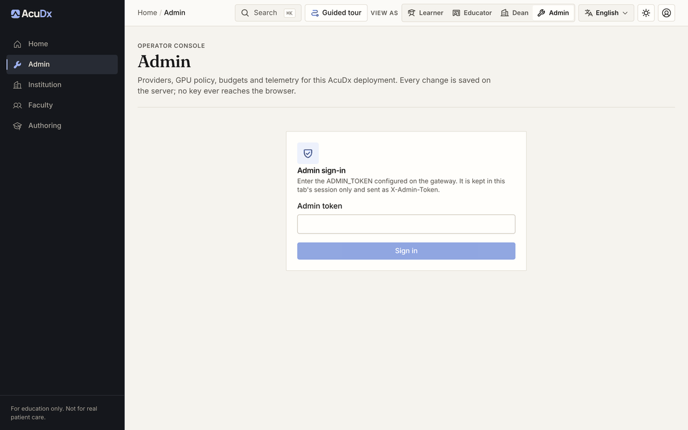 |
| Cohort analytics from the hash-chained event log, learners as masked handles. Offline it falls back to this browser's own records and labels them. | Providers, GPU policy, budgets and telemetry behind the `ADMIN_TOKEN` gate; keys are sealed server-side. |

## Configuration

1. **Admin console first** (`/admin`, needs `ADMIN_TOKEN`): model, voice, avatar, imaging, identity and GPU providers, GPU policy and budget, telemetry. Keys are sealed with `ACUDX_SECRET_KEY` and never reach the browser.
2. **Environment second**: only `ADMIN_TOKEN` is required to boot. `AIRGAPPED=true` (the default outside Compose) refuses every non-local endpoint before a socket opens. Every variable with its default is in [.env.example](.env.example) and [server/README.md](server/README.md).
3. **Identity**: `docker compose -f docker-compose.yml -f docker-compose.keycloak.yml up -d keycloak` starts a dev realm ([deploy/keycloak/README.md](deploy/keycloak/README.md)). With OIDC on, roles come from verified claims unioned with an admin-edited table; local profiles are for air-gapped use.
4. **Local mode is capped** (`AUTH_MODE=local`, the default): the role a local profile declares in the `X-User-Role` header is honoured only up to `resident`. Faculty, dean and admin panels need institution sign-in (a verified OIDC bearer) or the `ADMIN_TOKEN` entered in the admin console in the same browser tab; without either they answer 403 and the page says which role and what to do. Details in [docs/architecture/19](docs/architecture/19-identity-roles-and-panels.md) section 2.

## Testing

```bash
npm --prefix web run typecheck && npm --prefix web run lint && npm --prefix web test   # Vitest
python -m pip install -r server/requirements.txt -r server/requirements-dev.txt && python -m pytest server/tests -q
npm --prefix web run test:e2e   # Playwright at 390, 768, 1280 and 1920 px
```

CI runs the same three jobs ([.github/workflows/ci.yml](.github/workflows/ci.yml)). `scripts/watchdog.sh` fails a change that ships mock, placeholder or hardcoded data. Contributor rules (TDD loop, definition of done, handoff format): [docs/process/AGENT-PROTOCOL.md](docs/process/AGENT-PROTOCOL.md).

## Roadmap

Seven phases from substrate to evidence (psychometrics, a published eval set and a pilot with one school) are tracked in [docs/review/01, section 5](docs/review/01-multi-persona-review-and-roadmap-2026-10.md#5-roadmap).

## Status and limits

Shipped: the engines above, the redesigned EHR ([docs/design/03](docs/design/03-ui-redesign-2026-10.md)) and the round-two brand ([docs/design/02](docs/design/02-brand-identity.md)). Still needed from the owner: provider keys, a domain, the identity provider choice, clinician sign-off per condition family and a Turkish listening test. Known limits: the live video call needs a GPU worker (or a Tavus key), synthetic imaging offline only, no paediatric reference ranges, and some publisher guideline texts cannot be fetched headlessly. The full list is in [docs/build/REMAINING-AND-LIMITS.md](docs/build/REMAINING-AND-LIMITS.md); clinical content findings are in [docs/review/02](docs/review/02-clinical-content-review-2026-10.md).

## Contributing

Issues and pull requests are welcome. Start with [docs/process/AGENT-PROTOCOL.md](docs/process/AGENT-PROTOCOL.md): write the failing test first, keep the fast gate green, add EN and TR strings for any UI text, and cite a verified `GuidelineStatement` for any clinical fact. Contributions are accepted under the project licence below.

## License

AcuDx is **source-available, not open for business use**. It is licensed under the [PolyForm Noncommercial License 1.0.0](LICENSE): universities, teaching hospitals, students and researchers may use, modify and share it for noncommercial purposes. Any commercial use (selling it, hosting it as a paid service, or using it inside a business) needs a separate commercial license from the copyright holders (contact: ariorad@getvivax.com). Third-party components and bundled media keep their own licenses; see [NOTICE](NOTICE).

## Disclaimer

AcuDx is for education only. Every patient is synthetic, there is no path for real patient data, and nothing here is a medical device or a substitute for clinical judgement.
