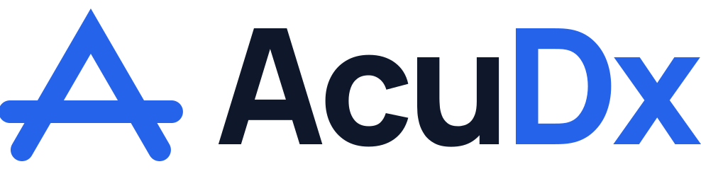
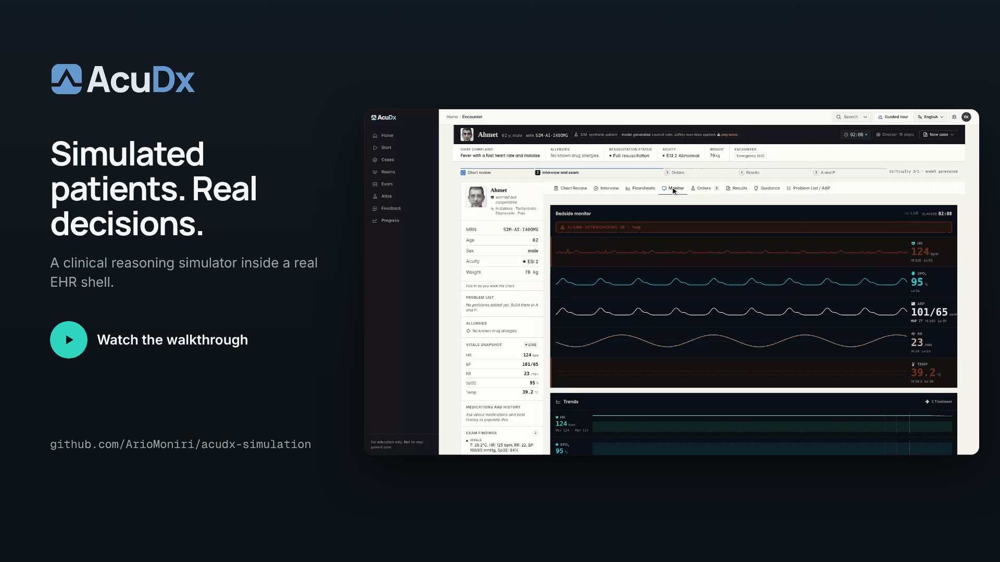
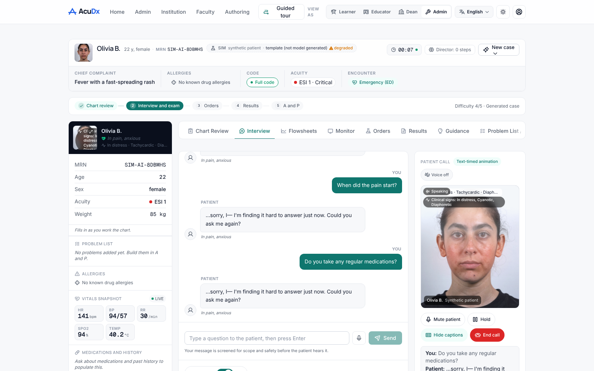
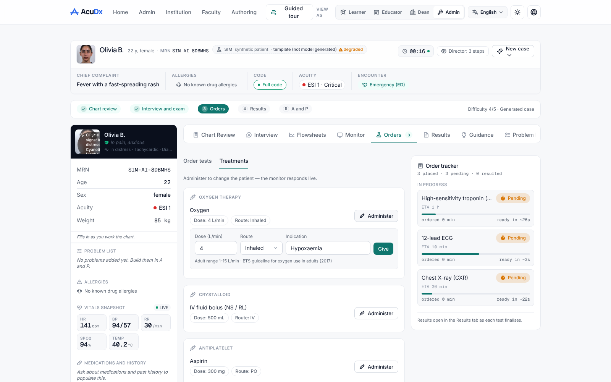
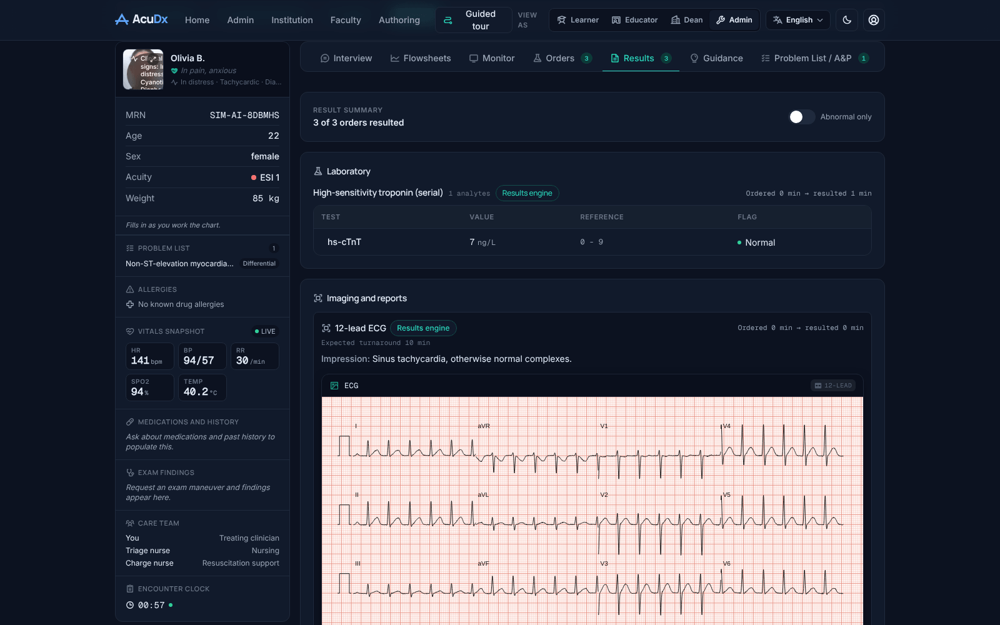
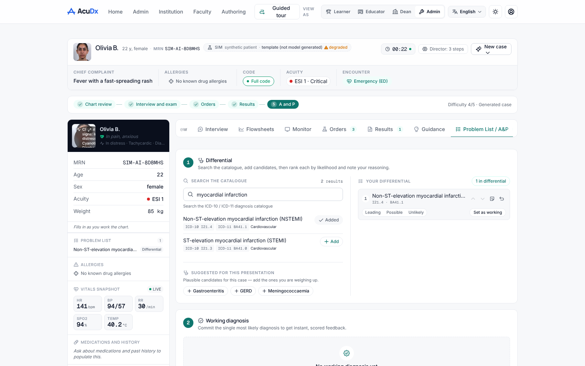
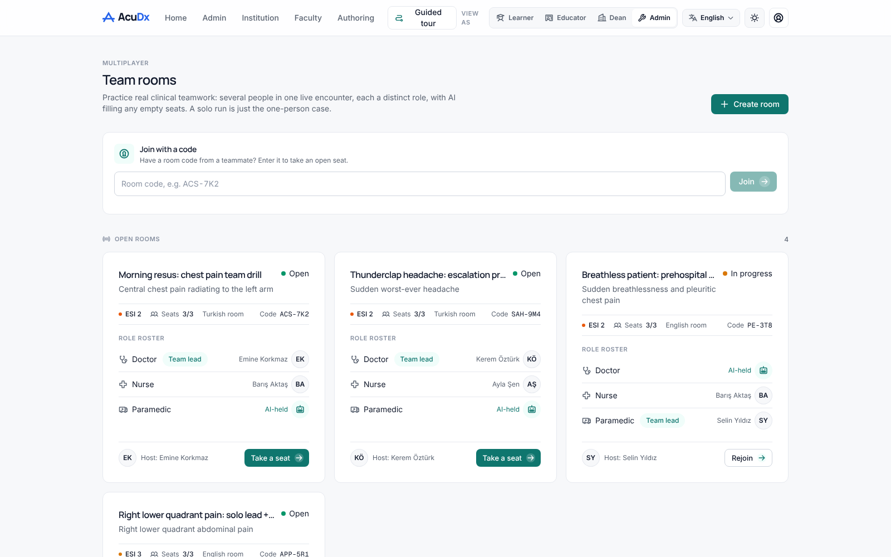
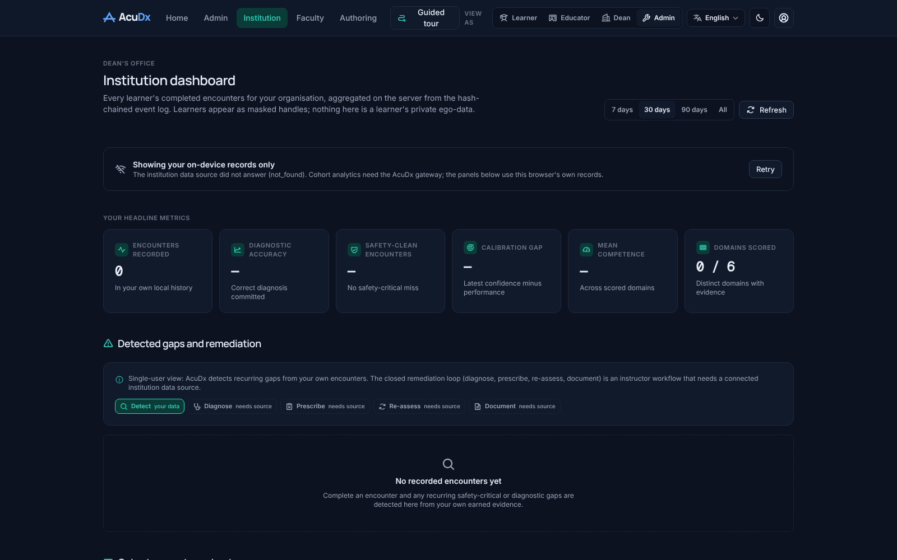
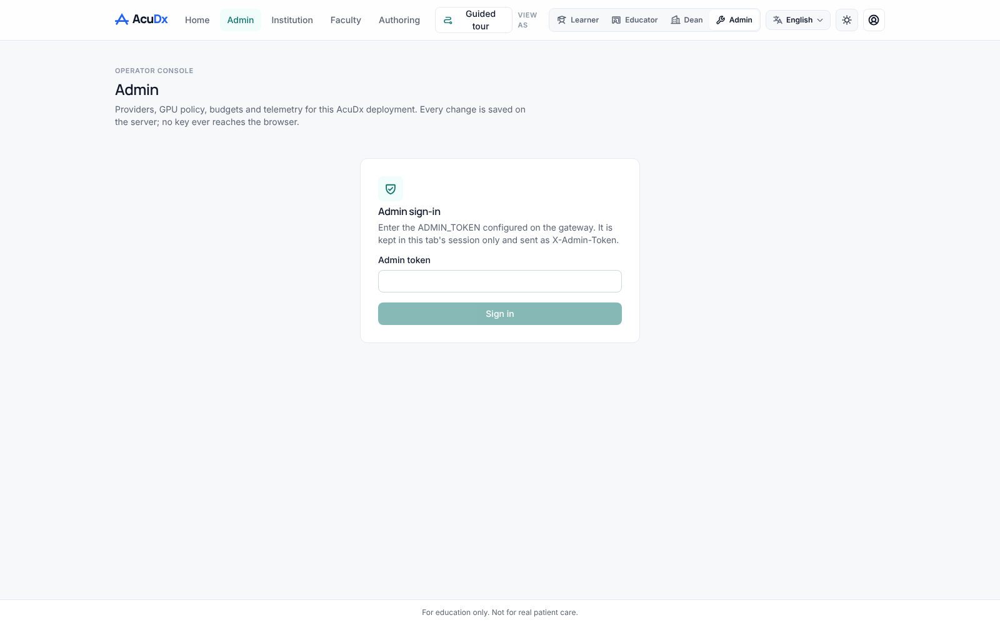
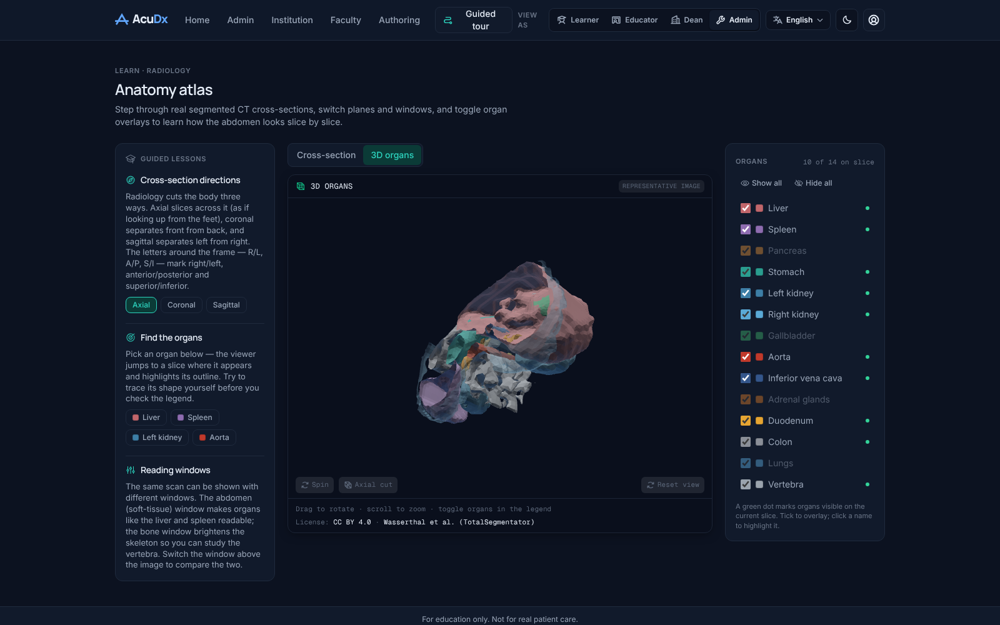

<p align="center">
  <picture>
    <source media="(prefers-color-scheme: dark)" srcset="web/public/brand/acudx-lockup-horizontal-dark.svg">
    
  </picture>
</p>

<p align="center">
  <a href="video/out/launch.mp4"></a>
</p>

<p align="center"><em>Education only. Synthetic patients. Not a medical device.</em></p>

AcuDx is an open-source clinical simulation platform for health-professions education. A learner works a generated emergency case inside an Epic-like EHR: interviews the AI patient by text, voice or video call, examines, orders tests, reads results and ECGs, treats, commits a diagnosis and gets a graded debrief whose every clinical statement cites a verified guideline. Teams practise the same case in interprofessional rooms (doctor, nurse, paramedic). Faculty, deans and admins have server-backed panels. The whole stack is open-weight and sovereign by default: it runs on an on-demand GPU worker with zero third-party egress, and hosted providers are opt-in from the admin console. UI is English and Turkish.

## What is real today

1. **Dynamic case generator with a judge council and Clinical Director.** LangGraph pipeline: author, three judges, deterministic high-stakes checks, repair; the Director adapts the live case to what the learner does. A case is returned only when a model authored it; the template path is labelled `meta.source = "template"`. [docs/architecture/15](docs/architecture/15-case-generator-v2-and-director.md)
2. **Results engine and synthesized 12-lead ECG.** Sourced reference ranges, time- and treatment-responsive kinetics (troponin, lactate, glucose, paracetamol), rule-authored ECG pathologies, a license-verified image bank with laterality guards. Every result carries provenance. [docs/architecture/14](docs/architecture/14-results-and-imaging-engine.md)
3. **Verified guideline citations and attending tips.** A GuidelineStatement store where a row is served only after the verifier found the supporting passage at the source URL; unverified rows are refused, not improvised. [docs/architecture/16](docs/architecture/16-guideline-store-and-verification.md)
4. **Voice and video patient call with provider switch.** Gateway-routed STT and TTS (Deepgram and ElevenLabs when keys exist, faster-whisper and Chatterbox on the GPU worker otherwise), LiveKit room with Simli or Anam avatar when configured, bundled talking head driven by the real audio when not. [docs/architecture/18](docs/architecture/18-voice-and-video-call.md)
5. **Interprofessional rooms.** Create a room, share a code, take a seat as doctor, nurse or paramedic; AI holds empty seats; orders hand off between roles over a WebSocket relay. [docs/architecture/07](docs/architecture/07-multiplayer-rooms.md)
6. **Admin, dean and faculty panels with OIDC roles.** Keycloak (or any OIDC issuer) verified server-side; roles from claims unioned with an admin-edited table; dean cohort analytics from the hash-chained event log; faculty review queue, assignments and grading override. [docs/architecture/19](docs/architecture/19-identity-roles-and-panels.md)
7. **Provider registry and per-call telemetry.** Every model, voice, video, imaging, identity and GPU provider is configured in the admin console and sealed server-side; every call is priced from a versioned table. [docs/architecture/17](docs/architecture/17-provider-registry-admin-telemetry.md)
8. **On-demand GPU worker and one-click deploy.** A Lambda Cloud worker (vLLM, TTS, STT) launches only when a request needs it and is reaped after an idle window under a daily budget. Docker Compose plus Caddy gives TLS from a domain name. [server/README.md](server/README.md), [deploy/](deploy/)

## Screenshots

Captured from the running app at 1600 x 1000 with no gateway attached (offline path, labelled as such). Dark variants sit next to each file in [docs/media/screens](docs/media/screens).

| | |
|---|---|
| **Interview with the patient call tile**<br> | **Orders with the dose form open**<br> |
| **Results with the ECG strip and provenance chips**<br> | **Problem list and differential**<br> |
| **Team rooms lobby**<br> | **Dean panel (on-device fallback without a gateway)**<br> |
| **Admin console token gate**<br> | **Anatomy atlas, 3D organs**<br> |

## Quick start

Production, on a fresh host with Docker and a DNS A record pointing at it:

```bash
git clone https://github.com/ArioMoniri/acudx-simulation.git && cd acudx-simulation
DOMAIN=sim.example.edu ./deploy/one-click.sh
# open https://sim.example.edu and paste ADMIN_TOKEN from .env into the Admin console
```

Local development (web on 5173, gateway on 8890, rooms relay on 8899):

```bash
npm --prefix web install && npm --prefix web run dev
python -m venv .venv && . .venv/bin/activate && pip install -r server/requirements.txt && bash server/run.sh
cd multiplayer && npm install && npm start
```

The web app runs without the gateway: cases come from the labelled on-device template, results from the labelled offline fallback, and guidance shows "unavailable" rather than unverified text.

## Configuration

1. **Admin console first** (`/admin`, needs `ADMIN_TOKEN`): model, voice, avatar, imaging, identity and GPU providers, GPU policy and budget, telemetry. Keys are sealed with `ACUDX_SECRET_KEY` and never reach the browser.
2. **Environment second**: only `ADMIN_TOKEN` is required to boot. `AIRGAPPED=true` (the default outside Compose) refuses every non-local endpoint before a socket opens. The full list with defaults is in [.env.example](.env.example) and [server/README.md](server/README.md).
3. **Identity**: `docker compose -f docker-compose.yml -f docker-compose.keycloak.yml up -d keycloak` starts a dev realm; see [deploy/keycloak/README.md](deploy/keycloak/README.md).

## Architecture

```
Browser (web/, React + Vite)                 Gateway (server/, FastAPI)                     Workers
 EHR workspace  --/v2/case/generate/stream-->  LangGraph case graph + judges + Director  --+
 Call tile      --/v1/voice/*, LiveKit------>  provider resolver (registry, air-gap guard)  +--> on-demand GPU worker
 Orders/Results --/v1/results/*------------->  results engine (ranges, kinetics, ECG, bank)  |    (vLLM, TTS, STT)
 Guidance       --/v1/guidelines/*, /v1/ground> verified GuidelineStatement store            |
 Panels         --/v1/dean/*, /v1/faculty/*-->  hash-chained event log, roles from OIDC      |
 Admin          --/admin/*------------------>  registry, GPU policy, telemetry (SQLite)   <-+
 Rooms          --ws relay (multiplayer/)----> snapshot bus, no clinical logic
```

Design docs live in [docs/architecture](docs/architecture) (00 to 13 are the blueprint, 14 to 19 describe the engines that ship). Process rules: [docs/process/AGENT-PROTOCOL.md](docs/process/AGENT-PROTOCOL.md). Brand: [docs/design/02-brand-identity.md](docs/design/02-brand-identity.md).

## Testing

```bash
npm --prefix web run typecheck && npm --prefix web run lint && npm --prefix web test   # Vitest
python -m pip install -r server/requirements.txt -r server/requirements-dev.txt && python -m pytest server/tests -q
npm --prefix web run test:e2e   # Playwright at 390, 768, 1280 and 1920 px; starts the dev server and relay itself
```

CI runs the same three jobs ([.github/workflows/ci.yml](.github/workflows/ci.yml)). `scripts/watchdog.sh` fails a change that ships mock, placeholder or hardcoded data.

## Status and limits

Shipped engines, what still needs owner input (provider keys, domain, identity provider choice, clinician sign-off per condition, Turkish listening test) and the honest limits (no MuseTalk runner yet, synthetic imaging offline only, no paediatric reference ranges, some publisher guideline texts not fetchable headlessly) are tracked in [docs/build/REMAINING-AND-LIMITS.md](docs/build/REMAINING-AND-LIMITS.md). Clinical content findings: [docs/review/02](docs/review/02-clinical-content-review-2026-10.md). Roadmap: [docs/review/01](docs/review/01-multi-persona-review-and-roadmap-2026-10.md).

## License and disclaimer

No LICENSE file is committed yet; the owner picks the licence before public release (the architecture assumes a permissive open-source licence, and every bundled asset is CC0, CC BY, CC BY-SA or SIL OFL with attribution recorded next to it).

AcuDx is for education only. Every patient is synthetic, there is no path for real patient data, and nothing here is a medical device or a substitute for clinical judgement. Turkish UI strings live in `web/src/i18n`; project documentation is in English.
