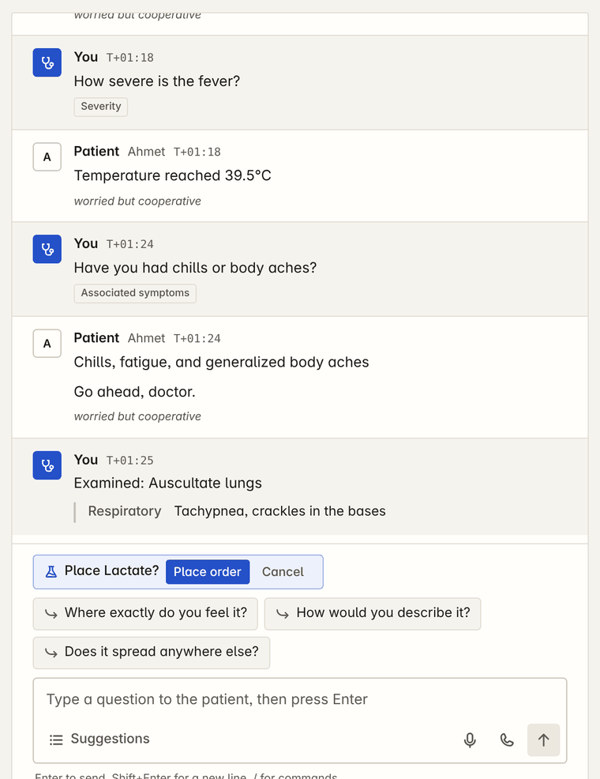
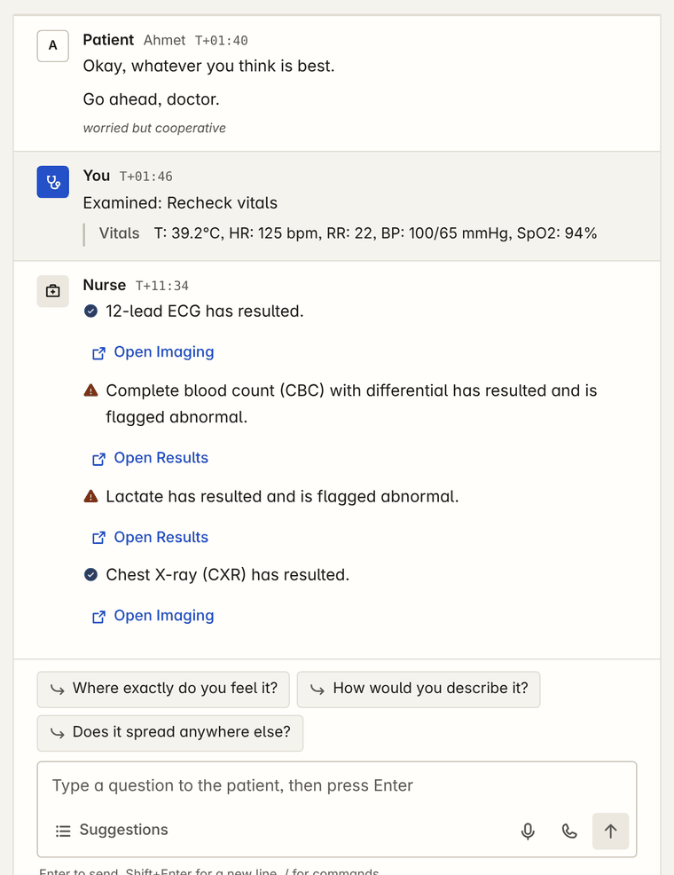
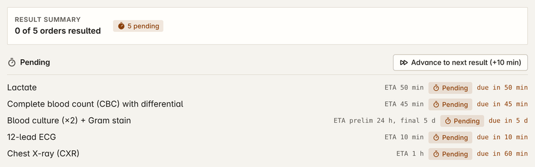
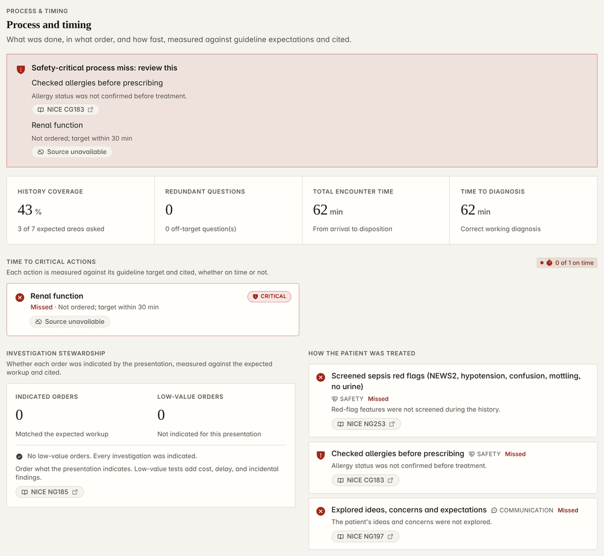
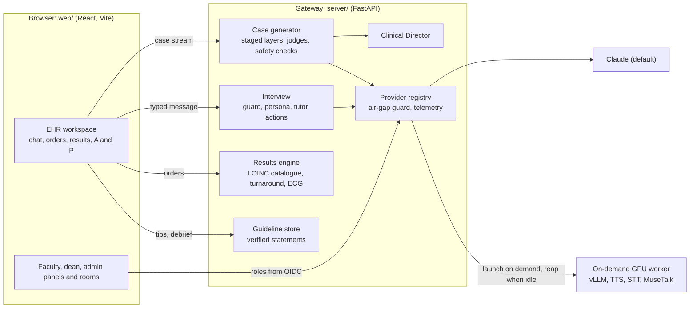
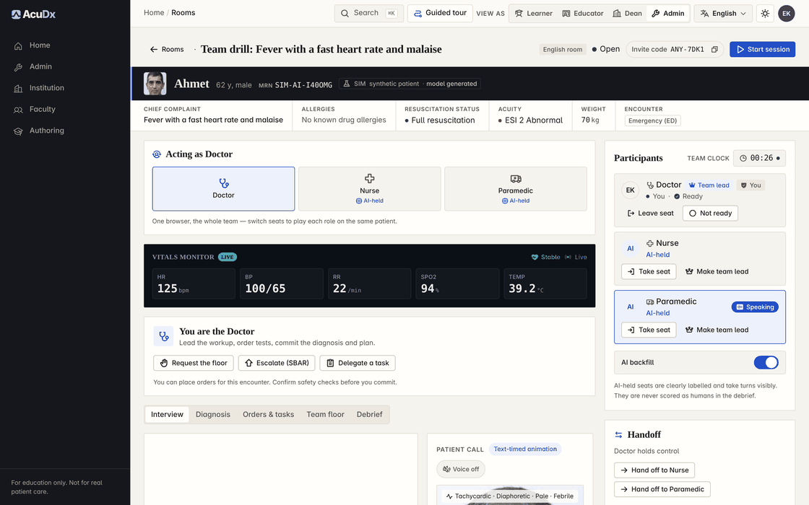

<p align="center">
  <picture>
    <source media="(prefers-color-scheme: dark)" srcset="docs/media/readme/lockup-dark.svg">
    <source media="(prefers-color-scheme: light)" srcset="docs/media/readme/lockup-light.svg">
    
  </picture>
</p>

<h3 align="center">Simulated patients. Real decisions.</h3>

<p align="center">A source-available clinical reasoning simulator inside a real EHR, for health-professions education.</p>

<p align="center">
  <a href="https://github.com/ArioMoniri/acudx-simulation/actions/workflows/ci.yml"></a>
  
  
</p>

<br>

<p align="center">
  
</p>

<p align="center"><sub>Education only. Synthetic patients. Not a medical device.</sub></p>

## In short

- **Every case is written on request** for the learner who asks. No case library, seed or template. The opening streams in first; history, exam, treatments and results are written for that patient while the learner works.
- **Claude is the default model** (set `ANTHROPIC_KEY`). Every role can instead run on open-weight models on an on-demand GPU worker, and `AIRGAPPED=true` keeps all traffic local.
- **A real EHR loop**: typed interview with in-chat order and navigate chips, LOINC orders on clinical turnaround, a Clinical Director that moves the patient after every action, a cited debrief and a calibration plot.
- **One command to deploy** on AWS or any Ubuntu host, with HTTPS on `<ip>.sslip.io` until you bring a domain, one account per role and a single-use credentials page.

## See it

<p align="center">
  <a href="video/out/launch.mp4"></a>
</p>

[Full walkthrough (MP4, about 2 min)](video/out/launch.mp4) · [15 s teaser (MP4)](video/out/teaser.mp4) · [how the films are made](video/README.md)

A screen recording of the running app against a local gateway with no model endpoint. The case is a recorded live model case (Qwen3-14B, acceptance run of 2026-10-20, `server/tests/fixtures/live`) replayed as the staged stream; its banner shows the run's own council note ("degraded"). Without a model, the patient's replies come from that recorded case through the offline path. The video call chapter is spliced from a real capture of the MuseTalk worker. The live Claude acceptance (case, interview, debrief) is in [docs/review/10](docs/review/10-live-claude-acceptance.md).

## Features

<table>
  <tr>
    <td colspan="2" valign="top">
      
      <br><strong>Generated on request</strong>
      <br>The opening (patient, complaint, triage) streams in first and the chart opens on it. Each layer is then written for that patient behind deterministic and safety checks. The banner always says where the case came from.
    </td>
  </tr>
  <tr>
    <td width="50%" valign="top">
      
      <br><strong>Chat that answers what you type</strong>
      <br>One send path for typed text, suggestions and chips. <code>/order</code>, <code>/exam</code> and <code>/go</code> work from the composer; an order chip confirms inside the line. Exam manoeuvres sit in the Suggestions drawer.
    </td>
    <td width="50%" valign="top">
      
      <br><strong>Results called in on the chat</strong>
      <br>The nurse calls each result in, flagged normal, abnormal or critical, with a button that opens it in Results. With a model, the reply's own order, navigate and ask chips render under it.
    </td>
  </tr>
  <tr>
    <td width="50%" valign="top">
      
      <br><strong>Orders on clinical turnaround</strong>
      <br>105 LOINC lab orderables and 43 imaging procedures. Stat chemistry about 50 min, CT about 4 h, cultures 24 h preliminary and 2 to 5 days final, all in simulation time.
    </td>
    <td width="50%" valign="top">
      
      
      <br><strong>Pending, then resulted</strong>
      <br>Results stay pending until due; "Advance to next result" moves the sim clock and steps the Director by the same time. Every value shows its range and provenance.
    </td>
  </tr>
  <tr>
    <td width="50%" valign="top">
      
      <br><strong>Clinical Director</strong>
      <br>Every question, exam, order and treatment is one Director step on the server. The course engine moves the vitals and fires or averts complications against guideline time targets.
    </td>
    <td width="50%" valign="top">
      
      <br><strong>Live video call, on-prem by default</strong>
      <br>A self-hosted LiveTalking and MuseTalk 1.5 runner on the GPU worker lip-syncs the patient's voice over WebRTC. Tavus is an optional hosted adapter.
    </td>
  </tr>
  <tr>
    <td width="50%" valign="top">
      
      <br><strong>Debrief with citations</strong>
      <br>Each process check is measured against a guideline target and cites it (here NICE NG253, CG183, NG185, NG197). A check with no verified source says "Source unavailable" instead of inventing one.
    </td>
    <td width="50%" valign="top">
      
      <br><strong>Calibrated feedback</strong>
      <br>Competency bands and a calibration plot of confidence against measured performance. No hidden score, no leaderboard.
    </td>
  </tr>
  <tr>
    <td width="50%" valign="top">
      
      <br><strong>Attending tips</strong>
      <br>Coaching traced to 172 verified guideline statements. Unverified sources show as unavailable, never as text.
    </td>
    <td width="50%" valign="top">
      <a href="video/out/launch.mp4"></a>
      <br><strong>Walkthrough</strong>
      <br>The whole loop in about two minutes, from profile to rooms.
    </td>
  </tr>
</table>

## Quick start

**AWS** (one EC2 web host; GPU workers stay on Lambda Cloud, launched on demand):

```bash
export AWS_REGION=eu-central-1 SSH_CIDR="$(curl -fsS https://checkip.amazonaws.com)/32"
deploy/aws/provision.sh        # DRY_RUN=1 first; LAMBDA_KEY and ANTHROPIC_KEY are read from the environment (deploy/aws/README.md)
```

**Any Ubuntu host** (Docker is installed when missing):

```bash
git clone https://github.com/ArioMoniri/acudx-simulation.git && cd acudx-simulation
sudo LAMBDA_SSH_KEY_NAME=<lambda key name> ./deploy/one-click.sh
```

- **Claude key**: put it in `/etc/acudx/anthropic.key` (mode 600) before running, or export `ANTHROPIC_KEY` for `provision.sh`, which delivers it to that file. Never on a command line.

- **HTTPS without a domain**: with `DOMAIN` unset the site is `https://<public-ip>.sslip.io` with a Let's Encrypt certificate. Point a domain's A record at the host and re-run with `DOMAIN=sim.example.edu`; the realm redirect URIs and the certificate follow.
- **Roles and credentials**: one Keycloak account per role (`acudx-student`, `-resident`, `-nurse`, `-paramedic`, `-faculty`, `-dean`, `-admin`, `-super-admin`) with random temporary passwords. A single-use retrieval code (72 h) opens `https://<host>/bootstrap/credentials`, which shows them once. Secrets stay root-only under `/etc/acudx`.
- **Operations** (update, logs, backup, rotate the code): [deploy/RUNBOOK.md](deploy/RUNBOOK.md).

**Local development** (web on 5173, gateway on 8890, rooms relay on 8899):

```bash
npm --prefix web install && npm --prefix web run dev
python -m venv .venv && . .venv/bin/activate && pip install -r server/requirements.txt && bash server/run.sh   # ANTHROPIC_KEY in the environment
cd multiplayer && npm install && npm start
```

Without a reachable model no case can start: the app says so and offers Retry; no template or seed is served in its place. The e2e suite replays recorded live model cases (`server/tests/fixtures/live`).

## Models and providers

| Role | Default (Claude) | Alternative |
|---|---|---|
| Case author, repair, persona, debrief | `claude-opus-5-5` | open-weight model (vLLM) on the GPU worker |
| Guard classifier | `claude-haiku-5-5` | rules plus local model |
| Tutor, narrator, renderings, grounding, judges | `claude-sonnet-5-5` (judges mix sonnet, opus and haiku) | local model |
| Voice | Kokoro or Chatterbox on the GPU worker | ElevenLabs, Aura-2 |
| Live video | LiveTalking and MuseTalk 1.5 on the GPU worker | Tavus |

Every provider is set in the admin console and persisted server-side; keys are sealed with `ACUDX_SECRET_KEY` and never reach the browser. If the Claude key is missing, routing falls back to the next enabled provider and the admin console says why. Live acceptance of the Claude route (guard macro F1 0.986, opening in 6.5 s, cost per case): [docs/review/10](docs/review/10-live-claude-acceptance.md).

## Catalogues

| Catalogue | Count | Licence |
|---|---|---|
| Lab orderables (18 sections) and analytes with sourced ranges | 105 orderables, 189 analytes | LOINC 2.82 codes, LOINC licence (verified, 244 codes, 0 failures) |
| Imaging procedures | 43 | LOINC radiology codes; RSNA Playbook attributes linked, not copied |
| Diagnoses, ICD-10-CM FY2027 | 98,403 codes (74,879 billable) | Public domain (CDC/NCHS) |
| Diagnoses, ICD-11 MMS 2026-01 | 35,664 entities | CC BY-ND 3.0 IGO (WHO), unmodified |
| Conditions with course models | 163 | AcuDx |
| Verified guideline statements | 172 | short quotations, publishers' terms |
| Imaging bank | 49 entries | each entry's own licence (CC0, PD, CC BY, CC BY-SA) |

Sources, checksums and licences: [data/terminology/MANIFEST.json](data/terminology/MANIFEST.json) and [NOTICE](NOTICE).

## How it works



Design documents: [docs/architecture](docs/architecture) (14 results, 15 case generator and Director, 16 guideline store, 17 provider registry, 18 voice and video, 19 identity and panels, 20 chat contract), [docs/design/05](docs/design/05-chat.md) (chat) and [06](docs/design/06-renewal-2.md) (renewal).

## Panels

| Student | Faculty |
|---|---|
|  |  |
| Recommended presentations, the term at a glance and a calibration snapshot. | Review queue, roster and assignments; every grading override is co-signed on the server. |
| **Dean** | **Admin** |
|  |  |
| Cohort analytics from the hash-chained event log, learners as masked handles. | Providers, GPU policy, budgets and telemetry behind `ADMIN_TOKEN`. This local run had no model endpoint, so its model calls count as errors. |
| **Rooms** | |
|  | Doctor, nurse and paramedic share one case over a WebSocket relay; AI-held seats are labelled and never scored as humans. |

## Configuration

1. **Admin console first** (`/admin`, needs `ADMIN_TOKEN`): model, voice, avatar, imaging, identity and GPU providers, GPU policy and budget, telemetry.
2. **Environment second**: only `ADMIN_TOKEN` is required to boot. `ANTHROPIC_KEY` enables the Claude route. `AIRGAPPED=true` (the default outside Compose) refuses every non-local endpoint before a socket opens. Every variable: [.env.example](.env.example), [server/README.md](server/README.md).
3. **Identity**: production uses the bundled Keycloak realm; roles come from verified claims unioned with an admin-edited table ([deploy/keycloak/README.md](deploy/keycloak/README.md)).
4. **Local mode is capped** (`AUTH_MODE=local`): a local profile's role is honoured only up to `resident`. Faculty, dean and admin panels need a verified OIDC sign-in or the `ADMIN_TOKEN` in the same tab ([docs/architecture/19](docs/architecture/19-identity-roles-and-panels.md) section 2).

## Testing

```bash
npm --prefix web run typecheck && npm --prefix web run lint && npm --prefix web test   # Vitest
python -m pip install -r server/requirements.txt -r server/requirements-dev.txt && python -m pytest server/tests -q
npm --prefix web run test:e2e   # Playwright at 390, 768, 1280 and 1920 px
```

CI runs the same jobs ([.github/workflows/ci.yml](.github/workflows/ci.yml)). `scripts/watchdog.sh` fails a change that ships mock, placeholder or hardcoded data. Contributor rules: [docs/process/AGENT-PROTOCOL.md](docs/process/AGENT-PROTOCOL.md). README media: `scripts/design/capture-readme.mjs` and `readme-media.py`; films: [video/README.md](video/README.md).

## Roadmap, status and limits

Phases from substrate to evidence (psychometrics, a published eval set, a pilot with one school): [docs/review/01](docs/review/01-multi-persona-review-and-roadmap-2026-10.md#5-roadmap). Still needed from the owner: clinician sign-off per condition family and a Turkish listening test. Known limits: the live video call needs a GPU worker (or a Tavus key), no paediatric reference ranges, some publisher guideline texts cannot be fetched headlessly. Full list: [docs/build/REMAINING-AND-LIMITS.md](docs/build/REMAINING-AND-LIMITS.md).

## Contributing

Issues and pull requests are welcome. Start with [docs/process/AGENT-PROTOCOL.md](docs/process/AGENT-PROTOCOL.md): write the failing test first, keep the fast gate green, add EN and TR strings for any UI text, and cite a verified `GuidelineStatement` for any clinical fact. Contributions are accepted under the project licence below.

## License

AcuDx is **source-available, not open for business use**. It is licensed under the [PolyForm Noncommercial License 1.0.0](LICENSE): universities, teaching hospitals, students and researchers may use, modify and share it for noncommercial purposes. Any commercial use (selling it, hosting it as a paid service, or using it inside a business) needs a separate commercial license from the copyright holders (contact: ariorad@getvivax.com). Third-party components, terminologies and bundled media keep their own licenses; see [NOTICE](NOTICE).

## Disclaimer

AcuDx is for education only. Every patient is synthetic, there is no path for real patient data, and nothing here is a medical device or a substitute for clinical judgement.
