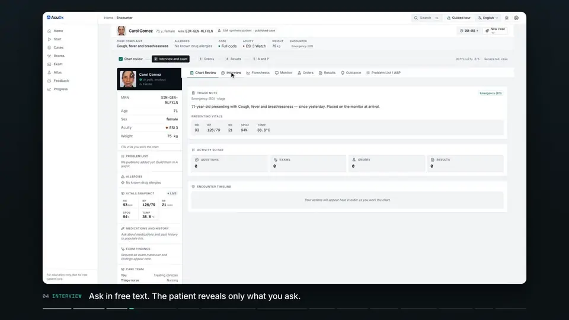
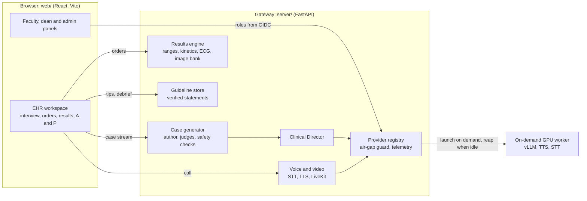

<p align="center">
  <picture>
    <source media="(prefers-color-scheme: dark)" srcset="web/public/brand/acudx-lockup-horizontal-dark.svg">
    
  </picture>
</p>

<p align="center"><strong>Simulated patients. Real decisions.</strong><br>An open-source clinical reasoning simulator inside a real EHR, for health-professions education.</p>

<p align="center">
  <a href="https://github.com/ArioMoniri/acudx-simulation/actions/workflows/ci.yml"></a>
  
  
</p>

<p align="center">
  
</p>

<p align="center"><sub>Education only. Synthetic patients. Not a medical device.</sub></p>

## Why AcuDx

Clinical reasoning is learned by doing: taking a history, choosing tests, reading results, treating and committing to a diagnosis under time pressure. AcuDx gives every learner an endless supply of generated emergency cases inside an Epic-like chart, with an AI patient that answers only what is asked, results that arrive on real turnaround timers, and a debrief whose clinical statements cite a verified guideline or say plainly that no verified source was found. It runs on open-weight models on an on-demand GPU worker, so a school can host it with zero third-party data egress.

## Features

<table>
  <tr>
    <td width="33%" valign="top">
      
      <br><strong>Case generator</strong>
      <br>LangGraph author, three judges and deterministic safety checks; a Clinical Director adapts the live case.
    </td>
    <td width="33%" valign="top">
      
      <br><strong>Patient interview</strong>
      <br>Free text, voice or video call. Each question is scope-screened and reveals only what was asked.
    </td>
    <td width="33%" valign="top">
      
      <br><strong>Orders worklist</strong>
      <br>Labs, imaging, micro and point of care, with an order tracker showing status, ETA and countdown.
    </td>
  </tr>
  <tr>
    <td width="33%" valign="top">
      
      <br><strong>Results and ECG</strong>
      <br>Sourced reference ranges, treatment-responsive kinetics and a 12-lead ECG; every value shows its provenance.
    </td>
    <td width="33%" valign="top">
      
      <br><strong>Attending tips</strong>
      <br>Coaching traced to verified guideline statements. Unverified sources are shown as unavailable, never invented.
    </td>
    <td width="33%" valign="top">
      
      <br><strong>Calibrated feedback</strong>
      <br>Attending debrief, competency bands and a calibration plot of confidence against measured performance.
    </td>
  </tr>
</table>

## See it in 90 seconds

<p align="center">
  <a href="video/out/walkthrough.mp4"></a>
</p>

A real screen recording of the running app, driven by [`video/scripts/record-walkthrough.mjs`](video/scripts/record-walkthrough.mjs) and cut in Remotion: profile, a fever case, chart review, interview, exam, six orders, results with the ECG, attending tips, paracetamol through the dose form, diagnosis, feedback, then the dean panel, the admin token gate and the 3D atlas. Also: [15 s teaser](video/out/teaser-v2.mp4), [square social cut](video/out/square.mp4). How it is made: [video/README.md](video/README.md).

## Quick start

Production, on a fresh host with Docker and a DNS A record pointing at it:

```bash
git clone https://github.com/ArioMoniri/acudx-simulation.git && cd acudx-simulation
DOMAIN=sim.example.edu ./deploy/one-click.sh
# open https://sim.example.edu and paste ADMIN_TOKEN from .env into the Admin console
```

Local development (web on 5173, gateway on 8890, rooms relay on 8899):

```bash
npm --prefix web install && npm --prefix web run dev
python -m venv .venv && . .venv/bin/activate && pip install -r server/requirements.txt && bash server/run.sh
cd multiplayer && npm install && npm start
```

The web app also runs without the gateway: cases come from the labelled on-device template, results from the labelled offline fallback, and guidance shows "unavailable" rather than unverified text. The walkthrough above was recorded on exactly that path.

## How it works



Design documents: [docs/architecture](docs/architecture) (00 to 13 are the blueprint; 14 [results](docs/architecture/14-results-and-imaging-engine.md), 15 [case generator and Director](docs/architecture/15-case-generator-v2-and-director.md), 16 [guideline store](docs/architecture/16-guideline-store-and-verification.md), 17 [provider registry](docs/architecture/17-provider-registry-admin-telemetry.md), 18 [voice and video](docs/architecture/18-voice-and-video-call.md) and 19 [identity and panels](docs/architecture/19-identity-roles-and-panels.md) describe what ships). Rooms for doctor, nurse and paramedic teams run over a WebSocket relay ([07](docs/architecture/07-multiplayer-rooms.md)).

## Panels

| Student | Faculty |
|---|---|
|  |  |
| Recommended cases, the term at a glance and a calibration snapshot. | Review queue, roster and assignments; every grading override is co-signed on the server. Offline it says the faculty API is unreachable. |
| **Dean** | **Admin** |
|  |  |
| Cohort analytics from the hash-chained event log, learners as masked handles. Offline it falls back to this browser's own records and labels them. | Providers, GPU policy, budgets and telemetry behind the `ADMIN_TOKEN` gate; keys are sealed server-side. |

## Configuration

1. **Admin console first** (`/admin`, needs `ADMIN_TOKEN`): model, voice, avatar, imaging, identity and GPU providers, GPU policy and budget, telemetry. Keys are sealed with `ACUDX_SECRET_KEY` and never reach the browser.
2. **Environment second**: only `ADMIN_TOKEN` is required to boot. `AIRGAPPED=true` (the default outside Compose) refuses every non-local endpoint before a socket opens. Every variable with its default is in [.env.example](.env.example) and [server/README.md](server/README.md).
3. **Identity**: `docker compose -f docker-compose.yml -f docker-compose.keycloak.yml up -d keycloak` starts a dev realm ([deploy/keycloak/README.md](deploy/keycloak/README.md)). With OIDC on, roles come from verified claims unioned with an admin-edited table; local profiles are for air-gapped use.
4. **Local mode is capped** (`AUTH_MODE=local`, the default): the role a local profile declares in the `X-User-Role` header is honoured only up to `resident`. Faculty, dean and admin panels need institution sign-in (a verified OIDC bearer) or the `ADMIN_TOKEN` entered in the admin console in the same browser tab; without either they answer 403 and the page says which role and what to do. Details in [docs/architecture/19](docs/architecture/19-identity-roles-and-panels.md) section 2.

## Testing

```bash
npm --prefix web run typecheck && npm --prefix web run lint && npm --prefix web test   # Vitest
python -m pip install -r server/requirements.txt -r server/requirements-dev.txt && python -m pytest server/tests -q
npm --prefix web run test:e2e   # Playwright at 390, 768, 1280 and 1920 px
```

CI runs the same three jobs ([.github/workflows/ci.yml](.github/workflows/ci.yml)). `scripts/watchdog.sh` fails a change that ships mock, placeholder or hardcoded data. Contributor rules (TDD loop, definition of done, handoff format): [docs/process/AGENT-PROTOCOL.md](docs/process/AGENT-PROTOCOL.md).

## Roadmap

Seven phases from substrate to evidence (psychometrics, a published eval set and a pilot with one school) are tracked in [docs/review/01, section 5](docs/review/01-multi-persona-review-and-roadmap-2026-10.md#5-roadmap).

## Status and limits

Shipped: the engines above, the redesigned EHR ([docs/design/03](docs/design/03-ui-redesign-2026-10.md)) and the round-two brand ([docs/design/02](docs/design/02-brand-identity.md)). Still needed from the owner: provider keys, a domain, the identity provider choice, clinician sign-off per condition family and a Turkish listening test. Known limits: no MuseTalk runner yet, synthetic imaging offline only, no paediatric reference ranges, and some publisher guideline texts cannot be fetched headlessly. The full list is in [docs/build/REMAINING-AND-LIMITS.md](docs/build/REMAINING-AND-LIMITS.md); clinical content findings are in [docs/review/02](docs/review/02-clinical-content-review-2026-10.md).

## Contributing

Issues and pull requests are welcome. Start with [docs/process/AGENT-PROTOCOL.md](docs/process/AGENT-PROTOCOL.md): write the failing test first, keep the fast gate green, add EN and TR strings for any UI text, and cite a verified `GuidelineStatement` for any clinical fact. No licence file is committed yet; the owner picks the licence before public release, and every bundled asset is CC0, CC BY, CC BY-SA or SIL OFL with its attribution recorded next to it.

## Disclaimer

AcuDx is for education only. Every patient is synthetic, there is no path for real patient data, and nothing here is a medical device or a substitute for clinical judgement.
