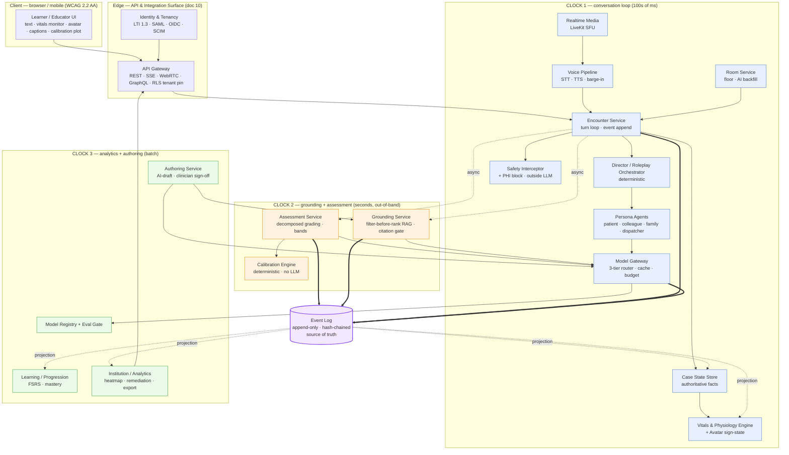
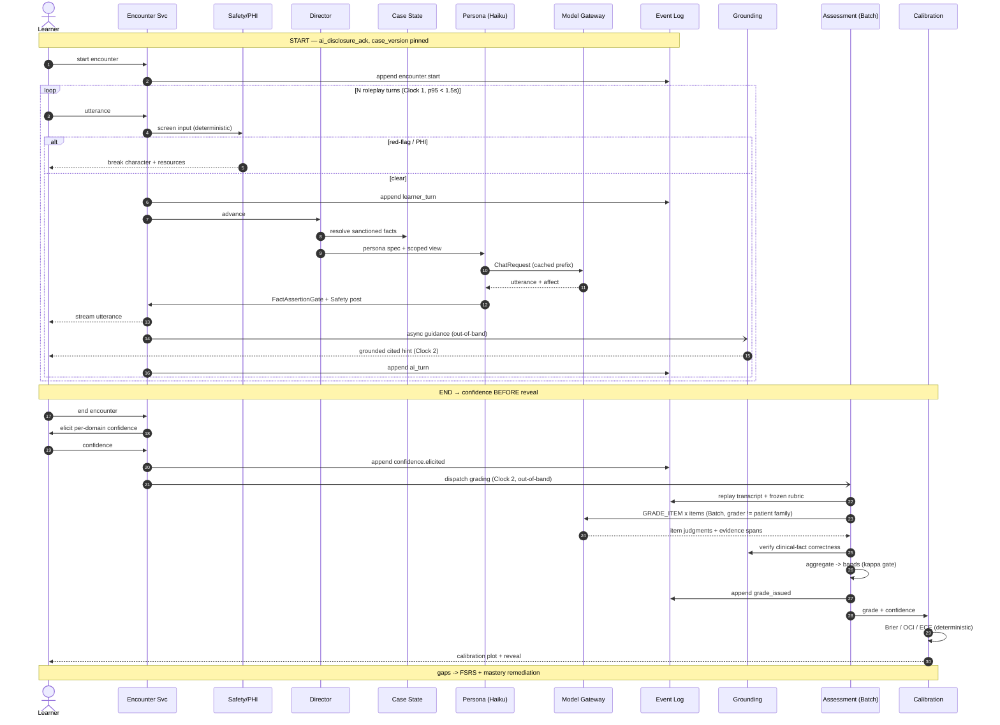
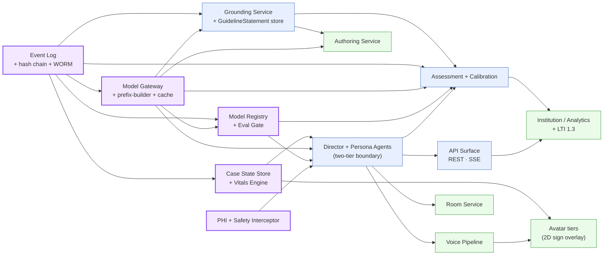

# 02 — Architecture Overview (Integrated Synthesis)

**Status:** Capstone synthesis. This is the single navigable map that ties the **eleven** architecture documents (`00`–`10`) together. It restates no derivations — it *routes*. Every claim here is owned in detail by a linked doc; where this overview and a service doc disagree, **the service doc wins and this file is the bug**.

**Baseline:** [`01-requirements-and-constraints.md`](./01-requirements-and-constraints.md) is the authoritative requirement/constraint source (RP/MP/V/AV/G/AS/GM/IN/AU/AD tags, tensions T1–T12, the MVP wedge, the two architecturally-enforced non-negotiables). **Time context:** July 2026 — pin the *architecture*, treat vendor IDs and `$`/dates as configuration in the **Model Registry** and `CorpusSnapshot`.

> **Two overviews, disambiguated.** This product-level capstone maps *why* — tensions T1–T12, the MVP wedge, the two non-negotiables — for a reader arriving from the requirements baseline. Its engineering twin, [`../architecture/00-system-overview.md`](../architecture/00-system-overview.md), is the *what-runs-where* C4/integrator entry point for a builder standing inside `docs/architecture/` (context → container → turn lifecycle → deployment topology → build-vs-buy). Read this for the synthesis; read `00` for the concrete wire form. They are byte-consistent by construction — both cite the same owning docs.

**The product in one sentence.** A learner roleplays a full clinical encounter (history → exam → tests → differential → diagnosis → management) against AI patients/colleagues/families, solo or in role-based multiplayer rooms, and receives a defensible competency-mapped grade, a Dunning-Kruger calibration plot, and a gap→remediation loop — while every clinical fact is grounded-or-refused, every synthetic asset is C2PA-marked, and every consequential action is an event on one hash-chained log.

**The four load-bearing invariants** (every doc honors all four; each is enforced *mechanically*, not by discipline):

1. **Two-tier content architecture** — a GROUNDED layer owns *all* clinical facts (citation-or-refuse); a ROLEPLAY layer improvises affect and *cannot assert clinical facts*. The AI-patient never sources a fact — the **Case State Store** does. ([`00`](../architecture/00-system-overview.md) §2, [ADR-0003](../architecture/adr/README.md))
2. **Three isolated clocks** — the conversation loop (100s of ms) never blocks on grounding/assessment (seconds, out-of-band) or analytics (batch). ([`01`](../architecture/01-ai-agent-architecture.md) §3, [ADR-0002](../architecture/adr/README.md))
3. **Event-sourced source of truth** — one append-only, hash-chained **Event Log** is authoritative; Case State, Grades, Calibration, the guideline corpus, and all analytics are deterministically-replayable *projections*. ([ADR-0004](../architecture/adr/README.md), [`09`](../architecture/09-security-and-compliance-architecture.md) §2)
4. **Model Gateway is the only path to any model** — no vendor SDK in business logic; `no_train`, region-pinning, prompt-version hashing, budget, and audit emission are all enforced at this single chokepoint. ([`02`](../architecture/02-model-gateway-and-routing.md), [ADR-0013](../architecture/adr/README.md))

The two **scope-defining non-negotiables** that keep the whole classification stable: **`assessment_mode: formative`** default (below EU AI Act Annex III high-risk, [ADR-0005](../architecture/adr/README.md)) and **synthetic-patients-only / no PHI** (FERPA+GDPR, not HIPAA, [ADR-0006](../architecture/adr/README.md)). Both are deliberate later gates to relax, never accidental.

---

## 1. System map — canonical services + the three clocks

One screen. Colour = clock. Solid double arrows (`==>`) are appends to the Event Log; dotted arrows are async fan-out or projections. **Nothing on Clock 1 waits on Clock 2 or 3.** This is the C4 container view; the engineering derivation with every seam annotated is [`00`](../architecture/00-system-overview.md) §2.



**How to read it.** The **Encounter Service** is the only writer to the client on the hot path and the only emitter of a persona utterance (after the Safety Interceptor clears it). The **Director** is deterministic code that picks the speaker, gates stages, and mediates all Case-State access. **Persona Agents** are the only LLM actors on Clock 1 and reach models *only* through the **Model Gateway**. The **Vitals & Physiology Engine** is a deterministic projection of the same Event Log that drives the monitor *and* the avatar's clinical-sign overlay off one `ClinicalSign.intensity` — so the monitor, the avatar, and the patient's words can never contradict ([`04`](../architecture/04-avatar-and-vitals-engine.md) §1). Grounding, Assessment, and Calibration hang off the Event Log asynchronously. The **Model Registry + Eval Gate** stands behind the Gateway so no un-evaled model/prompt is ever routable.

---

## 2. End-to-end sequence of a full encounter

Start → N roleplay turns (with an out-of-band guidance hint) → end → confidence-before-reveal → out-of-band batch grading (grader ≠ patient) → deterministic calibration → reveal → gap→remediation. The whole left-to-right span crosses all three clocks; only the inner loop is latency-bound. The single-turn wire form (client → gateway → Encounter → Safety → Director → Case-State → Persona via Gateway → FactAssertionGate → stream → append) is detailed in [`00`](../architecture/00-system-overview.md) §3.



**Five seams to notice.** (a) The guidance hint (steps inside the loop) is fired-and-forwarded on Clock 2 — the patient turn never awaits it. (b) `confidence.elicited` is appended *before* `grade_issued`; the Event Log ordering *rejects* a reversed sequence, so "confidence before reveal" is a structural guarantee, not a UI convention ([`06`](../architecture/06-assessment-and-calibration-engine.md) §3.1, [`08`](../architecture/08-data-model-and-multitenancy.md) §3.6). (c) The Model Registry **rejects a same-family `assess()` at config-resolution** — grader ≠ patient family is fail-closed, not a prompt instruction ([`02`](../architecture/02-model-gateway-and-routing.md) §4.2, [ADR-0008](../architecture/adr/README.md)). (d) Grading replays the transcript from the log against the *frozen* rubric hash, so a grade is reproducible on appeal. (e) Calibration is pure arithmetic — the Gateway *refuses* to route a `CALIBRATION_COMPUTE` task.

---

## 3. Services table

Every canonical service, its responsibility, clock, sync/async posture, key dependencies, and owning doc. Clock is the sync/async boundary: **1** is streamed and latency-bound (p95 < 1.5 s text turn); **2** is out-of-band seconds; **3** is batch.

| Service | Responsibility | Clock | Sync/Async | Key deps | Owning doc |
|---|---|---|---|---|---|
| **Encounter Service** | Server-authoritative turn loop; only emitter of persona utterance to client; appends every turn | 1 | sync (streamed) | Event Log, Director, Safety Interceptor | [`01`](../architecture/01-ai-agent-architecture.md) |
| **Director / Roleplay Orchestrator** | Deterministic speaker selection, stage gating, Case-State access mediation, two-tier boundary | 1 | sync (deterministic) | Case State Store, Persona Agents | [`01`](../architecture/01-ai-agent-architecture.md) §3 |
| **Persona Agents** | Only LLM actors on hot path; improvise affect; `request_clinical_fact` only via tools | 1 | sync (streamed) | Model Gateway | [`01`](../architecture/01-ai-agent-architecture.md) §4 |
| **Case State Store** | Authoritative vitals/labs/exam/timeline; qualitative `CaseStateView` redaction; deterministic projection of the log | 1 | sync (deterministic) | Event Log (projection) | [`01`](../architecture/01-ai-agent-architecture.md) §7, [`08`](../architecture/08-data-model-and-multitenancy.md) §1.1 |
| **Vitals & Physiology Engine** | Deterministic physiology tick → `VitalsSample` + `ClinicalSign(intensity)`; drives monitor **and** avatar off one state; `intensity→band` redaction seam | 1 | sync (deterministic) | Case State Store, Event Log | [`04`](../architecture/04-avatar-and-vitals-engine.md) §2 |
| **Avatar Renderer** | Client-side tiered render of the one sign-state (2D → 2.5D → client-3D → streaming); lip-sync off TTS; a11y equivalents; C2PA on synthetic frames | 1 (client) | sync (transport) | Vitals Engine (sign-state), Voice Pipeline (TTS) | [`04`](../architecture/04-avatar-and-vitals-engine.md) §4 |
| **Safety Interceptor (+ PHI block)** | Deterministic red-flag / self-harm / dangerous-mgmt / PHI screen, outside the LLM; break-character | 1 | sync (deterministic) | (rules + nano classifier) | [`01`](../architecture/01-ai-agent-architecture.md) §8, [`09`](../architecture/09-security-and-compliance-architecture.md) §3 |
| **Model Gateway** | Only path to any model; 3-tier router, prompt cache, budget, PII/no_train, region routing, audit emit | 1/2/3 | `chat()` sync · `ground()`/`assess()` async · `batch()` | Model Registry, Provider Adapters | [`02`](../architecture/02-model-gateway-and-routing.md) |
| **Voice Pipeline** | Cascade STT→(unchanged turn loop)→TTS; barge-in; per-persona turn-taking; low-confidence→text; C2PA | 1 | sync (transport only) | LiveKit, Deepgram, Cartesia/ElevenLabs, Encounter Service | [`03`](../architecture/03-voice-pipeline.md) |
| **Realtime Media (LiveKit)** | WebRTC SFU for voice/presence tracks + LiveKit Agents; carries *no* clinical state | 1 | sync (transport) | (SFU edge) | [`07`](../architecture/07-multiplayer-rooms.md) §10, [`03`](../architecture/03-voice-pipeline.md) §2 |
| **Room Service** | Event-sourced room/presence/roles; AI backfill of empty roles; floor control; per-role views | 1 | sync | Event Log, Encounter Service, LiveKit | [`07`](../architecture/07-multiplayer-rooms.md) |
| **Grounding Service** | `GuidelineStatement` corpus; country-filter-before-rank hybrid RAG; runtime safety chain (citation→verify→dose-check→refuse) | 2 | async, out-of-band | Model Gateway, Qdrant, Postgres FTS | [`05`](../architecture/05-guideline-grounding-engine.md) |
| **Assessment Service** | Frozen case rubrics; decomposed evidence-span grading; deterministic band mapping; κ gates; overrides | 2 | async, batch | Model Gateway (Batch), Grounding, Event Log | [`06`](../architecture/06-assessment-and-calibration-engine.md) |
| **Calibration Engine** | Brier/OCI/ECE/reliability-diagram from confidence + grade; deterministic, no LLM; never leaderboarded | 2 | async (pure code) | Assessment Service output | [`06`](../architecture/06-assessment-and-calibration-engine.md) §3 |
| **Learning / Progression Service** | Gap→FSRS spaced-repetition + mastery/entrustment thresholds; next-case targeting | 3 | async | Assessment Service (GapItems) | [`06`](../architecture/06-assessment-and-calibration-engine.md) §4 |
| **Authoring Service** | 6-stage AI-draft / human-authoritative pipeline; clinician sign-off gate; version-hash; MCP enrich (authoring-time) | 3 | batch, offline | Model Gateway, Grounding Service | [`05`](../architecture/05-guideline-grounding-engine.md) §3, [`06`](../architecture/06-assessment-and-calibration-engine.md) §1.2 |
| **Institution / Analytics Service** | Cohort heatmap, at-risk/remediation loop, aggregate calibration, one-click accreditation export | 3 | batch | ClickHouse/BigQuery read-models, Event Log | [`06`](../architecture/06-assessment-and-calibration-engine.md) §8, [`10`](../architecture/10-api-and-integration-surface.md) §2.6 |
| **Model Registry + Eval Gate** | Immutable eval-passed `ModelConfig`s; grader≠patient assertion; version-lock per cohort; no silent swaps | 3 | offline (CI gate) | Event Log, Eval suites | [`02`](../architecture/02-model-gateway-and-routing.md) §12, [`09`](../architecture/09-security-and-compliance-architecture.md) §5 |
| **API & Integration Surface** | REST/SSE/WebRTC/GraphQL; LTI 1.3 Advantage, SAML/OIDC/SCIM/OneRoster; Caliper/xAPI; webhooks; MCP | 1/2/3 | per transport | all services | [`10`](../architecture/10-api-and-integration-surface.md) |
| **Event Log + Security spine** | Append-only hash-chained log; WORM checkpoints; PHI block; two data planes; consent; crypto-shred erasure | — (substrate) | append-only | Postgres, KMS, bus (Redis→NATS/Kafka) | [`08`](../architecture/08-data-model-and-multitenancy.md), [`09`](../architecture/09-security-and-compliance-architecture.md) |
| **System Overview (integrator)** | C4 context/container view, one-turn lifecycle, deployment topology, tech-stack + build-vs-buy — the engineering entry point | — (index) | — | all docs | [`00`](../architecture/00-system-overview.md) |

---

## 4. Cross-cutting invariants — restated with the enforcement point

Each invariant, the mechanism, and the *specific* place a jailbroken model or careless caller is stopped.

| Invariant | Mechanism | Enforced at | Owning doc |
|---|---|---|---|
| **Two-tier content** (patient never sources facts) | Layer 1 persona has no numbers; Layer 2 facts arrive only via `request_clinical_fact` resolved by Case State; Layer 3 `FactAssertionGate` rejects unsanctioned assertions pre-emit | Director + `FactAssertionGate` (deterministic); Gateway `clinical_fact_needed` short-circuit | [`01`](../architecture/01-ai-agent-architecture.md) §2, [`02`](../architecture/02-model-gateway-and-routing.md) §4.2 |
| **Three isolated clocks** | `chat()` vs `ground()`/`assess()` vs `batch()` on separate pools/queues with separate SLOs; conversation loop reserves capacity | Model Gateway call surfaces; separate event-bus streams | [`02`](../architecture/02-model-gateway-and-routing.md) §1, [`09`](../architecture/09-security-and-compliance-architecture.md) §9 |
| **Event Log = source of truth** | Per-tenant hash chain `hash_n = SHA-256(body_n ‖ prev_hash_{n})`; gap-free `seq`; signed WORM checkpoint every 5 min; `verifyChain` | Postgres append-only + KMS + CI | [`09`](../architecture/09-security-and-compliance-architecture.md) §2, [`08`](../architecture/08-data-model-and-multitenancy.md) §3 |
| **Model Gateway is the only model path** | `no-restricted-imports` CI lint fails build if any package outside `packages/model-gateway/` imports a vendor SDK | CI + monorepo boundary | [`02`](../architecture/02-model-gateway-and-routing.md) §1, [ADR-0013](../architecture/adr/README.md) |
| **Grader family ≠ patient family** | Promotion-time assertion in Model Registry; router rejects same-family `assess()` at config-resolution (fail-closed); ensemble ≥2 families on high-stakes | Model Registry + router | [`02`](../architecture/02-model-gateway-and-routing.md) §4.2, [`06`](../architecture/06-assessment-and-calibration-engine.md) §2.4 |
| **Abstain > confident-wrong** (citation-or-refuse) | Ordered runtime chain: retrieval→hard-citation-gate→cheap-tier verifier→deterministic dose/threshold check→out-of-scope refuse | Grounding Service (code gates + LLM gates) | [`05`](../architecture/05-guideline-grounding-engine.md) §5 |
| **Country is a first-class filter** (filter before rank) | Hard metadata filter on `country/council/domain/population` runs *inside* Qdrant filterable-HNSW traversal, before any scoring | Grounding retrieval step 1 | [`05`](../architecture/05-guideline-grounding-engine.md) §4, [ADR-0009](../architecture/adr/README.md) |
| **Band-only granularity** | Continuous `domain_raw` never surfaced; κ≥0.6 to display, ≥0.7 for pass/fail; 4–5 ordinal bands | Assessment aggregation (code) | [`06`](../architecture/06-assessment-and-calibration-engine.md) §2.6, [ADR-0007](../architecture/adr/README.md) |
| **Confidence before reveal** | `confidence.elicited` with `stream_seq` after `grade_issued` rejected at append time | Event Log ordering invariant | [`08`](../architecture/08-data-model-and-multitenancy.md) §3.6, [`06`](../architecture/06-assessment-and-calibration-engine.md) §3.1 |
| **Monitor / avatar / words never contradict** | Monitor, avatar, and persona `CaseStateView` are three read-only projections of one `ClinicalSign.intensity`; no code path computes a sign twice | Vitals Engine single-state fan-out | [`04`](../architecture/04-avatar-and-vitals-engine.md) §1, §2.5 |
| **Synthetic-only / no PHI** | Deterministic PHI Interceptor at ingress *before* persistence; raw suspected-PHI never written; `phi_block` records rule, not content | API Gateway / Encounter Service ingress | [`09`](../architecture/09-security-and-compliance-architecture.md) §3, [ADR-0006](../architecture/adr/README.md) |
| **`no_train` default + two data planes** | `store=false`/zero-retention on every Gateway call; identified-education ⟂ de-identified-improvement on separate DB/KMS/network, no service holds both | Model Gateway + Infra/IAM | [`09`](../architecture/09-security-and-compliance-architecture.md) §4, [`08`](../architecture/08-data-model-and-multitenancy.md) §5 |
| **No learner-emotion inference** (EU-prohibited) | No learner-emotion field exists anywhere in the schema; affect is inferred only for the *persona* actor | Data model (absence-by-design) | [`08`](../architecture/08-data-model-and-multitenancy.md) §5.3, [`01`](./01-requirements-and-constraints.md) §3.4 |
| **Formative-by-default; summative co-sign** | Assessment refuses to finalize summative without a named human co-sign; AGS passback withholds summative until co-sign exists | Assessment Service + AGS boundary | [`06`](../architecture/06-assessment-and-calibration-engine.md) §7, [`10`](../architecture/10-api-and-integration-surface.md) §4.3, [ADR-0005](../architecture/adr/README.md) |
| **No silent model swaps** | Only `status:promoted` + passing `EvalResult` is routable; prompt hash is part of the config; version-lock per cohort | Model Registry + CI | [`02`](../architecture/02-model-gateway-and-routing.md) §12, [`09`](../architecture/09-security-and-compliance-architecture.md) §5 |
| **Synthetic media marked (Art. 50(2))** | C2PA content-credential manifest attached at generation for every TTS/avatar/media byte, KMS-signed | Voice Pipeline + Avatar tier + Gateway hook | [`03`](../architecture/03-voice-pipeline.md) §8.4, [`04`](../architecture/04-avatar-and-vitals-engine.md) §5, [`09`](../architecture/09-security-and-compliance-architecture.md) §7 |
| **Full non-voice / non-visual equivalence** | Verbatim captions, always-on text box, affect emotion-labels, confirm read-back twin; every sign has band-word + table + ARIA; text floor at <100 kbps | Voice Pipeline + Avatar + client | [`03`](../architecture/03-voice-pipeline.md) §10, [`04`](../architecture/04-avatar-and-vitals-engine.md) §5, [`01`](./01-requirements-and-constraints.md) V-5 |

---

## 5. Two content tiers × two data planes — the data-flow

Two orthogonal separations do the heavy compliance and safety lifting. They are *different* axes and must not be conflated.

**Axis A — the two content tiers (safety):** *what may assert a clinical fact.*

```
ROLEPLAY tier (affect)                     GROUNDED tier (facts)
  Persona Agents (Haiku→Sonnet)              Case State Store  ── this patient's vitals/labs/exam
  improvise emotion/persona                  Vitals Engine     ── physiology-driven ClinicalSign(intensity)
  CANNOT assert a clinical fact              Grounding Service ── guideline facts (thresholds/doses/"correct per body")
        │                                    citation-or-refuse; deterministic dose/threshold check
        └── request_clinical_fact (tool) ───────────▶  resolved value injected as SanctionedFact,
            FactAssertionGate rejects the residual    delivered in-character by the persona
```

The persona restyles affect around a value it did not choose; a hallucinated number is caught by the gate before any byte (text *or* TTS) reaches the learner. Voice is transport with **zero clinical authority** — the fact gate runs on persona *text* before TTS synthesis. The physical-sign channel obeys the same wall: the persona sees only the `intensity → band` adjective, never `SpO2:88` ([`04`](../architecture/04-avatar-and-vitals-engine.md) §2.5, §3.3). ([`01`](../architecture/01-ai-agent-architecture.md) §2, [`03`](../architecture/03-voice-pipeline.md) §1, [`05`](../architecture/05-guideline-grounding-engine.md) §7)

**Axis B — the two data planes (privacy):** *what may train a model.*

```
IDENTIFIED-EDUCATION plane                 DE-IDENTIFIED-IMPROVEMENT plane
  learner PII, transcripts, grades,          k-anonymized/synthetic traces
  calibration, progression                   ONE-WAY de-id projection ──▶  (no reverse path, no join key)
  no_train=true (hard), never trains         only trainable source, opt-in consent only
  region-pinned to tenant                    separate DB cluster + KMS namespace + network segment
```

Core educational use is **never** consent-based (institution is Art. 28 processor on a public-task/contract basis); consent is reserved for genuinely optional purposes (improvement, research, voice-clone). Right-to-erasure vs the immutable chain is reconciled by **crypto-shredding**: destroy the per-subject data key → ciphertext unrecoverable, hash-over-ciphertext still verifies, chain intact. ([`09`](../architecture/09-security-and-compliance-architecture.md) §4, [`08`](../architecture/08-data-model-and-multitenancy.md) §5–6, [ADR-0017](../architecture/adr/README.md))

**Why they are separate axes.** Axis A stops a *wrong fact*; Axis B stops a *privacy/training leak*. A persona utterance is roleplay-tier *and* identified-education-plane; a grade is grounded-tier *and* identified-education-plane. Collapsing them would let a safety relaxation quietly become a privacy relaxation.

---

## 6. How the hardest requirements are met — tensions T1–T12

Each cross-cutting tension from [`01`](./01-requirements-and-constraints.md) §4, the architectural mechanism that resolves it, and the doc that owns the mechanism.

| # | Tension | Architectural mechanism | Owning doc(s) |
|---|---|---|---|
| **T1** | Frontier quality vs cost | 3-tier router (Haiku default patient turns → Sonnet escalation → Opus batched grading); cache-first byte-stable prefix (~55% saving); RAG-not-long-context; **never start at frontier**; $0.15 soft / $0.43 hard per-encounter budget with degrade ladder | [`02`](../architecture/02-model-gateway-and-routing.md) §3–7 |
| **T2** | Roleplay realism vs clinical safety | Two-tier content architecture (Axis A above): grounded layer owns all facts; persona `FactAssertionGate`; deterministic Safety Interceptor outside the LLM | [`01`](../architecture/01-ai-agent-architecture.md) §2·§8, [`05`](../architecture/05-guideline-grounding-engine.md) §5 |
| **T3** | Guideline quality vs licensing | `license_tag` admission gate; open-license domains first; clinician-authored structured summaries + cite/deep-link for copyrighted; no scraping, no fine-tune on full text (CI-enforced snippet-length lint) | [`05`](../architecture/05-guideline-grounding-engine.md) §1·§3 |
| **T4** | LLM grading validity vs automation | Decomposed per-item forced-evidence-span grading, temp 0, code-side aggregation; grader≠patient family; κ gates (0.6 show / 0.7 pass-fail); band-only; transcript-anchored overridable; expert anchor set | [`06`](../architecture/06-assessment-and-calibration-engine.md) §2·§2.7, [ADR-0007](../architecture/adr/README.md)·[ADR-0008](../architecture/adr/README.md) |
| **T5** | Summative value vs EU AI-Act high-risk | `assessment_mode` hard flag; formative = Art. 6(3) limited-risk now; `summative-with-review` behind contract gate + named human co-sign + full high-risk stack, targeting 2 Dec 2027; no AI-only consequential decision, no AI proctoring | [`06`](../architecture/06-assessment-and-calibration-engine.md) §7, [`09`](../architecture/09-security-and-compliance-architecture.md) §7, [ADR-0005](../architecture/adr/README.md) |
| **T6** | Country-specific truth vs single answer | Country is a first-class retrieval filter (filter-before-rank, inside Qdrant HNSW traversal); divergent guidelines held as parallel cited statements; score against declared council, surface divergence as teaching | [`05`](../architecture/05-guideline-grounding-engine.md) §1.2·§4, [ADR-0009](../architecture/adr/README.md) |
| **T7** | Voice immersion vs auditability | Composable cascade STT→LLM→TTS is default (inspectable clinical text through the unchanged turn loop); native S2S (Gemini Live) is premium/cinematic fallback only, restricted to low-fact-density cases (gate can't run inside audio) | [`03`](../architecture/03-voice-pipeline.md) §1·§11, [ADR-0001](../architecture/adr/README.md) |
| **T8** | Embodiment vs cost & sign-control | 2D-first, clinical-signs-first, client-rendered; abstract sign/state schema authored once, physiology-driven `intensity` the assessment layer scores; streaming photoreal gated premium/OSCE (it can't expose sign shaders → signs degrade to monitor+captions) | [`04`](../architecture/04-avatar-and-vitals-engine.md) §3·§4, [ADR-0010](../architecture/adr/README.md) |
| **T9** | Educator help vs net burden | AI-drafts / human-authoritative 6-stage authoring (64→2–4 hrs/case); one-click transcript-anchored overrides; instrument educator-minutes per institution to prove net-negative | [`05`](../architecture/05-guideline-grounding-engine.md) §3, [`06`](../architecture/06-assessment-and-calibration-engine.md) §6 |
| **T10** | Gamification vs learning harm | XP tied to mastery & improvement (closing gaps, tightening calibration); forgiving streaks; no public global leaderboards; calibration private/never-ranked (data-plane + RBAC enforced) | [`06`](../architecture/06-assessment-and-calibration-engine.md) §3.3, [`08`](../architecture/08-data-model-and-multitenancy.md) §5.3 |
| **T11** | Bottom-up PLG vs enterprise cycle | MVP wedge individually valuable (solo text EM + calibration) without the institution; LTI 1.3 Advantage + Caliper/xAPI as the later institutional lock-in; token cost absorbed into seat price, never metered | [`10`](../architecture/10-api-and-integration-surface.md) §4·§7, [`01`](./01-requirements-and-constraints.md) §5 |
| **T12** | Moat vs commodity models | Moat is the substrate, not the LLM: hash-chained audit system-of-record + expert anchor set / eval flywheel + validity dossier + guideline-curation partnerships + LTI/Caliper lock-in + cert stack (ISO 42001/27001, AI-Act conformity) | [`08`](../architecture/08-data-model-and-multitenancy.md), [`06`](../architecture/06-assessment-and-calibration-engine.md) §7, [`09`](../architecture/09-security-and-compliance-architecture.md) §13 |

---

## 7. Build-order / dependency graph

Colour = tier: purple = day-one foundation (everything projects off it), blue = MVP wedge (solo text-first EM), green = gated fast-follows. An arrow means "must exist before." This is the dependency shape, not a Gantt chart.



**The critical path is the four foundation nodes**, in this order: (1) **Event Log** + hash-chain + `verifyChain` + WORM checkpointing; (2) **Model Gateway** with `no_train`, region map, prefix-builder + `assertByteStable()`, and `model.call` audit emission; (3) **Case State Store + Vitals Engine** (the authoritative substrate the two-tier boundary reads — the abstract `ClinicalSign` schema is the load-bearing contract every avatar tier renders against, [`04`](../architecture/04-avatar-and-vitals-engine.md) §3); (4) **PHI + Safety Interceptor** at ingress. Only then does the **Director + Persona + two-tier boundary** stand up on Clock 1, followed by **Grounding** (unblocks guidance *and* the clinical-fact half of grading) and **Assessment + Calibration** (the MVP's signature feature). **Fast-follows** after the MVP gate, in requirement order: multiplayer rooms (the moat, prioritized above single-player polish), voice, institution dashboard + LTI 1.3, 2D clinical-sign avatar (AV-1), summative track, 3D/streaming premium, on-prem appliance. ([`01`](./01-requirements-and-constraints.md) §6, [`00`](../architecture/00-system-overview.md) Open questions)

---

## 8. Peak-tech stack at a glance (July 2026 best-in-class)

Chosen tools pin *capability*, not lock-in — each is swappable behind its interface (`ProviderAdapter`, `RetrievalQuery`, the bus abstraction, the `EncounterEvent` envelope). The router, retrieval contract, and event envelope survive vendor churn. The full decision table with rejected alternatives and build-vs-buy calls is [`00`](../architecture/00-system-overview.md) §5–6.

| Component | Chosen July-2026 tool | Why this one |
|---|---|---|
| Patient/persona turns (T1) | **Claude Haiku 4.5** ($1/$5) | Cheapest capable persona actor; ~80–90% of turns never escalate; streams under the p95<1.5s budget ([`02`](../architecture/02-model-gateway-and-routing.md) §3) |
| Escalation / examiner / guidance gen (T2) | **Claude Sonnet 5** ($3/$15; intro $2/$10 to 2026-08-31) | Clinical-reasoning tier for persona-break, contested turns, grounded generation ([`02`](../architecture/02-model-gateway-and-routing.md) §4) |
| Grading / gap-analysis / authoring (T3) | **Claude Opus 4.8 via Batch API** (−50% → $2.50/$12.50) | Frontier judgment where it matters, off the hot path, halved by batching ([`06`](../architecture/06-assessment-and-calibration-engine.md) §2.8) |
| Cross-family verifier / grader | **MedGemma 1.5 / Meditron 70B** | Distinct family satisfies grader≠patient; guideline-trained; open-weight for on-prem ([`06`](../architecture/06-assessment-and-calibration-engine.md) §2.4) |
| Live STT | **Deepgram Flux (EoT) + Nova-3 Medical (keyterms)** | Model-based end-of-turn ~180 ms; per-case keyterm seeding; accent-robust ([`03`](../architecture/03-voice-pipeline.md) §2) |
| Assessment transcript STT | **Batch Nova-3 Medical re-STT** | Forced-verbatim, higher-accuracy re-transcript for grading — never the latency-tuned live stream ([`03`](../architecture/03-voice-pipeline.md) §9) |
| Live TTS | **Cartesia Sonic-3** (~90 ms TTFA) | Lowest time-to-first-audio; dominant voice cost line, degrade-exempt for safety ([`03`](../architecture/03-voice-pipeline.md) §8) |
| Scripted emotional peaks TTS | **ElevenLabs v3** (pre-rendered, cached) | Expressive peaks rendered once, replayed free; consented-actor Professional Voice Clones ([`03`](../architecture/03-voice-pipeline.md) §8) |
| Native S2S (premium fallback) | **Gemini Live 2.5 Native Audio** | Cinematic tier only, low-fact-density cases; OpenAI Realtime = benchmark/last-failover ([`03`](../architecture/03-voice-pipeline.md) §11) |
| Realtime transport (voice + multiplayer) | **LiveKit + LiveKit Agents** (WebRTC SFU) | ~$0.0005/participant-min; BAA burden evaporates under synthetic-only/no-PHI ([`07`](../architecture/07-multiplayer-rooms.md) §10, [ADR-0011](../architecture/adr/README.md)) |
| Avatar render engine | **Three.js + React-Three-Fiber (WebGPU, WebGL2 fallback)** | Client-rendered ~$0 marginal; largest ecosystem, glTF + morph-target native; author signs once, render across 2D/2.5D/3D ([`04`](../architecture/04-avatar-and-vitals-engine.md) §4.3, [ADR-0010](../architecture/adr/README.md)) |
| Avatar interchange + base rig | **ARKit-52 blendshapes + Ready Player Me GLB** | ARKit-52 is the frozen sign-⟂-viseme interchange across every tier; RPM is a free SDK exporting ARKit-52 + Oculus visemes ([`04`](../architecture/04-avatar-and-vitals-engine.md) §4.3, §9) |
| Avatar lip-sync (client-3D tier) | **Self-hosted NVIDIA Audio2Face-3D → ARKit-52** | GPU-amortized, no per-minute fee; runs off already-inspectable TTS audio; its ARKit-52 output composes with the clinical-sign channel ([`04`](../architecture/04-avatar-and-vitals-engine.md) §6.2, [ADR-0018](../architecture/adr/README.md)) |
| Streaming photoreal avatar (premium/OSCE) | **Simli** ($0.05/min, 3D Gaussian-splat, <300 ms) default; **HeyGen LiveAvatar** max fidelity | Photoreal affect upsell only — bundled emotion + lip-sync; **cannot expose clinical-sign shaders**, so signs degrade to monitor+captions; gated by cost + sign-blindness ([`04`](../architecture/04-avatar-and-vitals-engine.md) §4.4) |
| Vector index | **Qdrant 1.x (filterable HNSW)** | Country/council filter applied *inside* ANN traversal, not post-filter — the filter-before-rank requirement ([`05`](../architecture/05-guideline-grounding-engine.md) §2, [ADR-0012](../architecture/adr/README.md)) |
| Lexical index | **Postgres FTS (tsvector/GIN)** / OpenSearch BM25 | Hybrid dense+BM25 beats dense-only exactly on drug names & numeric thresholds ([`05`](../architecture/05-guideline-grounding-engine.md) §2) |
| Embeddings / rerank | **Voyage `voyage-3-large`** + **Cohere Rerank v3.5** (`bge-m3`/`bge-reranker` on-prem) | Strong medical-retrieval quality; open-weight fallback for EU-sovereign tier ([`05`](../architecture/05-guideline-grounding-engine.md) §2·§4) |
| Authoritative store | **Postgres 16 (+ JSONB, RLS)** | Hash-chained `event_log` + projections; RLS within region, db-per-region across regions ([`08`](../architecture/08-data-model-and-multitenancy.md) §2·§4) |
| Event bus | **Redis Streams (MVP) → NATS/Kafka (scale)** | Propagation-only, never truth; swap without touching projection logic ([`08`](../architecture/08-data-model-and-multitenancy.md) §3) |
| Analytics read-models | **ClickHouse / BigQuery** | Clock-3 cohort heatmap, aggregate calibration, accreditation export ([`06`](../architecture/06-assessment-and-calibration-engine.md) §8) |
| Immutability anchor | **S3 Object-Lock (WORM) + KMS-signed checkpoints** | Tamper-evidence bounded to one 5-min interval; reconcilable with GDPR erasure (no public chain) ([`09`](../architecture/09-security-and-compliance-architecture.md) §2.3) |
| Institutional integration | **LTI 1.3 Advantage** (OIDC + NRPS + Deep Linking + AGS) | 1EdTech-certified P0 surface; band-only AGS passback with summative co-sign gate ([`10`](../architecture/10-api-and-integration-surface.md) §4, [ADR-0015](../architecture/adr/README.md)) |
| Turn stream transport | **SSE** (WebSocket only for upstream barge-in) | Server-authoritative one-way stream, drop-tolerant resume via `Last-Event-ID` at <100 kbps ([`10`](../architecture/10-api-and-integration-surface.md) §2.2) |
| Analytics query surface | **read-only persisted GraphQL** | Role-scoped nested cohort→section→learner→encounter→evidence-span drill-down ([`10`](../architecture/10-api-and-integration-surface.md) §2.6) |
| On-prem / sovereign tier | **vLLM: Qwen3-32B / Llama 4 Scout + MedGemma 1.5** | Same `ProviderAdapter`; break-even vs hosted ≈ >3–5M tok/day; a compliance choice, not cost ([`02`](../architecture/02-model-gateway-and-routing.md) §13, [ADR-0014](../architecture/adr/README.md)) |
| Language / runtime | **TypeScript-primary + Python grading service** | TS for the services; Python where the psychometric/grading tooling lives ([ADR-0014](../architecture/adr/README.md)) |

---

## Document index

| # | Doc | Owns |
|---|---|---|
| 00 | [System Overview (integrator)](../architecture/00-system-overview.md) | C4 context/container, one-turn lifecycle, deployment topology, tech-stack + build-vs-buy — the engineering entry point |
| 01 | [AI Agent Architecture](../architecture/01-ai-agent-architecture.md) | Roleplay engine, Director, two-tier boundary, personas, variants, prompt-cache |
| 02 | [Model Gateway & Routing](../architecture/02-model-gateway-and-routing.md) | 3-tier router, prompt cache, budget, PII/region, Batch, Registry integration |
| 03 | [Voice Pipeline](../architecture/03-voice-pipeline.md) | Cascade STT→LLM→TTS, barge-in, turn-taking knobs, voice library, C2PA |
| 04 | [Avatar & Vitals Engine](../architecture/04-avatar-and-vitals-engine.md) | Deterministic physiology tick, `ClinicalSign` schema, monitor/avatar single-state, avatar tier ladder, a11y |
| 05 | [Guideline-Grounding Engine](../architecture/05-guideline-grounding-engine.md) | `GuidelineStatement`, filter-before-rank RAG, runtime safety chain, freshness/version-lock |
| 06 | [Assessment & Calibration Engine](../architecture/06-assessment-and-calibration-engine.md) | Rubrics, decomposed grading, bands, calibration math, gaps, validity dossier |
| 07 | [Multiplayer Rooms](../architecture/07-multiplayer-rooms.md) | Room state, AI backfill, floor control, per-role views, team rubric |
| 08 | [Data Model & Multi-Tenancy](../architecture/08-data-model-and-multitenancy.md) | Write/read split, `EncounterEvent` envelope, tenancy, two planes, erasure, identity |
| 09 | [Security & Compliance](../architecture/09-security-and-compliance-architecture.md) | Audit spine, PHI block, consent, Eval Gate, DCB0129, AI-Act, STRIDE, secrets |
| 10 | [API & Integration Surface](../architecture/10-api-and-integration-surface.md) | REST/SSE/WebRTC/GraphQL, LTI 1.3, SAML/OIDC/SCIM, Caliper/xAPI, webhooks, MCP |
| — | [ADR Log (0001–0018)](../architecture/adr/README.md) | Every load-bearing decision, dated and reversible-or-not |
| 01ov | [Requirements & Constraints](./01-requirements-and-constraints.md) | Authoritative baseline: requirements, NFRs, tensions T1–T12, MVP wedge, risks |
</content>
</invoke>
