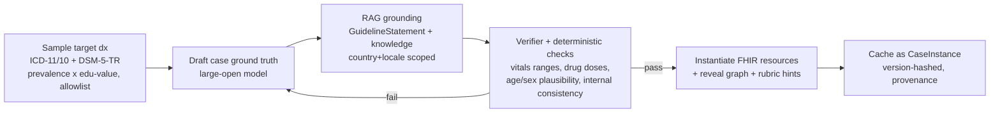

# 04 — Dynamic Cases, EHR Workspace & Process-Aware Assessment (Core-Loop Spec)

**Status:** Authoritative spec for the core learning loop, added after the requirements baseline (`01-requirements-and-constraints.md`) and architecture (`../architecture/`). It extends — does not replace — architecture docs 01 (AI agents), 05 (grounding), 06 (assessment), 08 (data model). Where it adds requirements, they are numbered `EHR-*`, `GEN-*`, `PROC-*` and are **MVP unless tagged otherwise**.

**Time context:** July 2026. Grounded in the current evidence that RAG-constrained generation over DSM-5-TR + ICD keeps synthetic patients clinically plausible ([JMIR Med Inform 2026 systematic review](https://medinform.jmir.org/2026/1/e79039/), [MDPI Appl. Sci. 15(22):11917](https://www.mdpi.com/2076-3417/15/22/11917), [arXiv:2508.13943](https://arxiv.org/pdf/2508.13943)), and that a FHIR-native React component base (Apache-2.0 [Medplum](https://github.com/medplum/medplum)) is the fastest compliant path to an authentic EHR UI.

---

## 1. Why this reframes the product

The encounter is not a chatbot with a vitals widget. It is a **simulated EHR the student must work**, in which a **dynamically generated** patient is interviewed and investigated, and in which **every action and its timing is measured** and fed back with cited guidelines. Three shifts:

1. **The chart is the interface.** Students learn EHR navigation (a graded skill in itself, and a top employer complaint about new graduates) while they reason. AcuDx is EHR-shaped, FHIR-shaped, from day one.
2. **The case is generated, not authored.** Unlimited, non-repeating cases sampled from ICD/DSM — so a cohort can never "memorize the bank," and difficulty/topic are dials, not a catalog.
3. **The process is the assessment.** What was asked, in what order, how fast, how the patient was treated, whether safety steps happened — not just the final diagnosis.

---

## 2. EHR-structured encounter workspace (EHR-*)

**Design goal:** an authentic-but-teachable EHR. Follow real conventions (Epic Storyboard / Cerner PowerChart mental model) closely enough to transfer, simplified enough to learn. A persistent **"SIM — education only, synthetic patient"** marker is always visible (safety + AI-Act Art. 50 transparency).

### 2.1 Layout

| Region | Content | Notes |
|---|---|---|
| **Patient banner** (persistent top) | Name (synthetic), age/sex, synthetic MRN, chief complaint, **allergies ⚠**, code status, encounter type (ED / clinic / prehospital), acuity | Epic-Storyboard-condensed. Allergy + code status always visible. |
| **Left rail (Storyboard)** | Avatar + demographics, **Problem List** (grows as discovered), Allergies, **Vitals snapshot**, Med list, Care team, encounter clock | Starts sparse; populates only from student actions (progressive disclosure). |
| **Activity tabs (main)** | see §2.2 | The chart tabs are the core navigation the student is being trained on. |
| **Interaction dock** | AI patient/role chat + voice, **Guidance toggle** (cited Socratic hints), "Advance / Close encounter" | Interview lives in a tab AND is dockable so it is available while ordering. |

### 2.2 Activity tabs (map to FHIR)

| Tab | Purpose (student action) | FHIR resources |
|---|---|---|
| **Chart Review** | Read available prior context / triage note / timeline | `Encounter`, `DocumentReference`, `Composition` |
| **Interview / Rooming** | Take the history (dynamic dialogue); request **exam maneuvers** → findings returned | drives `Observation` (exam), narrative |
| **Flowsheets / Vitals** | The live dark vitals monitor + trends; nursing flowsheet | `Observation` (vital-signs), streamed by the Vitals & Physiology Engine |
| **Orders (CPOE)** | Order labs / imaging / meds / consults; realistic result latency | `ServiceRequest`, `MedicationRequest` |
| **Results** | Review returned labs/imaging **(only what was ordered)** | `Observation` (laboratory), `DiagnosticReport`, `ImagingStudy` |
| **Notes** | Write H&P / SOAP / handoff; graded documentation | `DocumentReference` / `Composition` |
| **MAR / Meds** | Administer/prescribe; allergy & interaction interception | `MedicationRequest`, `MedicationAdministration` |
| **Problem List / A&P** | Build differential, working diagnosis, plan, disposition | `Condition`, `ClinicalImpression`, `CarePlan` |

**EHR-1** (MVP): banner + left rail + Interview + Flowsheets/Vitals + Orders + Results + Problem List/A&P, FHIR-backed, progressive.
**EHR-2** (v1): Notes (graded documentation), MAR with allergy/interaction interception, Chart Review timeline.
**EHR-3** (v1): role-scoped EHR views (nurse flowsheet-first, paramedic prehospital run-sheet, examiner read-only) — reuses the multiplayer role-view mechanism (arch/07).
**EHR-4**: build the React layer on FHIR resource shapes (Medplum component patterns as reference; own the components using the AcuDx design system so styling matches medkit). Never a real patient data path.

### 2.3 Progressive disclosure (the extraction principle)

- The **Case State Store** holds the full ground truth; the EHR renders only what the student has **obtained**. Given-at-start = banner + triage vitals + chief complaint. Everything else is earned: history by asking, exam findings by requesting maneuvers, objective data by ordering.
- A **reveal graph** maps each obtainable datum to its trigger (a question intent, an exam maneuver, an order). Unasked = unseen. Asking the wrong/irrelevant things costs time (measured, §4).
- The AI patient **never volunteers** the diagnosis or unasked findings, and (two-tier content) **never sources clinical facts** — the Case State Store does; the persona only supplies affect + phrasing (arch/01 §two-tier boundary).

---

## 3. Dynamic case-generation engine (GEN-*)

Replaces "a case library" with **on-demand generation**. Default is fully random; everything is constrainable.

### 3.1 Inputs

`GenerateCaseRequest { seedMode: 'random' | 'constrained', constraints?: { chiefComplaint?, bodySystem?, specialty?, icdCode?, dsmCode?, acuity?, difficulty(1-5), learnerRole, patientVariant?, locale('en'|'tr'|…), guidelineCouncil }, cohortPolicy? }`

- **Random (default):** sample a target diagnosis from a curated ICD-11 (+ ICD-10-CM crosswalk) and **DSM-5-TR** distribution, **weighted by prevalence × educational value**, gated by a **safety/appropriateness allowlist** (no impossible/harmful combinations; age/sex-plausible).
- **Constrained:** e.g. `chiefComplaint: "headache"` narrows to the differential space for that presentation; `difficulty` tunes distractor density, comorbidity, atypicality, and time pressure.

### 3.2 Pipeline (generate → ground → verify → instantiate)

1. **Draft** the ground truth with a large open-weight model (per the open-source-first model gateway): demographics, risk factors, **HPI**, ROS, PMH/meds/allergies/social/family, **exam findings by system**, **vitals trajectory** (baseline + evolution + response-to-treatment curves), **lab/imaging results**, correct diagnosis, **plausible differentials + distractors**, red flags, expected work-up + disposition.
2. **Ground** every clinical fact via RAG on the country+locale-scoped `GuidelineStatement` store + reference knowledge (ICD/DSM, drug data). No fact is retained that can't be grounded.
3. **Verify** with a cross-family verifier model **plus deterministic checks**: vitals in physiological range for the stated state, weight-based/renal drug doses correct, age/sex/anatomy plausibility, no internal contradiction, red-team traps (country-threshold, pediatric dosing). Loop on failure; **abstain > ship-wrong**.
4. **Instantiate** FHIR resources + the **reveal graph** + **case-specific rubric anchors** (what a strong history/work-up/management looks like, for §4 scoring) + provenance/version hash.

**GEN-1** (MVP): random + `chiefComplaint`/`difficulty` constrained EM cases, generate→ground→verify→FHIR, clinician spot-review of a sample before cohort exposure (the AI-drafts/human-authoritative gate from arch/AU still applies to **generation policy + validators**, not each instance).
**GEN-2** (v1): full ICD/DSM breadth incl. psychiatry (DSM-5-TR), multimorbidity, rare-disease dial; per-cohort novelty guarantee (no student sees the same instance twice).
**GEN-3**: generation for **all roles** (see §3.4) and multiplayer shared cases.

### 3.3 Runtime dynamics (dialogue conditioned on the encounter)

- The Persona Agent's next utterance is generated from **(persona spec + role-scoped CaseStateView + full conversation history + current EHR/order state)** — genuinely conditional, not branch-scripted. Ask differently → get a different, consistent answer.
- The **Roleplay Orchestrator (Director)** advances world state on its own clock: untreated pathology **deteriorates** (vitals engine), correct treatment **improves** it, time passes, new information can arrive (e.g., a returning lab, a family member). This is what makes timing matter.
- Determinism where it counts: dialogue is dynamic, but **objective data is fixed by the ground truth** (a re-asked lab returns the same value); the vitals engine is deterministic given actions + time.

### 3.4 All roles, one attention structure (GEN-role)

The same generate + condition-on-history structure powers every AI role, each with a role-specific goal, knowledge, and CaseStateView:

| AI role | Goal / behavior | Sees |
|---|---|---|
| Patient | Present symptoms, affect, concerns; reveal only what is asked | own symptoms/history (subjective) |
| Paramedic (prehospital) | Give a structured handover (ATMIST/SBAR), answer scene questions | scene + prehospital findings |
| Nurse | Report vitals/flowsheet, execute/clarify orders, flag concerns | flowsheet + orders |
| Senior colleague | Answer curbside consults; Socratic, not answer-giving | full case (as supervisor) |
| Family/caregiver | Collateral history; emotional dynamics | collateral facts |
| Examiner | Probe reasoning, ask "why"; never leads | full case + rubric |

All are dynamic, grounded (never source clinical facts outside case state), and safety-intercepted identically.

---

## 4. Process-aware, cited assessment (PROC-*)

Extends the Assessment/Calibration engine (arch/06). The **event-sourced encounter log** already captures every action with a timestamp and causal `seq`; assessment now derives **process metrics** from it, benchmarks them against guideline-derived expectations, and cites sources.

### 4.1 Metrics derived from the event log

- **Timing:** time-to-first-question, total encounter time, **time-to-critical-action** vs guideline (e.g. ECG ≤10 min for chest pain — ESC/AHA; antibiotics ≤1 h for sepsis — Surviving Sepsis; door-to-analgesia), time-to-diagnosis, time-to-treatment/disposition.
- **Order & sequence:** the **order in which** history areas and work-up were pursued vs an expected clinical sequence (e.g. red-flag screening before reassurance); ABCDE ordering in emergencies.
- **Count & efficiency:** number of history questions, **coverage vs redundancy** (how much of the expected HPI/ROS was obtained, how many irrelevant/duplicate questions), orders appropriateness (indicated vs low-value/over-ordering).
- **How the patient was treated:** communication quality — open vs leading questions, empathy/ICE (ideas-concerns-expectations), addressing the patient's stated concern, professionalism; **safety behaviors** — allergy check before prescribing, weight for pediatric dosing, red-flag screening, closed-loop communication in teams. (Assessment reads the patient's *treatment*; it never infers the *learner's* emotion — EU-prohibited, arch/09.)

### 4.2 Feedback & guide mode (both cited)

- Each finding is **anchored to an evidence span** (the exact transcript/action) AND **cited to the specific `GuidelineStatement`** it was measured against (e.g. "No ECG was ordered in the first 18 min; guideline target ≤10 min — ESC ACS 2023 §5.1"). Correct actions are cited too, not just misses.
- The **Dunning-Kruger calibration plot** gains a process dimension: confidence vs measured competence per domain, now informed by process quality, not only the final answer.
- **Guide mode** uses the identical grounded+cited pipeline live: hints are retrieval-grounded, citation-gated, and framed Socratically ("What time-critical test does this presentation demand?" → on request, the cited target).
- **Safety-critical process misses** (missed allergy check, missed time-critical action) are surfaced **separately and always**, regardless of score (arch/06 AS-8).

**PROC-1** (MVP): timing + coverage/redundancy + time-to-critical-action + communication/safety, all cited, in feedback; guide mode cited hints.
**PROC-2** (v1): sequence-quality scoring, over-ordering/low-value flags, per-cohort process analytics for the dean dashboard (arch/IN).

---

## 5. Phased implementation (step by step)

Built on top of the baseline `web/` app (design system, i18n EN/TR, Home/Encounter/Feedback) once it is verified running.

- **B1 — EHR workspace UI** (frontend): restructure the Encounter screen into the EHR shell (banner, Storyboard rail, activity tabs, interaction dock) on FHIR-shaped mock data with progressive disclosure. Reuse the design-system components; add EHR components (PatientBanner, Storyboard, ActivityTabs, OrdersPanel, ResultsPanel, ProblemList, NoteEditor). Bilingual, accessible, medkit-styled.
- **B2 — Case-generation engine**: a working generator (client/service) that samples ICD/DSM, produces a FHIR case + reveal graph + rubric anchors; wire the EHR + interaction to it so a fresh case loads each session; expose `random` and `constrained` (chief complaint / difficulty). Backend design = a `CaseGenerationService` behind the Model Gateway (open-weight default) with the ground→verify pipeline; MVP can run a seeded generator with a curated seed set + live generation behind a flag.
- **B3 — Process-aware assessment**: compute the §4 metrics from the event log; render cited, process-aware feedback + the enriched calibration plot; wire guide mode's cited hints.
- **B4 — Architecture docs**: expand this spec into `../architecture/12-case-generation-engine.md` and `../architecture/13-ehr-workspace-and-fhir-model.md`, and update arch/06 with the process metrics and arch/08 with the FHIR resource mapping.

Each sub-phase ships and is verified (build + screenshots) before the next.

---

## 6. Open questions

- ICD-11 vs ICD-10-CM as the primary sampling axis (ICD-11 for breadth/international incl. Turkey; ICD-10-CM for US billing familiarity) — likely both via crosswalk.
- How much clinician review gates *live* generation vs generation *policy* (validators) at each maturity stage.
- Reveal-graph authoring: fully generated vs template-assisted for the first cohorts.
- Whether to embed Medplum's components directly or reimplement their FHIR-binding patterns in the AcuDx design system (favoring the latter for visual consistency with medkit).
