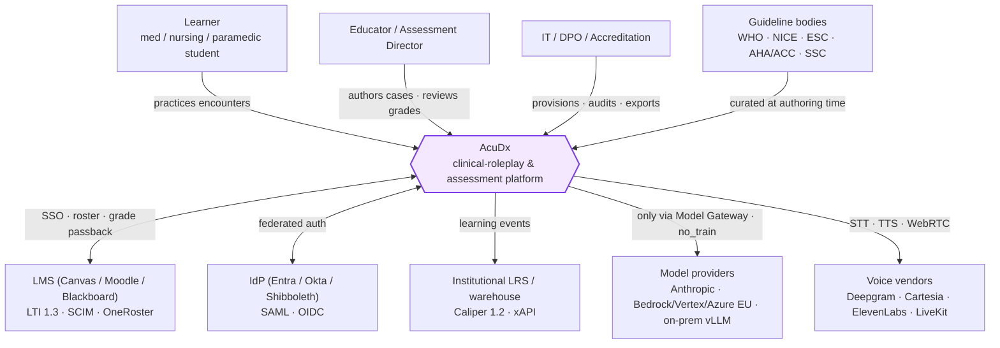
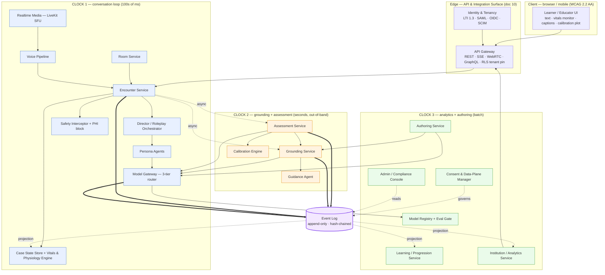
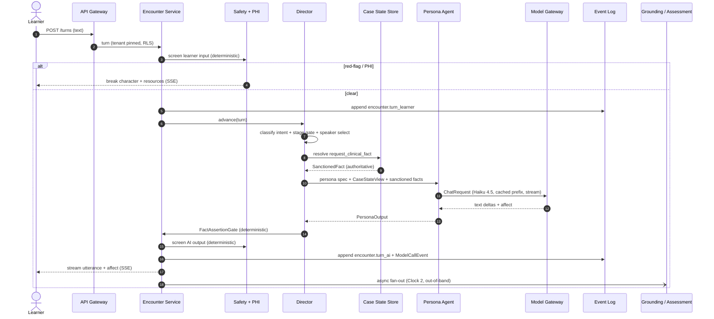
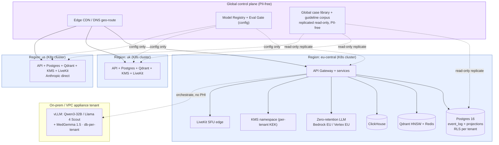

# 00 — System Overview (High-Level Architecture / Integrator)

**Status:** Build-ready architecture — the **top of the architecture tree**. **Date:** July 2026. **Owner:** Principal architecture (cross-service).

**What this doc is, and is not.** This is the **integrator / C4 view**: the system-context and container diagrams for *every* canonical service (its responsibility, its sync/async boundary, and which of the three clocks it lives on), the **end-to-end request lifecycle of one text encounter turn** in build-level detail, the **deployment topology** (K8s multi-region, region-pinning, edge, LiveKit, data planes), the **tech-stack decision table** (each choice with a one-line justification and the rejected alternative), and the **build-vs-buy** calls. It **routes and unifies**; it does not re-derive. Where this doc and a service doc disagree, **the service doc wins and this file is the bug**.

> **Relationship to [`../00-overview/02-architecture-overview.md`](../00-overview/02-architecture-overview.md).** That capstone is the *product-level* synthesis for a reader arriving from the requirements baseline (it maps tensions T1–T12, the MVP wedge, the two non-negotiables). **This doc** is the *engineering* entry point for a builder standing inside `docs/architecture/`: C4 context→container→component, the concrete turn lifecycle with the real interfaces, deployment/topology, and the stack/build-vs-buy tables. Read the capstone for *why*; read this for *what runs where and how a turn flows*. They are byte-consistent by construction (both cite the same owning docs).

**Baseline & grounding.** The authoritative requirement/constraint source is [`../00-overview/01-requirements-and-constraints.md`](../00-overview/01-requirements-and-constraints.md) (RP/MP/V/AV/G/AS/GM/IN/AU/AD tags, tensions T1–T12, NFRs, the MVP wedge, the two architecturally-enforced non-negotiables). Model tiers/prices trace to `docs/research/01-llm-models-and-cost.md`; voice to `docs/research/02-voice-ai.md`; 3D to `docs/research/03-3d-avatars.md`. **Time context: July 2026** — pin the *architecture*; treat vendor IDs and `$`/dates as configuration living in the **Model Registry** and `CorpusSnapshot`.

**The product in one sentence.** A learner roleplays a full clinical encounter (history → exam → tests → differential → diagnosis → management) against AI patients/colleagues/families, solo or in role-based multiplayer rooms, and receives a defensible competency-mapped grade, a Dunning-Kruger calibration plot, and a gap→remediation loop — while every clinical fact is grounded-or-refused, every synthetic asset is C2PA-marked, and every consequential action is one event on one hash-chained log.

**The four load-bearing invariants** (every service honors all four; each is enforced *mechanically*, not by discipline):

1. **Two-tier content architecture** — a GROUNDED layer owns *all* clinical facts (citation-or-refuse); a ROLEPLAY layer improvises affect and *cannot assert clinical facts*. The AI-patient never sources a fact — the **Case State Store** does. ([`./01-ai-agent-architecture.md`](./01-ai-agent-architecture.md) §2, [ADR-0003](./adr/README.md))
2. **Three isolated clocks** — the conversation loop (100s of ms) never blocks on grounding/assessment (seconds, out-of-band) or analytics (batch). ([`./01-ai-agent-architecture.md`](./01-ai-agent-architecture.md) §1, [`./02-model-gateway-and-routing.md`](./02-model-gateway-and-routing.md) §1)
3. **Event-sourced source of truth** — one append-only, hash-chained **Event Log** is authoritative; Case State, Grades, Calibration, the guideline corpus, and all analytics are deterministically-replayable *projections*. ([ADR-0004](./adr/README.md), [`./09-security-and-compliance-architecture.md`](./09-security-and-compliance-architecture.md) §2, [`./08-data-model-and-multitenancy.md`](./08-data-model-and-multitenancy.md) §3)
4. **Model Gateway is the only path to any model** — no vendor SDK in business logic; `no_train`, region-pinning, prompt-version hashing, budget, and audit emission are all enforced at this single chokepoint. ([`./02-model-gateway-and-routing.md`](./02-model-gateway-and-routing.md), [ADR-0013](./adr/README.md))

The two **scope-defining non-negotiables** that keep the whole classification stable: **`assessment_mode: formative`** default (keeps AcuDx below EU AI Act Annex III high-risk, [ADR-0005](./adr/README.md)) and **synthetic-patients-only / no PHI** (FERPA+GDPR, not HIPAA, [ADR-0006](./adr/README.md)). Both are deliberate later gates to relax, never accidental.

---

## 1. C4 Level 1 — system context

AcuDx is the **interaction-and-assessment layer**. It integrates *outward* to the institution (LMS, IdP, LRS) and to a small set of specialist model/voice/guideline suppliers, and *inward* it is one system with many services (§2). The whole outward surface is owned by [`./10-api-and-integration-surface.md`](./10-api-and-integration-surface.md).

**Boundaries worth stating at Level 1.** (a) **Guideline bodies are an *authoring-time* input, never a runtime dependency** — content is curated into versioned `GuidelineStatement`s under clinician review ([`./05-guideline-grounding-engine.md`](./05-guideline-grounding-engine.md) §3), never scraped or hit live in a turn. (b) **Model/voice providers are reached only through internal gateways** — the Model Gateway for LLM/embeddings, the Voice Pipeline's `ProviderAdapter`-equivalent for STT/TTS — so `no_train`, region-pinning, and audit are enforced at one seam. (c) **No real-patient / point-of-care actor exists** — the synthetic-only wall is a *context boundary*, not just a policy.

---

## 2. C4 Level 2 — container view (colored by clock)

One screen, every canonical service. **Colour = clock.** Solid double arrows (`==>`) are appends to the Event Log; dotted arrows are async fan-out or projections. **Nothing on Clock 1 waits on Clock 2 or 3** — that is the diagram's whole point.

### 2.1 Canonical services — responsibility · clock · sync/async · owning doc

Every canonical service named in canon, its one-line responsibility, the clock it lives on, its consistency posture, and where it is specified. **The clock column is the sync/async boundary**: Clock 1 is synchronous/streamed and latency-bound (p95 < 1.5 s text turn); Clock 2 is out-of-band seconds (never blocks a turn); Clock 3 is batch.

| Service | Responsibility | Clock | Sync/Async | Owning doc |
|---|---|---|---|---|
| **Encounter Service** | Server-authoritative turn loop; the *only* emitter of a persona utterance to the client (after Safety clears it); appends every learner/AI turn | 1 | sync (streamed) | [`01`](./01-ai-agent-architecture.md) |
| **Roleplay Orchestrator (Director)** | Deterministic speaker selection, stage gating, Case-State access mediation, two-tier boundary enforcement; rare Sonnet "director hint" only | 1 | sync (deterministic) | [`01`](./01-ai-agent-architecture.md) §3 |
| **Persona Agents** (Patient/Colleague/Family/Dispatcher/Examiner) | Only LLM actors on the hot path; improvise affect; obtain facts *only* via `request_clinical_fact` tool | 1 | sync (streamed) | [`01`](./01-ai-agent-architecture.md) §4 |
| **Model Gateway** | Only path to any LLM/embedding; 3-tier router, prompt cache, budget/degrade, PII/`no_train`, region routing, `ModelCallEvent` audit | 1 / 2 / 3 | `chat()` sync · `ground()`/`assess()` async · `batch()` | [`02`](./02-model-gateway-and-routing.md) |
| **Case State Store** | Authoritative vitals/labs/exam/timeline; deterministic projection of the Event Log; qualitative `CaseStateView` redaction; persona never reads it raw | 1 | sync (deterministic) | [`01`](./01-ai-agent-architecture.md) §7, [`08`](./08-data-model-and-multitenancy.md) §1.1 |
| **Vitals & Physiology Engine** | Deterministic vitals/`ClinicalSign(intensity)`; drives monitor + avatar clinical-sign overlay + the `intensity→adjective` map | 1 | sync (deterministic) | [`01`](./01-ai-agent-architecture.md) §4.1 |
| **Grounding Service** | `GuidelineStatement` corpus; country-filter-before-rank hybrid RAG; runtime safety chain (retrieve→citation-gate→verify→dose-check→refuse) | 2 | async, out-of-band | [`05`](./05-guideline-grounding-engine.md) |
| **Guidance Agent** | Socratic hints consuming `RetrievalResult`; runs the full runtime safety pipeline; surfaces country divergence as a teaching feature | 2 | async, out-of-band | [`05`](./05-guideline-grounding-engine.md) §7.1 |
| **Safety Interceptor** (+ PHI block) | Deterministic red-flag / self-harm / dangerous-mgmt / PHI screen *outside* the LLM; break-character; kill-switch | 1 | sync (deterministic) | [`01`](./01-ai-agent-architecture.md) §8, [`09`](./09-security-and-compliance-architecture.md) §3 |
| **Assessment Service** | Frozen case rubrics; decomposed evidence-span grading; deterministic band mapping; κ gates; overrides; validity dossier | 2 | async, batch | [`06`](./06-assessment-and-calibration-engine.md) |
| **Calibration Engine** | Brier/OCI/ECE/reliability-diagram from confidence + grade; deterministic, no LLM; never leaderboarded | 2 | async (pure code) | [`06`](./06-assessment-and-calibration-engine.md) §3 |
| **Learning / Progression Service** | Gap→FSRS spaced repetition + mastery/entrustment thresholds; XP tied to improvement; next-case targeting | 3 | async, batch | [`06`](./06-assessment-and-calibration-engine.md) §4 |
| **Room Service** | Event-sourced room/presence/roles; AI backfill of empty roles; floor control; per-role Case-State views | 1 | sync | [`07`](./07-multiplayer-rooms.md) |
| **Realtime Media (LiveKit)** | WebRTC SFU for voice/presence tracks + LiveKit Agents; carries *no* clinical state | 1 | sync (transport) | [`07`](./07-multiplayer-rooms.md) §10, [`03`](./03-voice-pipeline.md) §2 |
| **Voice Pipeline** | Cascade STT→(unchanged turn loop)→TTS; barge-in; per-persona turn-taking; low-confidence→text; C2PA marking | 1 | sync (transport) | [`03`](./03-voice-pipeline.md) |
| **Authoring Service** | 6-stage AI-draft / human-authoritative pipeline; clinician sign-off gate; version-hash; authoring-time MCP enrich | 3 | batch, offline | [`05`](./05-guideline-grounding-engine.md) §3.2, [`06`](./06-assessment-and-calibration-engine.md) §1.2 |
| **Institution / Analytics Service** | Cohort heatmap, at-risk/remediation closed loop, aggregate calibration, one-click accreditation export | 3 | batch | [`06`](./06-assessment-and-calibration-engine.md) §8, [`10`](./10-api-and-integration-surface.md) §2.6 |
| **Identity & Tenancy** | LTI 1.3 / SAML / OIDC / SCIM / OneRoster; `ExternalIdentity` resolution; RBAC; region resolution | — (edge) | sync | [`08`](./08-data-model-and-multitenancy.md) §7, [`10`](./10-api-and-integration-surface.md) §4–6 |
| **Event Log** | Append-only, per-tenant hash-chained source of truth; WORM checkpoints; `verifyChain`; every store is a projection of it | — (substrate) | append-only | [`09`](./09-security-and-compliance-architecture.md) §2, [`08`](./08-data-model-and-multitenancy.md) §3 |
| **Model Registry & Eval Gate** | Immutable eval-passed `ModelConfig`s; grader≠patient assertion; version-lock per cohort; no silent swaps | 3 | offline (CI gate) | [`02`](./02-model-gateway-and-routing.md) §12, [`09`](./09-security-and-compliance-architecture.md) §5 |
| **Consent & Data-Plane Manager** | Per-purpose revocable consent; one-way de-id projection between the two planes; crypto-shred erasure | 3 | batch | [`09`](./09-security-and-compliance-architecture.md) §4, [`08`](./08-data-model-and-multitenancy.md) §5–6 |
| **Admin / Compliance Console** | Hazard Log, dual incident process, CSO sign-off, DPO tooling, validity dossier surface | 3 | sync/batch | [`09`](./09-security-and-compliance-architecture.md) §6 |

### 2.2 Reading the container view — the three seams

- **The Encounter Service is the hub of Clock 1.** It is the only writer to the client on the hot path and the only emitter of a persona utterance, and it appends every turn to the Event Log. The Director is deterministic code (not an LLM by default); Persona Agents are the only LLM actors on Clock 1 and reach models *only* through the Model Gateway.
- **Clock 2 hangs off the Event Log asynchronously.** Grounding/Guidance and Assessment/Calibration subscribe to encounter events; nothing on the conversation clock awaits them. A guidance hint is *fired-and-forwarded* — it arrives on the stream out-of-band, so a refuse/regenerate never stalls the patient loop.
- **Clock 3 is projection + governance.** Institution/Analytics, Learning/Progression, Authoring, the Model Registry, Consent, and the Admin/Compliance Console all read or govern the Event Log on the batch clock; a runaway batch job cannot touch a live turn (STRIDE T8, [`09`](./09-security-and-compliance-architecture.md) §9).

### 2.3 C4 Level 3 note (where the components live)

Level-3 component decompositions are owned by the service docs and are not duplicated here: the **Director loop / FactAssertionGate / persona contract** in [`01`](./01-ai-agent-architecture.md) §2–4; the **router / prefix-builder / provider adapters / budget enforcer** in [`02`](./02-model-gateway-and-routing.md) §2–10; the **retrieval + runtime safety chain** in [`05`](./05-guideline-grounding-engine.md) §4–5; the **decomposed grading pipeline + calibration math** in [`06`](./06-assessment-and-calibration-engine.md) §2–3; the **barge-in controller / turn-taking knobs / voice-agent interface** in [`03`](./03-voice-pipeline.md) §5–6, §14; the **room floor control / backfill** in [`07`](./07-multiplayer-rooms.md) §3–7. This doc names the seams between them; it does not re-open them.

---

## 3. End-to-end lifecycle of ONE text encounter turn

This is the build-critical path: **client → gateway → Encounter Service → Safety Interceptor → Director → Case-State fact-resolve → Persona Agent via Model Gateway → FactAssertionGate → stream back → append EncounterEvent.** It is the wire form of the Director loop ([`01`](./01-ai-agent-architecture.md) §3.1) over the SSE turn-stream API ([`10`](./10-api-and-integration-surface.md) §2.2), on Clock 1, with a p95 < 1.5 s budget.

### 3.1 Step-by-step (with the real interfaces)

1. **Client → Gateway (`POST /v1/encounters/{id}/turns`).** The learner `POST`s `{ text, client_turn_id, stt_confidence }` with an `Idempotency-Key`; the region-pinned base URL (`https://{region}.api.acudx.dev/v1`) and the `tenant_id` token claim set Postgres **RLS** for the request. The `POST` returns `202 Accepted` immediately — **the persona response arrives on the already-open SSE stream**, not in the POST body ([`10`](./10-api-and-integration-surface.md) §2.2). This is what keeps the write path off the latency critical section and lets barge-in truncate mid-stream.
2. **Safety Interceptor (pre) — deterministic, outside the LLM.** The PHI Interceptor + red-flag rules screen the learner input *before* anything is persisted. A structural PHI hit → `422` + `safety.trigger{type:"phi_block"}`, raw text never written ([`09`](./09-security-and-compliance-architecture.md) §3). A red-flag (self-harm / dangerous management) → **break character**, resources surfaced, no persona turn ([`01`](./01-ai-agent-architecture.md) §8).
3. **Append `encounter.turn_learner`.** Only on a clear input; the event is the write model, everything downstream is a projection.
4. **Director — speaker selection + stage gate (deterministic).** Directed-address (NER + role-alias) → role affinity → backfill; soft stage gating with `unsupported_action` flagging; reveal discipline (never volunteer an unordered result). No LLM on the default path ([`01`](./01-ai-agent-architecture.md) §3.2–3.3).
5. **Case-State fact-resolve (two-tier boundary, Layer 2).** If the turn needs a self-knowable fact ("what's my oxygen?"), the Director calls `request_clinical_fact`/`query_case_state` against the **Case State Store** and injects the resolved value as a `SanctionedFact` for in-character delivery. The persona is handed a **redacted `CaseStateView`** (qualitative), never the raw number ([`01`](./01-ai-agent-architecture.md) §2, §4.3). Test orders/exam findings are *side-effects* resolved later on the physiology clock — no blocking.
6. **Persona Agent → Model Gateway `chat()`.** The persona emits a provider-agnostic `ChatRequest { taskType: 'PATIENT_TURN', prefix: CachedPrefix, suffix, patientModelFamily, signals, policy, idempotencyKey, stream:true }`. The Gateway resolves `(TaskType, EscalationSignals, TenantPolicy) → ModelConfig`, defaults to **Haiku 4.5** with ≥85% cached-prefix read, region-pins the deployment, checks budget, and streams text deltas + `affect`. A `clinical_fact_needed` signal short-circuits the LLM back to Case State ([`02`](./02-model-gateway-and-routing.md) §4). ~80–90% of patient turns never leave Haiku; escalation to **Sonnet 5** fires on `persona_break` / `low_confidence` / `guardrail_flag`.
7. **FactAssertionGate (two-tier boundary, Layer 3) — deterministic, pre-emit.** Every `PersonaOutput` passes a deterministic classifier + regex/NER that rejects any **unsanctioned clinical assertion** (a number/dose/verdict not in this turn's `SanctionedFact` set) → regenerate/deflect-in-character ([`01`](./01-ai-agent-architecture.md) §2). This is "citation-or-refuse" for the roleplay layer.
8. **Safety Interceptor (post).** The AI output is screened again before emission.
9. **Append `encounter.turn_ai` (+ `ModelCallEvent`).** The turn and the Gateway's `ModelCallEvent` (hash-only, no content) append to the per-tenant hash chain; the Case State delta folds into the next `CaseStateSnapshot` ([`02`](./02-model-gateway-and-routing.md) §10.1, [`08`](./08-data-model-and-multitenancy.md) §3.3).
10. **Stream back.** The Encounter Service streams `turn.delta` / `turn.affect` (always with a `caption` + emotion label — the non-voice equivalent) / `turn.complete` / `stage.transition` frames over SSE ([`10`](./10-api-and-integration-surface.md) §2.2). Resume is `Last-Event-ID` off the Event Log projection.
11. **Async fan-out (Clock 2, out-of-band).** The Encounter Service fires guidance/assessment events onto the `grounding_assessment.*` stream and returns. **The turn never awaits them.** A guidance hint runs the runtime safety chain and arrives later on the stream; grading is dispatched to Batch at encounter close.

### 3.2 Latency budget for the one turn (p95 < 1.5 s text)

Dominant cost is the Haiku round-trip (cached-prefix read ~0.1× input + ~2K fresh suffix + ~150 tokens out, streamed). Deterministic steps (Safety, Director, Case-State read, FactAssertionGate) are single-digit-to-low-tens of ms each. The only turn that spends a *second* round-trip is a **pre-resolved `request_clinical_fact`** (+~260 ms p50) — still inside budget ([`01`](./01-ai-agent-architecture.md) §4.3, [`02`](./02-model-gateway-and-routing.md) §7). The voice path wraps this identical loop with an STT prologue and TTS epilogue for a **<800 ms p50 first-audio** budget ([`03`](./03-voice-pipeline.md) §4); the FactAssertionGate still runs on persona *text before any TTS byte* ([`03`](./03-voice-pipeline.md) §1).

### 3.3 What a room turn adds (multiplayer, unchanged core)

A solo encounter is *a room with one human and every other role AI-backfilled* — the room model is a strict superset. A room turn adds, *around* the identical core loop: a `participant_id` on the turn, the Room Service's floor grant (≤1 AI speaker/tick), per-role `RoleViewScope` filtering of the Case-State snapshot, and deterministic `closed_loop.completed` / `request.unactioned` team-process events ([`07`](./07-multiplayer-rooms.md) §5–8). The `EncounterEvent`s and the two-tier boundary are **byte-identical to solo**.

---

## 4. Deployment topology

**Region-pinned multi-tenancy is a *placement* property, not an access property** ([ADR-0016](./adr/README.md), [`08`](./08-data-model-and-multitenancy.md) §4): **RLS within a region** for tenant isolation, **database/cluster/KMS-namespace/K8s-deployment per region** for residency. Learner PII/analytics never leave region; only PII-free content (the global case library, the guideline corpus, aggregate DPA-permitted telemetry) replicates.

### 4.1 Topology rules

| Concern | Rule | Source |
|---|---|---|
| **Regions** | `eu-central`, `uk`, `us` at launch; `me-central`/`ap` on demand. `Org.region` is **immutable** after creation. | [`08`](./08-data-model-and-multitenancy.md) §4.2, [ADR-0016](./adr/README.md) |
| **Within a region** | One logical Postgres deployment per region, many tenants, isolated by `tenant_id` + **RLS** + **per-tenant hash chains** + **per-tenant KEKs** in the region KMS namespace. | [`08`](./08-data-model-and-multitenancy.md) §4.2, [`09`](./09-security-and-compliance-architecture.md) §10 |
| **Across regions** | Separate DB clusters, Qdrant, ClickHouse, KMS namespaces, and K8s deployments per region. **No cross-region query path for learner PII/analytics.** Base URL is region-pinned; a cross-region call `421`-redirects. | [`08`](./08-data-model-and-multitenancy.md) §4.2, [`10`](./10-api-and-integration-surface.md) §1.1 |
| **Edge** | CDN/DNS geo-routes to the tenant's region; static assets + WASM avatar rig ship from edge; SSE/WebSocket for the turn stream, **WebRTC only where needed** (voice/multiplayer). Device floor: 4–5-yr-old laptop, mid-range phone on 4G, text at <100 kbps. | [`10`](./10-api-and-integration-surface.md) §1, [ADR-0011](./adr/README.md) |
| **Realtime Media (LiveKit)** | Regional SFU edge co-located with the tenant region; the Voice Agent, STT, TTS, and LLM endpoint are **co-located in the residency region** so a cross-region hop never blows the voice p95 (AD-6). Media carries no clinical state, so SFU load is decoupled from correctness. | [`03`](./03-voice-pipeline.md) §4, [`07`](./07-multiplayer-rooms.md) §9 |
| **Inference** | EU/UK tenants resolve to **Bedrock EU / Vertex EU / Azure OpenAI EU** (or on-prem) with contractual **zero-retention**; US may use Anthropic direct. The Gateway fails-closed if a region has no compliant deployment for a required task. | [`02`](./02-model-gateway-and-routing.md) §9 |
| **Two data planes** | Identified-education ⟂ de-identified-improvement on **separate DB clusters + KMS namespaces + network segments; no service holds credentials to both.** One-way de-id projection, no join key. | [`09`](./09-security-and-compliance-architecture.md) §4, [ADR-0017](./adr/README.md) |
| **On-prem / VPC appliance** | Privacy-maximal tenants get **db-per-tenant** inside their VPC; **vLLM** serves Qwen3-32B/Llama 4 Scout + MedGemma 1.5. The SaaS control-plane orchestrates but **never sees PHI**. Break-even ≈ >3–5M tok/day. | [`02`](./02-model-gateway-and-routing.md) §13, [ADR-0016](./adr/README.md) |
| **Global control plane** | Model Registry (config only) and the PII-free global case library + guideline corpus replicate read-only into each region; they never carry learner data. | [`08`](./08-data-model-and-multitenancy.md) §4.3 |

### 4.2 Tamper-evidence & durability substrate

Postgres is authoritative for the per-tenant hash chain; **S3 Object-Lock (WORM, compliance mode) + KMS-signed checkpoints every 5 min / 10k events** bound an attacker's rewrite window ([`09`](./09-security-and-compliance-architecture.md) §2.3). The event bus is **Redis Streams (MVP) → NATS/Kafka (scale)** — propagation, never truth; per-tenant order (Kafka partition-per-tenant / NATS JetStream) preserves replay ([`08`](./08-data-model-and-multitenancy.md) §3). Any projection store lost is rebuilt by replaying events to `event_log_head_hash`.

---

## 5. Tech-stack decision table (July 2026 best-in-class)

Each choice pins *capability*, not lock-in — every one is swappable behind its interface (`ProviderAdapter`, `RetrievalQuery`, the bus abstraction, the `EncounterEvent` envelope). One-line justification + the rejected alternative.

### 5.1 Frontend / client

| Component | Choice | Justification | Rejected alternative |
|---|---|---|---|
| Turn-stream transport | **SSE** (WebSocket only for upstream barge-in) | Server-authoritative one-way stream; drop-tolerant `Last-Event-ID` resume; works at <100 kbps through corporate proxies | WebSocket-for-everything — pays bidirectional cost the text wedge doesn't need |
| Realtime (voice/multiplayer) | **WebRTC via LiveKit** | Only transport hitting <800 ms p50 first-audio + multi-party media; used *only where needed* | WebRTC for all traffic — hostile to LMIC/low-bandwidth learners |
| Analytics reads | **read-only persisted GraphQL** | Role-scoped nested cohort→section→learner→encounter→evidence-span drill-down; FERPA need-to-know in the query layer | REST fat "report" endpoints — over-fetch or a combinatorial `?include=` explosion |
| Avatar rendering | **Three.js + R3F (WebGPU, WebGL2 fallback), ARKit-52, Ready Player Me** | Client-rendered ~$0 marginal; author signs once, render across 2D/2.5D/3D | Streaming photoreal as default — can't expose clinical-sign shaders, $0.05–0.20/min |
| Avatar lip-sync (3D tier) | **self-hosted NVIDIA Audio2Face-3D → ARKit-52** | ~$0 marginal, portable across fidelity tiers, composes with the sign overlay | Streaming-vendor lip-sync — per-minute cost, no clinical signs |

### 5.2 Backend / realtime

| Component | Choice | Justification | Rejected alternative |
|---|---|---|---|
| Primary language | **TypeScript** (services + realtime + web) | One codebase for the conversation loop, Director, gateway, web stack | All-Python — poor fit for realtime/WebRTC orchestration |
| Grading/calibration | **Python service** (psychometric math) | κ/Brier decomposition/monotone recalibration/DIF ecosystem; runs on a different clock | All-TypeScript — weaker validity-stack tooling |
| Repo/enforcement | **Monorepo, single Model-Gateway chokepoint** | `no-restricted-imports` CI lint bans vendor SDKs outside `packages/model-gateway/` — invariants enforced at the import boundary | Polyrepos with direct vendor SDK calls — invariants become tribal knowledge |
| Director / speaker select | **deterministic code** (rare Sonnet hint) | Keeps the frontier out of the hot path; O(roster) speaker selection; auditable | LLM-driven orchestration — cost + latency + non-determinism on Clock 1 |

### 5.3 Data / infra

| Component | Choice | Justification | Rejected alternative |
|---|---|---|---|
| Source of truth | **Postgres 16** (append-only `event_log`, hash-chained, RLS) | One tamper-evident record; every store a replayable projection | Mutable relational rows — no tamper evidence, no replay |
| Vector index | **Qdrant 1.x (filterable HNSW)** | Country/council filter applied *inside* ANN traversal — filter-before-rank | pgvector at scale — post-filter starves recall, leaks a US answer into a UK case |
| Lexical index | **Postgres FTS (tsvector/GIN)** / OpenSearch BM25 | Hybrid dense+BM25 beats dense-only on drug names + numeric thresholds | dense-only retrieval — blurs exactly where BM25 wins |
| Hot / ephemeral | **Redis 7** (conversation memory, budget ledger, presence) | Cheap, lossy-by-design, replayable from the log | Persisting hot memory as truth — breaks the projection model |
| Event bus | **Redis Streams (MVP) → NATS/Kafka (scale)** | Propagation-only; swap without touching projection logic | Kafka-only at MVP — ops cost before it's needed |
| Analytics store | **ClickHouse** (BigQuery acceptable) | Clock-3 cohort heatmap, aggregate calibration, accreditation export | OLTP Postgres for analytics — wrong tool for cohort rollups |
| Immutability anchor | **S3 Object-Lock (WORM) + KMS-signed checkpoints** | Tamper-evidence bounded to one 5-min interval; reconcilable with GDPR erasure | Public blockchain — PII-on-chain + residency + erasure conflict |
| Keys | **Cloud KMS / Vault** (root → per-tenant KEK → per-subject data key) | Envelope encryption; per-subject key enables crypto-shred erasure | Single shared key — no crypto-shred, no plane isolation |
| Orchestration / observability | **Kubernetes multi-region + OpenTelemetry** | Region-pinned deployments; OTel spans/metrics feed ClickHouse read models | Single-region deploy — violates residency law |

### 5.4 LLM / model tier (all via Model Gateway)

| Task | Choice | Justification | Rejected alternative |
|---|---|---|---|
| Patient/persona turns (T1) | **Claude Haiku 4.5** ($1/$5) | Cheapest capable persona actor; ~80–90% never escalate; streams under p95<1.5s | Start every turn at frontier — ~$6.30/enc → ~$63K/day at 10K enc |
| Escalation / examiner / guidance gen (T2) | **Claude Sonnet 5** ($3/$15; intro $2/$10 to 2026-08-31) | Clinical-reasoning tier for persona-break, contested turns, grounded generation | Sonnet-default patient turns — ~$1.10/enc, config-flag only |
| Grading / gap / authoring (T3) | **Claude Opus 4.8 via Batch (−50% → $2.50/$12.50)** | Frontier judgment off the hot path, halved by batching + caching | Live Opus grading — blows cost + the clock-isolation invariant |
| Cross-family verifier / grader | **MedGemma 1.5 / Meditron 70B** | Distinct family satisfies grader≠patient; guideline-trained; open-weight for on-prem | Same-family grader — self-preference bias, a validity defect |
| Embeddings / rerank | **Voyage `voyage-3-large`** + **Cohere Rerank v3.5** (`bge-m3`/`bge-reranker` on-prem) | Strong medical-retrieval quality; open-weight fallback for EU-sovereign | Single-provider embeddings — no residency/on-prem fallback |
| On-prem / sovereign | **vLLM: Qwen3-32B / Llama 4 Scout + MedGemma 1.5** | Same `ProviderAdapter`; compliance/sovereignty tier | On-prem everywhere — GPU capex only pays above 3–5M tok/day |
| **Avoid in live roleplay** | **Claude Fable 5** | Refuses bio/cyber-adjacent content → breaks character; reserve for authoring w/ Opus fallback | Fable in the patient path — spurious refusals mid-encounter |

### 5.5 Voice / realtime media (all via the Voice Pipeline / Realtime Media boundary)

| Component | Choice | Justification | Rejected alternative |
|---|---|---|---|
| Live STT | **Deepgram Flux (EoT) + Nova-3 Medical (keyterms)** | Model-based end-of-turn ~180 ms; per-case keyterm seeding; accent-robust | Silence-timer endpointing — slower, less natural |
| Assessment transcript STT | **Batch Nova-3 Medical re-STT** | Forced-verbatim higher-accuracy re-transcript for grading; Clock 3 | Grade off the latency-tuned live stream — silent drug/dose mis-score |
| Live TTS | **Cartesia Sonic-3** (~90 ms TTFA) | Lowest time-to-first-audio; dominant voice cost line; degrade-exempt for safety | ElevenLabs v3 live — emotional edge not worth its live latency/cost |
| Scripted emotional peaks | **ElevenLabs v3** (pre-rendered, cached) | Expressive peaks rendered once, replayed free; consented-actor Professional Voice Clones | Live v3 for peaks — pays realtime latency for a fixed line |
| Native S2S (premium) | **Gemini Live 2.5 Native Audio** | Cinematic tier only, low-fact-density cases (gate can't run inside audio) | Native S2S as default — hides reasoning, defeats auditability/routing |
| Realtime transport | **LiveKit + LiveKit Agents** (WebRTC SFU) | Room-first model maps onto humans + AI role-fillers; BAA burden evaporates under no-PHI | Pipecat — pipeline-first, awkward for multi-party rooms |

### 5.6 Institutional integration

| Component | Choice | Justification | Rejected alternative |
|---|---|---|---|
| LMS integration | **LTI 1.3 Advantage Complete** (OIDC + NRPS + Deep Linking + AGS) | 1EdTech-certified P0; band-only AGS passback with summative co-sign gate | LTI 1.1 — deprecated, insecure, no AGS/NRPS |
| SSO (non-LMS) | **SAML 2.0 (Shibboleth/InCommon) + OIDC** | Standalone federation for direct/kiosk deployments | Local passwords — non-starter for institutional IT |
| Provisioning | **SCIM 2.0 + OneRoster 1.2** | Zero-touch identity lifecycle + academic rostering; no manual CSV | Manual roster upload — ops burden, drift, error |
| Learning analytics | **Caliper 1.2 / xAPI** to institutional LRS | Standard learning-event emission; bands + gaps only, never decimals/emotion | Proprietary export format — fails analytics-mature buyers |

---

## 6. Build-vs-buy calls

The discipline: **buy the commoditized realtime/ML plumbing behind a thin adapter; build the moat** (the two-tier boundary, the event-sourced spine, the assessment/calibration psychometrics, the guideline curation). Every bought vendor sits behind an interface so it is swappable, and every bought vendor is region-pinned + zero-retention + BAA-signed where a data path exists.

| Capability | Decision | Why | Guardrail / interface |
|---|---|---|---|
| **Realtime media / SFU (LiveKit)** | **Buy** | Building a WebRTC SFU + room orchestration is a multi-quarter distraction from the moat; LiveKit's room model maps directly onto humans + AI role-fillers | Behind Realtime Media boundary; carries no clinical state; text fallback on WebRTC failure ([`07`](./07-multiplayer-rooms.md) §10) |
| **STT (Deepgram Flux + Nova-3 Medical)** | **Buy** | Medical-tuned accuracy (median WER ~3.45%), keyterm prompting, model-based EoT — infeasible to match in-house | Inside the Voice Agent only; low-confidence → text fallback, never a silent mis-score ([`03`](./03-voice-pipeline.md) §7) |
| **TTS (Cartesia Sonic-3 + ElevenLabs v3)** | **Buy** | ~90 ms TTFA + best-in-class emotional peaks; consented-actor voice clones with `ConsentRecord` on file | Inside the Voice Agent; C2PA-marked at generation ([`03`](./03-voice-pipeline.md) §8) |
| **LLMs (Anthropic + Bedrock/Vertex/Azure + on-prem)** | **Buy (rent), never own the weights** | Models are rentable by anyone; the moat is *not* the LLM ([`../00-overview/01-requirements-and-constraints.md`](../00-overview/01-requirements-and-constraints.md) T12) | Only via Model Gateway; `no_train`, region-pin, audit at one chokepoint ([`02`](./02-model-gateway-and-routing.md) §1) |
| **Vector DB (Qdrant)** | **Buy (OSS, self-host)** | Filterable-HNSW is the deciding capability; building an ANN index is undifferentiated | Behind `RetrievalQuery`; a projection of the Event Log, rebuildable ([`05`](./05-guideline-grounding-engine.md) §2, [ADR-0012](./adr/README.md)) |
| **Auth / identity (LTI 1.3 / SAML / OIDC / SCIM)** | **Buy standards + libraries; build the resolver** | The *protocols* are commodity; the `ExternalIdentity` resolution + region-pinning + RBAC is AcuDx-specific | Identity & Tenancy owns `(protocol, issuer, subject, deployment_id) → user_id` uniqueness ([`08`](./08-data-model-and-multitenancy.md) §7) |
| **LRS (learning record store)** | **Buy / integrate the institution's** | AcuDx *emits* Caliper/xAPI to the institution's existing LRS/warehouse; it is not an LRS | Clock-3 projection off the Event Log; bands + gaps only, de-identified for cross-institution sinks ([`10`](./10-api-and-integration-surface.md) §7) |
| **Two-tier content boundary / FactAssertionGate** | **Build** | The safety spine and the core differentiator; no vendor can supply "citation-or-refuse for the roleplay layer" | Deterministic, owned in [`01`](./01-ai-agent-architecture.md) §2 |
| **Event-sourced hash-chained spine** | **Build** | The system-of-record moat, audit substrate, and replay guarantee | Owned in [`09`](./09-security-and-compliance-architecture.md) §2, [`08`](./08-data-model-and-multitenancy.md) §3 |
| **Assessment + calibration psychometrics** | **Build** | The validity dossier + expert anchor set is the compounding moat; decomposed grading + κ gates + Brier/OCI are AcuDx IP | Python grading service, deterministic calibration ([`06`](./06-assessment-and-calibration-engine.md)) |
| **Guideline corpus curation** | **Build (with licensing partnerships)** | Content rights are existential; clinician-authored structured summaries + cite/deep-link are the moat | `GuidelineStatement` store, `license_tag` admission gate, no scraping ([`05`](./05-guideline-grounding-engine.md) §1, §3) |

---

## 7. Cross-cutting invariants — one-line enforcement map

Each invariant, and the *specific* place a jailbroken model or careless caller is stopped. Full derivations in the owning docs; this is the integrator's checklist.

| Invariant | Enforced at | Owning doc |
|---|---|---|
| Two-tier content (patient never sources facts) | Director + `FactAssertionGate` (deterministic); Gateway `clinical_fact_needed` short-circuit | [`01`](./01-ai-agent-architecture.md) §2, [`02`](./02-model-gateway-and-routing.md) §4.2 |
| Three isolated clocks | `chat()` vs `ground()`/`assess()` vs `batch()` on separate pools; separate bus streams | [`02`](./02-model-gateway-and-routing.md) §1, [`09`](./09-security-and-compliance-architecture.md) T8 |
| Event Log = source of truth | Per-tenant hash chain + gap-free `seq` + signed WORM checkpoints + `verifyChain` | [`09`](./09-security-and-compliance-architecture.md) §2, [`08`](./08-data-model-and-multitenancy.md) §3 |
| Model Gateway is the only model path | `no-restricted-imports` CI lint at the monorepo boundary | [`02`](./02-model-gateway-and-routing.md) §1, [ADR-0013](./adr/README.md) |
| Grader family ≠ patient family | Fail-closed config-time reject in Model Registry/router; ensemble ≥2 on high-stakes | [`02`](./02-model-gateway-and-routing.md) §4.2, [`06`](./06-assessment-and-calibration-engine.md) §2.4 |
| Abstain > confident-wrong | Ordered runtime chain: retrieval→citation-gate→verifier→deterministic dose-check→refuse | [`05`](./05-guideline-grounding-engine.md) §5 |
| Country is a first-class filter | Hard metadata filter *inside* Qdrant filterable-HNSW traversal, before ranking | [`05`](./05-guideline-grounding-engine.md) §4, [ADR-0009](./adr/README.md) |
| Band-only granularity | `domain_raw` never surfaced; κ≥0.6 display / ≥0.7 pass-fail; 4–5 ordinal bands | [`06`](./06-assessment-and-calibration-engine.md) §2.6, [ADR-0007](./adr/README.md) |
| Confidence before reveal | `confidence.elicited` after `grade_issued` rejected at append time | [`08`](./08-data-model-and-multitenancy.md) §3.6, [`06`](./06-assessment-and-calibration-engine.md) §3.1 |
| Synthetic-only / no PHI | Deterministic PHI Interceptor at ingress before persistence; `phi_block` records rule, not content | [`09`](./09-security-and-compliance-architecture.md) §3, [ADR-0006](./adr/README.md) |
| `no_train` default + two data planes | `store=false` on every Gateway call; identified ⟂ de-identified on separate DB/KMS/network | [`09`](./09-security-and-compliance-architecture.md) §4, [`08`](./08-data-model-and-multitenancy.md) §5 |
| No learner-emotion inference | No learner-emotion field exists anywhere in the schema (absence-by-design) | [`08`](./08-data-model-and-multitenancy.md) §5.3 |
| Formative default; summative co-sign | Assessment refuses to finalize summative without co-sign; AGS withholds passback until co-sign | [`06`](./06-assessment-and-calibration-engine.md) §7, [`10`](./10-api-and-integration-surface.md) §4.3, [ADR-0005](./adr/README.md) |
| No silent model swaps | Only `status:promoted` + passing `EvalResult` is routable; prompt hash is part of the config | [`02`](./02-model-gateway-and-routing.md) §12, [`09`](./09-security-and-compliance-architecture.md) §5 |
| Synthetic media marked (Art. 50(2)) | C2PA manifest attached at generation for every TTS/avatar/media byte, KMS-signed | [`03`](./03-voice-pipeline.md) §8.4, [`09`](./09-security-and-compliance-architecture.md) §7 |
| Full non-voice equivalence | Verbatim captions, always-on text box, affect emotion-labels, read-back confirm twin; text floor at <100 kbps | [`03`](./03-voice-pipeline.md) §10, [`10`](./10-api-and-integration-surface.md) §2.2 |

---

## 8. Failure-mode summary (system-level degradation)

How the system degrades without breaking the invariants — the union of the service-level failure tables, viewed from the top.

| Failure | Degradation | Invariant preserved |
|---|---|---|
| Persona model hallucinates a lab value | FactAssertionGate rejects → regenerate → deflect-in-character; never reaches learner | Two-tier content |
| Model Gateway / provider outage | Fallback chain (Anthropic→Bedrock EU→lower-tier, logged); retry once then scripted deflection; encounter continues in text | Gateway-only path; clock isolation |
| Grounding/assessment slow or down | Out-of-band by construction; conversation loop never awaits; guidance refuses rather than stalls | Three isolated clocks; abstain>wrong |
| Budget approaches cap | Degrade ladder: force caching → pin T1 → drop optional guidance → 20-min cap. **Safety + clinical-fact serving never suppressed** | Cost SLO; safety exemption |
| Voice path degraded / WebRTC fails | Drop to text chat mode — same turn loop, no audio; encounter completes at <100 kbps | Full non-voice equivalence |
| STT low confidence | Text-fallback prompt; confirmed text becomes the turn; never a silent mis-score | Language ≠ clinical score |
| Room Service pod crash / LiveKit outage | Rehydrate room by replay from checkpoint; whole room drops to text; zero clinical state lost (never in LiveKit) | Event-sourced truth |
| Projection store lost | Rebuilt by replaying events to `event_log_head_hash` | Event Log = source of truth |
| Real PHI entered | PHI Interceptor blocks at ingress before persistence; `phi_block` event, raw never stored | Synthetic-only / no PHI |
| Right-to-erasure request | Crypto-shred per-subject key → ciphertext unrecoverable, chain still verifies, band metadata retained | Immutable chain + GDPR erasure |

---

## Open questions & build sequence

**Foundational — the four day-one nodes (everything projects off these, per the dependency graph):**

1. **Event Log + hash-chain + `verifyChain` + WORM checkpointing** — freeze the canonical-JSON serialization and the `EncounterEvent` envelope (`stream_id`/`stream_seq`/`plane`/`crypto_ref` in v1, not a later migration) before the first event is written. Blocks *everything*. ([`08`](./08-data-model-and-multitenancy.md) §3.2, [`09`](./09-security-and-compliance-architecture.md) §2)
2. **Model Gateway** — `ProviderAdapter` + `chat()` streaming over Anthropic direct, the **prefix-builder** with `assertByteStable()`, prompt-cache telemetry (`gateway.cache.read_ratio` ≥85%), the router decision table + clinical-fact guard, `ModelCallEvent` emission, budget enforcer with the $0.15 soft cap, and the Model Registry with eval-gated promotion. Nothing calls a model until this exists. ([`02`](./02-model-gateway-and-routing.md) Open Qs)
3. **Case State Store + Vitals & Physiology Engine** — the authoritative substrate the two-tier boundary reads; the `CaseStateView` `intensity→adjective` redaction map is jointly owned by clinical content + the engine. ([`01`](./01-ai-agent-architecture.md) Open Q1)
4. **PHI + Safety Interceptor at ingress** — deterministic, before the first learner turn is persisted; the red-team CI suite in the Eval Gate. ([`09`](./09-security-and-compliance-architecture.md) §3, §5.3)

**MVP wedge (solo text-first Emergency-Medicine, on top of the foundation):** Director + Persona Agents (two-tier boundary end-to-end) → Grounding Service (`GuidelineStatement` store, filter-before-rank, runtime safety chain) → Assessment + Calibration (decomposed grading, band mapping, κ gate, before-reveal elicitation, gap analysis, `formative` mode) → API surface (REST + SSE turn stream with `Idempotency-Key`/`Last-Event-ID`). This is the calibration-plot signature feature; ship it before anything else.

**Fast-follows after the MVP gate, in requirement order** (D30 ≥25%, ≥3 enc/wk, measured competence rise wk1→wk6, >70% completion, cost <$0.15/enc, one paid pilot): (1) **multiplayer rooms** (the moat, prioritized *above* single-player polish); (2) **voice** (composable cascade); (3) **institution dashboard + LTI 1.3 Advantage**; (4) **2D clinical-sign avatar**; (5) **summative track + full compliance stack** toward 2 Dec 2027; (6) **3D/streaming premium**; (7) **on-prem/VPC appliance**. ([`../00-overview/01-requirements-and-constraints.md`](../00-overview/01-requirements-and-constraints.md) §6)

**Cross-service open questions the integrator must track** (each owned by a service doc, surfaced here because they span seams):

- **Escalation threshold tuning (`τ`, `λ`)** for the ~10–20% escalation-rate target — an offline sweep against recorded encounters, shared between the Gateway router and the persona-break classifier. ([`02`](./02-model-gateway-and-routing.md) Open)
- **`stt_floor` per-language calibration** and the **critical-action classifier scope** must align *exactly* with the Safety Interceptor's dangerous-action set — one definition across Voice and Safety, not two. ([`03`](./03-voice-pipeline.md) Open Q1, Q4)
- **Anchor-set bootstrap** (expert-double-rated transcripts per case-type) gates whether any band displays; it is also the moat — budget the SME cadence explicitly. ([`06`](./06-assessment-and-calibration-engine.md) Open Q3)
- **Event bus at scale** (Redis Streams → NATS vs Kafka): validate per-tenant order + replay before the swap; the projection contract is bus-agnostic. ([`08`](./08-data-model-and-multitenancy.md) Open)
- **Erasure vs accreditation defensibility** — confirm with accreditors that a shredded-content-but-hash-intact grade (band + `rubric_version_hash` + `model_config_id` retained) is "appealable enough." Jointly owned by [`08`](./08-data-model-and-multitenancy.md) and [`09`](./09-security-and-compliance-architecture.md).
- **On-prem eval parity** — the pre-promotion Eval Gate must run against the on-prem model set inside a tenant VPC without exposing PHI; decide who operates it and how results attest back. ([`02`](./02-model-gateway-and-routing.md) Open)
