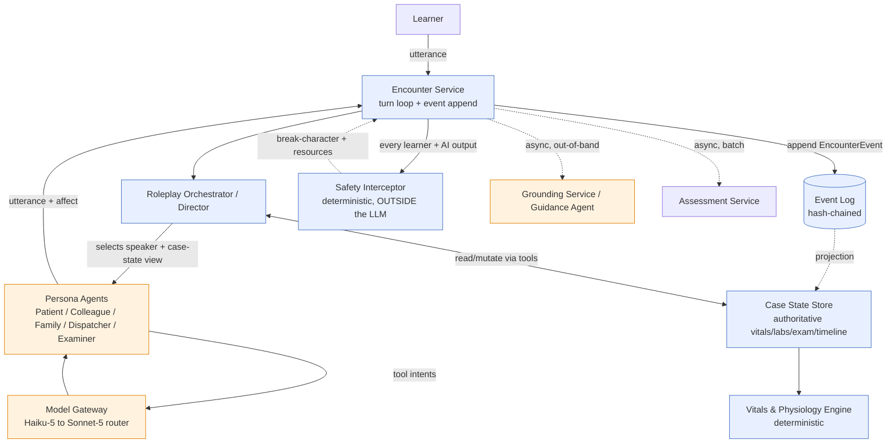
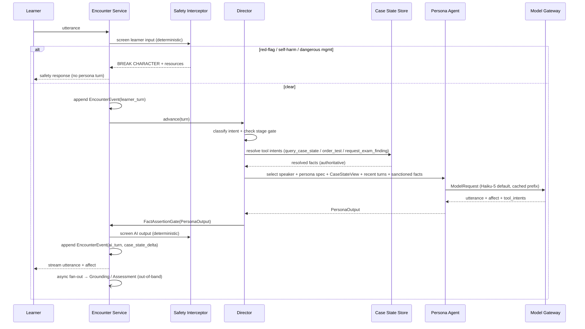

# 01 — AI Agent Architecture: The Multi-Agent Roleplay Engine

**Scope.** How AcuDx runs a live clinical encounter as a multi-agent roleplay: who speaks, how case state advances through the mandated stages (history → exam → tests → dx → mgmt), how persona agents are *structurally* prevented from inventing clinical facts, the memory model, the tool-use surface, the prompt structure engineered for prompt-cache hits, how patient variants are parameterized, and where the deterministic Safety Interceptor sits. This is the **conversation-loop clock** (100s of ms). Grounding/assessment (seconds, out-of-band) and analytics (batch) are separate documents and separate clocks; this doc names the seams but never blocks on them.

**Grounding.** Model tiers, prices, and the 3-tier routing strategy are pinned in `docs/research/01-llm-models-and-cost.md`; the guideline-grounding pipeline and `GuidelineStatement` atom in `docs/research/05-clinical-guideline-grounding.md`; the 6-domain rubric and grader-family separation in `docs/research/07-assessment-science.md`; the MVP wedge and non-negotiables in `docs/00-overview/01-requirements-and-constraints.md`. This doc consumes those; it does not re-derive them.

**The three canonical invariants this engine exists to enforce.**
1. **Two-tier content architecture.** A GROUNDED layer owns *all* clinical facts (citation-or-refuse); a ROLEPLAY layer improvises affect/persona only and *cannot assert clinical facts*. The AI-patient never sources clinical facts — the **Case State Store** does.
2. **Three isolated clocks.** The conversation loop must never block on grounding or assessment. Persona turns are Haiku-tier and streamed; grounding/grading run out-of-band.
3. **Event-sourced source of truth.** The append-only, hash-chained **Event Log** is authoritative; the live case state, conversation memory, and vitals are all deterministically-replayable **projections** of `EncounterEvent`s.

---

## 1. Agent topology

Four kinds of process participate in a turn. Only one of them (persona agents) is an actor; the rest are deterministic services or grounded, out-of-band workers.



**Reading the topology.**
- **Encounter Service** is server-authoritative. It owns the turn loop, appends every learner and AI utterance to the Event Log, and is the *only* component that emits the final AI utterance to the client — after the Safety Interceptor has cleared it.
- **Roleplay Orchestrator ("Director")** is a deterministic controller, *not* an LLM by default. It decides who speaks, enforces stage gating, and mediates all case-state access. (An optional Sonnet-tier "director hint" exists for genuinely ambiguous multi-party turns — §3.4 — but the default path is code.)
- **Persona Agents** are the only LLM actors on the hot path. They receive a persona spec + a *scoped view* of case state + recent turns, and emit an utterance + affect + optional tool intents. They **cannot** read arbitrary case state; they request it through tools the Director authorizes.
- **Model Gateway** is the only path to any LLM/embedding. Persona agents never hold a vendor SDK; they emit a `ModelRequest` and the Gateway routes Haiku→Sonnet→Opus per `docs/research/01`.
- **Grounding/Guidance and Assessment** hang off the Event Log asynchronously. Nothing on the conversation clock waits for them.

---

## 2. The two-tier content boundary, in code

This is the safety spine. The claim "the persona cannot assert a clinical fact" is not a prompt-engineering hope — it is enforced structurally, at three layers, so that a jailbroken or hallucinating persona model still cannot leak a wrong lab value to the learner.

**Layer 1 — the persona never has the numbers.** The persona agent's context window contains the persona spec, the learner's turns, and a **redacted case-state view** (`CaseStateView`) that deliberately omits authoritative clinical values. The AI-patient knows it is "short of breath and frightened," not that its `SpO2 = 88%`. It cannot recite a number it was never given.

**Layer 2 — facts arrive only via tools, resolved by deterministic services.** When the learner asks "what's my oxygen level?", the persona does not answer from parametric memory. It emits a `request_clinical_fact` tool intent. The Director resolves it against the Case State Store (deterministic), and the *resolved value* is injected as a system-authored fact turn, formatted for the persona to *deliver in character* ("The nurse says your oxygen is a bit low, 88%") — the persona restyles affect around a value it did not choose.

**Layer 3 — the fact-assertion gate (deterministic, pre-emit).** Every persona utterance passes a `FactAssertionGate` before the Encounter Service emits it. The gate is a cheap deterministic classifier + regex/NER pass (nano/Flash-Lite tier per `docs/research/01` §2, plus hard rules) that detects **unsanctioned clinical assertions**: numeric vitals/labs, drug names/doses, diagnostic verdicts, or test results *not present in a resolved tool response this turn*. On a hit, the utterance is **rejected and regenerated** with a stricter directive, or the persona is made to deflect in character ("I don't know my numbers, doctor — you'd have to check"). This gate is the code-level embodiment of "citation-or-refuse" for the *roleplay* layer, mirroring the Grounding Service's citation gate for the *grounded* layer.

```
Persona output  ─▶  FactAssertionGate (deterministic)
                       ├─ no clinical assertion            → pass
                       ├─ assertion == resolved-tool-value → pass (persona is delivering a sanctioned fact)
                       └─ assertion ∉ sanctioned set       → REJECT → regenerate / deflect-in-character
```

**Why three layers and not one.** Layer 1 removes the *ability* to hallucinate a specific value (the biggest surface). Layer 2 makes the *legitimate* path — a nurse reporting a real value — flow through authoritative state. Layer 3 catches the residual: a model that *guesses* ("your potassium is probably fine, around 4.0") even without being told the number. Defense-in-depth, because a single prompt instruction is known to be insufficient (`docs/research/01` §6).

---

## 3. The Director loop

The Director is the deterministic heart of a turn. It runs entirely on the conversation clock and never calls the frontier tier.

### 3.1 Turn sequence



### 3.2 Speaker selection

Who speaks is decided deterministically from encounter configuration and the last turn, not by an LLM:

1. **Directed address.** If the learner addressed a named role ("Nurse, can you get a set of obs?"), that role speaks. Simple NER + role-alias table.
2. **Role affinity.** Otherwise, the intent class maps to a role: a *history question* → Patient (or Family, if the patient is the redacted-view child/impaired variant with a proxy historian); an *order/consult* → Colleague; a *dispatch/handover* → Dispatcher; an *examination request* → resolved by the Director against Case State (returns findings), narrated by Patient affect.
3. **Director backfill.** In multiplayer, unfilled human roles are backfilled by AI personas (Room Service supplies role assignment; §7). The Director picks at most one AI speaker per turn to keep turn-taking legible; queued personas wait.
4. **Silence is valid.** If no role should speak (e.g., the learner is thinking aloud, or ordered a test whose result is pending on the physiology clock), the Director emits no persona turn and the UI shows a pending indicator.

### 3.3 Stage gating (history → exam → tests → dx → mgmt)

Stages are **soft-gated, not hard-locked** — clinicians work non-linearly, and forcing strict order would mis-train. The Director tracks `current_stage` as a projection of the Event Log and enforces:

- **Monotone-ish progression with allowed backtrack.** The learner may revisit history during management; the Director records the *dominant* stage per turn for pacing and scoring but does not refuse an out-of-order action.
- **Prerequisite guards on state mutation, not on conversation.** A `management` action that presupposes a diagnosis the learner never committed is *permitted* but flagged as an `EncounterEvent(unsupported_action)` — this becomes evidence for the Assessment Service ("prescribed antibiotics before establishing a source"), never a UI block.
- **Reveal discipline.** Test results and exam findings are only *served* when the learner *requests* them; the Director will not volunteer a lab the learner didn't order. This preserves the assessment signal (did they think to check?).
- **Time-pressure hooks.** For OSCE/paramedic modes, a hard timer runs; the Director can trigger a Colleague/Dispatcher prompt ("We're two minutes out — what's your plan?") as a scripted stage-advance nudge, emitted as an `EncounterEvent(director_prompt)`.

`current_stage ∈ {history, exam, tests, differential, diagnosis, management, wrap_up}`. The transition function is pure: `stage(t+1) = f(stage(t), dominant_intent(turn), committed_artifacts)` and is replayable from the Event Log.

### 3.4 When the Director escalates to an LLM

The default Director is code. It calls the Model Gateway (Sonnet-tier) only for a bounded "director hint" in two cases: (a) **ambiguous multi-party address** where NER + affinity are under-confident, and (b) **naturalistic turn-taking** in a >2-party voice room (who would realistically interject). The hint returns only a `speaker_id` + optional `interject: bool`; it never touches clinical facts. This keeps the frontier out of the hot path and the decision auditable.

---

## 4. Persona agent contract

Every persona agent — Patient, Colleague, Family, Dispatcher, Examiner — implements one contract. The differences are entirely in the **persona spec** (data), not the code path.

### 4.1 Inputs

```ts
interface PersonaTurnInput {
  persona: PersonaSpec;            // cached, byte-stable → prompt-cache prefix (§6)
  caseBrief: CaseBriefRedacted;    // cached: the persona's *narrative* knowledge, NO authoritative numbers
  caseStateView: CaseStateView;    // volatile-but-scoped: qualitative signs the persona can feel/express
  recentTurns: Turn[];             // volatile suffix: last K turns (sliding window)
  sanctionedFacts: SanctionedFact[]; // facts resolved THIS turn by the Director for in-character delivery
  variant: VariantParams;          // geriatric/anxious/aggressive/low-literacy/non-native/... (§5)
  directives: TurnDirectives;      // e.g. {maxWords, mustDeflectClinicalFacts:true, allowBargeIn}
}
```

`CaseStateView` is the load-bearing redaction. Example — a persona *feels* "very short of breath, chest feels tight, frightened," never `SpO2:88, RR:32, troponin:pending`. The mapping from authoritative `VitalsSample`/`ClinicalSign(intensity)` to a persona-safe qualitative view is a deterministic function in the Vitals & Physiology Engine (`intensity → adjective band`), so the avatar, the monitor, and the patient's words never contradict (`docs/00-overview` AV-1).

### 4.2 Outputs

```jsonc
{
  "speaker_id": "patient",
  "utterance": "It's... it hurts to breathe. Please, can you do something?",
  "affect": { "primary": "fear", "intensity": 0.7, "prosody": "breathless", "nonverbal": ["clutches chest"] },
  "tool_intents": [
    { "tool": "request_clinical_fact", "args": { "query": "own_oxygen_level" } }
  ],
  "meta": { "self_confidence": 0.9, "in_persona": true, "requested_escalation": false }
}
```

- **`utterance`** — natural-language, restyled by variant.
- **`affect`** — structured, consumed by TTS prosody (Cartesia Sonic-3) and the 2D/3D avatar; has a full non-voice equivalent (caption + emotion label) per the accessibility invariant.
- **`tool_intents`** — the *only* channel through which a persona can obtain a clinical fact. Zero or more; resolved by the Director *before* the utterance is finalized when the fact must appear in this turn (§4.3).
- **`meta.self_confidence` / `in_persona`** — cheap escalation signals for the router (`docs/research/01` §3): low confidence or persona-break → Director re-runs the turn at Sonnet-tier.

### 4.3 Two tool-call timings

Persona tool intents resolve in one of two ways, chosen by the Director:

- **Pre-resolve (blocking within the turn, still on conversation clock).** For "what's my oxygen?" the Director resolves `request_clinical_fact` *first*, injects the value as a `SanctionedFact`, and re-prompts the persona so the utterance delivers a real number. One extra Haiku round-trip (~500 ms) — acceptable within the p95<1.5s text SLO.
- **Post-turn side-effect.** For "order a chest X-ray," the persona/Colleague acknowledges in character immediately ("I'll get that ordered"), and the Director appends an `EncounterEvent(order_test)` that the Vitals & Physiology Engine resolves on its own timeline; the result surfaces to the learner only when requested, later. No blocking.

The Director chooses pre-resolve iff the fact is *self-knowable and immediately askable* (patient's own current sensation reported by staff); everything else is a side-effect.

---

## 5. Patient-variant parameterization

Variants are **data overlays on a base persona spec**, not separate agents or separate models. This keeps the cached prefix stable across most of the spec and confines volatility to a small `VariantParams` block (which is itself part of the cached prefix, since it's fixed for the encounter — see §6). Variants tax *communication*, not *reasoning* (`docs/research/07` §difficulty axes), and must never leak into the doctor's *clinical* score — only into the communication domain.

```jsonc
{
  "variant_id": "geriatric-anxious-lowlit-v3",
  "axes": {
    "age_register": "geriatric",        // vocabulary, pacing, hearing/repetition needs
    "affect_baseline": "anxious",       // elevated fear/uncertainty, catastrophizing tendency
    "health_literacy": "low",           // avoids jargon; needs teach-back; may agree without understanding
    "language": { "l1": "es", "target": "en", "proficiency": "B1", "accent": true },
    "cognition": "intact",              // vs. mild_impairment | needs_proxy_historian
    "cooperation": 0.6                  // 0..1: aggressive/guarded → withholds; cooperative → forthcoming
  },
  "behaviors": {
    "info_disclosure": "gated_on_rapport",   // reveals more if learner shows empathy / open questions
    "jargon_response": "confused_then_disengage",
    "interrupt_probability": 0.15,           // barge-in tendency (voice)
    "repair_strategies": ["asks_to_repeat", "code_switch_l1_filler"]
  }
}
```

**How each variant changes the turn without changing the code path:**

| Variant | Prompt effect | Turn-taking / voice knob | Assessment guard |
|---|---|---|---|
| **Geriatric** | slower pacing, may mishear, tangential history | longer pause tolerance, higher repeat rate | tests patience/verification, not slower = worse |
| **Anxious** | catastrophizes, seeks reassurance, jumps topics | higher interrupt probability | rewards de-escalation & signposting |
| **Aggressive** | guarded, challenges authority, withholds unless de-escalated | high barge-in, low pause tolerance | scores de-escalation; never scores learner "toughness" |
| **Low-literacy** | avoids/confused by jargon, false agreement | needs teach-back | rewards plain language, teach-back; jargon penalized in *communication* only |
| **Non-native** | L1 code-switch fillers, B1 syntax, asks to repeat | STT low-confidence → text fallback (`docs/00-overview` V-2) | **language ≠ clinical**: fluency must not leak into clinical score (`docs/research/07` §85–88) |
| **Cognitively impaired / pediatric-via-parent** | unreliable/absent self-history → Director routes history to Family/proxy | proxy persona speaks | tests collateral-history skill |

The `VariantParams` block is appended to the persona spec **before** the volatile suffix, so it stays inside the cached prefix (fixed per encounter). Switching variants means a new encounter (new cached prefix), not a mid-encounter prompt mutation.

---

## 6. Prompt structure engineered for cache hits

The single biggest per-encounter cost lever is prompt caching on the persona prefix (~55% of the optimized saving; `docs/research/01` §4). The rule: **byte-stable cached prefix, small volatile suffix.** Anthropic minimum cacheable prefix is 4096 tokens (Haiku/Opus), 2048 (Sonnet 5); cache reads cost ~0.1× input. We engineer the persona prompt as three ordered blocks.

### 6.1 Block layout

```
┌─ SYSTEM (cached, byte-stable, ~2–4K tokens) ───────────────────────────┐
│  • Roleplay-layer charter + hard rules (two-tier boundary, deflect     │
│    clinical facts, stay in persona, output schema)                     │
│  • PersonaSpec: identity, backstory, voice, affect baseline            │
│  • CaseBriefRedacted: the persona's NARRATIVE knowledge (symptoms as   │
│    experienced) — NO authoritative numbers, NO diagnosis               │
│  • VariantParams (fixed for this encounter)                            │
│  • Tool schemas (request_clinical_fact, order_test, request_exam_...)  │
├─ DEVELOPER (cached, byte-stable) ──────────────────────────────────────┤
│  • Output JSON contract; affect vocabulary; length/style directives    │
│  • FactAssertionGate reminder ("you do not know your own numbers")     │
├─ USER / VOLATILE SUFFIX (fresh each turn, cheap) ──────────────────────┤
│  • recentTurns (sliding window, last K)                                │
│  • sanctionedFacts resolved this turn (if any)                         │
│  • the learner's current utterance                                     │
└────────────────────────────────────────────────────────────────────────┘
```

The `cache_control: {type: "ephemeral"}` breakpoint is placed at the **end of the DEVELOPER block**. Everything above it is the cached prefix; everything below is billed fresh.

### 6.2 Byte-stability rules (violating any one silently misses the cache)

- **No `datetime.now()`, UUIDs, request IDs, or turn counters in the prefix.** Time and IDs live in the volatile suffix or in metadata outside the cached bytes.
- **Deterministic serialization.** `JSON.stringify` with sorted keys for any structured spec; no map/set iteration-order dependence.
- **Sliding-window suffix, not growing prefix.** Old turns are summarized into a compact running state (server-side compaction, `compact-2026-01-12`) and *never* re-inserted into the prefix; the prefix is frozen at encounter start.
- **Variant baked into the prefix.** Because variant is fixed per encounter, it belongs in the cached block — mutating it mid-encounter would invalidate the cache and is disallowed (§5).
- **One persona = one prefix = one cache entry.** In multiplayer, each AI persona has its own cached prefix; they do not share.

### 6.3 Concrete skeleton (Patient Agent, anxious/low-literacy variant)

**SYSTEM (cached):**
```text
You are role-playing a PATIENT in a medical-education simulation. This is the
ROLEPLAY layer. You improvise emotion, personality, and phrasing ONLY.

HARD RULES (never violate):
1. You are NOT a source of clinical facts. You do not know your vital signs,
   lab values, test results, or diagnosis. If asked, say so in character or
   report only what staff have just told you (provided to you as FACTS).
2. Never state a number, drug name, dose, test result, or diagnosis unless it
   appears verbatim in a FACTS block for THIS turn.
3. Stay in persona. Express symptoms as you FEEL them, not as measurements.
4. Output ONLY the JSON object defined in the developer message.

WHO YOU ARE:
  Name: Rosa Delgado. Age 71. Retired seamstress. Lives with daughter.
  You came in because breathing got hard over two days and now it frightens you.
  You experience: heavy chest tightness, breathlessness on minimal effort, a
  cough, exhaustion. You are SCARED and want reassurance.

HOW YOU COMMUNICATE (variant):
  - Spanish first language, English at ~B1; you sometimes search for words and
    say "how you say..." and slip a Spanish filler ("ay, dios").
  - Low health literacy: medical jargon confuses you; you may nod and agree
    without understanding. You open up MORE when the doctor is warm and uses
    plain words; you withdraw when rushed or talked-down-to.
  - Anxious: you catastrophize ("is it my heart? am I dying?") and seek comfort.

TOOLS: [request_clinical_fact, ...]  // schemas below
```

**DEVELOPER (cached):**
```text
Respond with ONE JSON object:
{ "speaker_id":"patient", "utterance": "...", "affect": {...}, "tool_intents":[...], "meta":{...} }
affect.primary ∈ {fear,pain,relief,confusion,anger,sadness,calm}; intensity 0..1.
Keep utterance ≤ 45 words. Reminder: you do NOT know your own numbers.
```

**USER (volatile, fresh each turn):**
```text
[FACTS provided this turn]: (none)
[Recent conversation]:
  DOCTOR: "Hello Rosa, I'm Dr. Lee. Can you tell me what brought you in?"
[DOCTOR just said]: "Your oxygen saturation is a little low. I'm going to give you some oxygen, okay?"
```

Here the doctor volunteered a number *to the patient*; the patient may echo it as reported speech ("you say my oxygen is low?") but must not invent a value, and the FactAssertionGate confirms the only number present was doctor-supplied.

### 6.4 Tool JSON schemas (the agent tool-use surface)

Persona/Director tools. All are idempotent and resolved by deterministic services; none reach an LLM for the fact itself.

```jsonc
// 1) Persona asks for a fact the patient could plausibly know (own sensation / staff-reported)
{
  "name": "request_clinical_fact",
  "description": "Request a clinical fact the persona may legitimately know or be told. Resolved from Case State Store; NEVER answered by the model.",
  "input_schema": {
    "type": "object",
    "properties": {
      "query": { "type": "string", "enum": [
        "own_symptom_onset","own_symptom_severity","own_medication_list",
        "own_allergy_list","staff_reported_value","prior_history"
      ]},
      "detail": { "type": "string", "description": "free-text scope, e.g. 'oxygen level'" }
    },
    "required": ["query"]
  }
}

// 2) Director/Colleague: order a test → side-effect, resolved on the physiology clock
{
  "name": "order_test",
  "description": "Record a learner-initiated test order as an EncounterEvent. Result is NOT returned inline; it becomes available later when requested.",
  "input_schema": {
    "type": "object",
    "properties": {
      "test_code": { "type": "string", "description": "LOINC or local test code" },
      "test_name": { "type": "string" },
      "priority":  { "type": "string", "enum": ["routine","urgent","stat"] }
    },
    "required": ["test_code","test_name"]
  }
}

// 3) Director: resolve a requested exam finding from authoritative case state
{
  "name": "request_exam_finding",
  "description": "Resolve a physical-exam maneuver against Case State Store; returns authoritative finding intensity for narration.",
  "input_schema": {
    "type": "object",
    "properties": {
      "region": { "type": "string", "enum": ["general","cardio","resp","abdo","neuro","msk","skin","heent"] },
      "maneuver": { "type": "string", "description": "e.g. 'auscultate lung bases'" }
    },
    "required": ["region","maneuver"]
  }
}

// 4) Director: read scoped case state (Director-only; never exposed to persona prompt)
{
  "name": "query_case_state",
  "description": "Director-only read of authoritative case state at current snapshot. Returns values NEVER placed in a persona prompt except via SanctionedFact.",
  "input_schema": {
    "type": "object",
    "properties": {
      "keys": { "type": "array", "items": { "type": "string" } },
      "as_of": { "type": "string", "description": "snapshot id / event offset; defaults to latest" }
    },
    "required": ["keys"]
  }
}
```

**Resolution contract.** `order_test` and `request_exam_finding` return an ack token synchronously and append an `EncounterEvent`; the *value* is produced by the Vitals & Physiology Engine deterministically and served only on later request. `request_clinical_fact` returns a `SanctionedFact` the Director injects into the *next* persona prompt. `query_case_state` is Director-internal and its output is never serialized into any persona context.

---

## 7. Memory model

Three tiers, mapped to the three-clock invariant, all projections of the Event Log.

| Memory | Horizon | Store | Authority | On the hot path? |
|---|---|---|---|---|
| **Short-term conversation** | last K turns (sliding) | Redis stream keyed by `encounter_id` | non-authoritative; replayable from Event Log | Yes — becomes the volatile suffix |
| **Running case-state summary** | whole encounter, compacted | Redis + periodic snapshot | derived; recomputable | Yes — replaces raw old turns to keep prefix frozen |
| **Case State (authoritative long-term)** | whole encounter | Case State Store (Postgres + JSONB), projected from Event Log | **authoritative** vitals/labs/exam/timeline | Director-only; never in persona prompt raw |
| **Persona backstory retrieval** | static per case | Grounding-adjacent vector index (pgvector/Qdrant HNSW) | authored, versioned | On demand, rare — retrieves *narrative* backstory chunks, never clinical facts |

**Key distinctions.**
- **Conversation memory is cheap and lossy by design.** After K turns, older turns are summarized into the running case-state summary (a compact "what the learner has established so far" object) rather than re-sent — this both cuts tokens and keeps the cached prefix byte-stable.
- **Case State is the authoritative long-term memory** and the only place clinical facts live. It is a deterministic projection of `EncounterEvent`s; replaying the log reproduces it exactly. The persona never reads it directly.
- **Backstory retrieval** lets a long-running or richly-authored persona pull *narrative* detail ("Rosa's late husband, her fear of hospitals") from a vector index, scoped so the retriever can only return non-clinical backstory chunks (index partition tagged `narrative`, never `clinical`). This reuses the HNSW layer but is a *separate partition* from the GuidelineStatement index.

**Multiplayer note.** Room Service holds room state, presence, and role assignment as its own event-sourced projection; each AI persona in a room has its own conversation-memory stream and its own cached prefix. AI backfill of an unfilled human role is an `EncounterEvent(role_assigned, ai=true)` — replayable, auditable.

---

## 8. Guardrails and the Safety Interceptor

Two distinct mechanisms, deliberately separated:

**A. The FactAssertionGate (content-boundary guardrail, §2).** Deterministic, per-persona-output, *inside* the roleplay pipeline. Its job is the two-tier boundary: no unsanctioned clinical assertion escapes. It is *not* a safety kill-switch.

**B. The Safety Interceptor (deterministic, OUTSIDE the LLM).** Screens **every learner input and every AI output** for red-flags: self-harm/suicidality, safeguarding/abuse disclosure, and dangerous learner management (e.g., a contraindicated stat drug order). On a hit it **breaks character** — the roleplay pauses, the persona layer is suspended, and the Encounter Service surfaces resources and (in summative mode) flags a `HazardLogEntry`. Placement is critical and shown in the §3.1 sequence:

```
learner utterance ─▶ Safety Interceptor (pre) ─▶ [clear] ─▶ Director ─▶ persona ...
                       └─ [red-flag] ─▶ BREAK CHARACTER (no persona turn)

persona utterance ─▶ FactAssertionGate ─▶ Safety Interceptor (post) ─▶ [clear] ─▶ emit
                                              └─ [red-flag] ─▶ BREAK CHARACTER
```

**Why the Interceptor is deterministic and outside the LLM.** A safety mechanism implemented as a prompt instruction can be jailbroken or hallucinated away; a self-harm disclosure must trigger resources with 100% reliability regardless of model behavior (`docs/00-overview` RP-7, G-3). It runs as rules + a small classifier (nano/Flash-Lite tier), never gated behind the persona model's cooperation. It is the "kill-switch" clinical governance tests against.

**Other guardrails inherited from canon (not re-implemented here):**
- **Synthetic patients only / PHI block.** A deterministic PHI detector on learner input blocks real-identifier entry; `no_train=true` on all learner data and every Model Gateway call.
- **No learner-emotion inference.** The engine infers *persona* affect for the AI actor; it never infers or scores the *learner's* emotional state (EU-prohibited).
- **Grader family ≠ patient-agent family.** Enforced at the Assessment Service (out-of-band), but named here because the patient-agent model family (Haiku/Sonnet, Anthropic) is chosen partly so the grader can be a *different* family (`docs/research/07` §85). Ensemble ≥2 families on high-stakes items.

---

## 9. Model routing on the hot path

Per `docs/research/01` §2–3, pinned so this engine survives version churn:

| Turn type | Default | Escalate to | Trigger |
|---|---|---|---|
| Patient/Family turn | **Claude Haiku 4.5** ($1/$5 per 1M, ~500 ms) | Sonnet 5 | persona-break, low `self_confidence`, complex de-escalation, FactAssertionGate reject |
| Colleague/Examiner turn | **Claude Sonnet 5** ($3/$15) | Opus 4.8 | contested clinical reasoning edge cases |
| Director "hint" (rare) | Sonnet 5 | — | ambiguous multi-party address only |
| Guidance/Socratic hint | Sonnet 5 + RAG (out-of-band) | Opus 4.8 | grounding gap / high uncertainty |
| Grading (batch, out-of-band) | Opus 4.8 via Batch API (−50%) | Fable 5 only if needed | high-stakes item |

Escalation signals (`meta.self_confidence`, `in_persona`, gate rejects) are cheap and computed on the small-model output; ~80–90% of patient turns never leave Haiku. All routing is the Model Gateway's job; persona agents emit a provider-agnostic `ModelRequest`. **Avoid Fable 5 in the live roleplay path** — it refuses bio/cyber-adjacent content and would break character on clinical scenarios (`docs/research/01` §6); reserve it for authoring with an Opus fallback.

**Latency budget for one Haiku patient turn (target p95 < 1.5 s):** cached-prefix read (~0.1× input, negligible) + fresh suffix (~2K in) + ~150 tokens out, streamed → TTFB well under the SLO; the only turn that spends a second round-trip is a pre-resolved `request_clinical_fact` (§4.3), still within budget.

---

## 10. Failure modes and how the engine degrades

| Failure | Detection | Degradation |
|---|---|---|
| Persona model hallucinates a lab value | FactAssertionGate (deterministic) | reject → regenerate → deflect-in-character; never reaches learner |
| Model Gateway timeout / provider outage | Gateway health check | retry once, then serve a scripted deflection turn; encounter continues in text |
| Case State Store unavailable | Director tool call fails | Director serves last-known snapshot from Event Log projection; blocks reveal of *new* facts, not conversation |
| Safety Interceptor false-negative risk | red-team CI suite (`docs/research/05` §4) | tuned toward high recall; false-positive break-character is acceptable, false-negative is not |
| Prompt-cache miss (byte drift) | cost/latency telemetry spike per encounter | alarm; the prefix-linter (CI) rejects any prefix containing time/UUID/unsorted-JSON before deploy |
| STT low confidence (voice, non-native) | Deepgram confidence score | fall back to text entry — never silently mis-transcribe into a mis-score (`docs/00-overview` V-2) |

---

## Open questions & build sequence

**Must be decided before build:**
1. **`CaseStateView` redaction schema.** The exact `intensity → qualitative-adjective` mapping (per `ClinicalSign`) that produces persona-safe views without letting a number leak. Owned jointly by clinical content + Vitals & Physiology Engine. *Blocks everything in §2/§4.*
2. **FactAssertionGate detector spec.** What counts as an "unsanctioned clinical assertion" — the NER/regex rule set + the small-model classifier threshold, plus its red-team corpus. This is the safety spine; it needs a labeled eval set before it can ship. *Blocks §2 Layer 3.*
3. **Stage-transition function `f`.** The precise intent→dominant-stage classifier and the `unsupported_action` flagging rules, agreed with the Assessment Service so scoring and pacing use one definition. *Blocks §3.3.*
4. **Sanctioned-fact re-prompt latency.** Confirm the pre-resolve extra Haiku round-trip stays under p95<1.5s under load; if not, move more facts to post-turn side-effects.
5. **Director LLM-hint boundary.** Whether the rare multi-party speaker-selection hint is worth the auditability cost, or whether a purely deterministic address-resolution table suffices for MVP (it likely does for solo text — the wedge).

**Build sequence (MVP = solo text-first EM roleplay, per `docs/00-overview`):**
1. **Event Log + Case State projection + Vitals & Physiology Engine** — the authoritative substrate; everything reads from it. Deterministic, replayable, no LLM.
2. **Deterministic Director** (speaker selection + stage gating) + **Patient Agent contract** on Haiku with a cached prefix. Prove the prompt-cache hit rate and the p95 latency on solo text first.
3. **The two-tier boundary end-to-end**: `CaseStateView` redaction → `request_clinical_fact` pre-resolve → **FactAssertionGate**. This is the differentiator and the safety spine; do not ship roleplay without it.
4. **Safety Interceptor** (deterministic, outside the LLM) on both input and output, with its red-team suite in CI.
5. **Variant overlays** (geriatric/anxious/aggressive/low-literacy/non-native) as data on the base spec — the roleplay depth competitors lack.
6. **Async fan-out to Grounding/Guidance and Assessment** — wired but strictly out-of-band; the conversation clock never waits on them.
7. **Role sub-agents (Colleague/Family/Dispatcher/Examiner) + Room Service backfill** — the multiplayer/role-interchange fast-follow, once the solo loop is flawless.
```
