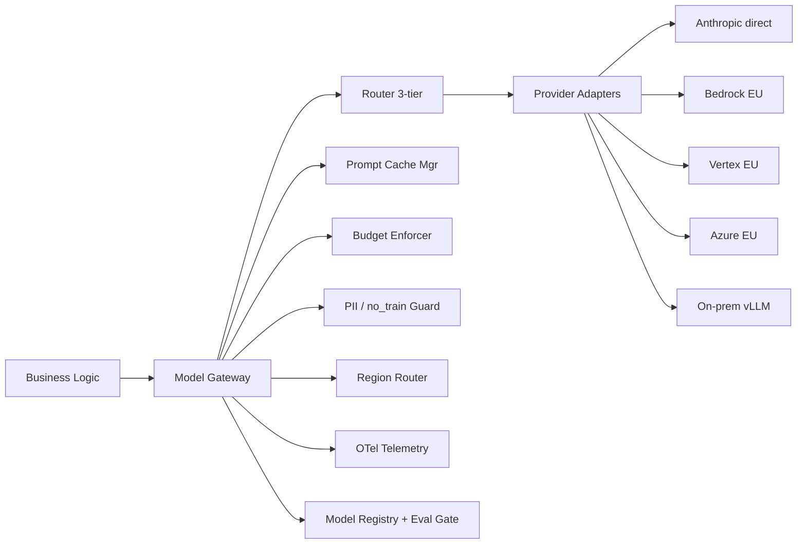
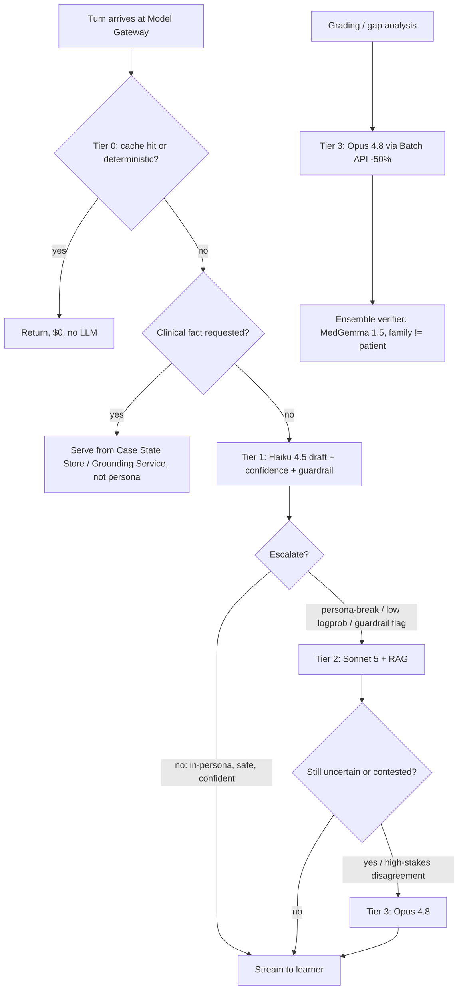
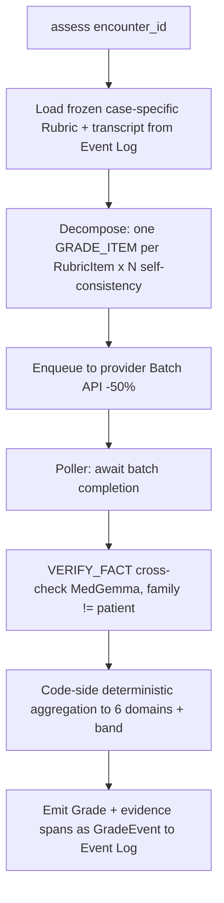

# 02 — Model Gateway & 3-Tier Routing

**Status:** Architecture. Realizes requirement **AD-4** (internal model gateway, no vendor SDK in business logic, 3-tier router pinned not model IDs) and the cost architecture of `[research:models]` / §3.1 of `01-requirements-and-constraints.md`. Downstream consumers: Roleplay Orchestrator, Persona Agents, Guidance Agent, Grounding Service, Assessment Service, Authoring Service. Every LLM/embedding/model call in AcuDx flows through this component — there is no other path.

**Time context:** July 2026. Prices below are snapshots from `[research:models]` (per 1M tokens). **Pin the router and its interfaces; treat model IDs and `$` as configuration that lives in the Model Registry, never in code.**

---

## 1. Why a gateway (the load-bearing invariants it enforces)

The Model Gateway is the single chokepoint through which the following CANON invariants are *mechanically* enforced rather than left to caller discipline:

- **MODEL GATEWAY is the ONLY path to any LLM/embedding/model.** Business logic never imports `@anthropic-ai/sdk`, `openai`, `@google-cloud/vertexai`, or a Bedrock client. A CI lint rule (`no-restricted-imports`) fails the build if any package outside `packages/model-gateway/` imports a vendor SDK.
- **THREE ISOLATED CLOCKS.** The gateway exposes three distinct call surfaces with different SLOs and backpressure policies: `chat()` (conversation loop, 100s of ms, streamed), `ground()`/`assess()` (out-of-band, seconds), `batch()` (analytics/authoring, minutes–hours). A slow grounding call can **never** occupy a conversation-loop worker.
- **TWO-TIER CONTENT ARCHITECTURE.** The gateway is content-agnostic transport, but the *routing policy* encodes it: a `clinical_fact_needed` signal short-circuits the persona model entirely and hands control back to the caller to serve from the **Case State Store** / **Grounding Service**. The persona model is never asked to source a fact.
- **GRADER family ≠ PATIENT-AGENT family.** Enforced as a hard constraint in the router: an `assess()` request whose `patient_model_family` equals the resolved grader family is rejected at config-resolution time (fail-closed), not at runtime.
- **no_train=true default; PII detect-and-block; region routing.** Every outbound request carries `no_train: true` and a residency tag unless an explicit, logged institutional opt-in overrides it. A deterministic PII/PHI scrubber runs before any bytes leave the region boundary.
- **EVENT-SOURCED audit.** Every model call emits a `ModelCallEvent` (append-only, hash-chained) into the Event Log with `model_config_id`, `prompt_hash`, `cache_hit`, token counts, cost, latency, region, and escalation reason. The Model Registry version served is reconstructable for any encounter at any past date.

---

## 2. Gateway responsibilities & component map



| Responsibility | What it does | Key mechanism |
|---|---|---|
| **Provider abstraction** | Uniform request/response over Anthropic (direct + Bedrock/Vertex/Azure), OpenAI, Google, on-prem vLLM. | `ProviderAdapter` interface (§10); capability manifest per adapter (streaming, prompt-cache, batch, citations, structured-output). |
| **Routing** | Resolve `TaskType` → `ModelConfig` (tier + model + params), apply escalation signals, enforce family constraints. | Decision table (§4) + Model Registry lookup. |
| **Prompt caching** | Construct byte-stable cached prefixes; manage cache keys, TTL, hit-rate SLO. | Prefix-builder + cache-breakpoint policy (§5). |
| **Batching** | Queue non-interactive work (grading, gap analysis, authoring) to provider Batch APIs at −50%. | Batch pipeline + poller (§6). |
| **Retries / fallback / circuit-breaking** | Retry idempotent calls; failover across providers/regions; trip breakers on error-rate/latency. | Per-provider circuit breaker + fallback chain (§8). |
| **Budget enforcement** | Per-encounter, per-tenant, per-day soft/hard caps; degrade before overrun. | Redis token-bucket + budget ledger (§7). |
| **Telemetry** | cost/encounter, cache-hit %, escalation-rate, p50/p95 per tier & task. | OpenTelemetry spans + metrics (§11). |
| **PII / no_train** | Detect-and-block real PHI at ingress; force `no_train`/zero-retention on egress. | Deterministic scrubber + per-request policy (§9). |
| **Region routing** | Pin each tenant's inference to a residency-compliant endpoint. | `region → provider/model` map from Registry (§9). |
| **Registry integration** | No silent swaps: only Registry-blessed `ModelConfig`s (passed eval gate) are routable. | Eval-gated promotion (§12). |

---

## 3. Task ↔ tier mapping (canonical)

From `[research:models]` §2, expressed as the gateway's `TaskType` enum and default routing. Frequencies are per reference encounter (~40 turns, 15-min ED case).

| `TaskType` | Clock | Freq/enc | Default tier / model | Escalate to | Batch? | Notes |
|---|---|---|---|---|---|---|
| `PATIENT_TURN` | conversation | 20–60 | **T1 · Haiku 4.5** ($1/$5) | T2 Sonnet 5 | no | Persona in cached prefix; streamed. |
| `PERSONA_TURN` (Colleague/Family/Dispatcher) | conversation | 3–10 | **T1 · Haiku 4.5** | T2 Sonnet 5 | no | Director selects speaker; same routing as patient. |
| `EXAMINER_TURN` | conversation | 3–10 | **T2 · Sonnet 5** ($3/$15) | T3 Opus 4.8 | no | Light clinical reasoning, conversational. |
| `GUIDANCE_HINT` | out-of-band | 5–20 | **T2 · Sonnet 5 + RAG** | T3 Opus 4.8 | no | Grounded+cited only; retrieval, not long-context. |
| `GUARDRAIL_CHECK` | conversation | every output | **T1 · Flash-Lite/nano** classifier | — | no | Cheap gate; runs on small-model output pre-stream. |
| `TERM_TRANSLATION` | out-of-band | on-demand | **T1 · Haiku / Flash-Lite** | T2 Sonnet | no | Glossary cached; translation-memory first. |
| `EMBEDDING` | out-of-band | authoring/index | embedding model (per region) | — | yes | For Grounding Service HNSW index. |
| `GRADE_ITEM` | out-of-band (batch) | 1 batch (10–40 items) | **T3 · Opus 4.8 Batch** ($2.50/$12.50) | Fable 5 only if needed | **yes** | Decomposed evidence-span judgments; family ≠ patient. |
| `VERIFY_FACT` | out-of-band | per hint/grade | **MedGemma 1.5 / Meditron** | — | yes (with grade) | Generate-then-verify cross-check; family ≠ generator. |
| `CASE_AUTHOR` | batch | offline, rare | **Opus 4.8 / Fable 5** | — | yes | Human-authoritative; cost amortized over thousands of runs. |
| `CALIBRATION_COMPUTE` | — | 1 | **no LLM — deterministic code** | — | — | Brier/OCI/ECE is arithmetic; Calibration Engine, not the gateway. |

> `CALIBRATION_COMPUTE` is listed to make the boundary explicit: **the gateway refuses to route it.** Any caller that tries to spend tokens on calibration math is a bug.

---

## 4. Routing policy — the decision table

**Principle: cheap default → escalate on complexity/uncertainty. Never start a turn at the frontier.** The router is a pure function `(TaskType, EscalationSignals, TenantPolicy) → ModelConfig`. Escalation signals are cheap to compute and are evaluated *after* the T1 draft for conversation tasks (speculative small-model drafting).

### 4.1 Escalation signals

| Signal | Source | Cost to compute | Action |
|---|---|---|---|
| `persona_break` | T1 output fails persona-consistency regex/classifier (breaks character, refuses, meta-comments) | ~ms | → T2 |
| `clinical_fact_needed` | Learner utterance matches fact-request intent ("what's my potassium?", "what's the BP?") OR T1 attempts to assert a lab/vital/dose | ~ms (intent classifier + output scan) | **Short-circuit LLM** → caller serves from Case State Store / Grounding Service |
| `low_confidence` | T1 self-reported confidence tag `<τ` OR mean output logprob `< λ` (where exposed) | free (in-band) | → T2 |
| `guardrail_flag` | `GUARDRAIL_CHECK` classifier flags medical-harm / PII / out-of-persona clinical assertion | ~ms | → T2 + Safety Interceptor path; regenerate |
| `retrieval_gap` | Grounding returns no/weak match for a `GUIDANCE_HINT` | free | → T2/T3 + widen retrieval; or refuse ("not in current guidelines") |
| `grader_disagreement` | Ensemble members disagree, or self-consistency (≥3× temp 0) diverges on an item | out-of-band | → T3 + flag for human review |
| `high_stakes_item` | RubricItem flagged safety-critical | config | force ensemble ≥2 families |

### 4.2 Resolution rules (evaluated in order)

1. **Tier-0 short-circuit.** If a deterministic answer exists (translation-memory hit, cached identical persona reply, guardrail regex), return it — **$0, no LLM**.
2. **Clinical-fact guard.** If `clinical_fact_needed`, the router returns a `ServeFromState` directive; the persona model is **never** invoked to source the fact (two-tier invariant).
3. **Default tier** from §3 for the `TaskType`.
4. **Escalation.** Apply the first matching signal from §4.1 to bump the tier.
5. **Family constraint.** For `GRADE_ITEM`/`VERIFY_FACT`, reject any resolution where grader family == the encounter's `patient_model_family`; pick the configured cross-family grader instead. Fail-closed.
6. **Region pin.** Replace the abstract model with the residency-compliant deployment for the tenant's region (§9).
7. **Budget check.** If the tenant/encounter budget is in the degrade band, apply the degrade ladder (§7) — never silently overrun.

### 4.3 Routing decision flowchart



---

## 5. Prompt-cache management (the single biggest cost lever)

Prompt caching is ~55% of the per-encounter saving (`[research:models]` §4). The gateway owns cache discipline so callers cannot break it by accident.

### 5.1 Prefix construction rules

A conversation request is assembled as **[ frozen cached prefix ] + [ dynamic suffix ]**:

| Segment | Cached? | Contents | Byte-stability rule |
|---|---|---|---|
| System / persona | ✅ prefix | Persona spec, case brief, difficulty dials, safety framing, output contract | **Byte-stable** — no `datetime.now()`, no UUIDs, no unsorted JSON, no per-request IDs |
| Retrieved guideline snippets (guidance) | ✅ prefix | Top-k `GuidelineStatement`s for the turn, canonically serialized | Stable within a turn; changes only when retrieval set changes |
| Running case-state summary | ⚠️ semi | Compacted history (see §5.4) | Re-cached at compaction boundaries, not every turn |
| Latest learner turn(s) | ❌ suffix | The fresh input | Always dynamic |

**Cache breakpoints.** Anthropic uses explicit `cache_control` breakpoints; the gateway inserts a breakpoint after the persona+case block and (for guidance) after the retrieved-snippets block. Anthropic minimum cacheable prefix: **4096 tokens (Opus/Haiku), 2048 (Sonnet 5)**; the prefix-builder pads/rejects blocks below the floor rather than issuing an uncacheable write.

### 5.2 Cache-key discipline

The gateway computes a **content hash** of the exact prefix bytes and stores it as `prompt_hash` on the `ModelCallEvent`. Cache-key inputs: `model_config_id` + `prefix_hash` + `region`. A change in *any* of persona text, model version, region, or serialization **is a new key** (correctly — a cache hit across a model swap would be a silent-swap bug).

### 5.3 What breaks a cache (banned in the prefix)

- Timestamps, `Date.now()`, ISO dates, "today is…" strings.
- UUIDs, request IDs, trace IDs, session IDs.
- Unsorted JSON (map ordering must be canonical), locale-dependent number formatting.
- Interpolated learner name/PII (also a no_train/PII violation).
- Any per-turn counter placed *before* a breakpoint.

The prefix-builder is the **only** code allowed to assemble a cached prefix; it runs a `assertByteStable()` check in dev/CI that renders the prefix twice and diffs.

### 5.4 TTL, compaction, hit-rate SLO

- **TTL:** Anthropic default cache TTL ~5 min, refreshed on each hit. A typical turn cadence (seconds) keeps the persona prefix warm for the whole encounter. Extended-TTL (1h) is used for hot cases at cohort scale.
- **Compaction:** after N turns, server-side compaction (`compact-2026-01-12`) or context-editing collapses old turns into the running case-state object rather than resending raw history — keeps the suffix small and the prefix re-cacheable at the new boundary.
- **Hit-rate SLO:** **≥85% cache-read ratio on `PATIENT_TURN` input tokens** per encounter. Below 80% fires an alert (prefix likely destabilized). Tracked as `gateway.cache.read_ratio`.

---

## 6. Batch API pipeline (grading & authoring)

Grading, gap analysis, cohort analytics, and authoring are non-latency-sensitive → provider **Batch API at −50%** (Opus 4.8 batch = $2.50/$12.50). This is the third clock and must never touch the conversation loop.



**Pipeline rules:**
- **Frozen rubric only.** The batch reads the version-hashed `Rubric`; the grader never improvises criteria (AS-2/AS-3).
- **Decomposed items.** One `GRADE_ITEM` request per `RubricItem`, each returning `{met, evidence_span (forced verbatim transcript quote), confidence}` via strict JSON schema (temp 0).
- **Self-consistency.** Grade each item ≥3× (temp 0 / sampled prompts); disagreement lowers item confidence and routes to human review (`grader_disagreement`).
- **Ensemble on high-stakes.** Safety-critical items get ≥2 families; the gateway guarantees family diversity.
- **Deterministic aggregation.** Item→domain rollup, band mapping (κ≥0.6 show / ≥0.7 pass-fail), and calibration are **code**, not LLM.
- **Idempotency + replay.** Batch jobs are keyed by `(encounter_id, rubric_version_hash, model_config_id)`; re-running is a no-op unless config changes. Because the transcript is an event-sourced projection, any grade is deterministically re-derivable.
- **Backpressure:** batch is queued (Kafka/Redis Streams); a batch backlog cannot degrade `chat()`.

---

## 7. Per-task token budgets & worked cost model

### 7.1 Per-task token budgets (guardrails, not hopes)

| TaskType | In (fresh) | Cached read | Out | Hard cap action |
|---|---|---|---|---|
| `PATIENT_TURN` | ~2K | ~90% of prefix | ~150 | Truncate output at 400 tok; compact if suffix > 8K |
| `EXAMINER_TURN` | ~3K | prefix cached | ~250 | — |
| `GUIDANCE_HINT` | 3K retrieved + 1K query | persona cached | ~400 | Refuse if retrieval empty (never widen to long-context) |
| `GRADE_ITEM` | ~1K/item | rubric cached | ~300/item | Cap items at rubric size (≤40) |
| `GUARDRAIL_CHECK` | ~300 | — | ~20 | — |

### 7.2 Worked per-encounter cost model (naïve vs optimized)

Reference encounter: solo-vs-AI, ~40 turns, 15-min ED case, guidance on, full post-encounter grade (from `[research:models]` §4).

**Naïve (everything on Opus 4.8, no caching, full history resent) — the anti-pattern:**

| Component | Tokens (in/out) | Model | Cost |
|---|---|---|---|
| 40 patient turns, full history each turn | ~600K / 20K | Opus 4.8 | $3.00 + $0.50 = **$3.50** |
| 15 guidance turns, full guideline docs in ctx | ~450K / 8K | Opus 4.8 | $2.25 + $0.20 = **$2.45** |
| Grading | ~40K / 6K | Opus 4.8 | $0.20 + $0.15 = **$0.35** |
| **Total** | | | **≈ $6.30 / enc** → ~$63K/day @ 10K enc |

**Optimized (routed + cached + RAG + batched):**

| Component | Tokens | Model | Cost |
|---|---|---|---|
| 34 patient turns (~90% cached read, 2K fresh / 150 out) | reads ~cached | Haiku 4.5 | ~**$0.09** |
| 6 escalated patient turns | small fresh | Sonnet 5 | ~**$0.04** |
| 15 guidance turns (RAG 3K + 1K query, persona cached) | | Sonnet 5 | ~**$0.10** |
| 40 guardrail checks | tiny | Flash-Lite/nano | ~**$0.01** |
| Grading + gap analysis (Batch −50%) | 40K / 6K | Opus 4.8 batch | ~**$0.18** |
| Translation (cached glossary) | | Haiku | ~**$0.01** |
| **Total** | | | **≈ $0.43 / enc** (~93% cut) |

**Levers, ranked by contribution:** (1) prompt caching on the persona prefix ~55%; (2) RAG-not-long-context for guidance ~25%; (3) batched grading ~10%; the rest = small-model drafting + streaming + compaction. **SLO: < $0.15/encounter at MVP volume** — the router's budget enforcer treats $0.15 as the per-encounter soft cap and $0.43 as the hard cap; conservative build (Sonnet-default patient turns) lands ~$1.10 and is only acceptable behind an explicit config flag.

### 7.3 Budget enforcement & degrade ladder

Budgets tracked in a Redis ledger keyed by `encounter_id` and `tenant_id/day`. On approaching a cap the gateway degrades **before** overrunning:

1. Force max prompt caching + compaction (shrink fresh input).
2. Pin `PATIENT_TURN` to T1 (suppress escalation except safety/clinical-fact — **safety escalation is never suppressed**).
3. Disable optional guidance hints (keep the encounter completable).
4. Hard cap: queue non-essential work to batch, or end-of-encounter idle timeout (20-min cap).

Safety Interceptor and clinical-fact serving are **exempt** from all degrade steps.

---

## 8. Provider fallback & circuit-breaking

Frontier-model deprecations and behavior drift are a real operational risk (`[research:regulatory]`). Each `ModelConfig` carries an ordered **fallback chain** of equivalent deployments.

| Aspect | Policy |
|---|---|
| **Fallback chain** | e.g. Opus 4.8 (Anthropic direct) → Opus 4.8 (Bedrock EU) → Sonnet 5 (last-resort quality drop, logged). Chains are Registry data. |
| **Circuit breaker** | Per (provider, region, model): trip on error-rate > threshold or p95 > SLO over a sliding window → route to next in chain; half-open probe to recover. |
| **Retries** | Idempotent calls only; exponential backoff + jitter; respect `Retry-After`. Streamed turns retry once then fail to text-degrade, never hang the loop. |
| **Refusal handling** | **Claude Fable 5 refuses bio/cyber-adjacent content** — never in the live roleplay path. If a model refuses a legitimate medical request, the gateway detects the refusal signature and fails over to Opus 4.8 (configured server-side fallback). |
| **Idempotency keys** | Every request carries a client-supplied idempotency key so retries/failovers don't double-charge or double-emit events. |
| **Family constraint under fallback** | Fallback must preserve the grader-≠-patient family constraint; a fallback that would violate it is skipped. |

---

## 9. PII / no_train / region routing

| Control | Mechanism |
|---|---|
| **PHI detect-and-block** | Deterministic scrubber (regex + NER for names/MRN/DOB/national-ID patterns) runs at the gateway ingress. Synthetic-patients-only; a real-PHI match blocks the request and raises an incident — no real PHI ever reaches a provider. |
| **no_train default** | Every request sets `no_train: true` / `store: false` / zero-retention endpoint. Overridable only by a logged, per-purpose institutional opt-in (de-identified plane only). |
| **Two data planes** | The gateway tags each call `plane: identified-education | deidentified-improvement`; identified-education calls are physically barred from any training-eligible endpoint. |
| **Region routing** | `TenantPolicy.region → { provider, model, endpoint }` from the Registry. EU/UK tenants resolve to **Bedrock EU / Vertex EU / Azure OpenAI EU** (or on-prem) with contractual zero-retention. US tenants may use Anthropic direct. Learner PII/analytics never leave region; only anonymized aggregate telemetry may cross borders if the DPA permits. |
| **C2PA labeling hook** | For synthetic voice/avatar/media generation tasks, the gateway attaches a C2PA content-credential directive so downstream media is machine-detectably marked (Art. 50, live 2 Dec 2026). |

The region map is **per-model**: not every model is available in every region, so the Registry documents which `ModelConfig` serves which region, and the router fails-closed if a tenant's region has no compliant deployment for a required task.

---

## 10. Interface signatures (TypeScript)

```typescript
// ---------- Enums & policy ----------
type TaskType =
  | 'PATIENT_TURN' | 'PERSONA_TURN' | 'EXAMINER_TURN'
  | 'GUIDANCE_HINT' | 'GUARDRAIL_CHECK' | 'TERM_TRANSLATION'
  | 'EMBEDDING' | 'GRADE_ITEM' | 'VERIFY_FACT' | 'CASE_AUTHOR';

type Tier = 'T0' | 'T1' | 'T2' | 'T3';
type Region = 'eu-central' | 'uk' | 'us' | 'me-central' | 'ap';
type DataPlane = 'identified-education' | 'deidentified-improvement';
type ModelFamily = 'claude' | 'openai' | 'gemini' | 'qwen' | 'llama' | 'medgemma' | 'meditron';

interface TenantPolicy {
  tenantId: string;
  region: Region;
  noTrain: boolean;              // default true; false only via logged opt-in
  plane: DataPlane;
  onPremAppliance?: boolean;     // route to tenant VPC vLLM
  budgetSoftUsd: number;         // per-encounter soft cap (default 0.15)
  budgetHardUsd: number;         // per-encounter hard cap (default 0.43)
}

interface EscalationSignals {
  personaBreak?: boolean;
  clinicalFactNeeded?: boolean;  // -> ServeFromState, never persona LLM
  lowConfidence?: boolean;       // self-tag < tau OR mean logprob < lambda
  guardrailFlag?: boolean;
  retrievalGap?: boolean;
  highStakesItem?: boolean;
}

// ---------- Requests ----------
interface CachedPrefix {           // the ONLY thing the prefix-builder emits
  segments: PrefixSegment[];       // ordered; each may hold a cache breakpoint
  prefixHash: string;              // content hash of exact bytes (cache key)
}
interface PrefixSegment { role: 'system' | 'context'; text: string; cacheBreakpoint: boolean; }

interface ChatRequest {
  taskType: Extract<TaskType, 'PATIENT_TURN'|'PERSONA_TURN'|'EXAMINER_TURN'|'GUIDANCE_HINT'>;
  encounterId: string;
  prefix: CachedPrefix;            // cached prefix (persona/case/snippets)
  suffix: Message[];               // dynamic: latest learner turn(s)
  patientModelFamily: ModelFamily; // recorded so graders enforce != later
  signals?: EscalationSignals;
  policy: TenantPolicy;
  idempotencyKey: string;
  stream: true;                    // conversation clock always streams
}

interface AssessRequest {
  taskType: 'GRADE_ITEM' | 'VERIFY_FACT';
  encounterId: string;
  rubricVersionHash: string;       // frozen rubric; grader cannot improvise
  items: RubricItemRef[];
  patientModelFamily: ModelFamily; // grader family MUST differ
  selfConsistency: number;         // >= 3
  ensembleFamilies?: ModelFamily[];// >= 2 on high-stakes
  policy: TenantPolicy;
}

// ---------- Responses ----------
interface ChatResult {
  stream: AsyncIterable<ChatDelta>;
  meta: CallMeta;                  // resolved AFTER stream completes
  escalatedTo?: Tier;
  serveFromState?: boolean;        // true => caller must fetch from Case State
}

interface CallMeta {
  modelConfigId: string;           // Registry-blessed config actually used
  tier: Tier;
  region: Region;
  promptHash: string;
  cacheReadTokens: number;
  cacheWriteTokens: number;
  inputTokens: number;
  outputTokens: number;
  costUsd: number;
  latencyMs: number;
  cacheHit: boolean;
  provider: string;
  fallbackDepth: number;           // 0 = primary
  noTrain: boolean;
}

// ---------- Gateway API ----------
interface ModelGateway {
  // Conversation clock (100s of ms, streamed). Emits ModelCallEvent.
  chat(req: ChatRequest): Promise<ChatResult>;

  // Out-of-band clock (seconds). Grounded generation for guidance.
  ground(req: ChatRequest): Promise<{ text: string; citations: Citation[]; meta: CallMeta }>;

  // Batch clock (minutes-hours). Grading/gap-analysis/verify. -50% Batch API.
  assess(req: AssessRequest): Promise<{ batchJobId: string }>;
  getBatchResult(batchJobId: string): Promise<ItemJudgment[] | { pending: true }>;

  // Embeddings for Grounding Service HNSW index (region-pinned).
  embed(texts: string[], policy: TenantPolicy): Promise<number[][]>;
}

// ---------- Provider adapter (the only vendor-SDK boundary) ----------
interface ProviderAdapter {
  readonly name: string;
  readonly capabilities: {
    streaming: boolean; promptCache: boolean; batch: boolean;
    citations: boolean; structuredOutput: boolean; regions: Region[];
  };
  invoke(resolved: ResolvedCall): Promise<ProviderResponse>;
  invokeStream(resolved: ResolvedCall): AsyncIterable<ProviderDelta>;
  submitBatch(jobs: ResolvedCall[]): Promise<string>;
  pollBatch(jobId: string): Promise<ProviderResponse[] | { pending: true }>;
}
```

### 10.1 ModelConfig & event schemas (JSON)

```json
// ModelConfig — lives in the Model Registry, referenced by id; never hardcoded
{
  "id": "mc_patient_haiku45_v7",
  "taskType": "PATIENT_TURN",
  "tier": "T1",
  "family": "claude",
  "modelId": "claude-haiku-4-5",
  "params": { "temperature": 0.7, "maxTokens": 400, "stream": true },
  "regionDeployments": {
    "us": { "provider": "anthropic", "endpoint": "…" },
    "eu-central": { "provider": "bedrock-eu", "endpoint": "…", "zeroRetention": true }
  },
  "promptHash": "sha256:…",          // the frozen system-prompt hash
  "fallbackChain": ["mc_patient_haiku45_bedrock_v7", "mc_patient_sonnet5_v3"],
  "evalResultId": "er_2026_06_30_pass",  // gate: must be present + passed
  "status": "promoted",
  "escalatesTo": "mc_patient_sonnet5_v3"
}
```

```json
// ModelCallEvent — append-only, hash-chained, into the Event Log
{
  "eventType": "ModelCallEvent",
  "encounterId": "enc_…",
  "turnId": "turn_…",
  "taskType": "PATIENT_TURN",
  "modelConfigId": "mc_patient_haiku45_v7",
  "promptHash": "sha256:…",
  "region": "eu-central",
  "plane": "identified-education",
  "noTrain": true,
  "tokens": { "cacheRead": 5120, "cacheWrite": 0, "input": 1980, "output": 142 },
  "costUsd": 0.0021,
  "latencyMs": 610,
  "cacheHit": true,
  "escalatedTo": null,
  "fallbackDepth": 0,
  "prevHash": "sha256:…",           // hash-chain link
  "hash": "sha256:…"
}
```

---

## 11. Observability

Emitted via **OpenTelemetry**; read models in ClickHouse. Every metric is dimensioned by `taskType`, `tier`, `region`, `tenantId`, `modelConfigId`.

| Metric | Type | SLO / alert |
|---|---|---|
| `gateway.cost.per_encounter` | histogram (USD) | p50 < $0.15, p95 < $0.43 |
| `gateway.cache.read_ratio` | gauge (%) | ≥85% on `PATIENT_TURN`; alert < 80% |
| `gateway.escalation.rate` | counter/turn | ~10–20% expected; alert on spike (persona regression) |
| `gateway.latency.turn` | histogram (ms) | `chat()` p95 < 1.5s (text turn budget) |
| `gateway.latency.ttfb` | histogram (ms) | streamed first-token, drives perceived responsiveness |
| `gateway.provider.error_rate` | counter | trips circuit breaker |
| `gateway.fallback.depth` | histogram | alert on sustained depth > 0 (primary provider degraded) |
| `gateway.budget.degrade_events` | counter | signal of under-budgeting or abuse |
| `gateway.refusal.rate` | counter | catches Fable-in-path or model-drift refusals |
| `gateway.pii.block` | counter | any nonzero = real-PHI attempt → incident |

Escalation reason, cache-hit, and cost are also on the `ModelCallEvent` so **per-encounter cost and routing are auditable and replayable** from the Event Log, independent of the metrics pipeline.

---

## 12. Model Registry & pre-promotion eval gate (no silent swaps)

- **Registry is source of truth for `ModelConfig`.** The router can only resolve to a `ModelConfig` whose `status == 'promoted'` and whose `evalResultId` references a **passed** `EvalResult`. A config without a passing eval is unroutable — this is how "no silent model swaps" is enforced mechanically.
- **Eval gate before promotion.** Any model/prompt change runs the pre-promotion suite: clinical-accuracy, safety (refusal of unsafe/off-topic), bias/fairness, hallucination, and the **red-team CI** (drug doses, pediatric weight-based calcs, country-threshold traps). Grading changes additionally regression-test against the **expert anchor set** (κ vs faculty) before rollout.
- **Prompt = part of the config.** The frozen system prompt's hash is in the `ModelConfig`; changing the prompt is a new config that must re-pass evals (prompts are as behavior-defining as weights, per `[research:assessment]` prompt-sensitivity findings).
- **Version-locking.** Scoring models + guideline packs are pinned per cohort/assessment window; the Registry records which config served which encounter, so a summative window is reproducible.

---

## 13. On-prem / open-weight routing tier

For privacy-maximal institutions (GDPR, national health-data law, IRB) the gateway routes to a **tenant-VPC appliance** (AD-7): containerized **vLLM** serving open-weight models, plus a local retrieval index. AcuDx's SaaS control-plane orchestrates but **never sees PHI**.

| Role | On-prem model | Notes |
|---|---|---|
| Patient roleplay / examiner | **Qwen3-32B** or **Llama 4 Scout** (vLLM) | Self-host $0.05–0.36/1M on B200/H100 spot; persona-quality trails Opus/GPT-5.5 — acceptable trade for compliance. |
| Grounding / grading / verify | **MedGemma 1.5** (~91% MedQA) or **Meditron 70B** | Auditable, guideline-trained; the clinical-accuracy hit is smallest exactly where institutions care most. |
| Reasoning fallback | **DeepSeek V4 Pro** (MIT) | Harder cases. |

The `ProviderAdapter` interface is identical for on-prem; `TenantPolicy.onPremAppliance = true` flips region resolution to the VPC endpoint. **Break-even vs hosted API ≈ >3–5M tokens/day sustained**; below that, hosted zero-retention EU endpoints are cheaper and the appliance is a compliance/sovereignty choice, not a cost one.

---

## 14. Trade-offs (explicit)

| Decision | Chosen | Rejected alternative | Why |
|---|---|---|---|
| Speculative small-model drafting | T1 draft, escalate ~10–20% | Start every turn at T2/T3 | 3.5× cost cut at the cost of a rare re-draft latency; the gate is cheap. |
| Prefix-builder monopoly on cached prefixes | Single component | Let callers build prompts | Only way to guarantee byte-stability and prevent silent cache misses. |
| Fail-closed on family constraint | Reject at config time | Warn at runtime | A same-family grade is a validity defect (self-preference bias); must be impossible, not discouraged. |
| Batch for all grading | Async −50% | Live grading for instant feedback | Assessment is a different clock; instant grading would blow both cost and the isolation invariant. Feedback arrives seconds–minutes later, out-of-band. |
| RAG-not-long-context, hard refuse on gap | Retrieve 2–5 passages | Stuff guideline PDFs into 1M ctx | Long-context is the #1 cost mistake and invites hallucination; abstain > confident-wrong. |
| On-prem as compliance tier, not default | Hosted zero-retention EU default | On-prem everywhere | GPU capex/opex + MLOps + persona-quality hit only pay off above 3–5M tok/day. |

---

## Open questions & build sequence

**Must be decided/built first (MVP-blocking):**
1. **`ProviderAdapter` + `chat()` streaming path** over Anthropic direct, with the **prefix-builder** and `assertByteStable()` CI check — this is the gateway's spine and unblocks the whole conversation loop.
2. **Prompt-cache manager + cache-hit telemetry** (`gateway.cache.read_ratio`) — without the ≥85% hit rate the cost model is fiction; build the metric before the router so the SLO is observable from day one.
3. **Router decision table (§4) + clinical-fact guard** wiring to Case State Store — the two-tier invariant must be live before any patient turn ships.
4. **`ModelCallEvent` emission into the hash-chained Event Log** — auditability and replay are non-negotiable (AD-5) and cheap to add early, expensive to retrofit.
5. **Model Registry with eval-gated promotion** (even a thin version: config table + "eval passed" boolean) — so "no silent swaps" holds from the first deploy.
6. **Budget enforcer + degrade ladder** with the $0.15 soft cap — cost is existential; ship the ledger with the MVP, not after volume hurts.
7. **`assess()` Batch pipeline + family constraint** — needed for the calibration/feedback loop that is the MVP's signature feature.

**Open questions (resolve during build):**
- **Confidence/logprob availability.** Which providers/models expose token logprobs vs only self-reported confidence tags? The `low_confidence` signal's precision depends on this; define a per-adapter capability and a fallback (self-tag) where logprobs are absent.
- **Escalation threshold tuning (`τ`, `λ`).** The confidence/logprob cutoffs that hit the target ~10–20% escalation rate without over-escalating are empirical — needs an offline sweep against recorded encounters before GA.
- **Cross-region fallback vs residency.** When the in-region primary trips its breaker, is a *lower-tier same-region* model always preferred over a *same-tier out-of-region* one? For EU/UK the answer is yes (residency wins), but this must be encoded per tenant, not assumed.
- **Compaction cadence.** The N-turn compaction boundary trades cache-write cost against suffix bloat; the optimal N is case-length-dependent and should be measured, not guessed.
- **On-prem eval parity.** The pre-promotion eval gate must run against the on-prem model set too; who operates that gate inside a tenant VPC, and how are results attested back to the control-plane without exposing PHI?
- **Ensemble cost ceiling.** Forcing ≥2 families on every high-stakes item roughly doubles those items' grading cost; define which RubricItems are "high-stakes" tightly enough that the ensemble surcharge stays inside the batch budget.
