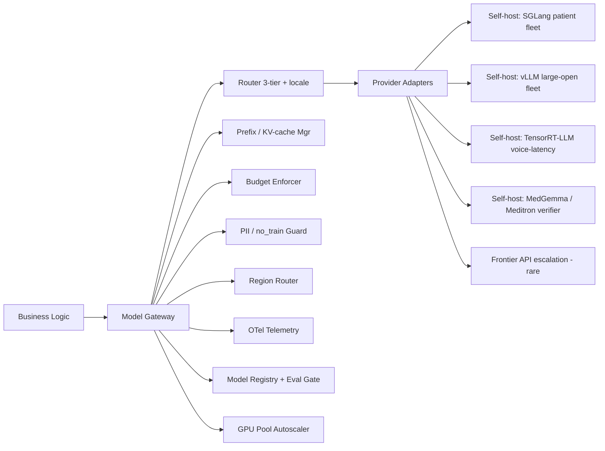
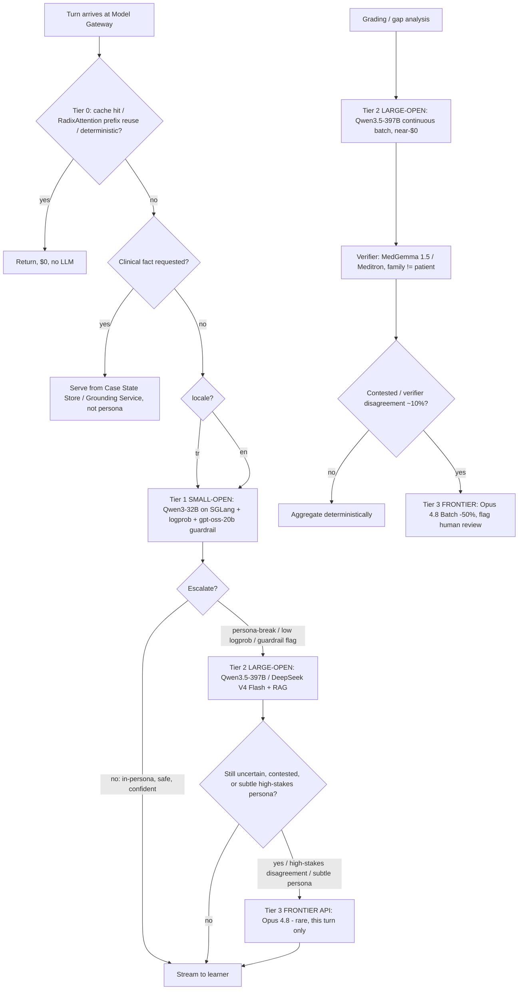
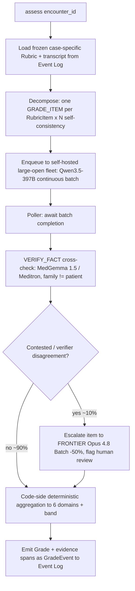

# 02 — Model Gateway & 3-Tier Routing (open-weight self-hosted default)

**Status:** Architecture. Realizes requirement **AD-4** (internal model gateway, no vendor SDK in business logic, 3-tier router pinned not model IDs) and the cost architecture of `[research:open-source-model-stack]` (`08-open-source-model-stack.md`) + §3.1 of `01-requirements-and-constraints.md`. Downstream consumers: Roleplay Orchestrator, Persona Agents, Guidance Agent, Grounding Service, Assessment Service, Authoring Service. Every LLM/embedding/STT/TTS/model call in AcuDx flows through this component — there is no other path.

**Time context:** July 2026. **Direction correction 1 applied:** the DEFAULT is now **self-hosted open-weight models served on our own GPUs (vLLM/SGLang)**; a frontier API is an escalation target used only when open quality genuinely falls short (rare, quality-gated, ~<5% of tokens). The Model Gateway and its 3-tier router survive **unchanged** — only the *contents* of the tiers swap from Anthropic-hosted (Haiku→Sonnet→Opus) to **small-open → large-open → frontier-API**. Prices below are snapshots from `[research:open-source-model-stack]` (per 1M tokens or per GPU-hour, web-verified July 2026). **Pin the router, the serving architecture, and the interfaces; treat model IDs, GPU SKUs, and `$` as configuration that lives in the Model Registry, never in code.**

**Direction correction 2 applied:** Turkish is a first-class locale. A **language-aware route** (`locale=tr` → Turkish-capable open model, TR STT/TTS) is a first-class dimension of the routing policy, not an afterthought.

---

## 1. Why a gateway (the load-bearing invariants it enforces)

The Model Gateway is the single chokepoint through which the following CANON invariants are *mechanically* enforced rather than left to caller discipline. **None of these change under the open-first default** — they are why the tier swap is safe:

- **MODEL GATEWAY is the ONLY path to any LLM/embedding/STT/TTS/model.** Business logic never imports `vllm`, an OpenAI-compatible client, `@anthropic-ai/sdk`, `openai`, `@google-cloud/vertexai`, or a Bedrock client. A CI lint rule (`no-restricted-imports`) fails the build if any package outside `packages/model-gateway/` imports a model/inference SDK — **including the OpenAI-compatible client we use to talk to our own vLLM/SGLang fleet.** Self-hosting does not weaken the chokepoint; it adds an in-house provider behind the same boundary.
- **THREE ISOLATED CLOCKS.** The gateway exposes three distinct call surfaces with different SLOs and backpressure policies: `chat()` (conversation loop, 100s of ms, streamed), `ground()`/`assess()` (out-of-band, seconds), `batch()` (analytics/authoring, minutes–hours). A slow grounding call can **never** occupy a conversation-loop worker — **and the three clocks now map to physically separate GPU pools** (§13) so a grading batch cannot starve the patient-turn fleet.
- **TWO-TIER CONTENT ARCHITECTURE.** The gateway is content-agnostic transport, but the *routing policy* encodes it: a `clinical_fact_needed` signal short-circuits the persona model entirely and hands control back to the caller to serve from the **Case State Store** / **Grounding Service**. The persona model (open or frontier) is never asked to source a fact.
- **GRADER family ≠ PATIENT-AGENT family.** Enforced as a hard constraint in the router: an `assess()` request whose `patient_model_family` equals the resolved grader family is rejected at config-resolution time (fail-closed), not at runtime. Under open-first this still holds — e.g. Qwen patient turns are graded by a **DeepSeek/MedGemma** cross-family stack, never by another Qwen.
- **no_train=true default; PII detect-and-block; region routing.** Every outbound request carries `no_train: true` and a residency tag unless an explicit, logged institutional opt-in overrides it. A deterministic PII/PHI scrubber runs before any bytes leave the region boundary. Self-hosting makes `no_train` *structural* — our own weights don't train on inference traffic — but the flag and scrubber remain because escalation to a frontier API must still guarantee it.
- **EVENT-SOURCED audit.** Every model call emits a `ModelCallEvent` (append-only, hash-chained) into the Event Log with `model_config_id`, `prompt_hash`, `cache_hit`, token counts, cost, latency, region, serving backend (vLLM/SGLang/TensorRT-LLM/frontier), and escalation reason. The Model Registry version served is reconstructable for any encounter at any past date.

---

## 2. Gateway responsibilities & component map



| Responsibility | What it does | Key mechanism |
|---|---|---|
| **Provider abstraction** | Uniform request/response over **self-hosted OpenAI-compatible endpoints (vLLM/SGLang/TensorRT-LLM)** as the default backend, plus frontier APIs (Anthropic/OpenAI/Google, direct or via Bedrock/Vertex/Azure EU) for escalation. | `ProviderAdapter` interface (§10); capability manifest per adapter (streaming, prefix-cache, batch, citations, structured-output, serving backend). |
| **Routing** | Resolve `(TaskType, locale)` → `ModelConfig` (tier + open/frontier model + params), apply escalation signals, enforce family constraints. | Decision table (§4) + Model Registry lookup. |
| **Prefix / KV-cache management** | Construct byte-stable cached prefixes; exploit **SGLang RadixAttention** shared-prefix reuse across the whole patient fleet; manage cache keys, TTL, hit-rate SLO. | Prefix-builder + cache-breakpoint policy (§5). |
| **Batching** | Queue non-interactive work (grading, gap analysis, authoring) to the **self-hosted large-open fleet's continuous batching** (near-$0 marginal), or to a frontier **Batch API at −50%** only when escalated. | Batch pipeline + poller (§6). |
| **Retries / fallback / circuit-breaking** | Retry idempotent calls; failover across GPU replicas/regions and (last resort) to a frontier API; trip breakers on error-rate/latency. | Per-backend circuit breaker + fallback chain (§8). |
| **Budget enforcement** | Per-encounter, per-tenant, per-day soft/hard caps; degrade before overrun. Marginal token cost is near-zero on owned GPUs, so the budget now guards **GPU-hour amortization + frontier-escalation spend**. | Redis token-bucket + budget ledger + GPU-utilization gauge (§7). |
| **Telemetry** | cost/encounter, GPU utilization, cache-hit %, escalation-rate, frontier-escalation $, p50/p95 per tier & task. | OpenTelemetry spans + metrics (§11). |
| **PII / no_train** | Detect-and-block real PHI at ingress; force `no_train`/zero-retention on egress (structural for self-host, enforced for frontier). | Deterministic scrubber + per-request policy (§9). |
| **Region routing** | Pin each tenant's inference to a residency-compliant GPU region / VPC appliance / frontier EU endpoint. | `region → backend/model` map from Registry (§9). |
| **GPU pool orchestration** | Own the small-open, large-open, verifier, and voice GPU pools; autoscale on queue depth; keep utilization high (the #1 cost lever). | Autoscaler + KV-cache/quantization policy (§13). |
| **Registry integration** | No silent swaps: only Registry-blessed `ModelConfig`s (passed eval gate) are routable. | Eval-gated promotion (§12). |

---

## 3. Task ↔ tier mapping (canonical, open-first)

From `[research:open-source-model-stack]` §5, expressed as the gateway's `TaskType` enum and default routing. **Tiers are now T1 small-open → T2 large-open → T3 frontier-API (rare).** Frequencies are per reference encounter (~40 turns, 15-min ED case). All default models are **self-hosted open-weight**; the "Escalate to" column is where a frontier API enters, and it is exercised only when an escalation signal fires.

| `TaskType` | Clock | Freq/enc | Default tier / model (self-hosted) | Escalate to | Batch? | Notes |
|---|---|---|---|---|---|---|
| `PATIENT_TURN` | conversation | 20–60 | **T1 · Qwen3-32B** (SGLang, FP8/INT4) | T2 Qwen3.5-397B; **T3 frontier only for subtle high-stakes personas** | no | Persona in RadixAttention shared prefix; streamed. TR-capable. |
| `PERSONA_TURN` (Colleague/Family/Dispatcher) | conversation | 3–10 | **T1 · Qwen3-32B** | T2 Qwen3.5-397B | no | Director selects speaker; same routing as patient. |
| `EXAMINER_TURN` | conversation | 3–10 | **T2 · Qwen3.5-397B-A17B** | T3 frontier (Opus 4.8) | no | Light clinical reasoning, conversational; MoE serves at ~17B cost. |
| `GUIDANCE_HINT` | out-of-band | 5–20 | **T2 · DeepSeek V4 Flash / Qwen3.5-397B + BGE-M3 RAG** | T3 frontier (Opus 4.8) | no | Grounded+cited only; retrieval, not long-context. |
| `GUARDRAIL_CHECK` | conversation | every output | **T1 · gpt-oss-20b** classifier (16GB, MXFP4) | — | no | Cheap gate; runs on small-model output pre-stream. |
| `TERM_TRANSLATION` | out-of-band | on-demand | **T1 · Qwen3-32B** (bilingual TR↔EN) | T2 Qwen3.5-397B | no | Glossary cached; translation-memory first. |
| `STT` (speech→text) | conversation | per voice turn | **Whisper large-v3-turbo** (self-host, TR +20–30%) | large-v3 (accuracy) | no | Voice pipeline; see `03-voice-pipeline.md`. |
| `TTS` (text→speech) | conversation | per voice turn | **XTTS-v2** (self-host, `tr`+`en`) | — | no | Kokoro/Fish-Speech for lighter GPU. |
| `EMBEDDING` | out-of-band | authoring/index | **BGE-M3** (self-host, 100+ langs incl. TR) | — | yes | For Grounding Service HNSW index; fine-tuned on guideline corpus. |
| `GRADE_ITEM` | out-of-band (batch) | 1 batch (10–40 items) | **T2 · Qwen3.5-397B (continuous batch)** | **T3 frontier Opus 4.8 Batch −50% on contested ~10%** | **yes** | Decomposed evidence-span judgments; family ≠ patient. |
| `VERIFY_FACT` | out-of-band | per hint/grade | **MedGemma 1.5 (~91% MedQA) / Meditron 70B** | — | yes (with grade) | Generate-then-verify cross-check; family ≠ generator; auditable. |
| `CASE_AUTHOR` | batch | offline, rare | **Qwen3.5-397B / DeepSeek V4 Pro**, frontier (Opus 4.8) acceptable | — | yes | Human-authoritative; cost amortized over thousands of runs. |
| `CALIBRATION_COMPUTE` | — | 1 | **no LLM — deterministic code** | — | — | Brier/OCI/ECE is arithmetic; Calibration Engine, not the gateway. |

> `CALIBRATION_COMPUTE` is listed to make the boundary explicit: **the gateway refuses to route it.** Any caller that tries to spend tokens (or GPU-seconds) on calibration math is a bug.

### 3.1 Language-aware route (Turkish first-class)

`locale ∈ {tr, en}` is carried on every request and is a routing input, not a suffix detail:

- **Text.** For `locale=tr`, the router resolves to the **Turkish-strongest open config** at each tier: Qwen3-32B / Qwen3.5-397B (Qwen is the open family with the strongest documented Turkish; MoE Qwen3.5-397B covers 201 languages). If a **TR-fine-tuned Qwen3** LoRA (trained on Turkish medical corpora + TEPDAD / T.C. Sağlık Bakanlığı guideline text) is promoted in the Registry, `locale=tr` prefers it for patient/examiner turns where clinical-register fluency matters.
- **Voice.** `locale=tr` pins **Whisper large-v3(-turbo)** STT (strong non-English gains) and **XTTS-v2** with the `tr` speaker; medical-term post-correction uses the TR glossary/translation-memory before any LLM call.
- **Terminology.** Turkish medical terminology, TUS/UEMS context, and TR guideline/accreditation citations (TEPDAD, T.C. Sağlık Bakanlığı) are served from the TR glossary and TR-tagged `GuidelineStatement`s in the Grounding Service — never invented by the persona model.
- **Eval gate.** A `locale=tr` `ModelConfig` is unroutable unless its eval passed the **TurkishMMLU + Cetvel** (and TR medical) suites, not just English MMLU (§12). TR is agglutinative/morphologically rich — persona fluency and medical terminology must be TR-eval'd, never assumed from an English score.

---

## 4. Routing policy — the decision table

**Principle: cheap default → escalate on complexity/uncertainty. Never start a turn at the frontier — and under open-first, "default" now means our own GPUs at near-zero marginal cost, so the frontier API is a genuine exception path.** The router is a pure function `(TaskType, locale, EscalationSignals, TenantPolicy) → ModelConfig`. Escalation signals are cheap to compute and are evaluated *after* the T1 open draft for conversation tasks (speculative small-model drafting).

### 4.1 Escalation signals

| Signal | Source | Cost to compute | Action |
|---|---|---|---|
| `persona_break` | T1 open output fails persona-consistency regex/classifier (breaks character, refuses, meta-comments) | ~ms | → T2 large-open |
| `clinical_fact_needed` | Learner utterance matches fact-request intent ("what's my potassium?", "what's the BP?") OR T1 attempts to assert a lab/vital/dose | ~ms (intent classifier + output scan) | **Short-circuit LLM** → caller serves from Case State Store / Grounding Service |
| `low_confidence` | T1 self-reported confidence tag `<τ` OR mean output logprob `< λ` (**self-hosted vLLM/SGLang expose token logprobs natively — this signal is high-precision under open-first**, unlike many closed APIs) | free (in-band) | → T2 large-open |
| `guardrail_flag` | `GUARDRAIL_CHECK` (gpt-oss-20b) flags medical-harm / PII / out-of-persona clinical assertion | ~ms | → T2 + Safety Interceptor path; regenerate |
| `retrieval_gap` | Grounding returns no/weak match for a `GUIDANCE_HINT` | free | → T2/T3 + widen retrieval; or refuse ("not in current guidelines") |
| `subtle_persona` | Turn tagged as high-stakes affect (cognitively-impaired affect, aggressive de-escalation, rare non-native-speaker sim) where open persona fidelity is felt to slip | config/tag | **→ T3 frontier for that turn only** |
| `grader_disagreement` | Ensemble members disagree, or self-consistency (≥3× temp 0) diverges on an item, or the MedGemma/Meditron verifier contradicts the generator | out-of-band | → T3 frontier (Opus 4.8 Batch) + flag for human review |
| `high_stakes_item` | RubricItem flagged safety-critical | config | force cross-family ensemble ≥2 families |

### 4.2 Resolution rules (evaluated in order)

1. **Tier-0 short-circuit.** If a deterministic answer exists (translation-memory hit, cached identical persona reply, guardrail regex, RadixAttention exact-prefix reuse), return it — **$0, no LLM**.
2. **Clinical-fact guard.** If `clinical_fact_needed`, the router returns a `ServeFromState` directive; the persona model is **never** invoked to source the fact (two-tier invariant).
3. **Locale resolution.** Select the `locale`-appropriate config lane (§3.1) — TR vs EN model/voice — before the tier default is read.
4. **Default tier** from §3 for the `TaskType` — a **self-hosted open model**.
5. **Escalation.** Apply the first matching signal from §4.1 to bump the tier. `persona_break`/`low_confidence`/`guardrail_flag` bump **T1→T2 (still open)**. Only `subtle_persona`, `grader_disagreement`, or an unresolved T2 uncertainty bump to **T3 frontier API**.
6. **Family constraint.** For `GRADE_ITEM`/`VERIFY_FACT`, reject any resolution where grader family == the encounter's `patient_model_family` (e.g. reject Qwen-grades-Qwen); pick the configured cross-family grader (DeepSeek / MedGemma / Meditron / frontier). Fail-closed.
7. **Region pin.** Replace the abstract model with the residency-compliant deployment for the tenant's region — a specific **GPU region / VPC appliance / frontier EU endpoint** (§9).
8. **Budget check.** If the tenant/encounter budget is in the degrade band, apply the degrade ladder (§7) — never silently overrun; under open-first the first thing suppressed is **frontier escalation**, keeping the encounter fully on owned GPUs.

### 4.3 Routing decision flowchart



---

## 5. Prefix / KV-cache management (the single biggest cost lever)

Cache reuse remains the dominant cost lever, but the mechanism shifts under self-hosting: instead of a provider's opaque prompt cache we own **SGLang RadixAttention** (a radix tree over KV-cache that reuses *any* shared prefix across the whole patient fleet, not just an exact repeat) plus **paged/quantized KV-cache**. The gateway owns cache discipline so callers cannot break it by accident.

### 5.1 Prefix construction rules

A conversation request is assembled as **[ frozen cached prefix ] + [ dynamic suffix ]**:

| Segment | Cached? | Contents | Byte-stability rule |
|---|---|---|---|
| System / persona | ✅ prefix | Persona spec, case brief, difficulty dials, safety framing, output contract, **locale** | **Byte-stable** — no `datetime.now()`, no UUIDs, no unsorted JSON, no per-request IDs |
| Retrieved guideline snippets (guidance) | ✅ prefix | Top-k `GuidelineStatement`s for the turn, canonically serialized (TR- or EN-tagged) | Stable within a turn; changes only when retrieval set changes |
| Running case-state summary | ⚠️ semi | Compacted history (see §5.4) | Re-cached at compaction boundaries, not every turn |
| Latest learner turn(s) | ❌ suffix | The fresh input | Always dynamic |

**Cache breakpoints under RadixAttention.** SGLang reuses the longest matching prefix automatically, so the gateway's job is to keep the persona+case block **identical byte-for-byte across every learner in the same case** — that maximizes cross-encounter reuse, not just within-encounter. The prefix-builder inserts a logical breakpoint after the persona+case block and (for guidance) after the retrieved-snippets block; on frontier-API escalation the same breakpoints map to that provider's `cache_control` markers (Anthropic min cacheable prefix 2048–4096 tok), so escalation does not lose caching. For self-hosted paths there is no minimum-prefix floor — RadixAttention caches sub-block prefixes too.

### 5.2 Cache-key discipline

The gateway computes a **content hash** of the exact prefix bytes and stores it as `prompt_hash` on the `ModelCallEvent`. Cache-key inputs: `model_config_id` + `prefix_hash` + `region` + `serving_backend`. A change in *any* of persona text, model version, region, locale, or serialization **is a new key** (correctly — a cache hit across a model swap would be a silent-swap bug). Because RadixAttention is keyed on the actual token prefix in a specific replica's KV store, the gateway also records `served_replica`/`kv_reuse_len` for telemetry, but correctness never depends on a warm replica.

### 5.3 What breaks a cache (banned in the prefix)

- Timestamps, `Date.now()`, ISO dates, "today is…" strings.
- UUIDs, request IDs, trace IDs, session IDs.
- Unsorted JSON (map ordering must be canonical), locale-dependent number formatting.
- Interpolated learner name/PII (also a no_train/PII violation).
- Any per-turn counter placed *before* a breakpoint.
- **Locale drift mid-encounter** — flipping `tr`↔`en` inside the persona block invalidates the shared prefix for the whole cohort; locale is fixed per encounter.

The prefix-builder is the **only** code allowed to assemble a cached prefix; it runs an `assertByteStable()` check in dev/CI that renders the prefix twice and diffs.

### 5.4 TTL, compaction, hit-rate SLO

- **TTL / eviction:** RadixAttention entries live in GPU KV-cache and are LRU-evicted under memory pressure, not on a fixed timer — a hot case (many concurrent learners) stays warm indefinitely, which is *better* than a provider's ~5-min TTL. The autoscaler pins popular cases to a replica set to keep their prefix resident. On frontier escalation, the provider's TTL (~5 min, extended-TTL 1h for hot cohorts) applies.
- **Compaction:** after N turns, context-editing collapses old turns into the running case-state object rather than resending raw history — keeps the suffix small and the prefix re-cacheable at the new boundary. INT8/FP8 KV-cache extends how much context stays resident per GPU.
- **Hit-rate SLO:** **≥85% KV-reuse ratio on `PATIENT_TURN` input tokens** per encounter (cross-encounter reuse pushes this higher for popular cases). Below 80% fires an alert (prefix likely destabilized). Tracked as `gateway.cache.read_ratio`.

---

## 6. Batch pipeline (grading & authoring)

Grading, gap analysis, cohort analytics, and authoring are non-latency-sensitive → the **self-hosted large-open fleet's continuous batching** (Qwen3.5-397B on vLLM) at **near-zero marginal cost** (owned GPUs, packed), with a frontier **Batch API at −50%** used only on the contested ~10% of items. This is the third clock and must never touch the conversation loop or its GPU pool.



**Pipeline rules:**
- **Frozen rubric only.** The batch reads the version-hashed `Rubric`; the grader never improvises criteria (AS-2/AS-3).
- **Decomposed items.** One `GRADE_ITEM` request per `RubricItem`, each returning `{met, evidence_span (forced verbatim transcript quote), confidence}` via strict JSON schema (temp 0). vLLM/SGLang enforce the schema with grammar-constrained (guided) decoding — structured output is free on the open stack.
- **Self-consistency.** Grade each item ≥3× (temp 0 / sampled prompts); disagreement lowers item confidence and routes to human review (`grader_disagreement`).
- **Generate-then-verify.** The large-open grader's factual claims are cross-checked by **MedGemma 1.5 / Meditron** (family ≠ generator ≠ patient). Verifier contradiction escalates that item to frontier.
- **Ensemble on high-stakes.** Safety-critical items get ≥2 families; the gateway guarantees family diversity across the open pool (Qwen + DeepSeek + MedGemma), escalating to frontier only if the open ensemble itself splits.
- **Deterministic aggregation.** Item→domain rollup, band mapping (κ≥0.6 show / ≥0.7 pass-fail), and calibration are **code**, not LLM.
- **Idempotency + replay.** Batch jobs are keyed by `(encounter_id, rubric_version_hash, model_config_id)`; re-running is a no-op unless config changes. Because the transcript is an event-sourced projection, any grade is deterministically re-derivable.
- **Backpressure:** batch runs on a **separate GPU pool** (§13); a batch backlog cannot degrade `chat()`. The queue is Kafka/Redis Streams.

---

## 7. GPU economics, token budgets & worked cost model

Under self-hosting the cost model inverts: **marginal token cost on owned GPUs is near-zero; the real cost is GPU-hour amortization + (rare) frontier-escalation spend + utilization.** The budget enforcer therefore guards two things — the per-encounter *frontier* spend, and the fleet's *utilization* (a GPU at 10% load inflates effective $/token 10×).

### 7.1 Self-hosted $/1M-token model (the inputs)

`$/1M tok = GPU_$/hr ÷ (throughput_tok/s × 3600) × 1e6 ÷ utilization`. Web-verified July 2026 inputs (`[research:open-source-model-stack]` §4):

| GPU | Spot / neo-cloud $/hr | On-demand | Hyperscaler |
|---|---|---|---|
| H100 80GB | ~$1.03–1.49 | ~$1.99–2.99 | ~$3.93–6.98 |
| H200 141GB | ~$3.72–3.80 | ~$4.11 | up to ~$10.60 |
| L40S 48GB | ~$0.8–1.2 | ~$1.5 | — |
| B200 192GB | ~$4.95 | $5.34+ | premium |

| Serving setup | Throughput | Raw GPU $/hr | Effective $/1M tok (70% util, ×4 all-in overhead) |
|---|---|---|---|
| Qwen3-32B FP8, H100 spot, SGLang | ~10K tok/s aggregate | $1.49 | **~$0.05–0.20** |
| gpt-oss-120b MXFP4, 1× H100 | high (MoE 5.1B active) | $1.99 | **~$0.10–0.30** |
| DeepSeek V4 Flash FP8, H200, vLLM | large-MoE | $4.11 | **~$0.30–0.60** |

Neo-clouds (Vast/RunPod/Lambda) are 50–75% cheaper than AWS/Azure/GCP for identical hardware. **All-in self-host cost is ~3–5× the raw GPU sticker** (MLOps, idle, redundancy, replicas) — this is the number the budget enforcer amortizes, not the sticker.

### 7.2 Per-task token budgets (guardrails, not hopes)

| TaskType | In (fresh) | Cached read | Out | Hard cap action |
|---|---|---|---|---|
| `PATIENT_TURN` | ~2K | ~90% of prefix (RadixAttention) | ~150 | Truncate output at 400 tok; compact if suffix > 8K |
| `EXAMINER_TURN` | ~3K | prefix cached | ~250 | — |
| `GUIDANCE_HINT` | 3K retrieved + 1K query | persona cached | ~400 | Refuse if retrieval empty (never widen to long-context) |
| `GRADE_ITEM` | ~1K/item | rubric cached | ~300/item | Cap items at rubric size (≤40) |
| `GUARDRAIL_CHECK` | ~300 | — | ~20 | — |

### 7.3 Worked per-encounter cost model (naïve → API-first → open-first)

Reference encounter: solo-vs-AI, ~40 turns, 15-min ED case, guidance on, full post-encounter grade.

**Naïve (everything on a frontier model, no caching, full history resent) — the anti-pattern: ≈ $6.30/enc** (~$63K/day @ 10K enc).

**Prior API-first optimized (routed + cached + RAG + batched frontier): ≈ $0.43/enc** (~$4.3K/day @ 10K enc) — this was the previous default.

**New open-first (self-hosted, routed + RadixAttention + RAG + batched, rare frontier escalation):**

| Component | Prior API-first | **New open-first (self-host)** |
|---|---|---|
| 34 patient turns (shared-prefix cached) | Haiku 4.5 ~$0.09 | **Qwen3-32B on SGLang ~$0.006** |
| 6 escalated patient turns | Sonnet 5 ~$0.04 | **Qwen3.5-397B (large-open) ~$0.008** |
| 15 guidance turns (RAG) | Sonnet 5 ~$0.10 | **DeepSeek V4 Flash + BGE-M3 ~$0.015** |
| 40 guardrail checks | nano/Flash-Lite ~$0.01 | **gpt-oss-20b ~$0.002** |
| Grading + gap analysis | Opus 4.8 batch ~$0.18 | **Qwen3.5-397B + MedGemma verify ~$0.02**; frontier only on contested ~10% **+~$0.03** |
| Translation / TR terms | Haiku ~$0.01 | **Qwen3-32B (bilingual) ~$0.002** |
| **Total / encounter** | **≈ $0.43** | **≈ $0.05–0.08** (with rare frontier escalation ~$0.10) |

**~80–88% below the already-optimized API-first number ($0.43 → ~$0.06), and ~98% below the naïve $6.30.** At 10K encounters/day: API-first ~$4.3K/day → **open-first ~$600–800/day marginal + a fixed GPU fleet.** Because the fleet is a fixed cost, **the saving compounds with volume** — more encounters, wider gap.

**Levers, ranked by contribution:** (1) near-zero marginal token cost on owned GPUs; (2) RadixAttention shared-prefix reuse across the cohort ~replaces the prompt-cache saving; (3) RAG-not-long-context for guidance; (4) continuous-batch grading; (5) small-model drafting + FP8/INT4 quantization + streaming + compaction. **SLO: < $0.10/encounter marginal at MVP volume** — the router's budget enforcer treats $0.08 as the per-encounter soft cap (marginal + amortized) and $0.15 as the hard cap; a conservative build (large-open-default patient turns) lands higher and is only acceptable behind an explicit config flag.

> **Break-even caveat (load-bearing).** Self-hosting only wins **above ~500K tok/day sustained** (~11B tok/month classic threshold); AcuDx clears this easily at target scale, but a **low-volume pilot should stay API-first** until volume amortizes the GPU fleet. The gateway supports both via the same router — an `apiFirst` fleet flag on `TenantPolicy` flips the tier *contents* back to hosted models without touching the routing logic.

### 7.4 Budget enforcement & degrade ladder

Budgets tracked in a Redis ledger keyed by `encounter_id` and `tenant_id/day`, plus a GPU-utilization gauge. On approaching a cap the gateway degrades **before** overrunning:

1. **Suppress frontier escalation first** (stay entirely on owned GPUs — the cheapest degrade, near-invisible to quality except on the ~5% subtle cases).
2. Force max prefix reuse + compaction (shrink fresh input).
3. Pin `PATIENT_TURN` to T1 small-open (suppress T1→T2 escalation except safety/clinical-fact — **safety escalation is never suppressed**).
4. Disable optional guidance hints (keep the encounter completable).
5. Hard cap: queue non-essential work to the batch pool, or end-of-encounter idle timeout (20-min cap).

Safety Interceptor and clinical-fact serving are **exempt** from all degrade steps. (Note: because marginal cost on owned GPUs is near-zero, degrade steps 2–5 are rarely needed for *cost* — their main job now is protecting **GPU-pool capacity** under load spikes.)

---

## 8. Backend fallback & circuit-breaking

Under self-hosting the primary failure modes shift from "provider deprecated a model" to "a GPU replica/region is down or saturated." Each `ModelConfig` carries an ordered **fallback chain** spanning replicas → regions → (last resort) a frontier API.

| Aspect | Policy |
|---|---|
| **Fallback chain** | e.g. Qwen3-32B (SGLang, region-A replicas) → Qwen3-32B (region-B replicas) → Qwen3.5-397B (large-open, quality-up) → **Opus 4.8 (frontier, last-resort, logged)**. Chains are Registry data. A frontier fallback is an *availability* backstop, distinct from a quality *escalation*. |
| **Circuit breaker** | Per (backend, region, replica-set, model): trip on error-rate > threshold, p95 > SLO, or **queue depth > threshold (GPU saturation)** over a sliding window → route to next in chain; half-open probe to recover. |
| **Retries** | Idempotent calls only; exponential backoff + jitter; respect backpressure. Streamed turns retry once then fail to text-degrade, never hang the loop. |
| **Refusal handling** | Open models rarely over-refuse legitimate medical content, but **Claude Fable 5 refuses bio/cyber-adjacent content** — never route the live roleplay path to it, even as a fallback. If any model refuses a legitimate medical request, the gateway detects the refusal signature and fails over to the next chain entry. |
| **Idempotency keys** | Every request carries a client-supplied idempotency key so retries/failovers don't double-charge (frontier) or double-emit events. |
| **Family constraint under fallback** | Fallback must preserve the grader-≠-patient family constraint; a fallback that would violate it (e.g. Qwen-graded-by-Qwen) is skipped. |
| **Model-churn resilience** | Open weights churn weekly; the eval gate (§12) + Registry pinning mean a new open release is adopted only after passing, and old configs stay pinned per assessment window. |

---

## 9. PII / no_train / region routing (self-host = compliance unlock)

| Control | Mechanism |
|---|---|
| **PHI detect-and-block** | Deterministic scrubber (regex + NER for names/MRN/DOB/national-ID incl. Turkish T.C. Kimlik No patterns) runs at the gateway ingress. Synthetic-patients-only; a real-PHI match blocks the request and raises an incident — no real PHI ever reaches any backend. |
| **no_train — structural under self-host** | Self-hosted inference on our own weights **cannot** train on traffic — `no_train` is structural, not a promise. Every request still sets `no_train: true` / `store: false` because a frontier *escalation* must carry it too; overridable only by a logged, per-purpose institutional opt-in (de-identified plane only). |
| **Two data planes** | The gateway tags each call `plane: identified-education | deidentified-improvement`; identified-education calls are physically barred from any training-eligible endpoint (which, for self-host, is none). |
| **Region routing** | `TenantPolicy.region → { backend, model, endpoint }` from the Registry. EU/UK/**Türkiye** tenants resolve to **in-region rented GPUs (EU/TR neo-cloud) or an on-prem/VPC appliance**; frontier escalation, if enabled, resolves to a zero-retention EU endpoint (Bedrock/Vertex/Azure EU). Learner PII/analytics never leave region; only anonymized aggregate telemetry may cross borders if the DPA permits. **KVKK (Turkish data-protection law) and T.C. Sağlık Bakanlığı residency are satisfiable by keeping inference on TR/EU GPUs with no US API export.** |
| **VPC / on-prem appliance** | Privacy-maximal institutions run the whole stack (vLLM/SGLang + Qwen3 + MedGemma + BGE-M3 + Whisper/XTTS + retrieval index) as a **containerized appliance** in their own VPC; the AcuDx SaaS control plane orchestrates but **never sees PHI**. |
| **Auditability** | Meditron's fully-open/auditable pipeline + open weights let an institution inspect exactly what grades its students — a trust/accreditation lever no closed API offers. |
| **C2PA labeling hook** | For synthetic voice/avatar/media generation, the gateway attaches a C2PA content-credential directive so downstream media is machine-detectably marked (EU AI Act Art. 50, live 2 Dec 2026). |

The region map is **per-model and per-backend**: not every open model is served in every GPU region, so the Registry documents which `ModelConfig`/GPU-pool serves which region, and the router fails-closed if a tenant's region has no compliant deployment for a required task.

---

## 10. Interface signatures (TypeScript)

```typescript
// ---------- Enums & policy ----------
type TaskType =
  | 'PATIENT_TURN' | 'PERSONA_TURN' | 'EXAMINER_TURN'
  | 'GUIDANCE_HINT' | 'GUARDRAIL_CHECK' | 'TERM_TRANSLATION'
  | 'STT' | 'TTS'
  | 'EMBEDDING' | 'GRADE_ITEM' | 'VERIFY_FACT' | 'CASE_AUTHOR';

type Tier = 'T0' | 'T1' | 'T2' | 'T3';          // T1 small-open, T2 large-open, T3 frontier-API
type Region = 'eu-central' | 'tr' | 'uk' | 'us' | 'me-central' | 'ap';
type Locale = 'tr' | 'en';
type DataPlane = 'identified-education' | 'deidentified-improvement';
type ServingBackend = 'sglang' | 'vllm' | 'tensorrt-llm' | 'frontier-api';
type ModelFamily =
  | 'qwen' | 'deepseek' | 'llama' | 'gpt-oss'      // open general
  | 'medgemma' | 'meditron'                         // open medical verifier
  | 'claude' | 'openai' | 'gemini';                 // frontier escalation only

interface TenantPolicy {
  tenantId: string;
  region: Region;
  locale: Locale;                // first-class; drives §3.1 language route
  noTrain: boolean;              // default true; false only via logged opt-in
  plane: DataPlane;
  apiFirst?: boolean;            // true for low-volume pilots below ~500K tok/day break-even
  onPremAppliance?: boolean;     // route to tenant VPC self-hosted stack
  frontierEscalationEnabled: boolean; // false => stay 100% on owned GPUs (max privacy/cost)
  budgetSoftUsd: number;         // per-encounter soft cap (default 0.08, marginal+amortized)
  budgetHardUsd: number;         // per-encounter hard cap (default 0.15)
}

interface EscalationSignals {
  personaBreak?: boolean;
  clinicalFactNeeded?: boolean;  // -> ServeFromState, never persona LLM
  lowConfidence?: boolean;       // self-tag < tau OR mean logprob < lambda (native on self-host)
  guardrailFlag?: boolean;
  retrievalGap?: boolean;
  subtlePersona?: boolean;       // -> T3 frontier for this turn only
  highStakesItem?: boolean;
}

// ---------- Requests ----------
interface CachedPrefix {           // the ONLY thing the prefix-builder emits
  segments: PrefixSegment[];       // ordered; each may hold a cache breakpoint
  prefixHash: string;              // content hash of exact bytes (cache key)
}
interface PrefixSegment { role: 'system' | 'context'; text: string; cacheBreakpoint: boolean; }

interface ChatRequest {
  taskType: Extract<TaskType, 'PATIENT_TURN'|'PERSONA_TURN'|'EXAMINER_TURN'|'GUIDANCE_HINT'>;
  encounterId: string;
  locale: Locale;                  // fixed per encounter; drives model+voice lane
  prefix: CachedPrefix;            // cached prefix (persona/case/snippets)
  suffix: Message[];               // dynamic: latest learner turn(s)
  patientModelFamily: ModelFamily; // recorded so graders enforce != later
  signals?: EscalationSignals;
  policy: TenantPolicy;
  idempotencyKey: string;
  stream: true;                    // conversation clock always streams
}

interface AssessRequest {
  taskType: 'GRADE_ITEM' | 'VERIFY_FACT';
  encounterId: string;
  rubricVersionHash: string;       // frozen rubric; grader cannot improvise
  items: RubricItemRef[];
  patientModelFamily: ModelFamily; // grader family MUST differ (e.g. not qwen-grades-qwen)
  selfConsistency: number;         // >= 3
  ensembleFamilies?: ModelFamily[];// >= 2 cross-family on high-stakes
  policy: TenantPolicy;
}

// ---------- Responses ----------
interface ChatResult {
  stream: AsyncIterable<ChatDelta>;
  meta: CallMeta;                  // resolved AFTER stream completes
  escalatedTo?: Tier;
  serveFromState?: boolean;        // true => caller must fetch from Case State
}

interface CallMeta {
  modelConfigId: string;           // Registry-blessed config actually used
  tier: Tier;
  servingBackend: ServingBackend;  // sglang | vllm | tensorrt-llm | frontier-api
  region: Region;
  locale: Locale;
  promptHash: string;
  kvReuseTokens: number;           // RadixAttention / prompt-cache reuse
  cacheWriteTokens: number;
  inputTokens: number;
  outputTokens: number;
  gpuSeconds?: number;             // self-host: for amortized-cost attribution
  costUsd: number;                 // marginal (self-host ~0) or frontier billed
  latencyMs: number;
  cacheHit: boolean;
  fallbackDepth: number;           // 0 = primary
  frontierEscalated: boolean;      // true only when a frontier API was actually hit
  noTrain: boolean;
}

// ---------- Gateway API ----------
interface ModelGateway {
  // Conversation clock (100s of ms, streamed). Emits ModelCallEvent.
  chat(req: ChatRequest): Promise<ChatResult>;

  // Out-of-band clock (seconds). Grounded generation for guidance.
  ground(req: ChatRequest): Promise<{ text: string; citations: Citation[]; meta: CallMeta }>;

  // Batch clock (minutes-hours). Grading/gap-analysis/verify on the large-open pool.
  assess(req: AssessRequest): Promise<{ batchJobId: string }>;
  getBatchResult(batchJobId: string): Promise<ItemJudgment[] | { pending: true }>;

  // Voice (self-hosted, TR-capable). Region-pinned.
  transcribe(audio: AudioChunk, policy: TenantPolicy): Promise<{ text: string; meta: CallMeta }>;
  synthesize(text: string, locale: Locale, policy: TenantPolicy): Promise<{ audio: AudioChunk; meta: CallMeta }>;

  // Embeddings for Grounding Service HNSW index (region-pinned, BGE-M3).
  embed(texts: string[], policy: TenantPolicy): Promise<number[][]>;
}

// ---------- Provider adapter (the only inference-SDK boundary) ----------
interface ProviderAdapter {
  readonly name: string;              // 'sglang-patient-fleet' | 'vllm-large-open' | 'frontier-anthropic' | ...
  readonly backend: ServingBackend;
  readonly capabilities: {
    streaming: boolean; kvPrefixReuse: boolean; continuousBatch: boolean;
    citations: boolean; structuredOutput: boolean; logprobs: boolean; // self-host => true
    regions: Region[]; locales: Locale[];
  };
  invoke(resolved: ResolvedCall): Promise<ProviderResponse>;
  invokeStream(resolved: ResolvedCall): AsyncIterable<ProviderDelta>;
  submitBatch(jobs: ResolvedCall[]): Promise<string>;
  pollBatch(jobId: string): Promise<ProviderResponse[] | { pending: true }>;
}
```

### 10.1 ModelConfig & event schemas (JSON)

```json
// ModelConfig — lives in the Model Registry, referenced by id; never hardcoded
{
  "id": "mc_patient_qwen3_32b_v3",
  "taskType": "PATIENT_TURN",
  "tier": "T1",
  "family": "qwen",
  "modelId": "Qwen/Qwen3-32B",
  "servingBackend": "sglang",
  "quantization": "fp8",
  "locales": ["tr", "en"],
  "params": { "temperature": 0.7, "maxTokens": 400, "stream": true },
  "regionDeployments": {
    "tr":         { "gpuPool": "pool-patient-tr",  "endpoint": "…", "zeroRetention": true },
    "eu-central": { "gpuPool": "pool-patient-eu",  "endpoint": "…", "zeroRetention": true }
  },
  "promptHash": "sha256:…",                 // the frozen system-prompt hash
  "fallbackChain": ["mc_patient_qwen3_32b_regionB_v3", "mc_patient_qwen35_397b_v2", "mc_patient_frontier_opus48_v1"],
  "evalResultId": "er_2026_06_30_pass_tr_en",  // gate: must be present + passed (TurkishMMLU+Cetvel for tr)
  "status": "promoted",
  "escalatesTo": "mc_patient_qwen35_397b_v2",
  "frontierEscalatesTo": "mc_patient_frontier_opus48_v1"
}
```

```json
// ModelCallEvent — append-only, hash-chained, into the Event Log
{
  "eventType": "ModelCallEvent",
  "encounterId": "enc_…",
  "turnId": "turn_…",
  "taskType": "PATIENT_TURN",
  "modelConfigId": "mc_patient_qwen3_32b_v3",
  "servingBackend": "sglang",
  "promptHash": "sha256:…",
  "region": "tr",
  "locale": "tr",
  "plane": "identified-education",
  "noTrain": true,
  "tokens": { "kvReuse": 5120, "cacheWrite": 0, "input": 1980, "output": 142 },
  "gpuSeconds": 0.41,
  "costUsd": 0.00006,
  "latencyMs": 540,
  "cacheHit": true,
  "escalatedTo": null,
  "frontierEscalated": false,
  "fallbackDepth": 0,
  "prevHash": "sha256:…",           // hash-chain link
  "hash": "sha256:…"
}
```

---

## 11. Observability

Emitted via **OpenTelemetry**; read models in ClickHouse. Every metric is dimensioned by `taskType`, `tier`, `servingBackend`, `region`, `locale`, `tenantId`, `modelConfigId`.

| Metric | Type | SLO / alert |
|---|---|---|
| `gateway.cost.per_encounter` | histogram (USD) | p50 < $0.08, p95 < $0.15 (marginal + amortized) |
| `gateway.frontier.escalation_rate` | counter/turn | ~<5% expected; alert on spike (open-model quality regression or over-escalation) |
| `gateway.frontier.spend_usd` | counter | per-tenant/day; the real dollar line under open-first |
| `gateway.gpu.utilization` | gauge (%) | target ≥60–70% per pool; alert < 40% (idle GPUs inflate $/token) |
| `gateway.cache.read_ratio` | gauge (%) | ≥85% KV-reuse on `PATIENT_TURN`; alert < 80% |
| `gateway.escalation.rate` | counter/turn | T1→T2 ~10–20% expected; alert on spike (persona regression) |
| `gateway.latency.turn` | histogram (ms) | `chat()` p95 < 1.5s (text turn budget) |
| `gateway.latency.ttfb` | histogram (ms) | streamed first-token; TensorRT-LLM path for voice-coupled turns |
| `gateway.provider.error_rate` | counter | trips circuit breaker |
| `gateway.gpu.queue_depth` | gauge | saturation signal; trips breaker / triggers autoscale |
| `gateway.fallback.depth` | histogram | alert on sustained depth > 0 (primary pool degraded) |
| `gateway.budget.degrade_events` | counter | signal of under-provisioning or abuse |
| `gateway.refusal.rate` | counter | catches Fable-in-path or model-drift refusals |
| `gateway.pii.block` | counter | any nonzero = real-PHI attempt → incident |
| `gateway.tr.eval_gate_fail` | counter | a `locale=tr` config failing TurkishMMLU/Cetvel gate must never route |

Escalation reason, KV-reuse, serving backend, GPU-seconds, and cost are also on the `ModelCallEvent` so **per-encounter cost and routing are auditable and replayable** from the Event Log, independent of the metrics pipeline.

---

## 12. Model Registry & pre-promotion eval gate (no silent swaps)

- **Registry is source of truth for `ModelConfig`.** The router can only resolve to a `ModelConfig` whose `status == 'promoted'` and whose `evalResultId` references a **passed** `EvalResult`. A config without a passing eval is unroutable — this is how "no silent model swaps" is enforced mechanically, and it is **more important under open-first** because open weights churn weekly and a tempting new release must not auto-adopt.
- **Eval gate before promotion.** Any model/prompt/quantization change runs the pre-promotion suite: clinical-accuracy, safety (refusal of unsafe/off-topic), bias/fairness, hallucination, and the **red-team CI** (drug doses, pediatric weight-based calcs, country-threshold traps). Grading changes additionally regression-test against the **expert anchor set** (κ vs faculty) before rollout.
- **Quantization is part of the config.** FP8/MXFP4/INT4 change a model's behavior; a re-quantized model is a new `ModelConfig` that must re-pass evals (a quality regression from aggressive INT4 is a silent-swap risk exactly like a weight change).
- **Turkish eval is mandatory for TR configs.** A `locale=tr` config must pass **TurkishMMLU + Cetvel + TR-medical** suites — an English-only pass does **not** promote a config for Turkish patient/grading use.
- **Prompt = part of the config.** The frozen system prompt's hash is in the `ModelConfig`; changing the prompt is a new config that must re-pass evals (prompts are as behavior-defining as weights).
- **Version-locking.** Scoring models + guideline packs are pinned per cohort/assessment window; the Registry records which config served which encounter, so a summative window is reproducible even as the open-model landscape moves under it.

---

## 13. Self-hosted serving architecture (the new default backend)

This is where the open-first default lives operationally. The gateway owns **four GPU pools**, each an OpenAI-compatible endpoint behind a `ProviderAdapter`, autoscaled independently so the three clocks never contend.

| Pool | Model(s) | Engine | Quantization | Why this engine |
|---|---|---|---|---|
| **Patient / persona fleet** (conversation clock) | Qwen3-32B (+ Qwen3.5-397B for T2) | **SGLang** | FP8 / INT4-AWQ | **RadixAttention** reuses the huge shared per-case persona prefix across every concurrent learner — up to 6.4× gain on this multi-turn/shared-prefix pattern; +29% vs vLLM at 8B where the small patient model lives. |
| **Large-open reasoning/grading fleet** (out-of-band + batch clocks) | Qwen3.5-397B-A17B, DeepSeek V4 Flash | **vLLM** | FP8 | PagedAttention + continuous batching for high-concurrency grading; guided/grammar-constrained decoding gives free strict-JSON grade schemas. |
| **Medical verifier** | MedGemma 1.5 (27B), Meditron 70B | vLLM | FP8 | Cross-family generate-then-verify; auditable open weights for accreditation. |
| **Voice-latency path** | (LLM turns coupled to TTS) | **TensorRT-LLM** | FP8 | Lowest TTFT (sub-100ms, p95 TTFT ~1,280ms @100 concurrent) where the learner *hears* the delay. Used only for the voice-coupled turn budget. |
| **Guardrail / classifier** | gpt-oss-20b | vLLM/TGI | MXFP4 | Fits 16GB; runs on every output cheaply. |
| **Voice STT/TTS** | Whisper large-v3-turbo, XTTS-v2 | dedicated | — | Self-hosted, TR-capable; see `03-voice-pipeline.md`. |

**Autoscaling & utilization (the #1 cost lever).**
- Scale each pool on **queue depth + TTFT SLO**, not CPU; spin replicas up before p95 breaches, down when idle — but keep a warm floor so RadixAttention prefixes for hot cases stay resident.
- **Pack replicas to 60–70%+ utilization.** A GPU at 10% load inflates effective $/token 10×; the budget enforcer's `gpu.utilization` gauge is a first-class SLO, not a nice-to-have.
- **Quantization policy:** FP8 default (near-lossless, ~2× throughput vs BF16 on H100/H200); MXFP4 where native (gpt-oss); INT4-AWQ for the small patient model to fit more replicas per GPU; INT8/FP8 **KV-cache** to extend batch/context length.
- **GPU sourcing:** rent H100/H200 on neo-cloud spot (50–75% cheaper than hyperscalers) in **EU/TR regions** for residency; on-prem/VPC appliance for privacy-maximal institutions. Break-even vs API ≈ **≥500K tok/day sustained** — below that, a pilot runs `apiFirst`.
- **KV-cache management:** paged KV-cache with quantization; hot-case pinning; cross-encounter prefix reuse is what turns the persona prefix from a per-encounter cost into a near-free shared asset.

The `ProviderAdapter` interface is **identical** for self-hosted pools and frontier APIs — that is the whole point: the router doesn't know or care whether it's talking to our SGLang fleet or Anthropic, only that the resolved `ModelConfig` says which. Flipping a tenant to `apiFirst` or `onPremAppliance` swaps adapters behind the boundary, not routing logic.

---

## 14. Trade-offs (explicit)

| Decision | Chosen | Rejected alternative | Why |
|---|---|---|---|
| **Open-weight self-hosted as default** | Small-open→large-open→frontier tiers on owned GPUs | API-first (Haiku→Sonnet→Opus) | ~80–88% further cost cut vs the optimized API number, near-zero marginal token cost, and PHI never leaves our GPUs — the compliance unlock. Holds above ~500K tok/day. |
| Frontier API as escalation, not default | ~<5% of tokens, quality-gated | Frontier for everything / never | Open persona/grading quality is ample for ~95% of tokens; keep the frontier for the hardest contested reasoning and subtle high-stakes personas where fidelity is genuinely felt. |
| SGLang for the patient fleet | RadixAttention shared-prefix | vLLM everywhere | The persona prefix is huge and shared across every learner in a case — RadixAttention's cross-request KV reuse is worth up to 6.4× here; +29% at 8B. |
| Speculative small-model drafting | T1 open draft, escalate ~10–20% to T2, ~<5% to frontier | Start every turn at large-open/frontier | Cost cut at the price of a rare re-draft; the gate is cheap and logprobs are native on self-host. |
| Prefix-builder monopoly on cached prefixes | Single component | Let callers build prompts | Only way to guarantee byte-stability and cross-encounter RadixAttention reuse. |
| Fail-closed on family constraint | Reject at config time (incl. qwen-grades-qwen) | Warn at runtime | A same-family grade is a validity defect (self-preference bias); must be impossible. |
| Continuous-batch grading on owned GPUs | Large-open pool, near-$0; frontier batch only on contested ~10% | Live frontier grading | Assessment is a different clock and a different GPU pool; owned-GPU batching makes grading essentially free. |
| RAG-not-long-context, hard refuse on gap | Retrieve 2–5 passages (BGE-M3) | Stuff guideline PDFs into 1M ctx | Long-context is the #1 cost mistake and invites hallucination; abstain > confident-wrong. |
| Turkish as a first-class route | TR model lane + TR eval gate + TR voice | English models with a translation shim | TR is agglutinative and medical-register-sensitive; a shim degrades persona fluency and terminology. Qwen's documented TR + TurkishMMLU/Cetvel gating is the honest path. |
| Utilization as a first-class SLO | `gpu.utilization` gauge gates spend | Only track $/token | Under self-host the leak is idle GPUs, not per-token price; a 10%-loaded fleet erases the whole saving. |

---

## Open questions & build sequence

**Must be decided/built first (MVP-blocking):**
1. **`ProviderAdapter` + `chat()` streaming path over a self-hosted SGLang Qwen3-32B endpoint**, with the **prefix-builder** and `assertByteStable()` CI check — the gateway's spine and the whole conversation loop. (One frontier adapter behind the same interface, for escalation + the `apiFirst` pilot mode.)
2. **KV-reuse / cache-hit telemetry** (`gateway.cache.read_ratio`) + **`gateway.gpu.utilization`** — without ≥85% prefix reuse and ≥60% utilization the cost model is fiction; build these metrics before the router so both SLOs are observable from day one.
3. **Router decision table (§4) + clinical-fact guard + locale route (§3.1)** wired to Case State Store and the TR/EN lanes — the two-tier invariant and Turkish first-class support must be live before any patient turn ships.
4. **`ModelCallEvent` emission (with `servingBackend`, `gpuSeconds`, `frontierEscalated`) into the hash-chained Event Log** — auditability/replay are non-negotiable (AD-5) and cheap early, expensive to retrofit.
5. **Model Registry with eval-gated promotion, including the TurkishMMLU+Cetvel gate and quantization-as-config** — "no silent swaps" must hold from the first deploy, and it matters more with weekly open-model churn.
6. **Budget enforcer + degrade ladder** with the $0.08 marginal soft cap and **suppress-frontier-first** step — cost is existential; ship the ledger + GPU-utilization gauge with the MVP.
7. **`assess()` continuous-batch pipeline on the large-open pool + cross-family verify (MedGemma) + family constraint** — the calibration/feedback loop that is the MVP's signature feature.
8. **Four-pool GPU serving + autoscaler (§13)** — even a thin version (one patient pool + one shared large-open/verifier pool) must exist for the open-first default to be real; TensorRT-LLM voice pool and per-region pools follow.

**Open questions (resolve during build):**
- **Break-even trigger for a pilot.** At exactly what sustained tok/day does a given tenant flip from `apiFirst` to the self-hosted fleet? Needs a measured amortization model per GPU-sourcing option (spot vs on-demand vs on-prem), not a guess.
- **Turkish clinical-register fluency.** Does base Qwen3/Qwen3.5 clear the TR-medical bar, or is a **LoRA on Turkish medical + TEPDAD/Sağlık Bakanlığı corpora** required for patient/examiner turns? Decide via TurkishMMLU/Cetvel + a TR-medical persona eval before GA.
- **Quantization quality floor.** How aggressive can we go (FP8 vs INT4-AWQ) on the patient model before persona/TR fluency measurably degrades? An offline quality-vs-throughput sweep per quantization is required; INT4 that saves replicas but fails the eval gate is a false economy.
- **Escalation threshold tuning (`τ`, `λ`).** The confidence/logprob cutoffs that hit ~10–20% T1→T2 and ~<5% frontier without over-escalating are empirical — logprobs are native on self-host, so precision is better than API-first, but the thresholds still need an offline sweep against recorded encounters.
- **GPU-pool sizing & autoscale cold-start.** How many warm replicas per pool per region to hold RadixAttention prefixes hot without over-provisioning? Cold-start latency vs idle cost is the core tension; measure against real cohort concurrency.
- **Cross-region fallback vs residency.** When an in-region pool saturates or trips, is a *lower-tier same-region* open model always preferred over a *same-tier out-of-region* one? For EU/UK/TR the answer is yes (residency wins); encode per tenant, never assume — and a frontier fallback must respect the tenant's `frontierEscalationEnabled` and residency.
- **On-prem eval parity & attestation.** The pre-promotion eval gate must run against the on-prem/VPC model set too; who operates that gate inside a tenant VPC, and how are results (incl. TR evals) attested back to the control plane without exposing PHI?
- **Ensemble cost ceiling under open-first.** Cross-family ensembles on the open pool are near-free, but frontier escalation on split ensembles is not; define which RubricItems are "high-stakes" tightly enough that frontier surcharge stays inside the batch budget.
