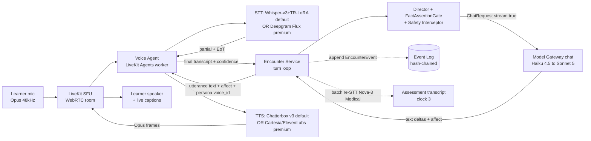
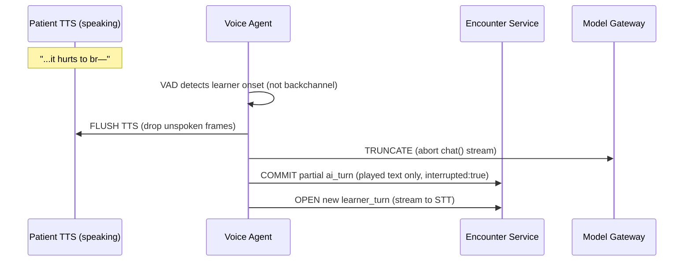

# 03 — Realtime Voice Pipeline (composable cascade STT→LLM→TTS)

**Scope.** How AcuDx turns a spoken clinical encounter into the same event-sourced,
grounded, gradable turn loop the text wedge already runs. This document specifies the
**composable cascade** — microphone → LiveKit SFU → Deepgram Flux/Nova-3 Medical (STT) →
the **Encounter Service turn loop** (arch/01) via the **Model Gateway** (arch/02) →
Cartesia Sonic-3 / pre-rendered ElevenLabs v3 (TTS) → learner playback — plus the
**barge-in controller**, the **per-persona turn-taking knobs**, the **latency budget** that
hits **<800 ms p50 first-audio**, accent-robustness with **text fallback**, the **persona voice
library**, **graceful degradation to text**, **full non-voice equivalence**, and a
**cost-per-voice-minute** model.

Voice is an **enhancement transport, not a second brain.** The reasoning, grounding, safety,
and grading are *identical* to the text path; voice only changes how the learner's utterance
*arrives* and how the persona's utterance *leaves*. This is the load-bearing consequence of
choosing the composable cascade over native speech-to-speech (invariant **V-1**).

**Open-source-first (the DEFAULT).** The default AcuDx voice stack is **fully open and
self-hostable** — open STT + open LLM + open TTS, orchestrated by self-hosted **LiveKit Agents**,
served through the **Model Gateway** (arch/02). The proprietary vendors named throughout this doc
(Deepgram, Cartesia, ElevenLabs, Gemini Live) are demoted to an **optional managed premium tier**,
each with a named open fallback that is the actual default. This is what makes AcuDx
**sovereign / air-gappable** for a Turkish ministry (Sağlık Bakanlığı / KVKK) or a privacy-max
institution with **zero third-party data egress**, and what floors COGS. The open-source-by-default
map is authoritative in [`../research/11-fully-open-source-stack.md`](../research/11-fully-open-source-stack.md)
(§6 STT, §7 TTS, §8 orchestration); the open-first voice stack is specified in **§0 below**, and
the vendor rows that follow are read as *"managed premium option → open default fallback."* The
cascade architecture, latency budget, barge-in, and every invariant are **unchanged** — only the
default *engine contents* of the STT and TTS boxes change.

**Grounding & integration.** The STT/TTS/turn-taking technology selection is pinned in
[`../research/02-voice-ai.md`](../research/02-voice-ai.md); this doc consumes it and does not
re-derive vendor choices. The turn loop, `PersonaTurnInput`/`PersonaOutput`, `affect` schema,
`FactAssertionGate`, and Safety Interceptor are defined in
[`01-ai-agent-architecture.md`](./01-ai-agent-architecture.md); every LLM call goes through the
`chat()` surface of [`02-model-gateway-and-routing.md`](./02-model-gateway-and-routing.md); the
event envelope, hash-chain, PHI block, and EU AI Act Art. 50 obligations are in
[`09-security-and-compliance-architecture.md`](./09-security-and-compliance-architecture.md);
the qualitative `ClinicalSign(intensity)` → adjective mapping the TTS prosody reads is owned by
the Vitals & Physiology Engine per [`01`](./01-ai-agent-architecture.md) §4.1. Requirements
**V-1..V-6**, **RP-4**, **RP-7**, **AV-1/AV-2** are in
[`../00-overview/01-requirements-and-constraints.md`](../00-overview/01-requirements-and-constraints.md).

**Canon status.** This is the **Voice Pipeline** canonical service. It rides the **conversation
clock** (100s of ms). The **grounding** and **assessment** clocks are unchanged and still
out-of-band — voice never lets them onto the hot path. The assessment transcript is produced by
a **batch** STT re-pass on the **third clock**, never by the live STT stream.

**MVP note.** Per [`../00-overview`](../00-overview/01-requirements-and-constraints.md), voice is
a **v1 fast-follow** behind the solo text-first EM wedge; every case must remain fully completable
in text at <100 kbps (**RP-6**). Nothing in this pipeline is allowed to become a *gate* on
completing an encounter (**V-5**).

---

## 1. The three invariants voice must not break

1. **Composable, not native (V-1).** The LLM turn is always **text in / text out**, so the
   `FactAssertionGate`, Safety Interceptor, guideline grounding, per-case model routing, and the
   verbatim assessment transcript all operate on inspectable text — exactly as in the text wedge.
   Native speech-to-speech (Gemini Live 2.5) is a **cinematic/premium fallback only** (**V-6**),
   never the default, because it hides clinical reasoning inside audio tokens (see §11).
2. **Voice is transport; the turn loop is unchanged.** The Encounter Service is still
   server-authoritative; it still appends every learner and AI utterance to the hash-chained
   **Event Log**; the Director still selects the speaker, resolves `request_clinical_fact`, and runs
   the `FactAssertionGate`; the persona is still Haiku-4.5-default via the Model Gateway. Voice adds
   an **STT stage before** and a **TTS stage after** the *same* text turn. It adds **zero** new
   authority over clinical facts.
3. **Full non-voice equivalence (V-5).** Every voice affordance has a text-mode twin: live captions
   render the TTS text verbatim; a text input box is always available; STT low-confidence *degrades
   to* text rather than mis-transcribing into a mis-score (**V-2**); the `affect` object renders as a
   caption emotion-label + avatar clinical-sign overlay for deaf/HoH learners. Voice can never carry
   information the text path lacks.

---

## 0. Open-source-first voice stack (the DEFAULT; vendors are optional premium)

Every box in the cascade has a **permissive open, self-hosted default** and an **optional managed
premium** with the same interface. Nothing below changes the turn loop, the gates, the clocks, or the
latency *budget* (§4) — it changes which engine sits in the STT and TTS boxes by default. All open
engines are served **through the Model Gateway / Voice Agent** exactly as the vendor engines are, so
the boundary discipline in §14 (STT/TTS SDKs live only inside the Voice Agent) is unchanged.

### 0.1 The default open engines (verified July 2026)

| Stage | **OPEN default (self-hosted)** | License | Turkish | Optional managed premium | Why the vendor survives (only) as premium |
|---|---|---|---|---|---|
| **STT — Turkish + medical** | **Whisper large-v3 (+ large-v3-turbo) + TR-medical LoRA**, wrapped with **faster-whisper / WhisperX / WhisperLive** for streaming | ✅ MIT (Whisper, faster-whisper, WhisperLive); ⚠️ WhisperX BSD-2/-4 (verify) | ✅ **TR native** (LoRA closes medical WER) | **Deepgram Nova-3 Turkish** | ops-outsourced streaming, vendor SLA, lower p95 under burst |
| **STT — EN / European streaming** | **NVIDIA Parakeet-tdt-0.6b-v3 / Canary / Nemotron-ASR-Streaming**; **Parakeet-1.1b-rnnt-multilingual** (this one *does* include TR) | ✅ CC-BY-4.0 | ⛔ Parakeet-tdt-v3 = **25 European langs, NO Turkish**; use 1.1b-rnnt or Whisper-TR for TR | **Deepgram Flux** | managed convenience only |
| **STT — on-prem full-duplex** | **Kyutai STT (Unmute)** | ✅ CC-BY-4.0 | multilingual (verify TR) | — | — |
| **TTS — expressive live (default)** | **Chatterbox Multilingual v3 (Resemble AI)** — 0.5B Llama backbone, **PerTh watermark on every self-hosted output** | ✅ **MIT** | ✅ **TR in the 23-lang set** | **ElevenLabs v3 / Cartesia Sonic-3** | top-end TR *emotional* realism for cinematic distress peaks |
| **TTS — fast / edge / utility** | **Kokoro** (82M, CPU-capable) + **Piper** (edge) | ✅ Apache-2.0 (Kokoro); ✅ MIT (Piper) | ⛔ Kokoro **no TR** → **Piper has TR voices** (use Piper for TR edge/utility) | ElevenLabs Flash v2.5 | latency floor / last-resort fallback |
| **Orchestration** | **LiveKit Agents** self-host (room-first, multiplayer §15) — or **Pipecat** (v1.0, Apr 2026) for the solo pipeline path | ✅ Apache-2.0 (LiveKit server + SDK); ✅ BSD-2 (Pipecat) | — | LiveKit Cloud / Pipecat Cloud | managed infra only; the SDK is identical |
| **VAD / turn-taking** | **Silero VAD** + **LiveKit turn-detector** / **Pipecat Smart-Turn** | ✅ MIT | — | — | already open (unchanged §5–6) |
| **Native S2S (cinematic on-prem)** | **Kyutai Moshi + Mimi codec** / **Ultravox** (bring-your-own-LLM) | ✅ CC-BY-4.0 (Moshi); ✅ MIT (Ultravox) | multilingual (Moshi verify TR; Ultravox inherits Qwen TR) | **Gemini Live 2.5** (§11, V-6) | raw fluidity where reasoning inspectability is waived |

**Three license/coverage facts that pin the defaults** (from research/11 §6–8, web-verified Jul 2026):
1. **Parakeet-tdt-0.6b-v3 has no Turkish** (25 European languages only) → the **Turkish** STT default is
   **Whisper-v3 + TR-medical LoRA**, not Parakeet. Parakeet/Canary are the EN/EU streaming default.
2. **Chatterbox v3 is the rare model that is MIT + Turkish + expressive + watermarked** — its embedded
   **PerTh watermark** directly serves the EU AI Act Art. 50(2) synthetic-audio obligation (§8.4), so it
   *replaces* ElevenLabs/Cartesia as the default and *helps* compliance rather than needing extra marking.
3. **XTTS-v2 and F5-TTS are NOT shippable** (XTTS = CPML non-commercial with Coqui defunct → no license
   purchasable; F5 weights = CC-BY-NC) — do **not** use them as a default; they are internal-experiment only.

### 0.2 Default cascade (open) vs the same cascade with vendors

```
DEFAULT (open, sovereign-capable):
  mic → LiveKit SFU → Voice Agent
      → STT:  Whisper-v3 + TR-LoRA (faster-whisper streaming)   [TR]  |  Parakeet/Canary  [EN/EU]
      → Encounter Service turn loop → Model Gateway (Qwen3, open) → FactAssertionGate + Safety
      → TTS:  Chatterbox v3 (live, watermarked)  |  Piper/Kokoro (utility/edge)
      → LiveKit → speaker + captions

OPTIONAL MANAGED PREMIUM (same interface, per-tenant flag, BAA + region-pinned per AD-6):
      STT: Deepgram Flux / Nova-3 Medical      TTS: Cartesia Sonic-3 (live) / cached ElevenLabs v3 (peaks)
```

The Voice Agent `SttConfig.chain` / `TtsConfig.liveEngine` (§14) select which engine serves; **the
turn loop is unaware which one did.** A tenant flips a config from `whisper-tr`/`chatterbox` to
`deepgram-flux`/`cartesia-sonic-3` — no code path changes. This is the same failover machinery §10
already uses, extended so the *default entry* in each chain is open.

### 0.3 Self-hosted latency reality (honest budget note)

The §4 budget (`<800 ms p50` voice-to-voice) was computed against **managed** engine TTFB numbers
(Deepgram Flux EoT ~180 ms, Cartesia TTFA ~90 ms). Self-hosted open engines meet it **only with the
right serving**, and the honest deltas are:

| Stage | Managed (§4 baseline) | Self-hosted open — reality |
|---|---|---|
| End-of-turn / STT final | Deepgram Flux ~180 ms EoT | **Whisper is not natively streaming**: use faster-whisper/WhisperLive VAD-chunking + Silero EoT; expect **~150–350 ms** EoT depending on chunk size and GPU. Parakeet/Canary streaming ~80 ms–1 s controllable (EN/EU). |
| TTS time-to-first-audio | Cartesia Sonic-3 ~90 ms | **Chatterbox ~150–400 ms TTFA** on a warm GPU (heavier than Cartesia); **Piper/Kokoro ~<100 ms on CPU** for utility lines. Sentence-chunk streaming (§3) still applies. |
| Net voice-to-voice p50 | ~525 ms | **~600–900 ms** on a warm, co-located single-GPU node; inside SLO for most turns, **tighter than managed** — mitigate with (a) GPU warm-pools (no cold start), (b) TensorRT-LLM/optimized Whisper builds, (c) the pre-rendered backchannel filler (§4.1) and cached emotional peaks (§8.1), which are engine-independent and cost $0 on replay. |

**Rule:** open engines are the default; where a specific tenant/cohort has a **hard p95 latency SLO**
(OSCE, high-burst) that a self-hosted node can't meet, that tenant may flip the STT/TTS box to the
managed premium — a per-tenant knob, not a redesign. Air-gapped tenants accept the self-hosted latency
envelope (still within budget for the vast majority of turns) as the price of zero egress. Cost of the
two paths is compared in §12.4.

---

## 2. End-to-end signal path



**Reading the path.** The **Voice Agent** is a LiveKit Agents worker that joins the encounter's
WebRTC room as a participant. It owns the audio plumbing (VAD, endpointing, STT streaming, barge-in,
TTS streaming, backchannel) but **owns no clinical logic** — it hands a final text transcript to the
Encounter Service and receives back a text utterance + `affect` + `voice_id` to speak. The dashed
lines are the two other clocks: the Event Log append (audit, still on the conversation clock but
async to playback) and the **batch** Nova-3 Medical re-transcription that builds the assessment
transcript out-of-band (§9).

### 2.1 Where each canonical service sits

| Stage | Owner service | On hot path? | Clinical authority? |
|---|---|---|---|
| Mic capture, Opus encode | Client (LiveKit client) | yes | none |
| SFU transport | **Realtime Media** (LiveKit SFU) | yes | none |
| VAD / endpointing / barge-in / STT / TTS orchestration | **Voice Pipeline** (LiveKit Agents worker) | yes | none |
| STT inference | **Whisper-v3 + TR-LoRA (default)** / Parakeet-Canary [EN/EU]; Deepgram Flux + Nova-3 (premium) | yes | none |
| Turn loop, speaker select, fact resolution, gates | **Encounter Service** + **Director** (arch/01) | yes | Director resolves from **Case State Store** |
| Persona text generation | **Persona Agents** via **Model Gateway** `chat()` (arch/02) | yes | **none** (two-tier boundary) |
| TTS inference | **Chatterbox v3 (default, watermarked)** / Piper-Kokoro (utility); Cartesia Sonic-3 + cached ElevenLabs v3 (premium peaks) | yes | none |
| Assessment transcript | **Voice Pipeline** batch re-STT → **Assessment Service** | no (clock 3) | verbatim record |

The single most important row: the persona LLM has **no clinical authority** in voice, exactly as in
text. A jailbroken persona still cannot voice a wrong lab value, because the `FactAssertionGate` runs
on its **text** output *before* a single TTS byte is synthesized (arch/01 §2, §8).

---

## 3. The voice turn loop (mapped onto arch/01 §3.1)

The voice turn is the arch/01 turn with an STT prologue and a TTS epilogue. The middle — Safety
Interceptor (pre), Director, Case State resolution, persona via Model Gateway, `FactAssertionGate`,
Safety Interceptor (post), Event Log append — is **byte-identical to the text path**.

```mermaid
sequenceDiagram
  participant L as Learner (voice)
  participant VA as Voice Agent
  participant STT as Deepgram Flux
  participant ES as Encounter Service
  participant DIR as Director + gates
  participant MG as Model Gateway
  participant TTS as Cartesia/EL cache
  L->>VA: speech (Opus via LiveKit)
  VA->>STT: stream audio
  STT-->>VA: partial transcripts
  STT-->>VA: end-of-turn (EoT conf >= tau) + final
  Note over VA,MG: Eager-EoT may pre-warm MG on partial (discard if EoT retracts)
  VA->>ES: final transcript + stt_confidence
  alt stt_confidence < floor
    ES-->>L: "I didn't catch that — please type it" (text fallback, V-2)
  else clear
    ES->>DIR: append learner_turn; screen (Safety Interceptor pre)
    DIR->>DIR: speaker select + resolve request_clinical_fact from Case State
    DIR->>MG: ChatRequest (Haiku 4.5, cached prefix, stream:true)
    MG-->>ES: text deltas + affect + tool_intents
    ES->>DIR: FactAssertionGate + Safety Interceptor (post)
    ES->>ES: append EncounterEvent(ai_turn)
    ES-->>VA: utterance text + affect + voice_id + peak_clip_id?
    VA->>TTS: synth(text, voice_id, prosody=affect) OR play cached peak
    TTS-->>VA: Opus frames (streamed)
    VA-->>L: audio + live captions
    Note over L,VA: BARGE-IN: learner speaks -> flush TTS, truncate MG, commit partial
  end
```

**Two commitments this diagram encodes.**
- **The gate is before the mouth.** `FactAssertionGate` + Safety Interceptor (post) run on the
  persona's *text* before TTS. No unsanctioned clinical assertion can ever be spoken — the same
  guarantee the text path gives (arch/01 §2).
- **Streaming end-to-end.** The Model Gateway streams text deltas (`stream:true`, arch/02 §10); the
  Voice Agent feeds sentence-boundary chunks into Cartesia as they arrive so TTS first-audio starts
  before the full utterance is generated. This is how the budget in §4 is met.

---

## 4. Latency budget — hitting <800 ms p50 first-audio

**SLO (V-4 / [`../research/02-voice-ai.md`](../research/02-voice-ai.md) §Latency): voice-to-voice
first-audio p50 < 800 ms, p95 < 1200 ms.** "Voice-to-voice" = from the learner falling silent (true
end of speech) to the first audible patient phoneme. The budget is decomposed by hop; the **critical
path** is the sum of the bold rows.

| # | Hop | Component | p50 | p95 | Notes |
|---|---|---|---|---|---|
| 1 | Mic → SFU (network in) | LiveKit WebRTC, Opus 20 ms frames | 20 ms | 45 ms | learner→nearest LiveKit edge; regional SFU |
| 2 | **End-of-turn detection** | **Deepgram Flux model-based EoT** | **180 ms** | **340 ms** | model-based, not silence-timer; default conf τ=0.7 |
| 3 | STT finalization (post-EoT) | Deepgram Flux final transcript | 40 ms | 90 ms | partials already streamed; final is a flush |
| 4 | Transcript → Encounter Service | intra-region gRPC | 8 ms | 20 ms | same-region call |
| 5 | Safety Interceptor (pre) | deterministic rules + nano classifier | 12 ms | 30 ms | arch/01 §8; runs pre-persona |
| 6 | Director + Case State resolve | deterministic; Redis/PG read | 15 ms | 45 ms | no fact-request → skip; fact-request adds §4.1 |
| 7 | **Model Gateway TTFB** | **Haiku 4.5, ≥85% cached prefix** | **260 ms** | **520 ms** | streamed first token; cache read ~0.1× input |
| 8 | First sentence buffered | accumulate ~1 clause for prosody | 60 ms | 130 ms | first punctuation/clause boundary |
| 9 | **TTS time-to-first-audio** | **Cartesia Sonic-3** | **90 ms** | **150 ms** | ~90 ms TTFA (research/02 §2) |
| 10 | SFU → speaker (network out) | LiveKit WebRTC out | 20 ms | 45 ms | edge→learner |
| | **Critical-path total (2+3+4+5+6+7+8+9+10)** | | **~525 ms** | **~1075 ms** | mic-in (row 1) overlaps speech; excluded from v2v |

**Budget headroom & where it goes.** p50 ~525 ms leaves ~275 ms of margin under the 800 ms SLO; p95
~1075 ms leaves ~125 ms under 1200 ms. Margin is consumed by: cross-region hops when a tenant's
compliant LLM region ≠ SFU region (adds ~40–90 ms — mitigated by co-locating the Voice Agent, STT,
and LLM endpoint in the tenant's residency region per **AD-6**); prompt-cache misses (row 7 balloons
to ~700 ms — the arch/02 ≥85% cache-read SLO is what keeps this rare); and TTS peak-clip fallback
(cached ElevenLabs v3 peak has ~0 ms synthesis, it is a disk/CDN read).

### 4.1 The one extra round-trip: pre-resolved `request_clinical_fact`

When the learner asks the patient a self-knowable fact ("what's my oxygen?"), the Director
pre-resolves `request_clinical_fact` and **re-prompts the persona** with the `SanctionedFact` so the
utterance carries a real number (arch/01 §4.3). That is a **second Haiku round-trip**: +~260 ms p50
on row 7. Voice-to-voice for those turns lands ~785 ms p50 — inside the 800 ms SLO but with no slack.
**Mitigation:** while the second round-trip runs, the Voice Agent may emit a **pre-rendered
backchannel filler** ("let me check…" in the persona voice) to mask the gap — a cached clip, zero
synthesis latency, keeping perceived responsiveness under 400 ms. This is the voice analogue of the
text UI's "pending" indicator.

### 4.2 Eager-EoT speculative start (optional, tunable)

Deepgram Flux **Eager EoT** (threshold 0.3–0.9) lets the Voice Agent pre-warm the Model Gateway on a
*partial* transcript before the turn is confirmed ended, then **commit or discard** when true EoT
fires (research/02 §4). This shaves ~120–200 ms off row 2+7 on turns that end predictably, at the
cost of an occasional discarded (wasted) Haiku draft. Because the discarded draft is *text* and never
reaches TTS or the Event Log (it is dropped pre-append), it is a pure latency/cost trade, tuned
per-tenant. **Default OFF for MVP voice** (simpler, cheaper); ON for premium/OSCE latency-critical
cohorts. The wasted-draft cost is bounded by the arch/02 budget enforcer.

---

## 5. Barge-in controller

Doctors interrupt patients constantly. Barge-in is **mandatory** (**V-4**); the patient voice must
yield instantly and the system must know *what the patient had said so far* when it was cut off.

### 5.1 The four atomic actions on detected learner speech

When VAD + endpointing detect the learner has **started a new utterance** while the patient is
speaking, the Voice Agent executes, in order and within one control tick:

1. **Flush TTS** — stop Cartesia playout immediately; drop all unspoken buffered Opus frames.
2. **Truncate LLM** — abort the in-flight Model Gateway stream (`AbortController` on the `chat()`
   stream); no further deltas are consumed.
3. **Commit partial** — append an `EncounterEvent(ai_turn, interrupted:true)` carrying **only the
   audio actually played** ("It's... it hurts to br—"), not the full generated text. The persona's
   context for the *next* turn therefore reflects that it was interrupted mid-word — critical for
   realism and for the assessment signal (did the learner interrupt appropriately?).
4. **Open learner turn** — begin streaming the learner's new speech to STT as the next `learner_turn`.



### 5.2 Distinguishing barge-in from backchannel (the hard part)

Not every learner noise is an interruption. "Mm-hm", "okay", a cough, or a throat-clear should **not**
flush the patient. The controller classifies onset with a two-signal gate:

- **VAD gate** — Silero VAD (LiveKit-native) confirms sustained voiced energy above threshold, not a
  transient. Threshold is a per-persona knob (§6).
- **Intent gate** — Flux partials over the first ~200 ms: if the partial is a known backchannel token
  (short affirmation/filler) *and* short, treat as **backchannel** (no flush); otherwise **barge-in**
  (flush). Backchannel detection uses a tiny deterministic token list, not an LLM.

**Fail-safe direction:** ambiguity resolves toward **flushing** (yield the floor). A patient that
keeps talking over an interrupting doctor is far worse (uncanny, blocks the learner) than a patient
that pauses on a cough. This mirrors the Safety Interceptor's recall-over-precision posture (arch/01
§10): the annoying false-positive is acceptable; the false-negative is not.

### 5.3 Patient-initiated barge-in (a graded skill)

An **aggressive** or **anxious** persona can barge in on the *learner* — the reverse direction. When
the persona's `affect.interrupt_probability` (from `VariantParams`, arch/01 §5) fires during a long
learner turn, the Voice Agent injects a short patient interjection ("Doctor — *please* — am I dying?")
and the learner must handle the interruption. This is a **per-persona knob**, not global behavior, and
it is a clinical differentiator: de-escalation and floor-management become observable, gradable skills
(arch/01 §5 assessment guards; the interruption is an `EncounterEvent` the Assessment Service reads).

### 5.4 Controller interface

```typescript
interface BargeInController {
  // Called on every VAD/STT partial event tick.
  onLearnerAudioActivity(ev: {
    vadActive: boolean;
    vadEnergy: number;            // 0..1 sustained voiced energy
    partialText?: string;         // Flux early partial, if any
    partialConfidence?: number;
  }): BargeInDecision;

  // Per-persona tuning (from VariantParams, arch/01 §5)
  configure(knobs: TurnTakingKnobs): void;
}

type BargeInDecision =
  | { action: 'ignore' }                                  // sub-threshold transient
  | { action: 'backchannel' }                             // affirmation/filler; do NOT flush
  | { action: 'barge_in'; flushTts: true; truncateLlm: true; commitPartial: true };
```

---

## 6. Per-persona turn-taking knobs

Turn-taking is **not global config** — it is a per-persona behavioral overlay that encodes the
clinical archetype (**V-4**). The knobs are derived deterministically from the `VariantParams` block
already defined in arch/01 §5 (`interrupt_probability`, `cooperation`, `age_register`, `cognition`),
so **switching variant = switching turn-taking**, and the mapping is data, not code.

```typescript
interface TurnTakingKnobs {
  // Endpointing — how long a learner pause before the patient assumes the turn is done.
  eotConfidenceThreshold: number;   // Deepgram Flux τ, 0.5–0.9 (default 0.7)
  pauseToleranceMs: number;         // extra grace on top of model EoT (geriatric = long)
  // Barge-in sensitivity — how easily the learner can interrupt the patient.
  bargeInVadThreshold: number;      // Silero threshold; low = easy to interrupt
  // Patient-initiated interruption — the reverse direction.
  interruptProbability: number;     // 0..1 from VariantParams; aggressive/anxious high
  overTalkTendency: number;         // 0..1 likelihood of talking over pauses
  // Backchannel — patient "mm-hm" during long learner turns.
  backchannelRate: number;          // 0..1; subtle for most, 0 for guarded/aggressive
  // Repair — how the patient handles being misheard / asks to repeat.
  repairStyle: 'none' | 'asks_repeat' | 'code_switch_filler';
}
```

**Archetype → knob mapping (derived, not authored per-case):**

| Variant (arch/01 §5) | eot τ / pauseTolerance | bargeIn / interruptProb | backchannel | repair | Clinical rationale |
|---|---|---|---|---|---|
| **Geriatric** | high τ, **long pause** (1200 ms) | low barge / low interrupt | low | `asks_repeat` | tolerate slow, tangential history; don't cut them off |
| **Anxious** | med τ, short pause | med barge / **high interrupt (0.35)** | med | none | over-talks, seeks reassurance; rewards signposting |
| **Aggressive** | low τ, **very short pause** | high barge / **high interrupt (0.5)** | **0** | none | challenges, talks over; scores de-escalation, never "toughness" |
| **Low-literacy** | med τ, med pause | low barge / low interrupt | med | `asks_repeat` | needs teach-back; false agreement; plain-language reward |
| **Non-native** | med τ, med pause | low barge / low interrupt | low | `code_switch_filler` | L1 filler; **STT low-conf → text fallback** (V-2, §7) |
| **Cognitively impaired** | high τ, **very long pause (1500 ms)** | low barge / unpredictable | low | `asks_repeat` | long unpredictable pauses; proxy-historian may speak |

The mapping is a pure function `knobs = f(VariantParams)` evaluated once at encounter start and
handed to `BargeInController.configure()`. Because `VariantParams` is fixed per encounter (part of the
cached prefix, arch/01 §5–6), the knobs are **stable for the whole encounter** — no mid-encounter
mutation, consistent with the byte-stable-prefix rule (arch/02 §5).

---

## 7. Accent robustness, low-confidence → text fallback, critical-value confirmation

### 7.1 Accent & code-switch handling (V-2)

- **Keyterm prompting.** The Deepgram Nova-3 Medical keyterm list (up to 100 terms) is seeded
  **per-case** from the case's scripted drug list, diagnosis terms, and the persona's named
  medications — resolved from the Case State Store at encounter start. This is what pushes rare drug
  names (e.g., *tenecteplase*, *co-amoxiclav*) from mis-transcription into reliable capture.
- **Multilingual + mid-call switch.** Deepgram Flux Multilingual (10 languages, mid-call switching)
  handles L1↔English code-switching for the **non-native** and bilingual persona cases; the target
  language is a per-institution config, not global.
- **Fallback STT chain** (research/02 §Fallback): Deepgram Flux + Nova-3 Medical → AssemblyAI Universal
  (+medical add-on) → gpt-4o-transcribe, for languages thin in Deepgram coverage. Selection is a Voice
  Agent config; the turn loop is unaware which STT served.

### 7.2 Low-confidence → text fallback (V-2, the anti-mis-score rule)

STT confidence is a first-class signal, **never silently swallowed**. When Deepgram returns a final
transcript with `confidence < stt_floor` (default 0.55, per-tenant tunable):

1. The Voice Agent does **not** forward the transcript to the persona.
2. The Encounter Service surfaces a **text-fallback prompt**: the recognized text (if any) is shown as
   an editable draft with a "type instead" box, and the learner confirms/corrects.
3. The confirmed text — never the low-confidence guess — becomes the `learner_turn`.

This is the mechanism behind **V-2**: "low STT confidence → text, never silent mis-score." A non-native
learner's accented phrase that STT is unsure about must never be misheard into a *wrong clinical action*
that the Assessment Service then penalizes. Language fluency must not leak into the clinical score
(arch/01 §5; [`../research/07-assessment-science.md`](../research/07-assessment-science.md)). The
fallback is logged as `EncounterEvent(stt_low_confidence)` for calibration of the floor.

### 7.3 Critical-value confirmation UX

A dangerous mishear is not symmetric. "Give **5** milligrams" vs "give **50** milligrams", or
"**stop** the heparin" vs "**start** the heparin", are safety-critical. For learner utterances that the
intent classifier tags as a **critical action** (drug + dose, stop/start, stat order — same classifier
that feeds the Safety Interceptor), the Voice Agent enforces **read-back confirmation regardless of STT
confidence**:

```
Learner (voice): "Give fifty of labetalol IV."
System (caption + optional TTS): "Confirm: labetalol 50 mg IV — say 'confirm' or correct me."
Learner: "Confirm."  -> action committed as learner_turn
```

This is closed-loop communication — itself a **taught clinical skill** — so the confirmation UX is not
friction, it is pedagogy, and it is scored (the Assessment Service credits closed-loop read-back). The
critical-action list is the same deterministic classifier the Safety Interceptor uses (arch/01 §8); it
never depends on the persona LLM. Read-back has a full text-mode twin (a confirm button) per **V-5**.

---

## 8. TTS persona voice library & pre-rendered emotional peaks

### 8.1 The voice library (V-3)

A curated library of **30–50 persona voices** spanning `age × gender × affect × accent`, each a stable
`voice_id` reused across thousands of encounters. Voices are **ElevenLabs Professional Voice Clones
built only from consenting, contracted voice actors** — never scraped audio, never real-patient
recordings, never public figures (research/02 §7; **hard requirement**). Each `voice_id` carries a
`ConsentRecord` (canonical entity) on file, enforced by the Consent & Data-Plane Manager.

```jsonc
// PersonaVoice — one row per voice_id in the voice library
{
  "voice_id": "vx_geriatric_f_es_accent_01",
  "provider": "elevenlabs",                 // clone lives at provider; id is stable
  "live_engine": "cartesia-sonic-3",        // live synthesis engine (default)
  "cartesia_voice_ref": "sonic3:...",       // mapped Cartesia voice for the live loop
  "demographics": { "age_band": "geriatric", "gender": "female",
                    "l1": "es", "accent": "es-en", "register": "low_literacy" },
  "affect_range": ["calm","fear","pain","confusion","sadness"],
  "consent_record_id": "consent_va_0142",   // actor written+recorded consent on file
  "c2pa": { "synthetic": true, "generator": "acudx-voice" },  // Art. 50(2) marking
  "peak_clips": {                            // pre-rendered ElevenLabs v3 emotional peaks
    "acute_distress": "s3://.../distress_01.opus",
    "aggressive_outburst": null,
    "relief": "s3://.../relief_01.opus"
  }
}
```

**Live vs peak, two engines by design:**
- **Live turns → Cartesia Sonic-3** (~90 ms TTFA, ~$35/1M chars, 40+ languages). This is the default
  synthesis engine for the vast majority of turns; the `affect` object (arch/01 §4.2) maps to Cartesia
  prosody/style tags.
- **Emotional-peak lines → pre-rendered ElevenLabs v3 clips.** A scripted "I can't breathe!" or an
  aggressive outburst is a **fixed line in the case script**; render it once with v3's best-in-class
  emotional model, cache it (S3 + CDN), and play from cache. This delivers cinematic distress **without**
  paying v3's realtime latency and at **zero marginal synthesis cost** on replay.

The Encounter Service tells the Voice Agent which path to take: the `PersonaOutput` may carry a
`peak_clip_id` (Director-set when the utterance matches a scripted peak line); otherwise the Voice
Agent synthesizes live via Cartesia.

### 8.2 `affect` → prosody mapping

The `affect` object is defined once in arch/01 §4.2 and consumed identically by TTS and the avatar:

```jsonc
// From PersonaOutput (arch/01 §4.2) — Voice Pipeline reads .affect for prosody
"affect": { "primary": "fear", "intensity": 0.7, "prosody": "breathless",
            "nonverbal": ["clutches chest"] }
```

- `primary` + `intensity` → Cartesia emotion/style selection and intensity dial.
- `prosody` ("breathless", "strained", "trembling") → speech-rate / breathiness hints.
- `nonverbal` → **caption + avatar** channel only (never synthesized as audio) — it is stage direction
  for the 2D/3D clinical-sign overlay (**AV-1/AV-2**), keeping avatar, monitor, and voice consistent so
  they never contradict (arch/01 §4.1; **AV-1**).

### 8.3 TTS live fallback chain

Cartesia Sonic-3 (default live) → **ElevenLabs Flash v2.5** (~75 ms, live fallback) → OpenAI
gpt-4o-mini-tts (last resort). Peak clips are engine-independent (already rendered). Fallback is
transparent to the learner; a voice swap is logged in `CallMeta`-style TTS telemetry but never
interrupts the encounter.

### 8.4 Synthetic-content marking (Art. 50(2), arch/09 §7)

**Every** synthesized or replayed audio segment is machine-detectably marked with **C2PA Content
Credentials** at generation time, per arch/09 §7 and **V-3**/regulatory. The manifest records
`{generator: "acudx-voice", voice_id, model_config_id, created_at, synthetic:true}` and is signed with
a KMS key. Peak clips carry their C2PA manifest baked at render time; live TTS output carries a
per-segment manifest attached by the Voice Agent. **On the open default, Chatterbox v3 additionally
embeds a PerTh audio watermark in every self-hosted output** — a second, in-signal marking layer
that complements the C2PA manifest and satisfies Art. 50(2) even if a manifest is stripped in
transit; the managed premium engines (Cartesia/ElevenLabs) rely on the C2PA manifest alone, so the
open path is here the *stronger* provenance posture, not the weaker one. The Art. 50(1) **AI-disclosure** ("you are speaking
with an AI patient") is acknowledged at `encounter.start` (`ai_disclosure_ack=true`, arch/09 §7) and
is a precondition the Encounter Service checks before the first TTS byte.

---

## 9. Assessment transcript — the third clock

The **live** STT stream is optimized for latency (Flux, streaming, EoT-tuned) and is *not* the
authoritative transcript. Post-encounter, the full encounter audio is **batch re-transcribed with
Nova-3 Medical** (~$0.0043/min, highest clinical fidelity, median WER 3.45%) to produce the verbatim
record the Assessment Service anchors evidence spans against
([`06-assessment-and-calibration-engine.md`](./06-assessment-and-calibration-engine.md) §2.3 forced
verbatim quote; [`../research/02-voice-ai.md`](../research/02-voice-ai.md) §1).

- **Why re-transcribe.** Grading requires *forced verbatim transcript quotes* as evidence spans; a
  latency-tuned live transcript with corrected-partials churn is not a stable verbatim record. The
  batch pass gives one clean, immutable transcript keyed to the encounter.
- **Clock isolation.** This runs on the **batch clock** (clock 3), never blocking the conversation loop
  and never blocking assessment latency-critically (assessment is already out-of-band, arch/01 §1).
- **Cost.** One extra ~$0.0043/min pass per encounter, folded into the §12 cost model. It is cheaper
  than paying premium streaming STT twice.
- **PHI.** Encounter audio is treated as potentially sensitive (learners may narrate real-adjacent
  detail); the batch transcript passes the same **PHI detect-and-block** scrubber as text ingress
  (arch/02 §9, arch/09 §3) before it lands in the assessment store, and audio retention is bounded per
  the institutional DPA (arch/09 §2.4).

---

## 10. Graceful degradation & full non-voice equivalence

Voice must **never break the encounter** (**V-5**, **RP-6**). The degradation ladder, from best to
last-resort, mirrors research/02 §Fallback:

| Failure | Detection | Degradation | Learner impact |
|---|---|---|---|
| TTS live engine error/slow | TTS TTFA breach / error | swap Cartesia → ElevenLabs Flash v2.5 → OpenAI TTS | none (transparent) |
| STT low confidence | Deepgram confidence < floor | **text-fallback prompt** (§7.2) | type/confirm one turn |
| STT engine outage | STT error rate | swap Flux → AssemblyAI → gpt-4o-transcribe | none (transparent) |
| Persona LLM timeout | Model Gateway health (arch/02 §8) | scripted deflection turn, spoken; encounter continues | brief canned reply |
| Whole voice path degraded | latency SLO breach sustained | **drop to text chat mode** — same turn loop, no audio | encounter completes in text |
| Cinematic-mode fluidity need | premium config | **Gemini Live 2.5 native S2S** (V-6, §11) | premium/warm-up only |
| Poor network (<100 kbps) | client bandwidth probe | **text mode** by default (RP-6) | fully completable in text |

**The floor is always text.** Because the turn loop is identical, dropping voice is *not* a mode
switch in the reasoning layer — it is removing the STT prologue and TTS epilogue. The encounter, the
grade, the calibration plot, and the audit trail are unaffected. This is the structural payoff of the
composable cascade (§1).

**Non-voice equivalence checklist (V-5), enforced in UI:**
- Live **captions** render TTS text verbatim (the exact string that was synthesized).
- Text **input box** always available; keyboard-first learners never touch a mic.
- `affect` renders as a **caption emotion-label + avatar clinical-sign overlay** (AV-1) for deaf/HoH.
- Read-back / critical-value confirmation has a **confirm button** twin (§7.3).
- Backchannel and interruptions render as **caption cues** ("[patient interrupts]").
- No information is voice-exclusive: any fact a hearing learner gets by ear, a text learner gets by eye.

---

## 11. Composable cascade vs native S2S (why the default is what it is)

| Dimension | **Composable cascade (default, V-1)** | Native S2S (Gemini Live 2.5, V-6 cinematic/premium) |
|---|---|---|
| Clinical governance | LLM turn is **text** → FactAssertionGate, Safety Interceptor, grounding all inspect it | reasoning hidden in **audio tokens**; hard to gate clinically |
| Per-case model routing | full (Haiku↔Sonnet↔Opus per arch/02) | fixed to the S2S model |
| Two-tier fact boundary | enforced (persona never sources facts) | far harder to enforce mid-audio |
| Verbatim assessment transcript | clean (batch Nova-3 re-STT) | must derive from S2S internals |
| Latency | ~525 ms p50 v2v (§4) | native, ~100–200 ms/turn lower — the reason it exists as premium |
| Cost | ~$0.05–0.09/min (§12) | ~$0.02/min audio (Gemini Live) — but governance cost dominates |
| Barge-in | built (§5) | server-side native |
| **Verdict** | **default** — control, grounding, routing, cost transparency | **premium/cinematic fallback only** (warm-ups, fluidity-first history-taking) |

**We explicitly reject OpenAI Realtime as a default** on cost and governance (research/02 §3); it
remains only a quality benchmark / last-ditch failover. Native S2S is gated to premium/OSCE cinematic
mode where raw conversational fluidity outweighs reasoning inspectability — and even there, the
`FactAssertionGate` cannot run inside the audio, so cinematic-mode cases are restricted to **low
clinical-fact-density** scenarios (rapport/history warm-ups), never management-heavy encounters. That
restriction is enforced by case config, not left to trust.

---

## 12. Cost-per-voice-minute model

**Blended target: ~$0.05–0.09/min all-in** for the composable default (research/02 §6). Voice is a
**premium/gated** feature (voice&3D premium per [`../00-overview`](../00-overview/01-requirements-and-constraints.md)),
priced to stay well under the naive-S2S alternative. Per-minute breakdown for a reference 12-min ED
encounter (~4 patient turns/min):

| Component | Unit | ~Cost/min | Notes |
|---|---|---|---|
| STT live (Deepgram Flux + Nova-3 Medical keyterms) | streamed min | **$0.004** | research/02 §1 |
| LLM turn (Haiku 4.5, ≥85% cached, RAG-not-long-ctx) | text tokens | **$0.008** | folds the arch/02 ~$0.43/enc text model into per-min; ~90% cache read |
| TTS live (Cartesia Sonic-3) | ~chars synth | **$0.030** | ~$35/1M chars; dominant line item |
| TTS peaks (cached ElevenLabs v3) | replay | **~$0.000** | rendered once, replayed from CDN free |
| SFU transport (LiveKit) | participant-min | **$0.004** | WebRTC egress/SFU |
| Assessment re-STT (Nova-3 Medical batch) | batch min | **$0.004** | amortized over encounter, clock 3 |
| **Blended live-voice total** | | **~$0.050–0.090/min** | matches research/02 target |

**Cost controls (mandatory at cohort scale, from research/02 §6 + arch/02 §7):**
1. **Prompt caching on the persona prefix** — the ≥85% cache-read SLO (arch/02 §5) keeps the LLM line
   tiny; a cache miss is the single biggest per-turn cost/latency spike.
2. **3-tier model routing** — ~80–90% of patient turns stay on Haiku (arch/01 §9, arch/02 §4); most
   patient turns are simple. Tier-0 deterministic short-circuits (cached identical reply) cost $0.
3. **Cache emotional-peak TTS** — scripted distress rendered once, replayed free.
4. **Prefer Cartesia over ElevenLabs v3 for live** — v3's emotional edge is not worth its live latency
   or cost; reserve it for cached peaks.
5. **Encounter cap + idle timeout** — hard cap ~20 min, idle disconnect ~60 s (a runaway session is a
   runaway bill; arch/02 §7 degrade ladder).
6. **Batch the assessment transcript** — one cheap batch pass, not a second premium streaming pass.
7. **Budget enforcer exemptions** — the arch/02 degrade ladder shrinks LLM cost first; **Safety
   Interceptor and clinical-fact serving are never degraded** (arch/02 §7). Voice degrades to text
   before it ever compromises safety.

**Scale sanity check** (research/02): a 5,000-student cohort at ~180k voice-minutes/month lands at
**~$9k–16k/month** on the *managed-composable* default, vs **$50k+** on naive uncached OpenAI Realtime —
the gap that makes cohort-scale voice viable.

### 12.4 Open self-hosted vs managed voice — COGS (research/11 §B)

The table above is the **managed** cascade (Deepgram + Cartesia). The **open self-hosted** default
collapses the two dominant per-minute lines (STT $0.004, live TTS $0.030) into **GPU time only**:

| Line | Managed (default table) | **Open self-hosted (the DEFAULT)** |
|---|---|---|
| STT live | Deepgram $0.004/min | Whisper-v3 + faster-whisper on shared GPU → **~$0.001–0.004/min**, batched/high-util |
| TTS live | Cartesia $0.030/min | Chatterbox v3 on shared GPU → **~$0.003–0.010/min**; Piper/Kokoro utility lines ~$0 (CPU) |
| TTS peaks | cached, ~$0 | cached, ~$0 (engine-independent) |
| Assessment re-STT | Deepgram batch $0.004 | Whisper batch on GPU → **~$0.001–0.003/min** |
| **Voice STT+TTS per 12-min encounter** | managed → **~$0.60–1.35** | **~$0.05–0.15** (GPU-time only) |

**The trade (the catch):** self-hosting converts a *variable per-minute vendor fee* into a *fixed
GPU + MLOps cost*. **Utilization is the #1 lever** — an idle STT/TTS GPU inflates $/min fast, and
voice+avatar self-host **breaks even at a higher sustained concurrency** than text-only. So the routing
rule mirrors the LLM break-even logic (arch/02 §7):

- **All-open (self-hosted voice)** for **high-volume institutions** and **every air-gapped / sovereign
  tenant** (zero egress is non-negotiable there, and volume amortizes the GPU).
- **Managed premium (Deepgram/Cartesia/ElevenLabs)** for **low-volume tenants** (below GPU break-even,
  where per-minute is genuinely cheaper) and the **top-realism TR-emotional upsell tier**.

Net: the open default takes the fully-loaded voice line from **~$0.60–1.35 → ~$0.05–0.15 per
encounter** (a ~5–20× saving) for tenants at scale, at the cost of running the GPUs — exactly the
posture in [`../research/11-fully-open-source-stack.md`](../research/11-fully-open-source-stack.md) §B.

---

## 13. Event schemas (voice-specific EncounterEvents)

Voice adds a small set of event classes to the hash-chained Event Log (envelope per arch/09 §2.3;
canonical JSON, sorted keys, per-tenant chain). These are **projections/audit**, never authoritative
clinical state.

```jsonc
// learner_turn produced from voice (rides the standard turn envelope)
{
  "event_type": "encounter.learner_turn",
  "payload": {
    "turn_id": "turn_...",
    "source": "voice",                       // vs "text"
    "transcript": "give fifty of labetalol IV",
    "stt": { "engine": "deepgram-flux", "confidence": 0.83,
             "language": "en", "keyterms_hit": ["labetalol"] },
    "readback_confirmed": true               // §7.3 critical-value confirmation
  }
}
```

```jsonc
// ai_turn spoken; carries voice provenance + interruption state
{
  "event_type": "encounter.ai_turn",
  "payload": {
    "turn_id": "turn_...",
    "speaker_id": "patient",
    "utterance": "It's... it hurts to breathe.",
    "affect": { "primary": "fear", "intensity": 0.7, "prosody": "breathless" },
    "tts": { "engine": "cartesia-sonic-3", "voice_id": "vx_geriatric_f_es_accent_01",
             "peak_clip_id": null },
    "interrupted": false,                     // true => only played-text committed (§5.1)
    "c2pa_manifest_id": "c2pa_..."            // Art. 50(2) synthetic marking (arch/09 §7)
  }
}
```

```jsonc
// STT fell below floor -> text fallback was offered (calibrates the floor, §7.2)
{
  "event_type": "encounter.stt_low_confidence",
  "payload": { "turn_id": "turn_...", "confidence": 0.41,
               "recognized": "start the hep...", "resolved_via": "text_fallback" }
}
```

Because these are event-sourced, an encounter's **entire voice interaction is deterministically
replayable** — including exactly where barge-in, low-confidence fallback, and read-back confirmation
happened — for debrief, grading, and audit (**AD-5**). The `ModelCallEvent` (arch/02 §10.1) for each
persona turn is emitted unchanged; voice adds no new model authority.

---

## 14. Voice Agent interface (the LiveKit Agents worker)

```typescript
interface VoiceAgent {
  // Join the encounter's LiveKit room as a participant; wire STT/TTS/barge-in.
  join(session: {
    encounterId: string;
    roomId: string;                      // Room Service (multiplayer) or solo room
    region: Region;                      // AD-6: STT/TTS/LLM co-located in tenant region
    sttConfig: SttConfig;                // engine chain + keyterms + language
    ttsConfig: TtsConfig;                // voice_id + engine + peak-clip map
    knobs: TurnTakingKnobs;              // §6, derived from VariantParams
    sttFloor: number;                    // §7.2 low-confidence threshold
  }): Promise<void>;

  // Upstream: a finalized learner turn ready for the Encounter Service turn loop.
  onLearnerTurn(cb: (turn: {
    transcript: string; sttConfidence: number; language: string;
    keytermsHit: string[]; readbackRequired: boolean;
  }) => void): void;

  // Downstream: Encounter Service hands back a persona utterance to speak.
  speak(u: {
    turnId: string; text: string; voiceId: string;
    affect: Affect;                      // arch/01 §4.2
    peakClipId?: string;                 // if set, play cached ElevenLabs v3 clip
  }): Promise<{ played: boolean; interrupted: boolean; playedText?: string }>;

  // Barge-in + backchannel controller (§5).
  bargeIn: BargeInController;
}

interface SttConfig {
  chain: ('deepgram-flux'|'assemblyai'|'openai-transcribe')[];  // failover order
  keyterms: string[];                    // <=100 per-case drug/dx terms (Nova-3 Medical)
  language: string; multilingual: boolean;
}
interface TtsConfig {
  liveEngine: 'cartesia-sonic-3'|'elevenlabs-flash-2.5'|'openai-tts';
  voiceId: string; peakClips: Record<string, string>;  // scripted-line -> clip URL
}
```

**Boundary discipline.** The Voice Agent **never** imports a vendor LLM SDK (that is a hard CI lint,
arch/02 §1) and **never** resolves a clinical fact — it forwards text up and speaks text down. STT and
TTS vendor SDKs live only inside the Voice Agent, exactly as LLM SDKs live only inside the Model
Gateway's `ProviderAdapter` (arch/02 §10). **On the open default, the STT/TTS engines are self-hosted
in-tenant, so there is no third-party BAA to sign and no egress** — the sovereign posture (§0). When a
tenant opts into the **managed premium** tier, BAAs are signed with every voice vendor then in the path
(Deepgram, Cartesia, ElevenLabs) and region-pinned per **AD-6** / arch/09; the open engines require
only the same in-tenant DPA the rest of the appliance runs under.

---

## 15. Multiplayer voice (v2, per Room Service)

The LiveKit room model is why we chose LiveKit Agents over pipeline-first Pipecat (research/02 §6):
multiple human learners + multiple AI-filled roles (patient, colleague, family, dispatcher, examiner)
coexist in **one** WebRTC room. Each AI persona is a Voice Agent participant with its **own** `voice_id`,
`TurnTakingKnobs`, and cached LLM prefix (arch/01 §7 multiplayer note; one persona = one prefix = one
cache entry, arch/02 §5). The Director's rare Sonnet-tier "who interjects" hint (arch/01 §3.4) is the
only place a >2-party voice room touches an LLM for turn-taking, and it returns only a `speaker_id` +
`interject:bool` — never a clinical fact. Multiplayer voice is a **v2** fast-follow behind flawless
solo voice; the interfaces above are already multiplayer-shaped (per-participant Voice Agent) so no
rework is needed.

---

## Open questions & build sequence

**Must be decided before build:**
1. **`stt_floor` value + per-language calibration.** The confidence threshold that triggers text
   fallback (§7.2) is empirical and language/accent-dependent; too high spams fallbacks, too low
   mis-scores. Needs an offline sweep against recorded accented encounters before GA, and per-language
   floors. *Blocks V-2.*
2. **Backchannel-vs-barge-in classifier boundary (§5.2).** The token list + VAD threshold that
   distinguishes "mm-hm" from a real interruption, with a labeled corpus and a bias toward flushing.
   *Blocks V-4.*
3. **Eager-EoT wasted-draft budget (§4.2).** Whether speculative pre-warming pays off per cohort; needs
   the discard-rate × Haiku-draft-cost measured against the latency win. Default OFF for MVP.
4. **Critical-action classifier scope (§7.3).** Which intents force read-back regardless of STT
   confidence — must align exactly with the Safety Interceptor's dangerous-action set (arch/01 §8) so
   there is one definition, not two.
5. **Voice-agent ↔ region co-location under residency (AD-6).** When a tenant's compliant LLM region ≠
   nearest SFU edge, confirm the cross-region hop stays inside the p95 budget; else pin the Voice
   Agent, STT, and LLM endpoint together in-region and accept a farther SFU edge.
6. **Peak-clip authoring surface.** How the Authoring Service marks a scripted line as an emotional
   peak and triggers its one-time ElevenLabs v3 render + C2PA + cache — owned jointly with Authoring.

**Build sequence (voice is a v1 fast-follow; solo text wedge ships first):**
1. **Voice Agent skeleton on LiveKit Agents** — join room, Silero VAD, Deepgram Flux STT streaming,
   Cartesia Sonic-3 live TTS, live captions. Prove the §4 latency budget on a solo patient turn.
2. **Wire the STT prologue / TTS epilogue onto the existing text turn loop** — no new clinical logic;
   the `FactAssertionGate` and Safety Interceptor run on text unchanged. Prove voice-to-voice p50 < 800 ms.
3. **Barge-in controller (§5)** — flush TTS + truncate LLM + commit-partial, with backchannel
   discrimination. This is the difference between a demo and a usable simulator; do not ship voice
   without it.
4. **Low-confidence text fallback (§7.2) + critical-value read-back (§7.3)** — the V-2/safety spine of
   voice; needs its calibration set before GA.
5. **Persona voice library + `affect`→prosody + cached emotional peaks (§8)** — consented-actor clones,
   C2PA marking, per-persona knobs (§6) derived from `VariantParams`.
6. **Batch assessment re-STT (§9)** — Nova-3 Medical batch pass into the assessment transcript, strictly
   on clock 3.
7. **Cinematic-mode Gemini Live S2S (V-6)** — premium/warm-up path, restricted to low-fact-density cases.
8. **Multiplayer voice (§15)** — per-participant Voice Agents in one LiveKit room, once solo voice is flawless.
