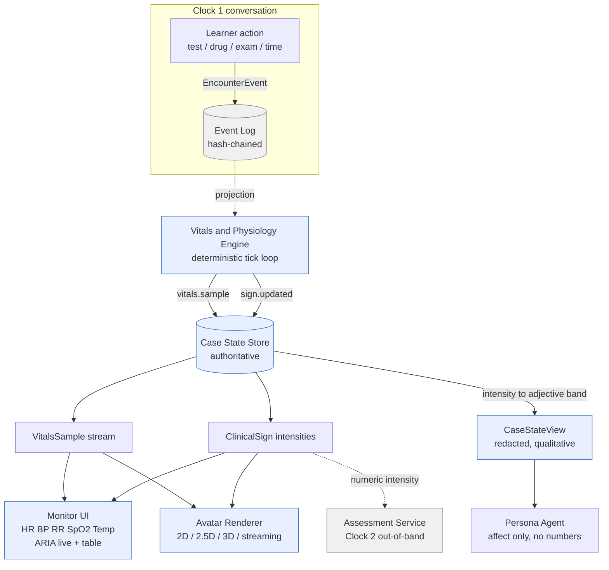
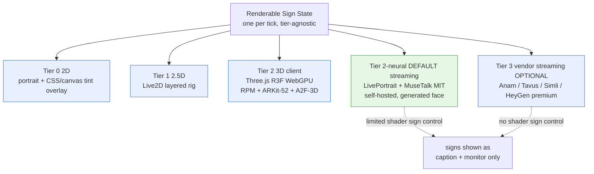

# 04 — Vitals & Physiology Engine + Avatar Pipeline

**Owner services:** **Vitals & Physiology Engine** (deterministic clinical-state simulator) and the **Avatar Renderer** (client-side, tiered). Both are *readers/producers* against the authoritative **Case State Store** ([`08` §2](./08-data-model-and-multitenancy.md)); neither is an LLM. The Engine emits `vitals.sample` and `sign.updated` `EncounterEvent`s ([`08` §3.3](./08-data-model-and-multitenancy.md)) that project into `VitalsSample`/`ClinicalSign`; the Avatar Renderer consumes those projections plus the Voice Pipeline's TTS audio.

**Scope.** The deterministic physiology tick loop (params → `VitalsSample` stream + `ClinicalSign` intensities); how learner interventions/tests/drugs perturb state; how one authoritative state feeds **both** the monitor UI and the avatar so they can never contradict; the abstract **clinical-sign schema authored once** (each sign carries a numeric intensity the Assessment layer in [`06`](./06-assessment-and-calibration-engine.md) can score) and rendered identically across 2D/2.5D/3D/streaming tiers; the avatar tier ladder (2D physiology-driven overlay first; ARKit-52 blendshape interchange; client-rendered Three.js/R3F + Ready Player Me; NVIDIA Audio2Face-3D lip-sync driven by the Voice Pipeline TTS; **open neural real-time 2D talking-heads — LivePortrait + MuseTalk, both MIT — as the default streaming tier**, with Anam/Tavus/Simli/HeyGen streaming photoreal as an optional premium managed fallback; Gaussian-splatting where it beats mesh); accessibility (colour-independent signs, text/table equivalents, ARIA live regions, non-audio alarm cues); and device-floor performance (4–5-yr laptop integrated GPU, mid-range phone on 4G).

**Grounding & integration.** Avatar/rendering technology selection is pinned in [`../research/03-3d-avatars.md`](../research/03-3d-avatars.md) — this doc consumes it and does not re-derive vendor choices; the decisions are frozen as [ADR-0010](./adr/README.md) (2D-first, clinical-signs-first, client-rendered, ARKit-52 / Ready Player Me) and [ADR-0018](./adr/README.md) (self-hosted Audio2Face-3D lip-sync). The **open-source-by-default** map for the streaming/photoreal tier — replacing Anam/Tavus/Simli/HeyGen with a self-hosted **open neural path** (LivePortrait + MuseTalk for real-time 2D talking-heads, Audio2Face-3D for 3D lip-sync, and open image-gen for the generated patient face) — is authoritative in [`../research/11-fully-open-source-stack.md`](../research/11-fully-open-source-stack.md) §9–10; this doc adopts it so that **the default at every tier is open and self-hostable**, with the streaming vendors demoted to an optional premium managed fallback (§4.4). The turn loop, `CaseStateView` redaction, `PersonaTurnInput`/`affect` schema, and the tool surface (`order_test`, `request_exam_finding`) are owned by [`01-ai-agent-architecture.md`](./01-ai-agent-architecture.md); the `EncounterEvent` envelope, hash-chain, `VitalsSample`/`ClinicalSign`/`CaseStateSnapshot` shapes and replay machinery by [`08-data-model-and-multitenancy.md`](./08-data-model-and-multitenancy.md); the `ClinicalSign(intensity)` numeric channel is scored by [`06-assessment-and-calibration-engine.md`](./06-assessment-and-calibration-engine.md); TTS audio + `voice_id` that drives lip-sync by [`03-voice-pipeline.md`](./03-voice-pipeline.md); C2PA marking of synthetic avatar frames by [`09-security-and-compliance-architecture.md`](./09-security-and-compliance-architecture.md). Requirements **RP-4** (vitals monitor), **AV-1..AV-4** (avatars), and the accessibility clauses (**§3.5** of the baseline) are in [`../00-overview/01-requirements-and-constraints.md`](../00-overview/01-requirements-and-constraints.md).

**Canon invariants honored here.**
- **Three isolated clocks.** The physiology tick rides **Clock 1** (conversation, 100s of ms) as a deterministic projection — it never calls a model and never blocks a persona turn. The numeric `ClinicalSign` intensity is *read* by the Assessment Service on **Clock 2** (out-of-band). Analytics rollups are **Clock 3**.
- **Two-tier content / AI-patient never sources facts.** The Engine is the *grounded* layer for vitals/labs/exam findings. The AI-patient never sources these — it receives only a redacted `CaseStateView` (`intensity → adjective band`), so the **avatar, the monitor, and the patient's words are three renders of one authoritative state** and cannot disagree (**AV-1**).
- **Event-sourced source of truth.** `VitalsSample`/`ClinicalSign` are **projections** of hash-chained `vitals.sample`/`sign.updated` events; any randomness (e.g., biological variability) is resolved at *write* time and stored in the payload so replay is byte-deterministic ([`08` §3.5](./08-data-model-and-multitenancy.md)).
- **Every avatar feature has a full non-voice / non-visual equivalent.** Every rendered sign has a text/table/ARIA equivalent; the avatar is an *enhancement*, never a gate (**AV-1/AV-2**, **V-5**).
- **Model Gateway is the only path to models.** Audio2Face-3D is not a "model" in that sense — it is a deterministic self-hosted media transform off already-inspectable TTS audio, not a clinical-reasoning call; it never touches the Model Gateway or clinical facts.

**MVP note.** Per the baseline, the **wedge is solo text-first EM**; the vitals monitor (**RP-4**) ships in MVP as a screen-reader-labelled data source, but the **avatar tiers are a v1+ fast-follow** (**AV-1** at v1; **AV-3/AV-4** at v2). The load-bearing MVP deliverable from *this* doc is the **abstract sign/state schema** (§4) — the contract every later tier renders against — plus the deterministic Engine (§2) that already drives the monitor.

---

## 1. Why this is one document, not two

The monitor and the avatar look like different features (a data widget vs a talking face) but they are the **same physiological state rendered twice**, and the single most-cited failure mode in medical simulators is a monitor and a mannequin/avatar that **contradict** — SpO₂ 82 % on the screen while the face is pink and calm ([`../research/03-3d-avatars.md`](../research/03-3d-avatars.md) §4). AcuDx forecloses that class of bug *architecturally*: there is exactly one authoritative physiology state (the Case State Store, folded from Engine events), and the monitor, the avatar, and the persona's `CaseStateView` are all **read-only projections of it**. A sign can never appear on one surface and not another because none of them *computes* the sign — they all *read* the same `ClinicalSign.intensity`.

This also fixes the second failure mode: a "decorative" photoreal avatar that cannot toggle cyanosis at SpO₂ 82 %. In AcuDx the **avatar is a state-driven clinical-sign renderer with a talking face bolted on**, not a talking face with signs bolted on ([`../research/03`](../research/03-3d-avatars.md) §1). The clinical-sign channel is the medical differentiator; the mesh/portrait/stream is the delivery tier.

---

## 2. The deterministic Vitals & Physiology Engine

### 2.1 What it is and is not

| It **is** | It is **not** |
|---|---|
| A deterministic, replayable state machine folding `EncounterEvent`s into a `PhysioState`, ticking that state forward, and emitting `vitals.sample`/`sign.updated`. | An LLM, an ML model, or anything on the Model Gateway. |
| The **grounded** authority for all vitals/labs/exam-finding *values* the learner ever sees (**RP-4**, T2). | A source of *narrative* affect — that is the persona's job, over the redacted view. |
| A pure function `apply(state, event) → state` plus a `tick(state, dt) → state` integrator (both side-effect-free; RNG pre-resolved at write time per [`08` §3.5](./08-data-model-and-multitenancy.md)). | A wall-clock real-time simulator — the tick is driven by encounter time, so replay reproduces it exactly. |
| Authored per case as a compact **parameter set + response model** (data), reviewed by a clinician SME in the Authoring Service (**AU-1/AU-2**). | Free to invent physiology at runtime; every response curve is authored and version-hashed against the `CaseVersion`. |

### 2.2 State model

`PhysioState` is small, JSONB-friendly, and the whole thing is a fold over the event stream. Two layers: **drivers** (the hidden physiological parameters the case author sets — the "truth") and **observables** (`VitalsSample` + `ClinicalSign` derived from drivers each tick).

```typescript
// Hidden physiological drivers — the authored "truth"; NEVER rendered directly, NEVER in a persona prompt.
interface PhysioDrivers {
  // cardiovascular
  preload: number;            // 0..1 relative volume status (hemorrhage/dehydration ↓)
  contractility: number;      // 0..1 pump function (MI/cardiogenic ↓)
  svr: number;                // 0..1 systemic vascular resistance (sepsis/anaphylaxis ↓, pain ↑)
  // respiratory / gas exchange
  ventilation: number;        // 0..1 alveolar minute ventilation
  shunt_fraction: number;     // 0..1 V/Q mismatch (pneumonia/PE/edema ↑ → SpO2 ↓)
  fio2: number;               // 0.21..1.0 delivered oxygen fraction (an intervention lever)
  // metabolic / neuro
  temp_setpoint_c: number;    // hypothalamic setpoint (sepsis/anaphylaxis ↑)
  metabolic_rate: number;     // 0..1 O2 demand (sepsis/pain/seizure ↑)
  gcs: number;                // 3..15 authoritative level of consciousness
  pain: number;               // 0..1 nociception (drives HR, RR, guarding, diaphoresis)
  glucose_mmol: number;       // for hypo/hyperglycaemia signs
  // hidden reserve — how close the patient is to decompensating
  compensation_reserve: number; // 0..1; ↓ as untreated time accrues → non-linear crash
}

// Observable output of one tick — the only thing that leaves the Engine.
interface VitalsSample {            // == the projection shape pinned in `08` §2
  encounter_id: string;
  t: number;                        // encounter-relative ms (causal, not wall-clock)
  seq: number;                      // stream_seq of the emitting vitals.sample event
  hr: number; sbp: number; dbp: number; map: number;
  rr: number; spo2: number; etco2?: number;
  temp_c: number; gcs: number; glucose_mmol?: number;
  rhythm: RhythmCode;               // 'sinus'|'sinus_tachy'|'af'|'svt'|'vt'|'vf'|'asystole'|...
  source: 'physiology_engine';      // invariant: the only source (`08` §2)
  confidence: 1;                    // vitals are ground truth; STT/UI never mutate them
}
```

**Derivation is authored, monotone, and bounded.** Each observable is a pure function of drivers, e.g. `spo2 = clamp( 100 − k_shunt·shunt_fraction·(1 − fio2_boost(fio2)) , 40, 100 )`. Authors tune coefficients against expected teaching values (pneumonia case: SpO₂ 88 % on air → 94 % on 4 L); the code is fixed, the coefficients are data, version-hashed with the case.

### 2.3 The tick loop

The Engine runs a **fixed-timestep integrator** on the conversation clock, but decoupled from turn cadence so vitals trend smoothly while the learner is typing or thinking.

- **Tick rate:** **1 Hz nominal** for the trend/monitor stream (clinically, HR/BP/RR/SpO₂ update once per second on a real monitor), with **event-driven immediate ticks** on any state-mutating `EncounterEvent` (a drug push, an `order_test` result maturing, an `fio2` change) so an intervention shows an effect without waiting for the next second boundary. Rhythm/ECG waveform, when rendered, is a **client-side procedural generator** seeded from `rhythm` + `hr` (no per-sample event — the server emits the *parameters*, the client draws the trace at 60 fps).
- **Emission policy (event-economy):** the Engine does **not** append 3,600 `vitals.sample` events for a 60-min encounter. It emits `vitals.sample` on a **deadband** — a sample is written only when any observable crosses a per-signal threshold (e.g. ΔHR ≥ 2, ΔSpO₂ ≥ 1, any rhythm change) or at a **≤10 s heartbeat** for trend continuity. Between events the monitor interpolates client-side. This keeps the hash-chained log lean while remaining fully replayable (interpolation is deterministic).
- **`sign.updated`** is emitted only when a `ClinicalSign.intensity` crosses a **render-significant delta** (default 0.05) or a **band boundary** (§4.3), so the avatar and the persona's adjective view change in lockstep and neither flaps.
- **Replay determinism:** the integrator is a pure fold; the only stochastic term (small biological jitter on HR/BP so a monitor doesn't look frozen) is drawn from a **seed stored in `encounter.started`** and advanced deterministically, so `rebuild(events)` reproduces every sample bit-for-bit ([`08` §3.5](./08-data-model-and-multitenancy.md)).

### 2.4 How learner actions perturb state

Interventions arrive as the **same tool-driven `EncounterEvent`s** the Director already appends ([`01` §4.3, §6](./01-ai-agent-architecture.md)) — the Engine is a *subscriber*, it invents nothing. Two timings, matching arch/01:

| Learner action | Event (arch/01) | Engine effect | Latency model |
|---|---|---|---|
| Give oxygen (e.g. NRB 15 L) | `encounter.order_test`-style intervention / `intervention.applied` | `fio2 ↑` → next tick `spo2 ↑` along authored curve | **immediate tick** (seconds); visible on monitor + cyanosis fades |
| Push a drug (e.g. adrenaline, fluids, antipyretic) | `intervention.applied {drug_code, dose, route}` | Author-defined response kernel: `svr↑`/`hr↑`/`temp_setpoint↓`/`preload↑`, applied as a **time-shaped kernel** (onset, peak, duration), not a step | onset per drug (adrenaline ~seconds; antibiotics: no acute vital change — teaches that *treating the cause* ≠ instant number change) |
| Order a test (CXR, troponin, ABG, 12-lead) | `encounter.order_test` (side-effect, arch/01 §4.3) | Result *value* computed deterministically from drivers, **held**; surfaces only when the learner requests it (**reveal discipline**, arch/01 §3.3) | test turnaround clock (author-set); never blocks conversation |
| Perform an exam maneuver | `encounter.exam_finding` via `request_exam_finding` | Returns authoritative finding intensity (e.g. crackles = f(shunt_fraction)); no state mutation | inline ack, resolved from state |
| Do nothing / delay | (time only) | `compensation_reserve ↓`; untreated sepsis/hemorrhage **decompensates non-linearly** → a crash the learner must catch | continuous; the pedagogical "clock is ticking" |

**Two design rules that keep this honest and gradeable:**
1. **Dangerous or contraindicated orders are still *simulated*, not blocked** — the Engine applies the physiologically-correct (possibly harmful) response so the learner sees the consequence, while the deterministic **Safety Interceptor** ([`01` §8](./01-ai-agent-architecture.md)) independently flags the dangerous management as a `HazardLogEntry` for assessment. The Engine models reality; the Interceptor handles safety. They are separate, per canon.
2. **Every perturbation is an event → every perturbation is scorable.** "Gave oxygen 40 s after SpO₂ fell below 90 %" is a fold over `sign.updated` + `intervention.applied` timestamps — the Assessment Service reads it directly ([`06` §4](./06-assessment-and-calibration-engine.md), gap analysis from spans + timings).

### 2.5 Serving one state to monitor + avatar + persona



The three consumers read the **same** `ClinicalSign.intensity`:
- **Monitor** renders numbers + trend + a text/table + ARIA-live equivalent (§5).
- **Avatar** maps intensity → shader uniform / portrait variant / blendshape weight (§4, §6).
- **Persona** gets only `intensity → adjective band` in `CaseStateView` ([`01` §4.1](./01-ai-agent-architecture.md)) — it *feels* "very short of breath," never `SpO2:88`. This is the **redaction seam** that makes "AI-patient never sources facts" true for the physical-sign channel.

---

## 3. The clinical-sign / state schema (authored once, rendered everywhere)

This is the load-bearing contract of the whole doc (**AV-2**). A case authors signs **once against the abstract schema**; every tier (2D → streaming) renders the *same* `ClinicalSign` state, so a case authored as "SpO₂ 82 % → central cyanosis intensity 0.7" looks correct whether the learner is on free 2D or premium streaming, and the Assessment layer scores the same numeric intensity regardless of render tier.

### 3.1 The canonical `ClinicalSign` set (frozen enum)

Like the 6 assessment domains ([`06` §1.1](./06-assessment-and-calibration-engine.md)), the sign *type* set is frozen in code (an enum); per-case authoring sets the **driver mapping and thresholds**, not new sign types.

```typescript
type ClinicalSignType =
  | 'cyanosis_central' | 'cyanosis_peripheral' | 'pallor' | 'flushing' | 'jaundice'
  | 'diaphoresis' | 'mottling' | 'cap_refill_delay'
  | 'resp_distress' | 'accessory_muscle_use' | 'nasal_flaring' | 'tripod_posture' | 'pursed_lip'
  | 'loc_depression'                     // level-of-consciousness / drowsiness (GCS-mapped)
  | 'ptosis' | 'gaze_deviation'
  | 'guarding' | 'fetal_posture' | 'seizure_activity' | 'hemiparesis_droop' | 'tremor'
  | 'edema' | 'rash' | 'wound' | 'bleeding' | 'fever_appearance';
```

Continuous signs (cyanosis, pallor, diaphoresis, flushing, resp_distress, loc_depression) are **shader/animation-parameterizable** and drive smoothly off a 0..1 intensity. Discrete/regional signs (wound, rash, bleeding) carry a body-region + a small variant payload and render as decals/overlays ([`../research/03`](../research/03-3d-avatars.md) §4).

### 3.2 The `ClinicalSign` JSON schema (with intensity fields)

```jsonc
{
  "$id": "acudx.clinical_sign.v1",
  "type": "object",
  "required": ["encounter_id", "t", "sign", "intensity", "band", "derived_from"],
  "properties": {
    "encounter_id": { "type": "string" },
    "t":            { "type": "integer", "description": "encounter-relative ms (causal, not wall-clock)" },
    "seq":          { "type": "integer", "description": "stream_seq of the emitting sign.updated event" },

    "sign":         { "type": "string", "enum": [ "cyanosis_central", "pallor", "diaphoresis",
                        "resp_distress", "loc_depression", "guarding", "mottling", "wound", "…" ] },

    // ── THE SCORABLE NUMERIC CHANNEL (read by Assessment `06`) ──
    "intensity":    { "type": "number", "minimum": 0, "maximum": 1,
                        "description": "continuous severity; 0 = absent, 1 = maximal. The value the grader scores." },
    "band":         { "type": "string", "enum": ["none","subtle","moderate","marked","severe"],
                        "description": "quantized intensity → the adjective the CaseStateView & captions use (`01` §4.1)" },
    "detectable":   { "type": "boolean",
                        "description": "true once intensity crosses the case's clinical-detectability threshold; the 'a competent clinician SHOULD notice this now' flag Assessment keys on" },
    "onset_t":      { "type": ["integer","null"],
                        "description": "encounter-ms when detectable first became true — enables 'missed cyanosis for 90 s' scoring" },

    // ── REGIONAL / DISCRETE PAYLOAD (decal-rendered signs) ──
    "region":       { "type": ["string","null"],
                        "enum": ["face","lips","nailbeds","peripheries","chest","abdomen","legs","generalized", null] },
    "variant":      { "type": ["object","null"],
                        "description": "sign-specific extras, e.g. wound {type,length_cm,bleeding_rate}, rash {morphology,distribution}" },

    // ── PROVENANCE / RENDER CONTRACT ──
    "derived_from": { "type": "object",
                        "description": "which PhysioDrivers produced this, for audit & replay",
                        "properties": {
                          "drivers": { "type": "array", "items": { "type": "string" },
                                        "example": ["shunt_fraction","fio2"] },
                          "formula_id": { "type": "string", "example": "cyanosis_central.v1" } } },

    "render_hints": { "type": "object",
                        "description": "tier-agnostic; each tier reads what it can, ignores the rest",
                        "properties": {
                          "shader_uniform": { "type": "string", "example": "u_cyanosis" },
                          "arkit_blendshapes": { "type": "array", "items": { "type": "string" },
                                                  "example": ["jawOpen","browInnerUp"] },
                          "portrait_layer": { "type": "string", "example": "overlay/cyanosis" },
                          "caption_text":  { "type": "string", "example": "lips and fingertips look blue-grey" } } }
  }
}
```

**Why `intensity` and `band` are both present.** `intensity` (continuous 0..1) is what the **Assessment layer scores** — "the learner missed central cyanosis while intensity ≥ 0.6 for 90 s" is a precise, gradeable claim ([`06` §2.3](./06-assessment-and-calibration-engine.md), evidence-span + timing). `band` (quantized `none/subtle/moderate/marked/severe`) is what the **`CaseStateView` and captions** consume — the persona says "I feel awful, I can't catch my breath" not "my respiratory-distress intensity is 0.62," and a caption reads "breathing looks laboured." The `intensity → band` quantizer is the **single deterministic function** referenced as the open question in [`01` §Open-Q1](./01-ai-agent-architecture.md); it lives here so the number never leaks and the three surfaces stay consistent.

### 3.3 `intensity → band` quantizer (the redaction seam)

```typescript
// Deterministic, pure, version-pinned per case-type. The ONLY bridge from number → adjective.
const BAND_CUTS = [0.0, 0.15, 0.40, 0.70, 0.90]; // none | subtle | moderate | marked | severe
function bandOf(intensity: number): SignBand { /* piecewise over BAND_CUTS */ }

// detectability is per-case (a subtle rash may be authored detectable at 0.25; central cyanosis ~0.4)
function detectable(sign: ClinicalSignType, intensity: number, threshold: number): boolean {
  return intensity >= threshold;
}
```

`band` feeds `CaseStateView` (persona) and captions (accessibility); `intensity` + `detectable` + `onset_t` feed Assessment; `render_hints` feed every visual tier. One authoring act, three consumers, zero contradiction.

---

## 4. Avatar tiers (progressive enhancement, one sign state)

Per [ADR-0010](./adr/README.md) and [`../research/03`](../research/03-3d-avatars.md) §6, ship value at each tier; never block on 3D. **Every tier renders the same `ClinicalSign` state** — the diagram below is the whole point: the sign channel is authored once and fanned to whichever tier the learner is entitled to.



### 4.1 Tier 0 — 2D physiology-driven portrait (the first avatar, **AV-1**, v1)

A per-persona illustrated/stylized portrait + a discrete **emotion set** (from `affect.primary`, arch/01 §4.2) + the **clinical-sign overlay layer** rendered as canvas/WebGL shader tints or layered image states:
- **cyanosis** → lips/nailbeds/central skin shifted blue-grey by `u_cyanosis = intensity`;
- **pallor** → desaturate + lighten albedo;
- **diaphoresis** → wet-sheen specular overlay + optional forehead beads;
- **flushing/fever** → warm cheek/forehead tint;
- **resp_distress** → looping chest/shoulder-excursion animation whose rate = `rr` and depth = distress intensity;
- **loc_depression** → eye-open %, head-droop, response-latency from `gcs`.

Continuous signs use **one material with uniforms** (`u_cyanosis`, `u_pallor`, `u_sweat`, `u_flush`) driven by `intensity` — cheap on integrated GPUs, animates smoothly ([`../research/03`](../research/03-3d-avatars.md) §4). This tier is **~$0 marginal cost**, ships the pedagogical payload, and — decisively — **carries the medical differentiator before any 3D exists**. Lip-sync here is a simple mouth-shape swap from TTS phoneme timing (§6.1); text-only encounters just show the portrait + captions.

### 4.2 Tier 1 — 2.5D layered rig (v2)

Same portrait, rigged in layers (**Live2D Cubism**-style) for parallax head-turn, blink, **breathing excursion**, brow/mouth deformation, and a sweat overlay — adds *life* and much better respiratory-distress realism at still **~$0 marginal**. No 3D asset pipeline. Good breathing/distress animation is the highest-value 2.5D upgrade for EM cases.

### 4.3 Tier 2 — client-rendered 3D (v2, **AV-3**)

The "real" AcuDx avatar: **Three.js + React-Three-Fiber**, **WebGPU renderer with automatic WebGL2 fallback** (r171+; ~70 %+ global WebGPU coverage in 2026, WebGL2 covers the device floor), **Ready Player Me** GLB base rig (free SDK; exports the **ARKit-52** blendshape set + Oculus visemes), **ARKit-52 as the interchange standard** across all tiers, and **NVIDIA Audio2Face-3D** (self-hosted, [ADR-0018](./adr/README.md)) for lip-sync + emotion driven off the cascade's TTS audio (§6.2). The clinical-sign channel ports to **PBR material uniforms + blendshapes + body-rig poses** (guarding, tripod, hemiparesis droop). Marginal cost **~$0** (runs on the student device); one-time GLB download ~2–8 MB, then only tiny blendshape/vitals parameter streams over the existing WebSocket — ideal for weak/mobile links. Enables multi-role embodied multiplayer rooms ([`07`](./07-multiplayer-rooms.md)) at ~$0 render cost.

**Sign ⟂ speech composition rule.** Clinical-sign blendshapes/uniforms and lip-sync blendshapes are **composed on one rig by additive layering**: A2F-3D owns the mouth/jaw viseme channel; the sign channel owns skin uniforms + posture + eye/LOC; emotion (`affect`) blends a pose over both. They never fight for the same coefficient because the sign channel is authored to avoid the ~15 viseme-critical ARKit shapes.

### 4.4 Streaming / photoreal tier — open neural DEFAULT, vendors optional (v2, **AV-4**)

The streaming tier is where earlier drafts named proprietary vendors (Anam CARA-3, Tavus Phoenix-4,
Simli, HeyGen). Per [`../research/11`](../research/11-fully-open-source-stack.md) §9, the **default is now an
open, self-hosted neural path**; the vendors survive **only as an optional premium managed fallback**.

**Tier 2-neural — the DEFAULT streaming face (open, self-hosted).** Real-time neural talking-heads
driving the **generated patient face** (per `caseInstanceId`, §4.6):

| Component | OPEN default | License | Role |
|---|---|---|---|
| Real-time 2D talking-head | **LivePortrait** (portrait animation / expression transfer) + **MuseTalk** (audio-driven lip-sync, 30 fps+) | ✅ **MIT** (both) | the streaming face, ~$0 marginal on a shared/edge GPU; ONNX/CoreML ports exist for on-device |
| Audio-driven upper body (alt) | **EchoMimic v2** | ✅ open (Apache/MIT-class — verify per repo) | richer half-body motion where wanted |
| 3D lip-sync (composes with signs) | **NVIDIA Audio2Face-3D** (self-hosted, [ADR-0018](./adr/README.md)) | ✅ MIT SDK / NVIDIA Open Model (model) | ARKit-52 output layers with the sign channel (§4.3) — **the sign-controllable path** |
| Generated patient face (still image the head-driver animates) | **Qwen-Image** or **FLUX.1-schnell** + **PuLID** / **PhotoMaker-V2** for identity-consistency | ✅ **Apache-2.0** (all) | seed-stable face per case; **avoid FLUX.1-dev output (non-commercial) and InstantID (its AntelopeV2 face encoder is non-commercial)** — use PuLID/PhotoMaker instead (§4.6) |

MuseTalk's lip-sync is **audio/phoneme-driven**, so it lip-syncs Turkish (or any) TTS audio from the
Voice Pipeline even though its training corpus is EN/JA/ZH — the driver is the waveform, not a language
model. Marginal cost is **~$0 on a shared GPU** (no per-minute vendor meter); the same GPU-utilization
break-even as voice (arch/03 §12.4) applies.

**Tier 3 — vendor streaming photoreal (OPTIONAL premium, OSCE/top-realism only).** **Anam CARA-3**
(HIPAA/SOC-2 vendor SLA) / **Tavus Phoenix-4** (image-to-replica) / **Simli** (neural 3D Gaussian-splat,
<300 ms, WebRTC, ~$0.05/min PAYG) / **HeyGen LiveAvatar** (max fidelity, ~$0.10–0.20/min). Emotion +
lip-sync are **bundled inside the vendor** (send audio, get an emotive face). **Gated to premium
subscribers and OSCE-realism cases only** because at $0.05–0.20/min a 12-min encounter is $0.60–$2.00 →
$6k–$20k/mo at 10k enc/mo in streaming alone ([`../research/03`](../research/03-3d-avatars.md) §2C, §5;
baseline §3.1) — where the open Tier 2-neural path is ~$0 marginal on your own GPU. Vendors are for
tenants that want a vendor SLA and refuse to run GPUs; **air-gapped / sovereign tenants never touch
this tier** (zero egress).

**The decisive constraint (applies to BOTH the open neural face and the vendors):** a photoreal/neural
talking-head renders a **healthy face** and **cannot expose clinical-sign shaders**. So on any streaming
tier the sign channel degrades to the **monitor + captions + a text sign-panel** (the `WARN` node above),
and streaming is used for *communication/affect* realism (breaking-bad-news, the aggressive/anxious
variant), never as the *physical-exam* surface. This is why **client-rendered Tier 0–2 (2D overlay,
2.5D rig, and 3D + Audio2Face-3D) stays the default wherever signs matter** — the sign-controllable
Audio2Face-3D path (Tier 2) is preferred over any streaming face for exam-heavy cases; the streaming
tier (open neural *or* vendor) is an affect upsell.

### 4.5 Tier picks and trade-offs

| Axis | 2D / 2.5D / 3D client (Tier 0–2) | Open neural streaming (Tier 2-neural, DEFAULT) | Vendor streaming photoreal (Tier 3, OPTIONAL) |
|---|---|---|---|
| Marginal $/encounter | **~$0** (client GPU) | **~$0–$0.10** (your shared/edge GPU; no vendor meter) | $0.60–$2.00 (12 min, per-min vendor fee) |
| Ongoing bandwidth | Near-zero (params only) | 0.5–2.5 Mbps WebRTC (or client-rendered) | 0.5–2.5 Mbps continuous WebRTC |
| Weak-network / LMIC | **Best** (offline-capable) | Mid (self-host in-region) | Worst |
| Weak-device GPU | Fine (stylized, WebGL2 floor) | Server-side render → decode-only client | Best (decode-only) |
| **Clinical-sign control** | **Full (shaders/blendshapes)** | Limited (Audio2Face-3D path keeps signs; pure LivePortrait/MuseTalk face does not) → monitor + caption | **None** — sign channel → monitor + caption |
| Photorealism | Stylized | Photoreal-ish (neural) | Photoreal |
| License / sovereignty | ✅ MIT, air-gappable | ✅ **MIT, self-hosted, air-gappable** | ⚠️ proprietary SaaS, egress → not for air-gapped |
| **Air-gap compatible** | ✅ **Yes** (open, self-hosted, zero egress) | ✅ **Yes** (open, self-hosted, zero egress) | ⛔ **No** (managed SaaS egress; **DISABLED in air-gapped mode**) |
| Default vs optional | **Default, always-available** | **Default streaming face, always-available** | **Optional managed add-on** (premium/OSCE only) |
| Verdict | **Default** wherever signs matter | **Default streaming face** (open, ~$0, self-hosted) | **Gated** affect/OSCE upsell, vendor-SLA only |

Every avatar capability is served by an **open, self-hosted model that is the default and always
available** (Tier 0–2 client rendering, the Tier 2-neural open streaming face, and the open generated
patient face of §4.6). The vendor streaming tier (Anam / Tavus / Simli / HeyGen) is an **optional
managed add-on only**; in **air-gapped / sovereign mode it is DISABLED** and every tier above it — none
of which egresses — remains fully functional, so an air-gapped tenant loses no avatar capability, only
the optional vendor-SLA polish.

**Explicit rejections (from research, restated so this doc is self-contained):** **Unity WebGL** rejected for web delivery (20–60 MB builds, slow TTI); **MetaHuman** premium/native only (web Creator sunset; heavy browser pipeline); **Soul Machines** dead (ceased ops Feb 2026 — do **not** design around it); in-browser Gaussian-splat driven faces tracked as an opportunistic **Phase-4** path to collapse streaming per-minute cost into client rendering, **not** committed until proven for driven, emotive, sign-controllable faces.

### 4.6 The generated patient face (open image-gen, replaces Tavus image-to-replica)

Both the client-3D rig (Tier 2, as a texture/likeness) and the neural streaming face (Tier 2-neural,
§4.4) need a **stable, diverse, synthetic patient face per `caseInstanceId`** — never a real person.
The default pipeline is **fully open and commercially clean** ([`../research/11`](../research/11-fully-open-source-stack.md) §10):

| Step | OPEN default | License | Note |
|---|---|---|---|
| Base face image | **Qwen-Image** or **FLUX.1-schnell** | ✅ **Apache-2.0** | output is unambiguously yours; **do NOT use FLUX.1-dev** (⛔ non-commercial output without a paid BFL license) |
| Identity consistency (same face across seeds/angles) | **PuLID** / **PhotoMaker-V2** | ✅ **Apache-2.0** (both) | seed-stable per case; **do NOT use InstantID** — its AntelopeV2/InsightFace face encoder is ⛔ non-commercial-only, an easy-to-miss trap |
| Image→3D head (client-3D texture path) | **TripoSR** (verify TripoSG per repo) | ✅ MIT (TripoSR) | single image → mesh, feeds the Tier-2 rig |

Every generated face is **C2PA-marked + "synthetic patient"-labelled + diversity-audited** at
generation (Art. 50(2), [`09`](./09-security-and-compliance-architecture.md); unchanged from
[`../research/11`](../research/11-fully-open-source-stack.md) §10 and research/10). This replaces
**Tavus image-to-replica** entirely for the default build; the vendor image-to-replica path survives
only inside the optional Tier-3 premium fallback (§4.4).

---

## 5. Accessibility (every sign has a non-visual equivalent)

Accessibility is a **schema property**, not a bolt-on: because every `ClinicalSign` carries `band` + `render_hints.caption_text` and every `VitalsSample` is structured, the text/table/ARIA equivalents are *generated from the same state* the avatar renders — they cannot drift. WCAG 2.2 AA is the non-negotiable baseline (baseline §3.5; EAA enforceable since 28 Jun 2025).

| Requirement (baseline §3.5) | How this engine satisfies it |
|---|---|
| **Colour-independent signs (WCAG 1.4.1)** | Every sign has a **text label + band word** ("central cyanosis: marked") rendered alongside/under the avatar; cyanosis/pallor are never encoded by colour alone. The monitor uses shape/label + value, not colour-only thresholds. |
| **Text/table equivalent** | A live **"Patient status" table** mirrors the monitor (HR/BP/RR/SpO₂/Temp/GCS + trend arrows) and a **"Visible signs" list** mirrors the avatar (`sign → band → caption`), both projected from the same `VitalsSample`/`ClinicalSign`. The whole encounter is completable with the avatar off (**AV-1/AV-2**, **V-5**). |
| **ARIA live regions** | Vitals table = `aria-live="polite"`; a **new red-flag threshold cross** (e.g. SpO₂ < 90, new VT) = `aria-live="assertive"` announces the change and value. Debounced to the `sign.updated`/deadband cadence so screen readers don't flood. |
| **Non-audio alarm cues** | Every monitor **alarm has a visual + haptic twin** (persistent banner + border pulse + optional `navigator.vibrate` on mobile), so a Deaf/HoH learner or a muted device still gets the alarm. No alarm is audio-only. |
| **No timing/colour traps; extended-time modes** | The physiology "decompensation clock" (§2.4) honours the baseline no-timer/extended-time modes for scaffolded learners (**RP-5**); the crash curve can be slowed, not removed, so the teaching signal survives without penalising slower learners. |
| **C2PA on synthetic frames** | Streaming/photoreal (Tier 3) and A2F-3D-generated (Tier 2) avatar media are **C2PA-marked at generation** (Art. 50(2), [`09`](./09-security-and-compliance-architecture.md), [ADR-0018](./adr/README.md)) — the accessibility statement and the AI-transparency label are one surface. |

---

## 6. The audio → face pipeline (lip-sync driven by the Voice Pipeline)

Lip-sync is driven by the **Voice Pipeline** ([`03`](./03-voice-pipeline.md)) TTS audio, never by any clinical channel. Two tiers, matching the render tiers:

### 6.1 Cheap client-side visemes (default; 2D/2.5D + free 3D)
Map TTS phoneme/timing output (Cartesia Sonic-3 / cached ElevenLabs v3 timestamps) to the ~15 Oculus/ARKit viseme shapes in-browser + jaw + minimal co-articulation. **$0 marginal, offline-capable**, "good enough" for a stylized RPM/portrait face. Text-only encounters skip this entirely (portrait + captions).

### 6.2 Audio2Face-3D microservice (premium client-3D; [ADR-0018](./adr/README.md))
Self-hosted **NVIDIA Audio2Face-3D** (NVIDIA Open Model License on the model, MIT SDK, Apache training framework — permissive to self-host) converts the cascade's TTS audio → **ARKit-52 blendshape coefficients + audio/explicit emotion**, streamed to the Three.js mesh. Higher fidelity, GPU-amortized across concurrent sessions (**no per-minute vendor fee**), and — critically — its ARKit-52 output **composes cleanly with the clinical-sign channel on the same rig** (§4.3). Runs off already-inspectable TTS audio, so it adds **zero** clinical authority and needs no Model Gateway path.

### 6.3 Emotion channel
`affect` (`primary`, `intensity`, `prosody`, `nonverbal`) comes from the **patient-agent LLM state** (arch/01 §4.2), not from audio prosody alone — this keeps affect *pedagogically controllable* (the "aggressive"/"anxious" variants must reliably *read* as such). A2F-3D takes emotion as explicit input; the 2D/3D renderer blends an emotion pose over the viseme + sign layers. Same `affect` object renders as a **caption emotion-label** for the non-voice path (**V-5**), so emotion, like signs, has a full non-visual equivalent.

For **Tier 3 streaming**, emotion + lip-sync are bundled inside the vendor — you send audio, they return the emotive face; no pipeline to build, you pay per minute.

---

## 7. Performance on the device floor

Target floor (baseline §3.3): a **4–5-yr-old student laptop** (integrated GPU, possibly WebGL2-only) and a **mid-range phone on 4G**.

| Concern | Budget / choice | Why it holds on the floor |
|---|---|---|
| **3D render** | Stylized RPM rig ~10–20k tris + blendshape morphs, WebGPU with **automatic WebGL2 fallback**; target 30–60 fps | Trivial for integrated GPUs; real-time facial AR at 58 fps on a phone is already demonstrated — our stylized load is far lighter. WebGPU gives ~1.5× battery + ~10× scene-render headroom where available; WebGL2 covers the floor. |
| **Asset download** | GLB **one-time ~2–8 MB**, then only blendshape/vitals param streams over the existing WebSocket | Near-zero ongoing bandwidth; fine on 4G and <100 kbps text-mode falls back to portrait + captions (**RP-6**). |
| **Sign shaders** | One material, ~4 continuous uniforms; decals for discrete signs | Uniform updates are per-frame-cheap; no asset-swapping for continuous signs. |
| **Vitals/ECG** | Server emits **parameters** (rhythm+hr); client draws the 60 fps trace procedurally; `vitals.sample` on a deadband (≤10 s heartbeat) | The server never streams a waveform; the log stays lean; the client does the cheap drawing. |
| **2D fallback** | Tier 0 portrait + CSS/canvas overlay; no GPU 3D required | Guarantees the medical differentiator renders even on the weakest device / air-gapped campus. |
| **Streaming (Tier 3)** | Decode-only client load, 0.5–2.5 Mbps down | Best for weak *devices*, worst for weak *networks* — hence gated, and never the floor default. |

**Degradation ladder (auto-selected by capability probe):** WebGPU 3D → WebGL2 3D → 2.5D rig → 2D portrait + overlay → text-only "Patient status" table. The clinical-sign *state* is identical at every rung; only the *render* degrades. This is the same guarantee the accessibility path relies on (§5).

---

## 8. Failure modes and degradation

| Failure | Detection | Degradation |
|---|---|---|
| Avatar/monitor would disagree | (structurally impossible) | Both read one `ClinicalSign.intensity`; there is no code path that computes a sign twice (§1). |
| WebGPU/WebGL2 unavailable or GPU-poor | client capability probe + fps watchdog | Fall down the ladder (§7) to 2.5D → 2D → text table; state unchanged. |
| A2F-3D microservice down | health check on the lip-sync stream | Fall back to client-side visemes (§6.1); face still talks, just lower-fidelity mouth. |
| Streaming face degraded (open neural GPU saturated, or vendor outage / budget cap) | GPU-util watchdog / vendor health / cost breaker | Fall back **open-neural → client-rendered Tier 2/0** (never forced onto a vendor); **sign fidelity improves** (shaders return) while photorealism drops. A premium tenant may fail *up* to a vendor if configured, but the default fallback is the open client tier. |
| `vitals.sample` gap (bus hiccup) | monitor interpolation staleness watchdog | Client interpolates from last sample + heartbeat; on resume, replay reconciles deterministically ([`08` §3.5](./08-data-model-and-multitenancy.md)). |
| Persona would leak a number via the sign channel | `intensity → band` quantizer + FactAssertionGate ([`01` §2](./01-ai-agent-architecture.md)) | Persona only ever sees `band`; the gate independently rejects any numeric assertion pre-emit. Defense-in-depth. |
| Case authored with an out-of-range driver curve | Authoring Service eval + version-hash gate (**AU-2**) | Rejected at authoring, never reaches runtime; coefficients are reviewed data, not runtime free-generation. |

---

## 9. Technology & where things live

| Concern | Choice | Rationale |
|---|---|---|
| Physiology state / `VitalsSample` / `ClinicalSign` store | **Case State Store** = Postgres 16 + JSONB, projected from the Event Log ([`08` §2](./08-data-model-and-multitenancy.md)) | Authoritative, replayable; `PhysioDrivers` + observables are JSONB-natural. |
| Engine implementation | **Deterministic TypeScript** service (pure `apply`/`tick` folds), on the conversation clock, no LLM | Byte-deterministic replay; no Model Gateway path; RNG seeded in `encounter.started`. |
| Emission | `vitals.sample` / `sign.updated` `EncounterEvent`s on a **deadband + ≤10 s heartbeat** | Lean hash-chained log; deterministic client interpolation between events. |
| Sign→adjective bridge | **`intensity → band` quantizer** (pure, version-pinned per case-type) | The single redaction seam feeding `CaseStateView` + captions; keeps numbers out of the persona ([`01` §4.1](./01-ai-agent-architecture.md)). |
| 3D client engine | **Three.js + React-Three-Fiber**, WebGPU + WebGL2 fallback | Largest ecosystem, R3F fits the React UI, glTF+morph-target native ([`../research/03`](../research/03-3d-avatars.md) §2A). |
| Base rig / interchange | **Ready Player Me** GLB + **ARKit-52** blendshapes | Free SDK, exports ARKit-52 + Oculus visemes; ARKit-52 is the frozen interchange across tiers ([ADR-0010](./adr/README.md)). |
| Client 3D lip-sync | **Self-hosted NVIDIA Audio2Face-3D** (Open Model + MIT SDK + Apache) | GPU-amortized, no per-minute fee, ARKit-52 output composes with the sign channel ([ADR-0018](./adr/README.md)). |
| Free-tier lip-sync | **Client-side visemes** from TTS phoneme timing | $0 marginal, offline-capable. |
| Streaming face (default) | **Open neural: LivePortrait + MuseTalk (MIT), self-hosted**, driving the generated face (§4.4, §4.6) | ~$0 marginal on your GPU, air-gappable; no per-minute meter ([`../research/11`](../research/11-fully-open-source-stack.md) §9). |
| Streaming photoreal (optional premium) | **Anam CARA-3 / Tavus Phoenix-4 / Simli** ($0.05/min, <300 ms) / **HeyGen LiveAvatar** max fidelity | Premium/OSCE-gated vendor fallback; no clinical-sign control; not for air-gapped ([`../research/03`](../research/03-3d-avatars.md) §2C; baseline §3.1). |
| Generated patient face | **Qwen-Image / FLUX.1-schnell + PuLID / PhotoMaker-V2 (all Apache-2.0)** (§4.6) | Replaces Tavus image-to-replica; **not** FLUX-dev / InstantID-encoder (non-commercial) ([`../research/11`](../research/11-fully-open-source-stack.md) §10). |
| Transport | **LiveKit SFU** for streaming/voice rooms; plain WebSocket for solo param streams | Streaming only where needed ([ADR-0011](./adr/README.md)); solo text-first is cheap. |
| Synthetic-media provenance | **C2PA** marking at generation for Tier 2/3 frames | Art. 50(2) transparency ([`09`](./09-security-and-compliance-architecture.md)). |

**Explicit trade-offs.**
1. **Deterministic authored physiology vs a real ODE cardiopulmonary model.** We choose an authored, coefficient-tuned response model (fast, replayable, SME-reviewable, gradeable) over a full mechanistic simulator (heavier, harder to audit, overkill for teaching signal). Accept coarser realism for byte-deterministic replay and clinician-authorable curves.
2. **1 Hz tick + event-driven immediates vs continuous simulation.** A 1 Hz monitor cadence matches real monitors and keeps the event log lean; immediate ticks on interventions preserve responsiveness. Accept that sub-second dynamics are client-interpolated, not event-sourced.
3. **Client-rendered default vs streaming photoreal.** We take stylized-but-sign-controllable at ~$0 over photoreal-but-sign-blind at $0.05–0.20/min. Streaming is gated because it trades away the medical differentiator and adds a per-minute meter.
4. **One frozen sign enum vs open sign authoring.** Freezing `ClinicalSignType` (like the 6 domains) keeps every tier and the grader consistent; authors tune *mappings/thresholds*, not new sign types. Accept that a genuinely novel sign needs a schema version bump, not runtime invention.
5. **`intensity` (score) ⟂ `band` (adjective) split.** Carrying both costs a little redundancy but is what lets Assessment score a precise number while the persona/captions stay number-free — the redaction seam that makes "AI-patient never sources facts" true for physical signs.

---

## Open questions & build sequence

**Must be decided first (blockers):**
1. **`intensity → band` cutpoints + per-sign `detectable` thresholds** (§3.3). Shared with [`01` Open-Q1](./01-ai-agent-architecture.md) (the `CaseStateView` redaction) and read by [`06`](./06-assessment-and-calibration-engine.md) (what "should have been noticed" means). Decide with clinician SMEs against real teaching values *before* any case authors signs — everything in §3/§4/§6.3 keys off it.
2. **Per-case `PhysioDrivers → observable` coefficient library** (§2.2) and the **drug/intervention response kernels** (§2.4). The authored physiology curves per EM case archetype (MI, sepsis, PE, anaphylaxis, hemorrhage, DKA); reviewed data, version-hashed with the `CaseVersion` (**AU-2**). Blocks the Engine's realism and every intervention-timing score.
3. **`vitals.sample` deadband + heartbeat parameters** (§2.3) — the exact per-signal deltas and heartbeat that balance log economy against monitor smoothness and screen-reader flood. Tune against a real EM encounter trace.
4. **ARKit-52 sign ⟂ viseme channel partition** (§4.3) — the exact blendshape allocation so clinical-sign posture/LOC coefficients never collide with A2F-3D viseme coefficients. Blocks Tier 2.

**Build sequence (MVP → v1 → v2):**
1. **MVP (ships in the EM text wedge):** the **deterministic Vitals & Physiology Engine** (`PhysioState` fold + 1 Hz/event tick + `vitals.sample`/`sign.updated` emission) as an authoritative Event-Log projection; the **abstract `ClinicalSign` schema + `intensity`/`band`/`detectable` fields** (§3, the load-bearing contract); the **monitor UI** (RP-4) with its **text/table + ARIA-live + non-audio-alarm** equivalents (§5, WCAG 2.2 AA); the `intensity → band` quantizer feeding `CaseStateView` (§3.3). No avatar render yet — the sign *state* and the monitor ship; the face is deferred.
2. **v1 (AV-1):** **Tier 0 2D physiology-driven portrait** + emotion set + clinical-sign overlay (cyanosis/pallor/diaphoresis/distress/LOC) driven by the Engine at ~$0 marginal — the medical differentiator, avatar & monitor provably consistent; client-side viseme lip-sync (§6.1) once voice lands.
3. **v2 (AV-3/AV-4):** **Tier 1 2.5D** rig (breathing/distress realism); **Tier 2 client-3D** (Three.js/R3F + RPM + ARKit-52 + self-hosted **Audio2Face-3D**, [ADR-0018](./adr/README.md)) with the sign channel ported to materials/blendshapes/body-rig, enabling embodied multiplayer rooms ([`07`](./07-multiplayer-rooms.md)); **Tier 2-neural open streaming** (self-hosted **LivePortrait + MuseTalk**, MIT, §4.4) driving the open **generated patient face** (Qwen-Image/FLUX-schnell + PuLID/PhotoMaker, §4.6) as the **default streaming face**, with **vendor streaming photoreal** (Anam/Tavus/Simli/HeyGen) behind the **premium/OSCE** flag — both C2PA-marked with sign-channel degradation to monitor+captions.
4. **Opportunistic (Phase 4):** evaluate in-browser Gaussian-splat driven faces (GaussianEmoTalker / GaussianHeadTalk line) to collapse the streaming per-minute cost into client rendering — do **not** commit until proven for driven, emotive, sign-controllable faces.
