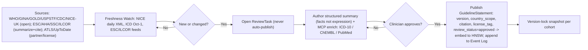
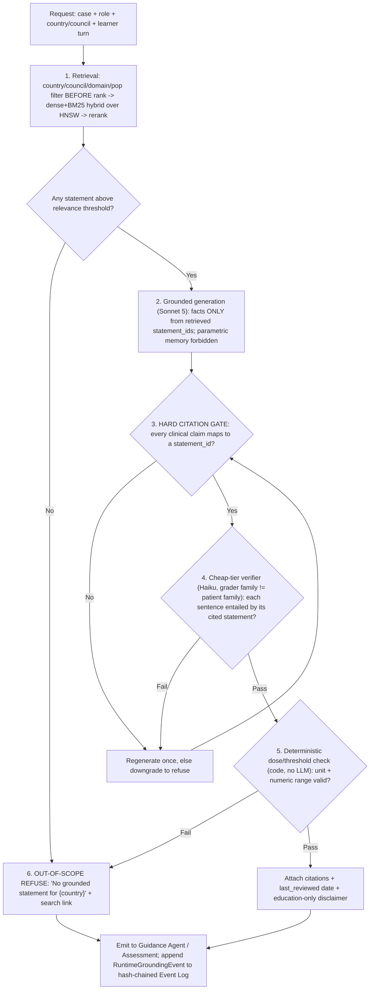

# 05 — Guideline-Grounding Engine

**Status:** Build-ready architecture. **Date:** July 2026. **Owner:** Grounding Service.

**Scope.** This document specifies the **Grounding Service** — the component that owns the `GuidelineStatement` corpus, hybrid country-filtered retrieval, and the **runtime safety pipeline** that every grounded output passes through. It serves two consumers with one engine: the **Guidance Agent** (Socratic hints) and the **Assessment Service** (case-fact correctness during grading). It is the safety spine of the two-tier content architecture: **the GROUNDED layer owns all clinical facts (citation-or-refuse); the ROLEPLAY layer cannot assert clinical facts.** The AI-patient never sources facts — the Case State Store does; the Grounding Service is the authoritative source for *guideline* facts (thresholds, drug protocols, "correct answer per body").

This design is derived from and must stay consistent with:
- `docs/research/05-clinical-guideline-grounding.md` (source strategy, licensing, `GuidelineStatement` atom, hybrid RAG, freshness watch).
- `docs/research/06-regulatory-compliance.md` (education-not-CDSS keystone, DCB0129-style hazard log, versioned/country-pinned store, refuse-not-hallucinate).
- `docs/research/01-llm-models-and-cost.md` (tier routing: generation on Sonnet 5, verifier on Haiku 4.5; RAG-not-long-context; prompt caching).
- `docs/research/07-assessment-science.md` (crosswalks-as-data, grader-family ≠ patient-family, band-not-decimal).

### Canonical positioning (invariants honored)

| Invariant | How this engine honors it |
|---|---|
| **Three isolated clocks** | The Grounding Service runs on **clock 2 (grounding + assessment, seconds, out-of-band)**. It NEVER sits in the conversation loop (clock 1). The Roleplay Orchestrator's patient turn does not await grounding. Ingestion runs on **clock 3 (batch)**. |
| **Two-tier content** | Grounding is the GROUNDED layer. Its output is the *only* channel by which clinical facts (thresholds, doses, "what the guideline says") reach a learner. |
| **Model Gateway is the only path to any model** | Every embed / generate / verify call goes through the **Model Gateway** (`ModelGateway.embed()`, `.complete()`). The Grounding Service holds no vendor SDK. |
| **Event-sourced, hash-chained Event Log = source of truth** | Every publish, review, freshness-detection, and runtime grounding decision appends an `EncounterEvent` / authoring event. The `GuidelineStatement` store and HNSW index are **projections**, deterministically replayable from the log. |
| **Country is a first-class retrieval filter (filter BEFORE rank)** | Hard metadata filter on `country/council + domain + population` precedes any vector/BM25 scoring. |
| **Grader family ≠ patient family; abstain > confident-wrong** | Runtime verifier runs on a family distinct from the patient agent; out-of-scope → **refuse**. |
| **Synthetic patients only; no PHI; no_train default** | No real-patient input path in grounding; all Model Gateway calls carry `no_train=true`, zero-retention. Guideline corpus contains no learner data. |

---

## 1. `GuidelineStatement` — the atomic unit

Guidelines are **never** stored as opaque PDFs. The atom is a structured, versioned, country-scoped, cited, license-tagged, clinician-approved **recommendation record**. Facts and thresholds are not copyrightable; *our* expression of them, under clinician editorial judgment, is what we store and cite back to the primary source.

### 1.1 JSON Schema (Draft 2020-12)

```json
{
  "$schema": "https://json-schema.org/draft/2020-12/schema",
  "$id": "https://acudx.dev/schemas/GuidelineStatement.json",
  "title": "GuidelineStatement",
  "type": "object",
  "required": [
    "id", "statement", "domain", "topic", "scope",
    "version", "citation", "license_tag", "review", "provenance"
  ],
  "additionalProperties": false,
  "properties": {
    "id":        { "type": "string", "pattern": "^gs_[a-z0-9]{8,}$",
                   "description": "Stable statement id, e.g. gs_ssc26abx0047" },
    "statement": { "type": "string", "minLength": 8, "maxLength": 1200,
                   "description": "AcuDx-authored condensed recommendation. Facts only; not a verbatim copy of the source." },
    "domain":    { "type": "string",
                   "enum": ["trauma","resuscitation","sepsis","cardiology","stroke",
                            "respiratory","endocrine","obstetrics","pediatrics","general"] },
    "topic":     { "type": "string", "description": "Fine-grained key, e.g. 'hypertension_dx_threshold'" },
    "recommendation_class": { "type": ["string","null"],
                   "description": "e.g. GRADE 'strong'|'conditional', or ACC/AHA COR I/IIa" },
    "certainty": { "type": ["string","null"],
                   "enum": ["high","moderate","low","very_low", null],
                   "description": "GRADE certainty of evidence" },

    "scope": {
      "type": "object",
      "required": ["countries","council","population","care_setting"],
      "additionalProperties": false,
      "properties": {
        "countries":   { "type": "array", "items": { "type": "string" },
                         "description": "ISO-3166 alpha-2 or 'GLOBAL'. e.g. ['US'], ['UK'], ['GLOBAL']" },
        "council":     { "type": "string",
                         "enum": ["ILCOR","AHA","ACC/AHA","ERC","ESC","SSC","NICE","WHO",
                                  "GINA","GOLD","USPSTF","CDC","ACS","RC-UK","OTHER"] },
        "population":  { "type": "string", "enum": ["adult","pediatric","neonatal","pregnancy","all"] },
        "care_setting":{ "type": "array", "items":
                         { "type": "string", "enum": ["prehospital","ED","ward","ICU","OT","clinic"] } }
      }
    },

    "version":       { "type": "string", "pattern": "^[0-9]{4}\\.[0-9]+$",
                       "description": "Edition version, e.g. '2026.1'" },
    "supersedes":    { "type": ["string","null"], "description": "id of the prior-edition statement" },
    "effective_date":{ "type": "string", "format": "date" },
    "reviewed_date": { "type": "string", "format": "date" },
    "expires_hint":  { "type": ["string","null"], "format": "date",
                       "description": "Soft freshness horizon; drives stale flag, not deletion" },

    "citation": {
      "type": "object",
      "required": ["body","title","reference","url","pub_date"],
      "additionalProperties": false,
      "properties": {
        "body":      { "type": "string", "description": "Issuing body, e.g. 'SSC (SCCM/ESICM)'" },
        "title":     { "type": "string" },
        "reference": { "type": "string", "description": "e.g. 'Crit Care Med. 2026;54(4):...' " },
        "url":       { "type": "string", "format": "uri", "description": "Stable deep link to primary source" },
        "pub_date":  { "type": "string" }
      }
    },

    "license_tag": { "type": "string",
                     "enum": ["open","licensed","partner","copyrighted-summarized"],
                     "description": "open=WHO/GINA/GOLD/USPSTF/CDC/NICE-UK; licensed=NICE-intl; partner=ACS/UpToDate deal; copyrighted-summarized=our summary + cite/link only" },

    "crosswalk_tags": {
      "type": "object", "additionalProperties": false,
      "description": "Non-authoritative hints linking a statement to competency/coding vocab. Assessment crosswalks remain versioned data in Assessment Service.",
      "properties": {
        "icd10":     { "type": "array", "items": { "type": "string" }, "description": "e.g. ['I10']" },
        "chembl":    { "type": "array", "items": { "type": "string" }, "description": "e.g. ['CHEMBL1200430']" },
        "acgme":     { "type": "array", "items": { "type": "string" } },
        "epa":       { "type": "array", "items": { "type": "string" } },
        "case_topics":{ "type": "array", "items": { "type": "string" } }
      }
    },

    "relations": {
      "type": "object", "additionalProperties": false,
      "properties": {
        "conflicts_with": { "type": "array", "items": { "type": "string" },
                            "description": "ids of parallel divergent statements, e.g. ESC 140/90 <-> ACC/AHA 130/80" },
        "overlays":       { "type": "array", "items": {
                              "type": "object",
                              "properties": {
                                "country":  { "type": "string" },
                                "ref":      { "type": "string" },
                                "note":     { "type": "string" } } } }
      }
    },

    "embedding": {
      "type": "object", "additionalProperties": false,
      "description": "Projection metadata; vector itself lives in the HNSW index, not inline in Postgres row.",
      "properties": {
        "model":     { "type": "string", "description": "e.g. 'voyage-3-large' via Model Gateway" },
        "dim":       { "type": "integer" },
        "text_hash": { "type": "string", "description": "sha256 of embedded (statement + scope context); re-embed on change" }
      }
    },

    "review": {
      "type": "object",
      "required": ["status","reviewer","reviewed_at"],
      "additionalProperties": false,
      "properties": {
        "status":     { "type": "string", "enum": ["draft","in_review","approved","superseded","retired"] },
        "reviewer":   { "type": "string", "description": "Clinician reviewer id; required for 'approved'" },
        "reviewed_at":{ "type": "string", "format": "date-time" },
        "changelog":  { "type": "string" }
      }
    },

    "provenance": {
      "type": "object",
      "required": ["source_event_id","content_hash"],
      "additionalProperties": false,
      "properties": {
        "source_event_id": { "type": "string", "description": "Event Log id of the publish event that created this projection" },
        "content_hash":    { "type": "string", "description": "sha256 over the canonical statement body; hash-chain anchor" },
        "authoring_run":   { "type": ["string","null"], "description": "id of the AI-draft run (Authoring Service) if machine-drafted" },
        "mcp_enrichment":  { "type": "array", "items": { "type": "string" },
                             "description": "authoring-time MCP calls, e.g. ['icd10:validate:I10','pubmed:PMID:40012345']" }
      }
    }
  }
}
```

### 1.2 Two worked examples — the divergence case

The canonical test of the model is **parallel divergent statements**: the same `topic` legitimately answered differently by two bodies. We **do not merge or average**; we store both, each independently cited, linked via `conflicts_with`. Case context (declared `country/council`) selects which one scores.

```json
// ESC branch
{
  "id": "gs_esc24htn0001", "topic": "hypertension_dx_threshold", "domain": "cardiology",
  "statement": "Diagnose hypertension at office BP >=140/90 mmHg; treat an 'Elevated' band of 120-139/70-89 by cardiovascular risk to avoid overtreatment.",
  "scope": { "countries": ["GLOBAL"], "council": "ESC", "population": "adult", "care_setting": ["clinic","ED"] },
  "version": "2024.1", "effective_date": "2024-08-30", "reviewed_date": "2026-05-02",
  "citation": { "body": "ESC", "title": "2024 ESC Guidelines for the management of elevated BP and hypertension",
                "reference": "Eur Heart J. 2024;45(...)", "url": "https://...", "pub_date": "2024-08" },
  "license_tag": "copyrighted-summarized",
  "relations": { "conflicts_with": ["gs_acc25htn0001"] },
  "review": { "status": "approved", "reviewer": "clin_0142", "reviewed_at": "2026-05-02T10:11:00Z" }
}
```
```json
// ACC/AHA branch
{
  "id": "gs_acc25htn0001", "topic": "hypertension_dx_threshold", "domain": "cardiology",
  "statement": "Diagnose and treat hypertension at >=130/80 mmHg using a risk-first, lifetime-CV-risk framing.",
  "scope": { "countries": ["US"], "council": "ACC/AHA", "population": "adult", "care_setting": ["clinic","ED"] },
  "version": "2025.1", "effective_date": "2025-07-01", "reviewed_date": "2026-05-02",
  "citation": { "body": "ACC/AHA", "title": "2025 AHA/ACC Hypertension Guideline",
                "reference": "J Am Coll Cardiol. 2025;...", "url": "https://...", "pub_date": "2025-07" },
  "license_tag": "copyrighted-summarized",
  "relations": { "conflicts_with": ["gs_esc24htn0001"] },
  "review": { "status": "approved", "reviewer": "clin_0142", "reviewed_at": "2026-05-02T10:12:00Z" }
}
```

A learner who calls 135/85 "hypertension" is **correct under ACC/AHA, incorrect under ESC**. The engine scores against the case's declared council and — in guidance mode — surfaces *why* they differ ("US: 130/80; ESC: 140/90 — here's the reasoning"). Silent US-defaulting is a bug.

---

## 2. Storage & indexing (projections of the Event Log)

| Store | Tech | Role | Notes |
|---|---|---|---|
| **Authoritative statement store** | **Postgres 16 + JSONB** | Queryable source-of-truth projection; what clinician reviewers curate | Row = full `GuidelineStatement` JSON in a `jsonb` column + extracted columns (`domain`, `council`, `population`, `version`, `review_status`) as generated columns for cheap filtering. |
| **Vector index** | **Qdrant 1.x (HNSW)** — pgvector acceptable at small scale | Dense semantic retrieval + native metadata payload filter | Qdrant chosen over pgvector for **filter-before-rank at scale**: Qdrant's HNSW respects payload filters during graph traversal (filterable HNSW), so the country/council filter is applied *inside* the ANN search, not as a post-filter that starves recall. Payload = `{statement_id, council, countries[], domain, population, version, review_status}`. |
| **Lexical index** | **Postgres FTS (`tsvector`, GIN)** or OpenSearch/BM25 | BM25 sparse retrieval for exact clinical terms/drug names/dose numerals | Medical-RAG literature repeatedly finds hybrid **dense+BM25 > dense-only**; drug names and numeric thresholds are exactly where dense embeddings blur and BM25 wins. |
| **Cache** | **Redis 7** | Hot-set of `{case_id, country, topic} -> retrieved statement_ids`; rerank memo | Grounding is out-of-band but still benefits: a case replays the same 10-40 statements across a cohort. |

**Why the corpus is a projection.** `GuidelineStatement.provenance.source_event_id` points at the append-only, hash-chained Event Log entry that published it. Postgres, Qdrant, and the FTS index are all **deterministically rebuildable** by replaying publish/supersede/retire events. This satisfies the event-sourcing invariant and gives us "score this the way it was taught in 2024" for free (replay to a timestamp).

**Embedding model.** Statements are embedded via the **Model Gateway** (`embed()`), not a direct SDK call. Default embedder: **Voyage `voyage-3-large`** (strong retrieval quality, 1024/2048-dim configurable) with **Cohere `embed-v4`** as the residency/fallback family; for the EU-sovereign / on-prem VPC tier, an open-weight embedder (e.g. `bge-m3`) runs in-region. The embedder id + `dim` + `text_hash` are recorded on the statement so a re-embed is triggered only when `statement + scope` changes. Corpus size is small (thousands of curated atoms, not millions of chunks), so embedding cost is negligible and re-embeds on model upgrade are affordable.

---

## 3. Ingestion pipeline (offline, clinician-in-the-loop, clock 3)

**Golden rule: open-license sources first; structured summaries for copyrighted; NO scraping; NO fine-tuning on full text; NO auto-publish.** Human clinical review is a *mandatory* pipeline stage — it is simultaneously the safety control and the copyright defense for summarizing proprietary guidelines.

### 3.1 Source tiers → what we may do

| License tier (`license_tag`) | Sources | Ingest full text? | Fine-tune? | Strategy |
|---|---|---|---|---|
| `open` | WHO (CC BY-NC-SA), GINA, GOLD, USPSTF, CDC, **NICE-UK** (UK Open Content Licence, free for UK use) | **Yes**, per license | NC use often OK — **never on full text regardless** | Ingest; author atoms; NICE via **Syndication REST API (daily XML)**. |
| `licensed` | **NICE international** (fee + agreement the moment UK content ships outside UK) | Per contract | No | Same pipeline, gated by the paid license flag. |
| `partner` | ACS/ATLS, UpToDate, AMBOSS content-API deals | Per contract | No | Formal license; confers credibility (OpenEvidence×NEJM playbook). |
| `copyrighted-summarized` | ESC, ACC/AHA, SSC, ILCOR CoSTR, ERC guideline articles | **No** (no redistribution) | **No** | RAG over **our own** clinician-authored structured summaries; cite + deep-link only; short attributed quotes at most. |

**Hard engineering guardrails (enforced in code, not policy):** the ingestion worker rejects any source flagged `no_reuse`; the vector store admission check refuses documents lacking a `license_tag`; a CI lint fails the build if any embedded `statement` exceeds fair-use snippet length against a known copyrighted source fingerprint. No path exists to fine-tune a base model on ingested full text — the training pipeline reads only from `license_tag ∈ {open}` *and* only aggregate-derived features, never verbatim body text.

### 3.2 Six-stage authoring flow (aligns with Authoring Service)

1. **Source watch** detects a new/changed guideline (§5).
2. **AI draft**: Model Gateway (Opus 4.8, Batch) drafts candidate `GuidelineStatement` atoms from the source — condensed *facts/thresholds*, never verbatim expression. Machine draft is marked `provenance.authoring_run`.
3. **MCP enrichment (authoring time only)**: attach `crosswalk_tags` via medical MCP tools — **ICD-10 FY2026** (`validate_code`, `lookup_code`) for diagnosis/procedure codes, **ChEMBL** for drug mechanism/ADMET on medication statements, **PubMed** for the primary-literature reference behind the claim (checking `get_copyright_status` before surfacing any full text). All MCP calls are recorded in `provenance.mcp_enrichment`.
4. **Clinician review**: a registered clinician edits/approves. `review.status` transitions `draft → in_review → approved`. **No atom reaches learners at `draft`/`in_review`.**
5. **Publish**: an append-only, hash-chained **publish event** is written to the Event Log; the Postgres row, Qdrant vector, and FTS entry are projected from it; `provenance.content_hash` chains to the prior corpus head.
6. **Version-lock exposure**: cohorts pin a corpus snapshot (§6).

### 3.3 Ingestion & freshness-watch flowchart



---

## 4. Hybrid retrieval — filter BEFORE rank

Retrieval is **filtered, then ranked, then reranked**. Filtering before ranking is what prevents "US answer leaking into a UK case."

### 4.1 Ordered algorithm

1. **Hard metadata filter** (Qdrant payload filter + Postgres predicate): `review_status = 'approved'` AND `council ∈ case.allowed_councils` AND (`countries` contains `case.country` OR `'GLOBAL'`) AND `domain = case.domain` AND `population ∈ {case.population,'all'}` AND `version` within the cohort's locked corpus snapshot (§6). **This runs first, always.**
2. **Hybrid candidate generation** within the filtered set: dense ANN (Qdrant HNSW, top-k≈40) ∪ BM25 (Postgres FTS / OpenSearch, top-k≈40).
3. **Fusion**: Reciprocal Rank Fusion (RRF, `k=60`) merges dense + lexical rankings — robust, tuning-free, no score normalization needed.
4. **Cross-encoder rerank**: **Cohere Rerank v3.5** (or `bge-reranker-v2` on the on-prem tier) via Model Gateway, top-n≈8 → final context.
5. **Relevance gate**: if the top reranked score is below `τ_relevance` (configured per domain), return **empty** → the runtime pipeline refuses rather than generating.

### 4.2 Interface

```typescript
interface RetrievalQuery {
  text: string;                       // learner turn / grading probe
  country: string;                    // ISO-3166-2 or 'GLOBAL' — REQUIRED
  allowedCouncils: string[];          // case-declared, e.g. ['ACC/AHA'] or ['ESC']
  domain: GuidelineDomain;
  population: 'adult'|'pediatric'|'neonatal'|'pregnancy'|'all';
  corpusSnapshotId: string;           // cohort version-lock (§6)
  topN?: number;                      // default 8
}

interface RetrievedStatement {
  statementId: string;
  statement: string;                  // AcuDx-authored, safe to show
  citation: Citation;                 // body/title/reference/url/pub_date
  council: string;
  version: string;
  reviewedDate: string;
  score: number;                      // post-rerank
  conflictsWith: string[];            // parallel divergent ids, for teaching surface
}

interface RetrievalResult {
  statements: RetrievedStatement[];   // [] => out-of-scope => refuse
  belowThreshold: boolean;
  divergenceDetected: boolean;        // >=2 conflicting statements matched -> guidance shows both
}
```

**Divergence handling.** If step 4 surfaces two statements linked by `conflicts_with` (e.g. both HTN branches matched a country-agnostic query during authoring/preview), `divergenceDetected=true`. In **guidance mode** this triggers the "show both, explain why" teaching surface. In **scoring mode** the case's `allowedCouncils` has already filtered to one branch in step 1, so there is a single authoritative answer — the divergence is never ambiguous *at grade time*.

---

## 5. Runtime safety pipeline — ordered, auditable chain

Every grounded output (a hint, or a case-fact correctness judgment) passes through this deterministic, ordered chain. It runs on **clock 2**, out-of-band, and **never blocks the conversation loop**. The core discipline: **abstain > confident-wrong**. Numeric checks are **deterministic code outside the LLM** — never trust an LLM for a mg/kg calculation or a threshold comparison.



### 5.1 Stage detail

| # | Stage | Where | Model tier | Fail behavior |
|---|---|---|---|---|
| 1 | **Retrieval** (filter→hybrid→rerank→relevance gate) | Grounding Service | embed (Voyage) + rerank (Cohere) via Gateway | empty → refuse (stage 6) |
| 2 | **Grounded generation** | Model Gateway | **Sonnet 5** ($3/$15; escalate to Opus 4.8 on low confidence) | — |
| 3 | **Hard citation gate** (code) | Grounding Service | none | regenerate once → else refuse |
| 4 | **Cheap-tier verifier / faithfulness** | Model Gateway | **Haiku 4.5** ($1/$5), family ≠ patient agent | regenerate → else downgrade to refuse |
| 5 | **Deterministic dose/threshold check** | Grounding Service (pure code) | none | refuse (never emit a wrong number) |
| 6 | **Out-of-scope refusal** + citations + disclaimer | Grounding Service | none | terminal, logged |

**Stage 2 — grounded generation.** System prompt (byte-stable, cached prefix — Sonnet 5 min cacheable prefix 2048 tokens): *"You are AcuDx's grounded reasoner. You may state clinical facts ONLY from the provided `GuidelineStatement`s, each referenced by `statement_id`. You MUST NOT use clinical knowledge from memory. If the statements do not support an answer, say so. This is education, not patient care."* Output is structured JSON: `{ claims: [{ text, statement_id }], uncited_prose }`.

**Stage 3 — hard citation gate (deterministic).** Every entry in `claims[]` must carry a `statement_id` present in the retrieved set; `uncited_prose` must contain no clinical assertion (checked against a clinical-term lexicon). Any unsupported clinical claim → regenerate once with a stricter prompt; second failure → refuse. This mirrors OpenEvidence's "citation on every answer," proven at scale.

**Stage 4 — verifier / faithfulness (cheap tier, cross-family).** A Haiku 4.5 call — **a different model family from the patient agent**, honoring the grader-family ≠ patient-family invariant and avoiding self-preference bias — checks each claim: *is this sentence entailed by its cited statement?* Returns `{claim_id, entailed: bool, note}`. Any `entailed=false` → regenerate → else downgrade to refuse. Verifier runs cheap-tier because it is a narrow entailment task, not open reasoning.

**Stage 5 — deterministic dose/threshold check (code, no LLM).** For any numeric clinical value in the output (drug dose, mg/kg, BP threshold, rate), a pure-code validator parses `{value, unit}`, checks unit sanity and range against the cited statement's structured numeric field, and — for weight-based pediatric dosing — recomputes the arithmetic. Mismatch → **refuse**, never emit. This is the hard backstop the research doc mandates: *never trust an LLM alone for a mg/kg calculation.*

**Stage 6 — out-of-scope refusal.** No statement above threshold, or any hard-gate/numeric failure that cannot be recovered, yields a **refusal**: *"No grounded guideline statement is available for this in {country}. [search link]"* — plus, always, the **education-only, not-for-patient-care disclaimer** and `last_reviewed` dates on anything that *is* emitted. Abstention beats a confident wrong answer.

### 5.2 Auditability

Each run appends a `RuntimeGroundingEvent` to the hash-chained Event Log:
```json
{
  "event_type": "RuntimeGroundingEvent",
  "encounter_id": "enc_...", "turn_id": "turn_...",
  "mode": "guidance|scoring",
  "country": "US", "councils": ["ACC/AHA"], "corpus_snapshot": "cs_2026q2",
  "retrieved": ["gs_acc25htn0001"], "reranker": "cohere-rerank-v3.5",
  "gen_model": "claude-sonnet-5@2026-06", "verifier_model": "claude-haiku-4-5@2026-06",
  "citation_gate": "pass", "verifier": "pass", "numeric_check": "pass|n/a",
  "outcome": "emitted|refused", "content_hash": "sha256:...", "prev_hash": "sha256:..."
}
```
This one record satisfies four masters at once: **clinical-safety** (hazard-log evidence), **academic integrity**, **AI-Act traceability** (the high-risk logging obligation), and **debuggability** (deterministic replay of any grounding decision). Full generated content need not be stored — model+version+prompt-hash+retrieved-ids suffice for replay.

---

## 6. Freshness watch → review task → version-lock

### 6.1 Watch cadence (scheduled jobs, clock 3)

| Source | Cadence | Trigger mechanism |
|---|---|---|
| ICD-10-CM/PCS | **Annually, Oct 1** (FY2026 = 2025-10-01→2026-09-30) | ICD MCP diff on Oct-1 refresh |
| ILCOR / AHA / ERC | ~5-yr major (2020→2025) + continuous CoSTR | Watch ILCOR CoSTR feed |
| ESC | Annual congress (Aug/Sep) | Watch ESC publication feed |
| ACC/AHA | Rolling per-topic | Watch Circulation/JACC |
| SSC | ~every few years (2021→2026) | Watch SCCM/ESICM |
| NICE | Rolling (~monthly) | **NICE Syndication API daily XML poll** |

### 6.2 The one hard rule: **never auto-publish clinical content**

A detected change **opens a `ReviewTask`**; a clinician must approve before it goes live. Detection → `ReviewTask` → author/update atom → clinician approve → publish event. Between detection and approval, affected statements are flagged **stale** in-product (`expires_hint` passed, or source changed) with a "last reviewed" date shown to learners — never silently swapped, never auto-updated.

### 6.3 Version-locking per cohort

Assessment must be **reproducible across a cohort and defensible on appeal**: two learners in the same cohort must be graded against the *same* guideline corpus, and a re-grade months later must reproduce the original.

- A **`CorpusSnapshot`** is an immutable manifest: `{snapshot_id, created_at, statement_ids_with_versions[], event_log_head_hash}`. It is itself a projection — reconstructable by replaying the Event Log to `event_log_head_hash`.
- A **Cohort/Section** pins a `corpusSnapshotId`. All retrieval (`RetrievalQuery.corpusSnapshotId`) and all scoring for that cohort resolve against the pinned snapshot.
- Advancing a cohort to a newer snapshot is an **explicit, logged educator action** (mid-term guideline changes must not silently move the goalposts). Formative/practice cohorts may track `latest`; summative cohorts pin a frozen snapshot for the assessment window.

---

## 7. One engine, two consumers

### 7.1 Guidance Agent (Socratic hints)

The **Guidance Agent** consumes `RetrievalResult` and produces grounded, cited hints. It runs the full runtime safety pipeline (§5). On `divergenceDetected`, it shows both bodies and the reasoning — a genuine teaching moment, not a bug. Every hint carries citations + `last_reviewed` + education-only disclaimer. Because it is out-of-band (clock 2), a hint that must refuse or regenerate never stalls the patient conversation.

### 7.2 Assessment Service (case-fact correctness)

The **Assessment Service** uses the same engine for the *clinical-fact* half of grading: was the learner's management/threshold call correct **against the case's declared council**? Step-1 filtering has already reduced the divergence to one authoritative branch, so grading is unambiguous. The Grounding Service returns the authoritative statement + citation; the Assessment Service's decomposed grader produces the `ItemJudgment{met, evidence_span, confidence}` with the guideline citation as the "correct answer" anchor. Grader family ≠ patient family holds end-to-end (patient = Haiku persona; grounded reasoning = Sonnet; verifier + grader = distinct families; ensemble ≥2 families on high-stakes items). **Communication-domain scoring does not route through grounding** — only clinical-fact correctness does; the dual-axis (clinical ⟂ communication) separation is preserved.

### 7.3 What grounding does NOT do

- It does not talk to the learner directly (Guidance Agent / Assessment own presentation).
- It does not source **case-specific** vitals/labs/exam — that is the **Case State Store** (authoritative encounter data). Grounding sources *guideline* facts ("what's the correct threshold/protocol"), not *this patient's* current potassium.
- It never sits in clock 1. The patient turn does not await it.

---

## 8. Cost & latency budget

Grounding is out-of-band, so it spends on **correctness**, not conversational latency. Per the cost doc, the rule is *grounding checks are cheap-tier, generation is where you spend*:

| Op | Model / tech | ~Cost | Latency (out-of-band, non-blocking) |
|---|---|---|---|
| Embed corpus atom (authoring) | Voyage `voyage-3-large` via Gateway | negligible (thousands of atoms) | n/a |
| Retrieval (filter+hybrid+RRF+rerank) | Qdrant + FTS + Cohere Rerank v3.5 | ~$0.001/query | ~150–400 ms |
| Grounded generation | **Sonnet 5** ($3/$15, cached persona prefix) | ~$0.005–0.01/hint | 1–3 s TTFB |
| Verifier / faithfulness | **Haiku 4.5** ($1/$5) | ~$0.001/hint | ~500 ms |
| Numeric check | pure code | $0 | <1 ms |
| Grading (batched) | **Opus 4.8 Batch (−50%)** | folds into ~$0.18 grading | batch |

Guidance turns land at **~$0.10 for ~15 turns** (cost doc §optimized) — RAG-not-long-context (retrieve 2–5 passages, never stuff guideline PDFs) is the dominant lever, worth ~25% of the blended per-encounter saving. Prompt caching on the byte-stable grounded-reasoner system prefix compounds it.

---

## 9. Failure modes & mitigations

| Failure | Mitigation |
|---|---|
| Ungrounded "hint" contradicts current guideline | Hard citation gate + verifier + refuse-not-hallucinate; corpus is clinician-approved only. |
| Wrong-country answer leaks | Filter BEFORE rank on `country/council`; `GLOBAL` only matches when the case allows it. |
| Stale guideline taught as current | Freshness watch flags stale; `last_reviewed` shown; version-lock makes "as-taught" explicit. |
| Wrong drug dose / threshold | Deterministic numeric check outside the LLM; refuse on mismatch. |
| Copyright breach | `license_tag` admission gate; no scraping; no fine-tune on full text; CI snippet-length lint. |
| Grader self-preference bias | Verifier + grader family ≠ patient family; ensemble ≥2 families high-stakes. |
| Divergence hidden by silent US-default | `conflicts_with` links + `divergenceDetected` → show-both teaching surface. |
| Model/prompt regression ships silently | Model Registry & Eval Gate: red-team suite (dose traps, 135/85 HTN country trap, pediatric weight-based calc) blocks release. |
| Grounding stalls the conversation | Architecturally impossible: clock-2 isolation; patient turn never awaits grounding. |
| No embed / rerank endpoint (the production host: Claude plus an on-demand GPU worker, no side-cars) | Every unscoped `/v1/ground` answer degrades to the lexical hashing cosine (`degraded: true`), which the web refuses, so every cited card read "unavailable" (live report 2026-10-21). The web now sends the case's `condition` and the attending-tip `stages` reached; the gateway limits candidates to the verified statements those tips cite (`scope: "condition"`) and ranks inside that set, `mode: "condition-scope"`, not degraded. A later stage's statements are never candidates. A condition without tips keeps the unscoped behaviour; the interview card then shows the next process step, labelled uncited (`GuidanceCard nextStep`). Tests: `server/tests/test_tips.py` (condition scope, stages, unknown condition), `web/src/lib/guidanceGrounding.test.ts`, `web/src/components/GuidanceCard.test.ts`. |
| Most catalogue conditions have no attending tips, so condition-scoped grounding falls back to the unscoped path (2026-10-21: 59 of 163 covered) | Catalogue coverage pass: `server/guidelines/seed_catalog.py` adds GuidelineStatements per organ system (source body, title, edition, `section`, URL, DOI, publication date, EN and TR text, `stages`) from fetchable current sources (NICE chapter pages, Europe PMC open-access full text, J-STAGE, CDC, WHO, UKHSA, BTS, RCOG, JBDS, AUA, KDIGO, ESICM). `server/guidelines/tips_catalog.py` adds AMBOSS-style tips (EN and TR, pitfall, timing) built only from those statements. Now 152 of 163 conditions have at least 2 verified tips; the rest are in `COVERAGE_GAPS` with the reason, usually a paywalled or bot-walled primary source (ESC on academic.oup.com, ERC, AHA). Nothing is written from memory: a statement that does not verify is reworded to what the source says, split, or dropped. Test: `server/tests/test_tip_coverage.py` (at least `MIN_TIPS_PER_CONDITION` verified tips or a documented gap, for every catalogue entry). |
| A verified quote is cut to its first 900 characters and loses the numbers the statement rests on (long table rows) | `verifier.focus_quote` keeps the 900-character window with the most statement terms, numbers weighted double. An independent second pass, `server/guidelines/crosscheck.py` (`agent:acudx-crosscheck/1`), re-fetches each source and accepts a row only if the quote is in the document verbatim, every number in the statement appears in the quote, and lexical support re-locates at the same threshold. A row that fails is set to `failed` and its tips are withheld. Every verified row in `statements.verified.json` carries `crosscheck ok <date>` in its note; two older rows (JBDS DKA fluids and potassium, NG148 urinalysis and ultrasound) were split so that each number sits in one passage. |
| Grounding for an early stage surfaces a later stage's evidence through a statement cited by tips at several stages | Each statement carries `stages`: the stages it was written for plus the stages of every tip that cites it (`store.seed` tags them). A tip may cite a statement only if the tip's stage is in the statement's `stages`. `test_tip_coverage.py` posts `/v1/ground` for every covered condition at each cumulative stage set and asserts that no passage comes from outside the stages reached. |
| A store created before `section` or `stages` existed fails to open | `GuidelineStore.init_schema` adds missing columns (`ALTER TABLE ... ADD COLUMN`) before it creates indexes; a re-seed refreshes descriptive fields (`section`, `stages`, codes, edition, date, DOI, scope) on an unchanged row without discarding its evidence. |

---

## Open questions & build sequence

**Must be decided/built first (blockers):**
1. **`GuidelineStatement` atom + Postgres/JSONB store + publish-event projection** — everything (guidance, grading, gap analysis, calibration) reads from it. Build this and the Event Log projection first (research R1).
2. **Filter-before-rank retrieval** — commit to **Qdrant (filterable HNSW)** vs pgvector now; the country-filter-inside-ANN requirement is the deciding factor. Stand up hybrid dense+BM25+RRF+Cohere rerank as one service.
3. **Runtime safety pipeline as an ordered, code-owned chain** — the six stages with deterministic gates (3, 5) in code and LLM stages (2, 4) behind the Model Gateway. Wire the `RuntimeGroundingEvent` to the hash-chained log from day one.
4. **CorpusSnapshot + cohort version-lock** — needed before any summative/defensible grading; decide the snapshot manifest format and the "advance cohort" educator action.

**Ship-order for content (research R2):** open-license domains first — **WHO/GINA/GOLD/USPSTF/CDC/NICE-UK** — where full-text ingest is legal and RAG stands up cleanly. Defer ATLS/UpToDate/AMBOSS to licensing deals.

**Open decisions requiring an owner:**
- **Embedder + reranker choice per residency tier.** Voyage/Cohere for hosted; open-weight (`bge-m3`/`bge-reranker`) for the EU-sovereign/on-prem VPC appliance — confirm quality parity on a medical retrieval eval set before locking.
- **Relevance threshold `τ_relevance` calibration.** Per-domain; too high → over-refusal (annoying), too low → confident-wrong (dangerous). Tune on the anchor/red-team set; err toward refusal.
- **Numeric-check coverage.** Which statement types carry structured numeric fields (dose ranges, thresholds) vs prose-only? Authoring must populate structured numerics for every dose/threshold statement, or stage 5 silently no-ops.
- **NICE international license timing.** Free UK-only; fee'd + agreement the moment UK content ships outside the UK. Budget and trigger on first non-UK UK-content tenant.
- **Divergence-surface UX for scoring vs guidance.** Confirmed for guidance (show both). For scoring, confirm learners can *see* the alternate-body answer in feedback ("under ESC this would be...") without it affecting the score.
- **Verifier escalation policy.** When Haiku verifier is itself uncertain, escalate to Sonnet verifier or refuse? Decide the confidence band that triggers escalation vs refusal.
- **Partner-content isolation.** If ACS/UpToDate content is licensed, confirm contractual terms permit vectorization + summary storage, and isolate `partner`-tagged atoms so a lapsed license can be purged by one projection rebuild.
