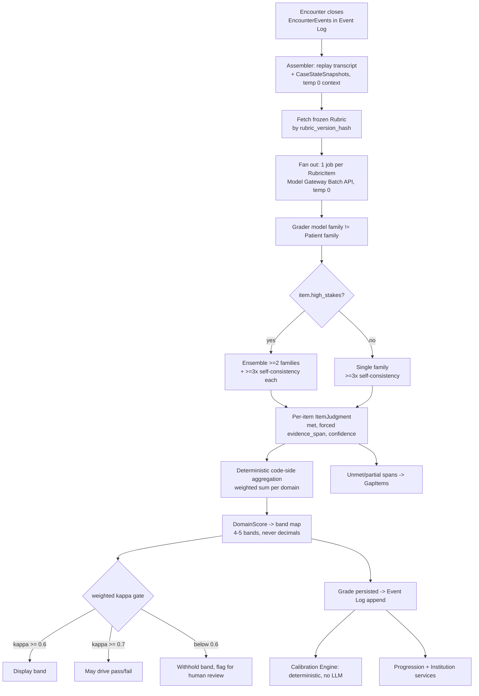

# 06 — Assessment & Calibration Engine

**Owner services:** Assessment Service (Rubric store · decomposed grading · band mapping · validity artifacts) and its embedded **Calibration Engine**. Consumes the **Event Log** (source of truth), the **Model Gateway** (only path to any LLM), and the **Case State Store**. Emits `Grade`, `CalibrationResult`, `GapItem`, and downstream signals to the **Learning/Progression Service** and **Institution/Analytics Service**.

**The core claim (inherited from `docs/research/07-assessment-science.md`):** assessment is a **psychometric product, not a feature**. A confidently wrong grade is worse than no grade — every downstream artifact (calibration plot, XP, remediation, dean heatmap) inherits the grader's noise. So the whole chain is engineered to a defined reliability floor (weighted κ ≥ 0.6 to display, ≥ 0.7 for pass/fail), scored at **band** granularity only, continuously measured against an expert anchor set.

**Clock discipline (invariant — THREE ISOLATED CLOCKS).** Grading lives entirely on **Clock 2** (grounding + assessment: seconds, out-of-band, auditable). It **NEVER** blocks the conversation loop (Clock 1). Institution rollups run on **Clock 3** (batch). The learner submits an encounter, the encounter closes, grading is dispatched to the Model Gateway **Batch API**, and results surface asynchronously — target end-to-end < 90 s p95, but there is no latency SLO that couples grading to a turn.

**Non-negotiable invariants honored here.** The AI-patient NEVER sources clinical facts (the Case State Store does); the grader is **outside** the roleplay tier; `assessment_mode ∈ {formative (default), summative-with-review}` and summative requires a named human co-sign; **GRADER model family ≠ PATIENT-AGENT model family**, ensemble ≥ 2 families on high-stakes items; the Calibration Engine is **deterministic** (no LLM); **no learner-emotion inference** (EU-prohibited since Feb 2025 — we roleplay an anxious *patient*, we never read the *learner's* affect as a scored dimension); everything replays deterministically from the hash-chained Event Log.

---

## 1. Rubric data model

### 1.1 Six fixed internal domains (the ontology)

AcuDx does **not** invent a competency taxonomy. It scores every encounter against a small, fixed **internal rubric ontology** and provides *crosswalks* (data, versioned) to external frameworks institutions already report on.

| # | `DomainId` | Domain | What it scores |
|---|---|---|---|
| 1 | `HISTORY` | History-taking | completeness, structure, targeting, red-flag screening |
| 2 | `EXAM_INVESTIGATIONS` | Physical exam & investigations | correct exam requests, justified test ordering, cost/radiation stewardship, interpretation |
| 3 | `REASONING` | Clinical reasoning | differential breadth+prioritization, hypothesis-driven gathering, diagnostic accuracy, safety-netting |
| 4 | `COMMUNICATION` | Communication | clarity, empathy, shared decision-making, adaptation to patient variant |
| 5 | `MANAGEMENT` | Management & procedures | plan correctness, guideline concordance, escalation, prioritization under time pressure |
| 6 | `PROFESSIONALISM` | Professionalism & teamwork | consent, safety behaviors, role-appropriate conduct, closed-loop comms (multiplayer) |

These six are frozen in code (an enum), never authored per case. Everything below the domain — the actual scorable behaviors — is case-specific.

### 1.2 Case-specific `RubricItem`s (behavioral anchors, weights, version-hashed)

Following the HealthBench model (262 physicians authored 48,562 unique per-case criteria; grading tracks physician grading) and the case-specific-rubric literature, **each `Case` carries a bespoke `Rubric` of 10–40 `RubricItem`s** authored ahead of grade time as a first-class content artifact — human-reviewed, version-hashed. The grader **never improvises criteria at run time**; it only judges frozen items.

Authoring pipeline (owned by the **Authoring Service**, not the grader): clinician SME drafts case → Model Gateway (Opus, Batch) *proposes* checklist items + weights + behavioral anchors → SME edits/approves → rubric frozen with `rubric_version_hash = sha256(canonical_json(items ⊕ weights ⊕ anchors ⊕ domain_map))`. The hash is stamped onto every `Grade` so a score is always reconstructable against the exact rubric that produced it.

```typescript
type DomainId =
  | 'HISTORY' | 'EXAM_INVESTIGATIONS' | 'REASONING'
  | 'COMMUNICATION' | 'MANAGEMENT' | 'PROFESSIONALISM';

interface RubricItem {
  item_id: string;                 // stable within a rubric version
  domain: DomainId;                // one of the 6 fixed domains
  kind: 'checklist' | 'grs';       // binary/near-binary behavior OR anchored global rating
  weight: number;                  // relative weight WITHIN its domain (code aggregates)
  behavior: string;                // e.g. "Screened for red-flag headache features (thunderclap, focal deficit)"
  anchors: {                       // behavioral anchors → forces full-range use, curbs central tendency
    met: string;                   // what "met" looks like, concretely
    partial?: string;              // optional partial-credit anchor
    unmet: string;
  };
  safety_critical: boolean;        // missed red flag / dangerous order / no consent → surfaced ALWAYS, separately
  high_stakes: boolean;            // triggers ensemble ≥2 families (§2.4)
  gate_min_confidence: number;     // below this grader-confidence → route to human review, do not auto-credit
}

interface Rubric {
  rubric_id: string;
  case_id: string;
  case_version_hash: string;       // ties rubric to the CaseVersion it was authored against
  rubric_version_hash: string;     // sha256 over canonical item set — stamped on every Grade
  items: RubricItem[];             // 10–40
  domain_weights: Record<DomainId, number>;  // domain → domain weight in the composite
  pass_bands: BandCutpoints;       // see §2.6; band-only, never decimals
  review_status: 'draft' | 'sme_approved' | 'frozen';
  authored_by: string;             // clinician SME user id
  frozen_at: string;               // ISO8601
}
```

**GRS lives inside the rubric, weighted low.** The global rating scale carries construct validity in OSCE research but is where LLM judgment is weakest and most biased (§2.3). It is modeled as `kind:'grs'` items, one per domain, and is **weighted below the checklist and never allowed to swing a pass/fail alone at MVP**.

### 1.3 External frameworks = versioned crosswalk tables (data, not code)

Institutions live in Miller / ACGME Milestones / CanMEDS / EPA language. AcuDx stores scores at the finest (item) level, aggregates deterministically to the 6 domains, then applies **versioned crosswalk tables** to emit Milestone / CanMEDS Role / EPA-entrustment estimates. Crosswalks change (CanMEDS 2025 refresh, program-specific Milestones) — they are **data, versioned, never code**.

```typescript
interface CrosswalkTable {
  crosswalk_id: string;
  framework: 'MILLER' | 'ACGME_MILESTONES' | 'CANMEDS_2025' | 'AAMC_CORE_EPA';
  version: string;                 // e.g. "CanMEDS-2025.1", "ACGME-IM-2024"
  rows: Array<{
    domain: DomainId;
    external_ref: string;          // e.g. "PC-2" (ACGME sub-competency), "Communicator" (Role), "EPA-10"
    map_kind: 'level' | 'role' | 'entrustment';
    // level: 1–5 Milestone anchor; entrustment: Chen/ten Cate O-SCALE 1–5
    band_to_external: Record<BandId, number | string>;  // deterministic band → external estimate
  }>;
  effective_from: string;
  supersedes?: string;
}
```

A single `Grade` renders in ACGME, CanMEDS, or EPA views per institution by selecting the tenant's pinned crosswalk version — **no re-grading**. Emitted framework estimates are labeled *supplementary evidence* (into a Clinical Competency Committee), never a replacement.

---

## 2. The decomposed grading pipeline

> **Never ask one model for one holistic number.** Decompose into per-item judgments with a forced quote, aggregate in code, map to a band. Item judgment is the LLM's job; arithmetic and thresholds are not.

### 2.1 Pipeline overview



### 2.2 Stage 1 — Assemble (deterministic, replayable)

The Assessment Service subscribes to the encounter-close event on the event bus (**Redis Streams** at MVP; **NATS/Kafka** at scale). On close it **replays** the `EncounterEvent` stream from the Event Log to reconstruct the exact transcript + interleaved `CaseStateSnapshot`s (what vitals/labs the learner saw, when). This is byte-deterministic — the same encounter always assembles the same grading input, which is what makes a grade reproducible and auditable. The assembled input, the `rubric_version_hash`, and the pinned `ModelConfig` id are the complete provenance of a grade.

> Voice encounters are graded from the **batch Nova-3 Medical re-transcript** (higher-accuracy than the live Deepgram Flux stream), not the low-latency live text — never silently mis-score on a drug/dose/eponym STT error.

### 2.3 Stage 2 — Per-item judgment (structured, temp 0, forced quote)

For each `RubricItem`, the Model Gateway issues a **temperature-0** call in **structured-output / tool-call mode** (constrained JSON, machine-checked, never parsed from prose). The prompt contains: the single item + its anchors, the assembled transcript, and the case state — and **demands a verbatim `evidence_span`**.

**Forcing a grounded transcript quote is the single biggest reliability lever** — it curbs hallucinated credit and gives the learner an auditable "why". If the model returns `met:true` but no exact-substring quote (validated against the transcript in code), the judgment is rejected and downgraded to `unmet` with low confidence.

```typescript
// One call per RubricItem via Model Gateway (Batch), temp 0, structured output
interface GradeItemRequest {
  item: RubricItem;
  transcript: string;              // assembled, replayed
  case_state_digest: string;       // authoritative labs/vitals/exam the learner had access to
  model_config_id: string;         // pinned; grader family != patient family
}

interface ItemJudgment {
  item_id: string;
  met: 'met' | 'partial' | 'unmet';
  evidence_span: string;           // FORCED verbatim transcript quote; '' only allowed when met==='unmet'
  evidence_offset?: [number, number]; // char offsets into transcript for anchoring the UI + audit
  confidence: number;              // 0..1, grader self-reported per item
  self_consistency: {              // filled by aggregator, not the model
    n: number;                     // >=3
    agreement: number;             // fraction of runs agreeing with the modal verdict
  };
  ensemble?: Array<{ family: string; met: string; confidence: number }>; // high_stakes only
}
```

### 2.4 Bias mitigations (frontier judges fail 50%+ of bias tests — mitigate each)

| Bias | Mitigation, enforced in the pipeline |
|---|---|
| **Position / order** | **Pointwise** item scoring (never pairwise learner comparison); items graded independently, order randomized per run. |
| **Verbosity** | Score against explicit behavioral anchors; filler stripped before grading; an explicit "concise/relevant" GRS criterion where relevant. |
| **Self-preference / family** | **Grader family ≠ patient-agent family** (patient played by one vendor via Model Gateway; graded by a *different* family — e.g. patient = Haiku/Sonnet, grader = a distinct family or MedGemma 1.5 / Meditron open-weight verifier). **Ensemble ≥ 2 families on `high_stakes` items.** |
| **Leniency / central-tendency** | Behavioral anchors force full-range use; a learned **monotone recalibration** fitted on the anchor set is applied code-side (§2.5). |
| **Sycophancy / prompt-sensitivity** | Grading prompts frozen under version control in the **Model Registry**; regression-tested against the anchor set before any rollout (**no silent swaps**, red-team CI in the Eval Gate). |
| **Demographic / language** | Fairness audit on the anchor set by learner language/demographic; the *patient variant* (low-literacy/non-native) must not leak into *doctor* scoring; DIF flags feed the validity dossier (§7). |

**Self-consistency:** every item is graded **≥ 3× at temp 0** (or with sampled prompt paraphrases). Items where the grader disagrees with itself get their confidence discounted and, below `gate_min_confidence`, are **routed to human review rather than auto-credited**.

### 2.5 Stage 3 — Deterministic code-side aggregation → `DomainScore`

Arithmetic is **not** the LLM's job. In code:

```
raw_item_score(item) = { met: 1.0, partial: 0.5, unmet: 0.0 }[judgment.met]
recalibrated = monotone_recalibration_curve(raw_item_score)   // fitted on anchor set, per grader ModelConfig
domain_raw   = Σ_i (weight_i · recalibrated_i) / Σ_i weight_i      // over items in that domain
```

`domain_raw ∈ [0,1]` is an internal continuous value **used only for band mapping and calibration math — never shown to a learner as a number**. GRS items contribute at their (low) weight. Safety-critical items are aggregated normally *and* extracted separately (a 90%-overall encounter that missed a STEMI is a fail on the thing that matters — §4).

### 2.6 Stage 4 — Band mapping (4–5 bands, never decimals)

Exact-score accuracy is low (~0.52) but band/level accuracy is high (~0.83–0.88). So AcuDx trusts scores at **band** granularity only. The continuous `domain_raw` is mapped to a small ordinal band per the rubric's `pass_bands` cutpoints.

```typescript
type BandId = 'B1' | 'B2' | 'B3' | 'B4' | 'B5';  // 4–5 ordinal bands (Milestone-shaped)
interface BandCutpoints { cutpoints: number[]; labels: Record<BandId,string>; } // e.g. [0.4,0.6,0.75,0.9]

interface DomainScore {
  domain: DomainId;
  domain_raw: number;              // internal only, NEVER surfaced
  band: BandId;                    // the only thing shown
  displayed: boolean;              // false when κ < 0.6 for this domain (withheld)
  pass_fail_eligible: boolean;     // true only when κ ≥ 0.7 for this domain
  contributing_items: string[];    // item_ids → drill-down to evidence spans
}
```

### 2.7 Reliability gates (weighted κ ≥ 0.6 display / ≥ 0.7 pass-fail)

The gate is not a per-encounter check — it is a **per-(domain × case-type × grader ModelConfig)** property measured continuously against the expert anchor set and stored as a `CalibrationResult`-adjacent reliability record. At grade time the pipeline looks up the current agreement for that cell:

- **weighted κ ≥ 0.6** (substantial, vs experts) → the domain band may be **displayed**.
- **weighted κ ≥ 0.7** → the domain band may **drive a pass/fail** decision.
- **below 0.6** → band **withheld**, encounter flagged for human review; the learner still gets evidence-span feedback (gaps) but no scored band.
- **inter-expert κ is reported as the ceiling** — the grader is not expected to beat the humans' own disagreement.

**Anchor set (the moat).** A growing bank of transcripts double/triple-rated by clinician experts per case-type. It is the ground truth the grader is measured against, the source of the recalibration curve, and the substrate for the validity dossier. Budget for it explicitly.

### 2.8 The `Grade` object (persisted, appended to Event Log)

```typescript
interface Grade {
  grade_id: string;
  encounter_id: string;
  case_version_hash: string;
  rubric_version_hash: string;     // exact rubric that produced this grade
  model_config_id: string;         // pinned grader config (family, prompt hash, versions)
  assessment_mode: 'formative' | 'summative-with-review';
  co_sign?: { user_id: string; name: string; role: string; at: string }; // REQUIRED iff summative
  domain_scores: DomainScore[];    // the 6 fixed domains
  item_judgments: ItemJudgment[];  // every per-item verdict + evidence span
  safety_flags: Array<{ item_id: string; behavior: string; evidence_span: string }>; // surfaced ALWAYS
  dual_axis: { clinical_band: BandId; communication_band: BandId }; // §5
  external_estimates: Array<{ framework: string; version: string; external_ref: string; value: number|string }>;
  reliability: Array<{ domain: DomainId; weighted_kappa: number; inter_expert_kappa: number }>;
  overrides: OverrideRecord[];     // §6, immutable audit trail
  created_at: string;
  hash_prev: string;               // hash-chain link into the Event Log
}
```

**Cost.** Grading = Opus 4.8 ($5/$25 per Mtok) via **Batch API (−50% → $2.50/$12.50)** with prompt caching (byte-stable rubric+system prefix, ~0.1× reads). 10–40 items × ≥3 self-consistency runs, but batched, cached, and off the hot path. Blended text-encounter cost SLO **< $0.15/enc**; grading is the dominant per-encounter cost and is the reason it must be Batch + cached, never synchronous.

---

## 3. The Calibration Engine (deterministic, no LLM)

The Dunning-Kruger visualization is a signature feature and a demotivation landmine. The engine is **pure deterministic code** — it consumes elicited confidence + the `Grade` and computes scoring-rule metrics. No model call.

### 3.1 Elicit confidence BEFORE the reveal

Post-hoc confidence is contaminated. Immediately after the encounter and **before any score is shown**, the learner self-rates:

- **per-domain confidence** (0–100%) for each of the 6 domains, and
- **per-decision confidence** on key case decisions (e.g. "how sure is your leading diagnosis?") — needed for proper scoring-rule metrics, not just a domain gestalt.

```typescript
interface ConfidenceElicitation {
  encounter_id: string;
  elicited_at: string;             // MUST precede grade reveal; enforced by event ordering
  per_domain: Record<DomainId, number>;      // 0..1
  per_decision: Array<{ decision_id: string; confidence: number; }>; // 0..1
}
```

The **event ordering in the Event Log enforces the "before reveal" invariant** — a `ConfidenceElicited` event with a timestamp after the `GradeRevealed` event is rejected as invalid.

### 3.2 Metrics (compute all; show few)

Let a learner's key decisions be items `i = 1..n` with stated confidence `c_i ∈ [0,1]` and binary correctness `o_i ∈ {0,1}` (from the graded `ItemJudgment` / diagnosis correctness).

**Brier score** (mean squared error; lower is better):

```
BS = (1/n) · Σ_i (c_i − o_i)²
```

**Murphy decomposition** (so we can tell "badly calibrated" from "can't discriminate"). Partition confidences into `K` bins; bin `k` has `n_k` items, mean confidence `c̄_k`, observed accuracy `ō_k`; overall base rate `ō`:

```
BS = Reliability − Resolution + Uncertainty
Reliability (calibration) = (1/n) · Σ_k n_k · (c̄_k − ō_k)²      // ↓ better
Resolution                = (1/n) · Σ_k n_k · (ō_k − ō)²        // ↑ better (discrimination)
Uncertainty               = ō · (1 − ō)                         // irreducible base-rate term
```

**Over/Under-Confidence Index** (signed — the DK signal itself; positive = overconfident = the clinically dangerous direction):

```
OCI = mean(c_i) − mean(o_i)     // computed per domain and per decision-set
```

**Expected Calibration Error** (secondary scalar for dashboards/trend lines):

```
ECE = Σ_k (n_k / n) · | ō_k − c̄_k |
```

**Reliability diagram** (the literal "Dunning-Kruger plot"): for each confidence bin `k`, plot `(c̄_k, ō_k)` against the 45° identity line. **Bands + uncertainty, never false-precision points** — the competence axis is itself banded (§2.6), and each bin point carries a Wilson interval on `ō_k`.

```typescript
interface CalibrationResult {
  encounter_id: string;
  per_domain: Record<DomainId, {
    brier: number;
    reliability: number;           // Murphy calibration term
    resolution: number;            // Murphy discrimination term
    oci: number;                   // signed
    ece: number;
    quadrant: 'calibrated_strong' | 'calibrated_growing' | 'blind_spot' | 'hidden_strength';
  }>;
  reliability_diagram: Array<{ bin: number; mean_conf: number; obs_acc: number; n: number; wilson: [number,number] }>;
  trajectory: { window: number; oci_series: number[]; brier_series: number[] }; // shrinking-gap story
}
```

### 3.3 Presentation (trainable skill, never leaderboarded)

- **Quadrant framing** (confidence × competence-band): `calibrated_strong`, `calibrated_growing`, `blind_spot` (overconfident), `hidden_strength` (underconfident). The dangerous `blind_spot` quadrant gets *supportive*, specific "here's the one thing to check next time" language — never a red "you're dangerous" banner.
- **Trajectory, not just today.** A shrinking OCI / falling Brier over the last N sessions is the motivating story; first-timers *will* be overconfident (population baseline) — normalize it explicitly.
- **Per-domain, actionable.** "Your reasoning is well-calibrated; your ECG-interpretation confidence runs ahead of performance" beats a global "you're overconfident."
- **Framed as a trainable skill**, XP-worthy on its own (improving calibration is rewarded independent of raw competence — §GM-1).
- **NEVER on a public leaderboard.** Calibration is private, formative, ego-fragile; public exposure invites sandbagging. This is enforced at the data-plane and RBAC level (a dean sees *aggregate* cohort calibration as a curriculum signal, never a learner's private ego-data unless policy explicitly permits).

---

## 4. Gap analysis → FSRS + mastery/entrustment

Gap analysis is **nearly free from evidence spans** — every unmet/partial `ItemJudgment` *is* a gap with a quote attached.

```typescript
interface GapItem {
  gap_id: string;
  encounter_id: string;
  item_id: string;
  domain: DomainId;
  behavior: string;
  evidence_span: string;           // the verbatim "why", from the ItemJudgment
  framework_tag: string;           // crosswalk external_ref
  severity: 'safety_critical' | 'quality';
  frequency: number;               // count across learner history (recurrence signal)
}
```

- **Safety-critical misses** (missed red flag, dangerous order, no consent) are surfaced **always and separately**, regardless of overall band.
- **Knowledge gaps → FSRS `SRSCard`s.** The concept/decision behind a miss becomes a scheduled review on an **FSRS** interval (best-in-class free scheduler, 2026); missed a Wells-score step → it resurfaces at expanding intervals until stably correct. Owned by the **Learning/Progression Service**.
- **Skill gaps → mastery / entrustment.** Don't advance past a competency until a **pre-set mastery threshold** across repeated encounters: e.g. `entrustment ≥ 4` (Chen/ten Cate O-SCALE) on "recognize urgent patient" across **≥ 3 distinct cases** before that EPA is marked provisionally met (fixed standard, variable time).
- **Deliberate-practice targeting.** The next recommended case exercises the learner's **widest current gap**; the calibration signal steers overconfident learners into **blind-spot cases** (an atypical presentation of the thing they think they've mastered) — the most efficient DK correction.

---

## 5. Dual-axis: clinical ⟂ communication

Every encounter reports **two orthogonal axes from day one** so a strong communicator with weak reasoning (or vice-versa) is legible, and multiplayer debriefs separate individual leadership marks from team clinical marks (MP-3).

- **Clinical axis** = aggregate of `HISTORY`, `EXAM_INVESTIGATIONS`, `REASONING`, `MANAGEMENT` → `clinical_band`.
- **Communication axis** = aggregate of `COMMUNICATION` and the interpersonal parts of `PROFESSIONALISM` → `communication_band`.

Both are banded (never decimals). The `patient variant` difficulty (low-literacy/non-native/aggressive) taxes the **communication** axis and must **not** leak into the **clinical** axis scoring (§2.4 demographic/language mitigation).

---

## 6. Transcript-anchored one-click override + immutable audit

Educators must be able to reconstruct and override any score. Every `ItemJudgment` and `DomainScore` is anchored to its `evidence_span` (with char offsets), so an educator sees exactly *why* the grader ruled as it did and can override in one click.

```typescript
interface OverrideRecord {
  override_id: string;
  target: { kind: 'item' | 'domain' | 'band'; id: string };
  before: { met?: string; band?: BandId };
  after:  { met?: string; band?: BandId };
  rationale: string;               // required free-text
  overridden_by: string;           // educator user id
  at: string;
  // Overrides are APPEND-ONLY EncounterEvents — the original grade is never mutated,
  // the Grade projection is recomputed deterministically from the event stream.
}
```

Overrides are **append-only events**, not mutations. The original grade stays in the hash-chained log forever; the displayed `Grade` is a deterministic projection of (auto-grade ⊕ ordered overrides). This is the defensible posture for regulators and program directors, and the raw material for the IRR-vs-faculty validity metric (§7) — every override is a labeled disagreement between the grader and a faculty rater.

---

## 7. Formative/summative flag + validity dossier

```typescript
type AssessmentMode = 'formative' | 'summative-with-review';
```

- **`formative` (default):** fully automated, banded, "flag for review" available. Keeps AcuDx **below EU AI Act Annex III high-risk** — an architecturally-enforced non-negotiable.
- **`summative-with-review`:** requires a **named human co-sign** (`Grade.co_sign`) before the grade is of record. The Assessment Service **refuses to finalize a summative grade without a co-sign** — enforced in code, not policy.

**Validity dossier (Kane's framework — build the evidence, not just a number).** Per case-type, the Assessment Service maintains a `ValidityDossier` artifact (visible in the Admin/Compliance Console) that is the institutional sales asset and the regulator's answer:

```typescript
interface ValidityDossier {
  case_type: string;
  model_config_id: string;
  scoring:        { rubric_maps_to_competency: boolean; evidence_span_coverage: number };
  generalization: { weighted_kappa_by_domain: Record<DomainId, number>;
                    inter_expert_kappa: number; g_coefficient: number };   // G-theory ≥ 0.7 for consequential use
  extrapolation:  { correlation_vs_real_osce?: number; correlation_vs_milestone?: number }; // run + publish this study
  implications:   { licensed_decisions: string[]; };  // formative feedback vs progression
  fairness:       { dif_flags: Array<{ subgroup: string; item_id: string; effect: number }>;
                    score_distribution_by_language: Record<string, number[]> };  // DIF / subgroup fairness — mandatory
  irr_vs_faculty: { n_overrides: number; agreement: number };  // derived from §6 override stream
  updated_at: string;
}
```

The four Kane inferences (**scoring → generalization → extrapolation → implications**) map 1:1 to the fields above. DIF/fairness and IRR-vs-faculty are **mandatory, not optional**, and the extrapolation correlation study (sim scores vs real OSCE/Milestone/in-training-exam performance) is the study to run and publish — it is the institutional sales asset.

---

## 8. Technology & where things live

| Concern | Choice | Rationale |
|---|---|---|
| Rubric / Grade / Crosswalk store | **Postgres (+JSONB)** | `RubricItem[]`, `ItemJudgment[]`, crosswalk rows are naturally JSONB; relational for tenancy/joins to cohorts. |
| Source of truth | **hash-chained Event Log** (append-only) | Grades, overrides, confidence elicitations are events; every projection deterministically replayable. |
| Grading transport | **Model Gateway → Batch API** (Opus 4.8, −50%) | Out-of-band (Clock 2); prompt caching on byte-stable rubric prefix; grader family ≠ patient family enforced in `ModelConfig`. |
| Grader-family separation | **Model Registry** pins `ModelConfig` (family + prompt hash) | No silent swaps; red-team CI in the Eval Gate; open-weight verifiers (MedGemma 1.5 / Meditron) available for the on-prem/VPC tier. |
| Event bus | **Redis Streams** (MVP) → **NATS/Kafka** (scale) | Encounter-close → grading dispatch; low ops at MVP, swap at scale without touching the projection logic. |
| Calibration math | **Deterministic service code** (no LLM) | Brier/OCI/ECE/reliability-diagram are pure functions; reproducible and cheap. |
| Anchor set + eval | **Postgres + object store (S3)** transcripts; **Eval Gate** | Expert-rated transcripts drive κ measurement and the recalibration curve; the moat. |
| Institution rollups | **ClickHouse/BigQuery** read-models; **Caliper/xAPI** emission | Clock 3 batch; cohort heatmap, aggregate calibration, accreditation export. |

**Explicit trade-offs.**
1. **Batch grading (async, out-of-band) vs instant feedback.** We take a ~90s grading latency to keep the conversation loop untouched and halve cost. Learners see "scoring…" and get results within the session — acceptable because feedback quality > immediacy for formative practice.
2. **Ensemble on high-stakes only, not everywhere.** ≥2 families on every item would ~double grading cost; we gate ensemble to `high_stakes` items (safety-critical + pass/fail-eligible) where the reliability payoff justifies it.
3. **Band-only, never decimals.** We deliberately discard the continuous `domain_raw` for display, accepting coarser feedback in exchange for defensible reliability (band accuracy ~0.85 vs exact ~0.52). This shapes UI, XP, and dashboards.
4. **Self-consistency ≥3× vs cost.** Three temp-0 runs per item triples item cost; mitigated by Batch (−50%) + prompt caching (~0.1× reads) and justified by the self-disagreement → human-review routing that catches the grader's own uncertainty.
5. **Recalibration curve vs raw grader output.** A learned monotone recalibration corrects leniency but must be re-fitted per grader `ModelConfig` and re-validated on the anchor set before promotion — a maintenance cost we accept for calibrated bands.

---

## Open questions & build sequence

**Must be decided first (blockers):**
1. **Band count & cutpoints (4 vs 5) per domain** — everything downstream (UI, XP, crosswalks, pass/fail) keys off `BandCutpoints`. Decide with clinician SMEs against the anchor set before any rubric is frozen.
2. **Grader family assignment** — which concrete family plays grader vs patient (Opus-family grader vs distinct-family patient; where MedGemma/Meditron open-weight verifiers sit). Pin in `ModelConfig`; drives the whole self-preference mitigation.
3. **Anchor-set bootstrap** — how many expert-double-rated transcripts per case-type to reach κ ≥ 0.6 measurability, and the SME budget/cadence to maintain it. No band displays until this exists.
4. **`gate_min_confidence` and self-consistency `n`** thresholds — the exact values that route an item to human review vs auto-credit; tune on the anchor set.

**Build sequence (MVP → v1 → v2):**
1. **MVP (ships in the EM text wedge):** `Rubric`/`RubricItem` model + version-hash; 6-domain enum + crosswalk *tables* (data); decomposed grading pipeline (per-item forced-quote, temp 0, Batch, grader≠patient, ≥3× self-consistency); deterministic aggregation → band; κ gate (0.6/0.7) wired to the anchor-set reliability record; `Grade` object appended to Event Log; Calibration Engine (Brier/OCI/ECE/reliability-diagram, before-reveal elicitation); gap analysis → `GapItem`s; dual-axis; transcript-anchored one-click override (append-only); `formative` mode.
2. **v1:** ensemble ≥2 families on high-stakes; FSRS `SRSCard`s + mastery/entrustment thresholds; adaptive difficulty on the two axes; cohort heatmap + aggregate calibration (Clock 3); Caliper/xAPI emission; fairness/DIF audit dashboards; recalibration curve fitted on a matured anchor set.
3. **v2:** `summative-with-review` + named co-sign enforcement; full `ValidityDossier` with published extrapolation study (sim vs real OSCE/Milestone); G-coefficient ≥0.7 evidence for consequential decisions; institution-pluggable rubrics (OSCE mark schemes, SBAR, leadership).
