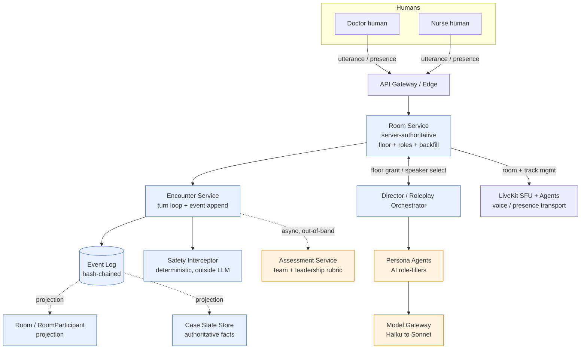
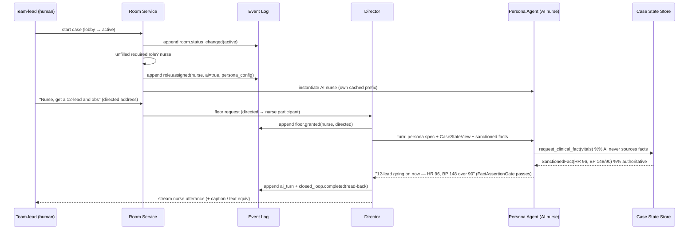

# 07 — Multiplayer Role-Based Rooms

**Owner service:** **Room Service** (server-authoritative, event-sourced room + participant state; floor/turn control across humans + AI; role assignment and AI backfill), sitting between the **Encounter Service** (server-authoritative turn loop, `docs/architecture/01-ai-agent-architecture.md`), the **Realtime Media** tier (LiveKit SFU + Agents), and the **Event Log** (hash-chained source of truth, `docs/architecture/09-security-and-compliance-architecture.md`). It consumes the **Persona Agents** (`docs/architecture/01` §7 backfill hook), the **Case State Store** + **Vitals & Physiology Engine**, the **Model Gateway** (only path to any model, `docs/architecture/02-model-gateway-and-routing.md`), and emits team/leadership signals to the **Assessment Service** (`docs/architecture/06-assessment-and-calibration-engine.md`).

**What this is.** The multiplayer, role-based **team room** — the hardest-to-copy moat (`docs/00-overview/01-requirements-and-constraints.md` MP-1..MP-4; `docs/research/04-market-competitors.md`: the empty top-right quadrant; SimCare AI's "group case simulations" is the only nearby signal). Several humans, each holding a distinct clinical role (doctor / nurse / paramedic / team-lead), run one live encounter; **AI Persona Agents backfill every empty role as first-class participants**. This is crisis-resource-management / team training that today needs a physical sim center and staff. It is a **v1 fast-follow, prioritized *above* single-player polish** (`docs/00-overview/01` §6), and it inherits — does not re-derive — the solo roleplay engine.

**Clock discipline (invariant — THREE ISOLATED CLOCKS).** A room is still Clock 1 (conversation, 100s of ms) for turns and presence. Team-rubric grading and debrief live on Clock 2 (assessment, out-of-band, seconds) and Clock 3 (analytics, batch). **Nothing in the room loop blocks on grading**, and a slow grader can never stall floor control. The three clocks are also the reason a 100-concurrent-room load test on Clock 1 is decoupled from grading cost (§9).

**Non-negotiable invariants honored here (verbatim from canon).**
- **Server-authoritative, event-sourced.** Room state is a deterministic projection of hash-chained `EncounterEvent`s; LiveKit and Redis are propagation/presence, never truth. Reconnect = replay.
- **Two-tier content architecture.** AI role-fillers are **Persona Agents** (roleplay layer) — a backfilled nurse/paramedic **never sources a clinical fact**; facts come only from the **Case State Store** via the `FactAssertionGate` (`docs/architecture/01` §2). This is unchanged in a room; a room just has more personas.
- **Model Gateway is the only path to any model**; **grader family ≠ patient-agent family** (the team rubric is graded out-of-band by the Assessment Service, `docs/architecture/06`).
- **Deterministic Safety Interceptor outside the LLM** screens every human and AI utterance in the room (`docs/architecture/09` §T10).
- **Every voice/avatar feature has a FULL non-voice equivalent** — a room is fully playable in **text at <100 kbps** with **graceful text fallback on WebRTC failure** (MP-2, `docs/00-overview/01` §3.3, §3.5). Voice/3D remain premium-gated; text-team-rooms are the accessible floor.
- **No learner-emotion inference.** We model *persona* affect for AI role-fillers; we never read a human teammate's emotion as an assessed dimension (EU-prohibited).

---

## 1. Where the Room Service sits



**Reading it.** The **Room Service** is a deterministic controller (like the Director, not an LLM). It owns *who is in the room*, *what role each participant holds*, *whose floor it is*, and *which empty roles are AI-backfilled* — all as events. The **Encounter Service** still owns the turn loop and is still the only component that appends `EncounterEvent`s and emits cleared utterances. **LiveKit** is the WebRTC SFU for voice/presence tracks and nothing else — it carries no authoritative clinical state. The **Director** (`docs/architecture/01` §3) is extended for multi-party speaker selection; the **Persona Agents** are unchanged, one cached prefix each.

**Design rule that keeps this tractable:** *a solo encounter is a room with one human participant and every other role AI-backfilled.* The room model is a strict superset — the solo wedge is the degenerate case `humans=1`, which is why multiplayer is a fast-follow, not a rewrite.

---

## 2. Room & RoomParticipant state (event-sourced)

The `Room` and its `RoomParticipant[]` are **projections of the Event Log**, exactly like `Case State` (`docs/architecture/01` §7). No state lives only in Redis or LiveKit; those are caches/transports rebuilt by replay.

```typescript
type RoomRole = 'doctor' | 'nurse' | 'paramedic' | 'team_lead';
// team_lead is a HAT worn atop a clinical role, not a slot that displaces one (§6).

type ParticipantKind = 'human' | 'ai';
type ParticipantConn  = 'connected' | 'reconnecting' | 'text_fallback' | 'dropped';

interface RoomParticipant {
  participant_id: string;          // stable per seat across reconnects
  room_id: string;
  role: RoomRole;
  kind: ParticipantKind;           // ai ⇒ backfilled by a Persona Agent
  user_id?: string;                // present iff kind==='human'
  persona_config_id?: string;      // present iff kind==='ai' (ModelConfig, docs/architecture/09 §5)
  is_team_lead: boolean;           // leadership hat; ≥0 per room (see §6)
  conn: ParticipantConn;           // presence, projected from LiveKit + heartbeat events
  view_scope: RoleViewScope;       // per-role Case State visibility (§5)
  joined_seq: number;              // Event Log seq of join
  last_ack_seq: number;            // last room event this participant confirmed (reconnection cursor, §4)
}

interface Room {
  room_id: string;
  tenant_id: string;               // region-pinned; chain is per-tenant (docs/architecture/09 §2.3)
  encounter_id: string;            // one room ↔ one Encounter (one turn loop, one Event Log stream)
  case_version_hash: string;
  country: string;                 // first-class retrieval filter downstream (canon)
  assessment_mode: 'formative' | 'summative-with-review';
  roster: RoomParticipant[];
  floor: FloorState;               // whose turn it is (§7)
  status: 'lobby' | 'active' | 'paused' | 'debrief' | 'closed';
  backfill_policy: BackfillPolicy; // which empty roles AI fills, and when (§3)
  media: { livekit_room: string; mode: 'voice' | 'text' | 'mixed' };
  created_at: string;
}
```

**Invariant:** every mutation of `Room`/`RoomParticipant` is an appended `room.*` event (§8); the structs above are never written directly. `verifyChain` (`docs/architecture/09` §2.3) covers room events like any other, so a disputed "who was in the room / who led / who was AI" is reconstructable and appealable — which matters for a *team leadership* grade.

---

## 3. Roles & AI backfill (empty roles as first-class participants)

**Roles are interchangeable (RP-3).** A learner may hold doctor / nurse / paramedic / team-lead; AI fills the rest. The moat is that AI role-fillers are **first-class participants**, not scripted extras: a backfilled nurse holds a real seat, a real `view_scope`, takes the floor, executes closed-loop comms, and is legible in the debrief as "AI-held" (never scored as a human).

### 3.1 Backfill policy

```typescript
interface BackfillPolicy {
  required_roles: RoomRole[];            // roles the case demands be present (e.g. ['doctor','nurse'])
  human_target: Partial<Record<RoomRole, number>>;  // seats reserved for humans
  ai_fills: 'immediately' | 'on_lobby_close' | 'on_human_drop';
  reclaim: 'human_preempts_ai' | 'locked_after_start';  // can a late human take an AI's seat? (§3.3)
  ai_persona_config: Partial<Record<RoomRole, string>>; // ModelConfig per backfilled role
}
```

- **`ai_fills: on_lobby_close`** (default): humans claim seats in the lobby; when the team-lead (or a timer) starts the case, every unclaimed required role is backfilled with an AI Persona Agent as a single `role.assigned{ai:true}` event per seat. This is the exact hook named in `docs/architecture/01` §7 ("AI backfill of an unfilled human role is an `EncounterEvent(role_assigned, ai=true)` — replayable, auditable").
- **`ai_fills: on_human_drop`**: if a human paramedic disconnects past the grace window (§4), an AI backfills that seat mid-encounter so the team can continue — emitted as `role.reassigned{from:human,to:ai}`. The human's completed turns stay attributed to them; the AI is scored separately (never blended into the human's marks).
- **`immediately`**: pure solo-style practice where a single human always plays against a full AI team.

### 3.2 Backfilled AI role-fillers are Persona Agents (unchanged two-tier boundary)

A backfilled nurse/paramedic/doctor is a **Colleague Persona Agent** (`docs/architecture/01` §4) with a role-scoped persona spec. It obeys the same contract:

- It has its **own cached prefix** (byte-stable, one cache entry per persona — `docs/architecture/01` §6.2); rooms do **not** share prefixes across personas.
- It **cannot source clinical facts**. When the doctor says "Nurse, what's the BP?", the AI nurse emits a `request_clinical_fact` tool intent; the Director resolves it against the Case State Store and injects a `SanctionedFact`; the `FactAssertionGate` rejects any unsanctioned number (`docs/architecture/01` §2). A backfilled nurse reading vitals is reading *authoritative case state delivered in character*, never model-parametric memory.
- Its turns route **Haiku 4.5** by default, escalate to **Sonnet 5** on persona-break / low `self_confidence` / gate-reject / complex closed-loop coordination (`docs/architecture/01` §9). ~80–90% of role-filler turns stay on Haiku — this is what keeps a 4-AI room affordable.

### 3.3 Role reassignment & preemption (as events)

Every seat change is an idempotent event, never an in-place mutation:

- **Human joins a lobby AI seat** (`reclaim: human_preempts_ai`, pre-start only): `role.reassigned{from:ai,to:human}`. The AI persona is suspended; its cached prefix is retired for that room.
- **Team-lead hat moves** (`team_lead.transferred`): the leadership hat is transferable mid-encounter (a senior arrives, or the team elects a lead). Scored to whoever held it *during* each decision window (§6), reconstructable by replay.
- **Locked after start** (`reclaim: locked_after_start`, default for summative): seats freeze at `active`; a late human observes or waits for debrief. Protects roster integrity for a graded team encounter.

**Idempotency.** Reassignment carries an `idempotency_key = sha256(room_id ‖ seat ‖ target ‖ requesting_seq)`; a retried or duplicated reassignment (common under network churn) is a no-op on replay. This mirrors the idempotent-tool-call requirement (MP-2) and the gateway's idempotent call surface.

---

## 4. Consistency under network churn

The room must survive drops (RP-6, MP-2). Because state is an Event-Log projection, **reconnection is replay from a cursor**, and conflict resolution is **server-authoritative ordering**, not client merge.

### 4.1 Per-turn checkpoint

The Encounter Service already checkpoints case state each turn (`docs/architecture/01`, RP-6). The Room Service adds a **room checkpoint** every turn: `{room_id, seq, roster_hash, floor, media_mode}` written as a `room.checkpoint` event. Reconnection or AI-backfill resumes from the latest checkpoint + tail replay — O(turns-since-checkpoint), not O(encounter).

### 4.2 Reconnection protocol

```
1. Client drops → LiveKit peer lost → Room Service marks participant conn='reconnecting',
   starts grace timer (default 20s voice / 45s text). Floor is NOT reassigned yet if this
   participant held it; a 'floor.hold' keeps the turn parked (§7) up to the grace window.
2. Client reconnects with (participant_id, last_ack_seq).
3. Room Service replays room + encounter events (last_ack_seq → head] to the client — the
   client rebuilds roster, floor, visible case state deterministically. No client-authored merge.
4. If grace expires: emit participant conn='dropped'; per BackfillPolicy either AI-backfill the
   seat (on_human_drop) or leave it vacant with the team notified. Any parked floor is released.
5. WebRTC total failure (ICE never establishes): downgrade participant to conn='text_fallback',
   media.mode='mixed'; that participant plays the rest in text (captions of others' TTS, text
   entry read by TTS to voice participants). The encounter continues — voice is enhancement,
   never a gate (V-5).
```

### 4.3 Conflict resolution

- **Single writer of truth.** Only the Encounter Service appends `EncounterEvent`s; only the Room Service appends `room.*` events; both go through one per-tenant hash-chained, gap-free `seq` (`docs/architecture/09` §2.3). There is no multi-master, so there is no CRDT/merge problem — **ordering is authoritative**.
- **Concurrent human actions in the same turn** (two humans "speak" near-simultaneously in text): the server timestamps arrival, the Director's floor policy (§7) admits one as the current turn and queues/coalesces the other; both are logged (nothing is lost), but only the floor-holder's utterance advances case state that turn. This is deterministic and replayable.
- **Duplicate/retried tool calls** (idempotent by `idempotency_key`, §3.3): `order_test` retried after a reconnect resolves to one `EncounterEvent(order_test)`, not two orders.
- **Split-brain guard.** A reconnecting client that replays finds its optimistic local actions were never accepted (they carried a stale `last_ack_seq`) → they are discarded, server state wins. The UI reconciles to the replayed projection.

### 4.4 Failure modes

| Failure | Detection | Degradation |
|---|---|---|
| One human drops | LiveKit peer loss + heartbeat gap | grace timer; parked floor; then AI-backfill or vacate per policy; team notified |
| WebRTC never establishes / firewall | ICE timeout | `text_fallback` for that participant; room stays `mixed`; full text play at <100 kbps |
| LiveKit SFU/region outage | Media health check | whole room degrades to **text mode** (WebSocket/SSE); no clinical state lost (it was never in LiveKit); resume voice when healthy |
| Team-lead drops mid-decision | presence + `is_team_lead` | leadership hat auto-parks; team prompted to elect/transfer (`team_lead.transferred`); decisions in the gap attributed to the room, flagged in debrief |
| Redis presence cache lost | cache miss | rebuild presence by replaying `room.*` from last checkpoint; authoritative, just slower |
| Room Service instance crash | orchestrator health | new instance rehydrates room by replay from checkpoint; participants reconnect by §4.2 |

---

## 5. Shared Case State with per-role views/permissions

One **Case State Store** serves the whole room (still the single authoritative source of clinical facts — the AI never sources them). But *what each role sees* differs: a nurse sees the live monitor and the MAR; the doctor sees imaging/labs they ordered; a paramedic sees the pre-hospital picture. **Views are role-scoped read permissions over one authoritative state**, not divergent copies — divergent copies would break the "avatar & monitor never contradict" invariant (AV-1).

```typescript
interface RoleViewScope {
  role: RoomRole;
  visible_channels: CaseStateChannel[];   // subset of the authoritative state this role may read
  can_order: OrderClass[];                 // what this role may initiate (nurse ≠ doctor ordering rights)
  can_administer: boolean;                 // e.g. nurse administers meds the doctor prescribes
  requires_closed_loop: boolean;           // orders to this role must be read back (§6 CLC scoring)
}

type CaseStateChannel =
  | 'vitals_monitor' | 'labs' | 'imaging' | 'medication_admin_record'
  | 'prehospital_handover' | 'nursing_notes' | 'exam_findings' | 'orders_board';

type OrderClass = 'medication' | 'test' | 'imaging' | 'disposition' | 'nursing_task';
```

**Example scoping (an ED chest-pain team case):**

| Channel / right | Doctor | Nurse | Paramedic | Team-lead (hat) |
|---|---|---|---|---|
| `vitals_monitor` | read | **read (owns it)** | read | read |
| `labs` / `imaging` | read (ordered) | read | — | read |
| `medication_admin_record` | read | **read + administer** | — | read |
| `prehospital_handover` | read | read | **read (owns it)** | read |
| order `medication` | **yes** | administer-only | protocol-only | (via role) |
| order `test`/`imaging` | **yes** | no | no | (via role) |
| order `nursing_task` | request | **execute** | — | (via role) |

- **Enforcement is server-side and deterministic.** A `request_exam_finding` or `order_test` (`docs/architecture/01` §6.4) carries the requesting `participant_id`; the Room Service checks `view_scope.can_order` before the Director resolves it. A nurse cannot *order* imaging; a nurse *can* prompt the doctor ("Doctor, do you want a CT?") — the un-actioned request is logged and becomes assessment evidence (did the doctor respond?).
- **Visibility is projection-time filtering.** Each participant's client receives only its `visible_channels` slice of each `CaseStateSnapshot`; the authoritative snapshot is whole and single. This is *not* security-by-UI: the filter is applied server-side before serialization, and Postgres RLS + tenant routing (`docs/architecture/09` §T4) still bound the whole room to its tenant.
- **Information asymmetry is the pedagogy.** The paramedic knows the mechanism of injury the doctor hasn't heard yet; surfacing it requires *communication*, not a shared screen. This is the SBAR/handover skill the team rubric scores (§6). The Case State Store makes the asymmetry authoritative and replayable.

---

## 6. Team/leadership rubric + debrief

Extends the Assessment Service (`docs/architecture/06`) — **it does not fork it**. Team behaviors are `RubricItem`s in the fixed `PROFESSIONALISM` domain (which canon already defines as "role-appropriate conduct, **closed-loop comms (multiplayer)**", `docs/architecture/06` §1.1), scored by the same decomposed, forced-evidence-span, grader≠patient pipeline. The one addition is **attribution**: in a room, an item judgment must name *whose* behavior it scores.

### 6.1 Team rubric items (crisis-resource-management anchors)

```typescript
interface TeamRubricItem extends RubricItem {   // RubricItem from docs/architecture/06 §1.2
  team_dimension: 'delegation' | 'situational_awareness' | 'closed_loop_comms'
                | 'role_clarity' | 'workload_distribution' | 'shared_mental_model';
  attribution: 'individual_lead' | 'team';      // whose mark this is (§6.2)
  scored_roles?: RoomRole[];                     // which seats this item can apply to
}
```

Concrete anchored items (behavioral, evidence-span-forced like every AcuDx rubric item):

| Item | `team_dimension` | Attribution | "Met" anchor (forces a transcript quote) |
|---|---|---|---|
| Assigned tasks to named roles | delegation | individual_lead | *"Nurse, get IV access and a 12-lead; paramedic, put them on the monitor"* — named role + specific task |
| Closed the loop on an order | closed_loop_comms | team | order → **read-back** → **confirmation** triad present (*"Give 300mg aspirin" / "300mg aspirin" / "given"*) |
| Maintained situational awareness | situational_awareness | individual_lead | verbal re-assessment / *"anyone got new obs?"* after a state change |
| Shared mental model on handover | shared_mental_model | team | SBAR/ISBAR structure detectable in the paramedic→doctor handover |
| Distributed workload / avoided fixation | workload_distribution | individual_lead | reassigns or de-tasks when a member is overloaded |

### 6.2 Debrief separates individual-leadership marks from team-clinical marks (MP-3)

The debrief is the product. It must not blur "the team got the diagnosis right" with "you led well." AcuDx already reports **dual-axis clinical ⟂ communication** (`docs/architecture/06` §5); the room adds a **third reporting cut — individual vs team — orthogonal to the dual axis**:

```typescript
interface TeamDebrief {
  encounter_id: string;
  room_id: string;
  team_clinical: { clinical_band: BandId; contributing_item_ids: string[] };   // the room's collective clinical outcome
  per_participant: Array<{
    participant_id: string;
    kind: ParticipantKind;                 // ai fillers reported but visually marked, never ranked vs humans
    role: RoomRole;
    was_team_lead_windows: Array<[number, number]>;   // event-seq ranges this seat held the hat
    individual_leadership: {               // only meaningful for whoever held the lead hat
      delegation_band?: BandId; situational_awareness_band?: BandId; closed_loop_band?: BandId;
    };
    individual_communication_band: BandId; // this person's comms, dual-axis (docs/architecture/06 §5)
    gaps: string[];                        // GapItem ids attributable to this seat's evidence spans
  }>;
  team_process: { closed_loop_rate: number; unactioned_request_rate: number };  // deterministic, from events
}
```

- **Team-clinical is a room-level mark** (did the *team* reach the right dx/mgmt) — the collective outcome, not any individual's.
- **Individual-leadership is scored only for whoever wore the `team_lead` hat**, and **only over the event-seq windows they held it** (transferable hat, §3.3). A lead who inherited the room at minute 8 is not marked on the first 8 minutes.
- **AI role-fillers are reported but never ranked against humans** and never leaderboarded — consistent with the no-public-leaderboard rule (GM-4) and the "AI-held" transparency (Art. 50 disclosure, `docs/architecture/09` §7).
- **`closed_loop_rate` / `unactioned_request_rate` are deterministic** — computed in code from order→read-back→confirm event triads and from `nursing_task`/order requests that never got an actioning event. No LLM needed for the team-process numbers; the LLM only judges the anchored qualitative items.
- **Reliability gates apply unchanged** — team items display at weighted κ ≥ 0.6, drive pass/fail at ≥ 0.7 (`docs/architecture/06` §2.7). Leadership items are ego-fragile and start formative-only.

---

## 7. Floor / turn control across humans + AI

A room has one **turn loop** (the Encounter Service's) but many potential speakers. The **Director** (`docs/architecture/01` §3.2, extended) decides who holds the floor; the Room Service enforces it. Humans are never *blocked* from speaking (that would be unrealistic and unsafe), but the loop **serializes state-advancing turns** so case state stays consistent.

```typescript
interface FloorState {
  holder?: string;                 // participant_id currently advancing the turn, or undefined (open floor)
  mode: 'open' | 'directed' | 'parked';
  queue: string[];                 // participant_ids waiting (humans + at-most-one AI, §7.2)
  parked_reason?: 'reconnecting' | 'safety_break' | 'awaiting_confirm';
  updated_seq: number;
}
```

### 7.1 Rules

1. **Humans speak freely; the server orders them.** In voice, LiveKit carries all human audio simultaneously (natural overlap is realistic). The **turn boundary** — which utterance *advances case state this tick* — is decided server-side by arrival order + directed-address, and logged. Barge-in over an AI persona flushes that persona's TTS + truncates its LLM (`docs/architecture/01`, V-4) exactly as in solo.
2. **Directed address wins** (`docs/architecture/01` §3.2): "Nurse, get obs" grants the AI/human nurse the next floor. Simple NER + role-alias table, now resolving to a `participant_id`.
3. **At most one AI speaks per tick.** To keep multi-party turn-taking legible (and cheap), the Director selects ≤1 AI speaker per turn; other AI personas wait in `queue`. The rare "who would realistically interject" call is the bounded Sonnet-tier Director hint (`docs/architecture/01` §3.4), returning only `{speaker_id, interject}` — never a clinical fact.
4. **Parked floor on churn.** If the floor-holder is `reconnecting`, the floor parks (up to the grace window, §4.2) rather than skipping them mid-sentence; on a safety break it parks with `safety_break` (§ below).
5. **Silence is valid** (`docs/architecture/01` §3.2). If no one should speak (team is acting, or a test is pending on the physiology clock), no persona turn is emitted.

### 7.2 Safety interception in a room

The deterministic **Safety Interceptor** (`docs/architecture/09` §T10, `docs/architecture/01` §8) screens **every** human and AI utterance in the room. On a red-flag (dangerous management, self-harm disclosure, a teammate voicing an unsafe order), it **parks the floor** (`parked_reason:'safety_break'`), breaks character across the whole room, and surfaces resources — the pause is room-wide, not per-participant, so one member's safety event pauses the team. `safety.trigger` is logged with the emitting `participant_id`.

---

## 8. Room event schema

Room events share the canonical `EncounterEvent` envelope (`docs/architecture/09` §2.3: `event_id` ULID, `tenant_id`, gap-free `seq`, `prev_hash`, `hash`, `occurred_at`, `actor`). Only the `event_type` + `payload` are room-specific. All are appended to the **same per-tenant hash chain** as every other event — one spine, one `verifyChain`.

```jsonc
// ── Room lifecycle ────────────────────────────────────────────────────────
{ "event_type": "room.created",
  "payload": { "room_id": "rm_7f3", "encounter_id": "enc_...", "case_version_hash": "sha256:...",
               "country": "GB", "assessment_mode": "formative",
               "backfill_policy": { "required_roles": ["doctor","nurse"], "ai_fills": "on_lobby_close",
                                    "reclaim": "human_preempts_ai" },
               "livekit_room": "lk_rm_7f3", "media_mode": "mixed" } }

{ "event_type": "room.status_changed",
  "payload": { "room_id": "rm_7f3", "from": "lobby", "to": "active" } }

{ "event_type": "room.checkpoint",   // every turn — reconnection anchor (§4.1)
  "payload": { "room_id": "rm_7f3", "at_seq": 918273, "roster_hash": "sha256:...",
               "floor": { "holder": "pt_doc_1", "mode": "open" }, "media_mode": "mixed" } }

// ── Participants & presence ───────────────────────────────────────────────
{ "event_type": "participant.joined",
  "payload": { "participant_id": "pt_doc_1", "room_id": "rm_7f3", "role": "doctor",
               "kind": "human", "user_id": "user_...", "view_scope_id": "vs_doctor_ed_chestpain" } }

{ "event_type": "role.assigned",     // AI backfill — the docs/architecture/01 §7 hook
  "payload": { "participant_id": "pt_nurse_ai", "room_id": "rm_7f3", "role": "nurse",
               "kind": "ai", "ai": true, "persona_config_id": "mc_colleague_nurse_2026_07",
               "reason": "lobby_close_backfill" } }

{ "event_type": "role.reassigned",   // preempt / mid-encounter swap (§3.3) — idempotent
  "payload": { "room_id": "rm_7f3", "seat": "paramedic",
               "from": { "kind": "human", "participant_id": "pt_medic_1" },
               "to":   { "kind": "ai",    "participant_id": "pt_medic_ai" },
               "reason": "human_drop_grace_expired",
               "idempotency_key": "sha256:room7f3|paramedic|ai|918290" } }

{ "event_type": "team_lead.transferred",   // leadership hat moves (§6.2)
  "payload": { "room_id": "rm_7f3", "from_participant": "pt_doc_1", "to_participant": "pt_doc_2",
               "reason": "senior_arrival" } }

{ "event_type": "participant.presence_changed",
  "payload": { "participant_id": "pt_medic_1", "conn": "reconnecting", "grace_ms": 20000 } }

// ── Floor / turn control (§7) ─────────────────────────────────────────────
{ "event_type": "floor.granted",
  "payload": { "room_id": "rm_7f3", "holder": "pt_nurse_ai", "mode": "directed",
               "granted_by": "director", "reason": "directed_address" } }

{ "event_type": "floor.parked",
  "payload": { "room_id": "rm_7f3", "prev_holder": "pt_medic_1", "reason": "reconnecting" } }

// ── Team-process signals (deterministic; feed the team rubric, §6) ─────────
{ "event_type": "closed_loop.completed",
  "payload": { "room_id": "rm_7f3", "order_ref": "ord_...", "issued_by": "pt_doc_1",
               "read_back_by": "pt_nurse_ai", "confirmed_by": "pt_nurse_ai" } }

{ "event_type": "request.unactioned",   // a role asked for something no one actioned within the window
  "payload": { "room_id": "rm_7f3", "requested_by": "pt_medic_1", "target_role": "doctor",
               "request": "consider CT head", "window_ms": 120000 } }
```

**Notes.**
- `closed_loop.completed` and `request.unactioned` are emitted **deterministically** by the Room Service correlating order/request events with read-back/action events — they are the substrate for the team-process numbers (§6.4) with **no LLM in the loop**.
- Clinical actions in a room (`order_test`, `request_exam_finding`, `request_clinical_fact`) are **the same `EncounterEvent`s as solo** (`docs/architecture/01` §6.4), just carrying a `participant_id`. Rooms add roster/floor/team events *around* the existing turn events; they do not redefine them.
- Every room event is content-minimizing like the audit spine (`docs/architecture/09` §2.2): it records *who/what/when/which config*, not raw utterance bytes (those live in the region-pinned learner-content store with their own retention/erasure).

---

## 9. Scale target & test plan (100 concurrent rooms, no p95 regression)

**Target (MP-4, `docs/00-overview/01` §3.3):** **100 concurrent multiplayer rooms** on staging with **no p95 regression** vs the solo text SLO (text turn p95 < 1.5 s; voice first-audio < 800 ms p50). A "room" for the gate is ~4 participants (mix of humans + AI backfill).

### 9.1 What actually has to scale, and why it holds

| Dimension | Load at 100 rooms | Design property that keeps p95 flat |
|---|---|---|
| Turn loop / Director | ~100 concurrent turn loops, ≤1 AI speaker/tick each | Director is deterministic code, not an LLM; speaker selection is O(roster). One Encounter Service worker per active room, horizontally sharded by `room_id`. |
| Persona LLM calls | up to ~3–4 AI fillers/room, but only the floor-holder's AI speaks per tick | ≤1 AI turn per tick caps concurrent LLM calls at ~100, not ~400; ~85% stay Haiku 4.5 (~500 ms); **prompt-cache hit ≥ 90%** (each persona's byte-stable prefix, cache reads ~0.1× input). |
| LiveKit media | 100 rooms × ~4 tracks | LiveKit SFU (WebRTC) is built for this; ~$0.0005/participant-min + Agents ~$0.01/agent-min (`docs/research/02`); media never carries clinical state, so SFU load is decoupled from correctness. |
| Event Log writes | roster/floor/turn events × 100 rooms | Append-only Postgres partition + Redis Streams (→ NATS/Kafka at scale, `docs/architecture/06` §8); per-tenant hash chain, gap-free `seq`; writes are small and content-minimized. |
| Case State reads | per-role filtered snapshots | Redis-cached projections keyed by `encounter_id`; role filter is a cheap server-side field mask, not a re-query. |
| Grading / debrief | 100 rooms closing | **Clock 2, out-of-band** — Batch API, never on the room loop (`docs/architecture/06` §2). Cannot regress live p95 by construction (three isolated clocks). |

**The load-bearing reason p95 holds:** the expensive/variable work (grading, analytics) is on Clocks 2/3; the room loop is deterministic control + at most one small-model turn per tick. Adding rooms adds shards, not per-turn latency.

### 9.2 Test plan (staging gate — must pass before v1 GA)

1. **Room simulator harness.** Scripted human clients (WebRTC + text) drive N rooms at a realistic turn cadence (~1 turn / 6–10 s / active speaker), mixing directed address, closed-loop orders, and role-fill. Runs as a k6/Playwright-driven fleet against staging.
2. **Ramp:** 10 → 50 → 100 → 120 rooms. **Pass:** at 100 rooms, text-turn **p95 < 1.5 s** and voice first-audio **p50 < 800 ms**, unchanged (≤10% drift) vs the solo baseline; **cache-hit ≥ 90%**; **escalation-rate ≤ 15%**; blended per-encounter cost within SLO band.
3. **Churn/chaos suite (the real risk, R10):** kill 10% of participants mid-turn; drop and reconnect the floor-holder; force full WebRTC failure on 5% (assert clean `text_fallback`); kill a Room Service pod (assert replay-rehydrate); partition Redis (assert projection rebuild from log). **Pass:** zero lost/duplicated clinical actions (idempotency holds), zero chain breaks (`verifyChain` green), every dropped seat resolves to backfill-or-vacate within its grace window.
4. **Consistency oracle:** after each run, **replay every room's Event Log independently** and assert the replayed `Room`/`Case State`/`Grade` byte-match the live projection — the event-sourced correctness guarantee, checked mechanically.
5. **Cost/telemetry assertions:** OTel (`docs/architecture/02` §11) confirms grading stayed on Batch (Clock 2), no grounding/assessment call occupied a conversation-loop worker (Clock 1), and per-room LLM cost tracks the ≤1-AI-turn/tick model.

---

## 10. Technology choices (July 2026 best-in-class)

| Concern | Choice | Runner-up | Why |
|---|---|---|---|
| Realtime voice/presence transport | **LiveKit** (WebRTC SFU) **+ LiveKit Agents** | Pipecat Cloud | Room-first participant model maps **directly** onto "several humans + several AI roles in one room"; Pipecat is pipeline-first (great for solo, awkward for multi-party rooms) (`docs/research/02` §orchestration). LiveKit Agents lets each AI role-filler join as a real participant. |
| Shared clinical state bus | **Redis Streams** (MVP) → **NATS / Kafka** (scale) | Kafka-only | Low ops at v1, swap at scale without touching projection logic (matches `docs/architecture/06` §8). NATS for low-latency room fan-out; Kafka when durability/throughput dominates. |
| Room/participant store | **Postgres (+JSONB)**, RLS per tenant | — | Same store/tenancy model as the rest of AcuDx; roster/floor are JSONB projections, relational for cohort joins (`docs/architecture/09` §T4). |
| Presence / floor cache | **Redis** | — | Ephemeral, rebuilt by replay; never authoritative. |
| AI role-fillers | **Persona Agents** via **Model Gateway** (Haiku 4.5 → Sonnet 5) | — | Same two-tier contract as solo; grader family ≠ patient family preserved for the team rubric. |
| Voice STT/TTS in rooms | **Deepgram Flux + Nova-3 Medical** (STT) · **Cartesia Sonic-3** live TTS + **ElevenLabs v3** pre-rendered peaks | Gemini Live 2.5 (cinematic/premium fallback only) | Cascade STT→text→TTS keeps every turn auditable/groundable in a multi-party room; native S2S hides reasoning (`docs/research/02`, T7). |
| Turn detection | **Deepgram Flux EoT** (<400 ms) + **LiveKit turn-taking v1.5** | Pipecat Smart Turn v3 | Model-based EoT in the live loop; framework-native multi-party turn signals. |
| Transport for text-only rooms | **WebSocket/SSE** (no WebRTC) | — | Text rooms don't pay WebRTC cost; the <100 kbps, WebRTC-failure-fallback floor (V-5, §4.2). |

**Explicit trade-offs.**
1. **LiveKit = we own the vendor BAA chain** (`docs/research/02` §orchestration). Acceptable and *cheaper in obligation* here because AcuDx is **synthetic-patients-only / no PHI** (`docs/architecture/09` §1) — the BAA burden that makes LiveKit "harder" for clinical products largely evaporates when there is no PHI by construction. We still sign region-pinned, zero-retention terms with Deepgram/Cartesia/ElevenLabs.
2. **≤1 AI speaker per tick** trades a little multi-party realism (two AI colleagues never talk over each other) for legible turn-taking, bounded cost, and a clean floor model. Worth it — human teams already find overlapping AI voices confusing.
3. **Server-authoritative ordering (no CRDT/client merge)** trades some optimistic-UI snappiness for zero split-brain and trivial auditability — mandatory for a *graded team leadership* record.
4. **One room ↔ one Encounter ↔ one Event Log stream** (not N per-participant streams) keeps replay and `verifyChain` simple and makes "the team's encounter" a single reconstructable object; the cost is that per-participant views are projection-time filters, not separate logs.

---

## 11. Room lifecycle + AI-backfill flow (diagram)



---

## Open questions & build sequence

**Must be decided before build (blockers):**
1. **Grace-window + parked-floor durations** (voice 20 s / text 45 s are defaults) — tune against real reconnection distributions so a normal 4G blip never triggers an AI backfill mid-decision, but a true drop resolves fast. Owned by Realtime Media + Room Service; blocks §4.
2. **`RoleViewScope` per case-type** — the exact channel/order-right matrix per role per case archetype (ED resus vs ward vs pre-hospital). Owned jointly by clinical content + Case State Store; blocks §5. Must not let a role-scoped view ever contradict the monitor/avatar (AV-1).
3. **Team-rubric attribution rules** — precisely when an item is `individual_lead` vs `team`, and how leadership-hat windows bound individual marks. Agreed with the Assessment Service so team scoring and the debrief use one definition; blocks §6. Leadership items ship formative-only until κ is measured.
4. **Directed-address resolution in >2-party voice** — whether the deterministic NER + role-alias table suffices or the bounded Sonnet Director-hint (`docs/architecture/01` §3.4) is needed for legible multi-party turn-taking; decide against the churn/chaos suite before GA.
5. **Backfill preemption policy default per mode** — `human_preempts_ai` (formative, welcoming late joiners) vs `locked_after_start` (summative, roster integrity). Confirm with educators; it changes the lobby UX and the audit story.

**Open questions (decide with clinical/psychometrics):**
- **Are AI role-fillers ever scored *as teammates* of the human?** Current stance: reported and visually marked "AI-held," never ranked vs humans, never leaderboarded. Confirm this survives educator expectations for a graded CRM exercise.
- **Closed-loop detection precision** — the deterministic order→read-back→confirm correlator will miss paraphrased read-backs; decide the acceptable recall floor and whether a cheap verifier (not the grader family) tightens it without re-introducing an LLM on the room loop.
- **Voice-room concurrency ceiling per region** — LiveKit SFU + Agents cost/scaling headroom beyond the 100-room gate; where the on-prem/VPC media tier (AD-7) becomes cheaper than hosted.

**Build sequence (v1 fast-follow, *after* the solo EM text wedge ships and passes its gate — `docs/00-overview/01` §6):**
1. **Room / RoomParticipant projection + `room.*` events + per-turn room checkpoint** on the existing Event Log — the authoritative substrate; solo = the `humans=1` degenerate case. No LLM.
2. **AI backfill of empty roles** as `role.assigned{ai:true}` reusing the Persona Agent contract (`docs/architecture/01` §4/§7) — first-class AI participants with their own cached prefixes; the two-tier boundary is *unchanged*.
3. **Text-first team rooms** (WebSocket/SSE, <100 kbps) end-to-end — the accessible floor and the WebRTC-failure fallback; prove floor control + per-role views + reconnection replay here **before** adding voice.
4. **Floor/turn control + directed address across humans + AI** (≤1 AI/tick) and the room-wide Safety Interceptor break.
5. **LiveKit voice/presence** layered on the working text room (voice is enhancement, never a gate); barge-in + `text_fallback` on WebRTC failure.
6. **Team/leadership rubric + debrief** (individual-lead ⟂ team-clinical, on top of dual-axis clinical ⟂ communication) — deterministic team-process numbers first, LLM-judged anchored items second; formative-only until κ measured.
7. **100-concurrent-room staging gate + churn/chaos + replay oracle** (§9) — the MP-4 sign-off before v1 GA.
