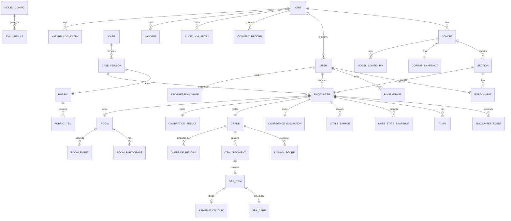
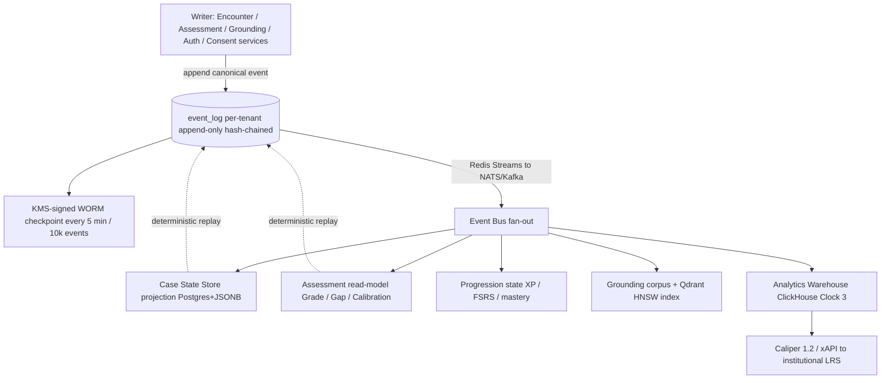
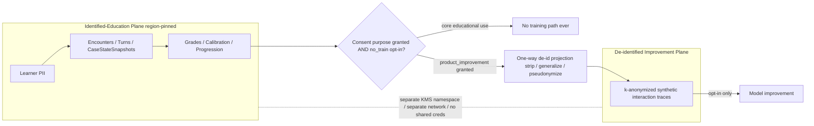
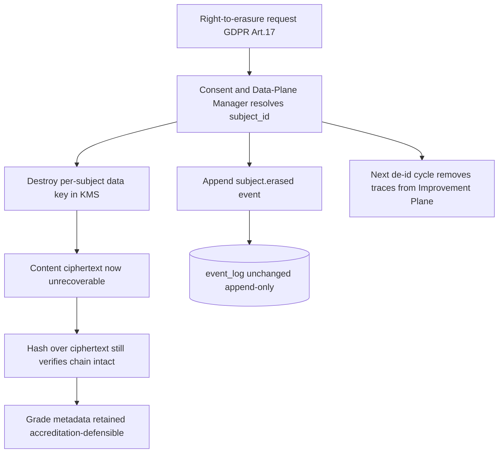

# 08 — Data Model, Multi-Tenancy & Event Sourcing

**Status:** Build-ready architecture. **Date:** July 2026. **Owner services:** Event Log / Event Store, Case State Store, Identity & Tenancy, Consent & Data-Plane Manager, Institution/Analytics Service — plus the projection surfaces of every other service.

**Scope.** This document is the **data spine** the rest of AcuDx hangs off. It specifies: the full logical data model (every canonical entity, its key fields and relationships) as an ER diagram; the **event-sourcing** design (`EncounterEvent` / `RoomEvent` streams, hash-chaining, snapshots, projections/read-models, deterministic replay); **multi-tenancy** (`Org → Cohort → Section → User`; the row-level vs schema-per-tenant vs db-per-region trade-off; region-pinned tenancy so learner PII/analytics never leave region); the **two physically-separated data planes** (identified-education ⟂ de-identified/synthetic-improvement) and the one-way de-identified flow between them; **RBAC + role-gated drill-down**; **retention / audit** (≥6-month immutable) and the **right-to-erasure vs event-log immutability** reconciliation (crypto-shredding); and **identity mapping** across LTI 1.3 / SAML / OIDC / SCIM / OneRoster.

**Consistency contract (this doc consumes, does not re-derive).** The `Grade` / `RubricItem` / `ItemJudgment` / `CalibrationResult` shapes are owned by [`06-assessment-and-calibration-engine.md`](./06-assessment-and-calibration-engine.md); the hash-chained audit spine, the event envelope, the two-plane split, crypto-shredding, `ModelConfig`, and the PHI Interceptor are owned by [`09-security-and-compliance-architecture.md`](./09-security-and-compliance-architecture.md); the `GuidelineStatement` atom and `CorpusSnapshot` by [`05-guideline-grounding-engine.md`](./05-guideline-grounding-engine.md); the `EncounterEvent` producers on the conversation clock by [`01-ai-agent-architecture.md`](./01-ai-agent-architecture.md); and `ModelCallEvent` + region routing by [`02-model-gateway-and-routing.md`](./02-model-gateway-and-routing.md). This doc **unifies** those into one physical data model, tenancy model, and event schema, and fills the gaps they left (the ER model, the `EncounterEvent` envelope as a single canonical schema, the residency/partition strategy, the identity-mapping table, the projection/replay machinery). Where a sibling doc already fixed a decision, this doc cites it and stays byte-compatible; ADRs [0004](./adr/README.md) (event-sourced log), [0016](./adr/README.md) (region-pinned tenancy), [0006](./adr/README.md) (synthetic-only), [0013](./adr/README.md) (monorepo/gateway) are binding here.

**Invariants honored (canon).** THREE ISOLATED CLOCKS · TWO-TIER CONTENT (grounded owns facts; roleplay owns affect) · AI-patient never sources facts (Case State Store does) · EVENT-SOURCED, append-only, HASH-CHAINED Event Log = single source of truth, everything else a replayable projection · MODEL GATEWAY is the only model path · `assessment_mode ∈ {formative (default), summative-with-review (human co-sign)}` · SYNTHETIC PATIENTS ONLY, detect-and-block PHI, `no_train=true` default · COUNTRY is a first-class retrieval filter · GRADER family ≠ PATIENT-AGENT family · every voice/avatar feature has a full non-voice equivalent · **no learner-emotion inference**.

---

## 1. The logical data model (ER)

AcuDx's persistent state is one **event log** plus a set of **projections**. The entities below are the *logical* model — the read-model/relational shape that projections materialize and that services query. The event stream (§3) is the write model; this ER is the read model. Every table carries `tenant_id` (§4) and, where it holds PII, a `region` residency tag.



### 1.1 Entity dictionary (key fields + purpose)

Fields are illustrative-but-load-bearing; full JSON contracts for `Grade`/`RubricItem`/`ItemJudgment`/`CalibrationResult`/`GapItem`/`ConfidenceElicitation`/`OverrideRecord` live in [`06`](./06-assessment-and-calibration-engine.md), for `GuidelineStatement`/`CorpusSnapshot` in [`05`](./05-guideline-grounding-engine.md), and for `ModelConfig`/`EvalResult`/`ConsentRecord`/`AuditLogEntry` in [`09`](./09-security-and-compliance-architecture.md). This dictionary is the **relational glue** binding them.

**Tenancy & identity**

| Entity | Key fields | Notes |
|---|---|---|
| `Org` (Tenant) | `org_id (ULID)`, `name`, `region ∈ {eu-central,uk,us,me-central,ap}`, `residency_locked bool`, `lti_deployment_ids[]`, `saml_entity_id`, `scim_token_ref`, `dpa_ref`, `retention_policy_id`, `on_prem_appliance bool` | The tenant root; `region` is immutable after creation (residency). All chains, KMS namespaces, and RLS predicates key off `org_id`. |
| `Cohort` | `cohort_id`, `org_id`, `academic_year`, `program ∈ {UME,GME,nursing,paramedic}`, `corpus_snapshot_id`, `model_config_pin_set_id`, `assessment_mode_default` | Cohort pins the **guideline `CorpusSnapshot`** and the **`ModelConfig` set** so scoring is reproducible cohort-wide ([`05` §6.3](./05-guideline-grounding-engine.md), [`09` §5.1](./09-security-and-compliance-architecture.md)). |
| `Section` | `section_id`, `cohort_id`, `name`, `crosswalk_version_pins{framework→version}` | The RBAC drill-down leaf above the learner; pins the crosswalk versions ([`06` §1.3](./06-assessment-and-calibration-engine.md)) used for framework rollups. |
| `User` (Learner/Educator/Admin) | `user_id`, `org_id`, `ext_ids[]` (§7), `display_name (crypto-shreddable)`, `email_hash`, `locale`, `accommodations{extra_time,no_timer,captions_default}` | PII fields are per-subject envelope-encrypted (§6). `ext_ids[]` is the identity-mapping join key (§7). |
| `Role` / `RoleGrant` | `role ∈ {learner,educator,coordinator,assessment_director,accreditation_liaison,dpo,admin,cso}`, `scope{org|cohort|section}`, `granted_via ∈ {LTI,SAML,SCIM,manual}`, `valid_to?` | RBAC is scope-bounded; a grant is `(user, role, scope_ref)`. LTI-launch roles map here (§7.3). |
| `Enrollment` | `user_id`, `section_id`, `status ∈ {active,suspended,dropped}`, `roster_source ∈ {NRPS,OneRoster,SCIM,manual}`, `synced_at` | Zero-touch rostering ([`03` §C](../stakeholders/03-institution.md)); deprovision flips `status`, never hard-deletes (retention). |
| `ConsentRecord` | `subject_id`, `org_id`, `purpose ∈ {educational_use,product_improvement,research,voice_clone}`, `state`, `consent_text_version`, `plane`, `revocable` | Event-sourced (grant/revoke are events); core educational use is **never** consent-based ([`09` §4.2](./09-security-and-compliance-architecture.md)). Gates the de-id flow (§5). |

**Content & authoring**

| Entity | Key fields | Notes |
|---|---|---|
| `Case` | `case_id`, `org_id? (null=global library)`, `specialty`, `country`, `council[]`, `status` | Logical case; `org_id=null` for the shared AcuDx library, set for institution-authored cases. |
| `CaseVersion` | `case_version_id`, `case_id`, `case_version_hash`, `blueprint`, `base_persona_spec_hash`, `variant_axes`, `published_by`, `frozen_at`, `provenance{authoring_run,locked_facts[]}` | Immutable, version-hashed ([`01` §5](./01-ai-agent-architecture.md)); a guideline change **flags** affected versions for re-review, never rewrites (AU-2). |
| `Rubric` / `RubricItem` | `rubric_version_hash`, `case_version_hash`, `items[]`, `domain_weights`, `pass_bands`, `review_status` | Owned by [`06` §1.2](./06-assessment-and-calibration-engine.md); stored `Postgres + JSONB`. The hash is stamped on every `Grade`. |
| `GuidelineStatement` | `id (gs_*)`, `scope{countries,council,population}`, `version`, `citation`, `license_tag`, `review.status`, `provenance{source_event_id,content_hash}` | Owned by [`05` §1](./05-guideline-grounding-engine.md); a projection of publish events. Referenced (not embedded) from grading via `statement_id`. |
| `CorpusSnapshot` | `snapshot_id`, `statement_ids_with_versions[]`, `event_log_head_hash`, `created_at` | Immutable version-lock manifest ([`05` §6.3](./05-guideline-grounding-engine.md)); a Cohort pins one. |

**Encounter & assessment**

| Entity | Key fields | Notes |
|---|---|---|
| `Encounter` | `encounter_id`, `tenant_id`, `learner_id`, `section_id`, `case_version_hash`, `assessment_mode`, `country`, `council[]`, `corpus_snapshot_id`, `room_id?`, `modality ∈ {text,voice}`, `state ∈ {active,closed,aborted,grading,graded}`, `started_at`, `closed_at` | The unit of practice; a projection of its `EncounterEvent` stream. `modality=voice` still has a full text equivalent (canon). |
| `EncounterEvent` | envelope (§3.2) + class-specific `payload` | The **write model**. Append-only, hash-chained, per-tenant. Everything below is projected from it. |
| `Turn` | `turn_id`, `encounter_id`, `seq`, `speaker ∈ {learner,patient,colleague,family,dispatcher,examiner}`, `text`, `affect?`, `stt_confidence?`, `stage` | Projection of `learner_turn` / `ai_turn` events; the transcript the grader replays. Voice turns store the **batch Nova-3 re-transcript** for grading ([`06` §2.2](./06-assessment-and-calibration-engine.md)). |
| `CaseStateSnapshot` | `snapshot_id`, `encounter_id`, `as_of_seq`, `state{vitals,labs,exam,orders,timeline}`, `content_hash` | Authoritative clinical state at an event offset; a deterministic fold of case-state-mutating events ([`01` §7](./01-ai-agent-architecture.md)). Persona never reads it raw. |
| `VitalsSample` | `encounter_id`, `t`, `hr,bp,rr,spo2,temp,...`, `source ∈ {physiology_engine}` | Emitted by the Vitals & Physiology Engine; drives monitor + clinical-sign overlay. Screen-reader-labeled, non-colour-only (WCAG). |
| `ClinicalSign` | `encounter_id`, `sign ∈ {cyanosis,pallor,diaphoresis,distress,LOC,...}`, `intensity 0..1`, `derived_from{vitals}` | Numeric intensity is scorable by assessment (AV-2); authored once, renders across 2D/3D. |
| `ConfidenceElicitation` | `encounter_id`, `elicited_at`, `per_domain`, `per_decision[]` | Owned by [`06` §3.1](./06-assessment-and-calibration-engine.md); **must precede** `GradeRevealed` — enforced by event ordering (§3.6). |
| `Grade` | `grade_id`, `encounter_id`, `rubric_version_hash`, `model_config_id`, `assessment_mode`, `co_sign?`, `domain_scores[]`, `item_judgments[]`, `safety_flags[]`, `dual_axis`, `reliability[]`, `overrides[]`, `hash_prev` | Owned by [`06` §2.8](./06-assessment-and-calibration-engine.md). A projection of `grade.*` events; `overrides` recompute deterministically. |
| `DomainScore` / `ItemJudgment` | per [`06` §2.3–2.6](./06-assessment-and-calibration-engine.md) | Band-only display; `domain_raw` never surfaced; `evidence_span` forced. |
| `CalibrationResult` | `encounter_id`, `per_domain{brier,oci,ece,quadrant}`, `reliability_diagram[]`, `trajectory` | Deterministic ([`06` §3](./06-assessment-and-calibration-engine.md)); **never leaderboarded** (RBAC-enforced, §5.4). |
| `OverrideRecord` | `override_id`, `target`, `before`, `after`, `rationale`, `overridden_by`, `at` | Append-only educator override ([`06` §6](./06-assessment-and-calibration-engine.md)); the IRR-vs-faculty substrate. |

**Progression, remediation, multiplayer, governance**

| Entity | Key fields | Notes |
|---|---|---|
| `GapItem` | `gap_id`, `encounter_id`, `item_id`, `domain`, `evidence_span`, `framework_tag`, `severity`, `frequency` | Free from evidence spans; safety-critical surfaced always ([`06` §4](./06-assessment-and-calibration-engine.md)). |
| `SRSCard` | `card_id`, `learner_id`, `concept_key`, `fsrs_state{stability,difficulty,due}`, `origin_gap_id` | FSRS scheduler (knowledge gaps); Learning/Progression Service. |
| `RemediationTask` | `task_id`, `learner_id`, `origin_gap_id`, `assigned_case_version_id`, `status ∈ {open,assigned,reassessed,closed}`, `delta` | The **closed loop** institutions buy ([`03` §4](../stakeholders/03-institution.md)); exportable. |
| `ProgressionState` | `learner_id`, `xp`, `streak{count,freezes}`, `mastery{epa→entrustment,n_cases}`, `calibration_trend` | XP tied to mastery+improvement, not raw score (GM-1); forgiving streaks (GM-2). |
| `Room` / `RoomParticipant` / `RoomEvent` | `room_id`, `participants[]{user_id?,ai_backfill bool,role}`, event stream | Multiplayer, event-sourced ([`01` §7](./01-ai-agent-architecture.md)); AI backfill of an empty role is a `role_assigned(ai=true)` event. |
| `ModelConfig` / `EvalResult` | per [`09` §5.1](./09-security-and-compliance-architecture.md) / [`02` §10.1](./02-model-gateway-and-routing.md) | Registry-owned; grader family ≠ patient family; cohort-pinned via `MODEL_CONFIG_PIN`. |
| `ConsentRecord` | (above) | — |
| `AuditLogEntry` | envelope + `{actor,target,before_hash,after_hash}` | The `admin.*`/`auth.*` classes of the same event log; hash-chained ([`09` §2.2](./09-security-and-compliance-architecture.md)). |
| `Incident` / `HazardLogEntry` | `severity`, `likelihood`, `dcb_hazard_id?`, `gdpr_clock_started_at?`, `cso_signoff?` | Dual incident process ([`09` §6](./09-security-and-compliance-architecture.md)); events on the spine. |

**Relationship notes that matter for correctness.**
- `Encounter → Grade`/`CalibrationResult` are `1:1` *projections* — there is exactly one current grade, but it is recomputed from `(auto-grade ⊕ ordered OverrideRecords)`; re-grades under a new `ModelConfig` are new `grade.*` event chains, not mutations.
- `Cohort → CorpusSnapshot` and `Cohort → ModelConfigPin` are the two **version-lock** joins that make a summative window reproducible on appeal.
- `GuidelineStatement` is referenced by `statement_id` from `ItemJudgment` evidence and `RuntimeGroundingEvent`, never copied — so a corpus rebuild does not orphan grades.
- `Encounter → Room` is nullable: solo text encounters (the wedge) have `room_id=null` and never touch Room Service.

---

## 2. Physical stores (which technology holds what)

Per ADR-0004/0012/0013/0016 and the sibling docs, the physical mapping is:

| Data | Store | Rationale |
|---|---|---|
| **Event Log** (`EncounterEvent`, `RoomEvent`, `auth.*`, `model.call`, `grounding.*`, `assessment.*`, `consent.*`, `admin.*`, `incident/hazard.*`) | **Postgres 16**, per-tenant append-only partitioned table `event_log` | Postgres is authoritative for the hash chain ([`09` §2.1](./09-security-and-compliance-architecture.md)); one hot partition per active encounter. |
| Event propagation | **Redis Streams** (MVP) → **NATS / Kafka** (scale) | Durable bus fans events to projections; *propagation, not truth* ([`06` §2.2](./06-assessment-and-calibration-engine.md), ADR-0013). |
| **Case State Store**, Rubric/Grade/Crosswalk, User/Org/Cohort/Section, Consent, ProgressionState, RemediationTask | **Postgres 16 + JSONB** | Relational for tenancy joins; JSONB for `items[]`/`item_judgments[]`/snapshots ([`06` §8](./06-assessment-and-calibration-engine.md)). |
| Short-term conversation memory, running case-state summary, budget ledger, rerank memo | **Redis 7** | Hot, cheap, lossy-by-design; replayable from the log ([`01` §7](./01-ai-agent-architecture.md)). |
| `GuidelineStatement` corpus | **Postgres + JSONB**; vector in **Qdrant (filterable HNSW)**; BM25 in Postgres FTS | Filter-before-rank ([`05` §2](./05-guideline-grounding-engine.md), ADR-0012). |
| Analytics read-models (cohort heatmap, aggregate calibration, accreditation export) | **ClickHouse** (BigQuery acceptable) | Clock-3 batch rollups ([`06` §8](./06-assessment-and-calibration-engine.md)); Caliper/xAPI emission to LRS. |
| Object store (transcripts, media, WORM audit checkpoints, anchor-set) | **S3** (+ **Object-Lock/WORM, compliance mode** for checkpoints) | Bulk content + tamper-evident anchoring ([`09` §2.3](./09-security-and-compliance-architecture.md)). |
| Secrets, per-tenant KEKs, per-subject data keys | **Cloud KMS / Vault** | Envelope encryption; crypto-shred erasure ([`09` §10](./09-security-and-compliance-architecture.md)). |

**One rule binds them all:** every store above is a **deterministic projection of the Event Log** except the log itself, the KMS material, and bulk object content. If a projection store is lost, it is rebuilt by replaying events to `event_log_head_hash`.

---

## 3. Event-sourcing design

### 3.1 The write model / read model split

AcuDx writes **events** and reads **projections**. A service handling a request (a) validates against current projected state, (b) appends one or more events to the tenant's `event_log`, (c) lets the bus fan the events to projection builders that update read-models idempotently. No service mutates a projection row as a source of truth — the row is a cache of a fold over events.

This is what makes the canon's four hardest promises cheap: **reconstructable + appealable** assessment ([`09` §2.1](./09-security-and-compliance-architecture.md)); **"score it the way it was taught in 2024"** replay ([`05` §2](./05-guideline-grounding-engine.md)); **deterministic re-grade** under a pinned `ModelConfig` ([`02` §6](./02-model-gateway-and-routing.md)); and **crypto-shred erasure without breaking the chain** (§6).



### 3.2 The `EncounterEvent` envelope (canonical schema)

This is the single envelope for **every** event class (encounter, room, auth, model.call, grounding, assessment, consent, admin, incident/hazard), extending the [`09` §2.3](./09-security-and-compliance-architecture.md) envelope with the fields the data model needs (`stream_id`, `partition_key`, `plane`, `region`, `schema_version`, `causation_id`, `crypto_ref`). Serialization is **canonical JSON: keys sorted, no whitespace variance, no volatile fields inside the hashed body** — byte-stability is a hard requirement or the hash chain and the prompt cache both silently break.

```jsonc
// EncounterEvent / RoomEvent / *.* — one envelope for the whole spine.
// JSON Schema Draft 2020-12; the hashed body is envelope-minus-{hash}.
{
  "event_id":     "01J8Z...ULID",        // monotonic ULID; globally unique
  "tenant_id":    "org_7f3",             // region-pinned; the chain is PER-TENANT
  "region":       "eu-central",          // residency tag; must equal tenant.region
  "stream_id":    "enc_5b2",             // aggregate id: encounter_id | room_id | "tenant" for auth/admin
  "stream_type":  "encounter",           // encounter | room | tenant_audit | consent
  "seq":          918273,                // GAP-FREE per-tenant sequence (deletion-detectable)
  "stream_seq":   42,                    // gap-free per-STREAM sequence (fast per-aggregate replay)
  "prev_hash":    "sha256:ab12...",      // hash of tenant event seq-1 (genesis = sha256:0*64)
  "event_type":   "encounter.ai_turn",   // dotted class; see §3.3
  "schema_version": 3,                   // event schema evolution (§3.7)
  "actor":        { "type": "service", "id": "encounter-svc", "on_behalf_of": "user_9c1" },
  "occurred_at":  "2026-07-07T10:31:04.221Z",  // metadata only — NOT in the causal/replay logic
  "causation_id": "01J8Z...",            // the event/command that caused this one
  "correlation_id":"enc_5b2",            // groups a logical flow across streams
  "plane":        "identified-education",// identified-education | deidentified-improvement
  "crypto_ref":   "dk_user_9c1_v2",      // per-subject data-key id wrapping PII in payload (§6); null if none
  "payload":      { /* class-specific; PII fields ciphertext under crypto_ref */ },
  "hash":         "sha256:cd34..."       // sha256( canonical(body_without_hash) || prev_hash )
}
```

**Why the extra fields over [`09`](./09-security-and-compliance-architecture.md)'s envelope.** `stream_id`/`stream_seq` let a single encounter (or room) replay without scanning the whole tenant chain — the read side folds one stream; the tenant-wide `seq`/`prev_hash` preserve global tamper-evidence. `plane` + `crypto_ref` make the two-plane split (§5) and crypto-shredding (§6) *properties of every event*, not bolt-ons. `schema_version` lets event shapes evolve without a migration (§3.7). `occurred_at` is deliberately **excluded from replay logic** (it is wall-clock metadata); causal order is `seq`, not time.

### 3.3 Event catalogue (the write model, by clock)

| Clock | `event_type` (class.verb) | Producer | Projects into |
|---|---|---|---|
| **1 · conversation** | `encounter.started` / `.turn_learner` / `.turn_ai` / `.order_test` / `.exam_finding` / `.stage_advanced` / `.director_prompt` / `.aborted` / `.closed` | Encounter Service ([`01`](./01-ai-agent-architecture.md)) | Turn, CaseStateSnapshot, current_stage |
| 1 | `vitals.sample` / `sign.updated` | Vitals & Physiology Engine | VitalsSample, ClinicalSign |
| 1 | `room.created` / `.participant_joined` / `.role_assigned` / `.role_reassigned` / `.turn` / `.closed` | Room Service | Room, RoomParticipant |
| 1 | `safety.trigger` | Safety Interceptor (outside LLM) | HazardLogEntry, incident feed |
| **2 · grounding+assessment** | `model.call` | **Model Gateway only** ([`02`](./02-model-gateway-and-routing.md)) | cost/routing read-model; **hash-only, no content** |
| 2 | `grounding.served` / `grounding.refused` (`RuntimeGroundingEvent`) | Grounding Service ([`05` §5.2](./05-guideline-grounding-engine.md)) | guidance audit; grade fact-anchor |
| 2 | `assessment.grade_issued` / `.item_judged` / `.band_mapped` / `.override` | Assessment Service ([`06`](./06-assessment-and-calibration-engine.md)) | Grade, DomainScore, ItemJudgment, GapItem |
| 2 | `calibration.result` | Calibration Engine (deterministic) | CalibrationResult |
| 2 | `confidence.elicited` | Encounter Service | ConfidenceElicitation (must precede reveal, §3.6) |
| **3 · batch/admin** | `consent.granted` / `.revoked` / `.changed` | Consent & Data-Plane Mgr | ConsentRecord |
| 3 | `progression.updated` / `srs.scheduled` / `remediation.*` | Learning/Progression Service | ProgressionState, SRSCard, RemediationTask |
| 3 | `auth.login` / `.sso_assertion` / `.token` / `.rbac_change` | API Gateway / Identity | AuditLogEntry |
| 3 | `admin.case_published` / `.model_promoted` / `.config_change` / `.export` / `.erasure` | Authoring / Registry / Admin Console | AuditLogEntry, CaseVersion, ModelConfig |
| 3 | `subject.erased` | Consent & Data-Plane Mgr | erasure tombstone (§6) |
| 3 | `incident.opened` / `hazard.logged` / `.cso_signoff` | Admin/Compliance Console | Incident, HazardLogEntry |

### 3.4 Snapshots (fold acceleration, not truth)

Replaying a 40-turn encounter from genesis every read is wasteful, so projections keep **snapshots** — a materialized fold at a given `stream_seq`, plus the events after it. Snapshots are **caches, never authoritative**; they are content-hashed and always re-derivable.

```typescript
interface Snapshot<S> {
  stream_id: string;
  stream_type: 'encounter' | 'room';
  as_of_stream_seq: number;      // fold covers events [0, as_of_stream_seq]
  state: S;                       // e.g. CaseStateSnapshot.state
  content_hash: string;           // sha256(canonical(state)) — must match a fresh replay
  projector_version: number;      // bump forces snapshot invalidation on projector logic change
  built_at: string;               // metadata only
}
```

- `CaseStateSnapshot` is taken every K turns (K tuned in [`01` §7](./01-ai-agent-architecture.md)) and at `encounter.closed`; the close snapshot is the grading input ([`06` §2.2](./06-assessment-and-calibration-engine.md)).
- On projector-logic change, `projector_version` bumps → old snapshots invalidate → rebuild from events. **The events never change**; only the fold does. This is the safety valve for §3.7.
- A snapshot's `content_hash` is verified against a from-genesis replay in CI on a sampled basis; a mismatch means a non-deterministic projector (a bug) — see §3.5.

### 3.5 Deterministic replay (the property everything leans on)

Replay is a **pure fold**: `state = events.reduce(apply, initial)`, where `apply` is a total, side-effect-free function keyed on `event_type` + `schema_version`. Determinism requires four disciplines, each enforced mechanically:

1. **Causal order is `seq`/`stream_seq`, never `occurred_at`.** Wall-clock is metadata; two events with the same millisecond still have a total order via `seq`.
2. **`apply` is pure.** No `Date.now()`, no RNG, no network, no reads of other projections inside a projector. Any randomness (e.g., variant sampling) was resolved at *write* time and stored in the event payload, so replay reproduces it.
3. **Canonical serialization.** The same `assertByteStable()` discipline the Model Gateway uses for cached prefixes ([`02` §5.3](./02-model-gateway-and-routing.md)) is reused for event bodies; a CI check renders each event body twice and diffs.
4. **`verifyChain(tenant, from, to)`** ([`09` §2.3](./09-security-and-compliance-architecture.md)) recomputes hashes + asserts gap-free `seq` + checks crossed WORM checkpoints. Run in CI, on export, and on erasure (to prove the chain still verifies over ciphertext, §6).

```typescript
// Read-model rebuild — identical shape for every projection.
function rebuild<S>(events: EncounterEvent[], project: Projector<S>): S {
  return events
    .sort((a, b) => a.stream_seq - b.stream_seq)   // seq, not time
    .reduce((s, e) => project.apply(s, e), project.initial());
}
```

**What replay buys, concretely:** rebuild any lost projection store; reproduce a summative grade months later (`ModelConfig` + `CorpusSnapshot` are pinned, transcript is a fold); answer a repudiation dispute ("I never got that hint") from `grounding.served`; and migrate a projector safely (§3.7).

### 3.6 Ordering invariants enforced by the log

Some canon rules are *temporal* and are enforced as append-time guards on the stream:

- **Confidence-before-reveal** ([`06` §3.1](./06-assessment-and-calibration-engine.md)): a `confidence.elicited` event whose `stream_seq` is greater than any `assessment.grade_issued` (reveal) on the same encounter is **rejected at append**. The calibration plot is only valid if elicitation causally precedes the score.
- **Reveal-once / override-append-only** ([`06` §6](./06-assessment-and-calibration-engine.md)): the original `grade_issued` is never mutated; `assessment.override` events append and the `Grade` projection is `fold(auto ⊕ ordered overrides)`.
- **Summative co-sign gate** ([`09` §7](./09-security-and-compliance-architecture.md)): the Assessment Service refuses to emit a *finalizing* `grade_issued` with `assessment_mode='summative-with-review'` unless the event payload carries a valid `co_sign`. Enforced in code, appended as an event.
- **PHI-before-persistence** ([`09` §3](./09-security-and-compliance-architecture.md)): the PHI Interceptor runs *before* any `turn_learner` event is appended; raw suspected PHI is never written, only `safety.trigger{type:"phi_block"}`.

### 3.7 Schema evolution (events are forever)

Because events are immutable, we never migrate old events; we evolve **readers**:

- **Additive first.** New optional payload fields don't bump `schema_version`; readers default missing fields.
- **Breaking change** ⇒ new `schema_version` + an **upcaster** `upcast(v_n → v_{n+1})` in the projector; the projector applies upcasters in sequence so a `v1` event and a `v3` event fold into the same state. Upcasters are pure and unit-tested against golden replays.
- **Projector logic change** ⇒ bump `projector_version`, invalidate snapshots, rebuild. Old events, new fold.
- No `ALTER`-on-events, no rewrite jobs — the chain would break and the "reconstructable in 2028 exactly as in 2026" guarantee would be a lie.

---

## 4. Multi-tenancy

### 4.1 The hierarchy

`Org (Tenant) → Cohort → Section → User`, with `RoleGrant` attaching authority at any scope and `Enrollment` binding a learner to a section. This is both the **authorization tree** (§5.3 drill-down) and the **residency tree** (an `Org` is pinned to one `region`; everything under it inherits).

### 4.2 The isolation decision: row-level within region, db-per-region across regions

Three options, evaluated against AcuDx's hard constraints (residency law, ≥thousands of small tenants, per-tenant hash chains + KMS keys, one shared global case library):

| Model | Isolation | Ops cost | Residency fit | Verdict |
|---|---|---|---|---|
| **Row-level (RLS), shared schema** | `tenant_id` on every row + **Postgres Row-Level Security** policy + per-tenant hash chain + per-tenant KEK | Lowest; one schema, one migration | Poor **alone** (one DB can't span residency zones) | **Chosen — within a region** |
| **Schema-per-tenant** | one Postgres schema per `Org` | N× migrations, connection sprawl at thousands of tenants | Same residency problem | **Rejected** — ops cost scales with tenant count for no isolation gain over RLS+KEK |
| **Database/cluster-per-tenant** | full physical DB per `Org` | Highest; only for the largest / most sensitive | Overkill except appliance | **Reserved** for on-prem/VPC appliance tenants (AD-7) and top-tier ministries |

**Decision (ADR-0016-consistent):** **Row-Level Security within a region, database-and-cluster per region.** Concretely:

- **Within a region:** a single logical Postgres deployment per region holds many tenants, isolated by (a) `tenant_id` on every row, (b) an **RLS policy** `USING (tenant_id = current_setting('acudx.tenant_id'))` that the API Gateway sets per request after authz, (c) **per-tenant hash chains** (the chain is keyed by `tenant_id`, so a cross-tenant read can't even produce a valid chain), and (d) **per-tenant KEKs** in a per-region KMS namespace ([`09` §10](./09-security-and-compliance-architecture.md)). This is the [`09` §T4](./09-security-and-compliance-architecture.md) tenant-isolation mitigation made concrete.
- **Across regions:** **separate databases, clusters, KMS namespaces, and Kubernetes deployments per region** (`eu-central`, `uk`, `us`; `me-central`/`ap` on demand). There is **no cross-region query path** for learner PII/analytics. The only things that may cross a border are (i) de-identified aggregate telemetry where the DPA permits, and (ii) the global, PII-free case library (replicated read-only into each region).
- **Appliance tenants** (AD-7) get **db-per-tenant** inside their own VPC; the AcuDx control-plane orchestrates but never holds their data or keys.

**Why not RLS globally.** RLS gives logical isolation but **not physical residency** — a single global cluster would put an EU learner's row on the same disk as a US learner's, which EU/UK ministries reject and which no RLS policy fixes. Residency is a *placement* property, not an *access* property; it must be solved at the deployment boundary, above RLS. Hence RLS *and* db-per-region, not one or the other.

### 4.3 Partition & residency strategy (the table)

| Data class | Partition key | Physical placement | Cross-region? | Retention default |
|---|---|---|---|---|
| **Event Log** (`event_log`) | `tenant_id` (list) → then `encounter_id`/time (hash+range) sub-partition | Region cluster of the tenant | **Never** | Per data-class (§6); assessment events 7y |
| **Turns / transcripts** (PII) | `tenant_id` → `encounter_id` | Region cluster + S3 (region bucket) | Never | Per-DPA; content crypto-shreddable |
| **Case State / Vitals / Signs** | `tenant_id` → `encounter_id` | Region cluster | Never | Tied to encounter retention |
| **Grades / Calibration / Progression** | `tenant_id` → `learner_id` | Region cluster | Never | 7y (accreditation defensibility) |
| **Consent records** | `tenant_id` → `subject_id` | Region cluster | Never | Life-of-relationship + audit tail |
| **Auth / model.call / admin audit** | `tenant_id` → time (range, monthly) | Region cluster | Never (content); aggregate metrics may | auth 90d–1y; assessment metadata 7y |
| **Analytics read-models** (heatmap, aggregate calibration) | `tenant_id` → `cohort_id` | Region ClickHouse | **De-identified aggregate only**, DPA-gated | Rolling; source of accreditation export |
| **De-identified improvement traces** | `pseudonym` (no tenant join key) | Improvement-plane cluster (region-pinned) | Aggregate + DPA-permitted only | Per improvement policy |
| **Guideline corpus / Qdrant / snapshots** | `council`/`country` (content, PII-free) | Replicated read-only per region | **Yes** (PII-free) | Versioned; superseded retained |
| **Global case library** (`org_id=null`) | `case_id` (PII-free) | Replicated read-only per region | Yes (PII-free) | Versioned |
| **WORM audit checkpoints** | `tenant_id` → `seq_range` | S3 Object-Lock (region), compliance mode | Never | ≥ audit retention (immutable) |

**Reading the table:** anything with a `tenant_id`-plus-PII shape is region-pinned and never crosses a border; anything PII-free and content-addressed (guidelines, global cases, aggregate telemetry) may replicate. Learner PII/analytics-never-leave-region (AD-6, ADR-0016) is a *placement* guarantee readable straight off this table.

### 4.4 Tenant lifecycle

- **Provision:** `admin.tenant_created` fixes `region` (immutable), mints the per-tenant KEK namespace, writes the genesis event (`prev_hash = sha256:0*64`), and registers LTI/SAML identifiers (§7).
- **Roster sync:** NRPS/OneRoster/SCIM drive `Enrollment` and `RoleGrant` via events (§7); deprovision flips `status`, never deletes (retention).
- **Version-lock:** cohort creation pins `CorpusSnapshot` + `ModelConfig` set; advancing them is an explicit, logged educator action ([`05` §6.3](./05-guideline-grounding-engine.md)).
- **Off-boarding:** contract exit runs a **hard-delete + certificate** ([`03` §8](../stakeholders/03-institution.md)): crypto-shred every subject key (§6), export the institution's data, retain only the shredded-content hash-intact chain per the agreed audit tail, then decommission the tenant's KEK namespace.

---

## 5. The two physically-separated data planes

**Invariant ([`09` §4](./09-security-and-compliance-architecture.md), [`04` §3](../stakeholders/04-policy-regulators.md)):** two planes, `no_train=true` default, per-purpose revocable consent, one-way de-id flow, no service holds credentials to both.

### 5.1 What each plane holds

| | **Identified-Education Plane** | **De-identified / Synthetic-Improvement Plane** |
|---|---|---|
| Contents | Learner PII, transcripts, `CaseStateSnapshot`s, `Grade`s, `CalibrationResult`, `ProgressionState` | k-anonymized / synthetic interaction traces (no names, no `tenant`↔`pseudonym` join key) |
| Owner | Institution (AcuDx = Art. 28 **processor**) | AcuDx |
| Training use | **Never** (`no_train=true`, hard) | Only source eligible for model improvement, **and only per explicit institutional opt-in** |
| Residency | Region-pinned to tenant | Region-pinned; cross-border only if aggregate + DPA-permitted |
| Keys / network | Per-tenant KEK, region KMS namespace, education network segment | Separate KMS namespace, separate network segment |
| Physical separation | **Separate DB clusters, separate KMS namespaces, separate network segments; no service holds credentials to both** ([`09` §4.1](./09-security-and-compliance-architecture.md)) | |

### 5.2 The one-way de-identified flow

The de-id pipeline is itself an **event-sourced, one-way projection**: it reads the identified plane, applies a documented k-anonymity + pseudonymization policy, and writes to the improvement plane. **There is no reverse path and no join key.** Every event carries `plane` (§3.2), so the Model Gateway ([`02` §9](./02-model-gateway-and-routing.md)) can bar an `identified-education` call from any training-eligible endpoint at the chokepoint.



**Enforcement points.** (1) Consent is checked **per subject, per trace, at ingest**; a `consent.revoked` event halts future ingestion and schedules removal from the improvement plane on the next cycle. (2) Core educational use is **never** a consent basis — a required curriculum tool can't rely on freely-given consent, so the "core educational use → no training path" branch is unconditional. (3) `no_train=true` is set on **every** Model Gateway call regardless of plane, so even the improvement path never leaks into a vendor's training set.

### 5.3 RBAC + role-gated drill-down

Authority is `(user, role, scope)` where scope ∈ `{org, cohort, section}` and the drill-down path is `cohort → section → learner → encounter → evidence_span`. Each hop is a **role-gated boundary**, enforced as an RLS + application predicate, so FERPA "need to know" is structural, not policy.

| Role | Sees | Cannot see |
|---|---|---|
| `learner` | Own encounters, grades (bands), gaps, **own** calibration plot, remediation | Any other learner's data; raw `domain_raw`; cohort aggregates |
| `educator` / course director | Their section's learners down to `evidence_span`; override grades | Other sections; DPO/admin audit; another cohort |
| `coordinator` | Rosters, completion, at-risk lists, exportable reports for their scope | Individual calibration ego-data; clinical content edit |
| `assessment_director` (champion) | Cohort heatmap, item analysis, **aggregate** calibration, validity dossier | Individual private calibration unless policy permits; cross-org data |
| `accreditation_liaison` | De-identified accreditation export, longitudinal rollups | Identified individual records |
| `dpo` | Consent state, audit log, data-flow records, erasure tooling | Clinical grade content beyond compliance need |
| `admin` / `cso` | Tenant config / model registry (admin); hazard log + safety triggers (cso) | Learner grade content unless separately granted |

**Calibration is special.** Individual `CalibrationResult` is **private, formative, never leaderboarded** ([`06` §3.3](./06-assessment-and-calibration-engine.md)); a dean/assessment-director sees **aggregate** cohort calibration as a curriculum signal, never a learner's private ego-data, unless institutional policy explicitly permits. This is enforced at the **data-plane + RBAC level**, not the UI. **No learner-emotion field exists anywhere in the model** (EU-prohibited) — the schema has no place to store it, which is the strongest possible guarantee.

---

## 6. Retention, audit & the right-to-erasure reconciliation

### 6.1 The tension

The Event Log is **append-only and hash-chained** (immutable, ≥6-month audit, ADR-0004), yet **GDPR Art. 17 erasure** and contract-exit hard-delete ([`03` §F](../stakeholders/03-institution.md)) must be executable. These appear contradictory. They are reconciled by **crypto-shredding + tombstone** ([`09` §2.4](./09-security-and-compliance-architecture.md)), never physical deletion of an event.

### 6.2 Crypto-shredding

Learner-content payloads are **envelope-encrypted per subject**: a per-user **data key** (`crypto_ref` in the envelope, §3.2) wraps the PII fields, and that data key is itself wrapped by the tenant KEK in KMS. Erasure = **destroy the per-subject data key** → the ciphertext is permanently unrecoverable, **but the hash over the ciphertext still verifies**, so the chain stays intact and every *other* subject's records and the tamper-evidence remain valid.



- A `subject.erased` event records the action (who, when, which subject) — erasure is itself auditable.
- **What survives shredding:** the *metadata* an accreditor needs — that an encounter happened, its band, the `rubric_version_hash`, the `model_config_id` — because those are non-PII assessment facts retained under the DPA (7y default). What's destroyed is the *learner-identifiable content* (transcript text, name, PII fields). The open question ([`09` Open](./09-security-and-compliance-architecture.md)) — whether a shredded-content-but-hash-intact grade is "appealable enough" for accreditors — is flagged in §9.

### 6.3 Retention schedule (policy rows, never "forever")

Retention is a **`retention_policy`** row per tenant, enforced by a scheduled job that only ever **crypto-shreds content**, never breaks the chain:

| Data class | Default retention | Basis |
|---|---|---|
| Assessment / validity artifacts (`Grade` metadata, reliability, override) | **7 years** | Accreditation defensibility, appeal window (≥6-mo canon minimum, exceeded) |
| Learner-content (transcripts, PII) | Per-DPA; crypto-shreddable on request | GDPR minimization + Art. 17 |
| `model.call` events | Hash + tokens + cost only (no content) | `no_train` / privacy-minimizing ([`09` §2.2](./09-security-and-compliance-architecture.md)) |
| Auth / operational logs | 90 days – 1 year | Operational, minimization |
| WORM audit checkpoints | ≥ audit retention (immutable) | Tamper-evidence |
| Consent records | Life-of-relationship + statutory tail | Accountability |

Per-country statutory minimums/maximums override the defaults per DPA (flagged §9).

### 6.4 Tamper-evidence recap (from [`09`](./09-security-and-compliance-architecture.md), so this doc is self-contained)

Chain continuity (`hash_n = SHA-256(canonical_body_n ‖ prev_hash_n)`, gap-free `seq`) detects insert/edit/delete; KMS-signed **WORM checkpoints** every 5 min / 10k events bound an attacker's rewrite window to one checkpoint interval; `verifyChain()` runs in CI, on export, and post-erasure. No public blockchain (PII-on-chain + residency + erasure conflicts, [`09` §2.3](./09-security-and-compliance-architecture.md)).

---

## 7. Identity mapping across LTI / SAML / OIDC / SCIM / OneRoster

A learner arrives through many doors (LTI launch inside Canvas, standalone SAML SSO, SCIM-provisioned account, OneRoster roster sync) and must resolve to **one** `User` with **one** `ext_ids[]` set, so grades pass back to the right gradebook row and rosters de-dupe. ADR-0015 makes **LTI 1.3 Advantage the P0** surface; the rest are v1 fast-follows.

### 7.1 The `ExternalIdentity` mapping

```typescript
interface ExternalIdentity {
  user_id: string;                 // internal ULID — the single source of identity
  org_id: string;
  protocol: 'lti' | 'saml' | 'oidc' | 'scim' | 'oneroster';
  issuer: string;                  // LTI platform iss | SAML IdP entityID | OIDC issuer
  subject: string;                 // LTI 'sub' | SAML NameID | OIDC sub | SCIM externalId | OneRoster sourcedId
  deployment_id?: string;          // LTI deployment_id (a platform can host many deployments)
  context_id?: string;             // LTI context (course) → maps to Cohort/Section
  linked_at: string;
  // Uniqueness: (protocol, issuer, subject[, deployment_id]) → exactly one user_id.
}
```

**Resolution rule.** On any inbound identity, look up `(protocol, issuer, subject, deployment_id?)`. Hit → existing `user_id`. Miss → **link if a strong match exists** (same `org_id` + verified `email_hash` from another protocol), else **provision** a new `User`. All links/provisions are `auth.*` / `admin.*` events (auditable). SCIM/OneRoster are authoritative for *lifecycle* (create/suspend/delete); LTI/SAML/OIDC are authoritative for *authentication*.

### 7.2 Protocol responsibilities

| Protocol | Provides | Maps to | Notes |
|---|---|---|---|
| **LTI 1.3 Advantage** (P0) | OIDC-based launch (SSO), **NRPS** roster, **Deep Linking** case selection, **AGS** grade passback | `iss`→platform, `deployment_id`→`Org`/deployment, `context_id`→`Cohort`/`Section`, `sub`→`User`, launch `roles[]`→`RoleGrant` | 1EdTech-certified; LTI 1.1 deprecated (ADR-0015). AGS respects `assessment_mode` + **band-only** granularity. |
| **SAML 2.0** (Shibboleth/InCommon) | Federated authN | `NameID`→`subject`, IdP `entityID`→`issuer`; attributes→role hints | Standalone (non-LMS) SSO; signature-validated ([`09` §T5](./09-security-and-compliance-architecture.md)). |
| **OIDC** (Entra/Okta/Google) | Federated authN | `sub`→`subject`, `iss`→`issuer` | Alternative standalone SSO. |
| **SCIM 2.0** | Provisioning lifecycle | `externalId`→`subject`; groups→`Section`/`RoleGrant` | Authoritative create/suspend/delete; drives `Enrollment.status`. |
| **OneRoster 1.2** | Roster/section sync | `sourcedId`→`subject`; classes→`Section`; enrollments→`Enrollment` | Often via the LMS, not direct ([`03` §3](../stakeholders/03-institution.md)). |

### 7.3 Role mapping

LTI launch `roles` (e.g. `Instructor`, `Learner`, `TeachingAssistant`) and SAML/SCIM group memberships map to AcuDx `Role`s via a **per-tenant, versioned mapping table** (data, not code — same discipline as crosswalks). A launch as `Instructor` in a course context grants `educator` scoped to that `Section`; it never grants `admin`/`dpo`/`cso` (those are provisioned deliberately). Grade passback (AGS) writes back **only bands**, respecting the formative/summative flag and the human co-sign gate.

---

## 8. Worked build example (ties the model together)

A learner launches an EM case from Canvas → grade appears in the Canvas gradebook. The data-model path:

1. **LTI launch** → resolve `ExternalIdentity(lti, iss, sub, deployment_id)` → `User` + `RoleGrant(learner, section)`; append `auth.sso_assertion`.
2. **Encounter start** → `encounter.started{case_version_hash, assessment_mode:'formative', country, corpus_snapshot_id, model_config_pin}` on the tenant's region cluster (`stream_id=enc_*`, `plane=identified-education`).
3. **Turns** → PHI Interceptor clears each learner input *before* `encounter.turn_learner` is appended; persona turns append `encounter.turn_ai`; `vitals.sample`/`sign.updated` fold into `CaseStateSnapshot`. `model.call` events (hash-only) recorded by the Gateway.
4. **Close** → `encounter.closed` + close `CaseStateSnapshot`; learner does `confidence.elicited` (append rejected if a grade already revealed).
5. **Grade (Clock 2, Batch)** → Assessment replays the stream, grades against the pinned `Rubric`, appends `assessment.item_judged` × N and `assessment.grade_issued`; Calibration Engine appends `calibration.result`. `GapItem`s spawn `SRSCard`/`RemediationTask`.
6. **Passback** → AGS writes the **band** to Canvas; **only** the band, respecting formative mode.
7. **Analytics (Clock 3)** → de-identified rollups project into ClickHouse for the cohort heatmap + accreditation export; Caliper/xAPI events emit to the LRS.
8. **Erasure (later)** → learner requests deletion → `subject.erased` + KMS data-key destroyed → transcript ciphertext unrecoverable, chain still verifies, band metadata retained for accreditation.

Every step is an event; every read is a projection; every projection is replayable.

---

## 9. Open questions & build sequence

**Must be decided/built first (foundational — everything projects off these):**
1. **Canonical event serialization + `EncounterEvent` envelope (§3.2) + `verifyChain` + WORM checkpointing.** The byte-stable canonical-JSON form and the checkpoint interval must be frozen before the first event is written — retrofitting either breaks the chain. Shared with [`09` Open Q1](./09-security-and-compliance-architecture.md); this doc adds `stream_id`/`stream_seq`/`plane`/`crypto_ref` — confirm those are in the v1 envelope, not a later migration.
2. **Projector framework + snapshot/replay + `assertByteStable()` for event bodies.** The pure-fold `apply` contract, `projector_version` invalidation, and upcaster mechanism (§3.4–3.7) — the substrate for Case State, Grade, Progression, and analytics read-models.
3. **RLS + per-tenant KEK + db-per-region deployment (§4.2).** The physical split must be real before any learner data is stored (can't retrofit a shared-credential system — [`09` Open Q3](./09-security-and-compliance-architecture.md)); decide the per-region cluster topology and the RLS session-var wiring in the API Gateway.
4. **Per-subject envelope encryption + crypto-shred erasure (§6).** Blocks any PII storage; the `crypto_ref` key hierarchy and the `subject.erased` flow must exist before the first transcript is persisted.

**Second wave (before first institutional pilot):**
5. **Identity-mapping resolver + LTI 1.3 Advantage (§7).** `ExternalIdentity` uniqueness + link-vs-provision + role mapping; AGS band-only passback. P0 for institutional adoption (ADR-0015).
6. **Two-plane KMS/IAM separation + one-way de-id projection + consent enforcement (§5).** Before any product-improvement data flow; decide the k-anonymity policy (or synthetic-only) for the improvement plane ([`09` Open Q6](./09-security-and-compliance-architecture.md)).
7. **ClickHouse analytics projections + Caliper/xAPI emission + accreditation export.** The dean-dashboard read-models on Clock 3.

**Open questions (decide with legal/clinical/data-eng before summative / cross-region scale):**
- **Erasure vs accreditation defensibility.** Confirm with accreditors that a **shredded-content but hash-intact** grade (band + `rubric_version_hash` + `model_config_id` retained, transcript destroyed) is "appealable enough" for their evidence standard — the same open item as [`09`](./09-security-and-compliance-architecture.md), owned jointly here because the retained-vs-shredded field split (§6.2) is a data-model decision.
- **Retention periods per data class per country.** The 7y assessment default is a starting point; some ministries mandate different minimums/maximums — reconcile per-DPA into the `retention_policy` rows.
- **Snapshot cadence K & projector-version churn.** Where snapshots are taken (§3.4) trades rebuild cost vs storage; measure against real EM encounter lengths, don't guess.
- **Cross-region identity for roaming learners.** A learner enrolled at two institutions in different regions has two region-pinned `User` records by construction (no cross-region PII join). Confirm this is acceptable (it satisfies residency) vs a need for a global, PII-free identity linkage — likely deferred; residency wins.
- **De-id sufficiency vs synthetic-only for the improvement plane.** Whether k-anonymized real traces are ever ingested, or the improvement plane is **synthetic-only** — the stricter, safer default; decide before enabling any training path ([`09` Open Q6](./09-security-and-compliance-architecture.md)).
- **Event bus at scale.** Redis Streams (MVP) → NATS vs Kafka (scale) — the projection contract is bus-agnostic, but the ordering/replay guarantees per bus must be validated (Kafka partition-per-tenant preserves per-tenant order; confirm NATS JetStream equivalent) before the swap.
