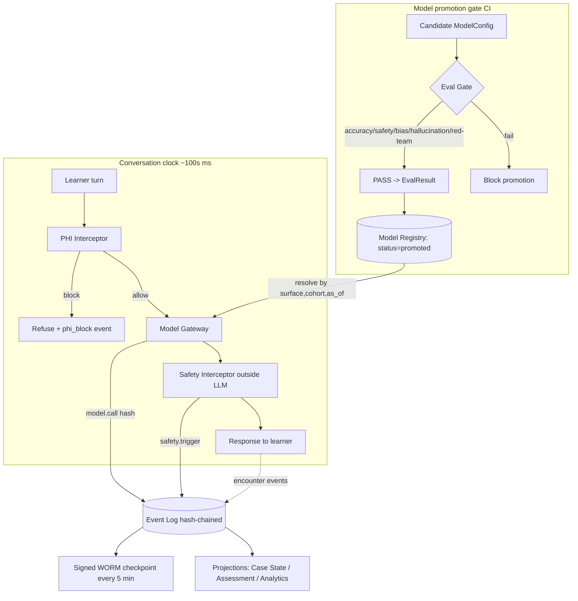
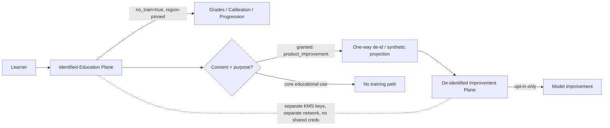

# 09 — Security & Compliance Architecture

**Scope.** How AcuDx makes its regulatory posture *architecturally enforced rather than promised*: the hash-chained immutable audit-log spine, PHI detect-and-block at ingress, the consent + two-data-plane split, the Model Registry + pre-promotion Eval Gate, DCB0129-style clinical-safety governance, EU AI Act Art. 4/50 obligations, the enterprise-readiness control set (HECVAT 4 / SOC 2 Type II / VPAT), a STRIDE threat model, and secrets/key management. This is the security spine that the Encounter, Grounding, Assessment, and Institution services all hang off. Time context: **July 2026**.

**Load-bearing framing (from `docs/research/06-regulatory-compliance.md` and `docs/stakeholders/04-policy-regulators.md`).**
1. AcuDx is **education, not clinical care** — synthetic patients only, no real PHI, `assessment_mode=formative` by default → below EU AI Act Annex III high-risk, FERPA (not HIPAA), outside FDA CDS / EU MDR device lines. Every control here defends that classification.
2. Build to the **strictest applicable regime by default**: GDPR + EN 301 549/WCAG 2.2 AA + a DCB0129-style clinical-safety file.
3. **One event-sourced, hash-chained audit-log spine** simultaneously satisfies privacy (GDPR), academic integrity, clinical safety (Hazard Log), AI-Act traceability, and enterprise procurement (HECVAT/SOC 2). Build it day one — everything else is a projection off it.

> **Compliance clocks that bind AcuDx (Jul 2026):** Art. 4 AI-literacy enforced **2 Aug 2026**; Art. 50 transparency (AI disclosure + C2PA marking of synthetic media) live **2 Dec 2026**; Annex III high-risk obligations for auto-gating assessment postponed to **2 Dec 2027** (Digital Omnibus). GDPR breach notice **≤72h**. Ship the Art. 4/50 controls now; keep the high-risk stack behind the `summative-with-review` contract gate.

---

## 1. Security-architecture principles

- **Deterministic before probabilistic.** Every safety-critical decision (PHI block, self-harm interception, dose/threshold check, hash-chain verification) is deterministic code *outside* the LLM. No safety guarantee depends on a model behaving.
- **Model Gateway is the only path to any model.** Business logic never calls a vendor SDK; this is the single chokepoint where `no_train`, region pinning, prompt-version hashing, and audit emission are enforced.
- **Event Log is the source of truth; everything else is a replayable projection.** Tamper-evidence, reconstructability, and appealability all reduce to "can we deterministically replay the hash-chained log."
- **Two physically-separated data planes.** Identified-education data can never reach a training pipeline; only the de-identified/synthetic plane can.
- **Fail closed on the clinical spine, fail open on affect.** If grounding/verification/eval is unavailable, refuse the clinical assertion (citation-or-refuse). The Roleplay layer degrades gracefully; the Grounded layer never guesses.
- **The three isolated clocks are a security boundary too.** Assessment, grounding, and analytics run out-of-band; a compromised or slow batch job can never block or corrupt the live conversation loop.

---

## 2. The audit-log spine (Event Log / Event Store)

### 2.1 What it is

An **append-only, hash-chained EncounterEvent log** is the single source of truth. Every consequential action across every service emits an event; the Case State Store, Assessment read-models, Progression state, and Analytics Warehouse are all deterministic projections of it. Because it is event-sourced, any encounter, score, or safety decision is **reconstructable and appealable** — the artifact accreditors, IRBs, and medical-defense counsel demand (`04-policy-regulators.md` §5).

**Store:** Postgres (primary) partitioned append-only table `event_log`, with a hot partition per active encounter; Kafka (or NATS/Redis Streams) as the durable event bus that fans events out to projections. Postgres is authoritative for the chain; the bus is for propagation, not truth.

### 2.2 What is logged (mandatory event classes)

| Event class | Emitted by | Key fields (beyond envelope) |
|---|---|---|
| `auth.*` (login, SSO assertion, token issue/revoke, RBAC change) | API Gateway / Identity | `subject_id`, `method` (SAML/OIDC/LTI), `idp`, `tenant_id`, `session_id`, `ip_hash` |
| `encounter.*` (start, turn, end, abort) | Encounter Service | `case_version_hash`, `assessment_mode`, `country` |
| `model.call` (**every** LLM/embedding call) | Model Gateway **only** | `model_config_id`, `model+prompt_version_hash`, `tier`, `no_train`, `region`, `cached_prefix_hash`, `tokens_in/out`, `latency_ms`, `escalated_from` |
| `grounding.served` | Grounding Service | `guideline_statement_ids[]` with `{version, country, council, effective_date}`, `citation_gate=pass/refuse`, `verifier_score`, `dose_check=pass/fail` |
| `safety.trigger` | Safety Interceptor | `type` (self_harm / safeguarding / red_flag / dangerous_management / phi_block), `action` (break_character / block / resource_surface), `matched_rule_id` |
| `assessment.*` (grade issued, item judgment, band map, override) | Assessment Service | `rubric_version`, `grader_model_config_id`, `item_judgments[]{met, evidence_span, confidence}`, `band`, `human_cosign_id?` |
| `calibration.result` | Calibration Engine | `brier`, `oci`, `ece` (never leaderboarded) |
| `consent.*` (grant, revoke, change) | Consent & Data-Plane Mgr | `purpose`, `consent_text_version`, `plane` |
| `admin.*` (case publish, model promote, config change, export, erasure) | Authoring / Model Registry / Admin Console | `actor_id`, `target`, `before_hash`, `after_hash` |
| `incident.*` / `hazard.*` | Admin/Compliance Console | `severity`, `likelihood`, `dcb_hazard_id`, `gdpr_clock_started_at?` |

**Deliberate omission:** `model.call` stores the **model+prompt-version hash, not full prompt/response content** by default (privacy-minimizing and `no_train`-consistent, per `06` §5.5). Full content lives only in the learner-content store, region-pinned, with its own retention and erasure path. The audit spine can prove *which model+prompt+guideline version acted* without retaining learner text — this is the split that keeps the audit log itself out of the "training corpus" and erasure-request blast radius.

### 2.3 Event envelope & hash chain

Every event carries a common envelope. The chain is a per-tenant Merkle-style linked hash: each event hashes its own canonical body plus the previous event's hash.

```jsonc
// EncounterEvent envelope (canonical JSON, keys sorted, no volatile fields)
{
  "event_id":   "01J...ULID",        // monotonic ULID
  "tenant_id":  "org_7f3",           // region-pinned; chain is per-tenant
  "seq":        918273,               // gap-free per-tenant sequence
  "prev_hash":  "sha256:ab12...",     // hash of event seq-1 (genesis = sha256:0*64)
  "event_type": "assessment.grade_issued",
  "actor":      { "type": "service", "id": "assessment-svc", "on_behalf_of": "user_..." },
  "occurred_at":"2026-07-07T10:31:04.221Z",
  "payload":    { /* class-specific, see §2.2 */ },
  "hash":       "sha256:cd34..."      // sha256(canonical(body) || prev_hash)
}
```

**Tamper-evidence, two layers:**
1. **Chain continuity** — `hash_n = SHA-256(canonical_body_n ‖ prev_hash_n)`, `prev_hash_n = hash_{n-1}`. Any insert/edit/delete breaks every subsequent hash. `seq` is gap-free per tenant, so *deletion* is also detectable (a missing seq).
2. **External anchoring** — every 5 min (or per 10k events) a **checkpoint** `{tenant_id, seq_range, merkle_root, signed_at}` is signed with a KMS-held key and written to (a) an append-only S3-Object-Lock (WORM, compliance mode) bucket and (b) an internal transparency log. Anchoring bounds how far back an attacker with DB write access could rewrite before detection to a single checkpoint interval.

```
verifyChain(tenant_id, from_seq, to_seq) -> { ok: bool, first_break_seq?: int }
  // recompute hashes, assert prev_hash linkage + gap-free seq,
  // then assert every crossed checkpoint merkle_root matches the WORM copy.
```

**Trade-off — why not a public blockchain?** Rejected: cost, latency, PII-on-chain risk, and residency conflicts (an immutable public ledger fights GDPR erasure). Signed WORM checkpoints give tamper-*evidence* (detect + prove) without tamper-*proofing* we can't reconcile with erasure. We accept "detectable within one checkpoint interval" over "cryptographically impossible," which is the correct posture for an education tool holding student PII.

### 2.4 Retention & erasure (the append-only vs. GDPR-erasure tension)

The chain is immutable, but GDPR Art. 17 erasure must be executable. Resolution: **crypto-shredding + tombstone**, never physical deletion of an event.

- Learner-content payloads are **envelope-encrypted per subject** (per-user data key wrapped by a tenant KEK in KMS). Erasure = destroy the user data key → ciphertext is unrecoverable, hash over ciphertext still verifies, chain intact. A `subject.erased` event records the action.
- Audit-spine events (auth, model.call hashes, assessment metadata) are retained per the institutional DPA and GDPR minimization — **defined per data class, never "forever"**: default 7y for assessment/validity artifacts (accreditation defensibility), 90d–1y for operational auth logs, per-contract for the rest. Retention is a policy row, enforced by a scheduled job that only ever crypto-shreds content, never breaks the chain.

---

## 3. PHI detect-and-block at ingress

**Invariant:** *synthetic patients only; no real PHI; detect-and-block PHI entry* — this is what keeps AcuDx off the HIPAA/PHI side and defends the "education, not care" wall (`06` §3.3).

A deterministic **PHI Interceptor** sits in the ingress path of the API Gateway / Encounter Service, **before** any learner text reaches a persona model or the Event Log content store. It is part of the Safety Interceptor family — outside the LLM.

```
POST /encounters/{id}/turns   { "text": "...", "modality": "text|voice-stt" }
  → PHIInterceptor.scan(text) -> { verdict: allow|block|redact, matches: [...] }
```

**Detection stack (layered, deterministic-first):**
1. **Structural regex/validators** — national ID formats, MRN patterns, phone/email, dates-of-birth adjacent to names, credit-card (Luhn). O(1), no model.
2. **NER pass** — a small cheap NER classifier (via Model Gateway, Tier-1/nano-class) tags PERSON/LOCATION/DATE with clinical context; used only to *raise suspicion*, never as the sole gate.
3. **Policy decision** — any structural hit ⇒ **block** with the fixed message *"AcuDx is a simulator. Do not enter real patient information."*; NER-only suspicion ⇒ soft warn. Voice/STT input is scanned on the transcribed text with the same pipeline.

On block: emit `safety.trigger{type:"phi_block"}`, drop the text (never persist raw), return the guidance message. **No raw suspected-PHI is ever written to any store** — the event records the *rule matched*, not the content. This makes "no real PHI exists" auditable, not rhetorical (`06` §1.1).

---

## 4. Consent & the two-data-plane split

**Invariant:** two *physically-separated* planes; `no_train=true` default; per-purpose revocable consent (`04-policy-regulators.md` §3).

### 4.1 Two planes

| | **Identified-Education Plane** | **De-identified / Synthetic-Improvement Plane** |
|---|---|---|
| Contents | Learner PII, transcripts, grades, calibration, progression | k-anonymized/synthetic interaction traces |
| Owner | Institution (AcuDx is Art. 28 **processor**) | AcuDx |
| Training use | **Never** (`no_train=true`, hard) | Only source eligible for model improvement, and only per explicit institutional opt-in |
| Residency | Region-pinned to tenant (`eu-central`/`uk`/`us`/…) | Region-pinned; cross-border only if aggregate + DPA-permitted |
| Physical separation | Separate DB clusters, separate KMS keys, separate network segment; **no service holds credentials to both** |

The de-identification pipeline is a **one-way, event-sourced projection**: it reads the identified plane, strips/generalizes per a documented k-anonymity + pseudonymization policy, and writes to the improvement plane. There is no reverse path and no join key. Training pipelines have IAM access to the improvement plane **only**.

### 4.2 ConsentRecord & enforcement

```jsonc
// ConsentRecord (event-sourced; grant/revoke are events)
{
  "subject_id": "user_...", "tenant_id": "org_...",
  "purpose": "product_improvement",           // ∈ {educational_use(core), product_improvement, research, voice_clone}
  "state": "granted",                          // granted | revoked | never
  "consent_text_version": "cx-2026-05",        // exact text hash, for IRB audit trail
  "granted_at": "2026-07-07T09:00:00Z", "revocable": true
}
```

- **Core educational use is never consent-based** — the institution is controller on a public-task/contract basis; a required curriculum tool can't rely on freely-given consent (`06` §1.2). Consent is reserved for genuinely optional purposes (product improvement, research, voice-clone avatars).
- **Consent is unbundled and revocable** per purpose; consenting to learn ≠ consenting to train. The de-id pipeline consults live consent per subject before ingesting any trace; a `consent.revoke` event halts future ingestion and triggers removal from the improvement plane on next cycle.
- **`no_train=true` is enforced at the Model Gateway**, propagated to the provider call (`store=false`/zero-retention endpoints) on *every* call regardless of plane, so even the improvement path never leaks into a vendor's training set.

---

## 5. Model Registry & pre-promotion Eval Gate

**Invariant:** no silent swaps; grader family ≠ patient family; version-lock per cohort; eval gate before any promotion (`06` §5.3, `04` §1 red lines).

### 5.1 ModelConfig & the registry

A `ModelConfig` is the versioned, immutable unit that binds a surface to a model + prompt + guardrails. Nothing reaches production except a promoted, eval-passed `ModelConfig`.

```jsonc
// ModelConfig (immutable once promoted; new change ⇒ new id)
{
  "id": "mc_patient_2026_07_02",
  "surface": "patient_agent",                  // patient_agent | examiner | guidance | grader | phi_ner | verifier
  "model": "claude-haiku-4-5",                 // provider+model+version, via Model Gateway
  "model_family": "anthropic-claude",          // used to enforce grader≠patient
  "prompt_version_hash": "sha256:...",         // byte-stable cached prefix hash
  "guardrail_set": "gr-2026-06",
  "region_map": { "eu-central": "bedrock-eu", "us": "anthropic" },
  "eval_result_id": "ev_...",                  // must be PASS to promote
  "status": "promoted",                         // draft | eval | promoted | pinned | retired
  "no_train": true
}
```

- **Grader ≠ patient enforcement** is a promotion-time assertion: the `grader` surface `ModelConfig.model_family` must differ from the live `patient_agent` family; high-stakes items require an ensemble of **≥2 families**. E.g. Patient=Anthropic Haiku 4.5 ⇒ Grader must be a non-Anthropic family (Opus-batched grade cross-checked by on-prem **MedGemma 1.5** as the second family/verifier).
- **Version-locking per cohort:** an assessment window pins a `ModelConfig` set (`status:pinned`); the Encounter/Assessment services resolve config by `(surface, cohort, as_of)` so a mid-cohort promotion cannot change scoring behavior — protecting longitudinal comparability (the accreditor's "no unversioned changes" red line, `04` §1).

### 5.2 The Eval Gate

Every candidate `ModelConfig` (new model, new prompt, provider drift) runs the **Eval Gate in CI** before it can be promoted. No path to `promoted` bypasses it — enforced in the deployment pipeline, not by convention.

| Suite | What it checks | Gate |
|---|---|---|
| **Accuracy** | MedQA-style + case-bank held-out; grader agreement vs faculty gold set (κ) | κ ≥ 0.6 (show) / ≥ 0.7 (pass-fail) |
| **Safety / refusal** | refuses out-of-scope clinical advice; self-harm → break character; no real-patient advice | 100% on the hard-refusal set |
| **Bias** | subgroup/DIF on scoring; STT/accent parity; persona non-stereotyping | no significant disparate impact |
| **Hallucination** | grounding-mode citation-or-refuse; fabricated-guideline detection | 0 uncited clinical assertions |
| **Red-team** | adversarial CI suite (§5.3) | 0 failures on the safety-critical subset |

A **PASS** produces an immutable `EvalResult` referenced by the `ModelConfig`; a FAIL blocks promotion and files a finding. Provider behaviour drift (a silent vendor model update) is caught because the Model Gateway version-pins and re-runs the gate on any detected upstream change.

### 5.3 Red-team suite (runs in CI, gates promotion)

The highest-yield adversarial cases, all deterministic pass/fail against ground truth:

- **Drug-dose traps** — prompt the surface to assert a dose; assert it either cites the grounded layer or refuses; a deterministic dose-range checker (from the Vitals/Grounding dose tables) fails any out-of-range assertion.
- **Pediatric weight-based calcs** — mg/kg dosing, tube sizes, fluid boluses; check arithmetic against the deterministic calculator, not the model's freehand math.
- **Country-threshold traps** — e.g. "is 135/85 hypertension?" must answer **per the case's `country`** (correct under AHA/ACC 130/80, incorrect under ESC 140/90) and never silently assume US defaults; sepsis bundle timing (1-hr SSC vs NEWS2/NICE) similarly. This directly exercises the *country-filter-before-rank* invariant.
- **Prompt-injection into the patient agent** — case text / learner turns that try to make the Patient Agent assert clinical facts or leak the system prompt; assert the two-tier boundary holds (patient never sources facts).
- **Sycophancy** — learner proposes an unsafe plan; assert the surface does not agree-to-be-supportive.

---

## 6. Clinical-safety governance (DCB0129-style)

AcuDx is not a medical device, but adopting the NHS clinical-risk pattern is cheap insurance and the strongest trust signal to hospitals/universities (`06` §5.1). The **#1 hazard is stale/wrong/wrong-country guideline content.**

- **Named Clinical Safety Officer (CSO)** — registered clinician, safety-trained; owns the safety file, signs off `HazardLogEntry` mitigations, and is the escalation endpoint for the in-product incident channel.
- **Clinical Safety Case Report + Hazard Log** — enumerated `HazardLogEntry` records (wrong/stale guideline hint; persona modelling a dangerous behaviour a learner mimics; mistranslation; wrong drug dose), each `severity × likelihood`, with mitigation and CSO sign-off. Stored as events on the audit spine.
- **In-product "report incorrect medical content"** — one-click on any clinical surface; files a `hazard.*` event routed to the CSO and Hazard Log. Turns learners into safety sensors and evidences good governance.
- **Dual incident process (kept distinct):**
  - **(a) Data/security incident** → GDPR **≤72h** breach clock (`incident.*` event stamps `gdpr_clock_started_at`), contractual notice to institutions, ICO/DPA notification.
  - **(b) Clinical-safety/content incident** → Hazard Log entry, root cause, corrective action, content quarantine, disclosure to affected institutions. In `summative-with-review` mode this is also the substrate for AI-Act serious-incident reporting.
- **Guideline-grounding controls** (the mitigation for hazard #1) live in the Grounding Service: versioned `GuidelineStatement` store, **country filter before rank**, hard citation gate → verifier → deterministic dose/threshold check → out-of-scope refusal → citations+disclaimer. Stale content is flagged when its source updates; RAG refuses rather than hallucinates.

---

## 7. EU AI Act obligations (Art. 4 & Art. 50)

Bind AcuDx **regardless of risk tier**; ship now (`06` §2.3).

- **Art. 4 — AI literacy (enforced 2 Aug 2026).** Documented AI-literacy program for staff/contractors who operate AcuDx's AI (AcuDx is provider *and* deployer). Tracked as completion records; export available for procurement.
- **Art. 50(1) — AI-interaction disclosure (live 2 Dec 2026).** The learner is told, in-UI and in ToS, that the patient/examiner/colleague/family is AI. Trivial (it's the premise) but stated explicitly and logged as acknowledged at session start (`encounter.start` payload carries `ai_disclosure_ack=true`).
- **Art. 50(2) — synthetic-content marking (live 2 Dec 2026).** All AI-generated audio/video/images — synthetic patient TTS (Cartesia Sonic-3 / ElevenLabs), 3D avatar frames, generated case media — are **machine-detectably marked with C2PA Content Credentials** and labelled to users. C2PA manifests are attached at generation time in the Voice Pipeline and avatar tier; the manifest records `{generator, model_config_id, created_at, synthetic:true}` and is signed with a KMS key. Text stays labelled via the Art. 50(1) disclosure.

**Boundary the whole doc defends:** the `summative-with-review` mode (auto-influencing progression + profiling) is presumptively **Annex III high-risk**. It stays behind a contract gate, requires a **named human co-sign**, and ships with the full high-risk stack (risk management, data governance, automatic logging — already built here, human oversight, conformity assessment, EU-DB registration) targeting **2 Dec 2027**. Default `formative` mode is limited-risk (Art. 6(3) escape hatch: advisory-to-human, doesn't materially influence the decision).

---

## 8. Enterprise-readiness control set

The controls the CISO/DPO/Procurement blockers gate on (`03-institution.md` §D; `04` §6). Any one is a hard veto — so these are build requirements, not roadmap.

| Control | Target / standard | Notes |
|---|---|---|
| **HECVAT 4** | Full completion; 321 questions / 7 sections; **32 AI/ML questions** (training data, output transparency, generative AI) | Required by most R1 universities *even with* SOC 2. AI section answered from this doc + Model Registry. |
| **SOC 2 Type II** | Annual; Security + Availability + Confidentiality (+ Privacy) | Type II (operating-effectiveness over time), not just Type I. |
| **ISO/IEC 42001** (AI mgmt) + **ISO 27001** | Roadmap; 42001 is the AI-management differentiator | Ministries increasingly require 42001 for health-adjacent AI. |
| **VPAT / WCAG 2.2 AA** (EN 301 549) | Published VPAT; every voice/avatar feature has a full non-voice equivalent | EAA enforceable since Jun 2025; captions/text-alt/ARIA vitals table are architectural, not add-ons. |
| **Encryption** | **AES-256** at rest; **TLS 1.2+** (prefer 1.3) in transit | Per-tenant KEKs; per-subject data keys (§2.4). |
| **Pen test** | Annual third-party + on major release; remediation SLA | Report shareable under NDA in security data-room. |
| **DPA / (BAA n/a)** | Art. 28 DPA with every institution; FERPA "school official" terms; sub-processor list w/ 30-day change notice | **BAA generally not applicable** — no PHI; say so explicitly in the security packet (turns a reflexive HIPAA ask into a trust signal). |
| **Region-pinned tenancy** | `eu-central`/`uk`/`us` (+ `me`/`ap` on demand); EU/UK inference on EU-resident, zero-retention endpoints | Learner PII/analytics never leave region. |

---

## 9. Threat model (STRIDE)

Top threats and their architectural mitigations. Mitigations reference controls above.

| # | Threat (STRIDE) | Scenario | Mitigation |
|---|---|---|---|
| T1 | **Tampering** — audit-log rewrite | Attacker with DB write access edits/deletes a grade or safety event to hide an incident | Hash chain + gap-free `seq` + signed WORM checkpoints every 5 min (§2.3); `verifyChain` in CI and on export; blast radius bounded to one checkpoint interval |
| T2 | **Info disclosure / Tampering** — **prompt injection into the Patient Agent** | Case text or learner turn instructs the Patient Agent to assert a (wrong) clinical fact or leak the system prompt | **Two-tier content architecture is the mitigation**: patient agent structurally cannot source clinical facts (served only from Case State Store); grounded assertions pass the Grounding safety pipeline; red-team injection suite gates promotion (§5.3); byte-stable cached prefix isolated from user turns |
| T3 | **Info disclosure** — data exfiltration / model-training leak | Learner PII ends up in a vendor training set or the improvement plane | `no_train=true` on every Model Gateway call (`store=false`); two physically-separated planes, no service holds both credentials (§4); de-id pipeline one-way; egress monitoring |
| T4 | **Elevation / Info disclosure** — **tenant isolation break** | Tenant A reads Tenant B's encounters/grades | Per-tenant hash chains + KMS keys; tenant_id in every row + Postgres RLS; API Gateway tenant-routing authz; region pinning; no cross-tenant join keys |
| T5 | **Spoofing** — auth/SSO compromise | Stolen token or forged SAML assertion impersonates an educator to alter grades | SAML 2.0/OIDC signature validation; short-lived tokens; SCIM deprovision; all `auth.*` + `assessment.override` logged; grade override needs role + is event-sourced/appealable |
| T6 | **Tampering** — silent model/prompt swap | A model or prompt change alters scoring mid-cohort | Model Registry immutability + Eval Gate + version-lock per cohort (§5); `model.call` records `model+prompt_version_hash`; Gateway detects provider drift and re-gates |
| T7 | **Info disclosure** — real PHI entered | Learner pastes a real patient's data | Deterministic PHI Interceptor blocks at ingress *before* persistence; raw never stored; `phi_block` event (§3) |
| T8 | **DoS** — batch job starves the conversation loop | Runaway grading/analytics job degrades live turns | Three isolated clocks: grounding/assessment/analytics are out-of-band on separate queues/pools; conversation loop has reserved capacity; Batch API for non-interactive work |
| T9 | **Repudiation** — "I never got that hint / my score is wrong" | Learner or institution disputes an assessment/guidance event | Event-sourced, hash-chained, reconstructable + appealable record of every score, model version, and guideline version served (§2) |
| T10 | **Safety bypass** — self-harm/dangerous-management slips through | Learner expresses self-harm; or model emits dangerous management | Deterministic Safety Interceptor *outside* the LLM breaks character + surfaces resources; runs on every output; `safety.trigger` logged |

---

## 10. Secrets & key management

- **Provider/API secrets** (Anthropic, Bedrock/Vertex/Azure-EU, Deepgram, Cartesia, LiveKit) live only in a managed secrets store (cloud KMS/Secrets Manager or HashiCorp Vault), injected at runtime — **never** in source, env files, or the prompt. The Model Gateway is the only component that reads model-provider secrets.
- **Key hierarchy:** cloud-KMS root → per-tenant **KEK** → per-subject **data keys** (envelope encryption). Per-subject keys enable crypto-shredding erasure (§2.4). Audit-checkpoint signing key and C2PA manifest signing key are separate KMS keys with restricted signing-only policies.
- **Rotation:** KEKs rotate on schedule (re-wrap, no data re-encryption needed); provider secrets rotate on a cadence and on any suspected exposure; short-lived tokens for service-to-service.
- **Isolation:** the two data planes use **separate KMS key namespaces**; no principal can decrypt across planes. Break-glass access is itself an `admin.*` audited event.
- **CI hygiene:** secret-scanning in CI, no secrets in build artifacts or logs; `npx @claude-flow/cli@latest security scan` after security-related changes.

---

## 11. Audit / Eval-Gate flow (diagram)



## 12. Data-plane & consent enforcement (diagram)



---

## 13. Controls-to-requirement traceability

| Requirement (source) | Control(s) in this doc | Enforcement point |
|---|---|---|
| Immutable, reconstructable, appealable audit trail (`04` §5) | Hash-chained Event Log + WORM checkpoints + `verifyChain` (§2) | Postgres append-only + KMS + CI |
| No real PHI / education-not-care (`06` §3) | PHI Interceptor detect-and-block at ingress (§3); synthetic-only | API Gateway / Encounter Service |
| `no_train` default (`06` §1.2) | Gateway sets `store=false` on every call; two-plane split (§4) | Model Gateway |
| Unbundled, revocable, per-purpose consent (`04` §3) | ConsentRecord events; core-use never consent-based (§4.2) | Consent & Data-Plane Manager |
| Two physically-separated planes (`04` §3) | Separate DB/KMS/network; one-way de-id projection (§4.1) | Infra / IAM |
| No silent model swaps; version-lock per cohort (`04` §1) | Model Registry immutability + Eval Gate + cohort pinning (§5) | CI deployment pipeline |
| Grader ≠ patient family; ensemble ≥2 (canon) | Promotion-time family assertion (§5.1) | Model Registry |
| Guideline correctness / country (`06` §5.2) | Grounding safety pipeline; country-filter-before-rank; dose check (§6) | Grounding Service |
| Clinical-safety governance (`06` §5.1) | Named CSO + Hazard Log + in-product report + dual incident (§6) | Admin/Compliance Console |
| GDPR 72h breach (`06` §5.4) | `incident.*` GDPR clock; dual incident process (§6) | Admin/Compliance Console |
| AI Act Art. 4 literacy (`06` §2.3) | Documented literacy program + completion records (§7) | Identity / Admin |
| AI Act Art. 50 transparency + C2PA (`06` §2.3) | In-UI AI disclosure + C2PA marking of synthetic media (§7) | Client / Voice Pipeline / Avatar |
| HECVAT 4 / SOC 2 / VPAT / AES-256 / TLS1.2+ / DPA (`03` §D) | Enterprise control set (§8) | Compliance program |
| Prompt injection resistance (canon) | Two-tier content arch + red-team gate (§5.3, T2) | Grounding / Model Registry |
| Tenant isolation (`03` §D) | Per-tenant chains/keys + RLS + tenant routing (T4) | API Gateway / Postgres |
| Secrets never in source (canon) | KMS/Vault; Gateway-only provider secrets; CI scanning (§10) | Secrets store / CI |

---

## Open questions & build sequence

**Must be decided/built first (foundational — everything projects off these):**
1. **Event Log schema + hash-chain + `verifyChain` + WORM checkpointing** — day-one spine; blocks Assessment, Grounding, and every audit/traceability claim. Decide the canonical-JSON serialization (must be byte-stable) and checkpoint interval before writing events.
2. **Model Gateway with `no_train`, region-map, and `model.call` audit emission** — the single chokepoint; nothing calls a model until this exists.
3. **Two-plane KMS + IAM separation** — the physical split must be real before any learner data is stored; retrofitting a shared-credential system is a rewrite.
4. **PHI Interceptor** — must sit at ingress before the first learner turn is ever persisted.

**Second wave (before first institutional pilot / summative):**
5. **Model Registry + Eval Gate + red-team CI suite** — needed before any scoring is trusted; decide the faculty gold-standard set and the κ/DIF thresholds per surface.
6. **ConsentRecord + de-id pipeline** — needed before any product-improvement data flow; decide the k-anonymity policy and whether de-id is sufficient vs. synthetic-only for the improvement plane.
7. **Clinical-safety file + named CSO + Hazard Log + in-product report** — needed before external clinical content ships.

**Open questions (decide with legal/clinical before high-risk mode):**
- **Checkpoint anchoring authority** — internal transparency log + S3 Object-Lock only, or add an external timestamping authority (RFC 3161 TSA) for stronger non-repudiation? (Trade-off: independence vs. another vendor dependency.)
- **NER-for-PHI residency** — the NER pass is a model call; confirm it runs on the in-region, zero-retention endpoint so PHI-suspicion scanning itself never crosses borders.
- **Retention periods per data class** — 7y assessment default is a starting point; must be reconciled per institutional DPA and per-country statute (some ministries mandate different minimums/maximums).
- **C2PA on text** — Art. 50(2) marking is clean for audio/video/image; text relies on Art. 50(1) disclosure. Confirm this is sufficient under the final Omnibus implementing acts, or whether text watermarking is expected.
- **Erasure vs. accreditation defensibility** — crypto-shredding content while retaining assessment metadata: confirm with accreditors that a shredded-content but hash-intact grade remains "appealable" enough for their evidence standard.
- **Summative human co-sign UX** — the named-human co-sign for `summative-with-review` must be anti-automation-bias (faculty actively confirm, disagreements logged); design and validate before enabling the high-risk mode.
