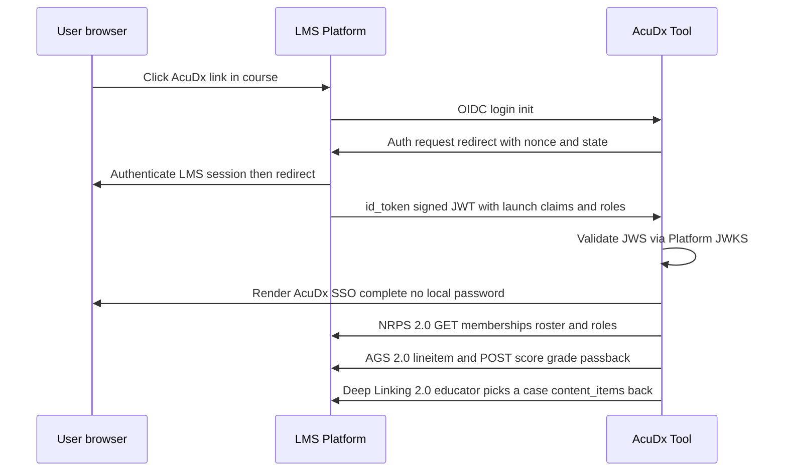

# 10 — API & Integration Surface

**Status:** Build-ready architecture. **Date:** July 2026. **Owner:** API Gateway/Edge + Identity & Tenancy Service (integration surfaces) with contributions from every canonical service that exposes a boundary.

**Scope.** This document specifies the **outward-facing contract** of AcuDx: the client and third-party API strategy (REST for CRUD, WebSocket/SSE for the text encounter stream, LiveKit data channels for realtime multiplayer/voice, and the GraphQL-vs-REST decision for analytics reads); a representative endpoint and event catalog with concrete request/response JSON; the **event-bus schemas** that couple the three clocks; and — in depth — the **institutional integration surfaces**: **LTI 1.3 Advantage** (OIDC launch, NRPS roster, Deep Linking, AGS grade passback) with the full launch sequence, standalone **SAML 2.0 / OIDC** SSO, **SCIM 2.0 + OneRoster 1.2** provisioning, **Caliper 1.2 / xAPI** emission to an LRS, and outbound webhooks. It closes with versioning/deprecation policy, rate-limits/quotas, and the authoring-time-vs-runtime **MCP** split.

**This doc consumes, and must stay consistent with:**
- `./02-model-gateway-and-routing.md` — the Model Gateway is the only path to any model; this API never exposes raw model access. `CallMeta`, `ModelCallEvent`, `TaskType`, budget/degrade are its terms.
- `./01-ai-agent-architecture.md` — the Encounter Service turn loop, Director, `PersonaOutput`, `SanctionedFact`, tool surface, and the three isolated clocks. The turn-stream API is the wire form of that loop.
- `./05-guideline-grounding-engine.md` — `RetrievalQuery`/`RetrievalResult`, `RuntimeGroundingEvent`, `CorpusSnapshot`, and the **authoring-time MCP enrichment** (ICD-10/ChEMBL/PubMed) vs restricted runtime MCP.
- `./06-assessment-and-calibration-engine.md` — `Grade`, `DomainScore`, `BandId`, `ConfidenceElicitation`, `GapItem`, `assessment_mode`. Grade retrieval and AGS passback obey band-only + formative-default.
- `./09-security-and-compliance-architecture.md` — the hash-chained Event Log, per-tenant isolation (RLS + KMS), PHI Interceptor, `auth.*`/`consent.*` events, C2PA, and the enterprise control set. Every endpoint authenticates, authorizes, and emits an audit event through that spine.
- `../stakeholders/03-institution.md` — LTI 1.3 Advantage Complete is the P0 institutional integration; SCIM/OneRoster/Caliper are the operator-facing gates.

**Canonical invariants this surface must honor mechanically** (not by convention): **three isolated clocks** (the turn-stream endpoint returns in ~100s ms and *never* blocks on grounding/assessment; grade/calibration arrive on a separate out-of-band channel); **event-sourced hash-chained Event Log is the single source of truth** (every write endpoint appends an `EncounterEvent`; all read endpoints serve *projections*); **Model Gateway is the only path to any model** (no API route calls a vendor SDK); **AI-patient never sources clinical facts**; **`assessment_mode` formative default**, summative requires human co-sign before AGS passback; **synthetic patients only / PHI detect-and-block at ingress**; **country is a first-class parameter**; **grader family ≠ patient family**; **every voice/avatar feature has a full non-voice equivalent** (the API is text-complete); **region-pinned tenancy**, `no_train=true` default.

---

## 1. API strategy — one protocol per clock, not one protocol for everything

AcuDx deliberately uses **four transports**, each matched to a clock and a consistency need. Forcing everything onto one protocol (all-REST, or all-GraphQL, or all-WebSocket) would either block the conversation loop, over-fetch analytics, or pay realtime cost on the text wedge.

| Surface | Transport | Why this and not the alternative | Clock |
|---|---|---|---|
| **CRUD / lifecycle** (cases, rubrics, cohorts, encounters start/close, grade retrieval, admin) | **REST/JSON over HTTPS** (HTTP/2), resource-oriented, cursor-paginated | Cacheable, idempotent, trivially versioned, maps 1:1 to bounded-context resources. GraphQL's flexibility is unneeded for well-known write shapes and complicates authz/rate-limiting. | 1 & 2 |
| **Text encounter stream** (turn deltas, affect, stage transitions, pending indicators) | **SSE** (server→client token/event stream) over the same HTTP/2 connection; **WebSocket** upgrade only when the client needs a low-latency *upstream* channel (barge-in signal, typing) | SSE is the correct default for a **server-authoritative** loop: the server streams, the client `POST`s turns over plain REST. Fully completable at **<100 kbps**, works through corporate proxies, auto-reconnects with `Last-Event-ID`. WebSocket is reserved for the bidirectional-latency case, not the norm. | 1 |
| **Realtime multiplayer + voice** (presence, role assignment, audio/video tracks, low-latency state) | **LiveKit (WebRTC SFU)** — media tracks + **LiveKit data channels** for room state deltas; server-authoritative via **LiveKit Agents** | WebRTC is the only transport that hits **<800 ms p50 first-audio** and multi-party media. Used **only where needed** (ADR-0011); text-solo never pays for it. Room state is still event-sourced; the data channel is a fast projection, the Event Log is truth. | 1 |
| **Analytics reads** (dean heatmap, cohort calibration, remediation lists, accreditation export) | **GraphQL** (read-only, persisted queries) over the ClickHouse/Postgres read-models | Analytics is **read-heavy, deeply nested, and shape-variable per persona** (Dean vs Assessment Director vs Accreditation Liaison drill differently). GraphQL kills N+1 over-fetch across cohort→section→learner→encounter→evidence-span. Writes stay REST. | 3 |

**The GraphQL-vs-REST decision, explicitly.** REST wins for *writes and lifecycle* (predictable shapes, idempotency keys, per-route rate limits, HTTP caching, easy LTI/webhook interop). **GraphQL wins for the institution analytics read plane only** — the drill-down graph (cohort → section → learner → encounter → `DomainScore` → `evidence_span`) is exactly the nested, persona-shaped read GraphQL is built for, and persisted queries let us allow-list every field a role may traverse (FERPA "need to know" enforced in the query layer). GraphQL is **read-only**; there are no analytics mutations. Runner-up considered and rejected: REST-only analytics with fat "report" endpoints — it forces either over-fetch or a combinatorial explosion of `?include=` params, and can't express the role-scoped traversal cleanly.

### 1.1 Cross-cutting conventions

- **Base URL is region-pinned:** `https://{region}.api.acudx.dev/v1/...` where `region ∈ {eu-central, uk, us, me-central, ap}`. Learner PII/analytics never leave region (ADR-0016). A tenant's region is fixed at provisioning; cross-region calls 421-redirect.
- **Auth:** short-lived OAuth 2.1 access tokens (JWT, 15-min) from the Identity & Tenancy service; refresh via rotating refresh tokens. Machine-to-machine (LTI platform, SCIM, webhooks) use OAuth 2.0 **client-credentials** with JWKS-published keys. Every request carries `tenant_id` (from token claim, never from the body) → Postgres RLS.
- **Idempotency:** every non-GET carries `Idempotency-Key` (per `02-model-gateway`'s idempotency discipline); replays return the original result, never double-append to the Event Log.
- **Errors:** RFC 9457 `application/problem+json` with a stable `type` URI, `title`, `status`, `detail`, `traceId` (OpenTelemetry).
- **Pagination:** opaque cursors (`?cursor=…&limit=…`), never offset; stable under append-only writes.
- **Every mutating call emits an audit event** to the hash-chained Event Log (`09` §2.2) before returning `2xx`.

---

## 2. Endpoint catalog (representative, not exhaustive)

`L`=Learner, `E`=Educator, `A`=Admin, `SVC`=service/M2M, `PLAT`=LTI platform. All scoped by `tenant_id`.

| # | Method & path | Purpose | Auth / role | Clock | Emits |
|---|---|---|---|---|---|
| 1 | `POST /v1/encounters` | Start an encounter for a `case_version_hash`; returns stream URLs | L, E | 1 | `encounter.start` |
| 2 | `GET  /v1/encounters/{id}/stream` | **SSE** turn/affect/stage stream (server-authoritative) | L, E | 1 | — (reads projection) |
| 3 | `POST /v1/encounters/{id}/turns` | Submit a learner turn (text or STT text); triggers Director loop | L, E | 1 | `encounter.turn` |
| 4 | `POST /v1/encounters/{id}/guidance` | Request a grounded Socratic hint (out-of-band; result via stream) | L, E | 2 | `grounding.requested` |
| 5 | `POST /v1/encounters/{id}/confidence` | Submit `ConfidenceElicitation` — **must precede** grade reveal | L | 2 | `calibration.elicited` |
| 6 | `POST /v1/encounters/{id}/close` | Close encounter; dispatch grading to Batch | L, E | 1→2 | `encounter.end` |
| 7 | `GET  /v1/encounters/{id}/grade` | Retrieve `Grade` (band-only) once ready; `202` while pending | L, E | 2 | — |
| 8 | `GET  /v1/encounters/{id}/calibration` | Retrieve `CalibrationResult` (private, never leaderboarded) | L (own), E | 2 | — |
| 9 | `GET  /v1/encounters/{id}/gaps` | `GapItem[]` (safety-critical surfaced separately) | L, E | 2 | — |
| 10 | `POST /v1/encounters/{id}/grade/overrides` | Educator one-click override (append-only) | E | 2 | `assessment.override` |
| 11 | `POST /v1/rooms` · `POST /v1/rooms/{id}/join` | Create/join a multiplayer room; returns LiveKit token + role | L, E | 1 | `room.created`/`room.participant_joined` |
| 12 | `POST /v1/rooms/{id}/roles` | Assign/reassign a role; AI backfills empties | E | 1 | `room.role_assigned` |
| 13 | `POST /v1/cases` · `PATCH /v1/cases/{id}` · `POST /v1/cases/{id}/versions` | Authoring CRUD (AI-drafts / human-authoritative) | E, A | 3 | `admin.case_publish` |
| 14 | `POST /v1/cases/{id}/rubric` | Freeze a `Rubric` (version-hashed) for a case version | E, A | 3 | `admin.rubric_freeze` |
| 15 | `POST /v1/authoring/enrich` | Authoring-time MCP enrichment (ICD-10/ChEMBL/PubMed) | E, A | 3 | `admin.enrichment` |
| 16 | `POST /graphql` | **Read-only** institution analytics (heatmap, calibration, remediation) | E, A | 3 | — |
| 17 | `POST /v1/exports/accreditation` | One-click de-identified accreditation export job | A | 3 | `admin.export` |
| 18 | `GET  /.well-known/jwks.json` | Public keys for token/assertion verification | public | — | — |
| 19 | `POST /lti/1.3/login` · `POST /lti/1.3/launch` | LTI 1.3 OIDC login init + launch (§4) | PLAT | — | `auth.lti_launch` |
| 20 | `POST /scim/v2/Users` · `PATCH /scim/v2/Users/{id}` | SCIM 2.0 provisioning (§6) | SVC | 3 | `admin.provision` |
| 21 | `POST /v1/webhooks` · `GET /v1/webhooks` | Register/list outbound webhook subscriptions (§8) | A | 3 | `admin.webhook_config` |
| 22 | `POST /v1/consent` · `DELETE /v1/consent/{purpose}` | Grant/revoke per-purpose consent | L | 3 | `consent.grant`/`consent.revoke` |

### 2.1 Encounter lifecycle — worked JSON

**Start an encounter (REST):**

```http
POST /v1/encounters
Authorization: Bearer <jwt>
Idempotency-Key: 6f1c-…
Content-Type: application/json

{ "case_version_hash": "cv_9a3f…", "mode": "solo",
  "assessment_mode": "formative", "country": "GB", "council": "NICE",
  "variant_id": "geriatric-anxious-lowlit-v3", "guidance_enabled": true,
  "modality": "text", "difficulty": { "scaffolding": "high", "ceiling": "ms1" } }
```
```json
// 201 Created
{ "encounter_id": "enc_7d21…",
  "stream_url": "https://uk.api.acudx.dev/v1/encounters/enc_7d21…/stream",
  "turn_url":   "https://uk.api.acudx.dev/v1/encounters/enc_7d21…/turns",
  "ai_disclosure_ack_required": true,   // Art. 50(1) — logged on start (09 §7)
  "corpus_snapshot_id": "cs_2026q2",    // version-lock pinned for this cohort (05 §6)
  "created_at": "2026-07-07T10:30:00Z" }
```

`ai_disclosure_ack_required:true` forces the client to record the learner's acknowledgment that the patient/examiner/colleague is AI; the ack is written into the `encounter.start` payload (`ai_disclosure_ack=true`, `09` §7).

### 2.2 The turn stream — SSE, the wire form of the Director loop

The learner `POST`s a turn; the server runs the Director loop (`01` §3) and streams the persona response back over the **already-open SSE connection** for that encounter. The `POST` returns `202 Accepted` immediately; **the response arrives on the stream, not in the POST body** — this is what keeps the write path off the conversation-latency critical section and lets barge-in truncate mid-stream.

**Submit a turn:**
```http
POST /v1/encounters/enc_7d21…/turns
Idempotency-Key: turn-014
{ "text": "What's brought you in today, Rosa?", "client_turn_id": "t14",
  "stt_confidence": null }   // set when modality=voice-stt; low → client already fell back to text
```
```json
// 202 Accepted  — the utterance streams over /stream
{ "turn_id": "turn_5aa…", "accepted_at": "2026-07-07T10:31:02Z" }
```

**SSE events on `GET /stream`** (each `event:` is a named SSE frame; `id:` enables `Last-Event-ID` resume):

```
event: turn.delta
id: turn_5aa#7
data: {"speaker_id":"patient","text_delta":"It's... it hurts to breathe. ","seq":7}

event: turn.affect
data: {"turn_id":"turn_5ab","primary":"fear","intensity":0.7,"prosody":"breathless",
       "nonverbal":["clutches chest"],"caption":"[frightened, breathless]"}

event: turn.complete
id: turn_5ab
data: {"turn_id":"turn_5ab","speaker_id":"patient","stage":"history",
       "meta":{"tier":"T1","escalated":false},"c2pa":null}

event: stage.transition
data: {"from":"history","to":"exam","dominant_intent":"exam_request"}

event: pending
data: {"reason":"test_result_pending","test_code":"loinc:2160-0"}   // ordered CXR, no persona turn

event: safety.break_character
data: {"type":"self_harm","action":"resource_surface",
       "message":"Let's pause the simulation. If you're having these thoughts…"}
```

- `turn.affect` **always** carries a `caption` and emotion label — the full non-voice equivalent (accessibility invariant). Voice clients additionally get prosody for Cartesia Sonic-3; text clients render the caption. Nothing is voice-only.
- Any AI-generated **audio/video** frame carries a `c2pa` manifest reference (`09` §7); text turns carry `c2pa:null` (text is covered by the Art. 50(1) disclosure, not C2PA marking).
- `safety.break_character` is emitted by the **deterministic Safety Interceptor outside the LLM** (`01` §8), never by the persona model — it can fire on either the learner input or the AI output path.
- **Resume:** on reconnect the client sends `Last-Event-ID: turn_5ab`; the server replays from the Event Log projection. Sessions are drop-tolerant and server-authoritative (RP-6).

### 2.3 Guidance request (out-of-band, clock 2)

Guidance is requested synchronously-looking but resolves **out-of-band**; the hint arrives on the stream so a refuse/regenerate never stalls the patient loop (`05` §5).

```http
POST /v1/encounters/enc_7d21…/guidance
{ "learner_turn": "Should I start antibiotics now?", "guidance_level": "socratic" }
```
```json
// 202 Accepted — hint (or refusal) streams later
{ "guidance_request_id": "gr_88…" }
```
```
event: guidance.hint
data: {
  "guidance_request_id":"gr_88…",
  "text":"Before treatment — what's your working diagnosis, and what would confirm a source?",
  "citations":[{"statement_id":"gs_nice_sepsis_2026_0031","body":"NICE","title":"NG51 (2026 update)",
                "url":"https://…","reviewed_date":"2026-05-02"}],
  "divergence":null,                    // set when conflicts_with matched (05 §4.2) → show-both
  "disclaimer":"Educational guidance only — not for patient care.",
  "outcome":"emitted"                   // or "refused" with reason: out_of_scope | numeric_check_fail
}
```
The `citations`, `disclaimer`, and `reviewed_date` are non-optional (citation-or-refuse). A `RuntimeGroundingEvent` (`05` §5.2) is appended regardless of `emitted`/`refused`.

### 2.4 Calibration elicitation → grade retrieval (order enforced)

Confidence is elicited **before** any score is shown; the Event Log ordering enforces it (`06` §3.1) — a grade cannot be revealed until a valid `calibration.elicited` event precedes the `assessment.grade_issued` event.

```http
POST /v1/encounters/enc_7d21…/confidence
{ "per_domain": {"HISTORY":0.8,"REASONING":0.6,"MANAGEMENT":0.5,
                 "EXAM_INVESTIGATIONS":0.7,"COMMUNICATION":0.75,"PROFESSIONALISM":0.7},
  "per_decision":[{"decision_id":"leading_dx","confidence":0.55}] }
```

**Grade retrieval** (band-only, transcript-anchored):
```http
GET /v1/encounters/enc_7d21…/grade
```
```json
// 202 while grading (out-of-band); 200 when ready:
{ "grade_id":"grd_41…","encounter_id":"enc_7d21…","assessment_mode":"formative",
  "rubric_version_hash":"rb_5c…","grader_model_config_id":"mc_grader_medgemma_v3",
  "dual_axis": { "clinical_band":"B3", "communication_band":"B4" },
  "domain_scores":[
    {"domain":"REASONING","band":"B3","displayed":true,"pass_fail_eligible":false,
     "contributing_items":["ri_012","ri_019"]},
    {"domain":"MANAGEMENT","band":null,"displayed":false,   // κ<0.6 → band withheld (06 §2.7)
     "pass_fail_eligible":false,"reason":"reliability_below_display_threshold"} ],
  "safety_flags":[
    {"item_id":"ri_007","behavior":"Did not screen for sepsis red flags",
     "evidence_span":"…I'll just give paracetamol and see…","severity":"safety_critical"}],
  "external_estimates":[
    {"framework":"AAMC_CORE_EPA","version":"2024.1","external_ref":"EPA-10","value":"3"}],
  "co_sign":null,                       // REQUIRED (non-null) iff assessment_mode=summative-with-review
  "reliability":[{"domain":"REASONING","weighted_kappa":0.64,"inter_expert_kappa":0.71}] }
```

Band-only display, withheld domains, always-separate safety flags, and the `co_sign` gate are all inherited verbatim from `06`. **No decimals ever cross this boundary** — `domain_raw` is never serialized.

### 2.5 Room join / role (multiplayer)

```http
POST /v1/rooms/{id}/join
{ "requested_role": "team_lead" }
```
```json
// 200
{ "room_id":"room_9…","livekit_url":"wss://uk.livekit.acudx.dev",
  "livekit_token":"<jwt-scoped-to-room-and-role>",   // grants only this participant's tracks + data channel
  "role":"team_lead","ai_backfilled_roles":["nurse","dispatcher"],
  "text_fallback_stream":"https://uk.api.acudx.dev/v1/rooms/room_9…/stream" }
```
The LiveKit token is minted server-side, scoped to the room and the granted role (a participant cannot subscribe to tracks their role shouldn't hear). Empty human roles are AI-backfilled and recorded as `room.role_assigned{ai:true}` events (`01` §7). `text_fallback_stream` is always present — WebRTC failure degrades to the SSE text loop, never drops the encounter (ADR-0011).

### 2.6 Analytics reads — GraphQL (role-scoped, persisted)

One persisted query drills cohort→section→learner→encounter→evidence-span; the resolver enforces FERPA "need to know" by role. A Dean sees aggregates; an Assessment Director drills to spans; a learner can only read `self`.

```graphql
# persisted query id: q_cohort_heatmap_v3
query CohortHeatmap($cohortId: ID!, $crosswalk: String!) {
  cohort(id: $cohortId) {
    id name
    domainHeatmap(crosswalk: $crosswalk) {           # 6 domains × band distribution
      domain band learnerCount
    }
    aggregateCalibration { domain meanOci ece }       # curriculum signal; never a learner leaderboard
    atRisk(threshold: BELOW_B2) {
      learner { id pseudonym }
      gaps { domain behavior severity frequency }
      remediation { status assignedCaseId reAssessBand }
    }
  }
}
```
```json
{ "data": { "cohort": {
  "domainHeatmap":[{"domain":"REASONING","band":"B2","learnerCount":41}, …],
  "aggregateCalibration":[{"domain":"REASONING","meanOci":0.18,"ece":0.12}],
  "atRisk":[{"learner":{"id":"u_…","pseudonym":"Learner-0447"},
             "gaps":[{"domain":"MANAGEMENT","behavior":"missed sepsis bundle","severity":"safety_critical","frequency":3}],
             "remediation":{"status":"assigned","assignedCaseId":"case_sep_02","reAssessBand":null}}] } } }
```

Individual `aggregateCalibration` is **cohort-aggregate only**; a learner's private Dunning-Kruger data is never exposed to the dean plane unless policy explicitly permits (`06` §3.3, enforced at RBAC + data-plane).

---

## 3. Event-bus schemas

All inter-service coupling rides the **event bus** (Redis Streams at MVP → NATS/Kafka at scale; ADR-0013). Every bus event is *also* an append to the hash-chained Event Log — the bus is for **propagation**, Postgres is for **truth** (`09` §2.1). Events share the envelope from `09` §2.3 (`event_id` ULID, `tenant_id`, gap-free `seq`, `prev_hash`, `hash`). The `payload` is class-specific. The three clocks map to three logical streams so a slow consumer on one can never starve another.

| Stream | Clock | Producers → consumers | Representative event types |
|---|---|---|---|
| `conversation.*` | 1 | Encounter Service, Room Service → Director, Client stream fan-out | `encounter.start`, `encounter.turn`, `room.role_assigned`, `safety.trigger` |
| `grounding_assessment.*` | 2 | Encounter/Grounding/Assessment/Calibration → each other, Analytics | `grounding.requested`, `grounding.served` (`RuntimeGroundingEvent`), `assessment.grade_issued`, `assessment.override`, `calibration.result` |
| `analytics.*` | 3 | Assessment/Progression → Institution/Analytics, LRS emitters, webhooks | `progression.updated`, `analytics.rollup_ready`, `export.completed`, `caliper.emit` |

**Example bus event — encounter turn (conversation clock):**
```jsonc
{ "event_id":"01J8…ULID","tenant_id":"org_7f3","seq":918274,"prev_hash":"sha256:ab…",
  "event_type":"encounter.turn","actor":{"type":"user","id":"u_learner_44"},
  "occurred_at":"2026-07-07T10:31:02.114Z",
  "payload":{ "encounter_id":"enc_7d21…","turn_id":"turn_5aa…","speaker":"learner",
              "stage":"history","modality":"text" },
  "hash":"sha256:cd…" }
```

**Example bus event — grade issued (assessment clock):** references `06`'s `Grade`; carries the `grader_model_config_id` so downstream can assert grader≠patient family and reproduce the score.
```jsonc
{ "event_type":"assessment.grade_issued","tenant_id":"org_7f3","seq":918901,
  "payload":{ "grade_id":"grd_41…","encounter_id":"enc_7d21…","assessment_mode":"formative",
              "rubric_version_hash":"rb_5c…","grader_model_config_id":"mc_grader_medgemma_v3",
              "dual_axis":{"clinical_band":"B3","communication_band":"B4"},
              "reliability":[{"domain":"REASONING","weighted_kappa":0.64}] },
  "prev_hash":"sha256:…","hash":"sha256:…" }
```

**Consumer contract.** Consumers are **idempotent** (keyed by `event_id`) and **replay-safe** (a projection is rebuildable by replaying from `seq=0`). No consumer on clock 2/3 may write back onto a clock-1 stream in a way that blocks a turn. Schema evolution is additive-only within a major version (§9); a consumer must ignore unknown fields.

---

## 4. LTI 1.3 Advantage — the P0 institutional integration

**Standard (verified July 2026):** LTI 1.3 core + **LTI Advantage** = **AGS v2.0** (Assignment & Grade Services), **NRPS v2.0** (Names & Role Provisioning), **Deep Linking v2.0**, plus the **Caliper Analytics Connector Service** (LTI Advantage Data). AcuDx pursues **1EdTech LTI Advantage Complete certification** (a checkbox on every RFP; `03` §3). LTI 1.1 is deprecated and unsupported.

AcuDx is the **Tool**; the LMS (Canvas/Moodle/Blackboard/Brightspace) is the **Platform**. LTI 1.3 rides **OpenID Connect** (third-party-initiated login), **OAuth 2.0 client-credentials** (for the service calls), and **JWT/JWS** message security with keys published at each party's JWKS.

### 4.1 Launch sequence (OIDC third-party-initiated)



The four service calls (`T→P`) are server-to-server, OAuth 2.0 **client-credentials**, made after the browser launch completes: **OIDC** (login/launch above), **NRPS 2.0** (roster), **AGS 2.0** (grade passback), **Deep Linking 2.0** (case selection).

### 4.2 The four services, mapped to AcuDx

| LTI Advantage service | AcuDx use | Endpoint / claim | AcuDx invariant honored |
|---|---|---|---|
| **OIDC launch (SSO)** | Federated login from the LMS — no local password for institutional users | `POST /lti/1.3/login`, `POST /lti/1.3/launch`; validates `id_token` against Platform JWKS | `auth.lti_launch` event; region-pinned; short-lived token minted |
| **NRPS 2.0 (roster)** | Pull cohort/section membership + roles; map LMS roles → AcuDx `Role` | Tool calls Platform `…/memberships`; scope `…/lti-nrps/…/contextmembership.readonly` | Zero-touch rostering (`03` C); no manual CSV |
| **Deep Linking 2.0** | Educator browses the AcuDx case bank *inside the LMS* and drops a specific `CaseVersion` as a graded activity | Tool returns `content_items` (an `ltiResourceLink` bound to a `case_version_hash`) | Case is version-pinned at link time; reproducible |
| **AGS 2.0 (grade passback)** | Post the **band** (mapped to the LMS's numeric scale) to the gradebook column | Tool creates a `lineItem`, `POST`s a `Score` with `activityProgress`/`gradingProgress` | **Band-only** passback; **formative** posts advisory; **summative** blocks passback until human co-sign |

### 4.3 AGS grade passback — the formative/summative gate

The `Score` posted to AGS respects `assessment_mode` (`06` §7, `09` §7). A **formative** grade posts with a clear "practice" semantic; a **summative-with-review** grade is **withheld from AGS until a named human co-sign exists** — the passback worker refuses to emit a `Score` for a summative grade whose `co_sign` is null.

```jsonc
// AcuDx → Platform AGS 2.0 Score (band mapped to the lineItem's scoreMaximum)
{ "userId": "<lms_user_id>",
  "scoreGiven": 3, "scoreMaximum": 5,          // BandId B3 → 3 of 5; never a decimal
  "activityProgress": "Completed",
  "gradingProgress": "FullyGraded",            // "PendingManual" while summative awaits co-sign
  "comment": "Formative practice — reasoning B3, communication B4. See AcuDx for evidence spans.",
  "timestamp": "2026-07-07T10:40:00Z",
  "https://acudx.dev/claim/assessment": { "mode":"formative", "grade_id":"grd_41…" } }
```

Band→scale mapping is a per-tenant config (`{B1..B5} → {1..5}` by default); the passback is a *supplementary* signal, never an AI-only consequential decision (ADR-0005). Every passback is an `admin.export`-class audit event.

### 4.4 Caliper connector

When the Platform supports the **LTI Caliper Analytics Connector Service**, AcuDx emits Caliper envelopes directly through the LTI-established connection (§7); otherwise it emits to the institution's standalone LRS endpoint. Both paths carry the same events.

---

## 5. Standalone SSO — SAML 2.0 / OIDC (non-LMS deployments)

For institutions that deploy AcuDx **outside** the LMS (direct web app, sim-center kiosk), the Identity & Tenancy service is both a **SAML 2.0 SP** and an **OIDC RP**, federating with Shibboleth/InCommon, Microsoft Entra ID, Okta, and Google Workspace (`03` §D). No local passwords for institutional users.

| Mechanism | AcuDx role | Notes |
|---|---|---|
| **SAML 2.0** | Service Provider (SP); SP-initiated + IdP-initiated | Shibboleth/InCommon federation metadata; assertion signature + audience + `NotOnOrAfter` validated; `auth.sso` event records `idp`, `method:"SAML"` |
| **OIDC** | Relying Party (RP) | Entra ID / Okta / Google; PKCE; `id_token` validated against IdP JWKS |
| **Attribute mapping** | eduPerson attributes → AcuDx `Role` + `Cohort` | `eduPersonAffiliation`/`eduPersonScopedAffiliation` → role; group claims → section |

SSO auth is always followed by tenant + region resolution; a SAML assertion or OIDC token that resolves to a different region than the tenant's pinned region is rejected (residency, `09` §T4).

---

## 6. Provisioning — SCIM 2.0 + OneRoster 1.2

Two provisioning surfaces for two buyer realities (`03` §3): SCIM where IT drives identity from an IdP; OneRoster where the SIS/LMS drives rostering.

### 6.1 SCIM 2.0 (RFC 7643 core schema / RFC 7644 protocol)

AcuDx exposes a **SCIM 2.0 service-provider** endpoint under `/scim/v2/` so Entra ID / Okta auto-provision, update, suspend, and deprovision users and group (section) membership — never manual CSV.

```http
POST /scim/v2/Users
Authorization: Bearer <client_credentials_token>
Content-Type: application/scim+json
{ "schemas":["urn:ietf:params:scim:schemas:core:2.0:User"],
  "userName":"j.okoye@med.example.ac.uk",
  "name":{"familyName":"Okoye","givenName":"Jane"},
  "active":true,
  "roles":[{"value":"learner"}],
  "urn:ietf:params:scim:schemas:extension:enterprise:2.0:User":{"department":"MBBS-Y3"} }
```
```json
// 201 Created
{ "id":"u_5f2…","userName":"j.okoye@med.example.ac.uk","active":true,
  "meta":{"resourceType":"User","location":"/scim/v2/Users/u_5f2…"} }
```

- **De/provisioning:** `PATCH …/Users/{id}` with `{"active":false}` suspends; group `PATCH` moves section membership. A `DELETE` hard-deletes on contract exit (with crypto-shred, `09` §2.4).
- **Async note (2026):** we support the **RFC 9967** SCIM Security-Event-Token profile (published May 2026) for asynchronous provisioning notifications where the IdP requests it; synchronous PATCH remains the default.
- Every provisioning action emits `admin.provision` to the audit spine.

### 6.2 OneRoster 1.2

Where the institution rosters from its SIS/LMS, AcuDx consumes **OneRoster 1.2 REST** (`orgs`, `academicSessions`, `classes`, `enrollments`, `users`) to sync sections and enrollments — typically *via the LMS* rather than direct to the SIS (`03` §3). OneRoster and SCIM are complementary: SCIM = identity lifecycle from the IdP; OneRoster = academic rostering (which learner is in which class/section). Both converge on the same `Org(Tenant) · Cohort/Section · User · Role` canonical entities.

---

## 7. Learning analytics emission — Caliper 1.2 / xAPI to an LRS

AcuDx emits standardized learning events to the institution's **LRS/warehouse** (`03` §3, AD-3). Caliper and xAPI are "horses for courses" (`03` §3) — both are supported; the tenant configures which (or both). Emission is **clock 3, batch**, off the `analytics.*` stream; it is a projection of the Event Log, so it is replayable and never blocks a turn.

**Caliper 1.2 envelope** (AssessmentEvent for an encounter completion):
```jsonc
{ "@context":"http://purl.imsglobal.org/ctx/caliper/v1p2",
  "id":"urn:uuid:…","type":"AssessmentEvent","action":"Completed",
  "actor":{"id":"https://…/users/u_5f2…","type":"Person"},
  "object":{"id":"https://acudx.dev/cases/cv_9a3f…","type":"Assessment",
            "name":"ED chest pain — NICE","version":"cv_9a3f…"},
  "generated":{"type":"AssessmentItemResult",
               "https://acudx.dev/term/clinicalBand":"B3",
               "https://acudx.dev/term/communicationBand":"B4",
               "https://acudx.dev/term/assessmentMode":"formative"},
  "eventTime":"2026-07-07T10:40:00Z","edApp":{"id":"https://acudx.dev","type":"SoftwareApplication"} }
```

**xAPI statement** (equivalent, for LRS-first institutions):
```jsonc
{ "actor":{"account":{"homePage":"https://…","name":"u_5f2…"}},
  "verb":{"id":"http://adlnet.gov/expapi/verbs/completed","display":{"en":"completed"}},
  "object":{"id":"https://acudx.dev/cases/cv_9a3f…",
            "definition":{"type":"http://adlnet.gov/expapi/activities/assessment"}},
  "result":{"extensions":{
     "https://acudx.dev/x/clinicalBand":"B3","https://acudx.dev/x/communicationBand":"B4",
     "https://acudx.dev/x/assessmentMode":"formative"}} }
```

**What we deliberately do NOT emit:** any decimal `domain_raw`, any learner-emotion signal (EU-prohibited — we never infer learner affect, `09`), and any private calibration data to a cohort-visible sink. Bands, completion, and gap tags only. De-identified for cross-institution sinks.

---

## 8. Webhooks (outbound)

For analytics-mature buyers and integrators, AcuDx pushes signed webhooks on `analytics.*`/`assessment.*` boundary events (encounter graded, remediation assigned/closed, export ready). Registration is `POST /v1/webhooks` with an HTTPS `url`, an event allow-list, and a shared secret.

```jsonc
// Outbound webhook body (HMAC-SHA256 signature in `X-AcuDx-Signature`, timestamp in `X-AcuDx-Timestamp`)
{ "delivery_id":"whd_…","event_type":"assessment.grade_issued","tenant_id":"org_7f3",
  "occurred_at":"2026-07-07T10:40:00Z",
  "data":{ "encounter_id":"enc_7d21…","grade_id":"grd_41…","assessment_mode":"formative",
           "clinical_band":"B3","communication_band":"B4" },
  "event_log_seq":918901 }                 // lets the consumer reconcile against the audit spine
```
Delivery is at-least-once with exponential-backoff retry and a replay endpoint; consumers dedupe on `delivery_id`. Payloads carry **bands and IDs, never decimals or raw transcript**; a consumer that needs the evidence span calls back through the authenticated GraphQL read plane (role-scoped). Webhooks never carry PHI (there is none) and never carry private calibration data.

---

## 9. Versioning & deprecation policy

| Surface | Versioning scheme | Deprecation policy |
|---|---|---|
| **REST** | URL major version `/v1/…`; additive minor changes are backward-compatible (new optional fields, new endpoints) | Breaking change → new major `/v2`; **12-month** overlap; `Deprecation` + `Sunset` HTTP headers on the old version; changelog + migration guide |
| **GraphQL** | Single evolving schema; `@deprecated(reason:…)` on fields; **persisted queries** are versioned by id (`q_…_v3`) | A field is removed only after ≥6 months deprecated and zero persisted-query references |
| **Event bus** | Envelope `event_type` + additive-only payloads within a major; consumers ignore unknown fields | A payload field is never removed within a major; a breaking change is a new `event_type` |
| **LTI / SCIM / OneRoster / Caliper / xAPI** | Pinned to the certified 1EdTech / IETF / ADL spec version; not AcuDx-versioned | Follow the standards body; e.g. LTI 1.1 already unsupported (deprecated by 1EdTech) |
| **ModelConfig / prompts / guideline corpus** | Not API-versioned — **version-locked per cohort** via the Model Registry and `CorpusSnapshot` (`02`, `05` §6); no silent swaps | A cohort's pinned config/snapshot never changes mid-window; advancing is an explicit logged educator action |

The **event-sourced spine is the deep compatibility guarantee**: because every read is a projection, a client on `/v1` and a client on `/v2` see consistent history — the projection changes shape, the truth does not.

---

## 10. Rate limits & quotas

Two distinct limiter classes, because the cost model is existential (`02` §7) and the conversation loop must never be starved by a batch abuser.

| Limiter | Applies to | Default | Enforcement |
|---|---|---|---|
| **Request rate** (per token / per tenant) | REST + GraphQL | e.g. 600 req/min/user, 10k req/min/tenant; analytics GraphQL lower + query-cost-scored | Redis token-bucket at the API Gateway; `429` + `Retry-After`; `RateLimit-*` headers |
| **Encounter concurrency** | live encounters + rooms | per-seat / per-cohort caps from the seat license (never usage-metered to the institution — `03` E) | Room Service admission control |
| **Model-cost budget** | every model-touching path | per-encounter **soft $0.15 / hard $0.43**; per-tenant/day ceiling | **Model Gateway budget enforcer + degrade ladder** (`02` §7.3) — degrades before overrun; **safety + clinical-fact serving are exempt** |
| **Grading throughput** | Batch grading | per-tenant batch queue depth | Batch API backpressure; a backlog never touches clock 1 (`02` §6) |
| **LTI/SCIM/webhook** | M2M integrations | per-platform client-credentials quota | separate bucket so a roster sync can't starve learners |

The institution is billed **per seat, cost absorbed** (`03` E, `05` business): the model-cost budget is an *internal* margin control (surfaced to the institution as headroom, never as a meter), while the *request-rate* limiter is the public API contract. Approaching the model budget triggers the degrade ladder (force caching, pin patient turns to T1, drop optional guidance) — **the encounter always stays completable in text**, and safety/clinical-fact serving is never suppressed.

---

## 11. MCP surface — authoring-time enrichment vs restricted runtime

A hard split, inherited from `05` §3.2 and requirement AU-4: **rich medical MCP tools run at authoring time under clinician review; runtime MCP is limited to cheap deterministic lookups.** This is a safety boundary (external tool output is a fact source, so it must pass human review before it can ever reach a learner) and a cost boundary (MCP round-trips don't belong on the conversation clock).

| | **Authoring-time MCP** (clock 3, human-in-loop) | **Runtime MCP** (clock 1/2, restricted) |
|---|---|---|
| **Tools** | **ICD-10 FY2026** (`validate_code`/`lookup_code`/`search_codes`), **ChEMBL** (drug mechanism/ADMET), **PubMed** (`search_articles`/`get_copyright_status`), ClinicalTrials.gov | **Only** deterministic validators: ICD-10 `validate_code` on a learner-entered code; unit/dose range check (already pure code in Grounding `05` §5 stage 5) |
| **Who calls** | Authoring Service via `POST /v1/authoring/enrich`; results become `provenance.mcp_enrichment` + `crosswalk_tags` on a `GuidelineStatement` (`05` §1) | Encounter/Grounding, narrowly, for a yes/no validation |
| **Gate** | **No enrichment reaches a learner until clinician approval** (`review.status: draft→in_review→approved`). MCP output is a draft input, never authoritative | A runtime MCP call may **only** validate/deny; it may **never source a new clinical fact** into a turn (two-tier invariant) |
| **Recorded** | `admin.enrichment` audit event; each MCP call logged in `provenance.mcp_enrichment` (e.g. `"icd10:validate:I10"`, `"pubmed:PMID:40012345"`) | `model.call`-adjacent audit; result cached, deterministic |

```http
POST /v1/authoring/enrich
{ "case_id":"case_htn_04","targets":[
    {"kind":"icd10","query":"essential hypertension"},
    {"kind":"chembl","query":"amlodipine"},
    {"kind":"pubmed","query":"ESC 2024 hypertension threshold"} ] }
```
```json
// 200 — DRAFT suggestions, pending clinician approval (never live)
{ "suggestions":[
   {"kind":"icd10","code":"I10","title":"Essential (primary) hypertension","billable":true},
   {"kind":"chembl","chembl_id":"CHEMBL1491","mechanism":"L-type Ca channel blocker"},
   {"kind":"pubmed","pmid":"40012345","copyright":"restricted","use":"cite_and_link_only"} ],
  "review_status":"draft","authoring_run":"ar_77…" }
```

The `copyright:"restricted"` / `use:"cite_and_link_only"` field enforces the licensing guardrail — full text is never ingested for `copyrighted-summarized` sources (`05` §3.1); only a clinician-authored summary + deep link ships.

---

## 12. How the surface honors the canon (traceability)

| Invariant | Enforced at this boundary by |
|---|---|
| Three isolated clocks | Turn `POST` returns `202`; response streams on SSE; guidance/grade arrive on the out-of-band channel; analytics is GraphQL clock-3 only. No read endpoint blocks a turn. |
| Event-sourced hash-chained truth | Every non-GET appends an `EncounterEvent`; every GET/GraphQL serves a projection; `event_log_seq` on webhooks lets consumers reconcile to the spine. |
| Model Gateway is the only model path | No API route calls a vendor SDK; guidance/grade endpoints dispatch through the gateway; MCP is not a model path. |
| AI-patient never sources facts | Turn stream carries persona affect + `SanctionedFact`-delivered values only; runtime MCP may validate, never source. |
| `assessment_mode` formative default | Grade JSON + AGS passback withhold summative until `co_sign` is non-null. |
| Synthetic-only / PHI block | Turn ingress runs the PHI Interceptor before persistence (`09` §3); `422` + `phi_block` event on a hit. |
| Country first-class | `country`/`council` on encounter start flow into `RetrievalQuery`; guidance citations are country-scoped. |
| Grader ≠ patient family | `grader_model_config_id` surfaced on the grade; enforced upstream at config time. |
| Voice/avatar full non-voice equivalent | `turn.affect` always carries `caption`; every room has a `text_fallback_stream`; the whole API is text-complete. |
| Region-pinned, no_train | Region-pinned base URL; cross-region 421; SSO/assertion region mismatch rejected. |
| Art. 50 transparency + C2PA | `ai_disclosure_ack` on start; AV frames carry `c2pa` manifest refs. |

---

## Open questions & build sequence

**Must be decided/built first (MVP-blocking — the solo text-first EM wedge):**
1. **Encounter REST + SSE turn stream + `Idempotency-Key`/`Last-Event-ID` resume** — the wire form of the Director loop; nothing learner-facing ships without it. Prove `<100 kbps` completability and p95<1.5s on solo text.
2. **PHI Interceptor at the turn ingress** — must sit before the first turn is persisted (`09` §3); a `422 phi_block` contract from day one.
3. **Grade / calibration / gaps retrieval endpoints with the order-enforcement** (`confidence` must precede grade reveal) and **band-only serialization** (no `domain_raw` ever crosses the boundary).
4. **Audit-event emission on every mutating route** into the hash-chained Event Log — cheap to add early, a rewrite to retrofit.
5. **Region-pinned base URL + tenant/RLS enforcement** — the residency and isolation spine.

**Second wave (institutional pilot — the money layer):**
6. **LTI 1.3 Advantage Complete** (OIDC launch → NRPS roster → Deep Linking → AGS passback) with the **formative/summative co-sign gate on passback**; pursue 1EdTech certification in parallel. This is P0 for any institutional deal (ADR-0015).
7. **GraphQL analytics read plane** with persisted, role-scoped queries (cohort→section→learner→encounter→evidence-span) + one-click accreditation export.
8. **SCIM 2.0 + OneRoster 1.2 provisioning**; standalone SAML 2.0 / OIDC SSO for non-LMS buyers.
9. **Caliper 1.2 / xAPI emission** on the `analytics.*` stream; outbound signed webhooks.
10. **LiveKit room join/role API + text_fallback_stream** — the multiplayer fast-follow, once the solo loop is flawless (fast-follow order, `00-overview` §6).

**Open questions (resolve during build):**
- **Band→AGS scale mapping per tenant.** The default `{B1..B5}→{1..5}` may collide with an LMS's percentage gradebook; confirm whether some institutions demand a pass/fail-only lineItem to avoid implying decimal precision (band-only invariant, ADR-0007).
- **SSE vs WebSocket for the upstream barge-in signal.** SSE + REST `POST` is the default; confirm whether voice barge-in needs a persistent upstream WebSocket even in solo mode, or whether the LiveKit data channel covers every barge-in case and SSE stays pure text.
- **GraphQL query-cost budgeting.** The role-scoped drill-down can be expensive; decide the per-field cost weights and the persisted-query allow-list cadence before the dean dashboard scales to multi-campus.
- **NRPS role-mapping table.** LMS role vocabularies differ across Canvas/Moodle/Blackboard/Brightspace; the LMS-role → AcuDx-`Role` crosswalk needs a reviewed, versioned mapping (data, not code) analogous to the assessment crosswalks.
- **Webhook PII posture per region.** Even band + IDs are institution data; confirm cross-border webhook delivery is DPA-permitted per tenant, or force same-region delivery endpoints (`09` §4.1).
- **xAPI vs Caliper default per tenant.** Which to emit when the institution runs both an LMS (Caliper-native) and a standalone LRS (xAPI); default to Caliper via the LTI connector when present, xAPI otherwise — confirm no double-counting in the warehouse.
- **RFC 9967 async SCIM adoption.** Whether the SCIM Security-Event-Token async profile is worth implementing at MVP or deferred until an IdP actually requests it.
