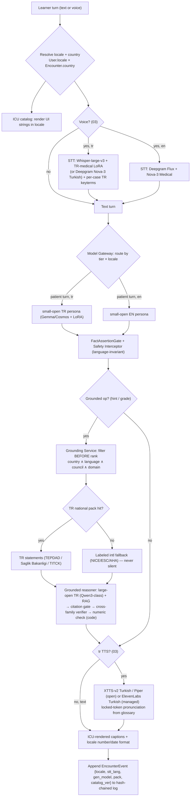

# 11 — Internationalization (i18n) & Localization Architecture

**Status:** Build-ready architecture. **Date:** July 2026. **Owner:** Platform / Localization Service.

**Scope.** This document specifies how AcuDx becomes **locale-aware end to end** without breaking any of the canonical invariants. It owns: the **message-catalog system** (ICU MessageFormat, EN + TR at MVP, extensible to *n* locales); **locale-aware clinical content** (case text, persona dialogue, rubrics, guidance) and how the **two-tier content architecture stays safe across languages**; **per-language model routing** through the Model Gateway (Turkish → Turkish-capable open model; grader/verifier language handling); the **guideline store as country + language-scoped** (Turkey/TEPDAD/Sağlık Bakanlığı packs alongside NICE/ESC/AHA), with **filter-before-rank on both country and locale**; the **voice pipeline in Turkish** (STT/TTS selection, medical-term confirmation, code-switching); **assessment fairness across languages** (dual-axis clinical ⟂ communication so Turkish/ESL learners aren't penalized for language); and **locale formatting + Turkish-specific pitfalls** (dotted/dotless `i` casing, collation, number/date).

Localization is **not a translation layer bolted on at the edge** — it is a **routing dimension** that threads through content, models, retrieval, voice, and assessment. The single organizing idea: **`locale` and `country` are two orthogonal axes.** `country/council` decides *which clinical truth applies* (this was always a first-class retrieval filter); `locale` decides *which language the learner reads/hears/is-graded-in*. They usually correlate (a `tr-TR` learner in a Turkish faculty gets `country=TR`) but they are decided independently and must never be conflated in code.

**Grounding & integration.** The Turkish text/voice/guideline stack selection is pinned in [`../research/09-localization-i18n-turkish.md`](../research/09-localization-i18n-turkish.md); this doc consumes it and does not re-derive vendor/model choices. It builds directly on:
- [`05-guideline-grounding-engine.md`](./05-guideline-grounding-engine.md) — the `GuidelineStatement` atom, filter-before-rank hybrid retrieval, the six-stage runtime safety pipeline. This doc **adds `language` as a second hard filter** and **country+language guideline packs**.
- [`03-voice-pipeline.md`](./03-voice-pipeline.md) — the composable STT→LLM→TTS cascade, barge-in, low-confidence→text fallback, critical-value read-back. This doc **specifies the Turkish STT/TTS bindings and code-switch handling** within that unchanged cascade.
- [`02-model-gateway-and-routing.md`](./02-model-gateway-and-routing.md) — the Model Gateway is the only path to any model; per-case model routing and tiering. This doc **adds `locale` as a routing input** (small-open → large-open → frontier-API tiers, Turkish-capable).
- [`06-assessment-and-calibration-engine.md`](./06-assessment-and-calibration-engine.md) / [`../research/07-assessment-science.md`](../research/07-assessment-science.md) — the **dual-axis clinical ⟂ communication** separation that keeps language fluency out of the clinical score.
- [`08-data-model-and-multitenancy.md`](./08-data-model-and-multitenancy.md) — `User.locale`, `Case.country`/`council[]`, `Encounter.country`/`corpus_snapshot_id`; the hash-chained Event Log and PII envelope-encryption this doc reuses.
- [`09-security-and-compliance-architecture.md`](./09-security-and-compliance-architecture.md) — the identity/casing rules below are **security-relevant** (the dotted/dotless `i` auth-bypass class); PHI block and Art. 50 disclosure apply per-locale.

---

## Canonical positioning (invariants honored)

| Invariant | How i18n honors it |
|---|---|
| **Three isolated clocks** | Localization touches **all three but adds no cross-clock coupling**. Message-catalog resolution and locale formatting are **client/edge, synchronous, off every backend clock**. Locale-aware persona generation rides **clock 1**; locale-aware grounding/grading rides **clock 2**; guideline-pack ingest and catalog builds ride **clock 3**. A missing translation never stalls a turn — it falls back (see §1.4). |
| **Two-tier content (grounded owns facts; roleplay owns affect)** | The tier boundary is **language-invariant**. The ROLEPLAY layer (persona) may speak Turkish, English, or code-switch — but still **asserts no clinical facts** in any language. The GROUNDED layer owns all facts and is retrieved **country+language-scoped**. Translation of a fact is a **grounded operation with locked tokens** (§4), never a free persona utterance. |
| **AI-patient never sources facts (Case State Store does)** | Unchanged and language-agnostic. `request_clinical_fact` resolves from the Case State Store; the *number* is locale-formatted for display but its **value is never re-generated by a translation step**. |
| **Country is a first-class retrieval filter (filter BEFORE rank)** | Extended: **country AND language are both hard filters applied before any vector/BM25 scoring** (§5). A `tr-TR` encounter retrieves TR-language, TR-scoped statements first; international sources are labeled fallback. |
| **Model Gateway is the only path to any model** | `locale` becomes a **routing input** to the Gateway, not a new model path. Turkish routing selects a Turkish-capable open model *inside* the existing tiering; no service holds a vendor SDK. |
| **Grader family ≠ patient family; abstain > confident-wrong** | Holds per-language. The Turkish verifier/grader runs on a family distinct from the Turkish patient agent; an untranslatable/ungrounded claim → **refuse**, in the learner's locale. |
| **Event-sourced, hash-chained Event Log = source of truth** | `locale` is a field on the relevant events (turn source language, STT language, grading language, catalog version). Catalogs and guideline packs are **versioned projections**, replayable. |
| **Synthetic patients only; no PHI; `no_train` default; no learner-emotion inference** | Unchanged across locales. Turkish audio/text passes the **same** PHI detect-and-block scrubber; `no_train=true` on every Gateway call regardless of language. |

---

## 1. Message-catalog system (ICU MessageFormat)

### 1.1 Format decision (web-verified July 2026)

**ICU MessageFormat 1 (MF1) is the production standard; we adopt it now, with a clean migration path to Unicode MessageFormat 2 (MF2) later.** Verified July 2026: MF2 remains a **technical preview** — TC39's `Intl.MessageFormat` proposal is stalled below Stage 2.7 (it gates on ~a dozen orgs running MF2 in production, unmet), and no major framework default nor TMS has shipped MF2. MF1, by contrast, has tripled in the i18next ecosystem (~100k→~300k weekly downloads) and is battle-tested. So: **author in MF1, keep messages MF2-portable** (avoid MF1-only quirks that MF2 drops), and re-evaluate MF2 at the next platform review. ([FormatJS](https://formatjs.github.io/), [Locize MF2 state May 2026](https://www.locize.com/blog/messageformat-2-i18next/), [IntlPull ICU 2026](https://intlpull.com/blog/icu-message-format-complete-guide-2026))

**Runtime.** The web app (React 18 + TS + Vite, per baseline) uses **`react-i18next` + `i18next-icu`** for ICU parsing with **lazy-loaded, feature-scoped namespaces** — the 2026-recommended pattern for a bundle-sensitive SPA (load `auth`, `encounter`, `debrief`, `vitals` namespaces on demand, not one megabundle). ([react-i18next ICU](https://react.i18next.com/misc/using-with-icu-format), [Crowdin React i18n](https://crowdin.com/blog/react-i18n)) Backend services that emit user-facing strings (e.g. refusal messages, notifications) use the **same ICU catalogs** via a shared `intl-messageformat` core so a string is defined **once** and rendered identically client- or server-side.

### 1.2 The one non-negotiable rule: no sentence assembly from fragments

Turkish is **agglutinative + SOV + vowel-harmony**: suffixes attach to the stem and word order differs from English, so concatenating translated fragments produces **ungrammatical Turkish**. Therefore:

- **Every user-facing sentence is exactly one ICU message with named placeholders.** Translators own the whole sentence, including word order and suffix attachment. No `"You have " + n + " tasks"` string-building — ever.
- **Plural/select via ICU, never string math.** Turkish is *gender-neutral* (no grammatical gender, single 3rd-person pronoun *o*) so `select`-on-gender is rarely needed, but ICU `plural` (Turkish has `one`/`other` CLDR categories) and `select` (register, role) are used instead of any hand-rolled branching.
- **Placeholders carry type + role, not just position** (`{count, plural, ...}`, `{patientName}`, `{drug}`) so a translator can reorder freely and a locked clinical token (§4) is recognizable in the string.

```jsonc
// en/encounter.json
{
  "vitals.spo2.reading": "SpO₂ is {value, number}%",
  "turn.tasksRemaining": "{count, plural, one {# task remaining} other {# tasks remaining}}",
  "refusal.noGuideline": "No grounded guideline statement is available for this in {country}."
}
```
```jsonc
// tr/encounter.json  — full-sentence translations, translator owns word order + suffixes
{
  "vitals.spo2.reading": "SpO₂ %{value, number}",
  "turn.tasksRemaining": "{count, plural, one {# görev kaldı} other {# görev kaldı}}",
  "refusal.noGuideline": "{country} için temellendirilmiş bir kılavuz ifadesi bulunmuyor."
}
```

### 1.3 Catalog structure, versioning, and QA

- **Locale content packs** are versioned bundles keyed by BCP-47 tag: `{ uiCatalogs (ICU namespaces), glossary (TR↔EN medical terms), voiceMap (TTS voice_ids), sttKeyterms, dateNumberConfig }`. Loaded together, pinned per release. UI catalogs are **projections** (built on clock 3 from source-of-truth message keys) — a catalog version is recorded on the Event Log so "which strings did this learner see" is replayable.
- **Pseudo-localization + TR expansion budget.** Turkish strings can run longer than English; CI runs a pseudo-locale pass (`[!! Ţéšţ !!]`) *and* renders real TR strings to catch layout overflow — never test layout with English placeholders.
- **Clinician-fluent TR reviewer, not a generic translator.** Medical Turkish is formal/clinical and code-switches heavily (§4); the localization QA gate requires a **Turkish clinician-fluent reviewer** to sign off medical strings, mirroring the clinician-in-the-loop gate on guideline atoms (`05` §3).

### 1.4 Fallback chain (a missing string never stalls a turn)

Resolution order for any key: **requested locale → base language (`tr-TR`→`tr`) → EN (source) → the key itself (dev-visible)**. A missing translation degrades gracefully to English text; it is **logged, not thrown**, and surfaced to the localization dashboard. This is the message-catalog analogue of the voice pipeline's "floor is always text" (`03` §10): the encounter never breaks on a localization gap.

---

## 2. Locale-aware clinical CONTENT (the two-tier boundary across languages)

Content in AcuDx is **not one blob** — it is split by the two-tier architecture, and localization respects that split exactly.

| Content class | Tier | Localization strategy | Safety rule across languages |
|---|---|---|---|
| **UI chrome** (buttons, labels, system prompts) | neither | ICU catalog (§1) | none clinical |
| **Case text** (stem, history, exam findings shown to learner) | GROUNDED-adjacent (authored, reviewed) | **Authored or human-reviewed per locale**, not machine-translated to the learner; numbers/units are **locked tokens** | Clinical facts are Case-State-authoritative; translation cannot alter a value |
| **Persona dialogue** (patient/family lines) | ROLEPLAY | Generated **in-locale** by the locale-routed persona model (§3); may code-switch (§4) | Persona **asserts no clinical facts** in *any* language; `FactAssertionGate` runs on its text pre-TTS (`03` §3) |
| **Rubric / rubric items** | GROUNDED (assessment) | **Authored per locale by clinician reviewers**; the *criterion* is language-parallel, the *evidence-quote* is in the encounter language (§6) | A rubric item's clinical meaning must be identical across EN/TR — validated by round-trip review, not MT |
| **Guidance / Socratic hints** | GROUNDED | Generated in-locale by the grounded reasoner, **grounded to language-scoped statements** (§5) | Every hint cited + verified + numeric-checked, in-locale (`05` §5) |
| **Guideline statements** | GROUNDED (source of truth) | **Country+language packs** (§5); AcuDx-authored condensed facts per pack | Facts locked; translation of a fact is a grounded, glossary-constrained op (§4) |

**The load-bearing consequence:** because the ROLEPLAY layer cannot source facts in *any* language, **translating persona dialogue is low-risk** (worst case: awkward Turkish, caught by QA) while **translating a clinical fact is high-risk** and is therefore **never** a persona/MT operation — it is a **grounded operation with locked tokens** (§4). The tier boundary is what makes multilingual safe: the dangerous content (facts) lives on the side that is authored + reviewed + grounded + numerically checked, and that machinery is language-parallel.

**Case authoring across locales.** A `Case` carries `country`/`council[]` (`08` §data-model) and gains a **`content_locales[]`** manifest listing which locales have reviewed content. A case is only *offered* in a locale where its case-text and rubric have passed clinician-fluent review — no auto-MT case ever reaches a learner. AI-draft translation of case text (Model Gateway, Batch, clock 3) is an **authoring aid**, gated by the same clinician-approval transition (`draft→in_review→approved`) as guideline atoms.

---

## 3. Per-language model routing (through the Model Gateway)

`locale` is a **routing input** to the existing tiered Gateway, not a new path. The direction-corrected tiers are **small-open (patient turns) → large-open (reasoning/grading) → frontier-API (rare escalation)**, and the Gateway picks the **Turkish-capable** member of each tier when `locale ∈ tr-*`.

### 3.1 Turkish routing table (from research/09 §1.3, pinned as routing, not as fixed model ids)

| Job | Clock | EN default (open, self-hosted) | TR default (open, self-hosted) | Escalate to |
|---|---|---|---|---|
| Patient/family **roleplay turn** | 1 | small-open + persona LoRA | **Gemma-class-9B / CosmosGemma-9B + AcuDx persona LoRA** (vLLM/SGLang) | large-open on persona-break |
| **Guidance / Socratic hint** (grounded) | 2 | large-open + RAG | **Qwen3-class-32B + TR-scoped RAG** | frontier-API if uncertainty high |
| **Post-encounter grading / gap analysis** | 2 (batch) | large-open | **Qwen3-class-235B-A22B (large-open)** | **frontier-API** for hardest ~10% + rubric authoring |
| **TR↔EN terminology translation** | 2/3 | — | **small-open + glossary cache** (locked tokens, §4) | large-open for rare terms |
| **Faithfulness verifier** | 2 | small-open, cross-family | **small TR-capable, family ≠ TR patient agent** | — |
| **Safety/guardrail classifier** | 1 (pre) | nano/small classifier | **Cosmos-safety-tuned small TR classifier** (highest TR prompt-injection safety in the 2026 suite) | — |

**Why open-first is viable for TR (the number that matters):** a large open model already **beats average Turkish residents on the TUS residency exam** (Llama-3-70B **79.2%**; Qwen3/Gemma-4-class exceed it) — so the large-open tier is genuinely sufficient for TR reasoning/grading, with frontier-API reserved for the hardest cases and high-stakes rubric authoring. Turkish-only fine-tunes are used **only** at small tier / for TR *style*, **never as the reasoner** (research/09 §1.2–1.3).

### 3.2 Grader / verifier language handling (fairness-critical)

- **Grade in the encounter language.** The grader reads the encounter's actual transcript (TR, EN, or code-switched) and produces judgments **in-locale**, with **evidence-quote spans in the language the learner actually used** (`06`; §6 below). A TR learner's TR utterance is graded by a TR-capable grader, not machine-translated to EN first — an MT round-trip before grading would inject transcription/translation error into the score.
- **Cross-family still holds per language.** TR patient agent (small-open TR persona) ≠ TR verifier/grader (distinct family). This preserves the grader-family ≠ patient-family invariant *within* Turkish, avoiding self-preference bias in a single-language encounter.
- **Frontier-API escalation is language-blind but locale-labeled.** When TR grading uncertainty is high, escalation to a frontier API is allowed (the model is strong in TR); the `ModelCallEvent` records `locale=tr-TR` so escalation rates are monitored **per locale** — a TR escalation rate persistently higher than EN is a signal the open TR tier needs a better model or LoRA, and is tracked as a fairness metric (§6.4).

### 3.3 Locale in the cached prefix

`locale` (and the TR persona LoRA selection) is part of the **byte-stable cached prefix** per encounter, exactly like `VariantParams` (`03` §6, `02` §5): one locale = one prefix = one cache entry. Locale is fixed at encounter start and does not mutate mid-encounter, so the ≥85% cache-read SLO is preserved — Turkish encounters get the same prompt-caching economics as English.

---

## 4. Turkish medical terminology, code-switching & locked-token safety

**The core linguistic reality:** Turkish clinicians and students **code-switch heavily into English/Latin medical terms**, often inflected with Turkish suffixes (`troponin`**`i`** `yüksek`, `EKG`, `dyspne`, INN drug names). The system must accept, understand, and **produce** this register or it reads as fake — so **code-switching is the product, not a bug**, and register itself becomes a teachable signal (a low-health-literacy patient says *kalp krizi*; a physician-examiner says *MI*).

**Handling requirements (from research/09 §4), architected as guardrails-in-code:**

1. **Bilingual TR/EN medical glossary + translation memory** — a curated term store mapping TR ↔ EN/Latin (*kalp krizi* ⇄ *myocardial infarction* ⇄ *MI*; *nefes darlığı* ⇄ *dyspnea*), part of the locale content pack (§1.3). It (a) seeds STT keyterms (§5/§7 below), (b) constrains TTS pronunciation, and (c) **grounds any translation so the model never invents a term.**
2. **Locked clinical tokens — the non-negotiable.** Numbers, units, INN drug names, and dosing pass through the glossary/translation-memory as **locked tokens the LLM must not re-generate.** A mistranslated dose is a patient-safety incident *even in simulation*. This binds to the two-tier rule (§2): fact translation is a **grounded, deterministic substitution**, not a persona/MT free-text step.
3. **Round-trip check** high-risk clinical strings (TR→EN→TR) at authoring time and flag divergence for human review before a case ships — the same discipline as the guideline numeric check (`05` §5.5), applied to translation.
4. **TR safety classifier gates every TR AI output** (Cosmos-safety-tuned small model) for medical-harm / PII / jailbreak — the same gate as EN, in the TR-capable family.
5. **Hallucination watch is *stronger* for TR, not weaker.** Turkish has less clinical training data than English, so **all TR clinical claims are RAG-grounded against the TR-scoped guideline store (§5), never model memory** — grounding matters *more* where data is thinner.

---

## 5. Country + language-scoped guideline store (filter-before-rank on BOTH)

The Grounding Service (`05`) already treats **country/council as a hard filter applied before ranking**. Localization adds **`language` as a second hard filter** and introduces **Turkey guideline packs** alongside the international bodies.

### 5.1 Guideline packs (the TR scope)

The `TR` scope carries Turkish national sources so citations read *TEPDAD / Sağlık Bakanlığı* to a Turkish student, not *NICE/AHA* (research/09 §5):

| Body | Governs | Role in the TR pack |
|---|---|---|
| **UÇEP / ÇEP** (Ulusal Çekirdek Eğitim Programı) | National **core curriculum** (core diseases/skills; UÇEP-2026 revision underway) | **Case-blueprint source of truth for TR** — scenarios map to UÇEP core presentations & skill levels |
| **TEPDAD** (WFME-recognized) | National medical-education **program accreditation** | Map AcuDx competencies to TEPDAD standards for accreditation self-evaluation (BİDR) |
| **T.C. Sağlık Bakanlığı + TİTCK** | National clinical guidelines, drug licensing, MedDRA | Drugs/indications/dosing grounded to **TİTCK**; TR pathways cite Sağlık Bakanlığı, not FDA/EMA |
| **TUS** (ÖSYM residency exam) | Residency entrance; Turkish-language, C1 | Tunes the TR **assessment register** and item framing |

These become `GuidelineStatement` atoms (`05` §1) exactly like NICE/ESC/AHA — same JSON schema, same clinician-in-the-loop authoring, same `license_tag` discipline — but tagged into the TR scope.

### 5.2 Schema extension: `scope.languages[]`

The `GuidelineStatement.scope` object (`05` §1.1) gains a **`languages[]`** field (BCP-47), parallel to the existing `countries[]`/`council`. A statement's `statement` text (the AcuDx-authored condensed recommendation) is **authored per language** and cross-linked, so the TR pack has TR-language statements and the international packs have EN — never machine-translated at retrieval time. The retrieval payload (Qdrant filterable HNSW, `05` §2) gains `languages` alongside `{council, countries[], domain, population, version, review_status}`.

### 5.3 Ordered retrieval — filter on country AND language BEFORE rank

The `05` §4 algorithm is unchanged in shape; step 1's hard filter gains a language clause:

1. **Hard metadata filter (runs first, always):** `review_status='approved'` **AND** `council ∈ case.allowed_councils` **AND** (`countries` contains `case.country` OR `'GLOBAL'`) **AND** (`languages` contains `encounter.locale.language` OR the pack's authoring language for a labeled fallback) **AND** `domain`/`population`/`corpusSnapshot` constraints.
2. Hybrid dense-ANN ∪ BM25 within the filtered set → RRF fusion → cross-encoder rerank → relevance gate (empty → **refuse**, in-locale). BM25 matters even more for TR because drug/dose tokens and code-switched Latin terms are exactly where dense embeddings blur.

**Fallback labeling.** When no *national* guidance exists for a TR case, retrieval falls back to international (NICE/ESC/AHA) **explicitly labeled as such** ("no Turkish national guidance; per ESC…"), never silently — the country+language scoping is a **trust and accreditation requirement**, and silent international-defaulting is a bug (the same posture as `05`'s silent-US-default bug).

### 5.4 Interface delta

```typescript
interface RetrievalQuery {              // extends 05 §4.2
  text: string;
  country: string;                      // ISO-3166 or 'GLOBAL' — REQUIRED
  language: string;                     // BCP-47, e.g. 'tr' | 'en' — REQUIRED (new)
  allowedCouncils: string[];            // e.g. ['TEPDAD','SaglikBakanligi'] or ['ESC']
  domain: GuidelineDomain;
  population: 'adult'|'pediatric'|'neonatal'|'pregnancy'|'all';
  corpusSnapshotId: string;
  allowLabeledIntlFallback?: boolean;   // default true; fallback is always labeled (new)
}
```

The runtime safety pipeline (`05` §5) is otherwise **byte-identical**: grounded generation → hard citation gate → cross-family verifier → **deterministic numeric check (code, no LLM)** → refuse-or-emit. The numeric check is **language-invariant by design** — it parses `{value, unit}` and compares ranges in code, so a Turkish decimal comma (§8) is normalized to a canonical numeric *before* the check, never left to the LLM. Each run's `RuntimeGroundingEvent` gains `language` and the resolved pack, for per-locale auditability.

### 5.5 Locale-aware request routing (mermaid)



---

## 6. Assessment fairness across languages (dual-axis clinical ⟂ communication)

**The keystone fairness rule:** a Turkish or ESL learner must **never be penalized on the clinical axis for a language issue.** This is enforced structurally by the **dual-axis** grading already canonical in `06` / research/07: **clinical correctness ⟂ communication** are scored on **separate axes**, and language mechanics touch only the communication axis — and even there, carefully.

### 6.1 Where language may and may not affect the score

| Signal | Clinical axis | Communication axis |
|---|---|---|
| Chose the correct threshold/drug/management | **counts** | — |
| Ordered the right workup | **counts** | — |
| Clear structure, signposting, teach-back, empathy | — | counts (*content* of communication, not accent) |
| Accent / L2 pronunciation / minor grammar | **must NOT count** | **must NOT count** — this is language *form*, not clinical communication skill |
| STT mis-transcription of an accented phrase | **must NOT count** | **must NOT count** — resolved by low-confidence→text fallback (`03` §7.2) before it can mis-score |

The Assessment Service routes **only clinical-fact correctness through grounding** (`05` §7.2); **communication-domain scoring does not route through grounding** — the dual-axis separation is preserved end-to-end and is what keeps language fluency out of the clinical grade (`03` §7.2).

### 6.2 STT low-confidence is the anti-mis-score spine (per locale)

The voice pipeline's rule — **STT confidence below floor → text fallback, never a silent mis-score** (`03` §7.2, V-2) — is *especially* load-bearing for TR/ESL learners. The `stt_floor` is **calibrated per language/accent** (an open question in both `03` and `08`): a Turkish-accented English phrase or a code-switched TR utterance that STT is unsure about is surfaced as an editable text draft, and the **confirmed** text becomes the turn. Language fluency thus cannot leak into a wrong clinical action that the grader then penalizes.

### 6.3 Rubric parallelism

A rubric item's **clinical meaning is identical across EN/TR** (validated by clinician-fluent review, not MT — §2). The **evidence-quote is in the language the learner actually used** so the debrief quotes the learner verbatim (a TR learner sees their own TR words as evidence), while the **criterion label** renders in the learner's UI locale via the ICU catalog. Grading is against the case's declared council in the correct language pack, so it is unambiguous (`05` §7.2).

### 6.4 Fairness as a monitored metric

Per-locale grading behavior is watched: **score distributions, refusal rates, escalation rates, and STT-fallback rates are broken out by locale.** A persistent TR-vs-EN gap that correlates with *language* rather than *clinical performance* is a fairness regression and triggers review (better TR open model / LoRA, better keyterms, floor recalibration). This is the calibration engine's `06` machinery, sliced by `locale`, and it is a **release gate** on the localization track — no locale ships GA with an unexplained clinical-axis gap.

---

## 7. Voice pipeline in Turkish

The composable STT→LLM→TTS cascade (`03`) is **unchanged in shape**; localization only binds the Turkish engines and the code-switch handling into it. Voice is a v1 fast-follow behind text and must always have a full text twin (`03` §10) — in TR exactly as EN.

### 7.1 Turkish STT (open-first, per research/09 §2)

- **Open-first default:** self-hosted **Whisper-large-v3 + a Turkish-medical LoRA** (fine-tuned on TR drug names, ICD/diagnosis terms, dictation), streamed via a low-latency runtime, seeded with a **per-case TR keyterm/glossary** (scripted drug list, diagnosis terms, patient's named meds — the same keyterm trick as EN, `03` §7.1).
- **Managed fallback / live-loop:** **Deepgram Nova-3 Turkish** (Turkish added Jan 2026; Mar-2026 WER drops; streaming + mid-call code-switch) when p95 latency or ops burden makes self-host impractical. Turkish streaming genuinely works and handles mid-call TR↔EN switching — critical because Turkish clinicians code-switch constantly (§4).
- **Fallback chain** slots into the existing `SttConfig.chain` (`03` §14): TR-Whisper/Nova-3 → AssemblyAI/gpt-4o-transcribe for thin coverage. The turn loop is unaware which STT served.
- **Assessment transcript:** batch re-transcribe (clock 3) with the highest-fidelity TR model — the verbatim record for evidence-quote spans (`03` §9), never the latency-tuned live stream.
- **Guardrail:** Turkish agglutination means a single mis-segmented suffix changes meaning; log per-encounter TR WER on a held-out set and alert on regression (vowel-harmony / long-compound errors are the failure mode).

### 7.2 Turkish TTS (open-first, per research/09 §3)

- **Open-first live turns:** self-hosted **XTTS-v2 Turkish** for patient-persona voices (cloned from short consenting-actor TR samples, per the `03` §8 consent regime); **Piper Turkish** for edge/on-prem and non-expressive utility voices.
- **Managed quality tier (when institution allows API):** **ElevenLabs Turkish** — Flash v2.5 for the live loop (Istanbul-accent default, sub-100 ms) and **pre-rendered v3** for scripted high-emotion TR lines ("Nefes alamıyorum!") rendered once, cached, replayed free — cinematic TR distress without paying v3 latency in the loop (the same live-vs-peak split as EN, `03` §8.1).
- **Do not use Cartesia for Turkish** — TR is in its long-tail/functional tier, not its flagship quality tier; the training value depends on the patient *sounding* Turkish-native. (This is the one place the EN default engine is **not** carried over to TR.)
- **Locked-token pronunciation:** the glossary (§4) constrains how INN drug names and code-switched Latin terms are pronounced, so the TTS never mangles *labetalol* or *troponin* mid-Turkish-sentence.

### 7.3 Code-switch, medical-term confirmation, and Art. 50

- **Code-switch is expected both directions:** STT accepts TR embedded with English/Latin terms; the persona *produces* the register appropriate to its archetype (§4). The `TurnTakingKnobs.repairStyle: 'code_switch_filler'` (`03` §6) already models L1 filler for non-native personas — reused for TR personas.
- **Critical-value read-back is language-aware:** the closed-loop confirmation (`03` §7.3) renders in the encounter locale ("Onaylayın: labetalol 50 mg IV — 'onayla' deyin"), and locked clinical tokens (drug + dose) are read back verbatim regardless of STT confidence. Read-back is itself a **taught, scored** skill, in TR as in EN.
- **Synthetic-voice disclosure & C2PA** (EU AI Act Art. 50, in force 2 Aug 2026; `03` §8.4, `09` §7) apply to TR voices identically — Turkish cloned voices carry a `ConsentRecord` and per-segment C2PA manifest.

---

## 8. Locale formatting & Turkish-specific pitfalls

### 8.1 Number / date / units (driven by `Intl`, never hardcoded)

- Turkish uses **`,` decimal separator and `.` thousands** (`1.234,56`), **24-hour** time, `d MMMM yyyy` dates, **metric everywhere**. Drive all of this from `Intl.NumberFormat`/`Intl.DateTimeFormat` with `tr-TR`; never hand-format.
- **Clinical vitals stay in SI/clinical units regardless of locale** — a BP is `120/80 mmHg` and an SpO₂ is a percent in every locale; only the *presentation number formatting* is localized. The **vitals monitor renders numerics in Geist Mono** (design tokens) and the value is locale-formatted for display but the **stored/graded value is the canonical number**, so §5's deterministic numeric check compares canonical numbers, not display strings.

### 8.2 The dotted/dotless `i` — a first-class, security-relevant bug class

Turkish has **four** i-letters: `I`(U+0049 uppercase dotless), `İ`(U+0130 uppercase dotted), `i`(lowercase dotted), `ı`(U+0131 lowercase dotless). Case mapping is **locale-dependent**: in `tr`, `uppercase(i)=İ` and `lowercase(I)=ı`. This is not cosmetic — it is the source of a real **auth-bypass class** (the GitHub password-reset bypass came from Turkish-locale lowercasing colliding `I`/`ı`).

**Two code paths, never mixed:**

| Path | Locale used | Where | Rule |
|---|---|---|---|
| **Identity / security** (emails, usernames, slugs, IDs, unique keys, password-reset comparisons, ext_id mapping `08` §7) | **invariant / `en-US`** or Unicode case-folding with the **Turkic flag OFF** | auth, tenancy, dedup | **Never** case-fold identifiers with `tr`. Store emails/IDs case-normalized under the **invariant** locale. |
| **Display text** (UI labels, patient names, *İstanbul*, *İLAÇ*) | **`tr-TR`** | rendering | Display casing is `tr-TR` so Turkish renders correctly. |

- **Collation / sort / search:** `Intl.Collator('tr')` (ç, ğ, ı, i, ö, ş, ü ordering); a naïve ASCII sort mis-orders Turkish and search fails to match `ı`↔`i`.
- **DB layer:** a **Turkish-aware collation** for user-facing sort, but a **deterministic/invariant collation for keys and unique constraints** — otherwise `İ`/`i` collisions create duplicate-key or lookup surprises. This binds to `08`'s identity-mapping table and the `email_hash`/`ext_ids[]` uniqueness: hash the **invariant-normalized** form.

These rules are **enforced in code + lint**, not policy: a CI lint flags any `toLowerCase()`/`toUpperCase()` without an explicit locale argument on an identity path, and any `toLocaleLowerCase('tr'...)` on a security comparison. The dotted/dotless `i` is treated with the same seriousness as a PHI leak — it is a security bug, not a formatting nit (`09`).

---

## 9. Failure modes & mitigations

| Failure | Mitigation |
|---|---|
| Missing translation stalls a turn | ICU fallback chain (locale→base→EN→key), logged not thrown (§1.4); "floor is always text/EN" |
| Fragment-concatenated Turkish is ungrammatical | One ICU message per sentence; translator owns word order + suffixes (§1.2); CI blocks string-building on user-facing text |
| Mistranslated drug/dose/unit | Locked clinical tokens — never LLM/MT-regenerated; grounded substitution + round-trip check + TR safety classifier (§4) |
| Wrong-country/wrong-language answer leaks | Filter BEFORE rank on **country ∧ language**; intl fallback always **labeled**, never silent (§5.3) |
| TR learner penalized for accent/L2 | Dual-axis clinical ⟂ communication; STT low-conf→text fallback per-locale floor; accent never scored (§6) |
| Turkish agglutination mis-scored by STT | Per-case TR keyterms; TR-medical LoRA; batch re-STT for the graded transcript; WER regression alert (§7.1) |
| Auth bypass via Turkish `ı`/`i` casing | Invariant-locale casing for identity/security; `tr-TR` only for display; deterministic DB collation for keys; CI lint (§8.2) |
| TTS mangles code-switched Latin term | Glossary-locked pronunciation; ElevenLabs/XTTS TR; **not** Cartesia for TR (§7.2) |
| Silent MT case reaches a learner | `Case.content_locales[]` gate — only clinician-reviewed locales are offered; AI-draft translation is an authoring aid behind approval (§2) |
| TR grading quality drifts below EN | Per-locale calibration/escalation monitoring as a release gate; frontier-API escalation labeled by locale (§3.2, §6.4) |
| Number decimal-comma corrupts a numeric check | Canonical numeric normalization before the code-only numeric check; display formatting kept separate from stored value (§8.1, §5.4) |

---

## Open questions & build sequence

**Must be decided/built first (blockers for TR GA):**
1. **`locale` as a routing key end-to-end** — thread `locale` through `User`→`Encounter`→Model Gateway routing→Grounding filter→ICU catalog→event envelope. This is the spine; nothing else works until `locale` is a first-class, orthogonal-to-`country` field everywhere (extends `08` `User.locale`).
2. **`GuidelineStatement.scope.languages[]` + TR guideline pack** — extend the `05` schema and stand up the first TR pack (UÇEP-blueprinted, TEPDAD-mapped, TİTCK-drug-grounded), with filter-before-rank on **country ∧ language**. Blocks any grounded TR guidance/grading.
3. **Locked-clinical-token translation memory + TR glossary** — the safety spine for multilingual facts; build the glossary, the locked-token substitution, and the round-trip check before any TR clinical string ships (§4).
4. **Dotted/dotless `i` casing rules + CI lint** — invariant vs `tr-TR` code paths and the lint that enforces them; this is security-relevant and cheap, so do it early (§8.2).
5. **ICU catalog scaffolding (EN + TR) with lazy namespaces + fallback chain** — `react-i18next` + `i18next-icu`, the full-sentence rule, pseudo-loc + TR-expansion CI (§1).

**Open decisions requiring an owner:**
- **Pinned TR model ids per tier.** research/09 pins the *routing*, not exact ids; confirm the specific open-weight members (Gemma-class-9B/CosmosGemma for persona; Qwen3-class-32B/235B for reasoning/grading) against a TR medical eval set (TUS-style + TurkMedNLI) before locking, and the LoRA recipe for the TR persona actor.
- **Per-language `stt_floor` calibration.** The confidence threshold that triggers text fallback is empirical and accent-dependent; needs a TR/TR-accented-EN sweep before GA (aligns with `03` Open Q1, `08` open item). *Blocks V-2 for TR.*
- **TR safety-classifier coverage.** Confirm the Cosmos-safety-tuned small model's coverage of TR jailbreak/medical-harm matches the EN classifier's, or add TR red-team prompts to the eval gate.
- **Guideline-fallback UX for TR.** How the labeled international fallback surfaces to a TR learner ("no Turkish national guidance; per ESC…") without reading as a defect — confirm the copy and the debrief treatment.
- **Rubric-parallelism verification process.** The workflow that proves an EN and TR rubric item are *clinically identical* (clinician round-trip review, not MT) — owned jointly with Assessment.
- **Fairness release gate thresholds.** The maximum tolerated per-locale clinical-axis gap and the escalation/refusal-rate deltas that trip review (§6.4) — Calibration Engine owns the numbers.
- **Next-locale extensibility proof.** Validate that adding a third locale (e.g. `de-DE` or `ar`) is purely additive (new content pack + language filter + routing member) with **zero** core changes — the test that the design is genuinely *n*-locale, not EN/TR-hardcoded. Note RTL (Arabic) would add a layout dimension not needed for EN/TR.
- **MF2 migration trigger.** Re-evaluate Unicode MessageFormat 2 at the next platform review; adopt only once framework defaults + a TMS ship it and messages stay MF1/MF2-portable in the interim (§1.1).
