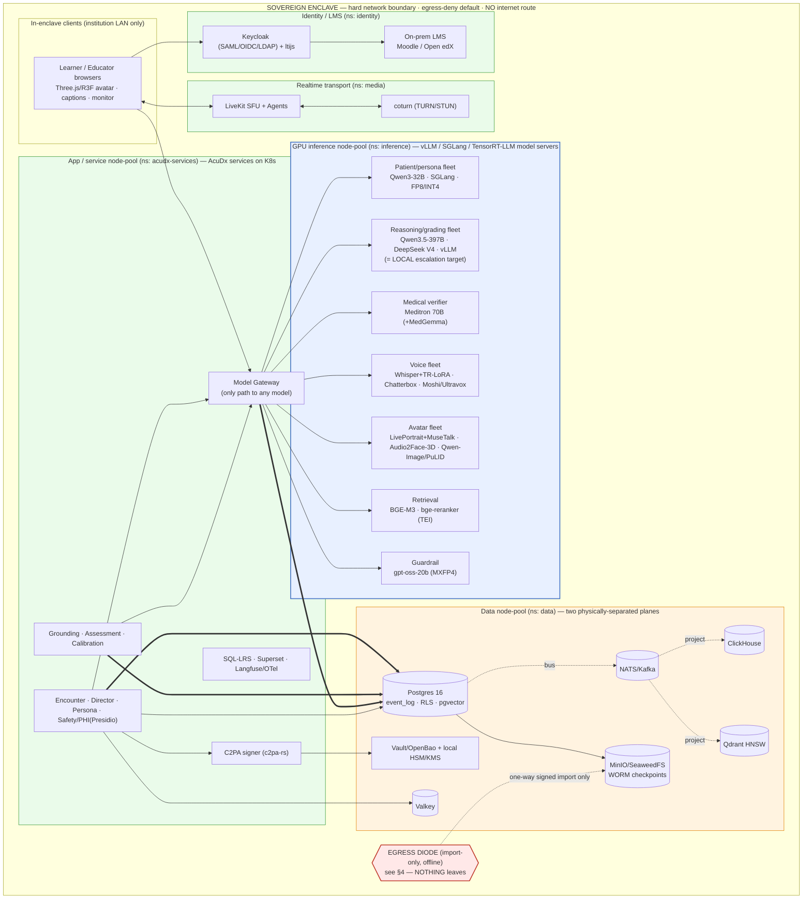
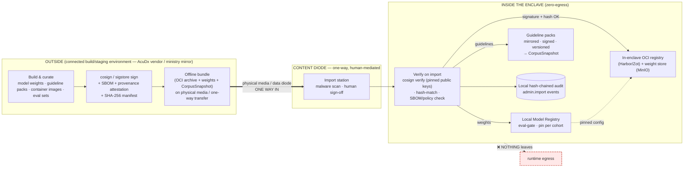

# 12 — Air-Gapped / Sovereign Reference Architecture (zero-egress, fully self-hosted)

**Status:** Architecture — the **first-class sovereign deployment tier** for AcuDx. **Date:** July 2026. **Owner:** Principal architecture (cross-service), with the Model Gateway ([`02`](./02-model-gateway-and-routing.md)) and Security & Compliance ([`09`](./09-security-and-compliance-architecture.md)) as co-owners.

**What this doc is.** A single, structured, buildable reference for delivering AcuDx as a **zero-egress enclave** — an on-prem/VPC appliance a Turkish ministry (T.C. Sağlık Bakanlığı / KVKK authority) or a privacy-maximal school runs entirely inside its own network, where **nothing calls out to the internet at runtime** and **every capability is served by a local open model**. It makes the "fully sovereign / air-gapped deployment" claim of [`../research/11-fully-open-source-stack.md`](../research/11-fully-open-source-stack.md) §A concrete: the component inventory, the enclave topology, the trust boundaries, the offline update pipeline, model-serving sizing, the honest degradation table, the compliance fit, and the conformance gates that *prove* no egress.

**What this doc is NOT.** It does not re-derive the routing logic ([`02`](./02-model-gateway-and-routing.md)), the two-tier content boundary ([`01`](./01-ai-agent-architecture.md)), the event-sourced spine ([`08`](./08-data-model-and-multitenancy.md), [`09`](./09-security-and-compliance-architecture.md) §2), or the per-layer open-vs-proprietary decision ([`../research/11-fully-open-source-stack.md`](../research/11-fully-open-source-stack.md)). It **applies** all of them under one constraint — a hard network boundary — and shows that the four load-bearing invariants ([`00`](./00-system-overview.md) §0) survive it intact. Where this doc and a service doc disagree, the service doc wins and this file is the bug.

**Framing (non-negotiable).** Air-gapped is a **deployment tier, not a downgrade**. It is the *same* AcuDx — same Model Gateway, same Director loop, same FactAssertionGate, same hash-chained Event Log — with the managed-vendor adapters swapped out and the egress door welded shut. **No functional capability is removed.** What changes is last-mile polish and ops-outsourcing (see §6), never capability.

---

## 1. The zero-egress invariant (stated plainly)

The sovereign tier adds a **fifth invariant** on top of the four canon invariants ([`00`](./00-system-overview.md) §0). It is enforced *mechanically* — by network policy and by the Model Registry, not by discipline.

> **INVARIANT AG — Zero runtime egress.**
> In air-gapped mode there is **no runtime outbound network path out of the enclave**. Every capability the product needs at runtime — LLM reasoning, patient persona, grading, medical verification, embeddings, rerank, STT, TTS, S2S, avatar streaming, generated faces, transport, identity, data, observability, PHI detection, C2PA signing — is served by a **local open model or local open service inside the boundary**. Every managed vendor and every frontier API is **DISABLED**, not merely "preferred-off."

Concrete consequences, each a mechanical control (see §4, §8):

1. **Frontier-API escalation is redirected to a larger LOCAL model.** The `frontierEscalationEnabled` flag on `TenantPolicy` ([`02`](./02-model-gateway-and-routing.md) §10) is **forced `false`**. The escalation ladder does not vanish — it re-points: `subtle_persona`, `grader_disagreement`, and unresolved T2 uncertainty escalate to a **larger local model tier** (T2 large-open → a T2+ "reasoning-max" local config, e.g. Qwen3.5-397B-A17B or DeepSeek V4 Pro on the reasoning pool) plus the **local medical-verifier ensemble** (Meditron 70B + optional MedGemma), never to `claude`/`openai`/`gemini`. A `ModelConfig` whose `family ∈ {claude, openai, gemini}` is **unroutable** in an air-gapped Registry — it fails config resolution the same way a same-family grader does.
2. **Every managed vendor adapter is disabled at the boundary.** Anam, Tavus, Deepgram, ElevenLabs, Cartesia, Gemini-Live, Voyage, Cohere — each has a named open replacement (§2) that is the *default* everywhere and the *only* option here. Their `ProviderAdapter`s are not loaded in the sovereign build; the egress-deny NetworkPolicy (§8) makes even a mis-configured attempt fail closed.
3. **The default IS the open model.** This is not a fallback the enclave "drops to." Per [`02`](./02-model-gateway-and-routing.md) and [`../research/11`](../research/11-fully-open-source-stack.md), the self-hosted open model is already the product default in *every* tier; air-gapped mode simply removes the optional proprietary add-ons and the escalation door. Users see the identical feature set.
4. **Content, not connections, cross the boundary — one way, offline, signed.** New model weights, guideline packs, and container images enter only through a human-mediated, cryptographically-signed **content diode** (§4). Nothing leaves. The hash-chained audit stays entirely local.

**Where AG is enforced:** the egress-deny `NetworkPolicy` + no external DNS resolver (§3, §8) at the network layer; `frontierEscalationEnabled=false` + a frontier-family reject in the Model Registry at the routing layer ([`02`](./02-model-gateway-and-routing.md) §4.2, §12); the CI/deploy conformance gates (§8) that fail the build if any egress path, external DNS name, or vendor SDK survives.

---

## 2. Component inventory — every capability slot → open self-hosted implementation

Every runtime capability, the open self-hosted implementation that serves it, its GPU/CPU placement inside the enclave, the managed vendor it replaces, and — the whole point — **air-gap compatible: yes** for every row. All licenses are the commercially-and-clinically-clean picks from [`../research/11`](../research/11-fully-open-source-stack.md) (permissive unless flagged).

### 2.1 Inference / reasoning plane (GPU)

| Capability slot | Open self-hosted implementation | GPU/CPU placement | Replaces (managed vendor) | Air-gap compatible |
|---|---|---|---|---|
| **LLM — patient / persona turn** | **Qwen3-32B** (Apache-2.0), SGLang, FP8/INT4-AWQ | GPU · patient pool (§5) | Anthropic Haiku / frontier persona API | **yes** |
| **LLM — reasoning / examiner / grading** | **Qwen3.5-397B-A17B** (Apache-2.0) / **DeepSeek V4** (MIT), vLLM, FP8 | GPU · reasoning pool | Sonnet / Opus escalation | **yes** |
| **LLM — grader ensemble (cross-family)** | **Qwen3.5-397B + DeepSeek V4** (distinct families) | GPU · reasoning pool | frontier grader | **yes** |
| **Escalation target (air-gapped)** | **larger LOCAL model** (T2+ reasoning-max config) + verifier ensemble — **not** a frontier API | GPU · reasoning pool | Opus 4.8 Batch escalation | **yes** |
| **Medical verifier** | **Meditron 70B** (auditable, Llama-Community) primary; **MedGemma 27B** (⚠ HAI-DEF terms) optional 2nd ensemble member | GPU · verifier pool | (none managed — cross-check only) | **yes** |
| **Guardrail / classifier** | **gpt-oss-20b** (Apache-2.0, MXFP4, 16 GB) | GPU · shared/edge | frontier guardrail | **yes** |
| **Embeddings** | **BGE-M3** (Apache-2.0), TEI | GPU (small) · retrieval pool | **Voyage / Cohere Embed** | **yes** |
| **Rerank** | **bge-reranker-v2-m3** (Apache-2.0) / **jina-reranker-v3** (open), TEI | GPU (small) · retrieval pool | **Cohere Rerank** | **yes** |
| **STT (TR + medical)** | **Whisper large-v3 + TR-medical LoRA** (MIT), faster-whisper/WhisperX streaming wrap | GPU · voice pool | **Deepgram** Nova-3 / Flux | **yes** |
| **STT (EN / EU streaming)** | **Parakeet-tdt-0.6b-v3 / Canary** (CC-BY-4.0) — *no Turkish*, EN/EU only | GPU · voice pool | **Deepgram** | **yes** |
| **TTS (expressive, TR)** | **Chatterbox Multilingual v3** (MIT, TR, embedded watermark) | GPU · voice pool | **ElevenLabs / Cartesia** | **yes** |
| **TTS (edge/utility)** | **Piper** (MIT) / **Kokoro** (Apache-2.0) | CPU (Piper) / GPU-light (Kokoro) | ElevenLabs Flash | **yes** |
| **S2S (on-prem "cinematic", optional)** | **Moshi + Mimi** (CC-BY-4.0) / **Ultravox** (MIT, on Qwen3) | GPU · voice pool | **Gemini-Live** / OpenAI Realtime | **yes** |
| **Avatar — 2D real-time talking-head** | **LivePortrait + MuseTalk** (both MIT) | GPU · avatar pool (or client) | **Anam CARA-3 / Tavus Phoenix-4** | **yes** |
| **Avatar — 3D lip-sync** | **NVIDIA Audio2Face-3D → ARKit-52** | GPU · avatar pool | streaming-vendor lip-sync | **yes** |
| **Avatar — 3D scene / rig** | **Three.js + R3F** (MIT), self-hosted GLB rigs | Client GPU (~$0) | HeyGen / hosted rig ToS | **yes** |
| **Generated patient face** | **Qwen-Image** (Apache-2.0) / **FLUX.1-schnell** (Apache-2.0) + **PuLID / PhotoMaker-V2** (Apache-2.0) | GPU · avatar/authoring pool | **Tavus image-to-replica** | **yes** |

> **Explicit vendor→open mapping (the headline):** **Anam / Tavus → LivePortrait + MuseTalk + Audio2Face-3D + R3F** (with Qwen-Image/PuLID for the generated face); **Deepgram → Whisper-v3+TR-LoRA / Parakeet**; **ElevenLabs / Cartesia → Chatterbox v3 (+ Piper/Kokoro)**; **Gemini-Live → Moshi / Ultravox**; **Voyage / Cohere → BGE-M3 + bge-reranker-v2-m3**; **any frontier LLM API → Qwen3 / Qwen3.5 / DeepSeek V4 + Meditron verifier**. Every replacement is the *default* in the standard product too — air-gapped mode just removes the optional add-on.

### 2.2 Transport, identity, data, and governance plane (CPU + a little GPU)

| Capability slot | Open self-hosted implementation | Placement | Replaces (managed vendor) | Air-gap compatible |
|---|---|---|---|---|
| **WebRTC SFU (transport)** | **LiveKit** self-host (Apache-2.0) + **LiveKit Agents** worker | App/service nodes (CPU) | LiveKit Cloud | **yes** |
| **TURN/STUN (NAT traversal)** | **coturn** (self-hosted, in-enclave) | App/service nodes (CPU) | hosted TURN | **yes** |
| **Voice orchestration / turn-taking** | **LiveKit turn-detector / Pipecat Smart-Turn** + **Silero VAD** (MIT) | App/service nodes | Pipecat Cloud | **yes** |
| **Identity / SSO (SAML+OIDC+LDAP)** | **Keycloak** (Apache-2.0) federating the ministry/school IdP or LDAP/AD | App/service nodes (CPU) | **Auth0 / Okta** | **yes** |
| **LTI 1.3 Advantage** | **ltijs** (Apache-2.0) | App/service nodes | commercial LTI libs | **yes** |
| **On-prem LMS (integration target)** | **Moodle** (GPL-3) / **Open edX** (AGPL-3) inside the boundary | App/service nodes | Canvas (proprietary) | **yes** |
| **Relational + event log + FTS + pgvector** | **PostgreSQL 16** (PostgreSQL license), append-only `event_log`, RLS, per-tenant hash chain | Data nodes (CPU + fast NVMe) | managed RDS | **yes** |
| **Vector DB** | **Qdrant** (Apache-2.0) filterable HNSW *or* **pgvector/VectorChord** to collapse into Postgres | Data nodes | Pinecone/managed | **yes** |
| **Cache / hot state** | **Valkey** (BSD-3) | Data nodes | Redis Cloud | **yes** |
| **Event bus** | **NATS JetStream** / **Apache Kafka** (Apache-2.0) | Data nodes | managed Kafka | **yes** |
| **Analytics warehouse** | **ClickHouse** (Apache-2.0) | Data nodes | BigQuery/Snowflake | **yes** |
| **Object storage (S3 API) + WORM** | **MinIO** (AGPL, isolated S3 service) / **SeaweedFS** (Apache-2.0), Object-Lock/immutability for checkpoints | Data nodes | AWS S3 Object-Lock | **yes** |
| **LRS (xAPI) + BI** | **Yet Analytics SQL-LRS** (Apache-2.0) + **Apache Superset** (Apache-2.0); Caliper/xAPI specs | App/service nodes | institution LRS / Datadog dashboards | **yes** |
| **Observability / LLM tracing** | **Langfuse** (MIT) + **OpenTelemetry** → ClickHouse; **OpenLLMetry** | App/service nodes | **Datadog LLM / LangSmith** | **yes** |
| **Eval / guardrails** | **Ragas / DeepEval / promptfoo / Giskard** (Apache) + **NeMo Guardrails / Guardrails AI** (Apache) | Batch nodes | managed eval | **yes** |
| **PHI detection** | **Microsoft Presidio** (MIT) + **medspaCy/spaCy** (MIT) — the deterministic PHI Interceptor ([`09`](./09-security-and-compliance-architecture.md) §3) | App/service nodes (CPU) | managed DLP | **yes** |
| **C2PA content signing** | **c2pa-rs** (Apache/MIT), signed by a **local** KMS/HSM key | App/service nodes + local KMS | cloud signing service | **yes** |
| **Secrets / keys / KMS** | **HashiCorp Vault / OpenBao** (or an on-prem HSM) — root → per-tenant KEK → per-subject data key | Data/security nodes | Cloud KMS | **yes** |
| **Model serving control plane** | **vLLM / SGLang / TensorRT-LLM** (Apache-2.0) behind the `ProviderAdapter` boundary | GPU nodes | managed inference | **yes** |
| **Orchestration / IaC** | **Kubernetes** (Apache-2.0) + **OpenTofu** (MPL-2.0) | All nodes | Terraform Cloud | **yes** |
| **Spaced repetition** | **ts-fsrs** (MIT) | App/service nodes | — | **yes** |

**Every row's answer to "air-gap compatible" is yes** — this is the load-bearing property of the whole stack: there is no capability slot whose only implementation requires a phone-home.

---

## 3. Deployment topology — the enclave

One K8s cluster (or a small HA set) inside a **hard network boundary with no internet route**. Namespaces/planes are labeled; the four canon planes ([`00`](./00-system-overview.md) §2) map onto node pools so the three clocks never contend and the two data planes stay physically separated ([`09`](./09-security-and-compliance-architecture.md) §4).

**Topology rules.**

| Concern | Rule |
|---|---|
| **Boundary** | Egress-deny by default (§8). No default route to the internet; no external DNS. The only ingress is the institution LAN (learner/educator browsers) and the offline import diode (§4). |
| **Namespaces / planes** | `inference` (GPU pools), `acudx-services` (Clock-1/2/3 services), `media` (LiveKit+coturn), `identity` (Keycloak+LMS), `data` (stores). NetworkPolicies scope pod-to-pod traffic; only `acudx-services` may reach `inference`, and only via the Model Gateway. |
| **Two data planes** | Identified-education ⟂ de-identified-improvement stay physically separated ([`09`](./09-security-and-compliance-architecture.md) §4) — separate DB schemas/clusters + KMS namespaces + NetworkPolicy segments inside `data`; no service holds credentials to both. In a pure air-gapped ministry deploy the improvement plane is typically **off** entirely (no model-training loop). |
| **Model Gateway monopoly** | Unchanged from [`02`](./02-model-gateway-and-routing.md): the only path to any model is the Gateway; `no-restricted-imports` CI lint holds; the frontier adapter is simply not loaded. |
| **Transport** | LiveKit SFU + coturn are **in-enclave**; media never leaves the LAN, so there is no third-party BAA and no egress ([`03`](./03-voice-pipeline.md) §0, §15). |
| **Identity** | Keycloak federates the institution's existing IdP/LDAP/AD *inside* the boundary; LTI 1.3 (ltijs) links the on-prem Moodle/Open edX, which also lives in the enclave. |
| **Event Log** | Postgres per-tenant hash chain + WORM checkpoints to in-enclave MinIO/SeaweedFS, signed by the **local** KMS/HSM. `verifyChain` runs locally. |
| **Single-node collapse** | For a pilot appliance the pools collapse onto one node (§5); the namespace/NetworkPolicy structure is preserved so scale-out is a re-schedule, not a redesign. |

---

## 4. Trust boundaries + the offline update pipeline (the content diode)

Nothing calls out. But weights, guidelines, and images must still get *in* — so updates arrive as **offline bundles** through a **one-way, human-mediated, cryptographically-signed content diode**. Import verifies signatures; **nothing is ever exported** through it.

**Trust-boundary and pipeline rules.**

- **One-way, human-mediated.** The diode is a physical-media or unidirectional-transfer step with a **human sign-off** at the import station. There is no automated pull from the internet; there is no return path. (For the highest assurance, a true data-diode appliance enforces one-wayness at the hardware layer.)
- **Cryptographically signed, verified on import.** Every bundle — model weights, guideline packs, container images — is **cosign/sigstore-signed** outside with a pinned key, ships with an **SBOM + provenance attestation + SHA-256 manifest**, and is **`cosign verify`'d against pinned public keys inside** before anything is admitted. A signature or hash mismatch rejects the bundle. Container images land in an **in-enclave OCI registry** (Harbor/Zot); pods only ever pull from it (§8).
- **Model registry pinned per cohort.** Imported weights become `ModelConfig`s that must pass the **local eval gate** (clinical-accuracy, safety, red-team, and — for `locale=tr` — TurkishMMLU/Cetvel + TR-medical, [`02`](./02-model-gateway-and-routing.md) §12) *inside the enclave* before `status:promoted`. A cohort **pins** its `ModelConfigPin` set so a summative window is reproducible even as newer weights are imported later ([`08`](./08-data-model-and-multitenancy.md) §7 version-lock).
- **Guideline packs mirrored / signed / versioned.** Guideline content is curated *outside*, signed, imported, and frozen as a **`CorpusSnapshot`** — the immutable manifest `{snapshot_id, statement_ids_with_versions[], event_log_head_hash}` ([`05`](./05-guideline-grounding-engine.md) §6.3, [`08`](./08-data-model-and-multitenancy.md)). A Cohort pins one `corpusSnapshotId`; retrieval and scoring resolve against it. No guideline is ever fetched live (it never is, even in the cloud tier — guideline bodies are an authoring-time input, [`00`](./00-system-overview.md) §1).
- **Local C2PA signing.** Synthetic voice/avatar/image bytes are C2PA-marked ([`09`](./09-security-and-compliance-architecture.md) §7, [`03`](./03-voice-pipeline.md) §8) by **c2pa-rs signed with a local KMS/HSM key** — no cloud signing service, so Art. 50(2) marking works fully offline.
- **Hash-chained audit stays local.** Every import is itself an `admin.import` event on the **local** per-tenant hash chain (`{actor_id, bundle_digest, cosign_cert, before_hash, after_hash}`), with WORM checkpoints to in-enclave immutable storage. Tamper-evidence and appealability are entirely on-prem; no telemetry leaves.

---

## 5. Model-serving plane sizing (appliance form factors)

The Model Gateway's four-pool serving architecture ([`02`](./02-model-gateway-and-routing.md) §13) is the sizing unit. Quantization is **FP8 default** (near-lossless, ~2× throughput on H100/H200), **MXFP4** where native (gpt-oss), **INT4-AWQ** on the small patient model to fit more replicas. Utilization is the #1 cost lever — pack pools to ≥60–70%.

### 5.1 Single-node pilot appliance

| Pool | Model(s) | Quant | Rough GPU need |
|---|---|---|---|
| Patient/persona + guardrail | Qwen3-32B (INT4-AWQ) + gpt-oss-20b (MXFP4) | INT4/MXFP4 | fits alongside voice on 1–2× 80 GB |
| Reasoning / grading / verify (shared) | one large-open (Qwen3.5-397B *or* gpt-oss-120b as a lighter stand-in) + Meditron 70B, time-sliced | FP8 | 1–2× 80 GB (MoE active-param serving) |
| Voice | Whisper-v3+TR-LoRA + Chatterbox v3 (+ Piper CPU) | — | shares a GPU |
| Avatar (optional at pilot) | LivePortrait+MuseTalk (or client-side) | — | shares/client |
| Retrieval | BGE-M3 + bge-reranker (TEI) | — | tiny, shares |

**Form factor:** a single **4–8× H100/H200 80–141 GB** box (or 8× L40S for a lighter pilot) runs a functional AcuDx enclave for a school or a departmental ministry pilot. gpt-oss-120b (MoE 5.1B active) fits **one 80 GB GPU** as a lighter "reasoning-max" escalation target when a full 397B is too heavy. Memory note: FP8 KV-cache extends resident context; INT4-AWQ on the patient model multiplies replicas (throughput-per-GPU is the lever, not raw params).

### 5.2 Multi-node production enclave

| Pool | Model(s) | Serving | Node sizing (indicative) |
|---|---|---|---|
| **Patient / persona** (Clock 1) | Qwen3-32B FP8/INT4 (+Qwen3.5-397B for T2) | **SGLang** (RadixAttention shared-prefix) | N× 80 GB; scale on queue depth + TTFT SLO, warm floor keeps hot-case prefixes resident |
| **Reasoning / grading / escalation** (Clock 2/3) | Qwen3.5-397B-A17B, DeepSeek V4 | **vLLM** (PagedAttention, continuous batch, guided JSON) | M× 80–141 GB; the **local escalation target** — sized for the ~5% escalated tokens + batch grading |
| **Medical verifier** | Meditron 70B (+ MedGemma 27B) | vLLM FP8 | 1–2× 80 GB; cross-family generate-then-verify |
| **Voice-latency path** | LLM turns coupled to TTS | **TensorRT-LLM** FP8 | dedicated where the learner *hears* the delay (<800 ms p50 first-audio) |
| **Voice STT/TTS/S2S** | Whisper+TR-LoRA, Chatterbox, Moshi/Ultravox | dedicated | scale on concurrent voice sessions (batched STT/TTS on shared GPUs) |
| **Avatar** | LivePortrait+MuseTalk, Audio2Face-3D, Qwen-Image/PuLID | dedicated | scale on concurrent streaming avatars; 2D/client-3D tiers are ~$0 marginal |
| **Retrieval / guardrail** | BGE-M3, bge-reranker, gpt-oss-20b | TEI / vLLM | small; co-locatable |

**Throughput / memory notes.** Qwen3-32B FP8 on H100 SGLang yields ~10K tok/s aggregate; RadixAttention reuses the huge shared per-case persona prefix across every concurrent learner (up to 6.4× on this pattern), which is what makes the persona prefix a near-free shared asset. Break-even vs API is ≥~500K tok/day sustained — a ministry cohort clears this easily; a tiny pilot may still run the single-node box under-utilized and accept it as the price of sovereignty. **GPU sourcing:** on-prem hardware or in-region (TR/EU) GPUs; no US API export, satisfying KVKK/Sağlık Bakanlığı residency.

---

## 6. Degradation vs the cloud tier (honest, and bounded)

**The load-bearing statement first: NO functional capability is lost going air-gapped.** Every feature — voice patient, avatar, grading, calibration, guidance, multiplayer, TR locale — has a working local path. What is traded is **last-mile polish** (top-end vendor realism) and **ops-outsourcing** (vendor SLAs), plus the **frontier-reasoning safety net** — and each has a mitigation.

| Dimension | Cloud / standard tier | Air-gapped / sovereign tier | Delta & mitigation |
|---|---|---|---|
| **Frontier-API escalation** | Opus 4.8 (Batch) available on the hardest ~<5% contested items | **Disabled** — escalates to a **larger LOCAL model** + Meditron/MedGemma verifier ensemble | Loses the frontier safety net on the rare hardest item. **Mitigation:** generate-then-verify cross-family ensemble + human co-sign on high-stakes summative ([`06`](./06-assessment-and-calibration-engine.md), [`02`](./02-model-gateway-and-routing.md) §4.2). |
| **Top-end Turkish emotional TTS** | ElevenLabs v3 (cinematic distress peaks) optional | **Chatterbox v3** (MIT, TR, watermarked) live + cached | A notch below at the extreme emotional peak. **Mitigation:** pre-render/cache peak lines locally; acceptable for education. |
| **Vendor-SLA photoreal avatar** | Anam CARA-3 / Tavus Phoenix-4 optional | **LivePortrait + MuseTalk + Audio2Face-3D** | Slightly below vendor photoreal at the top. **Mitigation:** the **clinical-sign shader channel** (cyanosis@SpO₂) — the actual medical differentiator — is *client-controlled and identical* across tiers ([`04`](./04-avatar-and-vitals-engine.md) §1); no vendor can even render it. |
| **Managed STT convenience** | Deepgram Nova-3 Turkish (ops-outsourced) | **Whisper-v3 + TR-LoRA** (self-host, streaming-wrapped) | Adds MLOps/GPU on-call. **Mitigation:** per-case keyterm/glossary seeding closes most of the accuracy gap; low-confidence → text fallback, never a silent mis-score. |
| **Native S2S "cinematic"** | Gemini-Live optional | **Moshi / Ultravox** (on-prem) | Below the very top managed S2S. **Mitigation:** the composable cascade (Whisper→Qwen3→Chatterbox) is the default anyway and is fully auditable; TR *must* use the cascade regardless (no open TR-native S2S exists). |
| **MedGemma SOTA MedQA** | MedGemma available (if HAI-DEF terms accepted) | **Meditron 70B** primary (MedGemma optional) | Small quality trade if the tenant declines HAI-DEF terms. **Mitigation:** Meditron is auditable/Apache-adjacent and ensembles cover it. |
| **Ops / uptime** | Vendor uptime SLAs | Own MLOps + GPU on-call | The real cost of sovereignty — a fixed GPU fleet + on-call, not a capability loss. |

**Bottom line:** the sovereign tier is the *same product* with **no missing feature**; the deltas are confined to top-end realism and the rare frontier escalation, each mitigated. This is why air-gapped is a first-class tier, not a "lite" one.

---

## 7. Compliance fit

The zero-egress enclave is the *strongest* posture for the regimes AcuDx targets ([`09`](./09-security-and-compliance-architecture.md)), because it removes third parties from the data path entirely.

- **KVKK / GDPR residency.** All learner PII, transcripts, grades, and audit stay on TR/EU (or on-prem ministry) hardware; **no US API export, no cross-border transfer**. KVKK and T.C. Sağlık Bakanlığı residency are satisfied structurally, not contractually ([`02`](./02-model-gateway-and-routing.md) §9). GDPR data-residency and Art. 28 processor obligations are trivially met because there is no sub-processor.
- **Zero third-party sub-processors.** With every managed vendor disabled, the sub-processor list is **empty** — no Anam/Tavus/Deepgram/ElevenLabs/Voyage/Cohere/Anthropic DPA to sign or audit. This collapses a major procurement and DPIA surface for a ministry buyer.
- **EU AI-Act — local logging & marking.** Art. 50 synthetic-media marking runs fully offline (local **c2pa-rs** + Chatterbox's embedded watermark, KMS-signed locally). Art. 4 AI-literacy and the traceability/logging obligations are served by the **local hash-chained Event Log** and Model Registry — the audit substrate never leaves the enclave. Formative-default keeps AcuDx below Annex III high-risk ([`00`](./00-system-overview.md) §0, [`09`](./09-security-and-compliance-architecture.md) §0).
- **DCB0129-style clinical-safety file, locally.** The Hazard Log, dual incident process, CSO/DPO sign-off, and validity dossier ([`09`](./09-security-and-compliance-architecture.md) §6) all run inside the Admin/Compliance Console in the enclave; the safety file is produced and retained on-prem, which is exactly what a sovereign clinical-safety authority expects.
- **Auditability as a trust lever.** Meditron's fully-open/auditable weights + pipeline let the institution inspect *exactly* what model grades its students — a trust/accreditation lever no closed API can offer, and one that a ministry accreditor can independently verify.

---

## 8. Zero-egress conformance checklist (CI / deploy gates)

Proving "no egress" must be a **mechanical gate**, not a claim. Each check is a CI or deploy-time gate that **fails the build/rollout** if violated; several also run as continuous runtime assertions.

| # | Control | How it's proven (gate) |
|---|---|---|
| 1 | **Egress-deny NetworkPolicy** | Default-deny egress on every namespace; a Kubernetes `NetworkPolicy`/CNI policy (Cilium/Calico) allows only intra-enclave pod-to-pod + LAN ingress. **Gate:** policy-as-code test (OPA/Kyverno) fails deploy if any pod has an allow-all or external-CIDR egress rule. |
| 2 | **No external DNS** | The in-cluster resolver has **no upstream forwarders**; only in-enclave names resolve. **Gate:** a conformance job asserts external names (e.g. `api.anthropic.com`, `api.deepgram.com`, `*.elevenlabs.io`) **fail to resolve**; any resolution fails the gate. |
| 3 | **Image & dependency mirror only** | All container images pull from the **in-enclave OCI registry**; no `imagePullPolicy` reaching an external registry. Language deps come from an in-enclave package mirror. **Gate:** admission controller rejects any image ref not on the local registry; SBOM diff fails if an un-mirrored dependency appears. |
| 4 | **Blocked telemetry / phone-home** | Vendor SDKs and their telemetry are absent (the `no-restricted-imports` lint keeps them out of business logic; the sovereign build doesn't load the frontier/managed adapters at all). Langfuse/OTel export targets point **only** at the in-enclave collector. **Gate:** static scan fails if any known-vendor SDK, analytics beacon, or external OTLP endpoint is present. |
| 5 | **Frontier/managed families unroutable** | Model Registry rejects any `ModelConfig` whose `family ∈ {claude, openai, gemini}` and forces `frontierEscalationEnabled=false`. **Gate:** Registry validation test fails if a frontier config is promotable in a sovereign profile. |
| 6 | **Egress canary** | A deploy-time and periodic job attempts outbound connections to a known external IP/port set. **Gate:** any successful connect (or successful DNS) fails the rollout / raises a local incident. |
| 7 | **Import-only diode** | The content diode has no return path; imports require a verified cosign signature + hash-match + human sign-off, logged as `admin.import`. **Gate:** import fails on signature/hash mismatch; a policy test asserts no service has write access to any outbound transfer path. |
| 8 | **Local KMS/HSM only** | C2PA signing, WORM checkpoints, and per-subject data keys use the in-enclave Vault/OpenBao/HSM. **Gate:** config test fails if any KMS endpoint is external. |

Passing all eight is the **definition of "air-gap conformant"** for an AcuDx deployment profile; the profile is version-locked and its conformance report is retained on the local audit chain.

---

## Open questions & build sequence

**Foundational (must exist before a sovereign profile ships):**

1. **The sovereign deployment profile itself** — a version-locked profile that (a) disables every managed/frontier adapter, (b) forces `frontierEscalationEnabled=false` and a frontier-family Registry reject, and (c) bundles the egress-deny NetworkPolicies + the eight conformance gates (§8) as policy-as-code. This is the artifact that makes "air-gapped" a checkable state, not a promise.
2. **The content diode + local Model Registry eval gate** — the cosign/sigstore import verifier, the in-enclave OCI registry (Harbor/Zot) + weight store, and the eval gate running **inside** the enclave (incl. TurkishMMLU/Cetvel + TR-medical) so imported weights are promotable only after a local pass. ([`02`](./02-model-gateway-and-routing.md) §12)
3. **The local escalation ladder** — define the T2+ "reasoning-max" local config (Qwen3.5-397B vs gpt-oss-120b vs DeepSeek V4 Pro) + Meditron/MedGemma verifier ensemble that replaces frontier escalation, and its eval parity vs the cloud escalation target on the hardest contested-grading set.

**Open questions to resolve during build:**

- **On-prem eval parity & attestation.** Who operates the pre-promotion eval gate inside a tenant enclave, and how are results (incl. TR evals) attested back to the ministry's own accreditation process without any egress? ([`02`](./02-model-gateway-and-routing.md) Open) — in a true air-gap the attestation itself must be an offline export via the diode's *human* channel, not a network callback.
- **Single-node vs multi-node break-even for sovereignty.** A ministry may accept an under-utilized single box as the price of a self-contained appliance; quantify the utilization/cost floor of the single-node pilot (§5.1) vs the multi-node enclave, and the minimum GPU set that still clears the voice+avatar p95 budgets.
- **Escalation-quality delta without the frontier.** Measure how much the local-only escalation ladder gives up vs Opus-4.8 on the contested ~5–10% of grading items, and whether human co-sign fully closes it for summative defensibility. ([`06`](./06-assessment-and-calibration-engine.md) Open Q3)
- **Guideline-pack update cadence via the diode.** Define the operational cadence and sign-off workflow for importing new `CorpusSnapshot`s (and re-pinning cohorts) through the human-mediated diode, so an air-gapped tenant's guidelines don't silently drift stale.
- **MedGemma HAI-DEF terms per ministry.** Whether a given ministry accepts the Health-AI-Developer-Foundations terms (for the SOTA MedQA verifier) or runs Meditron-only — a per-tenant legal/clinical decision that changes the verifier ensemble composition.
- **Highest-assurance diode hardware.** Whether a software import station with human sign-off suffices, or the tenant requires a hardware data-diode (physically one-way) for the top assurance level — a deployment-tier decision within the sovereign tier.
