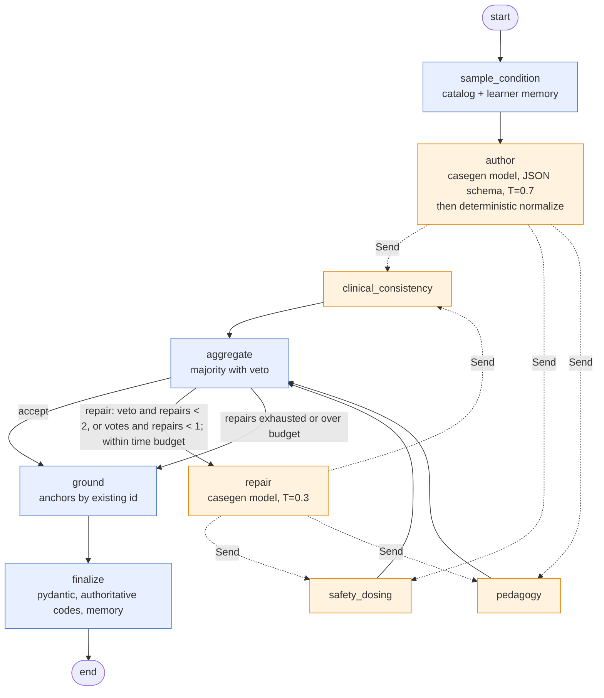
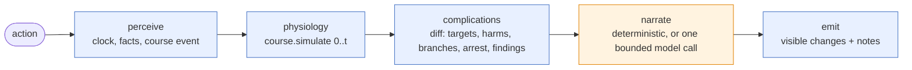

# 15. Case generator v2 and the Clinical Director

**Status:** on-request staged generation in section 12 supersedes the learner path of sections 4 and 8 (2026-10-20, review 06a); live-run hardening in section 11 (2026-10-20); first shipped on branch `worktree-agent-a9c18d0fa31dfef2b` (2026-10-19). **Owner:** AI engineer. **Code:** `server/orchestration/`, `web/src/lib/caseGenV2.ts`. **Tests:** `server/tests/test_orchestration_*.py`, `web/src/lib/caseGenV2.test.ts`.

This document replaces the single-call generator of `server/case_generator.py` (kept untouched behind `POST /v1/case/generate`) with a LangGraph 1.2 pipeline, and adds the Clinical Director that adapts a live case to what the learner does, turn by turn. It realises the recommendation in `docs/research/16` section 1 (LangGraph core, three-judge panel with deterministic high-stakes checks, Store-backed learner memory, cost attribution from a versioned price table).

## 1. Why a graph

The v1 generator makes one bounded model call and silently falls back to a template, so a learner could not tell a model-authored case from a deterministic one, and nothing checked the model's output beyond the pydantic shape. The v2 pipeline separates authoring from verification, makes every decision auditable through a persisted trace, and follows one honesty rule: **a case is returned only when a model authored it; otherwise the route says so (HTTP 503) and the learner is offered Retry, nothing else.** Since 2026-10-20 (section 12) the template is a faculty and admin diagnostic only (`POST /v2/case/template` answers 401 or 403 to learners) and is never served to a learner as a case.

## 2. Dependencies

Pinned in `server/requirements.txt` to the versions verified on PyPI on 2026-10-19:

| Package | Version | Used for |
|---|---|---|
| `langgraph` | 1.2.16 | `StateGraph`, `Send` fan-out, reducers, compiled graphs, `astream(stream_mode="updates")` |
| `langchain-core` | 1.6.12 | `parse_json_markdown` for tolerant structured-output parsing |
| `langgraph-checkpoint-sqlite` | 3.1.2 | `AsyncSqliteSaver` (checkpoints) and `SqliteStore` (learner memory) on one SQLite file |
| `aiosqlite` | >= 0.21 | the async connection the saver needs inside FastAPI |

The sync `SqliteSaver` cannot serve async nodes (it raises `NotImplementedError`), so the graph uses `AsyncSqliteSaver` on `ACUDX_DB_PATH` (default `server/data/acudx.db`); the learner store opens a second, autocommit connection to the same file.

## 3. Configuration (`server/config.py`)

| Env | Default | Meaning |
|---|---|---|
| `CASEGEN_BASE_URL`, `CASEGEN_MODEL`, `CASEGEN_API_KEY` | inherit `LLM_*` | endpoint for `author` and `repair` |
| `JUDGE_BASE_URL`, `JUDGE_MODEL`, `JUDGE_API_KEY` | inherit `LLM_*` | endpoint for the council and the Director narrator |
| `ACUDX_DB_PATH` | `server/data/acudx.db` | checkpoints and learner memory |
| `CASEGEN_TIME_BUDGET_S` | `120` | wall-clock budget for one generation; a repair that would not fit is skipped (section 11.6) |
| `CASEGEN_GPU_USD_PER_HOUR` | unset | hourly worker price for amortised cost when no GPU ledger row exists in this process (section 11.7) |

`AIRGAPPED` semantics are unchanged: every resolved URL passes `Settings.guard_egress()` at resolution time and again per call. Under `AIRGAPPED=true` with `LLM_PROVIDER=api` the runtime has no model client and every model-backed route answers 503.

## 4. The generator graph



### 4.1 State (`CaseGenState`)

| Key | Reducer | Written by |
|---|---|---|
| `request`, `seed`, `locale`, `condition`, `acuity`, `difficulty`, `candidate_anchor_ids` | overwrite | `sample_condition` |
| `draft` | overwrite | `author`, `repair` |
| `votes` | `operator.add` | the three judges (each vote carries its `round`) |
| `round`, `repairs` | overwrite | `repair` |
| `council` | overwrite | `aggregate` |
| `anchors` | overwrite | `ground` |
| `spec`, `status` | overwrite | `finalize` |
| `trace` | `operator.add` | every node |

### 4.2 Node contracts

**sample_condition** (deterministic). Input: `request` with optional `system`, `difficulty`, `complaint`, `locale`, `seed`, `learner_id`, `session_id`. Seeds a `random.Random`, reads the learner memory when `learner_id` is given (conditions seen are excluded while a candidate survives; with probability 0.6 the learner's weakest system replaces an absent `system` constraint), calls `condition_catalog.sample_condition`, computes the guideline candidate ids for the author prompt. Trace attributes: `condition_id`, `system`, `steered_system`, `excluded`.

**author** (casegen model, temperature 0.7, `response_format: json_schema` built from `AuthorDraft`, which is `GeneratedCaseSpec` minus free-text anchors plus `guideline_anchor_ids`). The reply is the draft; no template is merged. Condition codes, seed, locale and difficulty are stamped from the catalog so judges see the authoritative block. The draft then passes through `normalize.normalize_draft` (section 11): treatment codes are resolved, effect onsets clamped, and empty objective fields filled from the condition fixture, each change listed in the trace and in `meta.gap_filled` / `meta.normalization`. A malformed reply is retried once, then `ModelOutputInvalid` propagates (route: 502). Unreachable endpoint: `ModelUnreachable` (route: 503).

**clinical_consistency, safety_dosing, pedagogy** (judge model, temperature 0). Each runs its deterministic check first and asks the model only when code could not already decide. Vote shape: `{judge, round, verdict, veto, issues, repair_hints, deterministic, model}`.

| Judge | Deterministic checks | Model focus |
|---|---|---|
| clinical_consistency | vitals in hard bounds (HR 20-250, SBP 40-260, DBP 20-160, RR 0-80, SpO2 0-100, temp 25-43), diastolic below systolic, trajectory `atMs` increasing, triage vitals inside the adult ESI envelope (HR and RR exempt under 16 years), lab flag agrees with value and reference range, lab unit equals the `reference_ranges.json` unit (`rule:lab_unit`), exam, labs and imaging present | contradiction with a cited fixture field |
| safety_dosing | at least one indicated and one contraindicated treatment; every code is a catalogue code (`rule:treatment_code`); a fixture-contraindicated code is never `indicated` and a fixture first-line code is never `contraindicated`; effect keys known, deltas within caps, onsets and magnitudes inside the treatment-class table (`rule:effect_plausibility`) | appropriateness contradicting a cited fixture treatment |
| pedagogy | difficulty 1-5, `acuity_esi` within 1 of the catalog's typical acuity, 4-10 hpi items including `onset`, a red-flag hpi item and structured `red_flags` when the condition lists red flags, chief complaint presents the requested complaint (`rule:complaint_adherence`) | red flags and typical complaint not elicitable, citing the catalog |

Veto rules: any **deterministic** failure vetoes (code-checked facts are not voted on). At the model phase only **evidence-bound** issues count (section 11.5): the safety judge vetoes on a bound issue, the other two vote; unbound opinions become `notes` and never fail a draft.

**aggregate** (deterministic). Counts only the current round. `accept` when more than half pass and nobody vetoed, else `repair`. Collects `issues`, `repair_hints` and `notes` with the judge name as prefix.

**repair** (casegen model, temperature 0.3). Sends the draft plus issues and hints, asks for the complete corrected case in the same schema. Increments `repairs` and `round`, normalises the reply like the author's, then fans out to the judges again. Bounded by `CaseGenDeps.max_repairs` (default 2) while a veto stands, by `max_nonveto_repairs` (default 1) when only votes failed, and skipped when `elapsed + last author latency + last judge latency` would exceed `time_budget_s`.

**ground** (deterministic). Reads `draft.guideline_anchor_ids`, keeps the ids that exist in `server/guidelines_seed` and pass `has_citation`, drops the rest (listed in the trace as `dropped_ids`), then adds deterministic candidates from `anchors.candidate_ids` (topic hints per condition id plus domain affinity and token overlap) up to three anchors. Each anchor carries `statement_id`, bilingual statement, `source` (council) and `citation` (URL). Free text from the model never becomes an anchor.

**finalize** (deterministic). Validates with `GeneratedCaseSpec`, overwrites condition codes, seed, locale and difficulty, records the case in learner memory, and writes `meta`:

```json
{"source": "model", "generator": "v2", "model": "...", "models": ["..."],
 "condition_id": "acs_stemi", "thread_id": "...",
 "council": {"decision": "accept", "rounds": 1, "repairs": 0, "vetoed": false, "issues": []},
 "degraded": false, "note": null, "latency_ms": 0.0, "trace_summary": {...}}
```

When the council is still at `repair` after the last allowed repair, the case is still the model's but `degraded` is true, `note` starts with `council_exhausted`, and if a veto stands the deterministic safety overrides run first (fixture appropriateness forced, effects capped, vitals clamped). The UI must show such a case as degraded.

### 4.3 Trace events

Every node appends one record (`server/orchestration/trace.py`):

```json
{"node": "author", "status": "ok", "ts": 1760000000.0, "latency_ms": 4321.0,
 "model": "qwen2.5-7b-instruct", "model_requested": "qwen2.5-7b-instruct", "provider": "local",
 "tokens_in": 1200, "tokens_out": 800, "cost_usd": 0.0,
 "price_table_version": "2026-10-19.1", "attributes": {"temperature": 0.7}, "note": null}
```

`cost_usd` comes from `server/orchestration/prices.py`, a versioned table matched against the *served* model name (providers substitute models), with `cost_basis: "token_table"`; a call served by the GPU worker is priced from the GPU hour instead (`cost_basis: "gpu_hour_amortised"`, section 11.7). Unknown models with no GPU price price as `null` and are listed under `trace_summary.unpriced_models` instead of being guessed. `trace_summary.wall_ms` is the wall clock of the run; `latency_ms` sums node latencies and so counts the parallel judges three times. The trace is part of the state, so the checkpointer persists it with every step and `GET /v2/case/{thread_id}` returns it.

## 5. Learner memory (`server/orchestration/memory.py`)

LangGraph `BaseStore`, namespace `("learner", learner_id)`:

| Key | Content | Written by |
|---|---|---|
| `conditions_seen` | recent condition ids first, counts per system | `finalize` |
| `errors` | `{at, kind, detail, system}` items and counts per system | `POST /v2/director/step` (contraindicated treatment, missed deadline) |
| `calibration` | samples, confidence sum, correct sum | `LearnerMemory.record_calibration` (assessment hook) |

`weak_systems()` orders systems by errors per case seen; `sample_condition` uses it as described above. `GET /v2/learner/{learner_id}` returns the profile.

## 6. The Clinical Director (`server/orchestration/director.py`)

Rebuilt after medical review 06b (`docs/review/06b-medical-review-dynamic-cases.md`). The Director is a thin LangGraph
around one deterministic physiology engine (`server/orchestration/course.py`) that the browser mirrors line by line
(`web/src/domain/clinicalCourse.ts`). The engine runs a per-condition **course rule** (how a disease behaves), not a
stored case: the case is still generated on request, and the rule is applied to whatever the learner does.



### 6.1 Course rules (`server/case_fixtures.py`: `COURSE_PATTERNS`, `CONDITION_COURSE`)

Every one of the 97 ESI 1 to 2 conditions has a rule (and a treatment fixture: 47 were added by 06b F03); the long tail
without a rule uses a stable fallback that keeps the authored trajectory. A rule is a pattern (anchors and default
rates) plus per-condition fields:

| Field | Meaning |
|---|---|
| `s0`, `rate_h`, `recover_h`, `floor`, `lag_min` | Severity at arrival, rise per hour untreated, fall per hour once every disease-modifying group is met (after the lag), residual floor |
| `peri`, `well` | Absolute vitals and bedside signs at severity 1 (peri-arrest) and 0; a key absent is not moved by the disease (DKA and meningitis never desaturate, F14) |
| `groups` | All-of treatment requirements: each group is met by a case row code or a treatment class; `needs` adds an antimicrobial spectrum check (F11); `active_min` makes a group act only while a dose works (IM adrenaline 25 min, naloxone 45 min, nebuliser 60 min) |
| `targets` | Guideline time per group with its citation and `basis` (`guideline` or `design`), scored separately from the physiology (F06) |
| `branches` | New diagnoses with conditions, seeded probability and window: pneumonia to septic shock (CURB-65 3, no antibiotic by 60 min, p 0.3), sepsis to septic shock (MAP below 65 or lactate 4), pyelonephritis to urosepsis (obstructed kidney seeded p 0.2), DKA to cerebral oedema (age 25 or under and 2 L or more in the first hour), PE to obstructive shock (SBP below 90), STEMI to VF (p 0.06 before reperfusion) or cardiogenic shock (p 0.1 without reperfusion by 60 min), meningitis to status epilepticus (p 0.15) |
| `row_harms` | Specific harm of a contraindicated row (effects, rate multiplier, seeded arrest or branch): no generic HR +12 / SBP -10 (F09) |
| `harm_rules`, `fluid`, `o2_response`, `hypercapnic`, `metabolic` | Context rules: fluid response mode (responsive, pulmonary oedema, renal, RV, haemorrhage), oxygen dose response, CO2 retention, DKA / hypoglycaemia / hyperkalaemia lab model |
| `findings` | Exam findings that appear when state conditions hold (mottling, purpura, stridor, peritonism, crackles) |

### 6.2 Engine (`course.simulate(input, t_ms)`)

Pure, minute by minute from arrival: processes (presenting condition and branches) advance severity; events at each
minute apply class effect curves (`CLASS_EFFECTS`: onset then wane, for example IM adrenaline 4 min onset, fading
10 to 30 min; a 500 mL bolus SBP +12 at 15 min, fading 30 to 75 min) and harm rules; lactate (perfusion driven,
clearance only at MAP 65 or more and CRT 3 s or less, F20), CBG and potassium integrate (`LAB_RATES`, the
`kinetics.py` JBDS rates without the old glucose floor, F18); triggers open branches and the **explicit cardiac-arrest
state** (severity 1, MAP below 40 or SpO2 below 60 for 3 minutes, seeded VF, or a row harm). In arrest the vitals read
zero, `bedside.pulse` is false and the notes give the ALS entry (ERC 2021); defibrillation restores circulation from
VF, adrenaline plus a treated cause from PEA. The snapshot carries vitals, bedside (MAP, GCS, AVPU, CBG, K, lactate,
CRT, mottling, skin, urine, airway, rhythm, pulse, fluid balance, NEWS2), phase (`stable`, `improving`,
`deteriorating`, `peri_arrest`, `arrest`), processes, active diagnoses, harms, targets and findings.

Treatment classes come from the catalogue code (`CODE_CLASSES`) or a whole-word classification of the row label
(`normalize.classify_treatment`), never a substring: "beta-lactam" is not a beta-blocker (F08). `normalize.TREATMENT_CLASSES`
gained loop diuretic, FRIII, dextrose, potassium, thrombolytic, antiplatelet, anticoagulant, corticosteroid,
antihistamine, IV beta-blocker, glucagon, naloxone, NIV, antiemetic and insulin-glucose (F22), with allowed effect signs
(`ALLOWED_SIGNS`, F21) and IM inference for adrenaline 0.5 mg or less (F23).

### 6.3 Director nodes

`CaseState.from_spec(spec)` resolves the condition, builds the course input (arrival vitals plus bedside values from the
spec labs, structured allergies parsed from the allergy text, flags from PMH and medications such as heart failure,
renal failure, COPD, beta-blockade, PDE-5 use, CURB-65, seed) and the initial snapshot. Rows carry an explicit role
(`definitive`, `supportive`, `diagnostic`, `omission`; F29).

* **perceive**: facts for question, exam and order; an order or position change becomes a course event (lumbar
  puncture before CT with red flags is a harm); a treatment becomes a course event with its row, classes, spectrum,
  allergen class and volume. Omission rows ("delay antibiotics") are noted, never administered.
* **physiology**: `course.simulate` from 0 to `t_ms` over all events (server authoritative; the client never sends vitals).
* **complications**: diffs the snapshot against the previous one; targets met (`target 'x' met (complication averted)`)
  or breached (`missed_target` error, `complications_fired`), harms (error kind = harm id, for example `fluid_overload`,
  `gtn_hypotension`, `insulin_low_k`), branches (`branch: pneumonia_cap -> septic_shock` with why), arrest
  (`cardiac_arrest`) and ROSC, inadequate spectrum, and new findings added to `facts_by_trigger` so re-examining shows them.
  Affect follows GCS (alert 14 to 15, drowsy 9 to 13, unresponsive 8 or less or no pulse).
* **narrate**: the branch's own line ("I can't get my breath and I'm freezing"), a relative's voice at GCS 12 or less,
  "(no pulse, not breathing)" in arrest; the model prompt carries the active diagnoses and GCS.
* **emit**: `patient_visible_changes = {t_ms, vitals, affect, utterance_en, utterance_tr, new_facts, complications_fired,
  bedside, phase, severity, active_diagnoses, events, targets, results, trace}`; `results` is what the results engine
  reads (`director.results_view`).

API: `next_state` and `anext_state` as before, plus `director_step(store, thread_id, action, spec=None, llm=None)`, which
reads the Director state from the CaseStore record for `thread_id` (key `director`, the generated `spec` for the first
step) and writes it back. `CaseStoreLike` is the get/put protocol of `server/orchestration/store.py`;
`default_case_store()` uses that module when present and an in-memory adapter otherwise.

### 6.4 Results engine and client mirror

`server/results/engine.py` reads `case_state["director"]` (the `results` view): severity, vitals, MAP and shock replace
the ESI estimate, lactate, CBG and potassium come from the live state, and an opened branch switches the lab profile
(F19). `scripts/gen_course_tables.py` generates `web/src/domain/courseTables.generated.ts` and the parity fixture
`server/tests/fixtures/course_parity.json`; `test_course_parity.py` fails when either is stale and
`clinicalCourseParity.test.ts` requires the browser engine to match the Director within 1 unit at t10, t30, t60 and t120
(06b acceptance test 10). A generated case is bound to the model through `CaseInstance.course`; in Live mode the
overlay renders the server state (arrest included) and passes the Director's `results` view to the results engine.

## 7. HTTP surface (`server/orchestration/routes.py`, mounted in `server/app.py`)

| Route | Behaviour |
|---|---|
| `POST /v2/case/generate` | runs the graph on `thread_id` (given or new); 200 `{thread_id, spec, trace_summary, trace, council}`; 503 `model_unreachable`; 502 `model_output_invalid` |
| `POST /v2/case/generate/stream` | probes the endpoint, then SSE: `start {thread_id, pipeline}`, one `node {node, status, trace, council?}` per executed node in execution order (the three judges arrive in any order), then `done {thread_id, spec, trace_summary}` or `error {error, status, detail}` |
| `POST /v2/case/template` | faculty and admin diagnostic only (401 anonymous, 403 student or resident): deterministic template with `meta.source = "template"`, `degraded = true`; never a learner case (section 12) |
| `POST /v2/director/step` | `{case_state | spec, action, learner_id?, use_model?}` to `{case_state, patient_visible_changes, director_notes}`; new errors are written to learner memory |
| `GET /v2/case/{thread_id}` | checkpoint read: `status`, `spec`, `council`, `condition`, `trace`, `next`; 404 when unknown |
| `GET /v2/learner/{learner_id}` | memory profile |

`/v1/case/generate` is untouched. The `/v2` runtime is built lazily on first request and cached on `app.state.orchestration`; tests build their own runtime with an in-process transport.

## 8. Web client (`web/src/lib/caseGenV2.ts`)

Typed fetch helpers following `backend.ts` conventions (bounded timeout, `{ok, data} | {ok: false, error, status}`, never throws): `generateCaseV2`, `readCaseThread`, `readCaseLayer`, `listMyCases`, `directorStep`, and `streamCaseGenV2` with a pure `parseSseBuffer` for the POST-based SSE stream. `v2SpecToCaseInstance` reuses `specToCaseInstance` from `liveCaseGen.ts` and labels provenance from `meta.source`. The error code of a non-2xx answer (for example `model_unreachable`) is surfaced as `error` so the UI can explain the degraded state instead of guessing.

### 8.1 Encounter wiring (shipped 2026-10-20)

Code: `web/src/pages/EncounterPage.tsx`, `web/src/components/ehr/CaseGenProgress.tsx`, `web/src/components/ehr/SimBadge.tsx`, `web/src/state/encounterStore.ts`, `web/src/lib/liveEncounter.ts`, `web/src/components/ehr/tabs/InterviewTab.tsx`, `web/src/domain/debrief.ts`. Strings: `web/src/i18n/features/live2.{en,tr}.json`.

Generation (superseded by section 12.5). "New random case", the constrained menu and the Start page hand-over all call `streamCaseGenV2` when the gateway is reachable. `CaseGenProgress` shows the stages (sampling, authoring, council judging, repairing, grounding, finalizing) from the `node` events (`stageForNode`). A `done` spec is adapted with `v2SpecToCaseInstance` and started with a `CaseGenerationMeta` (`source: "model"`, thread id, council decision, veto and repairs, degraded flag, model). On 503 `model_unreachable`, 502, timeout or a broken stream the panel shows the real error and two labelled choices: "Use template case (deterministic, not model generated)" calls `POST /v2/case/template` and starts the case as `source: "template"`, `degraded: true`; "Retry" reruns the same request. The on-device generator runs only when the gateway is unreachable and is labelled `source: "offline"`. The banner `SimBadge` names the source for every case (model, template, offline, curated, published) with the council verdict and a degraded marker for model cases.

Director (the first-step `spec` and round-tripped `case_state` described here are replaced by `thread_id`, section 12.4). In Live mode the store queues one `directorStep` per learner action (question, exam, order, treatment or medication) and every 60 s of sim time (`elapsed`, coalesced). Calls are serialised in action order and never block the UI. The first step sends `spec` (`caseInstanceToSpec`, so curated and offline cases get a Director too); later steps round-trip the opaque `case_state`. `patient_visible_changes` is folded into a client overlay (`applyDirectorChanges`): the delta between the Director's vitals and the local course at the step is applied on top of the running local ramps and clamped to the server bounds (`DIRECTOR_BOUNDS`), so `getCurrentVitals` and `getVitalsSeries`, and with them the monitor, flowsheet and PatientViewer, show the Director's deterioration or recovery. New facts and fired complications accumulate; each `director_notes` entry becomes a `note` event with `meta.director = true` and a fired complication a `stage` event, both listed in the debrief under "Clinical Director notes". A failed step sets `director.status = "error"` with the reason and the local course continues.

Persona. `getPersonaLiveContext` gives `InterviewTab` the Director's sanctioned facts, the current vitals, their plain adjectives (`vitalsAdjectives`: tachycardic, hypotensive, hypoxic, drowsy, ...), affect and complications, which ride in `case_state` of `POST /v1/patient/turn`, so the patient voices the trend.

## 9. Tests

`python -m pytest server/tests -q`: graph topology, model-sourced happy path with trace and cost, safety veto with one repair, repair bound at two with safety overrides, SpO2 over 100 caught by the consistency judge, model-phase majority without veto, grounding drops unknown ids, author retry on bad JSON, learner memory anti-repeat and weak-system steering, SQLite persistence of checkpoints and memory, judge unit checks, aggregator, Director bounds, guideline targets and arrest, narrator fallback, the ten 06b acceptance tests (`test_course_acceptance_06b.py`), the reviewers' minute-by-minute simulation as regression tests (`director_sim.py`, `test_director_sim_06b.py`), server and browser table parity (`test_course_parity.py`), routes (503 unreachable, 503 under AIRGAPPED with a hosted endpoint, template labelling, SSE order, checkpoint read, director step with memory). Model-dependent tests use `server/tests/openai_double.py`, an in-process OpenAI-compatible FastAPI app reached through `httpx.ASGITransport`. `test_orchestration_live.py` is marked `live` and runs only when `CASEGEN_BASE_URL` is set. `test_case_quality.py` replays the two live-run outputs (section 11): code mapping, onset clamping, gap fill, complaint index and adherence, evidence binding, parallel judges, repair caps, scaled timing, amortised cost, telemetry rows and the Qwen3 thinking switch on patient turns, plus every catalog template passing the deterministic council after normalisation.

## 10. Open items

* Faculty approval gate: `interrupt()` before `finalize` for summative cases (`docs/research/16` section 1.2) is not wired yet.
* The judge council runs on one model today; the research recommends three model families. `JUDGE_*` already separates the judge endpoint from the author; per-judge endpoints are the next step.
* Checkpoints accumulate in SQLite; add a pruning job and move to `PostgresSaver` for multi-process deployment.
* Live verification of section 11 on the worker: rerun `pytest -m live` with `CASEGEN_BASE_URL` set and compare wall time with section 11.6.
* The complaint index and the treatment-class table are clinical content reviewed by the AcuDx emergency-physician agent; they still need the medical reviewer sign-off of protocol section 4.
* Calibration is recorded through `LearnerMemory.record_calibration` but no route writes it yet; the assessment service should call it after grading.
* Resolved (October 2026): `caseGenV2.withLearnerId` fills `learner_id` on `/v2/case/generate`, the SSE generator and `/v2/director/step` from `profileStore.selectLearnerId` (verified IdP `sub`, otherwise the pseudonymous `localId` that the local principal also carries in `X-User-Id`). An explicit `learner_id: null` from the caller opts out (faculty preview).

## 11. Live-run hardening (2026-10-20)

The first live run on the GPU worker (Qwen3-14B-AWQ on an A10) produced two cases that are kept as regression fixtures in `server/tests/fixtures/live/` (`fever-fever_and_rigors.json`: sepsis; `fever-fever_and_cough.json`: ascending cholangitis). Both ended `degraded: true` after two repairs, in 214 s and 297 s, with 7 model calls each. Tests: `server/tests/test_case_quality.py`.

### 11.1 Treatment codes

Every treatment had `code: ""`. `normalize.resolve_treatment_code` maps each item, in order: a code already in the condition vocabulary (`case_generator._resolve_fixture(cond)["treatments"]`, the codes the judges and the Director use) or in any fixture or the web catalogue; token overlap of the label with a condition item (Jaccard at least 0.5); a condition item of the same treatment class and the same appropriateness (investigations such as cultures excluded); for an indicated or neutral item, the web catalogue entry of that class (`normalize.WEB_TREATMENT_CATALOG`, mirrored from `web/src/domain/treatments.ts` and checked against it by a test). A contraindicated item never maps to a drug code by class ("Delay antibiotics" is not ceftriaxone). Two items that map to the same code are merged. An unresolvable neutral item ("NPO") is dropped with a note; an unresolvable indicated or contraindicated item keeps `code: ""` and the safety judge fails it (`rule:treatment_code`, a veto, so it is repaired). The author prompt lists the condition's codes and the web codes, and the schema requires a non-empty `code`. The web adapter drops any response that still has no code (`buildTreatmentResponses`), since it could never match an order.

### 11.2 Effect onsets

IV fluids took effect after 1 to 2 seconds. `normalize.TREATMENT_CLASSES` holds, per class (oxygen, fluids, antipyretic, antibiotic, analgesia, opioid, nitrate, bronchodilator, IM adrenaline, vasopressor, benzodiazepine, rhythm, procedure), the keywords, the plausible onset window, the vitals the class may move with the largest delta, and the source. Examples: fluids 5 to 30 min, SBP up to 20 (NICE CG174: 500 mL over less than 15 min, then reassess); oxygen 1 to 15 min, SpO2 up to 8 (BTS 2017); antibiotics move no vital inside a session (Halm, JAMA 1998); antipyretic 30 min to 2 h, temperature up to 1.5 C (OFIRMEV label section 14.2). Every effect is at least 10 s. The normaliser clamps onsets into the window, caps magnitudes and drops keys the class does not move; the safety judge flags anything outside the table, so an unnormalised draft fails. Every fixture and profile treatment passes the table (test). `EFFECT_CAPS["hr"]` rose from 40 to 80 because cardioversion and adenosine end a tachyarrhythmia.

### 11.3 Labs, imaging, red flags

All three were empty. The author schema now requires them (labs 2 to 5, imaging 1 to 2, red_flags 1 to 4, trajectory 3 to 5, treatments 3 to 5, `guideline_anchor_ids` at most 3, which also stops the runaway of 53 invented ids that hit the token cap in one repair). The prompt carries the fixture's labs with LOINC code, UCUM unit and reference interval, the reference imaging and the structured red-flag shape. When the model still omits a section the normaliser fills it from the condition fixture (labs jittered with the seeded RNG, imaging, catalog red flags plus the patient-voiced symptom, exam, trajectory from the model's own triage vitals, a missing contraindicated distractor) and marks a positive `red-flags` HPI answer as `red_flag`. Every filled field is listed in `meta.gap_filled`. Labs whose LOINC is in `server/results/reference_ranges.json` take the table's unit when equivalent, are converted with standard SI factors when not (glucose mmol/L to mg/dL, bilirubin, creatinine, hCG IU/L, and others in `UNIT_CONVERSIONS`), and fill a missing reference interval; anything else fails `rule:lab_unit`. Every catalog condition now has a contraindicated distractor (sepsis fixture, emergency and psychiatry profiles, AF, SVT, COPD, CO poisoning, PPH), because without one no model case could pass the safety judge.

### 11.4 Complaint adherence

"fever and cough" sampled cholangitis because the old token matcher matched "and". `condition_catalog.COMPLAINT_INDEX` maps 16 complaint keys (fever, cough, dyspnoea, chest pain, abdominal pain, headache, syncope, palpitations, confusion, weakness, seizure, vomiting, back pain, dizziness, rash, bleeding) with EN and TR synonyms to condition ids. `sample_condition` restricts the pool to the conditions presenting with every requested key (else any), even over a system that selects none of them; unrecognised text falls back to a stopword-filtered token match. A test keeps the index covering every condition whose own typical complaint names a key. The author and repair prompts state the requested complaint, and the pedagogy judge checks it deterministically: at least one requested key in the chief complaint and every key in the chief complaint or HPI.

### 11.5 Evidence-bound judges

The 14B judges vetoed correct content (for example "gallstones are not typically associated with cholangitis"). The judge prompt now lists `evidence_index(cond)`: citable keys such as `fixture.imaging`, `fixture.labs[0]`, `fixture.treatments[biliary_drainage]`, `catalog.red_flags[0]`, with their values. The judge schema requires each issue to name `evidence` and copy `evidence_value`. `judges.bind_issues` keeps an issue only when the key exists and at least 60 % of the quoted tokens appear in its value; a `rule:` citation is re-checked by code (already passed, so it becomes a note); free text, unknown keys and misquotes become `notes`. The verdict is `fail` only with a bound issue. Notes reach `meta.council.notes` and never veto. Replaying the live judges' opinions against the live drafts gives `accept` with zero repairs (test).

### 11.6 Latency

The three judges already ran concurrently: in the live trace they started within 3 ms of each other. A test with a 0.3 s judge delay confirms the round takes about one delay, not three. The time went to the author (53 to 59 s) and two repairs (61 to 109 s each). Expected live timing after the fixes, from those measured per-call latencies:

| Path | Calls | Expected on the A10 worker |
|---|---|---|
| draft passes after normalisation (both live drafts) | author + 3 parallel judges | 64 to 70 s |
| a stand-alone veto, budget 120 s | author + judges; the repair would end near 140 s, so it is skipped and the case is finalized degraded with overrides (`meta.note` starts with `time_budget_exceeded`) | about 70 s |
| a veto with `CASEGEN_TIME_BUDGET_S=240` | author + judges + repair + judges | about 140 s |

Measured with the in-process double scaled 1:100 (author 0.53 to 0.59 s, judge 0.11 s): 0.67 to 0.74 s warm, so 67 to 74 s at live scale, 4 model calls, `accept`, no repair (`test_scaled_live_timing_fits_the_budget` asserts under 1.2 s). Non-veto failures get at most one repair; progress still streams per node over SSE.

### 11.7 Amortised GPU cost

`cost_usd` was `null` with `unpriced_models: ["acudx-llm"]`. A call is self-hosted when the served model is `acudx-llm` or its base URL is the active worker's. Its cost is `usd_per_hour * latency_ms / 3 600 000 / concurrency`, where the hourly price is the active worker's `price_cents_per_hour`, else the latest `gpu_ledger` row, else `CASEGEN_GPU_USD_PER_HOUR`, and `concurrency` is the largest number of calls in flight on the same endpoint during the call (three parallel judges share the hour). The trace records `cost_basis: "gpu_hour_amortised"`; `trace_summary.cost_basis` lists the bases used. A self-hosted call also resets the worker's idle window (`WorkerManager.touch`), so the reaper never stops a worker mid-generation.

### 11.8 Telemetry and patient-turn thinking

`StructuredLLM` records every call, success or failure, through `app.state.telemetry` (`kind=llm`, provider `gpu-worker` for the worker or the host's billing slug, served model, tokens, latency, the amortised cost, error type), so `/admin/telemetry/summary` shows the author, judge, repair and Director narrator rows. The route comes from `call_context`; the SSE body re-binds the request's context because it runs after the middleware returned. The Qwen3 thinking rule moved to `model_gateway.wants_no_thinking` and is shared: `ModelGateway.chat` now sends `chat_template_kwargs: {"enable_thinking": false}` for Qwen3 and `acudx-llm`, so patient turns on the worker no longer spend their budget on hidden reasoning (live: 4 to 6 s and `had_reasoning: true` per turn).

## 12. On-request staged generation (2026-10-20, review 06a)

Owner decision (authoritative): every learner case is generated ON REQUEST by the model pipeline and changes in flight. No pre-generated case list, seed library, curated or published library or template is ever served to a learner as a case. Same-thread background continuation of deeper layers of the requested case is allowed; any pool or pre-generation ahead of a request is forbidden.

### 12.1 Stages (`server/orchestration/staged.py`)

| Stage | Trigger | Call | Cap (max_tokens) | Gate |
|---|---|---|---|---|
| S0 sample | request | none (catalog, learner steering, faculty blueprint `condition_id`) | none | deterministic |
| S1 opening | request | one call, `stream: true` | 380 | deterministic only: vital bounds (clamped), ESI envelope note, age and sex plausibility, non-empty complaint and statements, no dose in the opening, complaint adherence; one retry with the issues |
| kernel (hidden) | right after the opening, conditioned on it | one call | 320 | key positives at least two; branch ids validated against the condition's course library (`course.library_for`, unknown ids dropped, not executed); flags and structured allergies from closed vocabularies (06b 4.5); a failure is non-fatal |
| `history.presenting`, `history.associated`, `history.background` | continuation or first question of the cluster | one call per intent cluster | 360 | intents coerced to the cluster, non-empty items; background must carry PMH and allergies consistent with the kernel's structured allergies (06b F30) |
| `exam.<system>` (general plus the 1 to 2 kernel systems; the rest lazily) | continuation or first maneuver of the system | one call per system, conditioned on the current state | 180 | maneuvers coerced to the system |
| `treatments` | continuation or first treatment | one call | 440 | codes resolved with `normalize.resolve_treatment_code`, effects clamped to the class table, `check_safety_dosing`, then the BLOCKING safety judge; a veto (deterministic or bound judge issue) rewrites the layer once with the issues; a veto after the rewrite fails the layer honestly (`error: "safety_veto"`, reason, issues; 12.7). The fixture is a validation oracle only, never written into the table; the case is never marked degraded on this path |
| `results` | continuation or first order | one call | 400 | LOINC units normalised, flags recomputed from the reference interval |
| `event.<id>` | a Director branch fired (`director_step` schedules it in the background) | one call | 200 | blocking safety judge only when the event names a drug or a dose (`drug_bearing`); a veto after the rewrite fails the event with `safety_veto` |
| `debrief` | the learner commits a diagnosis (`POST .../layer/debrief {reason: "committed", diagnosis}`) | one call | 260 | anchors resolved by id only (verified statement, source, citation); the committed diagnosis is named in the prompt and recorded as `outcome` |
| rendering `<layer>` (TR) | the UI switches to Turkish on an EN case | one call per layer seen, cached | up to 900 | same count of texts, none empty, every number of the source kept; fills only the TR slot (12.7) |

Every call is single-locale (`Write every text field in English|Turkish only`); a Turkish UI requests the case with `locale: "tr"`. All layer calls of one thread share a byte-identical system block (charter, condition, kernel, opening, sorted keys) so vLLM prefix caching prefills only the per-layer delta. Background continuation runs in dependency waves (`continuation_waves`: the presenting history, then the other history and exam layers, then the treatment table and results), 1 call at a time on the GPU worker and 3 on the Claude route (`CASEGEN_LAYER_CONCURRENCY` overrides both; see 12.6 and 12.10); a layer the learner is waiting for (first access, a branch event) bypasses that queue. The assembled spec carries the validated `course` block (`latent_branches`, `flags`, `allergies`) the Director reads. A failed layer is regenerated or reported as failed with a retryable `error`; it is never filled from a fixture (`meta.gap_filled` stays empty on this path).

Model judges are asynchronous: when the core layers are in, `clinical_consistency` and `pedagogy` review the assembled case. An issue that maps to a layer the learner has not seen regenerates that layer (`judge {decision: "patched", patch: [{op: "replace", path: "/layers/<name>"}]}`); an issue on a seen layer or the opening is recorded in `meta.corrections` (`decision: "noted"`) and never rewrites history under the learner. The 4 to 10 core HPI rule of the single-call author does not apply to a layered history. The async council also runs `judges.check_course_rules` (06b F25): `untreated_worsens`, `complication_plan_present`, `definitive_covers_deadline`, `allergy_structured`, `effect_sign`; their issues map to the treatment table, the background history or (recorded only) the opening.

### 12.2 Server-authoritative case state (`server/orchestration/store.py`)

`CaseStore` (SQLite at `ACUDX_DB_PATH`, in memory for tests) holds one document per thread: request, owner and requester, condition, kernel, opening, layers `{status, data, seen, attempts}`, layer order, the assembled spec, the Director state, timings, trace and the SSE event log. Interface: `get(thread_id)`, `put(thread_id, state)`, atomic `update(thread_id, mutator)`, `append_event`, `events(thread_id, after)`, `list_for_owner`. `put` refuses any state whose `source` is not `"model"`. Every learner read goes through it: `GET /v2/case/{thread_id}`, the layer route, the events route and the Director step. A thread is readable by its owner (or, without a learner id, the principal that requested it), faculty and the members of the team room the owner bound it to (`set_room`, `add_member`, `is_member`: a salted hash of the room's join code is kept, members join with the code); anyone else gets the same 404 as a missing thread.

### 12.3 SSE contract

```
POST /v2/case/generate/stream                   id: <n> on every event
event: start          {thread_id, stages, eta_ms}
event: opening.delta  {path, value}             completed scalars from the streamed S1 JSON
event: opening.ready  {thread_id, opening, spec, layers, timings}   encounter starts here
event: kernel         {status: "ready"}           hidden kernel, right after the opening
event: layer.pending  {layer, reason}
event: layer.ready    {layer, data, spec}
event: judge          {layer, decision, issues?, patch?, spec?, blocking?}
event: error          {stage, error, status, retryable, fatal?, reason?, issues?, thread_id}
event: done           {thread_id, spec, timings}
event: layer.rendered {layer, locale, data, spec}   a rendering landed (12.7, 12.8)
event: task           {thread_id, op, task, client_id}   a room member ordered, claimed or completed (12.8)
event: director       {thread_id, client_id, action, case_state, patient_visible_changes, director_notes}
GET  /v2/case/{thread_id}/events?after=<n>     reconnect (or Last-Event-ID); &follow=1 stays open after done
POST /v2/case/{thread_id}/layer/{layer}        lazy layer (awaits an in-flight one); debrief takes {diagnosis}
POST /v2/case/{thread_id}/layer/{layer}/render {locale: "tr"|"en"}: rendering of a layer seen (or "opening") in the other locale
POST /v2/case/{thread_id}/task                 room order and task loop {op: order|claim|complete, task, role, mar?} (12.8)
POST /v2/case/{thread_id}/room                 the owner binds the thread to a room {room_code}
POST /v2/case/{thread_id}/join                 a room member joins {room_code}; 404 for a wrong code
GET  /v2/cases/mine                            the caller's own encounter summaries
POST /v2/case/generate                         same staged run, answered when the core layers are in
```

The stream is capped at `SSE_MAX_DURATION_S`; the cap ends it with `error {error: "stream_timeout", after: <last id>}` and the client reconnects. A reused `thread_id` never replays or overwrites a stored case: the new request gets a new thread.

### 12.4 Director binding

`POST /v2/director/step {thread_id, action}` calls `director.director_step(store, thread_id, action)` on a `DirectorStoreView` of the app's `CaseStore` (the same store `director.default_case_store()` returns: `store.get_case_store()`), which merges only the record's `"director"` key so a layer landing during the narrator call is never lost. Before stepping it lazily writes the layer the action reads (`layers_for_action`) before stepping, writes the new state back, marks the layer seen, and schedules `event.<complication id>` for every fired branch (`layers_pending` in the answer). When a layer lands, `refresh_director` folds its facts and treatment rows into the stored Director state (`DIRECTOR_CONTENT_KEYS`) and keeps the dynamics. A client-sent `case_state` is never accepted. Without a `thread_id` only faculty may step a model-generated `spec` once, statelessly (diagnostics); everyone else gets 422 `thread_required`. The Director itself (`director.py`) is owned by the clinical-course engineer and binds through this interface.

Persona: `server/persona.py` `live_state_lines` turns the Director's vitals adjectives, affect (pain, dyspnea, consciousness, mood) and fired complications into felt experience in the volatile user block (no numbers, no labels; the system prefix stays byte-stable). The web sends only facts sanctioned by questions actually asked (`web/src/lib/personaFacts.ts`), and the narrator line of a Director step reaches the transcript unless the persona already voiced the reply. The avatar and portrait affect follow the Director's live affect.

### 12.5 Web client

`web/src/lib/caseSession.ts` `requestCase` opens the stream, starts the encounter on `opening.ready` through `startGeneratedEncounter` (which throws unless `source === "model"` with a thread id), and merges every later `layer.ready`, patched `judge` and `done` spec of the same thread with `mergeGeneratedCase` (datum ids stable through `uid`, questions and exams that waited for a layer are answered when it lands). `LayerStrip` shows "being written for this patient" per pending layer and Retry for a failed one. `CaseGenProgress` shows the streamed opening fields, an elapsed timer and the server ETA; on failure it offers Retry only. Every entry point requests a case: Start, Cases (request form, one request row per presentation, the learner's own history), Home (a rail of requests), the New case menu, Exam (per station), Rooms (at creation, or on first entry of a lobby room) and Feedback (a harder variant). Faculty authoring drafts go through `POST /v2/case/generate` with a blueprint; a published case opens as a new request with its presentation and difficulty. `web/src/lib/provenanceGuard.test.ts` fails the build when a learner path imports the seed library, `generateCase`, a retired client or route, starts an encounter outside `startGeneratedEncounter`, or hands a built case through router state.

### 12.6 Measurements

In-process double (`server/tests/test_orchestration_staged.py`): one streamed S1 call (cap 380), one kernel call (cap 320), eight core layer calls (3 history, 3 exam, treatments, results), one blocking safety judge, two async judges plus the deterministic course rules; first text precedes the opening on every run.

Live, 2026-10-20, integration worker 13 (`gpu_1x_a100_sxm4`, Qwen3-14B-AWQ served as `acudx-llm`, vLLM eager mode, guided JSON), a private gateway started from the worktree (port 8907, its own scratch DB, so it could not launch or stop a worker) pointed at the worker with `CASEGEN_BASE_URL` and `JUDGE_BASE_URL`. Times are client side, from the POST to the event:

| Run | Pipeline | First text (`opening.delta`) | Playable opening (`opening.ready`) | First history layer | All core layers and judges (`done`) |
|---|---|---|---|---|---|
| fever | S1 = opening + kernel in one call (555 tokens) | 2.5 s | 49.8 s | 110 s | 250 s |
| chest pain | same, tightened schema (559 tokens) | 1.7 s | 41.2 s | 91 s | 231 s |
| fever | opening (265 tokens) then kernel (278) | 1.4 s | 18.6 s | 92 s (4 concurrent layers) | 185 s |
| shortness of breath | opening (280) then kernel (306), sequential continuation | 1.6 s | 20.5 s | about 62 s | 255 s (includes one judge patch) |

Findings. (1) The worker decodes guided JSON at 10 to 15 tokens per second for one call, and the AGGREGATE stays at 10 to 15 tokens per second with 4 concurrent calls (each slowed to 2 to 3 tokens per second). Concurrency therefore buys nothing on this worker and only delays the first layer, which is why continuation is sequential by default. (2) The playable opening is bounded by S1 output length: the combined kernel plus opening call of about 560 tokens took 40 to 50 s; splitting off the kernel brought the opening under the 30 s target (18.6 s and 20.5 s). (3) The baseline sync route of the old council graph took 54 to 69 s for a whole case on the same worker, while the old streaming UI path took 213 s (coordinator measurement, acceptance L1). Both ran the same graph; with no batching gain on this worker, any other call in flight on it at the same time (another learner's generation, the patient persona, guidance, Director narrator ticks, other agents' acceptance runs) serialises with the generation, which explains a 3 to 4 times longer wall clock on a shared worker. The staged stream removes the dependence: the learner plays from the opening at about 20 s whatever the continuation then takes. Next lever on the worker side: CUDA graphs (drop `--enforce-eager`), the xgrammar guided-decoding backend and `--enable-prefix-caching`; then raise `CASEGEN_LAYER_CONCURRENCY`.

### 12.7 Follow-ups closed (2026-10-20)

**F30 hard failure.** `staged.SafetyVeto` (a `LayerRejected`) is raised by the deterministic treatment checks, the blocking `safety_dosing` judge and the event safety judge. The layer is written again once with the issues (`layer_attempts = 2`); a veto after that rewrite marks the layer `failed` with `error: "safety_veto"`, a plain `reason` and the `issues`, emits `error {stage, error, reason, issues, retryable}`, and serves nothing in its place. The last-attempt `apply_safety_overrides` call and `degraded=True` are gone from the staged path (`meta.degraded` is always false there; a test fails if either returns). Deterministic clamps (onset windows, effect caps, codes, units) still run, as validation of the model's own rows only. The web keeps the reason (`setCaseLayerFailure`), regenerates the vetoed treatment table once on its own, so the treatments panel (`TreatmentTableNotice`) truthfully reads "Treatment options are being regenerated"; a second rejection reads "The safety review rejected the treatment options for this patient" with Retry for that layer (also in `LayerStrip`). `treatmentsLocked` blocks the Administer controls and `administerMedication` until a safe table lands.

**Rooms.** The owner binds the thread to the room's join code (`POST /v2/case/{t}/room`), every other member joins with the code (`POST /v2/case/{t}/join`); `CaseStore` records the members and `_thread_for` admits them to the events, layer, render and case reads and to the Director step. Each member follows its own stream, `GET /v2/case/{t}/events?after=0&follow=1`, which stays open after `done` (keepalive comments while idle, `stream_timeout` at the cap, then the client reconnects from the last id). Every Director step lands on the thread log as a `director` event carrying the sender's `client_id`; `applyThreadDirector` applies other members' steps once and ignores its own. Only the owner's tab runs the cadence ticks (`setDirectorClockEnabled`), so the shared course does not run N times faster. `web/src/lib/caseSession.ts` `followCase` does the bind-or-join and follow; `RoomPage` shows the live thread case (banner, interview, `LayerStrip`). The relay still carries the room snapshot; case content travels on the thread. Tested with two browser contexts in `web/e2e/rooms.spec.ts`.

**Debrief.** `commitDiagnosis` requests the debrief layer with the committed diagnosis (code and display from the picklist, one sanitised prompt line, `staged.debrief_extra`); the server records `outcome` (so `/v2/cases/mine` shows the encounter as committed). `CaseDebriefLayer` renders the teaching points, missed cues and the verified guideline statements with their source and a link when the citation resolves (URL or DOI, `lib/citations.ts`) in `FeedbackPage` and `DebriefReport`, with a progress state while it is written and Retry when it failed.

**TR on demand.** When the UI language switches to Turkish on an EN case, the session renders the opening and every layer the learner has seen (from the revealed datum `uid`s, plus the treatment table once given and the debrief) with `POST /v2/case/{t}/layer/{layer}/render {locale: "tr"}`: one model call per layer, cached on the thread (`state.renderings.tr[layer]` with a fingerprint of the source; a changed source is rendered again). The gate requires the same number of texts, none empty, and every number of the source kept, else one retry, then `rendering_rejected` (the source text stays on screen). `assemble_spec` fills only the `_tr` slot from the rendering; the `_en` source stays authoritative for the Director, the judges and grading, and `meta.renderings` lists what is rendered. Layers seen later while the UI is Turkish are rendered as they are revealed.

Tests: `server/tests/test_staged_followups.py` (12), `web/src/lib/caseSession.followups.test.ts` (6), `web/e2e/rooms.spec.ts` (member follow, two contexts), `web/e2e/on-request.spec.ts` (F30 panel). `StagedRuntime.tail` now reads the log again before waiting, so a replay without `done` no longer idles 15 s.

Open (closed in 12.8): the room's order and task loop on the client course engine, and EN to TR only renderings.

### 12.8 Room order and task loop on the thread, TR to EN renderings (2026-10-21)

**Room administration follows the solo rules.** The room's order and task loop (`web/src/components/room/roomCaseStore.ts`) no longer runs a client course: the store holds no treatments and computes no vitals (`useRoomVitals`, `roomVitalsAt` and `roomCourseStatusAt` are gone, and a unit test fails if they return). Every order, claim and completion is posted to the thread, `POST /v2/case/{t}/task {op, task, role, client_id, mar?}` (members only, the same 404 as the other thread routes for anyone else), stored on the thread record (`room_tasks`, status moves forward only, a repeated transition is answered without a new event) and logged as a `task` event that every member's follow stream applies once (`applyThreadTask`, idempotent). A medication task is administered on the executing member's device through `administerTreatment` (the solo path: five rights, allergy band, a MAR line with `administeredBy` set to the room role, then a Director treatment step on the thread); the step's `director` event moves every member's monitor to the same server vitals, and `applyThreadDirector` also records another member's treatment in the shared course so the ramps match from then on. A dose the bedside check blocks is done but withheld (`mar.outcome: "blocked"`, nothing enters the course, no Director step). While the thread's treatment table is pending or rejected, `OrderHandoffPanel` disables Administer and shows `TreatmentTableNotice`; the server refuses the same completion and a Director treatment step with 409 `treatments_locked` (staged threads only). A member replaying the thread log takes the layer statuses from `opening.ready`, so a member's device is locked exactly when the owner's is. `RoomPage` follows gateway reachability like the solo encounter (`setLiveEnabled`), its monitor reads the encounter store (`getCurrentVitals`), and AI backfill drives only a seat no person holds (`setRoomAiRoles`), from the device that placed the order, through the same path. A Director step is applied once per device even when it arrives on two streams (the owner's generate stream and its follow stream): only a step whose sim time is after the last one applied counts. The doctor commits the team's diagnosis in a Diagnosis tab (`ProblemListTab`); the debrief layer it requests reaches every member (`layer.ready debrief`) and shows in the room's Debrief tab (`CaseDebriefLayer`).

**TR to EN on demand.** `RENDER_LOCALES` is `("tr", "en")`: a TR case played with an English UI renders the opening and every layer seen into English with `POST /v2/case/{t}/layer/{layer}/render {locale: "en"}`, cached on the thread (`state.renderings.en`). `assemble_spec` keeps the source text in the slot of the case's own locale and fills only the other slot from the rendering; `staged.source_spec(state)` assembles the case without renderings, and the Director (first step and `refresh_director`), the judges and the layer ledger read it, so a rendering never reaches grading. The client renders into whatever the UI language is when it differs from the case's (`syncRenderings`), the debrief included (`debrief.rendered.en`).

Tests: `server/tests/test_room_tasks_and_renderings.py` (5), `web/src/components/room/roomCaseStore.test.ts` (7), `web/src/lib/caseSession.followups.test.ts` (TR to EN), `web/e2e/rooms.spec.ts` (two contexts: the doctor orders, the nurse's Administer is disabled until the table lands, then administers; one Director treatment step on the thread; both monitors show the same vitals). Live verification: `docs/review/07-live-room-acceptance.md`.

### 12.9 Ordered treatments reach the course (2026-10-21)

The live pneumonia run on a GPU worker (docs/review/08, doc 18 section 6.6) sent oxygen and antibiotics to the Director and the case state still read `o2: false` while the patient worsened. Three causes, all fixed in `server/orchestration/director.py`:

* **An order of a treatment was handled as a diagnostic order.** `order_is_treatment(state, code)` is true for a formulary code (`FX.CODE_CLASSES`), a case treatment row that is not a diagnostic or omission row, or a code that names a treatment class (`classify_treatment`, procedures excluded); a code that unlocks an authored result (`order:<code>` in `facts_by_trigger`) or a diagnostic row ("Blood cultures") stays an order. `node_perceive` and the `/v2/director/step` route turn such an order into a treatment step, so it reads the treatment layer and is refused with `treatments_locked` like an administered one.
* **Oxygen devices had no class.** The oxygen keywords now include nasal cannula or prongs, non-rebreather (`nrb`, `nrbm`, reservoir mask), face or simple mask, Venturi, HFNC or HFNO and the Turkish names (`nazal kanül`, `rezervuarlı maske`, `yüksek akım`). An oxygen device is never mapped to a case row, so an NRB order in a hypercapnic patient still gets the high-flow harm rule.
* **A named antibiotic had no spectrum.** `FX.AGENT_NAME_COVERAGE` gives the spectrum of an agent named in free text (`co_amoxiclav`, `ceftriaxone`, `amoxicillin`, `levofloxacin`, BNF and NICE NG138 sources); `agents_for` uses the formulary coverage first, then the named agents for any code that is not the case row itself. An antibiotic code without a row of its own (`iv_antibiotics`, `co_amoxiclav`) maps to the case's antibiotic row, and its named spectrum is still checked (clarithromycin alone does not meet the pneumonia `gram_pos` need). The browser mirror reads the same table (`agentNameCoverage` in `courseTables.generated.ts`, `namedAgents` in `clinicalCourse.ts`).

On the live timeline (4 h untreated, SpO2 86 %, then NRB and co-amoxiclav ordered) the patient now improves for the first hour (SpO2 90 %) and is alive at 3 h, where the untreated course arrests; ARDS has opened by then and needs ventilatory support on top. Tests: `server/tests/test_director_ordered_treatments.py` (99: 21 oxygen codes and 16 antibiotics, as order and as treatment), `test_orchestration_routes.py::test_an_ordered_oxygen_is_a_treatment_step_on_the_thread`, `clinicalCourseParity.test.ts` (named spectrum).

Medical review note (open): the ARDS branch counts only NIV or intubation as ventilatory support; HFNC is plain oxygen in the engine, although the ESICM 2023 ARDS guideline (Grasselli et al., https://doi.org/10.1007/s00134-023-07050-7) suggests HFNO over conventional oxygen in acute hypoxaemic respiratory failure. A change to the ARDS rule needs a reviewer decision and a parity regeneration.

### 12.10 Layer concurrency by route (2026-10-21)

On Claude the staged layers ran one at a time (`CASEGEN_LAYER_CONCURRENCY=1`, chosen for the GPU worker in 12.6) and the continuation took about 109 s. Claude serves each call on its own, so there is no shared decode budget to protect. `StagedRuntime.layer_concurrency()` now returns `CASEGEN_LAYER_CONCURRENCY` when it is set (any route), else `CASEGEN_CLAUDE_LAYER_CONCURRENCY` (default 3) when the case generator's calls go to Claude (`StructuredLLM.claude_active()` or an Anthropic registry row for `casegen`), else 1. The limit is read at every acquire (`_Limiter`), so a route switched in the admin registry applies to the next layer call.

Dependencies stay ordered. `continuation_waves(names)` runs `history.presenting` first (every later layer reads it in the ALREADY AUTHORED ledger), then the other history and exam layers together, then the treatment table and results together (they read history and exam). On one call at a time the order is the same as before. A layer a learner is waiting for still bypasses the limit.

Measured with the in-process double (`server/tests/test_layer_concurrency.py`, 8 core layers, 0.2 s per layer call): GPU route 1.65 s wall with 1 call in flight; Claude route 0.86 s with at most 3 in flight (4 waves: 1, then 3 and 2, then 2), against 1.60 s one at a time. Scaled to the live 109 s (about 13.6 s per layer), the Claude continuation is expected at about 55 to 60 s; this has not been measured live yet. Tests: `test_gpu_route_keeps_one_layer_at_a_time`, `test_claude_route_runs_independent_layers_three_at_a_time` (both also check that no later wave starts before its dependencies end), `test_an_explicit_setting_wins_over_the_route`, `test_layer_concurrency_by_route`.
