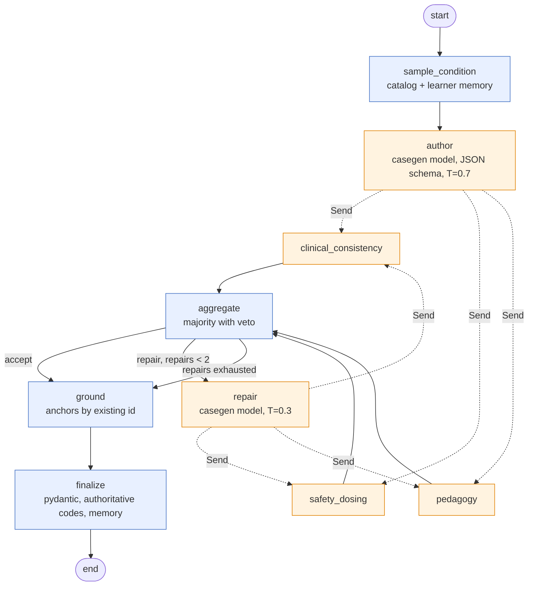
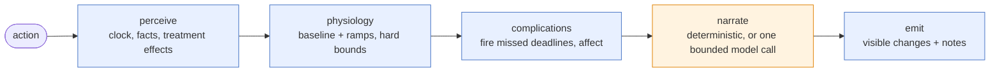

# 15. Case generator v2 and the Clinical Director

**Status:** shipped on branch `worktree-agent-a9c18d0fa31dfef2b` (2026-10-19). **Owner:** AI engineer. **Code:** `server/orchestration/`, `web/src/lib/caseGenV2.ts`. **Tests:** `server/tests/test_orchestration_*.py`, `web/src/lib/caseGenV2.test.ts`.

This document replaces the single-call generator of `server/case_generator.py` (kept untouched behind `POST /v1/case/generate`) with a LangGraph 1.2 pipeline, and adds the Clinical Director that adapts a live case to what the learner does, turn by turn. It realises the recommendation in `docs/research/16` section 1 (LangGraph core, three-judge panel with deterministic high-stakes checks, Store-backed learner memory, cost attribution from a versioned price table).

## 1. Why a graph

The v1 generator makes one bounded model call and silently falls back to a template, so a learner could not tell a model-authored case from a deterministic one, and nothing checked the model's output beyond the pydantic shape. The v2 pipeline separates authoring from verification, makes every decision auditable through a persisted trace, and follows one honesty rule: **a case is returned only when a model authored it; otherwise the route says so (HTTP 503) and the template is available only at an endpoint that labels it `meta.source = "template"`.**

## 2. Dependencies

Pinned in `server/requirements.txt` to the versions verified on PyPI on 2026-10-19:

| Package | Version | Used for |
|---|---|---|
| `langgraph` | 1.2.16 | `StateGraph`, `Send` fan-out, reducers, compiled graphs, `astream(stream_mode="updates")` |
| `langchain-core` | 1.6.12 | `parse_json_markdown` for tolerant structured-output parsing |
| `langgraph-checkpoint-sqlite` | 3.1.2 | `AsyncSqliteSaver` (checkpoints) and `SqliteStore` (learner memory) on one SQLite file |
| `aiosqlite` | >= 0.21 | the async connection the saver needs inside FastAPI |

The sync `SqliteSaver` cannot serve async nodes (it raises `NotImplementedError`), so the graph uses `AsyncSqliteSaver` on `ACUDX_DB_PATH` (default `server/data/acudx.db`); the learner store opens a second, autocommit connection to the same file.

## 3. Configuration (`server/config.py`)

| Env | Default | Meaning |
|---|---|---|
| `CASEGEN_BASE_URL`, `CASEGEN_MODEL`, `CASEGEN_API_KEY` | inherit `LLM_*` | endpoint for `author` and `repair` |
| `JUDGE_BASE_URL`, `JUDGE_MODEL`, `JUDGE_API_KEY` | inherit `LLM_*` | endpoint for the council and the Director narrator |
| `ACUDX_DB_PATH` | `server/data/acudx.db` | checkpoints and learner memory |

`AIRGAPPED` semantics are unchanged: every resolved URL passes `Settings.guard_egress()` at resolution time and again per call. Under `AIRGAPPED=true` with `LLM_PROVIDER=api` the runtime has no model client and every model-backed route answers 503.

## 4. The generator graph



### 4.1 State (`CaseGenState`)

| Key | Reducer | Written by |
|---|---|---|
| `request`, `seed`, `locale`, `condition`, `acuity`, `difficulty`, `candidate_anchor_ids` | overwrite | `sample_condition` |
| `draft` | overwrite | `author`, `repair` |
| `votes` | `operator.add` | the three judges (each vote carries its `round`) |
| `round`, `repairs` | overwrite | `repair` |
| `council` | overwrite | `aggregate` |
| `anchors` | overwrite | `ground` |
| `spec`, `status` | overwrite | `finalize` |
| `trace` | `operator.add` | every node |

### 4.2 Node contracts

**sample_condition** (deterministic). Input: `request` with optional `system`, `difficulty`, `complaint`, `locale`, `seed`, `learner_id`, `session_id`. Seeds a `random.Random`, reads the learner memory when `learner_id` is given (conditions seen are excluded while a candidate survives; with probability 0.6 the learner's weakest system replaces an absent `system` constraint), calls `condition_catalog.sample_condition`, computes the guideline candidate ids for the author prompt. Trace attributes: `condition_id`, `system`, `steered_system`, `excluded`.

**author** (casegen model, temperature 0.7, `response_format: json_schema` built from `AuthorDraft`, which is `GeneratedCaseSpec` minus free-text anchors plus `guideline_anchor_ids`). The reply is the draft; no template is merged. Condition codes, seed, locale and difficulty are stamped from the catalog so judges see the authoritative block. A malformed reply is retried once, then `ModelOutputInvalid` propagates (route: 502). Unreachable endpoint: `ModelUnreachable` (route: 503).

**clinical_consistency, safety_dosing, pedagogy** (judge model, temperature 0). Each runs its deterministic check first and asks the model only when code could not already decide. Vote shape: `{judge, round, verdict, veto, issues, repair_hints, deterministic, model}`.

| Judge | Deterministic checks | Model focus |
|---|---|---|
| clinical_consistency | vitals in hard bounds (HR 20-250, SBP 40-260, DBP 20-160, RR 0-60, SpO2 0-100, temp 30-43), diastolic below systolic, trajectory `atMs` increasing, triage vitals inside the ESI envelope, lab flag agrees with value and reference range, exam present | coherence of vitals, labs, exam and imaging with the condition |
| safety_dosing | at least one indicated and one contraindicated treatment; a fixture-contraindicated code is never `indicated` and a fixture first-line code is never `contraindicated` (`case_fixtures.CONDITION_FIXTURES`); effect keys known and deltas within caps | first-line versus harmful treatments, plausibility of effect size and direction |
| pedagogy | difficulty 1-5, `acuity_esi` within 1 of the catalog's typical acuity, 4-10 hpi items including `onset`, a red-flag hpi item when the condition lists red flags | can a learner reach the diagnosis; are EN and TR equivalent |

Veto rules: any **deterministic** failure vetoes (code-checked facts are not voted on); the safety judge also vetoes at the model phase. The other two model-phase failures are votes.

**aggregate** (deterministic). Counts only the current round. `accept` when more than half pass and nobody vetoed, else `repair`. Collects `issues` and `repair_hints` with the judge name as prefix.

**repair** (casegen model, temperature 0.3). Sends the draft plus issues and hints, asks for the complete corrected case in the same schema. Increments `repairs` and `round`, then fans out to the judges again. Bounded by `CaseGenDeps.max_repairs` (default 2).

**ground** (deterministic). Reads `draft.guideline_anchor_ids`, keeps the ids that exist in `server/guidelines_seed` and pass `has_citation`, drops the rest (listed in the trace as `dropped_ids`), then adds deterministic candidates from `anchors.candidate_ids` (topic hints per condition id plus domain affinity and token overlap) up to three anchors. Each anchor carries `statement_id`, bilingual statement, `source` (council) and `citation` (URL). Free text from the model never becomes an anchor.

**finalize** (deterministic). Validates with `GeneratedCaseSpec`, overwrites condition codes, seed, locale and difficulty, records the case in learner memory, and writes `meta`:

```json
{"source": "model", "generator": "v2", "model": "...", "models": ["..."],
 "condition_id": "acs_stemi", "thread_id": "...",
 "council": {"decision": "accept", "rounds": 1, "repairs": 0, "vetoed": false, "issues": []},
 "degraded": false, "note": null, "latency_ms": 0.0, "trace_summary": {...}}
```

When the council is still at `repair` after the last allowed repair, the case is still the model's but `degraded` is true, `note` starts with `council_exhausted`, and if a veto stands the deterministic safety overrides run first (fixture appropriateness forced, effects capped, vitals clamped). The UI must show such a case as degraded.

### 4.3 Trace events

Every node appends one record (`server/orchestration/trace.py`):

```json
{"node": "author", "status": "ok", "ts": 1760000000.0, "latency_ms": 4321.0,
 "model": "qwen2.5-7b-instruct", "model_requested": "qwen2.5-7b-instruct", "provider": "local",
 "tokens_in": 1200, "tokens_out": 800, "cost_usd": 0.0,
 "price_table_version": "2026-10-19.1", "attributes": {"temperature": 0.7}, "note": null}
```

`cost_usd` comes from `server/orchestration/prices.py`, a versioned table matched against the *served* model name (providers substitute models). Unknown models price as `null` and are listed under `trace_summary.unpriced_models` instead of being guessed. The trace is part of the state, so the checkpointer persists it with every step and `GET /v2/case/{thread_id}` returns it.

## 5. Learner memory (`server/orchestration/memory.py`)

LangGraph `BaseStore`, namespace `("learner", learner_id)`:

| Key | Content | Written by |
|---|---|---|
| `conditions_seen` | recent condition ids first, counts per system | `finalize` |
| `errors` | `{at, kind, detail, system}` items and counts per system | `POST /v2/director/step` (contraindicated treatment, missed deadline) |
| `calibration` | samples, confidence sum, correct sum | `LearnerMemory.record_calibration` (assessment hook) |

`weak_systems()` orders systems by errors per case seen; `sample_condition` uses it as described above. `GET /v2/learner/{learner_id}` returns the profile.

## 6. The Clinical Director (`server/orchestration/director.py`)



`CaseState.from_spec(spec)` builds the authoritative state: triage vitals, the authored trajectory as baseline, the case's treatment table (code, appropriateness, effects), the facts behind each trigger (`question:<intent>`, `exam:<maneuver>`, `order:<code>`), and the planned complications. For ESI 1, 2 and 3 cases one complication `missed_time_critical_treatment` is planned with a deadline of 10, 20 or 40 minutes and deterioration deltas scaled by acuity; it is cancelled when any indicated treatment is given before the deadline.

`Action`: `{kind: question|exam|order|treatment|elapsed, ref, elapsed_ms?, utterance?, locale}`. Default sim-time per kind: 30 s question, 60 s exam, 45 s order, 60 s treatment.

Node contracts:

* **perceive**: advances `t_ms`; for question, exam and order resolves the authored facts and appends new ones to `sanctioned_facts` (a trigger with no datum is noted as low value); for a treatment takes the effects from the case table, else from the generic class table (`GENERIC_EFFECTS`, mirroring `web/src/domain/treatments.ts` so client and server agree), caps every delta (`EFFECT_CAPS`), starts the ramps, applies an adverse response and records an error for a contraindicated code, and cancels averted complications.
* **physiology**: `vitals(t) = baseline(t) + sum of ramps(delta, onset, t - start)` then `clamp_vitals`: HR 20-250, SBP 40-260, DBP 20-160 and below SBP, RR 0-60, SpO2 0-100, temp 30-43. SpO2 can never exceed 100 regardless of stacked oxygen effects.
* **complications**: fires every pending complication whose deadline has passed, logs `why` (the planned reason), records a `missed_deadline` error, recomputes vitals and affect (consciousness drops to drowsy below SBP 85 or SpO2 86 and to unresponsive below SBP 70 or SpO2 75).
* **narrate**: deterministic line by default. With a model, one bounded call (judge endpoint, temperature 0.6, 240 tokens) may set `utterance_en/tr`, `pain` and `mood`. The prompt lists only the sanctioned facts of this turn; the model cannot change vitals, facts or complications, and any failure falls back to the deterministic line with the reason in the trace.
* **emit**: `patient_visible_changes = {t_ms, vitals, affect, utterance_en, utterance_tr, new_facts, complications_fired, trace}`; `director_notes = [{at_ms, note, why}]`.

API: `next_state(case_state, action)` (sync, deterministic) and `anext_state(case_state, action, llm)`; both return `(case_state, patient_visible_changes, director_notes)`.

## 7. HTTP surface (`server/orchestration/routes.py`, mounted in `server/app.py`)

| Route | Behaviour |
|---|---|
| `POST /v2/case/generate` | runs the graph on `thread_id` (given or new); 200 `{thread_id, spec, trace_summary, trace, council}`; 503 `model_unreachable`; 502 `model_output_invalid` |
| `POST /v2/case/generate/stream` | probes the endpoint, then SSE: `start {thread_id, pipeline}`, one `node {node, status, trace, council?}` per executed node in execution order (the three judges arrive in any order), then `done {thread_id, spec, trace_summary}` or `error {error, status, detail}` |
| `POST /v2/case/template` | deterministic template with `meta.source = "template"`, `degraded = true`; anchors still by existing id |
| `POST /v2/director/step` | `{case_state | spec, action, learner_id?, use_model?}` to `{case_state, patient_visible_changes, director_notes}`; new errors are written to learner memory |
| `GET /v2/case/{thread_id}` | checkpoint read: `status`, `spec`, `council`, `condition`, `trace`, `next`; 404 when unknown |
| `GET /v2/learner/{learner_id}` | memory profile |

`/v1/case/generate` is untouched. The `/v2` runtime is built lazily on first request and cached on `app.state.orchestration`; tests build their own runtime with an in-process transport.

## 8. Web client (`web/src/lib/caseGenV2.ts`)

Typed fetch helpers following `backend.ts` conventions (bounded timeout, `{ok, data} | {ok: false, error, status}`, never throws): `generateCaseV2`, `templateCaseV2`, `readCaseThread`, `directorStep`, and `streamCaseGenV2` with a pure `parseSseBuffer` for the POST-based SSE stream. `v2SpecToCaseInstance` reuses `specToCaseInstance` from `liveCaseGen.ts` and labels provenance from `meta.source`. The error code of a non-2xx answer (for example `model_unreachable`) is surfaced as `error` so the UI can explain the degraded state instead of guessing.

### 8.1 Encounter wiring (shipped 2026-10-20)

Code: `web/src/pages/EncounterPage.tsx`, `web/src/components/ehr/CaseGenProgress.tsx`, `web/src/components/ehr/SimBadge.tsx`, `web/src/state/encounterStore.ts`, `web/src/lib/liveEncounter.ts`, `web/src/components/ehr/tabs/InterviewTab.tsx`, `web/src/domain/debrief.ts`. Strings: `web/src/i18n/features/live2.{en,tr}.json`.

Generation. "New random case", the constrained menu and the Start page hand-over all call `streamCaseGenV2` when the gateway is reachable. `CaseGenProgress` shows the stages (sampling, authoring, council judging, repairing, grounding, finalizing) from the `node` events (`stageForNode`). A `done` spec is adapted with `v2SpecToCaseInstance` and started with a `CaseGenerationMeta` (`source: "model"`, thread id, council decision, veto and repairs, degraded flag, model). On 503 `model_unreachable`, 502, timeout or a broken stream the panel shows the real error and two labelled choices: "Use template case (deterministic, not model generated)" calls `POST /v2/case/template` and starts the case as `source: "template"`, `degraded: true`; "Retry" reruns the same request. The on-device generator runs only when the gateway is unreachable and is labelled `source: "offline"`. The banner `SimBadge` names the source for every case (model, template, offline, curated, published) with the council verdict and a degraded marker for model cases.

Director. In Live mode the store queues one `directorStep` per learner action (question, exam, order, treatment or medication) and every 60 s of sim time (`elapsed`, coalesced). Calls are serialised in action order and never block the UI. The first step sends `spec` (`caseInstanceToSpec`, so curated and offline cases get a Director too); later steps round-trip the opaque `case_state`. `patient_visible_changes` is folded into a client overlay (`applyDirectorChanges`): the delta between the Director's vitals and the local course at the step is applied on top of the running local ramps and clamped to the server bounds (`DIRECTOR_BOUNDS`), so `getCurrentVitals` and `getVitalsSeries`, and with them the monitor, flowsheet and PatientViewer, show the Director's deterioration or recovery. New facts and fired complications accumulate; each `director_notes` entry becomes a `note` event with `meta.director = true` and a fired complication a `stage` event, both listed in the debrief under "Clinical Director notes". A failed step sets `director.status = "error"` with the reason and the local course continues.

Persona. `getPersonaLiveContext` gives `InterviewTab` the Director's sanctioned facts, the current vitals, their plain adjectives (`vitalsAdjectives`: tachycardic, hypotensive, hypoxic, drowsy, ...), affect and complications, which ride in `case_state` of `POST /v1/patient/turn`, so the patient voices the trend.

## 9. Tests

`python -m pytest server/tests -q`: graph topology, model-sourced happy path with trace and cost, safety veto with one repair, repair bound at two with safety overrides, SpO2 over 100 caught by the consistency judge, model-phase majority without veto, grounding drops unknown ids, author retry on bad JSON, learner memory anti-repeat and weak-system steering, SQLite persistence of checkpoints and memory, judge unit checks, aggregator, Director bounds and complications, narrator fallback, routes (503 unreachable, 503 under AIRGAPPED with a hosted endpoint, template labelling, SSE order, checkpoint read, director step with memory). Model-dependent tests use `server/tests/openai_double.py`, an in-process OpenAI-compatible FastAPI app reached through `httpx.ASGITransport`. `test_orchestration_live.py` is marked `live` and runs only when `CASEGEN_BASE_URL` is set.

## 10. Open items

* Faculty approval gate: `interrupt()` before `finalize` for summative cases (`docs/research/16` section 1.2) is not wired yet.
* The judge council runs on one model today; the research recommends three model families. `JUDGE_*` already separates the judge endpoint from the author; per-judge endpoints are the next step.
* Checkpoints accumulate in SQLite; add a pruning job and move to `PostgresSaver` for multi-process deployment.
* Calibration is recorded through `LearnerMemory.record_calibration` but no route writes it yet; the assessment service should call it after grading.
* Resolved (October 2026): `caseGenV2.withLearnerId` fills `learner_id` on `/v2/case/generate`, the SSE generator and `/v2/director/step` from `profileStore.selectLearnerId` (verified IdP `sub`, otherwise the pseudonymous `localId` that the local principal also carries in `X-User-Id`). An explicit `learner_id: null` from the caller opts out (faculty preview).
