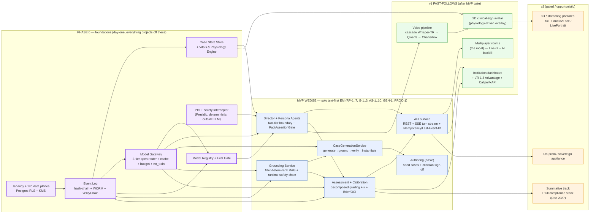

# 01 — Full Integration Plan: Demo → Production

**Status:** Build-ready integration plan. **Date:** July 2026. **Owner:** Principal architecture + platform lead.

**What this doc is.** The concrete, mechanical plan for taking the runnable `web/` **demo** (Vite + React 18 + TS + Tailwind v4 + Radix + i18next EN/TR, three routes — Home, Encounter/EHR workspace, Feedback — running entirely on client-side mock layers) to **production**: a sovereign-capable, open-source-first, EN/TR clinical-roleplay and assessment platform. It maps every mock layer to its real service, sequences the build against the requirement gates, scaffolds the backend, orders the API/contract work, wires FHIR persistence + event sourcing + the two data planes, wires auth/LTI 1.3, integrates open voice + avatar, and defines the eval/CI/observability gates — with a realistic timeline and team.

**It does not re-derive architecture.** The invariants, service boundaries, and vendor picks are owned by `docs/architecture/00–11` and the open-source map in `docs/research/11-fully-open-source-stack.md`. This doc is the *bridge*: it treats the demo as the presentation-layer prototype it is and names exactly what replaces each fake seam. Where this doc and a service doc disagree, **the service doc wins**.

**Companion:** `00-roadmap.md` (phase-by-phase roadmap with per-phase metric gates and demo-screen → milestone mapping). Read that for *when*; read this for *what replaces what and how*.

---

## 0. The demo as it stands (what is real, what is faked)

The demo is a **faithful presentation-and-domain-model prototype**. It already contains production-shaped artifacts that survive to production largely intact, and a set of client-side fakes that stand in for real services.

**Survives to production (reuse, do not rebuild):**
- **The whole design system** — tokens (`bg-bg`/`bg-surface`/`text-fg`/`text-muted`/`border-border`/`bg-brand`/`rounded-card`/`rounded-control`/`shadow-soft`/`font-mono` + `monitor-*`/`state-*`/`axis-*`/`calib-*`), shell (`AppFrame`/`TopNav`/`PageContainer`), UI primitives (`Button`/`Card`/`Badge`/`Tabs`/`Tooltip`/`Switch`/`Skeleton`/`Stat`), the EHR components (`PatientBanner`/`Storyboard`/`ActivityTabs` + the `ChartReview`/`Interview`/`Flowsheet`/`Orders`/`Results`/`ProblemList` tabs), `VitalCard`/`Sparkline`/`CalibrationPlot`/`CitationPill`/`GapCard`/`DomainBand`/`ProcessTimingCard`/`TreatmentChecklist`, `EncounterClock`.
- **The FHIR-shaped domain model** — `src/domain/fhir.ts` (Patient/Encounter/Observation/Condition/DiagnosticReport/AllergyIntolerance + ICD10/DSM5TR/LOINC codings), `src/domain/case.ts` (`CaseInstance`, reveal graph, `OrderExpectation`, `QuestionIntent`, `ExamManeuver`), `src/domain/processMetrics.ts` (pure process-metric functions).
- **The event envelope shape** — `EncounterEvent { seq, type, ref, at, meta }` in `src/state/encounterStore.ts`. This is the *client projection* of the production `EncounterEvent`; its field discipline (monotonic seq, sim-clock offset, structured meta) is exactly the write-model contract.
- **i18n EN/TR** — `src/i18n/locales/{en,tr}.json` via `t()`; the bilingual `Bilingual{en,tr}` pattern threads through the domain model.

**Faked (this plan's demolition list):** the six mock layers in §1.

---

## 1. Demo → production MAPPING (each mock layer → real service)

Each row: the demo fake, the file it lives in, what it pretends to be, the **production service** that replaces it (owning architecture doc), the **open-source component** (from `research/11`, with license), and a rough **effort/size**. Effort is engineer-weeks for a small senior team, MVP-scope unless noted.

| # | Demo mock layer | Where (demo) | What it fakes | Production service (owning doc) | Open-source component (license) | Effort / size |
|---|---|---|---|---|---|---|
| **M1** | **Static case content** — one hand-written chest-pain case + transcript + vitals series + guidance hints + feedback report | `src/data/mock.ts` | A real encounter's content, dialogue, results, and grade | **Case State Store + Grounding + Assessment** projections off the Event Log (arch/01 §7, 05, 06); content becomes `GuidelineStatement`s + `CaseVersion`s | Postgres 16 (source of truth) · Medplum (Apache-2.0) FHIR patterns for resource shapes | Retire mock → replace with API reads: **1–2 wk** once services exist |
| **M2** | **5 curated seed `CaseInstance`s** — fully specified EM cases (ACS/SAH/appy/PE/panic) with ground truth, reveal graph, rubric anchors, workup windows | `src/data/seedCases.ts` | The authored/generated case library | **Authoring Service** (6-stage AI-draft / clinician-signoff, arch/05 §3.2, AU-1/AU-2) → `Case`/`CaseVersion`/`Rubric` in Postgres; the 5 seeds become the **first human-reviewed cases** and the golden eval set | Medplum (Apache-2.0) for FHIR authoring UI patterns; Postgres+JSONB store | **3–4 wk** (schema + author UI + sign-off gate); seeds seed the eval set for free |
| **M3** | **Client-side case generator** — `mulberry32` seeded RNG + prevalence×edu-value weighted presentation table + deterministic validity checks + regenerate-on-fail loop | `src/domain/caseGen.ts` | Unlimited, non-repeating, grounded case generation (GEN-1) | **CaseGenerationService** behind the Model Gateway: `sample dx → draft (large-open) → RAG-ground → cross-family verify + deterministic checks → instantiate FHIR + reveal graph + rubric anchors` (overview/04 §3.2) | **Qwen3.5-397B** draft (Apache-2.0) → **BGE-M3** retrieve (Apache) over **Qdrant** (Apache) → **MedGemma/Meditron** verify (HAI-DEF / Llama-Community) + pure-code checks (already in `caseGen.ts` `validateCase`) | **6–10 wk** (pipeline + verifier ensemble + validator port + clinician spot-review gate) |
| **M4** | **`setTimeout` result timers** — labs return in ~20 s sim, imaging ~45 s, hardcoded; reveal via `resolveReveal` | `src/state/encounterStore.ts` (`placeOrder` → `setTimeout` → `resolveOrder`) | Realistic order turnaround + the whole turn/reveal loop | **Encounter Service** turn loop (arch/01) + **Vitals & Physiology Engine** deterministic tick (arch/04); results are event-sourced side-effects on the physiology clock, not timers | TypeScript service; **Postgres** event log; turnaround becomes case-authored `turnaroundMs` on the reveal graph, driven by the Director not a browser timer | **4–6 wk** (server turn loop + reveal-graph engine + physiology tick) |
| **M5** | **Static feedback + dashboards** — hardcoded 6-domain bands, calibration points, gaps, treatment behaviors, home stats/recommendations/recent-feedback | `src/data/mock.ts` (`feedbackReport`, `feedbackDomains`, `calibrationPoints`, `feedbackGaps`, `treatmentBehaviors`, `dashboardStats`, `recommendedCases`, `recentFeedback`) + `src/domain/processMetrics.ts` (real, pure — keep) | Decomposed grading, calibration math, gap analysis, progression, cohort analytics | **Assessment Service** (decomposed evidence-span grading, band mapping, κ gates — arch/06) + **Calibration Engine** (Brier/OCI/ECE, deterministic) + **Learning/Progression** (FSRS) + **Institution/Analytics** (arch/06 §8, 10 §2.6) | **Qwen3.5-397B + MedGemma** grader ensemble (grader≠patient family) via Model Gateway · **Python** psychometric service · **ts-fsrs** (MIT) · **ClickHouse** (Apache) analytics read-models · **Superset** (Apache) BI | **8–12 wk** (grading pipeline + calibration math + κ/anchor set + progression + analytics reads) |
| **M6** | **In-memory / single-client state** — `encounterStore` is a module-level singleton via `useSyncExternalStore`; no rooms, no persistence, no multi-user | `src/state/encounterStore.ts` | Multiplayer rooms, presence, voice, avatar, persistence, multi-tenancy | **Room Service** (event-sourced rooms + AI backfill, arch/07) + **Realtime Media** + **Voice Pipeline** + **Avatar Renderer** + the **Event Log / two data planes / tenancy** substrate (arch/08, 09) | **LiveKit** self-host (Apache) SFU + Agents · **Whisper-v3+TR-LoRA** STT (MIT) + **Chatterbox v3** TTS (MIT) · **LivePortrait+MuseTalk** (MIT) + **Audio2Face-3D** + **R3F** (MIT) · **Keycloak** (Apache) + **ltijs** (Apache) · Postgres + **Valkey** (BSD) + **NATS/Kafka** (Apache) | **v1/v2**: rooms **8–10 wk**, voice **8–12 wk**, avatar **8–12 wk**, tenancy/data-plane spine folded into Phase 0 |

**Extra layer — the model access seam.** The demo has *no* LLM at all (deterministic RNG stands in for generation, static text stands in for personas/grading). Production introduces the **Model Gateway** (arch/02, AD-4) as the *only* path to any model — small-open (patient turns, **Qwen3-32B**), large-open (grading/guidance, **Qwen3.5-397B / DeepSeek V4**), guardrail (**gpt-oss-20b**), medical verifier (**MedGemma/Meditron**), rare frontier escalation (**Opus 4.8 Batch**). This is a **Phase-0 foundation node**, not a per-feature add. Effort: **6–8 wk** (adapters + 3-tier router + prefix-builder + byte-stable cache + budget/degrade + `no_train`/region + `ModelCallEvent` audit).

### 1.1 What each mock's replacement must preserve (the load-bearing contracts)

- **M3 (generator):** the deterministic `validateCase` checks (vitals ranges, age/sex plausibility, internal consistency, high-acuity-needs-critical-action) are the **local analogue of the verify step** — port them verbatim into the CaseGenerationService's deterministic-check stage; they are the code half of "abstain > ship-wrong."
- **M4 (timers):** the reveal graph (`resolveReveal`, question-intent/exam-maneuver/order-code → datum ids) is the **progressive-disclosure contract** (overview/04 §2.3). Keep the graph; move the clock from `setTimeout` to the physiology engine + Director.
- **M5 (feedback):** `processMetrics.ts` is already the **production process-metric layer** — it runs over `EncounterEvent[]` identically for mock and live logs (the module's own doc-comment states this). It survives untouched; only its *input* changes from `feedbackEncounterEvents` fixture to a replayed live log.
- **M6 (store):** the `EncounterEvent` envelope + monotonic `seq` + sim-clock offset is the **event-sourcing write-model contract**. The client store becomes a thin SSE-fed projection of the server Event Log; the append actions (`askQuestion`/`requestExam`/`placeOrder`/`commitDiagnosis`) become REST `POST /turns` calls whose results stream back.

---

## 2. Integration SEQUENCING — MVP → v1 → v2 (tied to requirement gates)

The build order is the architecture's dependency graph (overview/02 §7, arch/00 build sequence), gated by the MVP success metrics (overview/01 §6). **Wire the encounter loop + grounding + assessment first; then rooms/voice/avatar/dashboard.**



**Sequencing rules, stated:**
1. **Nothing learner-facing ships before the four foundation nodes** (Event Log, Model Gateway, Case State + Vitals, PHI/Safety) + the tenancy/data-plane spine. These are cheap to build early and a rewrite to retrofit (arch/10 §Open build sequence).
2. **The encounter loop + grounding + assessment are the MVP wedge** — the calibration plot is the signature feature; the wedge must be 10× before anything else (overview/01 §6). CaseGeneration (GEN-1) rides inside the MVP because the demo already proves the *shape*; MVP can ship on the **5 seed cases + a live-generation flag** (overview/04 §5 B2).
3. **Rooms are the first fast-follow — above single-player polish** (the moat, MP-1; overview/01 §6). Then voice (cascade), then institution dashboard + LTI, then the 2D clinical-sign avatar.
4. **Summative, 3D/streaming, and the on-prem appliance are v2** — each gated (summative behind the Dec-2027 compliance stack, T5; appliance behind the ≈>3–5M tok/day break-even, AD-7).

**Gate between MVP and v1 (must all hold):** cohort ≥200 learners, D30 retention ≥25%, median ≥3 encounters/wk, measured competence rises wk1→wk6 on a held-out case, first-encounter completion >70%, ≥80% correctly interpret their calibration plot, blended text-encounter cost **<$0.15**, and **one paid design-partner pilot** (overview/01 §6).

---

## 3. Backend scaffold plan (services, monorepo, open stack, deployment)

### 3.1 Monorepo layout (single Model-Gateway chokepoint)

TypeScript-primary (services + realtime + the existing `web/`), one Python service for psychometrics (arch/00 §5.2). The single hard rule: **a `no-restricted-imports` CI lint bans any vendor/model SDK import outside `packages/model-gateway/`** — the Model-Gateway-only invariant enforced at the import boundary (arch/02 §1, ADR-0013).

```
acudx/
├── web/                          # EXISTING demo → the production client (reuse wholesale)
├── packages/
│   ├── model-gateway/            # ONLY place a model/provider SDK may be imported
│   │   ├── adapters/             # vLLM/SGLang (Qwen3, gpt-oss), TEI (BGE-M3), MedGemma, Opus-Batch
│   │   ├── router/               # 3-tier open router + escalation signals
│   │   ├── prefix/               # byte-stable cached-prefix builder + assertByteStable()
│   │   ├── budget/               # $0.15 soft / $0.43 hard + degrade ladder
│   │   └── audit/                # ModelCallEvent (hash-only)
│   ├── event-log/                # append-only hash chain + verifyChain + WORM checkpoints
│   ├── domain/                   # SHARED types — lift web/src/domain/* up to a package
│   ├── case-state/               # Case State Store + Vitals & Physiology Engine (deterministic tick)
│   ├── grounding/                # GuidelineStatement store + filter-before-rank RAG + runtime safety chain
│   ├── safety/                   # PHI Interceptor (Presidio) + red-flag rules (deterministic, outside LLM)
│   ├── assessment/               # rubric freeze + decomposed grading orchestration + gap analysis
│   ├── calibration-py/           # PYTHON — Brier/OCI/ECE/κ/DIF (deterministic, no LLM)
│   ├── case-gen/                 # CaseGenerationService (sample→draft→ground→verify→instantiate)
│   ├── authoring/               # 6-stage AI-draft / clinician-signoff pipeline + version-hash
│   ├── rooms/                    # v1 — event-sourced rooms + AI backfill + floor control
│   ├── voice/                    # v1 — cascade STT→LLM→TTS + barge-in + C2PA
│   ├── avatar/                   # v1/v2 — sign-state fan-out + LivePortrait/MuseTalk/A2F drivers
│   ├── analytics/                # ClickHouse read-models + GraphQL resolvers
│   └── identity/                 # Keycloak integration + ltijs LTI 1.3 + SCIM/OneRoster resolver
├── services/
│   ├── api-gateway/              # REST + SSE + WebRTC token mint + GraphQL edge + RLS tenant pin
│   ├── encounter/                # Clock-1 turn loop (Director + Persona + FactAssertionGate host)
│   ├── grounding-assessment/     # Clock-2 workers (out-of-band)
│   └── analytics-authoring/      # Clock-3 batch workers
├── infra/                        # OpenTofu (MPL) + K8s manifests + Helm; per-region
├── evals/                        # golden sets + red-team (dose/pediatric/country traps) — CI gate
└── docs/                         # THIS repo's docs (already present)
```

### 3.2 The open-source stack (the sovereign default; `research/11` is authoritative)

| Layer | Default-open pick (license) |
|---|---|
| **General LLM** | **Qwen3-32B** patient turns / **Qwen3.5-397B-A17B** grading+guidance (Apache-2.0); **DeepSeek V4** (MIT), **gpt-oss-20b/120b** (Apache) peers |
| **Medical verifier** | **Meditron 70B** (auditable, Llama-Community) primary for sovereign; **MedGemma** optional (⚠ HAI-DEF terms) — verifier only, never the persona |
| **Serving** | **vLLM** (Apache) control plane + **SGLang** (Apache) patient fleet (RadixAttention on shared case prefix); **TensorRT-LLM** only for voice-coupled path; **llama.cpp/Ollama** (MIT) edge |
| **Embeddings / rerank** | **BGE-M3** + **bge-reranker-v2-m3** (Apache), served via **TEI** |
| **Vector + BM25** | **Qdrant** (Apache) filterable-HNSW (country filter *inside* traversal) + **Postgres FTS**; **pgvector/VectorChord** collapses vector store into Postgres for the single-box sovereign build |
| **STT** | **Whisper large-v3 + TR-medical LoRA** (MIT) via **faster-whisper/WhisperX** for Turkish; **Parakeet/Canary** (CC-BY) for EN/EU |
| **TTS** | **Chatterbox v3** (MIT, TR, watermarked) + **Piper** (MIT edge) + **Kokoro** (Apache fallback). **NOT XTTS-v2 / F5** (non-commercial weights) |
| **Voice orchestration** | **LiveKit Agents** self-host (Apache) + **Silero VAD** (MIT); on-prem S2S option **Moshi**/**Ultravox** |
| **Avatars** | **2D physiology portrait** (in-house) + **LivePortrait + MuseTalk** (MIT) + **Audio2Face-3D** + **R3F** (MIT) — replaces Anam/Tavus. **NOT InstantID-encoder / FLUX.1-dev output** |
| **Image-gen faces** | **Qwen-Image / FLUX-schnell** (Apache) + **PuLID/PhotoMaker** (Apache) for seed-stable per-case faces |
| **Transport** | **LiveKit** self-host (Apache) / **mediasoup** (ISC) |
| **FHIR** | **Medplum** (Apache) — TS-native, whole platform open |
| **Auth / LTI** | **Keycloak** (Apache) SAML/OIDC/SCIM + **ltijs** (Apache) LTI 1.3; **Authentik** (MIT) if first-party SCIM decisive |
| **Data plane** | **Postgres 16** + **Valkey** (BSD, was Redis) + **NATS/Kafka** (Apache) + **ClickHouse** (Apache) + **SeaweedFS** (Apache object store) + **OpenTofu** (MPL, was Terraform) + **Kubernetes** |
| **Analytics / LRS** | **SQL-LRS** (Apache) + **Superset** (Apache) + Caliper/xAPI |
| **Obs / eval / guardrail / PHI** | **Langfuse** (MIT) + **Ragas/DeepEval/promptfoo/Giskard** (Apache) + **NeMo/Guardrails AI** (Apache) + **Presidio** (MIT) |
| **Spaced-rep / provenance** | **ts-fsrs** (MIT) + **c2pa-rs** (Apache/MIT) |
| **Frontend** | Vite/React/Tailwind/Radix/i18next/Three.js (all MIT) — **already the demo; nothing to swap** |

**License discipline is a build constraint** (overview/01 §3.8): avoid the non-commercial-weight traps (XTTS/F5/InstantID-encoder/FLUX-dev), the relicensed components (use **Valkey** not Redis, **OpenTofu** not Terraform; **Zitadel** is AGPL — not the default IdP), and the medical Prohibited-Use terms (Gemma-3 PUP, MedGemma HAI-DEF — keep MedGemma as one verifier in an ensemble, prefer Meditron for a maximally-clean sovereign build).

### 3.3 Deployment (multi-region SaaS + sovereign/on-prem variant)

- **SaaS multi-region:** K8s per region (`eu-central`, `uk`, `us`; `me-central`/`ap` on demand). `Org.region` immutable. **RLS within a region**, **db/cluster/KMS-namespace/K8s-deployment per region** across regions; base URL region-pinned, cross-region `421`-redirects. Global control plane (Model Registry config + PII-free case library + guideline corpus) replicates read-only into each region. GPU fleet from EU/Türkiye neo-cloud regions (H100/H200 spot) for residency + COGS (research/08 §4).
- **Sovereign / air-gapped appliance (the differentiator, AD-7, research/11 §A):** a single self-hostable containerized appliance a Türkiye ministry (T.C. Sağlık Bakanlığı / KVKK) or a privacy-max school runs **entirely on-prem with ZERO third-party data egress**. Reference stack: **Qwen3-32B + Qwen3.5-397B + gpt-oss-20b** on **vLLM/SGLang**, **Meditron 70B** verify, **BGE-M3 + bge-reranker** (TEI), **Qdrant/pgvector + Postgres FTS**, **Whisper-TR + Chatterbox-TR** voice via **LiveKit** self-host, **LivePortrait/MuseTalk + A2F + R3F** avatars, **Keycloak + ltijs**, **Postgres + Valkey + NATS/Kafka + ClickHouse + SeaweedFS + OpenTofu + K8s**, **SQL-LRS + Superset**, **Langfuse + Presidio + c2pa-rs**. The SaaS control plane orchestrates but **never sees PHI**; the appliance is structurally possible because **no layer must phone home to a vendor**. All-open per-encounter COGS ~**$0.10–0.30** (voice+avatar) vs ~$1–7 managed (research/11 §B). What is traded going air-gapped is *last-mile polish + ops-outsourcing* (top-end voice/avatar realism, the rare frontier-reasoning escalation), **not capability**.
- **Break-even honesty:** text-LLM self-host breaks even ≈≥500K tok/day; voice+avatar self-host breaks even at higher sustained concurrency (idle GPU is the #1 leak). **All-open for high-volume + every sovereign tenant; managed voice/avatar for low-volume + the top-realism premium tier.** A low-volume pilot may start API-first (or managed voice) until the fleet amortizes.

---

## 4. API / contract implementation order (from architecture/10)

The API surface is built in the order arch/10 §"Open questions & build sequence" fixes — MVP-blocking wedge first, institutional money-layer second, multiplayer last. Each row names the transport (arch/10 §1: REST for CRUD, SSE for the text stream, LiveKit data channels for realtime, read-only GraphQL for analytics) and the demo action it replaces.

| Order | Contract | Transport | Replaces (demo) | Owning §; gate |
|---|---|---|---|---|
| **A1** | `POST /v1/encounters` (start on `case_version_hash`, `ai_disclosure_ack_required`) + `GET /stream` (SSE turn/affect/stage) | REST + SSE | `startEncounter(caseInstance)` | arch/10 §2.1–2.2; **MVP-blocking**. Prove <100 kbps + p95<1.5s |
| **A2** | `POST /v1/encounters/{id}/turns` (`202`; response streams on SSE) | REST→SSE | `askQuestion`/`requestExam`/`placeOrder` | arch/10 §2.2 |
| **A3** | **PHI Interceptor at turn ingress** — `422 phi_block` before persistence | (middleware) | *(none — new safety wall)* | arch/10 §2 build-seq #2; **MVP-blocking**, day one |
| **A4** | `POST /confidence` (must precede grade) → `GET /grade` (band-only, `202` while pending) → `GET /calibration` → `GET /gaps` | REST | `feedbackReport`/`calibrationPoints`/`feedbackGaps` statics | arch/10 §2.4; **order-enforced**, no `domain_raw` ever crosses |
| **A5** | `POST /encounters/{id}/guidance` (out-of-band Socratic hint; cited or refused, streams on SSE) | REST→SSE | `guidanceHints` static | arch/10 §2.3; citation-or-refuse |
| **A6** | **Audit-event emission on every mutating route** into the hash-chained Event Log | (middleware) | `EncounterEvent[]` client log | arch/10 §2 build-seq #4; cheap early, rewrite to retrofit |
| **A7** | **Region-pinned base URL + tenant/RLS** enforcement | (edge) | *(none — new)* | arch/10 §1.1; residency spine |
| **A8** | `POST /v1/cases` · `/versions` · `/rubric` · `/authoring/enrich` (authoring-time MCP: ICD-10/ChEMBL/PubMed) | REST | `seedCases` array | arch/10 §2, §11; clinician-gated |
| **A9** | **LTI 1.3 Advantage Complete** — `POST /lti/1.3/login` · `/launch` → NRPS roster → Deep Linking → **AGS passback with formative/summative co-sign gate** | REST (OIDC + client-credentials) | *(none — v1 money layer)* | arch/10 §4; **v1 P0** for institutional |
| **A10** | `POST /graphql` — read-only persisted, role-scoped cohort→section→learner→encounter→evidence-span; `POST /exports/accreditation` | GraphQL | `dashboardStats`/`recommendedCases`/`recentFeedback` | arch/10 §2.6; v1 |
| **A11** | `POST /scim/v2/Users` + OneRoster 1.2 + standalone SAML/OIDC | REST (SCIM) | *(none)* | arch/10 §5–6; v1 |
| **A12** | **Caliper 1.2 / xAPI** emission (clock-3 batch) + outbound signed webhooks | (async) | *(none)* | arch/10 §7–8; v1 |
| **A13** | `POST /v1/rooms` · `/join` · `/roles` — LiveKit token mint + `text_fallback_stream` | REST + WebRTC | *(none — v1 moat)* | arch/10 §2.5; v1 after solo loop flawless |

**Cross-cutting conventions applied from A1:** short-lived OAuth 2.1 JWTs; `tenant_id` from the token claim (never the body) → RLS; `Idempotency-Key` on every non-GET (replay-safe, never double-appends); RFC 9457 `problem+json` errors; opaque cursors; `Last-Event-ID` SSE resume.

---

## 5. Data / FHIR persistence + event sourcing + the two data planes

### 5.1 Event sourcing (the demo's `EncounterEvent` grows up)

- The demo's `EncounterEvent { seq, type, ref, at, meta }` is the *shape* of the production write model. Production adds the arch/08 §3.2 envelope: `event_id (ULID)`, `tenant_id`, gap-free `seq`, `prev_hash`, `hash = SHA-256(body ‖ prev_hash)`, `occurred_at`, class-specific `payload`. **Freeze the canonical-JSON serialization and envelope before the first event is written** (arch/00 build-seq #1) — `stream_id`/`stream_seq`/`plane`/`crypto_ref` are v1 fields, not a later migration.
- **Postgres 16** append-only `event_log` is authoritative; **every store is a replayable projection** — Case State, Grade, Calibration, the guideline corpus, analytics. A lost projection rebuilds by replaying to `event_log_head_hash`. **S3/SeaweedFS Object-Lock (WORM) + KMS-signed checkpoints every 5 min / 10k events** bound an attacker's rewrite window; `verifyChain` in CI.
- **Event bus: NATS/Kafka** (Apache) — propagation only, never truth; three logical streams map the three clocks (`conversation.*` / `grounding_assessment.*` / `analytics.*`) so a slow clock-3 consumer can't starve a clock-1 turn. Consumers are idempotent (keyed by `event_id`) and replay-safe.
- **The demo's `processMetrics.ts` already consumes `EncounterEvent[]`** — in production it consumes a **replayed live log** instead of the `feedbackEncounterEvents` fixture. Zero rewrite; only the source changes.

### 5.2 FHIR persistence

- The demo's `src/domain/fhir.ts` (Patient/Encounter/Observation/Condition/DiagnosticReport/AllergyIntolerance + ICD10/DSM5TR/LOINC) is the FHIR-shaped read model. Production persists these as **projections of case-generation + encounter events** into Postgres+JSONB, using **Medplum (Apache-2.0)** component/resource-binding patterns as the reference (own the components in the AcuDx design system for medkit visual consistency — overview/04 §6 favors reimplementing Medplum's FHIR-binding patterns over embedding Medplum's UI). No real patient-data path ever (synthetic-only wall).
- Objective data is **fixed by the ground truth** (a re-asked lab returns the same value); the reveal graph controls *when* it becomes visible. Turnaround (`LAB_SIM_MS`/`IMAGING_SIM_MS` in the demo) becomes case-authored `turnaroundMs` on the reveal graph, driven by the Director + physiology engine, not a browser `setTimeout`.

### 5.3 The two data planes (privacy axis)

- **Identified-education plane** (learner PII, transcripts, grades, calibration, progression): `no_train=true` hard, never trains, region-pinned to the tenant.
- **De-identified-improvement plane** (k-anonymized/synthetic traces): the **only** trainable source, opt-in consent only, **separate DB cluster + KMS namespace + network segment; no service holds credentials to both**; one-way de-id projection, no reverse path, no join key.
- **Right-to-erasure vs the immutable chain** is reconciled by **crypto-shredding**: destroy the per-subject data key → ciphertext unrecoverable, hash-over-ciphertext still verifies, chain intact, band + `rubric_version_hash` + `model_config_id` retained for appeal defensibility.
- **No learner-emotion field exists anywhere in the schema** (EU-prohibited since Feb 2025; roleplaying an anxious *patient* is fine, reading the *learner's* emotion is banned) — absence-by-design.

---

## 6. Auth / LTI 1.3 wiring steps

**Identity provider:** **Keycloak** (Apache) as the open default IdP (SAML/OIDC/LDAP), replacing Auth0/Okta; **ltijs** (Apache) for LTI 1.3; **Authentik** (MIT) only if first-party SCIM is decisive. Steps, in build order (arch/10 §4–6, AD-1/AD-2):

1. **Identity & Tenancy resolver first** — `(protocol, issuer, subject, deployment_id) → user_id` uniqueness + region resolution + RBAC scope grants. This is the AcuDx-specific glue; the protocols are commodity (arch/00 build-vs-buy).
2. **Standalone SSO (SAML 2.0 SP + OIDC RP)** via Keycloak — Shibboleth/InCommon, Entra ID, Okta, Google Workspace; eduPerson attributes → AcuDx `Role` + `Cohort/Section`; assertion/token region-mismatch rejected (residency).
3. **LTI 1.3 Advantage Complete via ltijs** — the P0 institutional integration:
   - **OIDC third-party-initiated launch** (`POST /lti/1.3/login` → `/launch`): validate `id_token` JWS against the Platform JWKS; mint a short-lived AcuDx token; emit `auth.lti_launch`.
   - **NRPS 2.0 roster** (server-to-server, OAuth 2.0 client-credentials): pull cohort/section membership + roles → map LMS roles to AcuDx `Role` via a **reviewed, versioned crosswalk** (data, not code) — the open NRPS role-mapping question.
   - **Deep Linking 2.0**: educator browses the AcuDx case bank inside the LMS, drops a version-pinned `CaseVersion` as a graded activity.
   - **AGS 2.0 grade passback with the formative/summative gate**: post the **band** mapped to the LMS scale (`{B1..B5}→{1..5}` default, per-tenant config); a **summative** grade is withheld from AGS until a named human **co-sign** exists (the passback worker refuses a null-co-sign summative `Score`). Every passback is an audit event.
4. **SCIM 2.0 + OneRoster 1.2 provisioning** — Entra/Okta auto-provision/suspend/deprovision; OneRoster for SIS/LMS academic rostering; both converge on `Org · Cohort/Section · User · Role`; `admin.provision` audit on each.
5. Pursue **1EdTech LTI Advantage Complete certification** in parallel (a checkbox on every institutional RFP).

---

## 7. Open voice + avatar integration steps

**The cascade is the default, and it is now 100% open** (research/11 §8; the cascade is unchanged from arch/03 — auditability, grounding, per-case routing). **Turkish constraint: no open native-S2S can emit Turkish** (Qwen3-Omni is TR-in-not-out), so the TR voice patient *must* use the cascade **Whisper-TR → Qwen3 → Chatterbox-TR**.

**Voice (v1, arch/03, V-1..V-6):**
1. **Realtime transport:** self-hosted **LiveKit** (Apache) SFU + **LiveKit Agents** co-located in the residency region (STT/TTS/LLM co-located so no cross-region hop blows the voice p95).
2. **STT:** **Whisper large-v3 + TR-medical LoRA** (MIT) wrapped with **faster-whisper/WhisperX** for streaming (TR is native, ~4–14% WER, LoRA closes it); **Parakeet/Canary** (CC-BY) for EN/EU. Per-case keyterm/glossary seeding (drug list, ICD terms). **Low STT confidence → text fallback, never a silent mis-score** (V-2); batch re-STT for the assessment transcript (never the latency-tuned live stream).
3. **LLM:** the unchanged turn loop — the **FactAssertionGate runs on persona text before any TTS byte** (voice is transport with zero clinical authority).
4. **TTS:** **Chatterbox v3** (MIT, Turkish-capable, expressive, **embedded watermark** — directly helps AI-Act Art. 50 synthetic-audio marking) live; **Piper** (MIT) edge/utility; **Kokoro** (Apache) ultra-cheap fallback. **Never XTTS-v2/F5** (non-commercial weights).
5. **Turn-taking:** **Silero VAD** (MIT) + LiveKit turn-detector; **barge-in mandatory** (flush TTS + truncate LLM + commit partial); per-persona EoT/over-talk/pause knobs.
6. **Full non-voice equivalent** for every voice feature (verbatim captions on TTS, text alt for STT, affect emotion-labels) — voice is enhancement, never a gate (V-5, WCAG).
7. **C2PA (c2pa-rs, Apache/MIT):** every synthetic audio byte carries a KMS-signed manifest (Art. 50(2)).
8. **Managed premium fallback (optional):** ElevenLabs-TR for cinematic distress peaks, Deepgram Nova-3-TR for ops-outsourced streaming — each with the named open fallback as the default.

**Avatar (v1 → v2, arch/04, AV-1..AV-4):**
1. **Sign-state is the contract, authored once** — the `ClinicalSign(intensity 0..1)` schema drives the monitor **and** the avatar off one Vitals-Engine state, so monitor/avatar/words can never contradict (AV-2). The **clinical-sign shader channel stays client-controlled** regardless of renderer (cyanosis@SpO2, pallor, diaphoresis, distress, LOC) — no streaming vendor can shade it; this is the medical differentiator.
2. **v1 — 2D physiology portrait** (in-house SVG/CSS/canvas + emotion set) with the physiology-driven clinical-sign overlay (AV-1). ~$0 marginal, client-rendered.
3. **Generated per-case face:** **Qwen-Image / FLUX-schnell** (Apache) + **PuLID/PhotoMaker** (Apache) for identity-consistent, seed-stable faces per `caseInstanceId`; **NOT FLUX-dev output / InstantID-encoder** (non-commercial). Every face C2PA-marked + "synthetic patient" labeled + diversity-audited.
4. **v2 — streaming/animated tier:** **LivePortrait + MuseTalk** (both MIT) animate the generated face on a shared GPU (~$0.02–0.10/encounter, or $0 for 2D/client-3D) — **replaces Anam/Tavus entirely**. **Client-3D tier:** **R3F** (MIT) + ARKit-52 + **Ready Player Me** rig, lip-sync via self-hosted **Audio2Face-3D** off already-inspectable TTS audio.
5. **Gaussian-splat photoreal frontier** (GaussianTalker/TaoAvatar) stays a **T3 research tier** until a permissive release lands (most are research/CC-BY-NC). Vendor-SLA photoreal (Anam/Tavus) survives only as optional premium — and it **degrades signs to monitor+captions** because it can't expose the shader channel.
6. **Streaming photoreal is gated premium/OSCE only** (AV-4) — it cannot expose clinical-sign shaders, so signs degrade to monitor+captions when it's used.

---

## 8. Eval / CI / observability gates

**No un-evaled model or prompt is ever routable** (Model Registry + Eval Gate, arch/02 §12, 09 §5). All tooling is open (research/11 §16).

| Gate | Tool (license) | What it blocks |
|---|---|---|
| **Golden-set + red-team eval** on every model/prompt change | **Ragas / DeepEval / promptfoo** (Apache) | Accuracy/faithfulness regressions; red-team traps (drug doses, pediatric weight-based calcs, **country-threshold traps** e.g. ESC 140/90 vs AHA 130/80) fail the build |
| **Bias / robustness scan** | **Giskard** (Apache) | Demographic/DIF fairness + robustness defects on any progression-feeding signal (IN-7) |
| **Grader≠patient family** assertion | Model Registry (fail-closed at config resolution) | A same-family `assess()` is rejected at config-time, not by prompt |
| **Model-Gateway-only** import boundary | `no-restricted-imports` ESLint | A vendor/model SDK imported outside `packages/model-gateway/` fails the build |
| **`verifyChain`** on the Event Log | CI job | A broken hash chain / gap in `seq` fails the build |
| **Byte-stable cached prefix** | `assertByteStable()` + `gateway.cache.read_ratio ≥ 85%` telemetry | A timestamp/UUID/unsorted-JSON in the prefix (silent cache miss → cost blow-up) |
| **Runtime guardrails** on every LLM output | **NeMo Guardrails / Guardrails AI** (Apache) + **gpt-oss-20b** classifier | Unsafe/off-persona/PII leakage; pairs with the deterministic Safety Interceptor |
| **PHI detect-and-block** at ingress | **Presidio** (MIT) + medspaCy | Real PHI written to storage (`422 phi_block`, raw never persisted) |
| **Runtime tracing / prompt mgmt / evals / datasets** | **Langfuse** (MIT), OTel-native (**OpenLLMetry**, Apache) | Un-observable model calls; feeds the eval flywheel + ClickHouse read-models |
| **Enterprise-readiness** (parallel, non-code) | — | HECVAT 4 (incl. 32-Q AI/ML), SOC 2 Type II, VPAT/WCAG 2.2 AA, pen-test, DPA/BAA, ISO 42001/27001 + AI-Act conformity — each a procurement veto |

**Version-locking:** scoring `ModelConfig`s + the guideline `CorpusSnapshot` are pinned **per cohort** so a summative window is reproducible on appeal; advancing is an explicit logged educator action, never a silent swap.

---

## 9. Realistic timeline + team

**Team (lean senior core, scaling with phase):**

| Role | Phase 0 | MVP | v1 | Notes |
|---|---|---|---|---|
| Backend/platform eng (TS) | 2 | 3 | 4 | Event log, gateway, services, API |
| ML/inference eng | 1 | 2 | 2 | vLLM/SGLang fleet, router, case-gen, grading |
| Psychometrics eng (Python) | — | 1 | 1 | Grading math, κ/Brier/OCI, validity dossier |
| Frontend eng | 1 | 2 | 2 | Reuse the demo; wire to APIs, EHR polish, a11y |
| Realtime/voice/avatar eng | — | — | 2 | LiveKit, cascade voice, LivePortrait/A2F (v1) |
| Clinical content / SME | 0.5 | 1 | 1.5 | Case sign-off, rubrics, anchor set, guideline curation |
| Clinical Safety Officer (named) | 0.5 | 0.5 | 0.5 | Hazard Log, DCB0129-style file |
| Security/compliance/DPO | 0.5 | 1 | 1 | Two planes, HECVAT/SOC2, DPIA, AI-Act |
| **Total (approx FTE)** | **~6** | **~11** | **~14** | |

**Timeline (calendar, small senior team, some parallelism):**

| Phase | Duration | Exit gate |
|---|---|---|
| **Phase 0 — foundations** | **~2–3 months** | Event Log + `verifyChain` + WORM; Model Gateway (open router, cache ≥85%, budget, `no_train`); Case State + Vitals tick; PHI/Safety Interceptor; tenancy + two planes; Eval Gate scaffolding + red-team CI |
| **MVP wedge — solo text EM** | **~4–6 months** | Director+Persona (two-tier boundary), CaseGeneration (GEN-1 on 5 seeds + live-gen flag), Grounding (filter-before-rank + runtime safety chain), Assessment+Calibration (decomposed grading, κ, Brier/OCI), REST+SSE. **MVP metric gate** (D30 ≥25%, ≥3 enc/wk, competence rise, >70% completion, cost <$0.15, 1 paid pilot) |
| **v1 fast-follows** | **~6–9 months** (parallel tracks after gate) | (1) multiplayer rooms → (2) cascade voice → (3) institution dashboard + LTI 1.3 Advantage Complete + Caliper/xAPI → (4) 2D clinical-sign avatar. Enterprise certs (HECVAT/SOC2/VPAT) land here |
| **v2 (gated)** | **9–18+ months** | Summative track + full compliance stack (toward EU AI-Act 2 Dec 2027); 3D/streaming premium; on-prem/sovereign appliance (past the ≈>3–5M tok/day break-even) |

**Roughly 12–15 months from an empty backend to a gated, institutionally-sellable v1**, with the sovereign appliance and summative track trailing as v2 — consistent with the MVP-first discipline (overview/01 §6): prove the solo text-EM wedge is 10× before spending runway on voice/3D/multiplayer/dashboards (risk R6, scope creep).

---

## 10. Traceability — this plan honors the canon

| Invariant | How this plan preserves it |
|---|---|
| Two-tier content (patient never sources facts) | M4/M6 replacement puts the Director + FactAssertionGate + Case State Store on the hot path; persona gets redacted `CaseStateView`, never raw numbers |
| Three isolated clocks | §2 sequencing + §3.1 monorepo split clocks 1/2/3 onto separate services + bus streams; §4 API returns `202` and streams out-of-band |
| Event Log = source of truth | §5.1 grows the demo's `EncounterEvent` into the hash-chained write model; every store a projection |
| Model Gateway is the only model path | §3.1 `no-restricted-imports` boundary; §8 CI gate |
| Grader ≠ patient family | §1 M5 grader ensemble; §8 fail-closed Registry assertion |
| Abstain > confident-wrong | §1 M3 verify step (ported `validateCase` + verifier ensemble); §7 citation-or-refuse guidance |
| Country first-class filter | §3.2 Qdrant filter-before-rank; §8 country-threshold red-team gate |
| Band-only; confidence before reveal | §4 A4 order-enforced, no `domain_raw` crosses |
| Synthetic-only / no PHI | §4 A3 + §8 Presidio ingress block; §5.2 no real-patient path |
| `no_train` + two data planes | §5.3 identified ⟂ de-identified on separate DB/KMS/network; §1 gateway `no_train` |
| No learner-emotion inference | §5.3 absence-by-design |
| Formative default; summative co-sign | §6 AGS passback withholds summative until co-sign |
| Synthetic media marked (Art. 50) | §7 c2pa-rs on every TTS/avatar byte; Chatterbox embedded watermark |
| Full non-voice equivalence | §7 captions/text-alt/affect-labels; text floor <100 kbps |
| Open-source-first + sovereign | §3.2/§3.3 default-open per layer, air-gappable appliance, license discipline |
