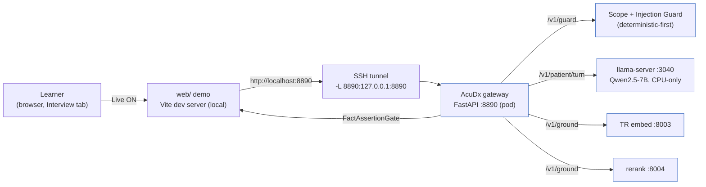

# 02 - Live backend runbook (open, air-gapped)

**Status:** Operational. **Scope:** stand up the live, open-model backend and drive it from the `web/` demo end to end. **Companion:** `01-full-integration-plan.md` (what replaces what), `../../server/README.md` (the gateway internals).

This is the reproducible path from a cold pod to a real patient turn in the browser: deploy the gateway, start the open model + side-cars, open the tunnel, run the web demo, flip the **Live** switch, and send a message that flows through the Scope and Injection Guard, the persona LLM, and the FactAssertionGate. Everything runs on open weights inside the pod with **zero third-party egress**. Education only, synthetic patients, no real patient data.

---

## 0. The request path (what "Live" wires up)



With **Live** off (the default) the encounter runs entirely on the client mock path; nothing leaves the browser. With **Live** on, the Interview turn routes through the gateway and the reply is a real Qwen2.5-7B utterance, guarded on the way in and fact-gated on the way out. Any gateway failure falls back to the mock path, so the UI never breaks.

---

## 1. The pod stack (ports and who starts what)

| Service | Bind (on pod) | Purpose | Started by |
|---|---|---|---|
| **llama-server** (Qwen2.5-7B-Instruct, **CPU-only**) | `127.0.0.1:3040` | patient-turn LLM, OpenAI-compatible `/v1/chat/completions` | operator (llama.cpp), **no GPU offload** |
| **TR embed** (BGE-M3 / modernbert-tr, dim 768) | `127.0.0.1:8003` | grounding embeddings | pod side-car (usually already up) |
| **reranker** (bge-reranker-v2-m3) | `127.0.0.1:8004` | grounding rerank | pod side-car (usually already up) |
| **AcuDx gateway** (FastAPI) | `127.0.0.1:8890` | the only path to a model: guard -> persona -> FactGate, `/v1/ground`, `/health`, `/status` | `server/run.sh` or the deploy launch line |
| **SSH tunnel** | local `8890` -> pod `127.0.0.1:8890` | reach the gateway from the laptop | `ssh -f -N -L ...` |
| **web dev server** (Vite) | local (printed URL) | the demo client; the **Live** toggle | `npm --prefix web run dev` |

**Pod address:** `root@10.6.110.10`, SSH port `30405`. Remote base `/data/acudx-sim` (source at `/data/acudx-sim/src`, venv at `/data/acudx-sim/.venv`).

---

## 2. Prerequisites

**Local (laptop):**
- SSH access to the pod with a key loaded in your agent. Verify: `ssh -p 30405 root@10.6.110.10 'echo ok'`.
- Node 20+ and npm for the web demo. Python 3 for the smoke test (stdlib only).

**Pod:**
- `llama-server` (llama.cpp) built for CPU, and the Qwen2.5-7B-Instruct GGUF on disk.
- The TR embed (`:8003`) and rerank (`:8004`) side-cars available. They are typically already running.

---

## 3. Deploy the gateway to the pod

From the repo root on your laptop:

```bash
cd /path/to/acudx-simulation

# Preview what would sync (no remote changes):
DRY_RUN=1 ./server/deploy.sh

# Real deploy: rsync server/ to the pod + create/refresh the venv, then PRINT the launch line.
./server/deploy.sh
```

`deploy.sh` is idempotent and additive: it rsyncs `server/` to `/data/acudx-sim/src/server` **without `--delete`**, never ships `.env` or secrets, and does **not** auto-start anything. It ends by printing the exact launch command for step 5.

Override any target from the environment, for example a different pod:

```bash
REMOTE_HOST=10.6.110.10 SSH_PORT=30405 ./server/deploy.sh
SKIP_VENV=1 ./server/deploy.sh      # sync only, leave the remote venv untouched
```

---

## 4. Start the open model + side-cars (on the pod)

SSH in (use `tmux` or `nohup` so long-running processes survive the session):

```bash
ssh -p 30405 root@10.6.110.10
tmux new -s acudx        # optional but recommended
```

**4a. llama-server, CPU-only (no VRAM).** The `--n-gpu-layers 0` flag keeps every layer on the CPU, so the process uses **0 MiB of GPU memory** and the H200 VRAM stays reserved for its primary tenants.

```bash
llama-server \
  --model /data/models/qwen2.5-7b-instruct-q4_k_m.gguf \
  --host 127.0.0.1 --port 3040 \
  --ctx-size 8192 --threads "$(nproc)" \
  --n-gpu-layers 0                      # keep it on CPU; do NOT offload to the GPU
```

(Point `--model` at the GGUF that already lives on the pod. On a shared pod, cap `--threads` below `nproc` and keep `--ctx-size` modest to bound RAM.)

**4b. Embed + rerank side-cars.** Start these the way your pod already runs them, or confirm they are up:

```bash
curl -s http://127.0.0.1:8003/health || echo "embed :8003 not reachable"
curl -s http://127.0.0.1:8004/health || echo "rerank :8004 not reachable"
```

Grounding degrades gracefully if these are down; patient turns do not need them.

---

## 5. Start the gateway (on the pod)

Use the launch line `deploy.sh` printed, or the convenience wrapper. Both bind loopback, which is all the tunnel needs.

```bash
# Convenience wrapper (runs from repo root, binds 127.0.0.1:8890; respects HOST/PORT):
cd /data/acudx-sim/src
AIRGAPPED=true \
LLM_BASE_URL=http://127.0.0.1:3040/v1 LLM_MODEL=qwen2.5-7b-instruct \
EMBED_URL=http://127.0.0.1:8003 RERANK_URL=http://127.0.0.1:8004 \
/data/acudx-sim/.venv/bin/python -m uvicorn server.app:app --host 127.0.0.1 --port 8890
```

The gateway **loads no model** (it only calls the endpoints above), so it starts in well under a second and stays resource-light. Confirm it is live from the pod:

```bash
curl -s http://127.0.0.1:8890/health | python3 -m json.tool
python3 /data/acudx-sim/src/server/smoke_test.py --base-url http://127.0.0.1:8890
```

`smoke_test.py` hits every endpoint and fails hard if an injection utterance is ever classified in-scope.

---

## 6. Open the SSH tunnel (on the laptop)

```bash
ssh -f -N -L 8890:127.0.0.1:8890 -p 30405 root@10.6.110.10
```

`-f -N` puts it in the background with no remote shell. Confirm the gateway is now reachable locally:

```bash
curl -s http://localhost:8890/health | python3 -m json.tool
```

---

## 7. Run the web demo and go Live

```bash
# First run only:
npm --prefix web install

# The client defaults to http://localhost:8890. To target a different origin:
echo 'VITE_BACKEND_URL=http://localhost:8890' > web/.env.local   # optional

npm --prefix web run dev
```

Open the printed local URL, then:

1. On load the client pings `GET /health`. If the gateway answers, the **Live** control in the top nav becomes enabled (a Broadcast icon). If unreachable it stays disabled with a visible "backend offline" note, so the affordance never lies.
2. **Turn on the Live switch** in the top nav (next to the language switcher). The preference persists in `localStorage`, and is forced off automatically if the backend goes away.
3. Open an **Encounter**, go to the **Interview** tab, type a question to the patient, and send it. The turn now flows: `/v1/guard` (classify before any model sees the text) -> `/v1/patient/turn` (real Qwen2.5-7B via the gateway) -> FactAssertionGate on the output. Off-topic freezes state, injection and unsafe are blocked deterministically, and the reply is a live open-model utterance.

Full loop verification over the tunnel:

```bash
python3 server/smoke_test.py --base-url http://localhost:8890
```

---

## 8. Resource safety

- **The gateway is a caller, not a host.** It never loads a model, so it is cheap to start, restart, and leave running. All model weight lives in llama-server and the side-cars.
- **CPU-only, zero VRAM.** llama-server runs with `--n-gpu-layers 0`, so the patient LLM touches no GPU memory. Verify our process is not on the GPU:
  ```bash
  nvidia-smi                       # our llama-server should show no GPU memory
  ```
  If it does, GPU offload is on: stop it and relaunch with `--n-gpu-layers 0`.
- **Watchdog via `/status`.** `GET /status` returns `{disk, ram}` (from `statvfs('/data')` + `/proc/meminfo`) plus reachability of the LLM / embed / rerank pods. Watch it while running load:
  ```bash
  watch -n 30 'curl -s http://localhost:8890/status | python3 -m json.tool'
  ```
  Cap `--threads` and `--ctx-size` on a shared pod to keep CPU and RAM bounded.
- **Air-gap is welded shut.** `AIRGAPPED=true` (the default) makes the gateway resolve only loopback / in-VPC endpoints: any non-local `LLM_BASE_URL` / `EMBED_URL` / `RERANK_URL` raises `EgressBlocked` at startup, before a socket opens. Keep `LLM_PROVIDER=local`. If the model pool sits on a sibling host, add its host or CIDR to `LOCAL_ALLOWLIST` rather than relaxing the guard.

---

## 9. Troubleshooting

| Symptom | Likely cause | Fix |
|---|---|---|
| **Live** toggle stays disabled, "backend offline" | gateway not reachable at `localhost:8890` | check the tunnel is up (`ps aux \| grep 'L 8890'`), `curl localhost:8890/health`, reopen the tunnel (step 6) |
| `/health` returns but toggle still off | stored preference is off, or `status != "ok"` | click the switch; inspect the `/health` body |
| Patient turn spins then falls back (client caps at ~22s) | llama-server cold or slow on CPU | warm it, lower `--ctx-size`, check `curl 127.0.0.1:3040/v1/models` on the pod |
| `503` on grounding (`/v1/ground`) | grounding module or a side-car down | `curl 127.0.0.1:8003` / `127.0.0.1:8004`; confirm `EMBED_URL` / `RERANK_URL` |
| `EgressBlocked` at startup | a non-local model URL under `AIRGAPPED=true` | point it at loopback/VPC, or add the host/CIDR to `LOCAL_ALLOWLIST` |
| CORS error in the browser console | serving the web app from a non-localhost origin | `localhost` / `127.0.0.1` (any port) are always allowed; add others via `CORS_ORIGINS` |
| `deploy.sh` prompts or fails at rsync/ssh | key/agent/network to the pod | verify `ssh -p 30405 root@10.6.110.10 'echo ok'` |
| smoke test: injection classified in-scope (hard FAIL) | guard misconfiguration | inspect `server/scope_guard.py` (`python -m server.scope_guard`); do not expose Live until it blocks |
| `nvidia-smi` shows our llama-server using VRAM | GPU offload enabled | relaunch llama-server with `--n-gpu-layers 0` |

---

## 10. Shutdown

```bash
# laptop: stop the web dev server with Ctrl-C, then close the tunnel
pkill -f 'ssh .*-L 8890:127.0.0.1:8890'

# pod: stop the gateway (Ctrl-C in its tmux window, or)
pkill -f 'uvicorn server.app'
```

Leave llama-server and the side-cars running for the next session, or stop them if the pod is shared.

---

## 11. Quick reference (in order)

```bash
# 1. laptop: deploy the gateway
./server/deploy.sh

# 2. pod: open model, CPU-only
llama-server --model /data/models/qwen2.5-7b-instruct-q4_k_m.gguf \
  --host 127.0.0.1 --port 3040 --ctx-size 8192 --threads "$(nproc)" --n-gpu-layers 0

# 3. pod: gateway
cd /data/acudx-sim/src && AIRGAPPED=true \
  LLM_BASE_URL=http://127.0.0.1:3040/v1 LLM_MODEL=qwen2.5-7b-instruct \
  EMBED_URL=http://127.0.0.1:8003 RERANK_URL=http://127.0.0.1:8004 \
  /data/acudx-sim/.venv/bin/python -m uvicorn server.app:app --host 127.0.0.1 --port 8890

# 4. laptop: tunnel
ssh -f -N -L 8890:127.0.0.1:8890 -p 30405 root@10.6.110.10

# 5. laptop: web demo, then toggle Live in the top nav and send an Interview message
npm --prefix web run dev

# verify end to end
python3 server/smoke_test.py --base-url http://localhost:8890
```

*Education only. Synthetic patients. No real patient data. Open weights, air-gapped, zero egress.*
