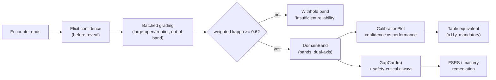

# 00 — AcuDx Design System

**Status:** Foundational design baseline. Governs every learner- and educator-facing surface. Traces to `../00-overview/01-requirements-and-constraints.md` (§3.5 accessibility, §3.6 clinical safety, §6 wedge) and `../research/06-regulatory-compliance.md` (WCAG 2.2 AA, AI-Act Art. 50 transparency) and `../research/09-localization-i18n-turkish.md` (TR as a first-class locale). Where a UI decision touches clinical safety, accessibility, or i18n, this file is **normative** — do not ship a component that violates a "MUST" here without amending it.

**This document matches the implemented app in `web/`.** The tokens, fonts, icon family, component APIs, and utilities described below are the ones actually shipped: React 18 + TypeScript + Vite + **Tailwind CSS v4** (CSS-first `@theme`), **Radix UI** primitives, **Geist Sans/Mono** (self-hosted via `@fontsource`), and **Phosphor** icons (one family). CSS custom properties in `web/src/index.css` are the single source of truth; components reference `var(--…)` or the mapped Tailwind semantic classes only — **never a raw hex**.

**Design language:** this is the **medkit** design language (medkit.clinic / `github.com/bedriyan/medkit-app`) applied to AcuDx with the locked AcuDx tokens — a clean clinical **white** base, a single locked **brand-blue** CTA, a sparse teal→blue→pink gradient frame, a large-headline grotesk voice with italic emphasis, generous whitespace, subtly-bordered rounded cards, evidence/citation callouts, and exactly **one dark element: the vitals monitor**. The register is premium-clinical and trustworthy — never playful, never toy-like.

**Scope reminder:** the MVP surface is **solo, text-first, Emergency-Medicine roleplay + structured feedback + the Dunning-Kruger calibration plot**. Voice, 3D avatars, multiplayer rooms, and the dean's dashboard are gated fast-follows — but their tokens and component contracts are specified here so the system does not fork later.

---

## 1. Design principles

1. **Clinical calm.** The default register is a quiet, well-lit clinical space — not a game arcade, not a dashboard-of-doom. The medkit reference is a serious editorial product crossed with a high-end monitoring device. Restraint is the brand: saturated color is *rationed* and reserved almost entirely for clinical state. Chrome is neutral; signal is colored.
2. **Trust before delight.** This is an assessment product a Dean signs off on. Every surface must read as *defensible*: citations visible, "last reviewed" dates shown, AI clearly labeled (AI-Act Art. 50), evidence spans one click away, an education-only disclaimer always present. Trust is a visual property — earned through precision, alignment, and honest hierarchy, not badges that say "trusted."
3. **Premium restraint (expensive, not busy).** "Premium" = generous spacing, a tight type scale, near-invisible hairline borders (`#E2E8F0`), soft slate-tinted shadows (never harsh black), one radius scale, and **no gradient-mesh, no neon, no drop-shadow-on-everything**. The teal→blue→pink gradient appears in exactly two places (app frame + logo mark) and nowhere else.
4. **Low cognitive load under time pressure.** An EM encounter is a working-memory tax; the UI must never compete with the clinical reasoning. One primary action per view; progressive disclosure of secondary detail; the vitals monitor is glanceable in <1 s; nothing animates that doesn't carry meaning.
5. **Never toy-like despite gamification.** XP, streaks, and badges exist (`GM-1`, `GM-2`) but render with the same restraint as everything else — monochrome-forward, small, celebratory only at genuine milestones. **Confetti is banned from any assessment or calibration surface.** Gamification is a quiet sidebar, never the main stage.
6. **Dual-axis honesty.** Clinical reasoning and communication are *orthogonal* (`AS-5`) and must be visually parallel, never merged into one number. The design language encodes this everywhere feedback appears (distinct hue **and** glyph: ◆ clinical, ● communication).
7. **Calibration is a mirror, not a scoreboard.** The Dunning-Kruger plot is framed as a *trainable skill* (`AS-7`). It is **never leaderboarded**, never colored red-for-bad; over- and under-confidence are shown as *directional*, not *good/bad*.
8. **Accessible by construction, not by retrofit.** WCAG 2.2 AA is the floor, not the aspiration. No-color-only clinical state, 24×24 px targets, visible focus, reduced-motion, and text/table equivalents are baked into each component's definition — a component is not "done" until its a11y row is filled.
9. **Bilingual by construction (EN + TR, text and voice).** Turkish is a first-class locale, not a translation afterthought. Layouts absorb Turkish string expansion; casing splits into a **display path** (`tr-TR`) and an **identity/security path** (invariant) so the dotted/dotless `i` never becomes a bug. Every string is one full ICU message — never assembled from fragments (Turkish is agglutinative + SOV).

---

## 2. Brand & voice

**Personality:** the calm senior clinician-educator — precise, never condescending, always shows their work. Confident but abstains rather than bluffs (mirrors the "abstain > confident-wrong" grounding stance, `G-3`).

**Voice rules (UI copy, EN + TR):**
- **Plain, active, short.** "Order a 12-lead ECG," not "You may wish to consider ordering…". Instruction-grade clarity because learners read under load. TR follows the formal/clinical register a Turkish clinician expects.
- **Second person for the learner, third person for the case.** "You asked about chest pain." / "The patient reports…". Never blur who is speaking.
- **Feedback is specific and evidenced, never a verdict.** "History-taking: developing — you didn't establish onset, see turn 4." Not "History: 6/10."
- **Never shame; name the gap and the next step.** Every gap card ends with a remediation action, not a grade.
- **AI is always labeled.** The patient/colleague/examiner carries a persistent "AI" marker (`app.aiLabel`); the education-only disclaimer (`app.eduDisclaimer`) is present on every surface (AI-Act Art. 50, MDR education-side).
- **Numbers are banded, not decimal, in learner-facing copy** (`AS-6`): "Proficient," not "83.4 %."
- **Code-switching is the product, not a bug** (TR): a low-health-literacy patient says *kalp krizi*; a physician-examiner says *MI*. Register itself is a teachable signal. Drug names/doses/units are locked glossary tokens, never free-translated.

**Tone by surface:** Encounter = terse, in-character-adjacent, low-chrome. Feedback = warm, structured, coaching. Institution dashboard = neutral, factual, audit-grade.

---

## 3. Design tokens

Tokens live as CSS custom properties on `:root` (light — **the default**, medkit white-dominant) and `.dark` (full dark theme). The **vitals-monitor tokens are always dark in both themes.** Tailwind v4 maps these via a CSS-first `@theme inline` block, so components use semantic classes (`bg-surface`, `text-muted`, `border-border`, `bg-brand`, `rounded-card`, `shadow-soft`, `font-mono`, `text-state-*`). This is a verbatim mirror of `web/src/index.css`.

All color pairings below meet WCAG 2.2 AA contrast (≥ 4.5:1 body text; ≥ 3:1 large text and non-text/UI per 1.4.11), verified for both themes.

### 3.1 Brand, gradient, surfaces & text

```css
:root {
  color-scheme: light;

  /* ---- Brand (single locked blue accent) ---- */
  --brand-50:  #eff6ff;   /* tint: hover/selected backgrounds  */
  --brand-600: #2563eb;   /* PRIMARY blue — the one CTA accent  */
  --brand-700: #1d4ed8;   /* hover                              */

  /* ---- Brand gradient (SPARSE — app-frame accent + logo mark ONLY) ---- */
  --grad-teal: #2dd4bf;
  --grad-blue: #3b82f6;
  --grad-pink: #f472b6;

  /* ---- Surfaces & text (light — cool slate neutrals) ---- */
  --bg:        #ffffff;   /* app background          */
  --bg-subtle: #f8fafc;   /* recessed / rails / page */
  --surface:   #ffffff;   /* cards, panels           */
  --fg:        #0f172a;   /* primary text            */
  --fg-muted:  #64748b;   /* secondary text          */
  --border:    #e2e8f0;   /* hairline dividers       */

  /* ---- Clinical semantic states (NEVER color alone — §3.4) ---- */
  --state-normal:   #10b981;  /* normal / in range     */
  --state-caution:  #f59e0b;  /* elevated / caution    */
  --state-warning:  #f97316;  /* warning / abnormal    */
  --state-critical: #ef4444;  /* critical              */

  /* ---- Feedback dual-axis (orthogonal, always paired with a glyph) ---- */
  --axis-clinical:      #2563eb;  /* ◆ clinical reasoning */
  --axis-communication: #7c3aed;  /* ● communication      */

  /* ---- Calibration (directional, never good/bad) ---- */
  --calib-line:  #0f172a;  /* identity y=x diagonal     */
  --calib-over:  #c2603a;  /* over-confident direction  */
  --calib-under: #3a7bc2;  /* under-confident direction */
  --calib-well:  #10b981;  /* well-calibrated band      */

  /* ---- Radius (ONE scale) ---- */
  --r-card:    16px;  /* cards                       */
  --r-control: 10px;  /* inputs, buttons             */
  /* pills use full radius (999px) directly            */

  /* ---- Soft, slate-tinted shadows (no harsh black) ---- */
  --shadow-sm: 0 1px 2px  rgba(15,23,42,0.05);
  --shadow-md: 0 8px 24px rgba(15,23,42,0.06);

  /* ---- Motion — restrained, device-grade ---- */
  --ease-out:  cubic-bezier(0.16, 1, 0.3, 1);
  --dur-fast:  200ms;
  --dur-base:  300ms;
  --dur-slow:  400ms;

  /* ---- Fonts (self-hosted, NO CDN) ---- */
  --font-sans: "Geist Variable", ui-sans-serif, system-ui, -apple-system, sans-serif;
  --font-mono: "Geist Mono", ui-monospace, "SF Mono", monospace;

  /* ---- Vitals monitor — ALWAYS dark (both themes) ---- */
  --monitor-bg:     #0b1220;
  --monitor-border: #1e293b;
  --monitor-fg:     #e2e8f0;
  --monitor-dim:    #64748b;
  --monitor-online: #10b981;   /* live/online dot */
}
```

```css
.dark {
  color-scheme: dark;

  --brand-50:  #172554;   /* deep tint for dark surfaces */
  --brand-600: #2563eb;   /* accent hue held             */
  --brand-700: #1d4ed8;

  --bg:        #0b1120;
  --bg-subtle: #0f172a;
  --surface:   #111827;
  --fg:        #e2e8f0;
  --fg-muted:  #94a3b8;
  --border:    #1e293b;

  /* Clinical-state hues hold in dark (contrast re-verified on dark surfaces) */
  --state-normal:   #10b981;
  --state-caution:  #f59e0b;
  --state-warning:  #f97316;
  --state-critical: #ef4444;

  --axis-clinical:      #60a5fa;  /* lightened for dark contrast */
  --axis-communication: #a78bfa;

  --calib-line:  #e2e8f0;
  --calib-over:  #e0865c;
  --calib-under: #60a5fa;
  --calib-well:  #10b981;

  --shadow-sm: 0 1px 2px  rgba(0,0,0,0.30);
  --shadow-md: 0 8px 24px rgba(0,0,0,0.40);

  /* Vitals monitor stays dark — identical across themes */
  --monitor-bg:     #0b1220;
  --monitor-border: #1e293b;
  --monitor-fg:     #e2e8f0;
  --monitor-dim:    #64748b;
  --monitor-online: #10b981;
}
```

**Why the monitor is theme-invariant:** the vitals monitor is the single dark element in the medkit language even in light mode — it reads as real monitoring hardware, keeps clinical-line contrast constant, and prevents the vitals palette from being re-tuned per theme (a safety liability). Its tokens (`--monitor-*`) never change between `:root` and `.dark`.

### 3.2 Token → Tailwind mapping (CSS-first `@theme`)

Tailwind v4 reads the vars through an `@theme inline` block, so **one rename propagates everywhere** and no component hard-codes a hex:

```css
@theme inline {
  --color-bg: var(--bg);
  --color-bg-subtle: var(--bg-subtle);
  --color-surface: var(--surface);
  --color-fg: var(--fg);
  --color-muted: var(--fg-muted);
  --color-border: var(--border);

  --color-brand: var(--brand-600);
  --color-brand-hover: var(--brand-700);
  --color-brand-tint: var(--brand-50);

  --color-grad-teal: var(--grad-teal);
  --color-grad-blue: var(--grad-blue);
  --color-grad-pink: var(--grad-pink);

  --color-state-normal: var(--state-normal);
  --color-state-caution: var(--state-caution);
  --color-state-warning: var(--state-warning);
  --color-state-critical: var(--state-critical);

  --color-axis-clinical: var(--axis-clinical);
  --color-axis-communication: var(--axis-communication);

  --color-calib-line: var(--calib-line);
  --color-calib-over: var(--calib-over);
  --color-calib-under: var(--calib-under);
  --color-calib-well: var(--calib-well);

  --color-monitor-bg: var(--monitor-bg);
  --color-monitor-border: var(--monitor-border);
  --color-monitor-fg: var(--monitor-fg);
  --color-monitor-dim: var(--monitor-dim);
  --color-monitor-online: var(--monitor-online);

  --radius-card: var(--r-card);
  --radius-control: var(--r-control);

  --shadow-soft: var(--shadow-sm);
  --shadow-soft-md: var(--shadow-md);

  --font-sans: var(--font-sans);
  --font-mono: var(--font-mono);
  --ease-out: var(--ease-out);
}
```

### 3.3 Typography

**Two families, self-hosted, no CDN:** **Geist Sans** (display + body — a clean Swiss grotesk that carries both the large medkit headlines and the reading body) and **Geist Mono** (vitals and any tabular numeric readout). Geist is SIL OFL 1.1 and variable; it ships from `@fontsource-variable/geist` + `@fontsource/geist-mono` (imported in `index.css`, never from a CDN — offline/on-prem and privacy-safe).

Base element styling (`@layer base`):

```css
body {
  background-color: var(--bg-subtle);
  color: var(--fg);
  font-family: var(--font-sans);
  font-size: 1rem;            /* 16px — reading floor, never below for body/chat */
  line-height: 1.55;
  font-feature-settings: "cv11", "ss01";   /* Geist stylistic set */
}

/* Tabular numerals for ANY monospace readout (vitals must not jitter) */
.font-mono, [class*="font-mono"] {
  font-variant-numeric: tabular-nums slashed-zero;
  letter-spacing: 0.01em;
}

/* Large medkit headlines: tight, balanced, negative tracking */
h1, h2, h3, h4 {
  text-wrap: balance;
  letter-spacing: -0.02em;
  line-height: 1.1;
}
```

**Type scale** (rem, mobile-first; medkit favors a few big steps over many small ones):

| Token / usage | Size | Notes |
|---|---|---|
| caption / timestamp | 0.75rem (12) | secondary metadata |
| secondary UI / table | 0.875rem (14) | `text-sm` |
| **body / chat** | **1rem (16)** | reading floor — never smaller |
| lead paragraph | 1.125rem (18) | `text-lg` |
| card / section title | 1.25–1.375rem | `text-lg`/`text-xl` |
| page headline | 1.75–2.25rem | `text-2xl`/`text-3xl`, balanced, italic-emphasis allowed |
| vitals big-number | 2–3rem, **mono, tabular** | glanceable readout |

**Rules:** body/chat never below 16px. Vitals numerals use `tabular-nums slashed-zero` so `98 → 100` doesn't shift layout. Feedback narrative line length capped ~68 ch. Headlines may use *italic emphasis* (the medkit signature) on the load-bearing word — sparingly.

**Turkish typographic note:** headlines and body must render `İstanbul`, `İLAÇ`, `ı`, `ş`, `ğ` correctly — display casing is `tr-TR` (§8). Turkish strings run longer; the scale and layouts are tested with real TR strings (§7), not English placeholders.

### 3.4 Non-color state encoding (WCAG 1.4.1 — normative)

Every clinical state MUST carry **three** redundant channels: **color + Phosphor icon + text label**, plus an optional fill/pattern for filled regions. This table is the contract (labels map to `states.*` i18n keys, EN/TR):

| State | Color var | Phosphor icon | Text label (EN / TR) | ARIA |
|---|---|---|---|---|
| Normal | `--state-normal` `#10B981` | `CheckCircle` | "Normal" / "Normal" | `aria-label`, not an alert |
| Caution / elevated | `--state-caution` `#F59E0B` | `Eye` | "Watch" / "İzle" | `role="status"`, polite |
| Warning / abnormal | `--state-warning` `#F97316` | `Warning` (triangle) | "Abnormal" / "Anormal" | `role="status"`, polite |
| Critical | `--state-critical` `#EF4444` | `WarningOctagon` | "Critical" / "Kritik" | `role="alert"`, assertive |

A vitals value out of range shows the **arrow direction** (↑/↓, `states.aboveRange`/`belowRange`) **and** the state icon **and** shifts numeral weight — three non-color cues. Critical adds a **pulsing ring** (`@keyframes pulse-ring`), which becomes a **static ring under reduced-motion**. Screen-reader announcement mirrors all channels ("Heart rate 132, critical, above range").

### 3.5 Icons — Phosphor, one family

**Phosphor** (`@phosphor-icons/react`) is the single icon family — no second set. Six weights are available (`thin · light · regular · bold · fill · duotone`); AcuDx uses **`bold`** for UI affordances (matches `ThemeToggle`'s `weight="bold"`), **`fill`/`duotone`** reserved for emphasis and the clinical-state glyphs. Every decorative icon is `aria-hidden="true"`; meaning always also lives in text (§3.4). Icon size tracks the control (`h-4 w-4` in 36–44px controls).

### 3.6 Spacing, radius, elevation, motion

- **Spacing:** Tailwind's default 4px grid (`gap-2` = 8, `p-5` = 20, `p-6` = 24…). Medkit is *generous* — cards use `p-5`/`p-6 sm:p-7`; sections breathe.
- **Radius — ONE scale:** cards `--r-card` **16px**, inputs/buttons `--r-control` **10px**, pills **full** (999px). The app-frame outer shell uses 20px. Nothing else invents a radius.
- **Elevation — soft, slate-tinted:** `--shadow-sm` (resting) and `--shadow-md` (elevated). Never harsh black; dark theme swaps to low-alpha black. Most surfaces are flat with a hairline border; shadow signals lift, not decoration.
- **Motion — restrained, `cubic-bezier(0.16, 1, 0.3, 1)`, 200–400 ms:** UI transitions ≈ 200 ms (`--dur-fast`); nothing bounces. Permitted continuous motion is limited to the vitals sweep and the critical `pulse-ring` — both suppressed under `prefers-reduced-motion`. `fade-up` is the one entrance. Gamification celebrations are ≤ 1 subtle scale/fade, never blocking, never on assessment surfaces.

**The gradient utilities** (the *only* places the teal→blue→pink gradient appears):

```css
@utility gradient-frame {   /* 2.5px border around the app shell */
  position: relative;
  background:
    linear-gradient(var(--surface), var(--surface)) padding-box,
    linear-gradient(120deg, var(--grad-teal), var(--grad-blue), var(--grad-pink)) border-box;
  border: 2.5px solid transparent;
}
@utility gradient-text { /* the "Dx" in the wordmark */
  background: linear-gradient(105deg, var(--grad-teal), var(--grad-blue), var(--grad-pink));
  -webkit-background-clip: text; background-clip: text;
  color: transparent; -webkit-text-fill-color: transparent;
}
@utility gradient-mark {  /* the logo tile */
  background: linear-gradient(135deg, var(--grad-teal), var(--grad-blue), var(--grad-pink));
}
```

### 3.7 Token summary

| Group | Tokens | Purpose |
|---|---|---|
| Brand | `--brand-50/600/700` | Single rationed blue accent, CTA, focus |
| Gradient | `--grad-teal/blue/pink` | App frame + logo mark ONLY |
| Neutral base | `--bg`, `--bg-subtle`, `--surface`, `--fg`, `--fg-muted`, `--border` | Calm cool-slate chrome |
| Clinical state | `--state-{normal,caution,warning,critical}` | Semantic, always tri-channel (§3.4) |
| Dual-axis | `--axis-{clinical,communication}` | Orthogonal feedback (`AS-5`) |
| Calibration | `--calib-{line,over,under,well}` | Directional, non-judgmental |
| Monitor | `--monitor-{bg,border,fg,dim,online}` | Always-dark vitals monitor |
| Radius | `--r-card` 16, `--r-control` 10, pill full | One scale |
| Shadow | `--shadow-sm/md` | Soft slate-tinted lift |
| Motion | `--ease-out`, `--dur-{fast,base,slow}` | Restrained, device-grade |
| Type | `--font-sans` (Geist), `--font-mono` (Geist Mono) | Display+body / tabular vitals |

---

## 4. Component library

Built on **Radix UI** primitives (keyboard/focus/ARIA for free — Tabs, Switch, Tooltip, Dialog) restyled to the tokens above, plus token-native AcuDx components. Each entry lists **anatomy · states · a11y**. MVP-core components are starred (★). Where a real file exists in `web/`, it is cited so this doc and the app never diverge.

### 4.1 Button ★ — `web/src/components/ui/Button.tsx`
The one locked accent CTA.
- **Anatomy:** label · optional inline `leadingIcon` · optional `trailingIcon` shown inside a circle (primary CTA affordance; `bg-white/20` on primary, `bg-brand-tint text-brand` on others) · `asChild` to render a router `<Link>` as a button without nesting an anchor in a button.
- **Variants:** `primary` (`bg-brand text-white hover:bg-brand-hover shadow-soft` — the single locked blue) · `secondary` (`bg-surface border-border`) · `ghost` (transparent). **Sizes:** `sm` (h-9) · `md` (h-11) · `lg` (h-12) — all ≥ 24px, touch-comfortable at md/lg.
- **States:** rest · hover · `active:scale-[0.98]` · `disabled:opacity-50` · focus-visible ring (§6).
- **a11y:** real `<button>` (or the child element via `asChild`); icons `aria-hidden`; label carries meaning; min-target met at every size.

### 4.2 Card ★ — `web/src/components/ui/Card.tsx`
The medkit subtly-bordered rounded surface.
- **Anatomy:** `rounded-card border border-border bg-surface`, soft bezel; `padding` presets `none|sm|md|lg`; `elevated` swaps `shadow-soft` → `shadow-soft-md`. Sub-parts `CardHeader / CardTitle / CardDescription`.
- **States:** resting (flat + hairline) · elevated (soft md shadow) · interactive (hover lift, if actionable).
- **a11y:** `CardTitle` is an `<h3>` (heading semantics); actionable cards expose a real control, not a click-only div.

### 4.3 Badge ★ — `web/src/components/ui/Badge.tsx`
Small pill; clinical tones enforce icon + label.
- **Anatomy:** `inline-flex … rounded-full` pill · optional `icon` slot · text label. Tones: `neutral · brand · normal · caution · warning · critical`. Clinical tones use `color-mix` tints of the state color with the state text color.
- **States:** static; the icon is **required** for clinical tones so meaning is never color-only (WCAG 1.4.1).
- **a11y:** icon `aria-hidden`; the text label is the accessible name.

### 4.4 Tabs ★ — `web/src/components/ui/Tabs.tsx` (Radix)
Segmented navigation (feedback views, dashboard sections).
- **Anatomy:** `TabsList` (bordered `bg-bg-subtle` track) · `TabsTrigger` (active → `bg-surface text-fg shadow-soft`) · `TabsContent`.
- **States:** active/inactive via `data-[state=active]`; hover; focus-visible.
- **a11y:** Radix roving-tabindex, arrow-key nav, `aria-selected`; content panels labeled by their trigger.

### 4.5 Switch — `web/src/components/ui/Switch.tsx` (Radix)
Toggle (e.g. Guidance on/off, no-timer mode).
- **Anatomy:** track (brand when on, `--border` when off) · thumb (`bg-white shadow-soft`), 24px+ hit target (h-6 w-11).
- **States:** checked/unchecked (`data-[state=…]`), disabled, focus-visible.
- **a11y:** Radix `role="switch"` + `aria-checked`; always paired with a real `<label>`.

### 4.6 Tooltip — `web/src/components/ui/Tooltip.tsx` (Radix)
Non-essential hints only (never the sole carrier of meaning). `TooltipProvider` wraps the app (`delayDuration≈200`). Content is supplementary; keyboard-reachable via focus.

### 4.7 Stat / StatTile ★ — `web/src/components/ui/Stat.tsx`
A single labeled metric (term-at-a-glance, dashboard tiles).
- **Anatomy:** uppercase tracked `label` · large value (`mono` tabular by default so digits don't jitter) · optional `unit` · optional `hint` (trend/status line).
- **States:** value / with-unit / with-hint; loading → Skeleton.
- **a11y:** label + value read as a pair; `mono` for numerics; trend also stated in text, not color-only.

### 4.8 Skeleton — `web/src/components/ui/Skeleton.tsx`
Loading placeholder using the `shimmer` keyframe; suppressed to a static block under reduced-motion.

### 4.9 VitalCard + Sparkline ★
The single-vital readout on the always-dark monitor (`RP-4`). Uses `--monitor-*` tokens regardless of theme.
- **Anatomy:** short label (`vitals.hrShort` = "HR") · large **Geist Mono** tabular numeral · unit (`vitals.units.*`) · state icon + label (§3.4) · trend arrow (`vitals.trend.*`) · **24-tick sparkline** (hue **+** shape per vital) · "updated Xs ago" (`vitals.updatedAgo`) · online dot (`--monitor-online`).
- **States:** normal · caution · warning · critical (border + tint + icon; critical adds `pulse-ring`, static under reduced-motion) · **stale** (>expected interval → dimmed via `--monitor-dim` + "No fresh data," `vitals.stale`) · paused · loading (skeleton).
- **a11y:** each card is `aria-live="polite"` for normal deltas; **critical transitions escalate to `role="alert"` (assertive)**; announcements **debounced** to meaningful deltas (never every tick — avoids SR flooding); full text alt; non-audio alarm cue mandatory (audio never sole channel).

**Sparkline rules:** hue **and** line shape (solid/dashed/dotted/dash-dot) co-encode each vital so no pair collapses under any color-vision deficiency; a value out of range marks the point with the state glyph, not just color.

### 4.10 VitalTrendChart ★
Multi-vital time series (CV & respiratory trends, `RP-4`).
- **Anatomy:** shared time axis · one line per vital (hue + dash) · patterned reference-range band (not color-only) · event markers (drug given, intervention) · legend with glyph + label · **"View as table" toggle** (`actions.viewAsTable`) — mandatory text equivalent.
- **States:** live (sweeping) · paused · historical/replay · empty.
- **a11y:** each series keyboard-focusable; arrow-keys move a readout cursor announcing `{time, value, state}`; the **data table is a first-class equivalent** (`vitals.table.*`), not an afterthought; reference band described in text; no sweep under reduced-motion.

### 4.11 EncounterChat ★
The core text roleplay surface (`RP-1`).
- **Anatomy:** message stream (learner right / patient-AI left) · **persistent "AI" badge** on non-learner turns (`app.aiLabel`, Art. 50) · role chips (`encounter.patient/colleague/examiner`) · stage indicator (`encounter.stages.*`: History → Exam → Investigations → Differential → Diagnosis → Management) · composer anchored in the bottom thumb-zone (`encounter.composerPlaceholder`, `encounter.sendHint`) · quick-action chips (`actions.orderTest`, `actions.requestExam`, `actions.commitDiagnosis`) · safety-interceptor banner slot (`encounter.safety.*`).
- **States:** idle · AI typing (subtle, non-spinner — `encounter.aiTyping`) · streaming reply · low-STT-confidence → text-fallback (voice tier) · **safety break-character** (interceptor fires → resources banner, `RP-7`) · resumed-session toast (`encounter.resumeToast`, ≤ 2 taps, `RP-6`) · disconnected/reconnecting (server-authoritative, no data loss).
- **a11y:** log is `aria-live="polite"`; each turn labeled with speaker + role; stage changes announced; composer reachable in ≤ 1 tab; education-only + AI-interaction disclosure persistent; supports no-timer mode; full non-voice equivalent for the voice tier.

### 4.12 GuidanceCard (cited) ★
Grounded Socratic hints (`G-1`/`G-3`); `encounter.guidance.*`.
- **Anatomy:** Switch toggle (off by default for seniors, on for MS1 scaffolding) · hint text · **mandatory citation chip** `{guideline · version · country · "last reviewed"}` (`guidance.citation`, `guidance.lastReviewed`) · country-divergence disclosure when relevant (`G-4`) · "Education only" tag (`guidance.educationOnly`) · abstention state ("No grounded guidance for this step yet," `guidance.abstained`).
- **States:** collapsed · hint shown · **abstained** (cited refusal, styled as legitimate — not an error) · loading (out-of-band, never blocks chat) · stale-content flag.
- **a11y:** citations are real, SR-readable links; abstention is `role="status"`, not `alert`; country divergence explained in text; never color-only for current-vs-stale. TR encounters cite TEPDAD / Sağlık Bakanlığı / TİTCK first (§ localization).

### 4.13 PatientPortrait ★
The 2D persona portrait + physiology-driven clinical-sign overlay (`AV-1`); `encounter.portrait.*`.
- **Anatomy:** persona portrait · affect caption (`encounter.affect.distress/guarded/relieved`) · **clinical-sign overlay** (cyanosis / pallor / diaphoresis / distress / LOC) driven by the vitals engine — each sign has a numeric intensity the assessment layer can score · "AI" label · sign caption (`portrait.caption` e.g. "Diaphoretic, mild distress").
- **States:** neutral · affect states · sign-active (overlay intensity) · loading. The portrait and the monitor **never contradict** (both read the same case state).
- **a11y:** portrait has descriptive `alt`; the active clinical sign is stated in text (`portrait.sign`), never color/image-only; synthetic-media C2PA label inherited from the AI-label component (Art. 50).

### 4.14 DomainBand (DomainScoreBand) ★
The 6-domain rubric result (`AS-1`, `AS-6`); `feedback.domains.*`, `bands.*`.
- **Anatomy:** domain label (history · exam/investigations · reasoning · communication · management · professionalism) · **band chip** (Emerging → Developing → Proficient → Strong → Exemplary — **never decimals**) · dual-axis split where relevant (◆ clinical ∥ ● communication, `AS-5`) · evidence-span "Show evidence" affordance (`actions.showEvidence`, `AS-9`) · κ-gate note if below display threshold.
- **States:** displayed (κ ≥ 0.6) · **withheld** ("Not enough reliability to score this yet," `feedback.withheld`, κ < 0.6) · overridden-by-educator (shows override + reason, audit-linked).
- **a11y:** band conveyed by label + position + icon, not color; evidence spans keyboard-reachable; override announced; **no numeric score exposed to the learner**.

### 4.15 CalibrationPlot ★ (the signature)
Self-rated confidence vs measured competence (`AS-7`); `calibration.*`. See §5.
- **Anatomy:** scatter/quadrant with **y=x identity diagonal** (`--calib-line`, "Well-calibrated," `calibration.identityLine`) · per-domain points (shape-coded by domain, size = evidence weight) · well-calibrated tolerance band (`--calib-well`) · **directional** over/under labels (`calibration.direction.*` — words, not good/bad) · quadrant labels (`calibration.quadrant.*`) · shrinking-gap trajectory (`calibration.trajectory`) · plain-language read-out sentence (`calibration.readout`).
- **States:** first-encounter (single point + explainer) · trended (trajectory) · **insufficient-data** ("Not enough evidence yet to plot this," `calibration.insufficient` — no plot forced).
- **a11y:** **full data-table equivalent mandatory** (`calibration.table.*`: domain, confidence, performance, direction, trend); axes labeled (`axisConfidence`/`axisCompetence`); not color-only (shape + position + label); **never rendered on a leaderboard or ranked against peers** — enforced at component + route level (`home.noPublicLeaderboard`); framed as trainable in copy.

### 4.16 GapCard ★
Gap → remediation (`AS-8`); `feedback.gap.*`.
- **Anatomy:** gap statement (from an evidence span) · linked transcript quote (`gap.evidence`, "From the transcript") · **remediation action** (`gap.remediation` "Practice this" / `gap.schedule` FSRS review) · **safety-critical badge** (`gap.safetyCritical` — surfaced always & separately, regardless of score) · recurrence note (`gap.recurrence`) · dual-axis tag.
- **States:** open · scheduled (SRS) · resolved · **safety-critical** (persistent; cannot be dismissed without `gap.acknowledge`).
- **a11y:** action is a real button; safety-critical uses `role="alert"` + tri-channel; evidence link SR-labeled; ends with a next step, never a bare verdict.

### 4.17 LanguageSwitcher — `web/src/components/shell/LanguageSwitcher.tsx`
Compact EN/TR segmented control.
- **Anatomy:** `role="group"` bordered track · one button per language (`SUPPORTED_LANGUAGES`); active → `bg-surface text-fg shadow-soft`. Persists via i18next language-detector (localStorage `acudx-lang`) and updates `<html lang>` for SR.
- **States:** active (`aria-pressed`) / inactive; hover; focus-visible.
- **a11y:** group labeled (`language.label`); each button `aria-label={switchTo(lang)}`; the whole product re-renders in the chosen locale; number/date/collation follow `tr-TR`/`en` (§7–8).

### 4.18 ThemeToggle — `web/src/components/shell/ThemeToggle.tsx`
Icon button, light ⇄ dark, persisted (`acudx-theme`).
- **Anatomy:** square control · Phosphor `Sun`/`Moon` (`weight="bold"`). Light is the default (medkit); follows `prefers-color-scheme` live until the user makes an explicit choice (`web/src/lib/theme.tsx`).
- **a11y:** `aria-label`/`title` reflect the *next* state (`theme.toLight`/`toDark`); focus-visible; icon `aria-hidden`.

### 4.19 App shell — AppFrame / Wordmark / TopNav (`web/src/components/shell/`)
- **AppFrame:** the medkit signature — a thin `gradient-frame` (teal→blue→pink) around a 20px-radius white shell; a skip-to-content link (`nav.skipToContent`); `TopNav` pinned inside; a persistent footer with the education-only disclaimer (`app.eduDisclaimer`). Wrapped in `TooltipProvider`.
- **Wordmark:** the "acute trace" mark (an A drawn as one 60 degree deflection on a baseline, inline SVG in `currentColor`) + "Acu**Dx**" in Manrope ExtraBold, "Dx" and the mark in `--axis-clinical` (brand blue on light, lightened blue on dark). The gradient appears only on the app-icon tile. Full spec: `02-brand-identity.md`; files: `web/public/brand/`.
- **TopNav / PageContainer:** neutral chrome, generous whitespace, `LanguageSwitcher` + `ThemeToggle` in the bar.

### 4.20 DataTable (v1) & shared primitives
Cohort analytics text-equivalents (`IN-1`): real `<table>` semantics (`<th scope>`, caption, `aria-sort`), band cells (not decimals), drill-down cohort→section→learner→encounter→evidence, role-gated columns, de-identified export; wide tables scroll inside their own `overflow-x:auto` container (never the page body). **Shared Radix primitives** (Dialog, Toast, Popover, Select, Progress) are restyled to the tokens and inherit focus (§6) + 24px targets.

---

## 5. Data-visualization guidelines

**Governing rules:** (1) **no meaning in color alone** — always co-encode with shape, glyph, label, position, or pattern; (2) **every chart ships a table equivalent** in the same component; (3) bands not decimals in learner-facing viz; (4) motion only where it carries data (live sweep), suppressed under reduced-motion; (5) axes always labeled, units always shown; (6) locale-format numbers/dates via `Intl` (`tr-TR` uses `,` decimal / `.` thousands).

**The Calibration Plot (signature, `AS-7`):**
- **Axes:** X = self-rated confidence (elicited *before* score reveal, `actions.rateConfidence`), Y = measured competence — both as **bands**, gridded to quadrants.
- The **identity diagonal (y = x)** is the "perfectly calibrated" reference in `--calib-line` with a tolerance band in `--calib-well`.
- Points are **domains**, shape-coded (removing color still distinguishes them), sized by evidence weight.
- Deviation is **directional and neutral:** above the line = under-confident (`--calib-under`), below = over-confident (`--calib-over`) — labeled with words (`calibration.direction.*`), **never "good/bad," never red-for-fail**.
- A **shrinking-gap trajectory** shows |confidence − competence| tightening over encounters ("you're getting better at knowing what you know").
- A plain-language sentence summarizes it (`calibration.readout`).
- **Hard constraints:** never leaderboarded, never peer-ranked, never on a public surface; table equivalent mandatory; insufficient evidence → no forced plot.

**Sparklines & trend charts (`RP-4`):** shared time axis; hue **+** dash pattern per vital; patterned reference band; keyboard cursor readout; "View as table" toggle; live sweep at ~1 s cadence, static under reduced-motion; always-dark monitor palette.

**Cohort heatmap (`IN-1`, v1):** sequential band scale with **a value label in every cell** (not color-only); diverging only for over/under-confidence signals; the accessible table is the primary artifact, the heatmap an overlay.



---

## 6. Accessibility system (WCAG 2.2 AA — normative)

The floor for every component. Non-negotiable (regulatory `research/06`, requirements `§3.5`). WCAG 2.2 is now ISO/IEC 40500:2025 and the basis EN 301 549 is adopting under the EU Accessibility Act (enforceable since 28 Jun 2025).

- **Focus-visible (2.4.7, 2.4.11):** every interactive element shows a **2px surface + 2px brand-600 ring** (`box-shadow: 0 0 0 2px var(--surface), 0 0 0 4px var(--brand-600)`), ≥ 3:1 contrast, never clipped by overflow. Focus order follows reading order; no traps outside intentional Radix dialogs.
- **Target size (2.5.8):** interactive targets ≥ **24 × 24 CSS px** (48px preferred on touch); adequate spacing; **no drag-only interactions** (every drag has a click/keyboard alternative). Button sizes are h-9/h-11/h-12 — all compliant.
- **ARIA live for vitals/alarms (4.1.3):** VitalCards are `aria-live="polite"` for normal deltas; **critical transitions escalate to `role="alert"` (assertive)**; announcements **debounced** to meaningful changes; alarms carry **non-audio cues** (visual + text) — audio is never the sole channel.
- **No color-only (1.4.1):** enforced via the §3.4 tri-channel contract; audited per component (Badge *requires* an icon for clinical tones).
- **Contrast (1.4.3 / 1.4.11):** body ≥ 4.5:1, large text and UI/non-text ≥ 3:1 — pre-verified in §3.1 for both themes and the always-dark monitor.
- **Text/table equivalents (1.1.1):** every chart and the vitals monitor expose a table/text alternative in-component (`vitals.table.*`, `calibration.table.*`, `actions.viewAsTable`).
- **Reduced motion (2.3.3):** the global `@media (prefers-reduced-motion: reduce)` block near-zeroes all animation/transition; the monitor sweep and `pulse-ring` stop (a static critical ring is retained); gamification celebration is disabled.
- **Keyboard-operable (2.1.1):** the entire product is completable by keyboard; the whole EM case is completable in text (`RP-6`).
- **No-timer / extended-time mode (2.2.1):** required; timers are opt-in, never forced.
- **Non-voice equivalent (regulatory):** every voice feature (v1) has captions/text alt (`V-5`); voice is enhancement, never a gate.
- **Language & SR (3.1.1/3.1.2):** `<html lang>` tracks the active locale (EN/TR); the LanguageSwitcher updates it live so screen readers switch pronunciation.
- **Deliverables:** publish a **VPAT / EN 301 549 accessibility statement**; a11y is a CI gate (axe-core + manual SR pass per release).

```css
@media (prefers-reduced-motion: reduce) {
  *, *::before, *::after {
    animation-duration: 0.001ms !important; animation-iteration-count: 1 !important;
    transition-duration: 0.001ms !important; scroll-behavior: auto !important;
  }
}
:where(button, a, [role="button"], input, select, textarea, [tabindex]):focus-visible {
  outline: none;
  box-shadow: 0 0 0 2px var(--surface), 0 0 0 4px var(--brand-600);
  border-radius: var(--r-control);
}
```

---

## 7. Internationalization in the UI (EN + TR, first-class)

Turkish is a launch-cohort locale, not a bolt-on. The i18n engine is **i18next + react-i18next** with browser language detection (`web/src/i18n/index.ts`); strings live in `locales/en.json` and `locales/tr.json` and load together. Rules:

- **ICU-style full-sentence messages, never fragment assembly.** Turkish is agglutinative + SOV + vowel-harmony; suffixes attach to the noun and word order differs from English, so each user-facing sentence is one message with named placeholders (`{{lang}}`, `{{minutes}}`, `{{count}}`) — translators own full-sentence order. Plurals use i18next's `_one`/`_other` (`recentFeedback.daysAgo`, `feedback.gap.recurrence`), never `"n " + word`.
- **Locale formatting via `Intl`.** Numbers/dates through `Intl.NumberFormat`/`Intl.DateTimeFormat` with `tr-TR` — Turkish uses **`,` decimal and `.` thousands** (1.234,56), 24-hour time, `d MMMM yyyy` dates, metric units. Never hardcode a separator. **Clinical vitals stay in SI clinical units** (`vitals.units.*`) regardless of locale — a mmHg is a mmHg.
- **String-length elasticity.** Turkish strings run longer than English; layouts (buttons, chips, nav, headlines) are tested with real TR strings, not English placeholders — the type scale and container widths flex, they don't clip or truncate mid-suffix.
- **The dotted/dotless `i` is a first-class bug class (§8).** Two casing paths: **display casing = `tr-TR`** (render `İstanbul`, `İLAÇ`), **identity/security casing = invariant** (`en-US`) for emails/usernames/slugs/keys. Never mix them.
- **Right register, clinician-reviewed.** Medical Turkish is formal/clinical, and code-switches into English/Latin terms (§ localization research). TR content QA is done by a Turkish clinician-fluent reviewer, not a generic translator.
- **RTL is out of scope for EN/TR** (both LTR); the token/layout system is direction-agnostic so a future Arabic (me-central) locale can add `dir="rtl"` mirroring without a fork (open question).

---

## 8. Turkish `i`-casing — the security-relevant contract

Turkish has four i-letters — `I` (uppercase dotless), `İ` (uppercase dotted, U+0130), `i` (lowercase dotted), `ı` (lowercase dotless, U+0131) — and case mapping is locale-dependent (in `tr`, `uppercase(i)=İ`, `lowercase(I)=ı`). Getting this wrong is a real defect (the GitHub auth bypass came from locale-sensitive lowercasing colliding `I`/`ı`). The **normative rules**:

1. **Never case-fold identifiers/emails/usernames/slugs with the Turkish locale.** For any security-sensitive comparison use invariant casing (`toLocaleUpperCase('en-US')` / Unicode case-folding with the Turkic flag **off**); store emails/IDs case-normalized under the invariant locale.
2. **Do use `tr-TR` casing for DISPLAY text** — headings, labels, uppercased chips must render `İ`/`ı` correctly. Two code paths: **display = tr**, **identity = invariant**. Never mix.
3. **Collation/sort/search** with `Intl.Collator('tr')` (ç, ğ, ı, i, ö, ş, ü order); a naïve ASCII sort mis-orders Turkish and search fails to match `ı`↔`i`.
4. **DB layer:** Turkish-aware collation for user-facing sort; deterministic/invariant collation for keys and unique constraints, or `İ`/`i` collisions create duplicate-key and lookup surprises.

---

## 9. Responsive & mobile-first

Phone-first, **one-handed** entry is a hard requirement (device floor: mid-range phone on 4G; `RP-6` text mode at < 100 kbps).

- **Breakpoints:** Tailwind `sm 640 · md 768 · lg 1024 · xl 1280`. Design mobile-first; enhance up. The AppFrame reduces its padding on small screens (`p-2 sm:p-3`).
- **One-handed phone layout:** primary actions and the chat composer anchor in the **bottom thumb-zone**; quick-action chips reachable without repositioning; nothing critical in the top corners.
- **Encounter on phone:** chat is the full-height primary; the **vitals monitor collapses to a swipe-up sheet / sticky compact strip** (glanceable numerals + state icon), expandable to full trends; never buried; the PatientPortrait tucks to a small header tile.
- **Feedback on phone:** DomainBands and the CalibrationPlot stack vertically; the plot surfaces its table equivalent more prominently for small-screen legibility.
- **Institution dashboard:** desktop-first (drill-down density), read-only responsive to tablet; wide tables scroll inside their own container, never the page body.
- **Performance floor:** target a 4–5-yr-old laptop (integrated GPU) and mid-range 4G phone; the text path is lightweight; avatars/3D are gated and never block text.
- **Touch targets:** 48px on touch surfaces; increased composer spacing; sheet handles ≥ 44px.

---

## 10. Theming & implementation notes

- **Light is the default** (medkit white-dominant); **full dark theme** available and remembered (`acudx-theme`); the app follows `prefers-color-scheme` live until the user chooses explicitly (`web/src/lib/theme.tsx`). The **vitals monitor is dark in both themes** by design (§3.1).
- **Token flow:** CSS vars on `:root`/`.dark` → `@theme inline` maps them to Tailwind → components use semantic classes (`bg-surface`, `text-muted`, `border-border`, `rounded-card`, `shadow-soft`, `font-mono`). One rename propagates everywhere; **no raw hex in components**.
- **Fonts self-hosted, no CDN:** Geist Sans + Geist Mono via `@fontsource` (offline/on-prem/privacy-safe); `font-mono` carries `tabular-nums slashed-zero`.
- **Icons:** Phosphor only, one family, `weight="bold"` for UI; every icon `aria-hidden` with meaning also in text.
- **Gradient discipline:** the teal→blue→pink gradient appears **only** in `gradient-frame` (app shell) and the Wordmark (`gradient-mark` + `gradient-text`). Nowhere else.
- **AI / synthetic-media labeling (Art. 50):** the "AI" badge and the C2PA synthetic-media label are *design-system components*, inherited by any TTS/avatar/patient surface — never a per-feature afterthought.
- **Do / Don't:** DO ration color to clinical meaning; DO show citations and "last reviewed" dates; DO keep motion device-quiet; DO test layouts in Turkish. DON'T decimal-score learners; DON'T color-only any state; DON'T confetti an assessment; DON'T leaderboard the calibration plot; DON'T let a chart ship without its table; DON'T Turkish-case an email/username.

---

## Open questions

1. **Band vocabulary lock:** confirm Emerging / Developing / Proficient / Strong / Exemplary with the Assessment Director, and that the labels crosswalk cleanly to Miller / ACGME / AAMC-EPA / TEPDAD without implying a hidden decimal — including their canonical **Turkish** equivalents.
2. **Dark-default per surface:** the app defaults to *light*; do we want the *encounter* surface to default dark (OSCE-room feel) while feedback/dashboard stay light, or keep one global theme? Validate reading comfort for long TR histories in dark.
3. **Clinical-sign token set:** PatientPortrait's physiology-driven overlays (cyanosis / pallor / diaphoresis / distress / LOC) need their own **sign-intensity scale** tokens (0–1 numeric the assessment layer can score), authored once to render identically across 2D → 2.5D → 3D (`AV-2`). Define before AV work starts.
4. **Alarm audio policy:** default audible-alarm behavior (opt-in vs opt-out) that satisfies immersion without becoming a nuisance or an a11y trap in shared study spaces; the visual/text cue is always present regardless.
5. **Calibration point encoding at scale:** 6 domains shape-code cleanly, but multiplayer/team rubrics add axes — does shape-coding survive > 8 series, or do we need faceting?
6. **Gamification ceiling:** the exact threshold for a "genuine milestone" celebration, and whether any celebration is permitted *adjacent to* (never on) calibration surfaces.
7. **RTL commitment:** guideline country-scoping implies future me-central tenancy (Arabic); when do we commit to `dir="rtl"` mirroring, and does the current token/utility layer need any change to support it cleanly?
8. **Geist licensing/brand:** Geist is SIL OFL 1.1 (safe to self-host) — confirm no institutional brand objection, and decide whether marketing wants a distinct display face vs. reusing Geist in-product.
