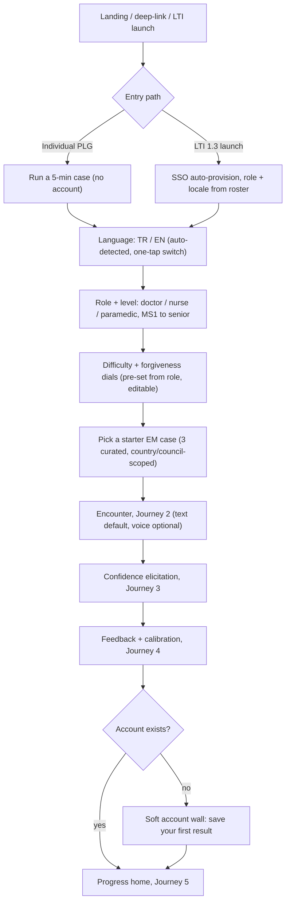
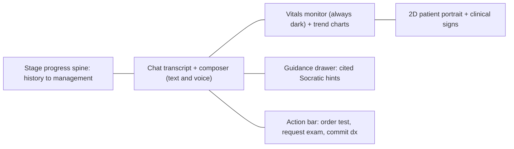
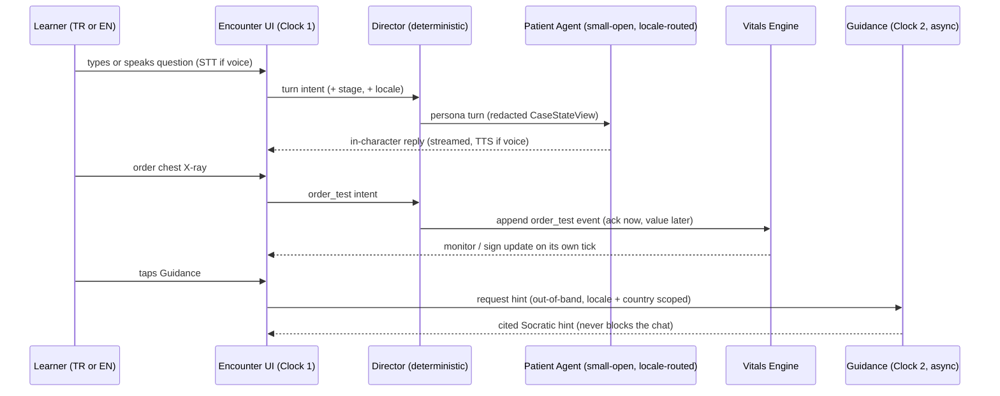
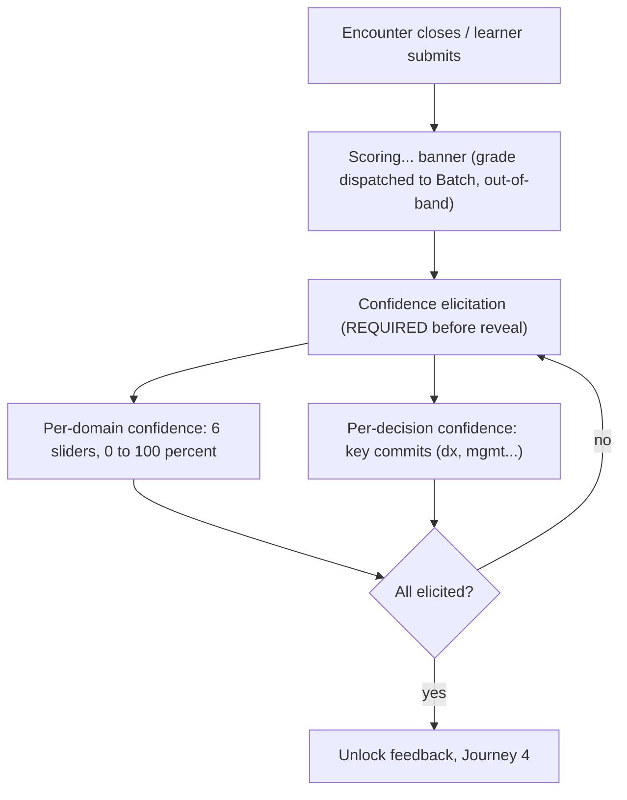
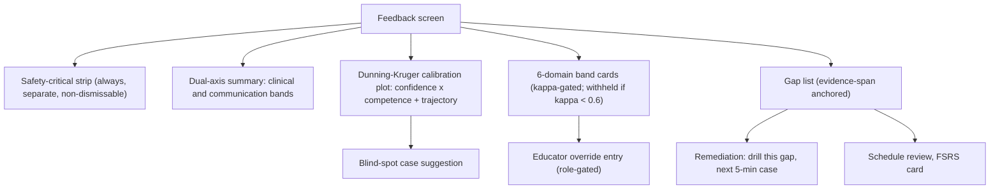
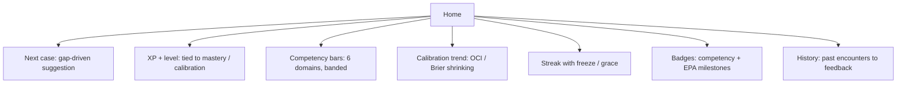
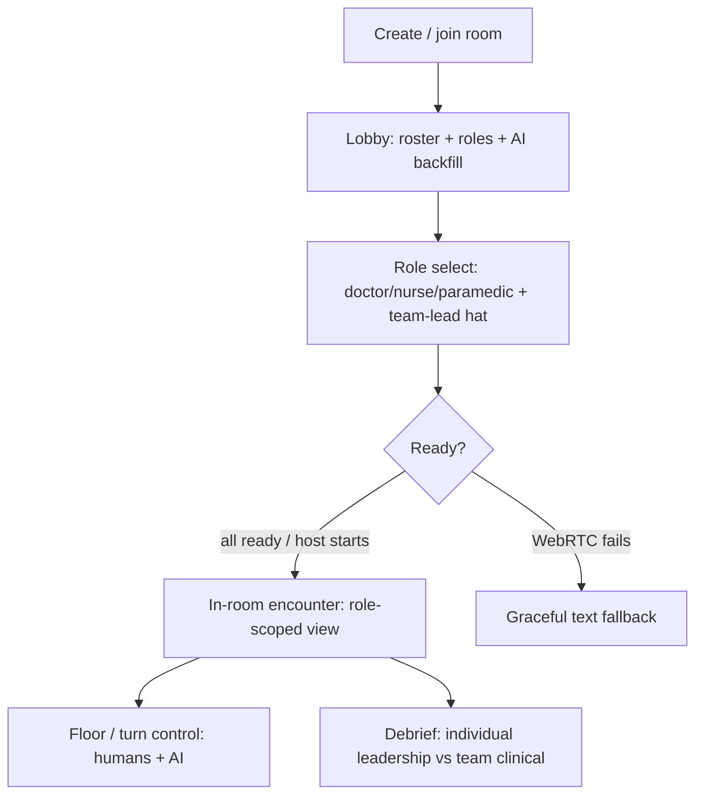
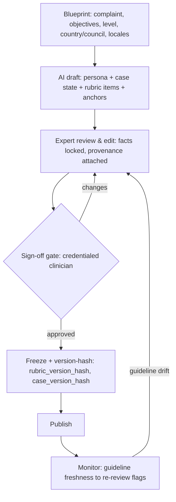
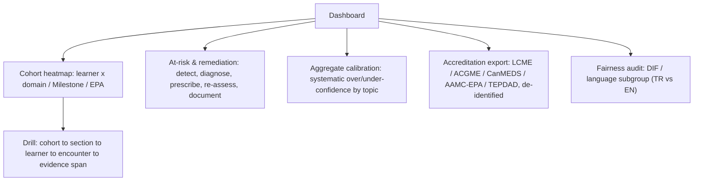

# 01 — UX Flows & Key-Screen Specs

**Status:** Design phase, decision-oriented. Downstream of the authoritative baseline (`docs/00-overview/01-requirements-and-constraints.md`), the design system (`docs/design/00-design-system.md`), the learner personas (`docs/stakeholders/01-learners.md`), the Assessment & Calibration Engine (`docs/architecture/06-assessment-and-calibration-engine.md`), and the localization stack (`docs/research/09-localization-i18n-turkish.md` + `docs/architecture/11-internationalization.md`). Where a screen encodes an architectural contract, the contract wins — this doc renders it, never re-derives it.

**Time context:** July 2026. **Design floor:** 4–5-yr-old laptop (integrated GPU, WebGL2), mid-range phone on 4G, text-completable at <100 kbps, WCAG 2.2 AA non-negotiable, **phone-first one-handed** entry, **TR + EN first-class in text *and* voice**, both light and dark theme.

**These screens are implemented in `web/`.** The live scaffold (`web/src/`) already ships the design language, the `AppFrame` gradient shell, the EN/TR i18n runtime (`react-i18next` + `i18next-icu`, EN default, TR co-primary, `<html lang>` synced), the shared UI primitives (`Button`, `Card`, `Badge`, `Tabs`, `Tooltip`, `Switch`, `Skeleton`, `Stat`), and typed bilingual mock data (`web/src/data/mock.ts`). This doc specifies the full screens those routes grow into; component names below map to `web/src/components/`.

**Three direction corrections applied throughout (they change what the UI *shows*, not just what runs behind it):**
- **DC-1 Local/open-source-first models.** The Model Gateway tiers are now **small-open (patient turns) → large-open (reasoning/grading) → frontier-API (rare escalation)**, self-hosted via vLLM/SGLang. Where the UI surfaces model provenance (feedback footer, authoring provenance chips, admin console), it names the **tier**, not a vendor — e.g. "graded by a large open model (self-hosted), cross-family verified" — and the AI-transparency badge (Art. 50) is model-agnostic. No screen implies a specific commercial API by default.
- **DC-2 Turkish is a first-class locale.** Every screen ships in **TR + EN**, text *and* voice. The language pick is a first onboarding step (auto-detected, one-tap switch), persisted, and reachable from every screen via the `LanguageSwitcher`. Turkish medical terminology, TR guideline citations (TEPDAD / T.C. Sağlık Bakanlığı / TİTCK / UÇEP), TR TTS/STT, code-switch handling, and the dotted/dotless-`i` display-vs-identity split are treated as first-class, not a translation veneer. Screen specs call out TR behavior explicitly (`TR:` notes).
- **DC-3 medkit design language, locked AcuDx tokens.** Clean clinical **white base** (light is the default, including in the encounter), single locked **brand blue `--brand-600 #2563EB`** CTA, sparse **teal→blue→pink** gradient reserved for the `AppFrame` shell + logo mark, **Geist Sans** (display+body) / **Geist Mono** (vitals/tabular), **one dark element — the vitals monitor** (`--monitor-*`, dark in both themes), radius 16px cards / 10px controls / pill, soft slate-tinted shadows, restrained `cubic-bezier(0.16,1,0.3,1)` 200–400ms motion honoring reduced-motion, **Phosphor** icons (one weight). Evidence/citation callouts are a first-class medkit element.

**Cross-cutting design invariants (bind every screen below):**
- **INV-1 Text is the floor, never the gate.** Every action has a keyboard-and-text path; **voice (TR or EN)** and avatar are enhancements layered on top, never required to complete a case. Voice always has a full text twin (captions on TTS, editable text draft for STT).
- **INV-2 Bands, never decimals.** No numeric score of competence is ever shown to a learner (κ-gated bands only: `Emerging → Developing → Proficient → Strong → Exemplary`). Confidence *is* elicited as a % (the learner's own input); competence renders as a 4–5-band ordinal.
- **INV-3 Dual-axis always.** Clinical reasoning ⟂ communication/language are visually separated on every feedback surface, each with its locked icon (◆ clinical `--axis-clinical`, ● communication `--axis-communication`). The TR/ESL fairness rule lives here: accent/L2 form never scores.
- **INV-4 Calibration never leaderboarded.** The Dunning-Kruger plot is private, formative, RBAC-walled from any ranking; framed as a *trainable skill*. "Private by design. No public leaderboard." is shown, not implied.
- **INV-5 Signs never rely on colour alone** (WCAG 1.4.1). Vitals/signs carry **icon + text label + shape/pattern + ARIA-live** redundancy; alarms have non-audio cues. The four clinical states (`normal` `--state-normal`, `caution` `--state-caution`, `warning` `--state-warning`, `critical` `--state-critical`) always render icon+label.
- **INV-6 Safety-critical misses surface always & separately**, regardless of overall band, on a dedicated non-dismissable strip.
- **INV-7 Forgiveness by default for novices.** MS1 = scaffolding ON, no penalty for naive questions; senior = high ceiling, sparse hints. Dials are visible and adjustable pre-encounter.
- **INV-8 Confidence before reveal.** Score is architecturally un-revealable until confidence is elicited; the UI enforces the same event ordering the Event Log enforces.
- **INV-9 AI transparency + provenance** (AI Act Art. 50): a persistent "roleplay · AI patient" affordance; every clinical claim carries a cited, versioned, "last reviewed" guideline reference (TR-scoped for TR encounters) or it is not shown. Synthetic voice/avatar is C2PA-labeled.
- **INV-10 Locale is orthogonal to country.** `locale` (what the learner reads/hears/is graded in — TR or EN) and `country/council` (which clinical truth applies) are two independent axes (`architecture/11`). The UI lets a `tr-TR` learner practice a `country=TR` case, but the two selections are visible and separable; content is only offered in a locale that passed clinician-fluent review — never auto-machine-translated to the learner.

**Design tokens referenced below** (canonical in `docs/design/00-design-system.md` and `web/src/index.css`): `--brand-600 / --brand-700 / --brand-50`; neutrals `--bg --bg-subtle --surface --fg --fg-muted --border` (light + dark); vitals-monitor `--monitor-bg --monitor-border --monitor-fg --monitor-dim --monitor-online` (always dark); clinical states `--state-{normal,caution,warning,critical}`; dual-axis `--axis-clinical / --axis-communication`; calibration `--calib-{line,over,under,well}`; radius `--r-card 16px / --r-control 10px`; fonts `--font-sans` (Geist) / `--font-mono` (Geist Mono); gradient utilities `gradient-frame / gradient-text / gradient-mark`. **Never encode meaning in hue alone; never hard-code hex in a component.**

**Scope of this doc.** Eight journeys, each = a Mermaid user-flow + a screen-by-screen spec (layout regions, key components, primary/secondary actions, empty/loading/error states, mobile adaptation, a11y, TR/EN). Journeys **1–5 are MVP** (solo text-first EM wedge, TR+EN). Journeys **6–8 are gated fast-follows** (multiplayer v1; educator authoring MVP-basic→v1; dean dashboard v1) — specified now so the MVP screens don't paint us into a corner.

---

## Journey 1 — Onboarding + first encounter (language, role, difficulty; time-to-first-encounter is the metric)

**Goal:** get a brand-new learner into a *completed* EM encounter as fast as possible (first-encounter completion >70% is an MVP gate), in **their language**, while capturing just enough to set the forgiveness/difficulty dials correctly and avoid the two churn cliffs (novice humiliation, senior boredom). Account creation is deferred until *after* first value where possible. **Language is picked (or confirmed) before the case** so a Turkish student never reads an English stem by accident.

### Screen 1.1 — Landing / entry (medkit hero)
- **Layout regions:** the `AppFrame` gradient shell; **hero** (one-line value prop in the medkit large-headline + italic-emphasis register — `home.title` "Rehearse the case before the case rehearses you." — plus a single primary CTA `home.primaryCta`); a **muted trust strip** (formative-only · synthetic patients · WCAG AA · guideline-cited · *for education only*); footer with the persistent education-only disclaimer (`app.eduDisclaimer`), accessibility statement / VPAT link, and AI-transparency notice.
- **Primary action:** *Run a 5-minute case* (brand-blue button, no account). **Secondary:** *Sign in / institution SSO*, *For educators*.
- **Language affordance:** the `LanguageSwitcher` is in the `TopNav` on every screen; on first load the language is auto-detected (`i18next` browser detector) and the hero renders in it. A small "TR · EN" toggle is visible in the hero trust strip so the first thing a Turkish student sees is that the product is theirs.
- **LTI path:** an LMS deep-link skips this screen → SSO auto-provision; **role, cohort, *and* locale** inherited from the NRPS roster (a Turkish faculty roster lands the learner in `tr-TR`) → land directly on 1.3 (language step is pre-satisfied, still confirmable).
- **Empty/loading:** skeleton hero (`Skeleton`); if the tenant's country has zero cases, show "cases coming for {country}" rather than US-defaulting (T6) — never silently fall back to another country's guidelines.
- **Error:** SSO failure → text-explained fallback to email sign-in, never a dead end.
- **Mobile:** single column, CTA in the bottom thumb-zone, trust strip collapses to a tappable "Why it's safe" sheet.
- **TR:** hero, trust strip, CTA all from the `tr` catalog (full-sentence ICU messages, no fragment assembly); TR strings run longer — the hero headline is tested at TR length, not EN. `<html lang="tr">` set so the browser hyphenates/reads correctly.
- **a11y:** one H1, logical tab order, CTA is a real `<button>`, ≥24px targets, focus-visible brand ring, reduced-motion respected on the hero fade-up.

### Screen 1.2 — Language confirm (only when ambiguous)
- **Purpose:** an explicit, low-friction confirmation when auto-detection is uncertain or the learner arrived via a language-neutral link. Two large cards: **Türkçe** and **English**, each with a one-line sample of the product voice in that language so the choice is concrete.
- **Behavior:** the choice sets `User.locale`, persisted; it is orthogonal to `country` (INV-10) — choosing Turkish does *not* silently force `country=TR`; country/council is set by the case (1.4) or the tenant. A "you can change this anytime" note points at the always-present `LanguageSwitcher`.
- **Skip:** when detection or the LTI roster is confident, this screen is skipped; the toggle in `TopNav` remains the escape hatch.
- **a11y/mobile:** two big radio cards, arrow-key navigable, selection announced; whole card is the target.

### Screen 1.3 — Role + level picker
- **Layout:** two stacked segmented controls — **Role** (Doctor / Nurse / Paramedic; Examiner/Team-lead greyed "multiplayer, coming") and **Level** (Pre-clinical / Clinical / Intern / Senior). A one-line plain-language explainer under each ("Nursing: assess, monitor, escalate — not diagnosis-first").
- **Why here:** Role and Level *pre-set the dials* (1.4), *scope the case list* (1.5), and *seed the rubric axis emphasis*. Nursing must never feel like a "mini-doctor" bolt-on (anti-pattern #10) — the copy and the subsequent case set change materially.
- **Primary:** *Continue*. **Secondary:** *Not sure? Use recommended* (defaults Clinical-year Doctor, the median).
- **TR:** level labels use the TR clinical register (e.g. *Klinik öncesi / Klinik / İntörn / Uzman*); "İntörn" exercises correct `tr-TR` **display** casing (dotted `İ`), while any identifier derived from the choice is normalized under the invariant locale (never `tr` case-folding on identity — the dotted/dotless-`i` rule).
- **Empty/loading:** instant (static). **Error:** none (client-side).
- **Mobile:** segmented controls wrap to 2×2 tap grids; large targets.
- **a11y:** radiogroup semantics, arrow-key navigable, selection announced.

### Screen 1.4 — Difficulty + forgiveness dials
- **Layout:** two labeled sliders + a live preview `Card`. **Difficulty** (Gentle → Stretch) governs case complexity ⟂ patient-agent difficulty (the two adaptive axes, shown as one blended dial at MVP with an "advanced: split" disclosure). **Forgiveness** (Guided → On-your-own) governs guidance default, hint density, and *no-penalty-for-naive-questions*.
- **Defaults by INV-7:** MS1 → Forgiveness=Guided (guidance ON, heavy scaffold), Difficulty=Gentle. Senior → Forgiveness=On-your-own, Difficulty=Stretch. Preview card restates in plain words what the learner just chose ("You'll get Socratic hints when you pause; naive questions won't cost you marks").
- **Voice preference (DC-1/DC-2 aware):** a third, optional control — **Input mode** (Text / Voice / Both) — defaulting to **Text** (INV-1). If Voice is chosen, a one-line note states the voice runs in the learner's locale (TR patient personas via the open-first TR TTS; EN via the EN stack) and that low-confidence speech falls back to editable text (never a silent mis-score). Voice is never required to proceed.
- **Primary:** *Start*. **Secondary:** *No-timer mode* toggle (a11y + ESL, decouples from scoring semantics), *Extended time*.
- **TR:** slider `aria-valuetext` in TR words ("Nazik" … "Zorlayıcı"), not numbers; the preview card is a full-sentence TR ICU message.
- **Mobile:** full-width sliders, value announced on change; preview card sticky above the CTA.
- **a11y:** sliders are `role=slider` with `aria-valuetext` in words not numbers; no-timer/extended-time are first-class, not buried; `Switch` primitives inherit focus + 24px targets.

### Screen 1.5 — Starter case pick
- **Layout:** 3 curated EM cases as `Card`s (chief complaint, ~duration, one-line "what you'll practice", competency tags, patient-variant chip e.g. "anxious", **guideline/council chip** showing the country scope). A single *Surprise me* option.
- **Country/council visibility (INV-10):** each card shows the case's `country/council` (e.g. "TR · TEPDAD/UÇEP · TİTCK drugs" or "UK · NICE") so the learner sees which clinical truth applies — TR cases cite Turkish bodies, not NICE/AHA, unless labeled fallback.
- **Primary:** card tap → encounter. **Secondary:** *browse all* (post-onboarding library).
- **Empty:** if the country pack is incomplete, show the open-license EM subset available and label the country/guideline version explicitly; for a TR learner with a thin national pack, a case may show "no Turkish national guidance for this — per ESC (labeled fallback)" rather than silently US-defaulting.
- **Loading:** card skeletons; case content (persona prefix + rubric + **locale content pack**) prefetched so the encounter opens warm; the byte-stable cached prefix already includes `locale`, so a TR case gets the same prompt-caching economics as EN.
- **Mobile:** vertical card stack, whole card is the target.
- **TR:** case title, chief complaint, "what you'll practice" all from clinician-reviewed TR case text (not MT); a case with no reviewed TR content is not offered in TR (`Case.content_locales[]` gate).
- **a11y:** each card a labeled link/button; tags are text not colour chips alone.

### Screen 1.6 — Soft account wall (post-value)
- Only appears for the un-authenticated PLG path, **after** the first feedback. "Save your first result + calibration" with email/OAuth/SSO. Result is held in session and attached on sign-up so nothing is lost.
- **TR/identity note:** email/username is normalized and compared under the **invariant** locale (never `tr` case-folding) — the dotted/dotless-`i` auth-bypass class is closed here; display of the person's name uses `tr-TR` casing.
- **Error:** if sign-up fails, result stays viewable for the session with a persistent "save to keep" banner.
- **a11y:** never a modal trap; dismissible, keyboard-escapable, focus returned.

---

## Journey 2 — Core EM encounter screen (the product)

**Goal:** run the solo EM encounter — **chat with the AI patient in TR or EN**, read the **live dark vitals monitor** + trend charts, see a **2D patient portrait with physiology-driven clinical signs**, toggle **cited Socratic guidance**, order tests / request exam findings, take input by **text AND voice**, and move through the soft-gated stage machine `history → exam → tests → differential → diagnosis → management → wrap-up` with a visible **stage progress** spine. This screen is Clock 1; grounding and grading hang off it asynchronously and never block a turn. **Light theme is the default here (medkit white)** — the *only* dark element is the vitals monitor (`--monitor-*`), which stays dark in both themes.

### Screen 2.1 — Encounter (desktop/tablet, three-pane)
- **Layout regions (desktop):**
  - **Top bar:** case title + chief complaint · **AI-transparency badge** (`app.aiLabel` — "Roleplay · AI patient", model-tier-agnostic per DC-1) · **language + input-mode indicator** (TR/EN, Text/Voice) · elapsed/timer (only if timed mode) · pause/resume · exit. The `LanguageSwitcher` is *not* live-swappable mid-encounter (locale is fixed at start for cache-prefix stability, `architecture/11 §3.3`) — it shows the current locale, greyed with a tooltip.
  - **Left rail — Stage progress spine:** the 7 stages as a vertical progress spine; current stage highlighted (**icon + label + fill, not colour alone**); completed stages checked; soft-gate means any stage is tappable to jump — the tracker records the *dominant* stage per turn, never refuses an out-of-order action. A subtle "you can revisit history anytime" affordance. This is the "stage progress" the wedge requires.
  - **Center — Chat transcript + composer:** streamed patient turns with a clear speaker label (Patient / Colleague / Dispatcher / System) in Geist Sans, timestamps (locale-formatted, 24-h for TR), and inline **action receipts** ("You ordered: CBC — pending"). Learner turns are right-aligned; AI turns left with the persistent AI badge. Composer supports **free text + voice + a quick-action menu** (see 2.2). Patient affect is surfaced as a small text chip (`encounter.affect.*` — "In pain, anxious").
  - **Right rail — Vitals Monitor (top, always dark) + 2D Portrait (bottom):** see 2.3 / 2.4.
  - **Guidance drawer:** slides over the right rail on toggle; cited hints (2.5).
- **Primary actions:** send message (text or voice); order test / request exam finding; commit differential/diagnosis/management (the stage-advancing commits).
- **Secondary:** toggle Guidance; toggle Portrait; open vitals table view; **terminology translator** (inline, non-blocking — the ESL/IMG hero feature, and for TR it's the TR↔EN medical glossary: tap *troponin* / *kalp krizi* to see the paired term without leaving the case); toggle voice input; flag "report incorrect medical content" (Art. 50 + hazard-log intake).
- **Empty state:** fresh encounter shows the opening stem (triage note / dispatch) + baseline vitals; composer focused; a one-line "Start by taking a history" nudge (suppressed for seniors).
- **Loading state:** patient turn streams token-by-token with a non-spinner typing indicator (`encounter.aiTyping` — "Patient is responding"); if a turn escalates a tier (small-open → large-open on a hard/clinical-fact turn, or → frontier-API on persona-break) the user sees no difference except latency stays under the p95 <1.5 s text budget. Action results show "pending" chips resolved when the engine ticks.
- **Error states:** (a) model/turn failure → retry inline, transcript preserved, "we kept your progress" (server-authoritative, resumes in ≤2 taps); (b) network drop → offline banner, composer disabled with "reconnecting…", auto-resume on reconnect (drop-tolerant, checkpoint each turn); (c) **safety interceptor trip** (self-harm/abuse/dangerous order) → the AI **breaks character**, a distinct system `Card` appears with resources/next-step (`encounter.safety.*`), and the encounter pauses — deterministic, outside the LLM, always available, and rendered identically in TR and EN.
- **Mobile adaptation:** single column with a **bottom tab switcher**: `Chat · Monitor · Patient · Guidance`. Chat is default. Monitor collapses to a persistent **one-line dark vitals ticker** pinned above the composer (HR/BP/SpO₂ + trend glyphs) so deterioration is never hidden behind a tab; tapping it opens the full monitor. One-handed: composer + send + quick-action + voice mic are all in the thumb zone. Portrait is a tab, never forced.
- **Voice (INV-1, DC-2):** a mic button in the composer. On press: STT runs in the encounter locale (TR: open-first self-hosted Whisper-large-v3 + TR-medical LoRA, or Deepgram Nova-3 Turkish managed; EN: Deepgram Flux/Nova-3 Medical), seeded with the per-case keyterm/glossary. **Low STT confidence → an editable text draft**, never a silent commit; the learner confirms and the confirmed text becomes the turn. TTS reads patient replies with **captions always on** (voice never a gate). Critical-value read-back is closed-loop and locale-aware ("Onaylayın: labetalol 50 mg IV — 'onayla' deyin"), with drug+dose as locked tokens.
- **a11y:** full keyboard operation (send, open action menu, jump stage, toggle drawers, start/stop voice); transcript is an ARIA log with a polite live region; every action receipt announced; focus never trapped in the guidance drawer; 24×24 targets; respects reduced motion (disable streaming animation, keep token append); captions on all TTS; light/dark both meet AA (verified in `web/src/index.css`).

### Screen 2.2 — Action bar / order & exam surface
- **Layout:** a quick-action menu on the composer (`/` or a "+" button): **Order test** (labs/imaging/ECG), **Request exam finding** (auscultate, palpate, neuro…), **Interpret result**, **Commit differential**, **Commit diagnosis**, **Commit management**, **Ask for senior/colleague**.
- **Behavior (contract):** `order_test` / `request_exam_finding` return an **ack immediately** (in-character "I'll get that ordered") and the *value* surfaces later from the deterministic Vitals Engine — never blocking. Results land as transcript receipts and (for vitals-affecting orders like O₂) visibly move the monitor + fade the relevant sign.
- **Commit actions** are the stage-advancing, calibration-relevant decisions — each commit later maps to a per-decision confidence prompt (Journey 3) and to rubric items.
- **TR clinical-token safety:** drug names, doses, units, and INN strings are **locked glossary tokens** — the same value in TR and EN, never LLM-translated; the order UI shows the canonical drug/dose (e.g. `labetalol 50 mg IV`) identically in both locales, so a TR encounter can never mistranslate a dose.
- **Empty/loading:** ordered-but-pending items show a "results tray" badge count; tapping shows pending vs resolved.
- **Error:** an out-of-scope order (e.g., nurse role ordering imaging in a future role-scoped case) is logged, not silently dropped, and returns a plain "that's outside your role here — you could ask the doctor" (RP-3 groundwork; MVP solo = doctor scope by default).
- **Mobile:** the quick-action menu is a bottom sheet with large rows; the results tray is a badge on the Monitor tab.
- **a11y:** menu is a proper listbox/menu; commits require an explicit confirm to avoid mis-taps corrupting the stage record.

### Screen 2.3 — Live Vitals Monitor + trend charts (RP-4, INV-5; the one dark element)
- **Layout:** a compact **always-dark** monitor card (`--monitor-bg #0B1220`, `--monitor-border`, `--monitor-fg`, online-dot `--monitor-online #10B981`) — dark in *both* light and dark app themes, the single medkit-sanctioned dark surface. **Numeric vitals** (HR, BP, RR, SpO₂, Temp) in **Geist Mono, tabular figures** (numbers don't jitter as they update) each with a **trend sparkline** (last N samples), a **direction glyph** (↑ ↗ → ↘ ↓), and a **text state word** ("SpO₂ 91% falling"). A tab/expander reveals **CV and respiratory trend charts** at larger size, and a **table view** (time × parameter) as the non-graphical equivalent (`vitals.table.*`).
- **Encoding rules (INV-5):** no vital's status is conveyed by colour alone — every abnormal value pairs the state colour (`--state-*`) with an **icon**, a **text word** ("low"/"falling"/`states.*`), and a **shape/threshold marker** on the sparkline. Alarms (e.g., SpO₂ crossing a threshold) fire an **ARIA-live polite** announcement + a non-colour visual pulse (outline/shape, `pulse-ring` keyframe, static under reduced-motion) + optional non-audio cue; audio alarm is opt-in and never the only channel.
- **Data provenance:** the monitor is a read-only projection of the authoritative Case State — it can never contradict the portrait or the patient's words (one state, three renders). Vitals update on the physiology tick and after interventions along the authored curve.
- **TR:** vital labels and status words come from the `tr` catalog (`vitals.hr` "Kalp hızı" etc.); **values stay in SI/clinical units** in every locale (BP `120/80 mmHg`, SpO₂ a percent) — only the *number formatting* is localized (TR decimal comma via `Intl.NumberFormat('tr-TR')`), and the **stored/graded value is the canonical number** so the deterministic numeric grounding check compares canonical numbers, not display strings.
- **Empty/loading:** baseline vitals present from t=0; an unmonitored parameter shows "—" with "not monitored", not a fake zero.
- **Error:** if the vitals stream lags, the last-known sample shows with a "stale (Xs)" tag (`vitals.stale`) rather than a blank or a guess.
- **Mobile:** collapses to the pinned one-line dark ticker (2.1); full monitor + charts + table via the Monitor tab; charts are horizontally scrollable in an `overflow-x:auto` container (never force horizontal page scroll).
- **a11y:** each vital is a labeled group ("Heart rate, 118, rising, tachycardic"); charts have a text summary + the table equivalent is always one control away; live regions are polite (not assertive) to avoid SR spam, except a single assertive announcement on a *safety-threshold* crossing. Dark-monitor text meets AA on `--monitor-bg`.

### Screen 2.4 — 2D patient portrait + clinical-sign overlay (AV-1; sign *state* legible even in text-only)
- **Layout:** a portrait panel driven by the same `ClinicalSign` intensities as the monitor. Continuous signs (`cyanosis_central`, `pallor`, `diaphoresis`, `flushing`, `resp_distress`, `loc_depression`) render off a 0..1 intensity; discrete/regional signs (wound, rash, bleeding) render as region decals. Each sign carries a **text/label equivalent** and a **band word** (`none · subtle · moderate · marked · severe`). A caption chip (`encounter.portrait.caption` — "Diaphoretic, mild distress") states the headline sign in words.
- **MVP reality:** the *portrait render* is a v1 fast-follow, but the **sign state must be legible in the text-only MVP** — so a **"Clinical signs" list/table** (sign · band · when-first-detectable) is the load-bearing MVP surface; the portrait is the enhanced render of that same list. This keeps "missed cyanosis for 90 s" scoreable and visible without the avatar, and is what nursing/ESL/TR learners rely on at <100 kbps.
- **Consistency invariant:** portrait, monitor, and patient dialogue are three projections of one state; a sign shown on the portrait is always present in the signs table and consistent with the vitals.
- **TR:** sign names and band words localized (`none · subtle · moderate · marked · severe` → TR equivalents); the signs table is a first-class TR surface, not an MT afterthought.
- **Empty/loading:** no active signs → calm neutral portrait, table reads "no abnormal signs detected"; portrait render failure degrades to the signs table (never blocks the case).
- **Error/perf:** on the device floor, portrait animation caps FPS and falls back to static + signs-table; **C2PA label on any synthetic avatar frame** (Art. 50) in both locales.
- **Mobile:** Patient tab; the signs table is the equivalent.
- **a11y:** signs announced as text with band words, never colour-only; portrait is decorative-plus-labeled, the table is authoritative; reduced-motion disables sign animation but not the state.

### Screen 2.5 — Guidance drawer (grounded, cited, Socratic; G-1/G-3, INV-9; medkit citation callout)
- **Layout:** a slide-over drawer. Hints are **Socratic** ("You haven't established onset — how might you ask?"), scaffolded to the forgiveness dial, and **every clinical claim is cited** in the medkit evidence-callout style to a versioned `GuidelineStatement` chip: `{source · version · country/council · "last reviewed" date}`. If retrieval can't ground a claim, the system **abstains** (`encounter.guidance.abstained` — "No grounded guidance for this step yet.") rather than free-generating — abstain > confident-wrong; the abstention is styled as legitimate, not an error.
- **Locale + country grounding (DC-2, INV-10):** hints are generated **in the encounter locale** by the locale-routed grounded reasoner (TR: Qwen3-class-32B + TR-scoped RAG; EN: EN large-open + RAG), retrieval **filtered before rank on country AND language**. A TR encounter's citation chips read **TEPDAD / UÇEP / T.C. Sağlık Bakanlığı / TİTCK**, not NICE/AHA — unless no national guidance exists, in which case the international source is shown **explicitly labeled** ("Türkiye ulusal kılavuzu yok; ESC'ye göre…"), never silently.
- **Country-divergence as teaching:** where guidelines legitimately differ (ESC 140/90 ∥ AHA/ACC 130/80), both cited statements are shown side by side, scoped to the case's declared council — a teaching feature, never a silent US-default.
- **Toggle behavior:** guidance ON by default for novices (INV-7); a visible `Switch` toggle (`encounter.guidance.toggle`); hint requests are **out-of-band** (Clock 2) and never stall the chat — a late hint simply appears.
- **Empty/loading:** "Tap for a hint" empty state; a subtle spinner while grounding; abstention explains "why".
- **Error:** grounding-service failure → "hints unavailable right now" (encounter fully playable without them; text is the floor).
- **Mobile:** Guidance tab / bottom sheet; citations expandable inline.
- **a11y:** drawer is a labeled dialog with focus management and escape; citation chips are real links, SR-readable; hint text plain-language and screen-reader-first; abstention is `role=status` not `alert`; "current vs stale" never colour-only.

---

## Journey 3 — Confidence elicitation (BEFORE reveal; AS-7, INV-8)

**Goal:** capture the learner's self-rated confidence *before any score is shown*, per domain and per key decision, because post-hoc confidence is contaminated and this is the raw input to the Dunning-Kruger plot. The Event Log rejects a confidence event stamped after the grade reveal — the UI enforces the same ordering so the two can never disagree.

### Screen 3.1 — "Scoring…" interstitial
- **Layout:** a calm full-width banner "Scoring your encounter — this runs in the background." Grading is Batch/out-of-band (target <90 s p95) so the learner is *not* blocked; they proceed straight to confidence elicitation while grading runs.
- **DC-1 provenance (subtle):** no vendor is named; if any provenance appears it's tier-level ("scored by a large open model, self-hosted"). No commercial-API branding.
- **Primary:** *Rate your confidence* (`actions.rateConfidence`) — the only forward path. No "skip to score"; reveal is architecturally gated on elicitation.
- **TR:** banner and CTA from the `tr` catalog; no countdown shown (no timer anxiety).
- **a11y:** status announced politely; no countdown.

### Screen 3.2 — Per-domain + per-decision confidence
- **Layout:** two grouped sections.
  - **Per-domain (6):** History · Exam/Investigations · Reasoning · Communication · Management · Professionalism — each a 0–100% slider ("How confident are you that you did this well?"). Plain anchors at 0 / 50 / 100 (`confidenceAnchors.*` — "Not confident" / "Somewhat" / "Very confident").
  - **Per-decision:** each key commit from the encounter (leading diagnosis, management plan, any safety-net decision) gets a short "How sure are you?" 0–100%. These feed the proper scoring-rule metrics (Brier/OCI), not just a domain gestalt.
- **Framing copy (anti-shame):** "First encounters are often overconfident — that's normal and it's a skill we'll help you train." Sets up the calibration reframe before any result. **This is the one place a numeric % is correct** — it's the learner's *own* input, not a competence score (INV-2 unaffected).
- **Primary:** *See my feedback* (enabled only when all required ratings are set). **Secondary:** *why we ask this* (explains calibration, links a 20-sec primer — supports the ≥80% "learners correctly interpret their plot" gate).
- **Empty/loading:** sliders default to *unset* (not 50) so we capture a real signal; an unset required slider blocks continue with a gentle inline prompt.
- **Error:** none server-side; purely client until submit, then a single `ConfidenceElicited` event (stamped with `locale`).
- **Mobile:** one slider per row, large thumb, value announced in words + %; sections collapsible; sticky continue button.
- **TR:** domain labels and anchors from the `tr` catalog; `%` renders in TR format (`%75` per Turkish convention). Sliders `aria-valuetext` in TR words + %.
- **a11y:** sliders `aria-valuetext` in %+word; keyboard-settable; the confidence % is the learner's own number so a numeric value here is correct (unlike competence, INV-2).

---

## Journey 4 — Post-encounter feedback + the Dunning-Kruger calibration plot (the signature)

**Goal:** deliver defensible, dual-axis, evidence-anchored feedback: 6-domain **band** scores (κ-gated, band-only), the signature **calibration plot** (confidence vs competence quadrants + trajectory), an **evidence-span-anchored** gap list, **safety-critical misses surfaced separately**, and remediation CTAs. This is the screen the whole product is judged on. Light theme (medkit white), warm/coaching tone.

### Screen 4.1 — Feedback overview (scroll order is deliberate)
- **Region order (top→bottom):** (1) **Safety-critical strip** (INV-6) → (2) **Dual-axis summary** → (3) **Calibration plot** → (4) **6-domain band cards** → (5) **Gap list + remediation** → (6) footer (mode/version provenance, override, report-content).
- **1. Safety-critical strip:** a distinct, non-dismissable band at the very top when any `safety_critical` item was missed — with its **evidence span** and a supportive "here's the one thing to check next time" framing (`feedback.safetyStripTitle`). Present *regardless* of overall band; a quiet clean-state message when none (`feedback.safetyStripClean`). Uses the critical state icon+label, never colour alone.
- **2. Dual-axis summary (INV-3):** two clearly separated readouts — **Clinical (◆, `--axis-clinical`)** band and **Communication (●, `--axis-communication`)** band — each a band chip with a word label. Copy makes explicit these are orthogonal (`feedback.dualAxis.orthogonalNote` — "These are scored independently."). The patient-variant difficulty (anxious/low-literacy/non-native) is noted as taxing the *communication* axis, and must not have leaked into the clinical axis. **TR/ESL fairness:** accent, L2 pronunciation, minor grammar, and any STT mis-transcription **never** score on either axis — a Turkish learner is graded on clinical correctness and the *content* of communication, not language form.
- **3. Calibration plot:** see 4.2 (exact encoding).
- **4. Six-domain band cards:** one `Card` per domain with its band word (`bands.*` — Emerging/Developing/Proficient/Strong/Exemplary), a one-line "what this means", and a drill-down to contributing items → **evidence spans in the language the learner actually used** (a TR learner sees their own TR/code-switched words quoted verbatim). **κ-gating is visible:** κ<0.6 shows `feedback.withheld` ("Not enough reliability to score this yet.") — band withheld but gap feedback still shown, never a fabricated band. Pass/fail-eligible (κ≥0.7) is marked only in summative/institutional contexts.
- **5. Gap list:** see 4.3.
- **6. Footer:** `assessment_mode: formative` badge, **rubric version + guideline versions served + grader-config provenance in plain language and tier-level** (DC-1 — "graded by a large open model, self-hosted; cross-family verified", never a vendor name), **educator override** entry (role-gated), and **report incorrect content** (`feedback.provenance.reportContent`).
- **Empty/loading:** if grading is still running, band cards and plot show a "still scoring…" skeleton while the **gap/evidence** and **safety strip** (available first from evidence spans) populate early; the screen fills progressively.
- **Error:** withheld domain (κ or grader low-confidence → human review) says so plainly; grading failure offers retry and keeps transcript + confidence intact.
- **Mobile:** vertical scroll in the exact region order; the calibration plot gets a dedicated full-width, pinch-zoomable render with the table equivalent one tap away.
- **TR:** every band word, domain label, gap statement, and the safety strip render from the `tr` catalog; the **evidence quote stays in the learner's actual language** while the criterion label is localized.
- **a11y:** each region a labeled landmark; band words text-first; the plot has a full text/table alternative (4.2); safety strip announced assertively once on load.

### Screen 4.2 — The Dunning-Kruger calibration plot (exact visual encoding)

This is the signature artifact. **Encoding, precisely (rendered on light medkit surface; a directional, non-judgmental palette — never red-for-fail):**

- **Canvas:** a square 2-D quadrant chart.
  - **X-axis = self-rated Confidence**, 0→100% left→right (the learner's elicited number; `calibration.axisConfidence`).
  - **Y-axis = measured Competence**, low→high bottom→top, rendered as **ordinal bands** (Emerging→Exemplary), *not* a continuous 0–100 — competence is band-only (INV-2). Gridlines fall on band boundaries, labeled with band words (Geist Sans labels, Geist Mono for the confidence axis ticks).
  - **Identity reference:** a 45° "perfect calibration" diagonal drawn in **`--calib-line`** (dark on light, light on dark) as a **dashed** neutral guide, labeled `calibration.identityLine` ("Well-calibrated").
- **Four quadrants** (the `quadrant` enum), each with a **word label + icon + distinct fill pattern** (never colour alone):
  - **Calibrated & strong** (high conf ∧ high competence) — top-right (`calibration.quadrant.calibratedStrong`).
  - **Calibrated & growing** (low conf ∧ low competence, honestly aware) — bottom-left.
  - **Blind spot / overconfident** (high conf ∧ low competence) — bottom-right — the clinically dangerous quadrant, framed **supportively** (`calibration.quadrant.blindSpot` — "Confidence ahead of performance"; body: "here's what to check"), **never a red 'you're dangerous' banner**. Deviation toward this side is drawn in **`--calib-over`** (a warm ochre *direction*, not an alarm colour).
  - **Hidden strength / underconfident** (low conf ∧ high competence) — top-left — explicitly named to reframe imposter feelings (MS1/ESL/TR). Deviation this side is **`--calib-under`** (a cool blue *direction*).
- **Per-domain points:** one marker per domain (6 markers), each **shape/icon-coded by domain and labeled** (◆ clinical-family, ● comms-family); position = (that domain's confidence, that domain's competence band). Each marker carries a **Wilson-interval whisker on the competence axis** — uncertainty shown, never false-precision points.
- **The gap:** for each point, a thin connector to the identity line makes the **signed over/under-confidence (OCI)** visually literal — length = size of the miscalibration, direction = which way (right-of-line = overconfident, `--calib-over`; above/left = underconfident, `--calib-under`).
- **Well-calibrated band:** a tolerance band hugging the diagonal in **`--calib-well`** (`--state-normal` green) marks "close enough" — the only place green appears, and it means *calibrated*, not *good grade*.
- **Trajectory overlay:** a faint **trail** of each domain's position over the last N encounters, arrowed toward the current point — the "shrinking gap" story (`calibration.trajectory`). First-timers are told the population baseline is overconfident, so a starting blind-spot is normalized.
- **Legend + reading aid:** a plain-language one-liner per quadrant (`calibration.readout`), and a "how to read this" toggle (feeds the ≥80% interpret-correctly gate).
- **Never:** no leaderboard, no cohort ranking, no comparison to peers (INV-4, enforced at component + route level); no numeric competence value; no learner-emotion inference (EU-prohibited).
- **Empty state:** first-ever encounter shows the four quadrants + this encounter's points with *no* trajectory trail and an explicit "we'll show your trajectory as you do more" (`calibration.insufficient` when even the points can't be plotted).
- **Loading:** plot renders once grading completes; before that, a labeled placeholder.
- **Error:** a withheld domain (κ<0.6) has its marker **omitted with a footnote**, never plotted at a guessed height.
- **Mobile:** full-width square, pinch-zoom, tap a marker for a callout (domain, confidence %, competence band, direction); the **table equivalent** (`calibration.table.*`) lists domain · confidence% · competence band · over/under-confident · trend arrow.
- **TR:** axis titles, quadrant names, the plain-language readout sentence, and the table all localized; the headline ARIA description is a full TR sentence ("Muhakeme: iyi kalibre; EKG yorumu: özgüvenli, düzeliyor"). `%` in TR format.
- **a11y (mandatory):** **not colour-dependent** — quadrants differ by pattern + label, markers by shape + label, directions by both position and the `--calib-over/under` *plus* a text word; a complete **text/table alternative** conveys every datum; an ARIA description summarizes the headline; keyboard-navigable markers with focus callouts. Contrast verified on both light and dark surfaces.

### Screen 4.3 — Gap list + remediation (evidence-span anchored)
- **Layout:** a ranked list of gaps, each row = the missed behavior + its **verbatim evidence span** (the forced transcript quote — the auditable "why", shown in the medkit blockquote/`Quotes`-icon style already in `web/`) + domain tag + framework crosswalk tag + a recurrence count (`feedback.gap.recurrence` — "Seen 3× recently"). Safety-critical gaps are visually separated and mirror the top strip.
- **Remediation CTAs (per gap):** *Practice this* (`feedback.gap.remediation` — targets the widest gap; overconfident-domain gaps route to a **blind-spot case**, an atypical presentation of the thing they think they've mastered) and *Schedule a review* (`feedback.gap.schedule` — an FSRS card for knowledge gaps). Closes feedback→action.
- **TR:** the gap *statement* and CTAs localize; the **evidence quote stays verbatim in the learner's language** (TR or code-switched TR/EN); framework crosswalk tags map to TEPDAD/UÇEP refs for TR cases.
- **Empty state:** "No gaps this time — try a harder case?" (nudges seniors up the difficulty dial).
- **Loading:** gaps populate early (free from evidence spans) even while bands finalize.
- **Error:** a gap whose evidence-span failed substring validation is downgraded/omitted (never an unanchored claim).
- **Mobile:** rows expand to show the full quote; CTAs full-width buttons.
- **a11y:** each gap a labeled disclosure; the quote is real selectable text; CTAs are buttons with clear names; safety-critical uses `role=alert` + tri-channel.

### Screen 4.4 — Educator override (role-gated, append-only)
- Visible only to educator/examiner roles. One-click override on any item/domain/band, **mandatory rationale**, writes an append-only `OverrideRecord` (original grade never mutated; displayed grade is a projection). Surfaces the evidence span beside the grader's verdict so the educator reconstructs the "why"; the grader verdict is labeled tier-level (DC-1), not by vendor.
- **TR:** the override form and the grader verdict render in the educator's UI locale; the learner-language evidence quote is shown as-is.
- **a11y:** standard form semantics; rationale required before submit; confirmation announced.

---

## Journey 5 — Progress / gamification home (mastery + calibration, forgiving, no public leaderboard)

**Goal:** the returning-learner hub. XP tied to **mastery & improvement** (closing gaps, tightening calibration) not raw score/volume; **forgiving streaks** (freeze/grace days) for a ~37%-burnout population; competency-milestone badges; a "next case" driven by the widest gap. **No public global leaderboard**; calibration never ranked (INV-4) — `home.noPublicLeaderboard` ("Private by design. No public leaderboard.") is shown, not implied.

### Screen 5.1 — Progress home
- **Layout regions:**
  - **Greeting + resume/next-case hero:** a warm greeting (`home.welcome` — "Welcome back, Dr. Yılmaz") and one primary CTA — either *Continue encounter* (`home.primaryCtaContinue`, ≤2 taps back in via `home.resumeChip`) or *Your next case* (gap-driven: "You keep missing safety-netting — 5-min case"). The retention engine (micro-session, one rep).
  - **XP + level:** progress toward next level with a plain "why you earned it" ("+XP for tightening your reasoning calibration"), reinforcing XP ≈ competence gain, not grinding. Rendered restrained/monochrome-forward — never arcade-like; **no confetti** on any surface adjacent to calibration.
  - **Competency bars:** 6 domains as banded bars (`home.statsHeading`; band words, not decimals) showing current band + a small delta vs last week (`stats.trendingUp/Down`).
  - **Calibration snapshot:** a compact sparkline of OCI/Brier over time (`home.snapshotSub` — "Your confidence-performance gap is narrowing.") — private, formative, the core dopamine.
  - **Streak:** current streak + **freeze/grace** state clearly shown ("2 freezes left — a rough week won't break your streak").
  - **Badges:** competency + EPA-entrusted milestones ("Handled an aggressive patient", "Recognized deterioration ×3"), identity-reinforcing.
  - **Recent feedback + History:** reverse-chron list (`home.recentHeading`) → each opens its feedback (Journey 4); each row shows top band + safety-flag status (`recentFeedback.*`).
- **Primary:** the next-case CTA. **Secondary:** browse library, adjust dials, open a past encounter, switch language.
- **Empty state (new user, 1 encounter):** hero = "Do one more to start your trajectory"; competency bars mostly "not enough data yet" (`home.empty.*`); no fake streak.
- **Loading:** card skeletons; history paginates.
- **Error:** a failed metric load degrades that card to "unavailable", never blanks the page.
- **Mobile:** single column, next-case hero pinned top, thumb-reachable; streak/XP compact.
- **TR:** greeting uses `tr-TR` **display** casing on the name (*Dr. Yılmaz*); dates/relative-times localized (`recentFeedback.daysAgo` via ICU plural, TR `one`/`other`); numbers TR-formatted.
- **a11y:** bars have text values (band words); trend sparkline has a text summary; **no element ranks the learner against others**; badges labeled.

---

## Journey 6 — Multiplayer room: lobby + role select + role-scoped view (v1 fast-follow, the moat)

**Goal:** several humans in one live encounter, each a distinct role, AI backfilling empty roles as first-class participants; a solo encounter is the degenerate `humans=1` case, so this is a superset, not a rewrite. Text-team-rooms are the accessible floor (fully playable at <100 kbps, TR or EN); voice/3D are premium-gated.

### Screen 6.1 — Lobby
- **Layout:** room title + case + a **role roster** (`RoomRoster`) showing each seat (Doctor / Nurse / Paramedic), who holds it (human avatar/name or **"AI-held"** chip, Art. 50), ready state, and the **team-lead hat** (worn atop a clinical role, ≥0 per room, not a displacing slot). A join-code / invite affordance; a "backfill empty roles with AI" toggle (on by default). **Room locale** is shown — all seats share one encounter locale (TR or EN) so the roleplay is coherent.
- **Primary:** *Take a seat* → role select. **Secondary:** invite, spectate (v2 agent-only observe), text-only mode.
- **Empty:** a solo creator sees themselves + all-AI backfill previewed ("you'll lead; AI plays the rest").
- **Loading:** presence/roster is a live projection; reconnect = replay (last_ack cursor), never a lost room.
- **Error:** WebRTC/voice failure → the whole room degrades to **text** with a banner; nobody ejected (MP-2 graceful fallback).
- **Mobile:** roster as a vertical list, seats large tap rows, join-code prominent.
- **a11y:** roster is a labeled list; AI-held vs human is text (not just an icon); ready state announced.

### Screen 6.2 — Role select
- **Layout:** available roles as `Card`s (role + one-line scope + "what you'll be scored on" — Nurse: assess/monitor/escalate/SBAR; Team-lead hat: delegation, situational awareness, closed-loop comms). Taking a role assigns a server-side `view_scope`.
- **Primary:** *Confirm role*. **Secondary:** *hand me the team-lead hat*.
- **TR:** role names and scope in the TR clinical register; SBAR/escalation language localized.
- **a11y/mobile:** same card patterns as 1.5; role scope is text-first.

### Screen 6.3 — In-room, role-scoped view
- **Layout:** the encounter screen (Journey 2) with **role-scoped visibility** over one authoritative Case State — nurse: live dark monitor + MAR; doctor: imaging/labs they ordered; paramedic: pre-hospital picture. Views are **role-scoped read permissions over one state**, never divergent copies (preserves the monitor/portrait-never-contradict invariant). A **participants/floor** rail shows who holds the floor (human or AI), turn order, and closed-loop-comms affordances ("acknowledge", "read-back").
- **Order rights enforced server-side:** a nurse can't *order* imaging but *can* prompt the doctor; the un-actioned request is logged as assessment evidence (did the doctor respond?).
- **Voice (v1, TR/EN):** closed-loop read-back is locale-aware and scored; captions always on; locked clinical tokens read back verbatim.
- **Primary:** role-appropriate actions (scoped action bar). **Secondary:** request the floor; hand off; escalate/SBAR.
- **Empty/loading:** waiting-for-floor state; AI role-fillers take turns visibly labeled "AI-held".
- **Error:** a participant drop → their role auto-backfills with AI (as an event), room continues; on reconnect they can reclaim.
- **Mobile:** same bottom-tab switcher (`Chat · Monitor · Patient · Room`); role-scoped so a nurse's Monitor and a doctor's Labs differ.
- **a11y:** floor changes announced politely; role scope never hides safety-relevant monitor data from a role that clinically needs it; text-team-room is the full-fidelity floor.

### Screen 6.4 — Debrief (individual ⟂ team; MP-3)
- **Layout:** two clearly separated columns — **your individual marks** (including the leadership rubric if you wore the hat: delegation, situational awareness, closed-loop comms) and **the team's clinical marks** — so a good leader on a weak team (or vice-versa) is legible. AI-held roles are labeled and never scored as humans. Plus the standard dual-axis + calibration for each human.
- **a11y/mobile:** two stacked sections on mobile; leadership vs clinical are text-labeled, never conflated.

---

## Journey 7 — Educator case-authoring (AI-drafts / human-authoritative, sign-off gate; AU-1/AU-2)

**Goal:** get a clinician from blueprint to a published, version-hashed case in ~2–4 hrs of review (vs ~64 person-hrs from scratch), with **AI drafting (via the open-first tiers)** and a **credentialed clinician sign-off gate** enforced in code, not policy. Locked facts + provenance on every clinical claim; guideline updates *flag* cases for re-review, never silently rewrite. **Authoring is bilingual-aware:** a case is only *offered* in a locale whose case-text and rubric passed clinician-fluent review.

### Screen 7.1 — Blueprint
- **Layout:** a short structured form — chief complaint, learning objectives (mapped to the 6 domains + framework crosswalk), level/role, **country/council** (first-class, drives grounding + scoring), **content locales** (`content_locales[]` — which of TR/EN this case will be reviewed in), patient variant(s), estimated duration.
- **TR (INV-10):** `country/council` and `locale` are independent required fields — a Turkish case selects `country=TR`, `council=TEPDAD/UÇEP/TİTCK`, and `content_locales=[tr, (en?)]`; the case-blueprint source of truth for TR maps to **UÇEP core presentations**.
- **Primary:** *Generate draft*. **Secondary:** *start from template*.
- **a11y/mobile:** standard labeled form; country/council + locale are required searchable selects (never US-defaulted).

### Screen 7.2 — AI draft review (the human-authoritative core)
- **Layout:** a split editor — left = the AI-proposed artifacts (persona spec, hidden physiology drivers → vitals/signs, **rubric items + weights + behavioral anchors**, safety-critical flags), right = an inline editor. Every AI-generated clinical claim shows a **provenance chip** (source + guideline version; the drafting model is labeled **tier-level per DC-1**, e.g. "drafted by a large open model (Batch), self-hosted") and a **lock** control; a claim can't be published until it's either cited-and-locked or edited-and-locked.
- **Rubric authoring:** each of the 10–40 items is editable (behavior, `met/partial/unmet` anchors, weight, `safety_critical`, `high_stakes`, `gate_min_confidence`); the domain enum is fixed. A live "coverage" indicator shows which of the 6 domains and which crosswalk refs are covered.
- **Bilingual authoring (DC-2):** for a TR+EN case, the editor shows **parallel TR/EN case-text and rubric-item** panes; an **AI-draft translation is an authoring aid only** (Batch, clock 3), gated behind the same clinician-approval transition — **no auto-MT reaches a learner**. **Locked clinical tokens** (drug/dose/unit/INN) are shared across locales and cannot be free-translated; a **round-trip check (TR→EN→TR)** flags high-risk clinical strings for review before ship. Rubric *clinical meaning* must be identical across locales (validated by clinician round-trip review, not MT).
- **Primary:** *Send for sign-off*. **Secondary:** *save draft*, *preview as learner* (dry-run, per locale), *re-draft a section*.
- **Empty/loading:** "generating draft…" with per-section progress (open-first Batch tier at authoring time); a failed section is editable-from-blank, never blocks the rest.
- **Error:** an ungrounded/uncitable clinical claim is flagged and **cannot be locked** until resolved (citation-or-refuse extends into authoring).
- **Mobile:** authoring desktop-first; mobile is review/approve-only.
- **a11y:** editor keyboard-navigable; provenance and lock states text-labeled; coverage indicator has a text summary.

### Screen 7.3 — Sign-off gate
- **Layout:** a review summary — objectives, rubric coverage, safety-critical items, all provenance/lock states, **per-locale review status**, and a **hard gate**: publish disabled until a **credentialed clinician** co-signs (identity + credential recorded). On approval, the case + rubric freeze with `case_version_hash` / `rubric_version_hash`.
- **TR gate:** a case can be **published EN-only** and later gain TR once a **Turkish clinician-fluent reviewer** signs off the TR content — the `content_locales[]` gate means learners never see an unreviewed TR case.
- **Primary:** *Approve & freeze* (credentialed only). **Secondary:** *request changes*.
- **Error:** a non-credentialed user sees the gate but cannot approve; attempting it explains the requirement.
- **a11y/mobile:** approval is a deliberate confirmed action; mobile-approvable for credentialed reviewers.

### Screen 7.4 — Monitor / freshness
- **Layout:** a list of the author's published cases with **"last reviewed" dates**, guideline-version pins (TR cases pin TEPDAD/UÇEP/TİTCK versions), per-locale status, and **re-review flags** raised by the freshness watch (NICE/ICD/ESC/ILCOR + TR national-source drift). A flagged case is clearly marked "guideline changed — review" and links to 7.2; **nothing auto-publishes**.
- **a11y/mobile:** list with text status; flags are text + icon; re-review is one tap to the editor.

---

## Journey 8 — Dean dashboard (cohort heatmap, at-risk/remediation, accreditation export; IN-1/2/3/4, v1)

**Goal:** the institutional purchase-justifier — cohort competency heatmap with drill-down to evidence spans, the at-risk→remediation closed loop (the money feature), aggregate calibration as a curriculum signal, and one-click accreditation export. Role-gated; the dean sees **aggregate** calibration, never a learner's private ego-data (INV-4 enforced at RBAC/data-plane). **Per-locale fairness is a first-class panel** (DC-2).

### Screen 8.1 — Cohort heatmap
- **Layout:** a matrix — rows = learners (or sections), columns = the 6 domains and/or the tenant's pinned framework refs (Milestone/EPA/**TEPDAD** for TR institutions). Cells are **banded** (band words + pattern, not colour alone) with a **table equivalent** always available (`DataTable`). Filters: cohort / section / case-type / **locale** / time window. Drill-down: cohort → section → learner → encounter → **evidence span** (the same auditable quote the grader used, in the learner's language).
- **Primary:** drill a cell. **Secondary:** switch framework view (crosswalk, no re-grading — a TR institution views TEPDAD/UÇEP mappings), export, filter.
- **Empty/loading:** "not enough encounters to display" per cell rather than a fabricated band (κ-gating extends to aggregates); progressive load with skeletons.
- **Error:** a withheld/low-reliability cell is labeled, not blank-guessed.
- **Mobile:** desktop-first; on mobile degrades to a sorted at-risk list + per-learner cards (the matrix scrolls in its own container, never the page).
- **a11y:** cells carry text band words; the matrix has a table alternative; drill-downs keyboard-navigable; no cell encodes status by colour alone.

### Screen 8.2 — At-risk & remediation loop
- **Layout:** a ranked at-risk list (learners with recurring safety-critical misses or stalled competency), each opening a remediation record: **detect → diagnose (which gaps) → prescribe (assigned cases/reviews) → re-assess → document**, exportable. The renewal-driving "money feature".
- **Primary:** open/prescribe a remediation. **Secondary:** export the closed-loop record.
- **a11y/mobile:** list + record text-first; export a labeled action.

### Screen 8.3 — Aggregate calibration (curriculum signal)
- **Layout:** cohort-level systematic over/under-confidence **by topic** ("the cohort is systematically overconfident on ECG interpretation") — a curriculum diagnostic, shown banded/aggregate, **never** exposing an individual's private calibration. Reuses the plot's directional, non-judgmental encoding (`--calib-over/under/well`) at the aggregate level.
- **a11y/mobile:** text summary of the headline signal; table equivalent.

### Screen 8.4 — Accreditation export + fairness audit (incl. TR-vs-EN)
- **Layout:** a one-click export builder tagged to LCME/ACGME/CanMEDS/AAMC-EPA **and TEPDAD** elements, **de-identified**, with the crosswalk version stamped. Alongside, a mandatory **fairness audit** view (DIF flags, score distribution by language/subgroup) — required, not optional. **Per-locale fairness (DC-2):** score distributions, refusal rates, escalation-to-frontier rates, and STT-fallback rates are broken out **TR vs EN**; a persistent clinical-axis gap that correlates with *language* rather than *clinical performance* is a fairness regression (a release gate, not a display nicety).
- **Primary:** *Generate export*. **Secondary:** choose framework/version (incl. TEPDAD), date range, locale slice.
- **Error:** export blocked if a required fairness/validity artifact is missing for the selected scope (forces the dossier to exist).
- **a11y/mobile:** export is a labeled confirmed action; fairness tables have text alternatives; mobile is view/generate, not deep configuration.

---

## Cross-journey states & patterns (applies to all screens)

- **Loading:** skeletons over spinners; streamed content (patient turns, feedback regions) fills progressively; async grading never blocks navigation.
- **Empty:** always say *why* it's empty and the *next action* (never a blank); country-incomplete content is labeled, never US-defaulted; TR-unreviewed content is simply not offered in TR (never auto-MT).
- **Error:** server-authoritative resume (≤2 taps) on any drop; retry-in-place preserving transcript/confidence; safety interceptor is deterministic and always reachable; "report incorrect medical content" is on every clinical surface.
- **Offline / <100 kbps:** text path fully functional in TR and EN; the dark monitor degrades to the one-line ticker + table; portrait/voice/streaming drop out without blocking the case.
- **Model provenance (DC-1):** wherever model provenance is shown (feedback footer, authoring chips, admin/compliance console), it names the **tier** (small-open / large-open / frontier-API) and self-hosted status, plus cross-family-verification for grading — **never a vendor brand as the default**. The AI-transparency badge is model-agnostic.
- **Localization (DC-2):** `LanguageSwitcher` on every screen; locale fixed at encounter start (cache-prefix stability), swappable between encounters; ICU full-sentence messages (no fragment assembly); TR-expansion-tested layouts; TR numbers/dates/`%` via `Intl('tr-TR')`; **display casing = `tr-TR`, identity/security casing = invariant** (dotted/dotless-`i` bug class closed in code + CI lint); `Intl.Collator('tr')` for sort/search; SI/clinical units unchanged across locales; a missing string falls back locale→base→EN→key, logged not thrown, never stalling a turn.
- **a11y baseline (every screen):** keyboard-operable, focus-visible (brand ring), 24×24 targets, no colour-only meaning, ARIA live regions for vitals/turns (polite; assertive only on safety thresholds), captions/text for any audio, no-timer/extended-time modes, both light and dark theme, reduced-motion, screen-reader-labeled charts with table equivalents. Publish VPAT / EN 301 549 accessibility statement.
- **AI transparency (every AI surface):** persistent "roleplay · AI patient" affordance; synthetic voice/avatar C2PA-labeled (TR + EN); grounded claims cited with version + "last reviewed" (TR-scoped for TR encounters).
- **Design language (DC-3, every screen):** medkit white base (light default), single brand-blue CTA, sparse teal→blue→pink gradient on the `AppFrame` + logo mark only, Geist Sans / Geist Mono, 16px cards / 10px controls / pill radius, soft slate-tinted shadows, `cubic-bezier(0.16,1,0.3,1)` 200–400ms motion, Phosphor icons (one weight), evidence/citation callouts as a first-class element, the dark vitals monitor the only dark surface.

---

## Open questions

1. **Blended dial vs split axes at MVP.** Ship difficulty as one blended dial (complexity ⟂ agent-difficulty) with an advanced "split" disclosure, or expose both axes from day one? Leaning blended for onboarding simplicity — needs a novice-usability check (TR + EN cohorts).
2. **Calibration Y-axis granularity on the plot.** Competence is band-only (5 bands: Emerging→Exemplary) — does a 5-band Y-axis read as legible quadrants, or do we need a coarser 3-region overlay (low/mid/high) *for the plot only* while keeping 5 bands in the domain cards? Blocks 4.2 final encoding; test against the ≥80% interpret-correctly gate in both locales.
3. **Confidence granularity vs micro-session friction.** Per-domain (6) + per-decision is the architecture; is that too much friction on a 5-minute rep (interns/paramedics)? Consider a "quick confidence" single-slider fast-path that still yields a usable OCI. Needs a friction/quality trade study.
4. **Portrait timing.** MVP shows the signs *table*; the portrait render is v1. Is the table sufficient for "spot the deteriorating patient", or is a minimal static portrait needed at MVP for the deterioration-recognition JTBD? Validate with the Elena (nursing) and Wei (ESL/TR) personas.
5. **Voice-input default per persona.** Text is the default (INV-1), but paramedics/OSCE learners want voice-first; and for TR, does the open-first self-hosted STT hit the latency/accuracy bar in the live loop, or do we default TR institutions to the managed Deepgram Nova-3 Turkish path? Confirm the per-locale `stt_floor` and the default input mode by persona.
6. **TR guideline-fallback UX.** How the labeled international fallback surfaces to a TR learner ("Türkiye ulusal kılavuzu yok; ESC'ye göre…") without reading as a defect — confirm copy and the debrief treatment with a Turkish clinician-fluent reviewer.
7. **Model-tier provenance wording.** Exact learner-facing phrasing for tier-level provenance (DC-1) that is honest and non-alarming ("graded by a large open model, self-hosted, cross-family verified") without implying the model is the moat — align with the assessment/validity narrative.
8. **Safety-strip fatigue.** A non-dismissable safety-critical strip is right for genuine misses — how do we prevent alarm-fatigue if a case is safety-dense? Consider per-encounter grouping + a "reviewed" acknowledgement that logs without dismissing the record.
9. **Where the terminology translator lives.** Inline non-blocking is decided; is it a tap-a-word affordance in the transcript, a persistent side utility, or both? For TR the same control surfaces the TR↔EN medical glossary — ESL/IMG churn is the fastest, so worth a dedicated micro-study.
10. **Dark-monitor-on-light-app contrast in bright clinical settings.** The vitals monitor is the one dark element on a white app; validate glare/contrast on the device floor and in bright rooms, and that the always-dark monitor reads correctly for low-vision users in both app themes.
