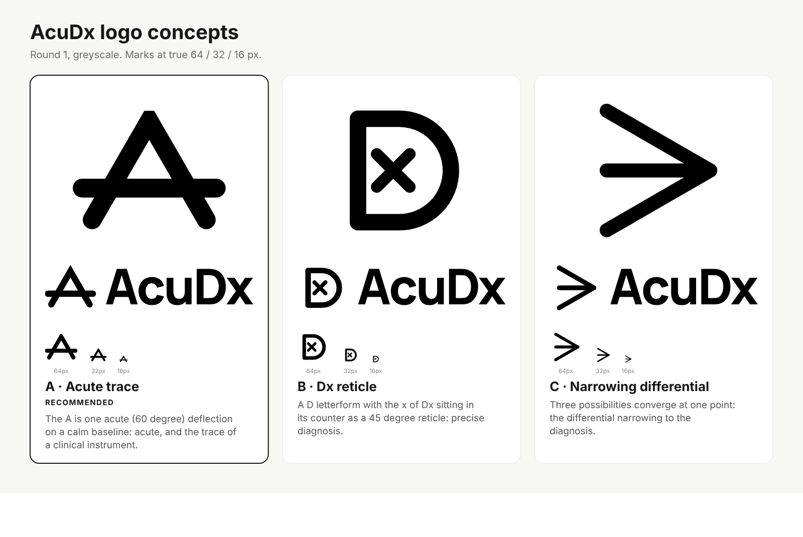

# 02: AcuDx Brand Identity

**Status:** Logo and brand-mark specification. Companion to `00-design-system.md` (tokens, type, gradient discipline) and the files in `web/public/brand/` (usage rules in `web/public/brand/README.md`). Built with the `logo-design` skill process: brief, research, concept longlist, three built concepts, tests, one chosen direction, kit.

---

## 1. Brief

| | |
|---|---|
| Name | **AcuDx** (acute + diagnosis). Spelling locked: capital A, lowercase cu, capital D, lowercase x. |
| What it is | Open-source medical-education platform: AI simulated patients inside an Epic-like EHR, voice and video interviews, interprofessional rooms, graded feedback. EN and TR. |
| Audience | Medical students and residents, educators, deans. Secondary: hospitals and open-source contributors. |
| Adjectives | precise, calm, clinical, trustworthy, modern, open |
| Must work | 16 px favicon, app icon, EHR top-nav wordmark, light and dark, one colour, embroidery or engraving |
| Constraints | No caduceus or rod of Asclepius, no red cross (Red Cross trademark), no heart-plus-ECG cliche. Must sit in the existing "Clinical Instrument" language: white base, one locked brand blue, the teal-blue-pink gradient only on the logo tile, Manrope display, Phosphor icons. |
| Existing equity | The type-only "Acu**Dx**" wordmark in the shell (Dx in brand blue). Kept. |

**Assumptions made:** the product name is final; the wordmark stays in Manrope ExtraBold because the shell already sets it that way; the gradient tile is the only place colour beyond brand blue appears.

## 2. Research

**Category cliches (off limits):** caduceus and snakes, red or green crosses, hearts with an ECG spike, stethoscopes, DNA helices, shields, blue gradient blobs, "plus" signs. The skill's reference library confirms the ECG-in-a-circle and the "letter as pulse line" are already taken several times over (codebeat, morpheus).

**Word map (intersections circled):**

- *acute*: sharp, an acute angle (less than 90 degrees), a point, urgency, acuity
- *diagnosis*: Dx, the x as the unknown, narrowing a differential to one point, the finding
- *clinical instrument*: trace, baseline, reticle, caliper, monitor, tick marks, calm line
- *calm / trustworthy*: even weight, few parts, nothing decorative
- *open*: open forms, no enclosing emblem

The strongest intersection: **a sharp point on a calm line** (acute + trace).

## 3. Concepts

Longlist (one sentence each, scored for clarity, distinction, simplicity, relevance, small-size strength):

1. **Acute trace**: an A built as one 60 degree deflection on a calm baseline. (built)
2. **Dx reticle**: a D letterform with the x of Dx in its counter as a 45 degree reticle. (built)
3. **Narrowing differential**: three lines converge at one point. (built)
4. A d whose ascender is a flatline with one spike. Dropped: pulse cliche.
5. Open ring with an acute wedge and a dot at the finding. Dropped: reads as a loading spinner.
6. A as a caliper, crossbar as the measure. Dropped: too close to 1 with more parts.
7. D as a rounded monitor tile with a trace crossing it. Dropped: tile plus trace is a generic "dashboard" icon.
8. x made of two measured tick lines. Dropped: too small an idea at 16 px.

Three were built in black, audited with `svg_audit.py` (scores 98 to 99), and tested on the round-1 sheet (`web/public/brand/concepts/test-sheet-round1.png`): size ladder to 16 px, pixel test, backgrounds, one-colour, reversed, blur, mirror, 180 degree rotation, favicon and app-icon contexts.



### A: Acute trace (letterform / abstract) **chosen**

*The A is one acute deflection on a calm baseline: acute, and the trace of a clinical instrument.*

- Names the brand twice: the letter A and the acute angle. The trace ties it to the one dark element of the design system, the vitals monitor.
- One stroke weight, five anchors. Survives 16 px (the pixel test keeps the counter open), one colour, reversed, mirrored and rotated without a new reading.
- Ownable detail: the apex is the only mitred (sharp) join in a round-capped system.
- Risk: A-shaped marks are common. The long trace through the letter and the monoline construction are what make it ours. A trademark search is still required.

### B: Dx reticle (letterform)

*A D letterform with the x of Dx sitting in its counter as a 45 degree reticle: precise diagnosis.*

- Reads "Dx" literally and holds up at 32 px.
- Risk found in testing: an x inside a container reads as "close" or "error", exactly the wrong signal on an assessment product. The x also closes up at 16 px. Not chosen.

### C: Narrowing differential (abstract)

*Three possibilities converge at one point: the differential narrowing to the diagnosis.*

- Clean, open, confident. Cheapest to animate.
- Risk found in testing: reads as the "greater than or equal" sign and as a fast-forward glyph. Says nothing specific to AcuDx. Not chosen.

**Decision:** A. It is the only concept that is specific to the name, carries the instrument language already in the product, and passes every small-size and one-colour test without a compromise.

## 4. Construction (final)

Canvas 256 x 256, grid unit 4, stroke 32 (1/8 of the canvas), round caps.

```
Legs:  M31 212  L128 44  L225 212   (apex exactly 60 degrees; miter join, miter limit 4)
Trace: M14 158  H242                (crossbar height, 2/3 down the letter)
```

- Ink bounds 12 to 231 vertically (mitred apex overshoots the centreline apex by one stroke width), centre at 121.5, which is the optical centre, slightly above geometric.
- Counter: 66 units tall; 4 px at 16 px.
- **Small cut** (`acudx-mark-small.svg`, used for the favicon and at 32 px or below): stroke 40, apex (128, 52), legs to (34.5, 214) and (221.5, 214), trace at y 164 from 26 to 230. Same angle, wider counter, slightly lower trace.
- **Wordmark:** Manrope variable at wght 800, letter-spacing -0.035 em, hand kerned pairs "A c" (-0.006 em) and "D x" (-0.012 em), outlined to paths with fontTools and HarfBuzz. "Acu" in `--fg`, "Dx" in brand blue. Cap height 180 on a 256 canvas.
- **Horizontal lockup:** symbol at full 256 height, gap 52, wordmark cap height 164 with the baseline at y 204, so the trace runs through the x-height centre and the stems (31 units at that size) match the mark's stroke (32).
- **App icon:** rounded square, radius 56 (22 percent), gradient 135 degrees teal to blue to pink, white small-cut mark scaled 0.69 and nudged up 2 percent.
- **Animation (`acudx-mark.lottie.json`):** 256 composition, 60 fps, 90 frames. The trace draws left to right over frames 0 to 40, the deflection draws from the left foot over the apex to the right foot over frames 20 to 70, both on the AcuDx ease (0.16, 1, 0.3, 1). `BrandLottie.tsx` plays it with lottie-web's light SVG renderer (self-hosted, no CDN), recolours strokes to the live `--axis-clinical` token, and renders the static SVG under `prefers-reduced-motion` or if the JSON fails to load.

## 5. Colour

| Role | Light | Dark |
|---|---|---|
| Mark, "Dx" | `--brand-600` #2563eb | `--axis-clinical` #60a5fa (4.5:1 on #0b1120) |
| "Acu" | `--fg` #0f172a | `--fg` #e2e8f0 |
| Tile | teal #2dd4bf, blue #3b82f6, pink #f472b6 | same |
| One colour | #000000, #ffffff | |

Brand blue on white is 5.2:1, well above the 3:1 required for non-text graphics. Print: use the one-colour files; the blue approximates Pantone 2728 C / CMYK 85 65 0 0 (proof before print).

## 6. Test results

Final sheet: `web/public/brand/concepts/test-sheet-final.png`.

- 16 px: the A and the trace both survive; the favicon uses the small cut so the counter stays open.
- One-colour black and reversed white pass; the reversed version is not visibly heavier at 48 px, so no thinned white file was needed.
- Mirror and 180 degree rotation produce a V on a line: no unintended reading.
- Blur test: the silhouette (a peak crossed by a line) stays distinct.
- `svg_audit.py`: 99/100 mark, 98/100 small cut, 90 to 91 for the lockups (the only warnings are Manrope's own diagonal angles on A and x, which are type, not construction errors).
- Chrome headless was the only renderer available; cairosvg and librsvg were not installed. PNGs were produced with it.

## 7. Open items

1. Trademark search and reverse image search before public launch (not done; cannot be done from here).
2. A stacked lockup (symbol over wordmark) for square social avatars, if marketing wants one.
3. Expanding strokes to filled outlines in a vector editor for embroidery and vinyl masters.
4. Decide whether the landing page hero should use `BrandLottie` once on first load (the component is ready; nothing uses it yet).

## 9. Motion: the brand moment and the launch film

Owner: Motion designer. Source: `video/` (Remotion 4.0.537, pinned) and `web/src/components/landing/`.

- **Landing hero.** `HeroMark` wraps `BrandLottie` inside the `Wordmark` lockup (`mark` slot). The component is code-split (lottie-web ships as its own chunk, about 49 KB gzipped) and mounts only after the browser goes idle, so the hero headline is painted first and LCP is unaffected. Under `prefers-reduced-motion` the static inline mark is shown and the Lottie JSON is never fetched.
- **Teaser.** `LaunchTeaser` places the ten-second film as an inline `<video>` with native controls, a poster and `preload="none"`. The element mounts only when the section scrolls within 320 px of the viewport. The film is silent by design; captions are in the frame in English and Turkish. Strings live in `web/src/i18n/features/landing3.{en,tr}.json`.
- **Launch film.** 51 s, 1920 x 1080, 30 fps, no audio track. Scenes: mark draws in (the same Lottie file as the hero), promise in EN and TR, four real captures of the running app with slow pan and zoom, five feature cards, the open-source and sovereign line, end card with the repository URL. Every transition uses `cubic-bezier(0.16, 1, 0.3, 1)` and the `fade-up` entrance. Render and capture commands: `video/README.md`.
- **Poster.** `video/out/poster.png`, 1200 x 630, doubles as the teaser poster at `web/public/media/launch-poster.png`.
