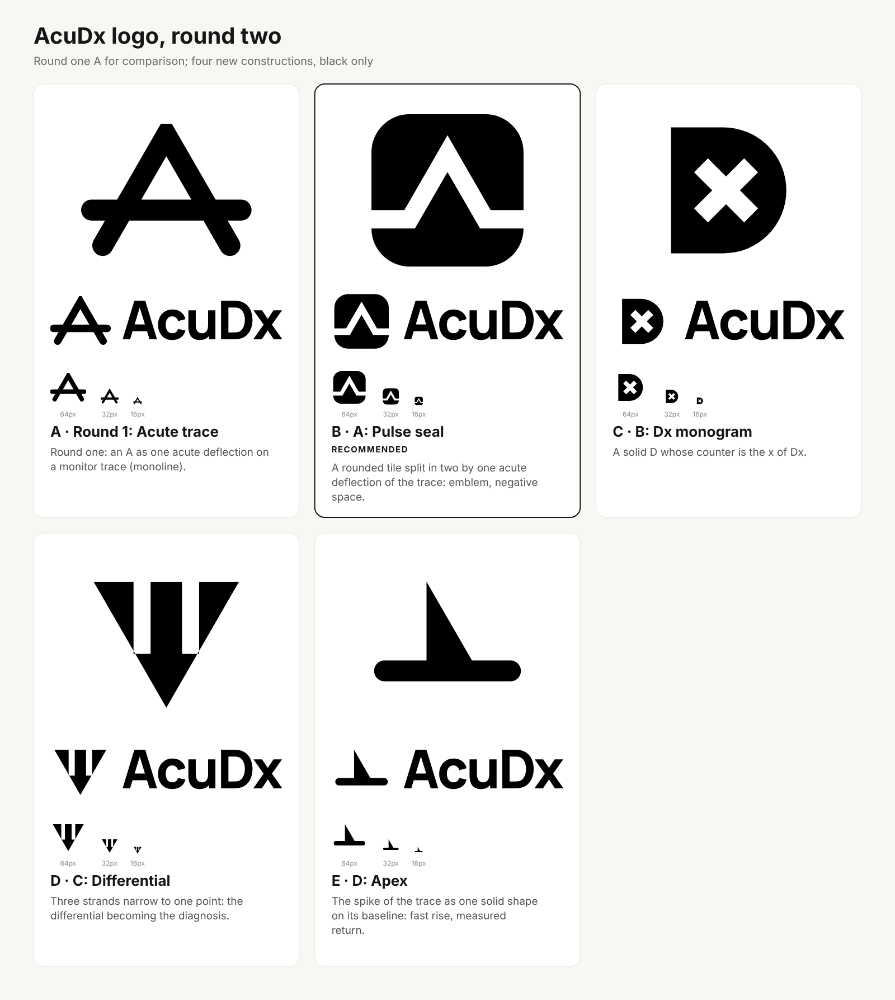

# 02: AcuDx Brand Identity

**Status:** Logo and brand-mark specification. Companion to `00-design-system.md` (tokens, type, gradient discipline) and the files in `web/public/brand/` (usage rules in `web/public/brand/README.md`). Built with the `logo-design` skill process: brief, research, concept longlist, built concepts, tests, one chosen direction, kit.

**Current mark: the pulse seal (round two, section 8).** Sections 3 to 7 are the round one record (the monoline "acute trace" A), kept for the reasoning and because round two was judged against it. The brief (1) and research (2) still apply.

---

## 1. Brief

| | |
|---|---|
| Name | **AcuDx** (acute + diagnosis). Spelling locked: capital A, lowercase cu, capital D, lowercase x. |
| What it is | Open-source medical-education platform: AI simulated patients inside an Epic-like EHR, voice and video interviews, interprofessional rooms, graded feedback. EN and TR. |
| Audience | Medical students and residents, educators, deans. Secondary: hospitals and open-source contributors. |
| Adjectives | precise, calm, clinical, trustworthy, modern, open |
| Must work | 16 px favicon, app icon, EHR top-nav wordmark, light and dark, one colour, embroidery or engraving |
| Constraints | No caduceus or rod of Asclepius, no red cross (Red Cross trademark), no heart-plus-ECG cliche. Must sit in the existing "Clinical Instrument" language: white base, one locked brand blue, the teal-blue-pink gradient only on the logo tile, Manrope display, Phosphor icons. |
| Existing equity | The type-only "Acu**Dx**" wordmark in the shell (Dx in brand blue). Kept. |

**Assumptions made:** the product name is final; the wordmark stays in Manrope ExtraBold because the shell already sets it that way; the gradient tile is the only place colour beyond brand blue appears.

## 2. Research

**Category cliches (off limits):** caduceus and snakes, red or green crosses, hearts with an ECG spike, stethoscopes, DNA helices, shields, blue gradient blobs, "plus" signs. The skill's reference library confirms the ECG-in-a-circle and the "letter as pulse line" are already taken several times over (codebeat, morpheus).

**Word map (intersections circled):**

- *acute*: sharp, an acute angle (less than 90 degrees), a point, urgency, acuity
- *diagnosis*: Dx, the x as the unknown, narrowing a differential to one point, the finding
- *clinical instrument*: trace, baseline, reticle, caliper, monitor, tick marks, calm line
- *calm / trustworthy*: even weight, few parts, nothing decorative
- *open*: open forms, no enclosing emblem

The strongest intersection: **a sharp point on a calm line** (acute + trace).

## 3. Concepts

Longlist (one sentence each, scored for clarity, distinction, simplicity, relevance, small-size strength):

1. **Acute trace**: an A built as one 60 degree deflection on a calm baseline. (built)
2. **Dx reticle**: a D letterform with the x of Dx in its counter as a 45 degree reticle. (built)
3. **Narrowing differential**: three lines converge at one point. (built)
4. A d whose ascender is a flatline with one spike. Dropped: pulse cliche.
5. Open ring with an acute wedge and a dot at the finding. Dropped: reads as a loading spinner.
6. A as a caliper, crossbar as the measure. Dropped: too close to 1 with more parts.
7. D as a rounded monitor tile with a trace crossing it. Dropped: tile plus trace is a generic "dashboard" icon.
8. x made of two measured tick lines. Dropped: too small an idea at 16 px.

Three were built in black, audited with `svg_audit.py` (scores 98 to 99), and tested on the round-1 sheet (`web/public/brand/concepts/test-sheet-round1.png`): size ladder to 16 px, pixel test, backgrounds, one-colour, reversed, blur, mirror, 180 degree rotation, favicon and app-icon contexts.


### A: Acute trace (letterform / abstract) **chosen**

*The A is one acute deflection on a calm baseline: acute, and the trace of a clinical instrument.*

- Names the brand twice: the letter A and the acute angle. The trace ties it to the one dark element of the design system, the vitals monitor.
- One stroke weight, five anchors. Survives 16 px (the pixel test keeps the counter open), one colour, reversed, mirrored and rotated without a new reading.
- Ownable detail: the apex is the only mitred (sharp) join in a round-capped system.
- Risk: A-shaped marks are common. The long trace through the letter and the monoline construction are what make it ours. A trademark search is still required.

### B: Dx reticle (letterform)

*A D letterform with the x of Dx sitting in its counter as a 45 degree reticle: precise diagnosis.*

- Reads "Dx" literally and holds up at 32 px.
- Risk found in testing: an x inside a container reads as "close" or "error", exactly the wrong signal on an assessment product. The x also closes up at 16 px. Not chosen.

### C: Narrowing differential (abstract)

*Three possibilities converge at one point: the differential narrowing to the diagnosis.*

- Clean, open, confident. Cheapest to animate.
- Risk found in testing: reads as the "greater than or equal" sign and as a fast-forward glyph. Says nothing specific to AcuDx. Not chosen.

**Decision:** A. It is the only concept that is specific to the name, carries the instrument language already in the product, and passes every small-size and one-colour test without a compromise.

## 4. Construction (round one, superseded by section 8)

Canvas 256 x 256, grid unit 4, stroke 32 (1/8 of the canvas), round caps.

```
Legs:  M31 212  L128 44  L225 212   (apex exactly 60 degrees; miter join, miter limit 4)
Trace: M14 158  H242                (crossbar height, 2/3 down the letter)
```

- Ink bounds 12 to 231 vertically (mitred apex overshoots the centreline apex by one stroke width), centre at 121.5, which is the optical centre, slightly above geometric.
- Counter: 66 units tall; 4 px at 16 px.
- **Small cut** (`acudx-mark-small.svg`, used for the favicon and at 32 px or below): stroke 40, apex (128, 52), legs to (34.5, 214) and (221.5, 214), trace at y 164 from 26 to 230. Same angle, wider counter, slightly lower trace.
- **Wordmark:** Manrope variable at wght 800, letter-spacing -0.035 em, hand kerned pairs "A c" (-0.006 em) and "D x" (-0.012 em), outlined to paths with fontTools and HarfBuzz. "Acu" in `--fg`, "Dx" in brand blue. Cap height 180 on a 256 canvas.
- **Horizontal lockup:** symbol at full 256 height, gap 52, wordmark cap height 164 with the baseline at y 204, so the trace runs through the x-height centre and the stems (31 units at that size) match the mark's stroke (32).
- **App icon:** rounded square, radius 56 (22 percent), gradient 135 degrees teal to blue to pink, white small-cut mark scaled 0.69 and nudged up 2 percent.
- **Animation (`acudx-mark.lottie.json`):** 256 composition, 60 fps, 90 frames. The trace draws left to right over frames 0 to 40, the deflection draws from the left foot over the apex to the right foot over frames 20 to 70, both on the AcuDx ease (0.16, 1, 0.3, 1). `BrandLottie.tsx` plays it with lottie-web's light SVG renderer (self-hosted, no CDN), recolours strokes to the live `--axis-clinical` token, and renders the static SVG under `prefers-reduced-motion` or if the JSON fails to load.

## 5. Colour

| Role | Light | Dark |
|---|---|---|
| Mark, "Dx" | `--brand-600` #2563eb | `--axis-clinical` #60a5fa (4.5:1 on #0b1120) |
| "Acu" | `--fg` #0f172a | `--fg` #e2e8f0 |
| Tile | teal #2dd4bf, blue #3b82f6, pink #f472b6 | same |
| One colour | #000000, #ffffff | |

Brand blue on white is 5.2:1, well above the 3:1 required for non-text graphics. Print: use the one-colour files; the blue approximates Pantone 2728 C / CMYK 85 65 0 0 (proof before print).

## 6. Test results (round one)

Final sheet: `web/public/brand/concepts/test-sheet-final.png`.

- 16 px: the A and the trace both survive; the favicon uses the small cut so the counter stays open.
- One-colour black and reversed white pass; the reversed version is not visibly heavier at 48 px, so no thinned white file was needed.
- Mirror and 180 degree rotation produce a V on a line: no unintended reading.
- Blur test: the silhouette (a peak crossed by a line) stays distinct.
- `svg_audit.py`: 99/100 mark, 98/100 small cut, 90 to 91 for the lockups (the only warnings are Manrope's own diagonal angles on A and x, which are type, not construction errors).
- Chrome headless was the only renderer available; cairosvg and librsvg were not installed. PNGs were produced with it.

## 7. Open items (round one)

1. Trademark search and reverse image search before public launch (not done; cannot be done from here).
2. A stacked lockup (symbol over wordmark) for square social avatars, if marketing wants one. Done in round two.
3. Expanding strokes to filled outlines in a vector editor for embroidery and vinyl masters. Moot in round two: the seal is filled outlines.
4. Decide whether the landing page hero should use `BrandLottie` once on first load (the component is ready; nothing uses it yet). Done: see section 9.

## 8. Round two: the pulse seal

**Why a second round.** The owner asked for a stronger, more distinctive and more premium mark than the monoline A. The round one A is honest but light: a letter on a line is a common construction (the library alone has six A letterforms and two "letter as pulse line" marks), it has no mass, and as an app icon it needed a tile under it.

### 8.1 Research

`search_library.py` was used to study 30+ real marks: the education set (23: Khan Academy, Udemy, Udacity, Coursera, Treehouse, IEEE and others), the AI and health sets (Google Fit is the only health mark in the library, so the medical category relied on category knowledge: crosses, hearts, caducei, stethoscopes, pulse-in-a-circle), the exemplary negative-space set (Kotlin, Rocky Linux, Snowpack, npm, Zendesk, CircleCI, Auth0, Doctrine), the triangle set (Vercel, Prisma, Atlassian, Unity), the pulse and wave sets (codebeat, Morpheus, Amplitude, Tailwind) and the letter A, D and x sets. Conventions worth departing from: blue is 43 percent of education marks, hexagons and containment are common, and every pulse mark in the library is a QRS-style zigzag inside a circle. What the strongest negative-space marks share: one solid, one cut, and the cut is the idea.

### 8.2 Longlist (one sentence each, none a plain A with a line)

1. **Pulse seal**: a rounded tile split in two by one acute deflection of the trace; the trace is the negative space. (built, A)
2. **Dx monogram**: a solid D whose counter is the x of Dx. (built, B)
3. **Differential**: a solid inverted triangle with two slits, three strands narrowing to one point. (built, C)
4. **Apex**: the spike of the trace as one solid shape on its baseline bar, fast rise and a 30 degree return, like an action potential. (built, D)
5. Acuity lens: two arcs forming a lens with an acute spike as the pupil. Dropped: reads as an eye, an optometry cliche.
6. Sharpened disc: a circle extended to one tangent point at the top, pierced by a horizontal slit. Dropped: an inverted map pin.
7. Pulse-in-a-disc: the seal idea on a circle. Dropped: codebeat and Morpheus already own the pulse-in-a-circle.
8. Caliper x: an x whose two bars are calipers closing on a dot. Dropped: too small an idea at 16 px, and an x reads as "close".
9. Stacked traces: two baselines, the upper one deflected, with the A implied between them. Dropped: a letter A again, and the gap closes at 16 px.
10. Wedge notch: a solid tile with a single acute triangular notch cut from the bottom edge. Dropped: reads as a speech bubble or an arrow, says nothing about a trace.

Scored for idea clarity, distinction, simplicity, relevance and small-size strength; the four built were the four highest and the four most different from each other. All four are in `docs/design/brand-src/round2_concepts.py` and `web/public/brand/concepts/round2/src/`.

### 8.3 Tests



All four were audited with `svg_audit.py` (A 100, B 100, C 99, D 99 after one fix: the first build of A offset the channel apex by h/cos 30 instead of h/sin 30, so the channel walls were 2.5 degrees off parallel; the audit caught it). The five-way sheet (`concepts/round2/test-sheet-round2.png`) put round one's A beside the four at the size ladder down to 16 px, the pixel test, light, dark, brand, photo and pattern backgrounds, one colour, reversed, 2 px blur, mirror, 180 degree rotation, favicon, app icon, avatar, header and business card contexts, and a shelf against Rocky Linux, Kotlin, Khan Academy, Amplitude, Morpheus and codebeat.

- **A, pulse seal.** Survives 16 px (the channel is 1.75 px at 16 px on the master and 2.4 px on the small cut; the pixel test keeps it open). Reversed is not heavier. Blur keeps a distinct silhouette (a block with a peak through it). Mirror is identical; 180 degrees gives a V in a tile, benign. Only concept that stands out on the shelf as a solid mass. **Chosen.**
- **B, Dx monogram.** Reads as a "delete" or "close" badge at every size, the exact risk round one found with its Dx reticle. Dropped.
- **C, differential.** Reads as a trident, a funnel or "III" in a V; rotated it is a crown. Says nothing specific. Dropped.
- **D, apex.** Alone it reads as a fin or a hat; the medical reading (an action potential) needs explaining. Dropped, though its asymmetry is worth remembering for motion.
- **Round one A** next to them: lighter, less ownable, and the only one needing a tile for the app icon.

### 8.4 Rationale

The pulse seal keeps the one idea of round one (one acute deflection on a calm trace: acute, and the instrument language of the product) and gives it mass and a container of its own. Three things make it ownable: the deflection is one clean 60 degree spike, not a QRS zigzag; the trace is negative space that splits the tile in two, so the mark is read as two solid pieces rather than a line on a badge; and the tile is a rounded square, not the circle every pulse mark uses. It is its own app icon (gradient fills the two pieces edge to edge, the channel stays white), its own favicon, and it holds as a solid on embroidery and engraving without expanding strokes. Against the brief's adjectives: precise (one angle, one channel width), calm (a flat trace on both sides), clinical (a monitor trace), trustworthy (mass, symmetry), modern (negative space, no outline), open (the channel runs out of both edges).

### 8.5 Construction (final)

Canvas 256 x 256. Tile 12 to 244 (232 units, rx 58, 25 percent). Trace centreline flat at y 172, one 60 degree spike to y 72 (half-width at the base 57.7). Channel width 28. The two pieces are explicit outlines, offset 14 either side of the centreline with a mitred apex (offset 28 along the vertical, h / sin 30):

```
upper: M12 158 H62.2 L128 44  L193.8 158 H244 V70  A58 58 0 0 0 186 12  H70 A58 58 0 0 0 12 70  Z
lower: M12 186 H78.3 L128 100 L177.7 186 H244 V186 A58 58 0 0 1 186 244 H70 A58 58 0 0 1 12 186 Z
```

- Thinnest solid: 32 units above the apex (2 px at 16 px). Bottom band 58 units.
- **Small cut** (`acudx-mark-small.svg`, favicon and anything at or below 32 px): channel 38, flat at y 176, apex at y 86.
- **Favicon:** the small cut with inset 4 and rx 60, so the tile fills the 16 px square.
- **App icon:** the small-cut geometry with inset 0 and rx 56 (22 percent), the two pieces filled with the 135 degree teal to blue to pink gradient on white. The apex of the channel sits 84 units from the centre, inside the maskable safe zone.
- **Wordmark:** unchanged from round one (Manrope wght 800, tracking -0.035 em, kerned "A c" and "D x", outlined; "Acu" in `--fg`, "Dx" in brand blue).
- **Horizontal lockup:** tile at full size, wordmark cap height 200 centred on the tile (tile = 1.16 x cap), gap 40 from the tile's right edge. The flat of the trace runs through the lower third of the letters.
- **Stacked lockup:** 512 wide; tile centred over the wordmark at cap height 120, gap 48.
- **Clear space:** one channel width (28) on all sides.
- **Animation (`acudx-mark.lottie.json`):** 256 composition, 60 fps, 84 frames (1.4 s), 3.8 KB. Each piece's outline draws along its edge with a trim path, starting at the left end of the trace so the deflection is seen first (upper frames 0 to 48, lower 8 to 56); the fills fade in and the outlines fade out over frames 30 to 66. AcuDx ease throughout. `BrandLottie.tsx` recolours fills and strokes to the live `--axis-clinical` token and re-reads it when the theme flips; `MarkScene.tsx` in the film plays the same file.
- **In React:** `AcuDxMark` in `Wordmark.tsx` carries the two master paths in `currentColor`; the shell lockup sizes the SVG to 0.92 em with a 0.12 em gap, which reproduces the 1.16 x cap and 0.2 cap spacing of the lockup file.

### 8.6 Colour

As round one (section 5): brand blue `#2563eb` on light, `#60a5fa` on dark (4.5:1 on `#0b1120`), black and white for one colour, the gradient only on the app icon. The channel is never painted; it is the ground.

### 8.7 Test results (final files)

Final sheet: `web/public/brand/concepts/round2/test-sheet-final.png` (master, small cut and horizontal lockup, with the same shelf references).

- `svg_audit.py`: 100/100 for the mark, the small cut and the reversed mark; 91 for the lockups (the only warnings are Manrope's own A and x diagonals); 98 favicon; 92 app icon (the gradient is deliberate and the one sanctioned surface).
- 16 px: the channel and the peak read on white and on dark; the favicon uses the small cut.
- One colour black and reversed white pass without a thinned file; the negative channel does the irradiation work.
- Blur, mirror and 180 degree rotation: no unintended reading.
- The Lottie was rendered frame by frame with lottie-web (frames 12, 30, 48, 83) to confirm the outline, the handoff to the fill and the final frame match the static SVG exactly.
- Renderer: the Playwright Chromium headless shell under `/opt/pw-browsers` through the skill's `render_png.py` (`docs/design/brand-src/render_kit.sh` documents the wrapper). cairosvg and librsvg were not installed.

### 8.8 Trademark risk note

Web searches (October 2026) for the construction in medical education and health found no mark that is a rounded tile split by a single acute deflection. Nearest shapes, all different enough in construction: Rocky Linux (a circle cut by a mountain chevron, no trace), Bozeman Health (three mountain peaks with an H in the negative space), and the many generic "heartbeat in a square" app icons and templates, which use a QRS zigzag line drawn in positive, not a single spike cut through a solid. Name-wise, "AccuDx" (two c's) is a San Diego surgical-instrument company; the spelling, class and audience differ, but the phonetic overlap is the one item to put in front of counsel. No clearance has been done: a professional trademark search (USPTO, EUIPO, TURKPATENT, Nice classes 9, 41 and 42) and a reverse image search of the mark are still required before public launch.

### 8.9 Reproduce the kit

```
pip install fonttools brotli uharfbuzz          # once
npm --prefix web ci                              # Manrope lives in web/node_modules
python3 docs/design/brand-src/round2_concepts.py # concept sources (optional)
sh docs/design/brand-src/render_kit.sh [path/to/logo-design/scripts]
```

`render_kit.sh` runs `build_brand.py` and `make_lottie.py`, rasterises the icons, the favicon and the OG image, and copies the files the launch film reads into `video/public/brand/`.

## 9. Motion: the brand moment and the launch film

Owner: Motion designer. Source: `video/` (Remotion 4.0.537, pinned) and `web/src/components/landing/`.

- **Landing hero.** `HeroMark` wraps `BrandLottie` inside the `Wordmark` lockup (`mark` slot). The component is code-split (lottie-web ships as its own chunk, about 49 KB gzipped) and mounts only after the browser goes idle, so the hero headline is painted first and LCP is unaffected. Under `prefers-reduced-motion` the static inline mark is shown and the Lottie JSON is never fetched.
- **Teaser.** `LaunchTeaser` places the ten-second film as an inline `<video>` with native controls, a poster and `preload="none"`. The element mounts only when the section scrolls within 320 px of the viewport. The film is silent by design; captions are in the frame in English and Turkish. Strings live in `web/src/i18n/features/landing3.{en,tr}.json`.
- **Launch film.** 51 s, 1920 x 1080, 30 fps, no audio track. Scenes: mark draws in (the same Lottie file as the hero), promise in EN and TR, four real captures of the running app with slow pan and zoom, five feature cards, the open-source and sovereign line, end card with the repository URL. Every transition uses `cubic-bezier(0.16, 1, 0.3, 1)` and the `fade-up` entrance. Render and capture commands: `video/README.md`.
- **Poster.** `video/out/poster.png`, 1200 x 630, doubles as the teaser poster at `web/public/media/launch-poster.png`.
