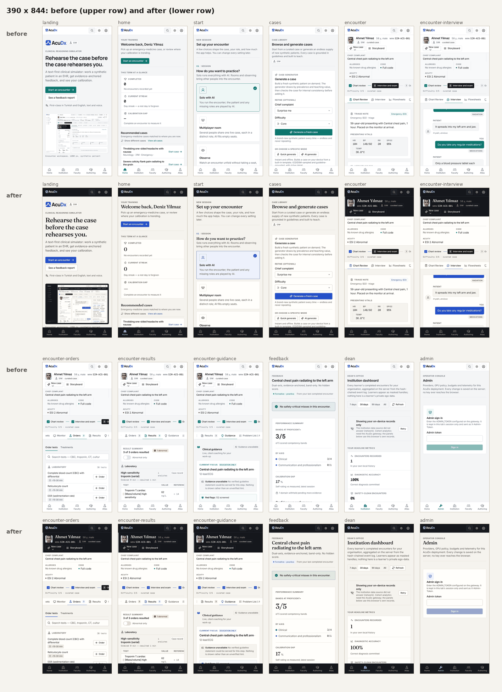

# 04 Visual renewal, October 2026: "Ward ink"

**Status:** implemented in `web/` (see the HANDOFF at the end). Supersedes the visual values of `03-ui-redesign-2026-10.md`; the structure that pass introduced (rail, top bar, chart header, storyboard, activity tabs, worklists) is kept. `00-design-system.md` mirrors the tokens.

## 1. The verdict

The owner's verdict on the v3 pass: "the design is not renewed". v3 changed density and tokens, but a learner opening the app saw the same product: a white rail, a grey canvas, Inter everywhere, a teal button, rounded white boxes. Nothing on screen said AcuDx rather than "a SaaS app". The README banner made it worse: a zoomed crop that cut text at the left edge mid-word, a fake cursor over the typed question, a caption bar over the chart and a "published case" label from the old case library.

The renewal had to be visible at a glance, at 1280 px and at 390 px, while every component API, i18n key and test id keeps working.

## 2. The language in one paragraph

**Ward ink.** A warm paper canvas (never cold grey). An ink-dark navigation rail and an ink chart header that carry the Pulse seal and the patient's name: the two places a clinician's eye anchors. One confident accent, Pulse cobalt, the brand mark's blue deepened to 6.8:1, used for the primary action, the active tab, links, the focus ring and the seal, and for nothing decorative. Page and section titles in the Fraunces display serif beside Inter for UI and Geist Mono for data, so the product reads like a clinical reference rather than a dashboard kit. Crisp 1 px rules and 2 px corners instead of soft rounded cards. Clinical colour only where it carries meaning (state, ESI, allergy, flags). Generous whitespace on reading surfaces; compact tables for data.

## 3. References pulled from Mobbin

Platform: web. AMBOSS and Epic are not on Mobbin, so the references are the closest products for each property: editorial reference reading, dark rails, record headers, premium data tools. Every screen below was opened and read; what was taken is listed per screen.

| # | Product and screen | mobbin_url | Taken |
|---|---|---|---|
| 1 | The New York Times, article body | https://mobbin.com/screens/63c96c48-ac9d-4b8e-ac26-fc1404b069f1 | A serif reading voice on an off-white ground, a narrow measure, plain rules between blocks. The reason titles are now serif and reading panels keep a 68 character measure. |
| 2 | Mintlify, components reference | https://mobbin.com/screens/731c0653-266e-4c03-aae6-df4d07631ebd | Reference page rhythm: large H1, lede, H2 with generous space above, callouts as quiet tinted blocks, a left nav that stays out of the way. Model for PageHeader spacing and the guidance reading layout. |
| 3 | Microsoft Copilot, answer page | https://mobbin.com/screens/be6a4099-feb1-4fc9-b03d-77789469f92e | A warm off-white canvas with a slim icon rail; content as headings and bullets, not boxes. Confirmed the paper ramp (#f5f3ee canvas, #fffefb sheet). |
| 4 | Perplexity Health, overview | https://mobbin.com/screens/36a49c7d-3c3e-44ff-a3a3-139e6f8aacbc | A health product on warm paper with hairline side panels and a medical disclaimer line in the panel. Confirmed warm paper reads as calm and clinical, not as "beige". |
| 5 | hilos, workspace home | https://mobbin.com/screens/df005e64-1fa3-4882-a2a5-43852b1da768 | A serif "Welcome back" display title over a dark sidebar. The model for the serif page title on Home and the serif KPI figures. Its colourful tiles were not taken. |
| 6 | Snowflake, home | https://mobbin.com/screens/58e04551-6df9-42be-9d07-c585c91e5734 | A slim ink rail with icon rows, a compact table with 1 px row rules and sortable headers. Model for the ink rail and the dense case tables. |
| 7 | Plain, reporting | https://mobbin.com/screens/e892500e-f820-4e3e-af83-973bf50ed22e | An ink rail with a lighter active row; charts on hairline grids with small titles and one large figure. Model for the active rail row (lighter ink plus a leading bar) and for chart cards. |
| 8 | Sweatpals, team payout report | https://mobbin.com/screens/89b0b7b2-0e5b-4c8c-ac28-9b96fa789f8f | A grouped dark sidebar beside a flat table with an underline tab row. Confirmed the underline activity tabs sit well next to an ink rail. |
| 9 | Mintlify, analytics | https://mobbin.com/screens/03b084b9-d5ed-41be-a9ca-43445af854f2 | A KPI strip of hairline cells with a label and a large value, over a chart card. Model for the Stat cells (eyebrow label, large serif figure). |
| 10 | Supabase, integration record | https://mobbin.com/screens/562ef6ef-a931-43d0-a81e-630b7ee52067 | A record header: icon tile, title, one-line description, key and value facts, then an underline tab row. Model for the chart header's two bands (identity, facts). |
| 11 | Plain, company record | https://mobbin.com/screens/a6bf013d-a947-4269-9f63-42c9ffa052b9 | Record title with a back link, tab strip, a right details rail of label and value rows. Confirmed the storyboard as a flat column with 1 px rows rather than a dark card. |
| 12 | Delphi, knowledge table | https://mobbin.com/screens/c723dce0-43df-4dcb-96c4-5722c679fdd2 | Rows divided by 1 px rules only, filter chips, one dark primary action. Model for "rules instead of cards" on lists. |
| 13 | Gumloop, run detail drawer | https://mobbin.com/screens/bf54bbb1-692f-4dfd-91d4-536284b7990f | Key and value header block over underline tabs, sections as titled blocks with rules. Model for the vertical console tabs with a leading accent bar. |

Not taken on purpose: the colourful tiles of hilos, the gradient covers of Dropbox Dash, and full dark mode as the default (the ink is reserved for the rail and the chart header so it stays a signal).

## 4. What changed

### 4.1 Tokens (`web/src/index.css`)

| Group | v3 | v4 Ward ink |
|---|---|---|
| Canvas, sheet, inset | #f4f5f6, #ffffff, #eceef0 (cold grey) | #f5f3ee, #fffefb, #ece8e0 (warm paper) |
| Text | #15181d, #596270, #626975 | #1a1916, #57534b, #5f5a51 (warm ink; 17, 7.6, 6.8 to 1 on the sheet) |
| Rules | #e2e4e8, #cbd0d6 | #e2ddd3, #c9c1b3 |
| Accent | teal #0f766e | Pulse cobalt #2450c8 (6.8:1 on paper, white on fill 7.1:1); dark #9db0ff with ink text on fill (`--on-brand`) |
| Ink (new) | none | `--ink` #15171c, `--ink-2/3`, `--ink-border`, `--ink-fg` #ece9e2 (14.8:1), `--ink-muted` #a6a198 (7.0:1), `--ink-accent` #9db0ff (8.6:1) |
| Clinical states | normal #04694a, caution #9a4508, warning #a83508, critical #b01b1b | normal #04694a, caution #8f3f06, warning #a23206, critical #b01b1b (each at least 4.6:1 on its own 12 percent tint over the warm inset) |
| Clinical axis, underconfident | blue #2563eb (the accent's neighbour) | petrol #1b6079, so meaning never reads as the accent |
| Radius | card 6, control 4, chip 4 | sheet 2, control 4, chip 3 |
| Type | Inter for all headings; Manrope for display | Fraunces (optical size axis) for h1, h2, `display`, `serif`, KPI figures; Inter for UI and h3/h4; Manrope only for the wordmark (`wordmark` utility) |

The **ink scope** (`.ink-scope`, `.ink-scope-until-lg`) re-points the semantic tokens at the ink ramp, so the existing Button, Badge, StatusDot, GlobalSearch, ThemeToggle and focus ring render AA on ink without a second component set or any API change. `bg-brand text-white` became `bg-brand text-on-brand` across 18 files, which also fixes white on the light accent in dark mode.

### 4.2 Shell

- **SideNav:** a 232 px ink rail in both themes, the Pulse seal lockup at 1.2 rem, 36 px rows, the active row on lighter ink with a 2 px cobalt bar on its leading edge.
- **TopNav:** paper from lg up; ink below lg, so the phone shell is ink top and bottom with the content on paper between.
- **BottomTabBar:** ink, active item in light cobalt.
- **PageHeader:** a 26 to 32 px Fraunces title, a 14 px lede, more air above the rule. The landing title is 36 to 56 px.

### 4.3 The chart header (`PatientBanner`), the signature surface

An ink identity band with a 3 px cobalt leading edge: portrait, the patient's name in Fraunces at 22 px, age and sex, MRN in mono, SIM provenance, the clock and New case on ink. Under it a paper fact band divided by 1 px rules. On a phone the facts become a two-column grid (chief complaint across both) instead of a ragged wrap; from md the band no longer wraps (the chief complaint clamps to two lines, weight shows from lg, encounter class from xl). The storyboard beside it is now a flat paper column with the name in serif (the old monitor-dark block duplicated the banner).

### 4.4 Surfaces

- **Landing:** serif headline, the product capture framed in ink, serif section titles.
- **Home, Progress, Dean:** serif page titles and serif KPI figures in hairline cells (`Stat` md and up; `sm` keeps Geist Mono for dense readouts).
- **Start, Cases, Rooms, Faculty, Admin, Atlas:** serif titles; selection and console tabs carry the cobalt leading bar; cases tables keep 1 px row rules. Changes in StartPage, CasesPage and NewCaseMenu are class names only.
- **Encounter:** banner and storyboard above; guidance and attending tips get serif panel titles and a reflowed attending tips header (the title, the education badge and the outline switch no longer squeeze into a 120 px column).
- **Charts:** the evilcharts components in `web/src/components/charts/` are reused as they are; they read `--chart-1..4`, so the dean and admin charts pick up cobalt, petrol, violet and ochre with no chart code change.
- **KeyValue:** mono values no longer break mid-identifier (MRN), the label column is 4.5 rem.

## 5. Before and after

`docs/design/renewal-shots/before/` and `after/` hold the same 12 screens at 1280 x 800 and 390 x 844 (landing, home, start, cases, encounter, interview, orders, results, guidance, feedback, dean, admin), plus progress, faculty, atlas and rooms. Both sets come from `scripts/design/capture-renewal.mjs` on the offline path (`/api/**` aborted) with one profile and one encounter driven through the UI; the before set was taken before any change (admin and faculty from a pristine export of the same commit, after the script learned to switch the local profile to the admin role). Side by side: `contact-sheet-1280.png` and `contact-sheet-390.png`.

## 6. README

- The hero is a plain, uncropped 1280 x 800 capture of the renewed encounter at 2x (no cursor, no caption bar), from a case built by the offline generator, so its provenance reads "offline generator", not a pre-generated or published label.
- The header is a lockup in a `<picture>` with explicit light and dark sources (`docs/media/readme/lockup-{light,dark}.svg`, recoloured from the brand master), an h3 tagline, a one-line description, badges, then the hero at full width. `scripts/design/readme-preview.mjs` renders the README with the GitHub markdown stylesheet in Chromium, light and dark, at 1012 and 390 px, checks the lockup, tagline, badges and hero for overlap and for horizontal overflow, and screenshots the header into `renewal-shots/readme/`.
- Every feature and panel image and the walkthrough poster were re-captured from the renewed UI (`scripts/design/capture-readme.mjs`, `readme-media.py`), whole panels only, palette-quantised, each under 350 KB. The film pipeline no longer exports the hero (`video/scripts/encode-media.sh`), and the old crop script is gone.

## 7. Accessibility notes

- Every new pairing was computed before use (warm text on the paper ramp, ink text and accent on the ink ramp, each clinical state on its own tint over the warm inset). The caution and warning hues were darkened because the warm inset is darker than the v3 grey inset.
- The ink scope keeps the focus ring visible on ink (it becomes the light cobalt).
- `npm run test:e2e` includes the axe spec; counts are in the HANDOFF.
