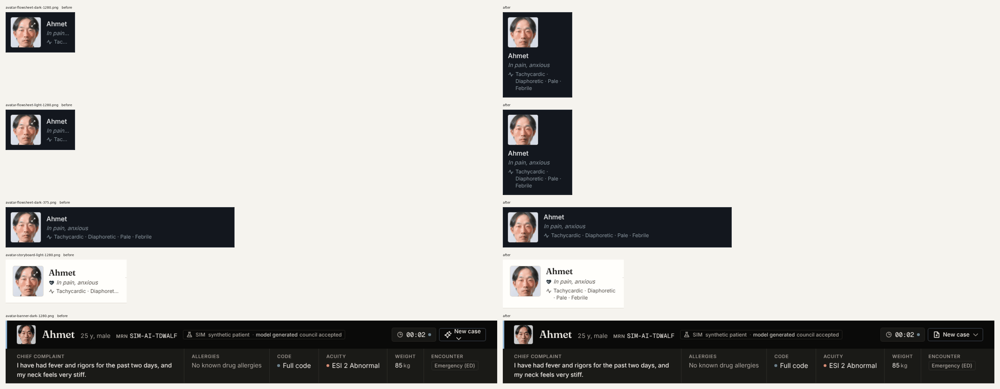
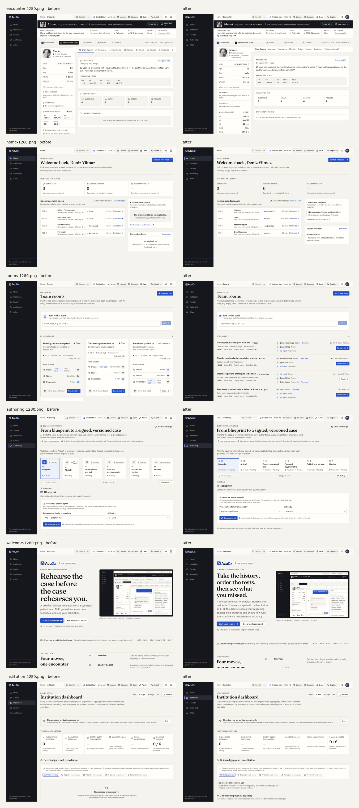
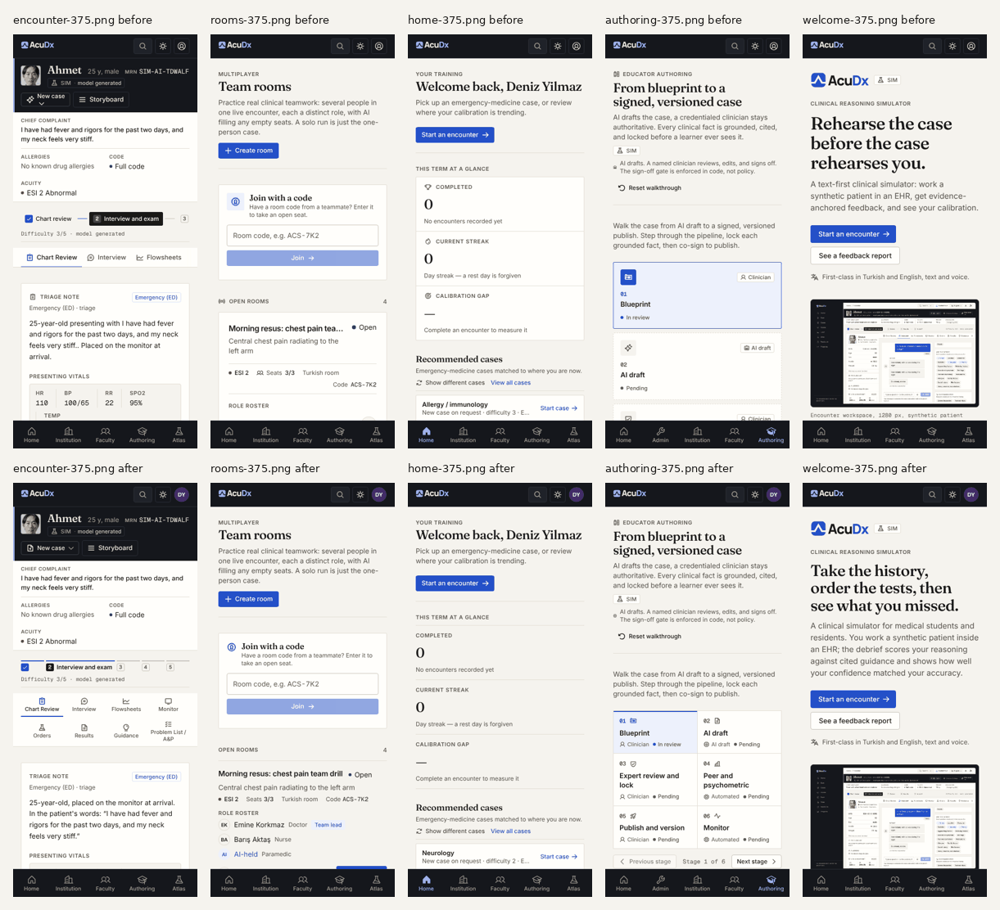

# 06 Renewal 2, October 2026: menus that fit, faces without captions, less generated

**Status:** implemented in `web/` (HANDOFF at the end). Builds on `04-visual-renewal.md` ("Ward ink"): the paper canvas, ink rail, ink chart header, Fraunces titles and Pulse cobalt all stay. This pass removes what still made the product read as generated, fixes every menu that needed a sideways scroll, and fixes the patient photo thumbnails.

## 1. What the owner reported

1. "There should be no need to horizontal scroll in menus."
2. "UI issue in the profile pictures" in the patient header area. Clarified: in the dark patient card (name, "In pain, anxious", "Tachycardic"), the 64 px square thumbnail showed the caption "Clinical signs: ... distress, Diaphoresis" on the photo, clipped, plus a stray icon.
3. "UI looks too AI generated, use some designs from Mobbin."

## 2. Audit

`scripts/design/audit-overflow.mjs` signs in through the real profile form, opens every route at 375, 768, 1024, 1280, 1440 and 1920 px and prints every element that scrolls horizontally. Before this pass:

| Surface | Widths | Finding |
|---|---|---|
| EHR chart tabs (`ActivityTabs`) | 375 to 1280 | an 857 px rail of eight tabs inside an `overflow-x-auto` strip with hidden scrollbars; at 1280 the eighth tab (Problem List / A&P) was cut to its icon |
| Encounter stage stepper (`ProgressStages`) | 375, 768, 1024 | a 612 px `ol` scrolling sideways; at 375 only the first two stages were visible |
| Authoring pipeline | 1024 | the page itself scrolled 233 px sideways (six fixed cards in a row) |
| Admin and Faculty console tabs below lg | 375, 768 | `-mx-4 overflow-x-auto` rails (not visible without the admin token, fixed in code) |
| New case button (chart header) | all | the caret wrapped onto a second line inside the button |

Nothing else (shell, top bar, rail, bottom bar, popups, tables' toolbars) overflowed at any width.

## 3. References pulled from Mobbin

Platform web. AMBOSS, Epic, UpToDate and Osmosis are not on Mobbin (searches for them returned other products), so the references are the closest products for each property. Every screen below was opened and read.

| # | Product and screen | Mobbin screen id | Taken |
|---|---|---|---|
| 1 | Heidi, patient session record | 2d97c22c-d4c0-48a6-8b4c-4a7cb8194b4b | A clinical record header: initials or photo, name, one diagnosis line, then a plain underline tab row. Signs and context are text beside the identity, never on it. Model for the thumbnail rule. |
| 2 | Clerk, user record | 79c6ffd5-1479-418e-9647-206f05da315a | Photo next to the name at a fixed size, details in a right rail of label and value rows. Confirmed the flowsheet column for the storyboard vitals. |
| 3 | QuickBooks, employee profile | d022cae0-8738-42e8-bf1b-c7b006a25390 | A round photo with a single edit badge outside the face area, not over it. Reason the expand glyph is hidden at rest on thumbnails. |
| 4 | Jira, space with views menu | 8835a262-f48c-49cf-b664-ed5aaa0c6e15 | Tabs that do not fit go into a menu instead of a scrolling rail. Considered for the chart tabs; rejected because the e2e suite and keyboard users reach every chart section as a real tab, so the strip reflows (icons, then labels only, then a 4 x 2 grid) and never hides a tab. |
| 5 | Asana, project tabs | 408774eb-3721-4758-8ae6-43add0febad9 | A dense text-only tab row with no icons once space is tight. Model for the compact chart tab layout at 1024 to 1440 px. |
| 6 | Stripe, Radar overview | d4df0ce4-30b8-4770-bfb6-eb8b553bb2e9 | Metrics as a label over a figure on the page ground, divided by rules, no tile per metric and no icon per label. Model for the Home stat strip and the Stat component. |
| 7 | Stripe, transactions | f576b06e-b290-4864-a0be-2d753324fd1d | Filter chips with square corners over a tight table; status as text with a small mark. Model for the timeline filter chips. |
| 8 | Linear, issues grouped by status | ef923b0e-9a40-4fdd-80f2-f3aafb4f36ce | Rows divided by 1 px rules, an identity mark leading each row on one vertical axis, metadata right-aligned. Model for the Rooms lobby list and its roster lines. |
| 9 | Linear, dark issue list | e142df2a-3527-499c-8f81-1b715947ac0c | Avatars at one size (about 20 px) on a fixed column so long and short names align. Model for the 24 px `RoleAvatar` size. |
| 10 | Mintlify, components reference | 731c0653-266e-4c03-aae6-df4d07631ebd | Empty and note states as plain lines with a rule, not centred icon panels. Model for the empty states on Home, Institution and the chart timeline. |
| 11 | SchoolAI, session outcomes | 1e4632b3-7192-445e-a6f4-955905044362 | Step progress as thin segments with a count beside them. Model for the stage stepper segments. |
| 12 | Xero, contact record | 6d42919c-1f78-4f9c-b61b-329c971b7059 | Record header: small initials mark, title, a one-line fact row with mono identifiers. Confirmed the chart header needs no change beyond the button fix. |

Not taken: Deel's and Whop's gradient covers, NotebookLM's coloured tiles and emoji, Perplexity's image cards.

## 4. What changed

### 4.1 Menus never scroll sideways

- **Chart tabs** (`web/src/components/ehr/ActivityTabs.tsx`). Two hidden measuring copies give the width of one row with icons and without. The strip takes the first that fits; below that it becomes a 4 x 2 grid of the same tabs (icon over label on a phone, icon beside label from sm). Every chart section stays a real `role=tab` in every layout. The scroll fades and their listeners are gone.
- **Stage stepper** (`web/src/components/ProgressStages.tsx`). Five equal segments with a 2 px rule on top (cobalt once reached), number and label. Below md only the current stage shows its label and takes the spare width; the others keep the label for assistive tech and as a tooltip.
- **Authoring pipeline** (`AuthoringPage.tsx`). Six look-alike cards with arrows became a ruled step table, 2, 3 then 6 across.
- **Console tabs** (`AdminPage.tsx`, `FacultyPage.tsx`) and the shared `TabsList` (segmented and underline) wrap instead of scrolling.
- **New case** button: the caret is the button's trailing icon, so it no longer wraps.
- **Guard:** `web/e2e/menu-overflow.spec.ts` checks every nav, tablist, menu, menubar, toolbar and listbox (and anything marked `data-menu-surface`) on 15 routes at all six widths, plus every shell popup, and fails on a surface wider than its box, a surface inside a sideways-scrolling rail, or one past the viewport edge.

### 4.2 Patient photos and avatars

- `PatientPhoto` measures its own width (ResizeObserver) instead of relying on a container query. Below 160 px it is a thumbnail (`data-patient-photo="thumbnail"`): no clinical-signs pill, no caption, no speaking label (a 2 px ring instead) and the expand glyph only on hover or keyboard focus. The pill and caption are no longer frosted (no backdrop blur). Faces are framed at 38 percent from the top so the crop keeps the eyes and mouth.
- The signs are printed beside every thumbnail and wrap instead of truncating (`SymptomSummary`): the storyboard header, the chart header and the Flowsheets monitor card. The monitor card wraps the text under the photo when its column is narrow, instead of breaking words letter by letter.
- `ProfileAvatar` moved to `components/ui` with `flex-shrink: 0` (it rendered as an oval beside long names) and muted chroma; the top bar shows the learner's initials instead of a generic person glyph.
- `RoleAvatar` gained a 24 px size and shows the letters "AI" instead of a robot glyph.
- Guards: `web/src/components/PatientPhoto.test.ts` (no overlay below 160 px) and `web/e2e/patient-photo.spec.ts` (reduced motion on, every photo under 160 px on Chart Review and Flowsheets holds no text and no visible corner glyph, and the signs are visible as text in the panel).

### 4.3 Less generated

| Tell | Where | Now |
|---|---|---|
| Sparkle, magic wand and robot icons | New case menu, Cases, Progress, Authoring, landing rail, case cards, rooms | file, shuffle, play, plant, pencil and chip glyphs; "AI" as letters |
| Glyph plus caps eyebrow on every tile and section | `Stat`, `SectionLabel`, storyboard sections | words only (props kept for API compatibility) |
| Tinted icon tiles beside titles | Join with a code, admin sign-in, overview, accreditation, fairness, sign-off, authoring, progress, rooms panels | a plain 20 px glyph aligned to the title |
| Uniform card grids | Rooms lobby (3-up cards), authoring pipeline (6 cards), chart activity counters (4 boxes) | a ruled list, a ruled step table, a hairline matrix |
| Boxed KPI tiles | Home stat strip | figures between two rules on the page ground |
| Centred dashed empty panels with a big icon | chart timeline, calibration snapshot, institution remediation | a left-aligned line with a rule |
| Violet chart series | `--chart-3` | umber (#6f4e37 light, #c9a27e dark) |
| Oversized display headline and slogan copy | Landing: "Rehearse the case before the case rehearses you." at 56 px | "Take the history, order the tests, then see what you missed." at 44 px, with a lede that says who it is for and what the debrief measures |
| Clinician sentence built from the patient's words | Triage note: "presenting with I have had fever..." | "25-year-old, placed on the monitor at arrival. In the patient's words: ..." |
| A 3-up vitals grid with two empty cells | Storyboard vitals snapshot | a flowsheet column, label left and value right |
| Rounded pill chips | timeline filters, counts | square chips (3 px) |

Kept on purpose: the Ward ink identity (paper, ink rail and header, Fraunces, cobalt), because the references above use the same restraint (one accent, rules over boxes, a serif or display face for titles). New strings live in `web/src/i18n/features/renewal2.{en,tr}.json`; the missing "Presenting vitals" key now resolves in Turkish.

## 5. Critiques and what was done with them

The brief asked for two critique subagents. This session had no subagent tool, so both critiques were run in this agent against the before and after captures, each as a fixed persona with its own checklist, and every finding was acted on or answered.

**Clinician user (emergency medicine registrar, uses Epic daily).**

1. "At 1280 the last chart tab is a lone icon; I could not find A&P." Fixed: one row without icons from 1024 to 1440, all eight labels visible.
2. "The triage note reads 'presenting with I have had fever'. No clinician writes that." Fixed: the complaint is quoted as the patient's words.
3. "Vitals in the side panel: five values in a 3-up grid, the eye zigzags." Fixed: one column, values right-aligned in mono, like a flowsheet.
4. "Signs next to the photo cut off at 'Diaphoret...'. That is the one line I need." Fixed: the sign line wraps.
5. "The rooms list: I want to see who is in each room at a glance, not open three cards." Fixed: roster lines lead with the person, then the role, on one axis.

**Design critic.**

1. "Every metric has a glyph and a caps label; every section has a glyph. That density of icons is the generated look." Fixed at the component level (`Stat`, `SectionLabel`, storyboard sections).
2. "Tinted squares with an icon next to every card title." Removed in fifteen places.
3. "Sparkles on New case and on the authoring draft step signal 'AI feature', not clinical work." Replaced.
4. "Rooms: three equal cards with equal weight, names wrapping, avatars on different x positions." Rebuilt as a ruled list with a fixed host column, so avatars align across rows.
5. "Empty states are centred dashed boxes, the most templated pattern on the page." Replaced on the surfaces in scope.
6. Answered, not changed: "Uppercase page kickers (YOUR TRAINING, DEAN'S OFFICE)". They are Epic-like section markers that clinicians scan for, and they stay at 11 px.

## 6. Before and after

`docs/design/renewal-2-shots/before/` and `after/` hold every route at 375 and 1280 px from `scripts/design/audit-overflow.mjs`, and the patient photo close-ups (chart header, storyboard identity, Flowsheets monitor card; light and dark; reduced motion) from `scripts/design/capture-avatars.mjs`. `scripts/design/contact-sheet-2.py` builds:







The before set has no storyboard close-up of its own (the capture selector picked the rail); `before/avatar-storyboard-light-1280.png` is cropped from `before/encounter-1280.png`.

## 7. Out of scope and open

- `InterviewTab`, `PatientCallTile` (patient chat and interview) and `ResultsTab`, `OrdersTab` internals belong to other agents; they pick up the shared token changes only (`Tabs`, `Stat`, `SectionLabel`, `PatientPhoto`). The call tile is above 160 px, so its overlays are unchanged.
- Em dashes remain in some existing locale strings (for example the Home streak hint); `locales/*.json` belong to the Orchestrator.
- The TrendMonitor treatment marker is still violet on the dark monitor; it is a data mark, left for the monitor owner.

## 8. HANDOFF

```
HANDOFF Designer -> Orchestrator
Goal: no menu needs a horizontal scroll at any width, patient thumbnails carry the face only, and the UI stops reading as generated, inside the Ward ink identity.
Done: web/src/components/ehr/ActivityTabs.tsx, ProgressStages.tsx, ui/Tabs.tsx, AdminPage/FacultyPage console tabs, AuthoringPage step table, NewCaseMenu (menus); PatientPhoto.tsx, PatientViewer SymptomSummary, Storyboard, FlowsheetTab, ui/ProfileAvatar.tsx, TopNav, room/RoleAvatar (photos and avatars); ui/Stat, ui/SectionLabel, ChartReviewTab, HomePage, RoomCard + RoomPage, RemediationLoop, CalibrationPlot, LandingPage + PageHeader, icon tiles in 11 files, Sparkle/Robot replacements, --chart-3 (de-AI); i18n/features/renewal2.{en,tr}.json; e2e/menu-overflow.spec.ts, e2e/patient-photo.spec.ts, src/components/PatientPhoto.test.ts, e2e/on-request.spec.ts (vitals reader follows the new dt/dd rows); scripts/design/audit-overflow.mjs, capture-avatars.mjs, contact-sheet-2.py; this doc and renewal-2-shots/.
Verified by: npm run typecheck clean; vitest 464/464; eslint 0 errors (71 warnings, was 72); audit-overflow at 375/768/1024/1280/1440/1920 in EN and TR prints nothing; full e2e (E2E_PORT=4321, load average up to 24 from other sessions) 247 passed, 31 failed, 118 skipped, then --last-failed with 2 workers 30/31 passed; the one real failure (on-request vitals reader used the old <p> markup) was fixed and passes; axe spec green on the rerun after naming the account link with sr-only text.
Open: no subagent tool in this session, so the clinician and design critiques were run in-agent (section 5). InterviewTab, PatientCallTile, ResultsTab and OrdersTab internals untouched (other owners). Em dashes in existing locales/*.json strings and the violet TrendMonitor treatment marker are left for their owners.
Next: merge this branch, then re-run `python3 scripts/design/contact-sheet-2.py` only if the captures are retaken; README hero and docs/media captures still show the pre-renewal-2 tab strip.
```
